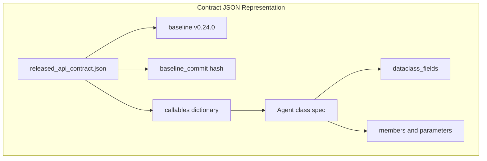
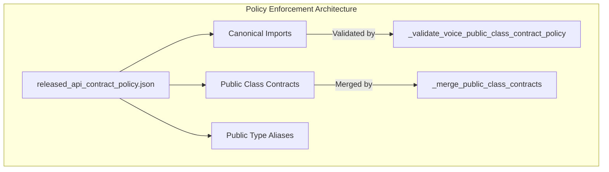
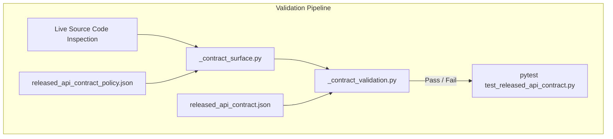
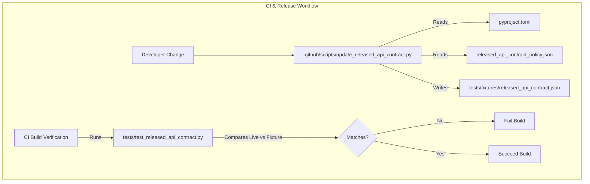

<!-- source: DeepWiki mcp.deepwiki.com · repo openai/openai-agents-python · page 17.3 Public API Contract · fetched 2026-10-26 -->

# Public API Contract

<details>
<summary>Relevant source files</summary>

The following files were used as context for generating this wiki page:

- [.github/scripts/run_examples.sh](.github/scripts/run_examples.sh)
- [.github/scripts/run_serial_tests.py](.github/scripts/run_serial_tests.py)
- [.github/scripts/update_released_api_contract.py](.github/scripts/update_released_api_contract.py)
- [.release-please-manifest.json](.release-please-manifest.json)
- [.vscode/settings.json](.vscode/settings.json)
- [CHANGELOG.md](CHANGELOG.md)
- [examples/sandbox/extensions/README.md](examples/sandbox/extensions/README.md)
- [integration_tests/_contract_support.py](integration_tests/_contract_support.py)
- [pyproject.toml](pyproject.toml)
- [src/agents/extensions/sandbox/__init__.py](src/agents/extensions/sandbox/__init__.py)
- [src/agents/version.py](src/agents/version.py)
- [tests/README.md](tests/README.md)
- [tests/fixtures/released_api_contract.json](tests/fixtures/released_api_contract.json)
- [tests/fixtures/released_api_contract_policy.json](tests/fixtures/released_api_contract_policy.json)
- [tests/test_released_api_contract.py](tests/test_released_api_contract.py)
- [tests/test_run_serial_tests.py](tests/test_run_serial_tests.py)
- [uv.lock](uv.lock)

</details>


## Overview and Scope

The OpenAI Agents SDK maintains strict backward compatibility and public interface stability across releases through an automated API contract testing and enforcement mechanism. This subsystem tracks the exact signature of public callables, class layouts, dataclass fields, parameter structures, type aliases, TypedDicts, and submodule export boundaries. 

The API contract infrastructure consists of three core components:
1. **The Released API Contract Fixture (`released_api_contract.json`)**: A versioned snapshot of the SDK's public API surface [tests/fixtures/released_api_contract.json:1-10]().
2. **The Submodule Export Policy (`released_api_contract_policy.json`)**: Declarative policy rules defining canonical imports, optional dependency bindings, and submodule export mappings [tests/fixtures/released_api_contract_policy.json:1-15]().
3. **Contract Surface & Validation Helpers**: Python modules under `integration_tests/` that inspect live module bytecode and AST structures to enforce that code modifications do not introduce breaking API changes without an explicit version update [tests/test_released_api_contract.py:23-45]().

Sources: [tests/fixtures/released_api_contract.json:1-10](), [tests/fixtures/released_api_contract_policy.json:1-15](), [tests/test_released_api_contract.py:23-45]()

---

## The Released API Contract Fixture

The released API contract is stored as a serialized JSON fixture located at `tests/fixtures/released_api_contract.json`. It serves as the immutable ground-truth baseline against which every test run validates the current source checkout.

### Structure of `released_api_contract.json`

The fixture records the baseline SDK version, the exact git commit hash at which the baseline was frozen, and detailed contracts for all public callables and classes:

```json
{
  "baseline": "v0.24.0",
  "baseline_commit": "7d7f70391ce12ac86d39deaff5d5d25b9e9c24c1",
  "callables": {
    "Agent": {
      "dataclass_fields": [
        {
          "default": { "kind": "required" },
          "init": true,
          "name": "name"
        },
        ...
      ],
      "kind": "class",
      "members": {
        "as_tool": {
          "binding": "instance",
          "execution_kind": "sync",
          "parameters": [...]
        }
      }
    }
  }
}
```

Each entry in `callables` captures:
* **Dataclass Fields**: Field names, initialization flags, and default values (classified by kind such as `required`, `literal`, or `factory`) [tests/fixtures/released_api_contract.json:6-142]().
* **Class Members**: Methods, functions, and properties, including binding type (`instance`, `class`, or `static`), execution mode (`sync` or `async`), and complete parameter signatures [tests/fixtures/released_api_contract.json:144-244]().


Sources: [tests/fixtures/released_api_contract.json:1-244]()

---

## Submodule Export Policy

To manage complex module hierarchies, optional extras (such as `voice`, `sandbox`, `litellm`), and canonical re-exports, the SDK uses a policy file: `tests/fixtures/released_api_contract_policy.json`.

### Policy Declarations

The policy file defines:
* **Canonical Imports**: Mapping between internal implementation modules and public re-exports (e.g., exposing `AudioInput` under `agents.voice` while it resides in `agents.voice.input`) [tests/fixtures/released_api_contract_policy.json:154-165]().
* **Public Class Contracts**: Explicit contracts for abstract base classes and their concrete implementations, especially within optional subsystems like the voice pipeline [integration_tests/_contract_support.py:83-136]().
* **TypedDict & Type Aliases**: Structural validation rules for complex dictionary types and type aliases exported across public boundaries [integration_tests/_contract_support.py:138-168]().


Sources: [tests/fixtures/released_api_contract_policy.json:1-219](), [integration_tests/_contract_support.py:58-136]()

---

## Contract Surface and Validation Helpers

Contract validation relies on helper modules under `integration_tests/` that inspect Python objects via `inspect`, `ast`, and metadata modules.

### Core Validation Modules

| Module Path | Primary Role |
| :--- | :--- |
| `integration_tests/_contract_surface.py` | Extracts current public surface signatures, parameter types, default values, and module exports. |
| `integration_tests/_contract_validation.py` | Compares live signatures against the baseline contract, detecting signature breaks, removed fields, or type alterations. |
| `integration_tests/_contract_support.py` | Provides merging routines (`_merge_canonical_imports`, `_merge_public_class_contracts`) and policy validation helpers [integration_tests/_contract_support.py:17-136](). |

### Merging and Validation Functions

When updating contracts or verifying pull requests, validation helpers execute structural checks:
* `_validate_parameter_contract()` verifies that positional parameter prefixes and default values maintain backward compatibility [tests/test_released_api_contract.py:87-95]().
* `_validate_voice_public_class_contract_policy()` ensures that any public voice classes correctly declare their abstract base relationships before policy promotion [integration_tests/_contract_support.py:83-136]().


Sources: [tests/test_released_api_contract.py:23-45](), [integration_tests/_contract_support.py:83-136]()

---

## Release Enforcement and CI Automation

API stability is continuously enforced during local test execution and CI workflows.

### Test Execution

Unit tests in `tests/test_released_api_contract.py` load the current installed SDK version, verify conformance with `released_api_contract.json`, and ensure exact typing and default identity preservation:

```python
def test_released_api_contract_fixture_matches_installed_version() -> None:
    contract = load_api_contract(CONTRACT)
    assert contract["baseline"] == f"v{version('openai-agents')}"
    assert len(contract["baseline_commit"]) == 40
```
*(Source: [tests/test_released_api_contract.py:150-154]())*

### Updating the Contract

When breaking changes or intentional public API expansions occur as part of a feature release, maintainers update the contract fixture using the helper script `.github/scripts/update_released_api_contract.py`:

```bash
python .github/scripts/update_released_api_contract.py --version 0.24.0
```

This script performs the following operations:
1. Verifies that the supplied version matches `pyproject.toml` [.github/scripts/update_released_api_contract.py:77-81]().
2. Invokes `build_released_api_contract()` using the current checkout state and policy file [.github/scripts/update_released_api_contract.py:93-99]().
3. Serializes the updated JSON structure back to `released_api_contract.json` [.github/scripts/update_released_api_contract.py:123]().
4. Reports added and removed top-level exports to guide maintainer reviews [.github/scripts/update_released_api_contract.py:125-131]().


Sources: [pyproject.toml:3](), [.github/scripts/update_released_api_contract.py:66-133](), [tests/test_released_api_contract.py:150-154]()

---

