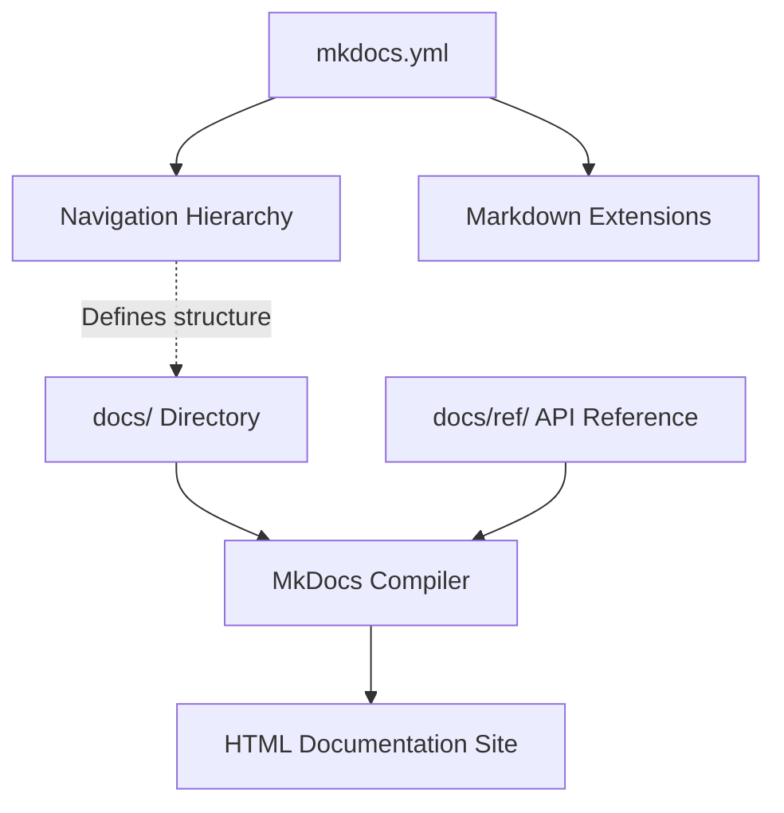
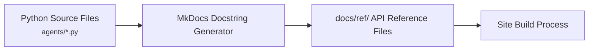
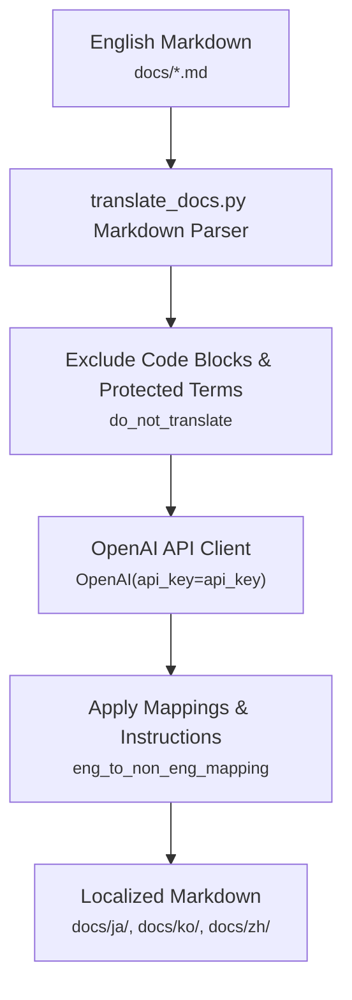
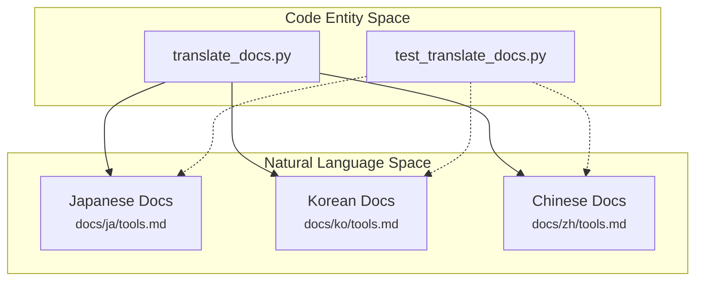
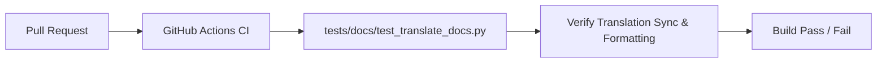

<!-- source: DeepWiki mcp.deepwiki.com · repo openai/openai-agents-python · page 17.4 Documentation and Translations · fetched 2026-10-26 -->

# Documentation and Translations

Relevant source files

The following files were used as context for generating this wiki page:

- [CONTRIBUTING.md](CONTRIBUTING.md)
- [SECURITY.md](SECURITY.md)
- [docs/ja/agents.md](docs/ja/agents.md)
- [docs/ja/config.md](docs/ja/config.md)
- [docs/ja/context.md](docs/ja/context.md)
- [docs/ja/guardrails.md](docs/ja/guardrails.md)
- [docs/ja/handoffs.md](docs/ja/handoffs.md)
- [docs/ja/mcp.md](docs/ja/mcp.md)
- [docs/ja/quickstart.md](docs/ja/quickstart.md)
- [docs/ja/results.md](docs/ja/results.md)
- [docs/ja/sandbox/clients.md](docs/ja/sandbox/clients.md)
- [docs/ja/sandbox/guide.md](docs/ja/sandbox/guide.md)
- [docs/ja/sandbox/memory.md](docs/ja/sandbox/memory.md)
- [docs/ja/sandbox_agents.md](docs/ja/sandbox_agents.md)
- [docs/ja/streaming.md](docs/ja/streaming.md)
- [docs/ja/tools.md](docs/ja/tools.md)
- [docs/ja/visualization.md](docs/ja/visualization.md)
- [docs/ja/voice/quickstart.md](docs/ja/voice/quickstart.md)
- [docs/ko/agents.md](docs/ko/agents.md)
- [docs/ko/guardrails.md](docs/ko/guardrails.md)
- [docs/ko/mcp.md](docs/ko/mcp.md)
- [docs/ko/sandbox/clients.md](docs/ko/sandbox/clients.md)
- [docs/ko/sandbox/guide.md](docs/ko/sandbox/guide.md)
- [docs/ko/sandbox/memory.md](docs/ko/sandbox/memory.md)
- [docs/ko/sandbox_agents.md](docs/ko/sandbox_agents.md)
- [docs/ko/tools.md](docs/ko/tools.md)
- [docs/ko/voice/quickstart.md](docs/ko/voice/quickstart.md)
- [docs/sandbox/clients.md](docs/sandbox/clients.md)
- [docs/sandbox/guide.md](docs/sandbox/guide.md)
- [docs/sandbox/memory.md](docs/sandbox/memory.md)
- [docs/sandbox_agents.md](docs/sandbox_agents.md)
- [docs/scripts/translate_docs.py](docs/scripts/translate_docs.py)
- [docs/zh/agents.md](docs/zh/agents.md)
- [docs/zh/guardrails.md](docs/zh/guardrails.md)
- [docs/zh/mcp.md](docs/zh/mcp.md)
- [docs/zh/sandbox/clients.md](docs/zh/sandbox/clients.md)
- [docs/zh/sandbox/guide.md](docs/zh/sandbox/guide.md)
- [docs/zh/sandbox/memory.md](docs/zh/sandbox/memory.md)
- [docs/zh/sandbox_agents.md](docs/zh/sandbox_agents.md)
- [docs/zh/tools.md](docs/zh/tools.md)
- [docs/zh/voice/quickstart.md](docs/zh/voice/quickstart.md)
- [tests/docs/test_translate_docs.py](tests/docs/test_translate_docs.py)

## Purpose and Scope

This page documents the site architecture, API reference generation, automated localization pipeline, and synchronization practices for the `openai-agents-python` documentation system. The documentation stack relies on MkDocs for site compilation, automated code-to-markdown API generation in `docs/ref`, and an LLM-driven translation script (`docs/scripts/translate_docs.py`) that maintains localized documentation sets in Japanese (`ja`), Korean (`ko`), and Chinese (`zh`).

---

## MkDocs Site Structure and Configuration

The documentation site is configured via `mkdocs.yml` at the repository root, defining the navigation hierarchy, theme settings, markdown extensions, and plugin integrations. The source files reside in the `docs/` directory, while generated API references occupy `docs/ref/`.

Sources: [docs/scripts/translate_docs.py:34-42]()

---

## API Reference Generation (`docs/ref`)

API references under `docs/ref/` are automatically generated from Python docstrings and module signatures using MkDocs docstring plugins. These pages expose public SDK symbols, such as `Agent`, `Runner`, `RunConfig`, `Tool`, and exception classes, ensuring that the documentation stays aligned with code definitions.

Sources: [docs/scripts/translate_docs.py:34-36]()

---

## Translation Pipeline Architecture (`translate_docs.py`)

The translation script `docs/scripts/translate_docs.py` automates the generation and updating of localized documentation files for Japanese (`ja`), Korean (`ko`), and Chinese (`zh`). It parses source Markdown files, isolates translatable content, manages code snippet protection, and queries the OpenAI API using models such as `gpt-5.6-sol` [docs/scripts/translate_docs.py:21]().

### Core Translation Data Structures

The translation process is governed by configuration dictionaries defined in `docs/scripts/translate_docs.py`:

* `do_not_translate`: A list of protected terms (e.g., `"OpenAI"`, `"Agents SDK"`, `"MCP"`, `"structured outputs"`, `"Chat Completions"`) that must remain in English across all localized versions [docs/scripts/translate_docs.py:49-69]().
* `eng_to_non_eng_mapping`: Language-specific dictionaries mapping core SDK terminology to localized equivalents (e.g., `"agents"` to `"エージェント"` in Japanese, `"에이전트"` in Korean, and `"智能体"` in Chinese) [docs/scripts/translate_docs.py:71-155]().
* `eng_to_non_eng_instructions`: Prompt instructions enforcing tone, politeness, formatting preservation, and technical accuracy per language [docs/scripts/translate_docs.py:156-182]().

Sources: [docs/scripts/translate_docs.py:1-182]()

---

## Localized Documentation Sets (`ja`, `ko`, `zh`)

Localized documentation is structured as parallel directory trees under `docs/ja/`, `docs/ko/`, and `docs/zh/`. Each localized directory mirrors the English source structure, containing translated equivalents for core guides such as `tools.md`, `agents.md`, `mcp.md`, `config.md`, `handoffs.md`, `guardrails.md`, `results.md`, and `streaming.md`.

Sources: [docs/ja/tools.md:1-15](), [docs/ko/tools.md:1-15](), [docs/zh/tools.md:1-15](), [tests/docs/test_translate_docs.py:1-1]()

---

## Documentation Synchronization and Testing

To prevent drift between English source documentation and localized editions, the repository includes validation tests (e.g., `tests/docs/test_translate_docs.py`). CI/CD workflows enforce documentation freshness, verifying that translations correctly reflect structural changes, updated code snippets, and modified parameter descriptions in the primary markdown files.

Sources: [tests/docs/test_translate_docs.py:1-1]()

---

