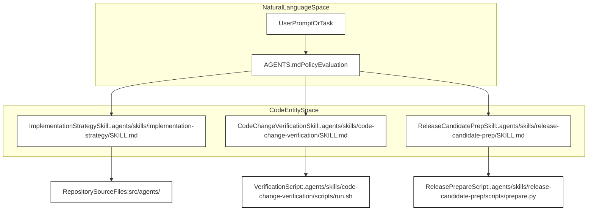
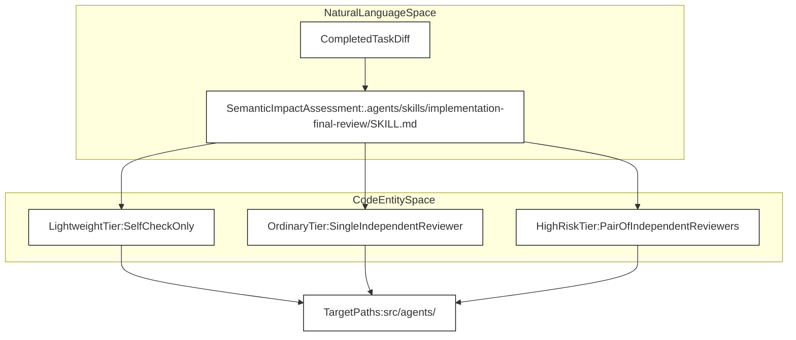
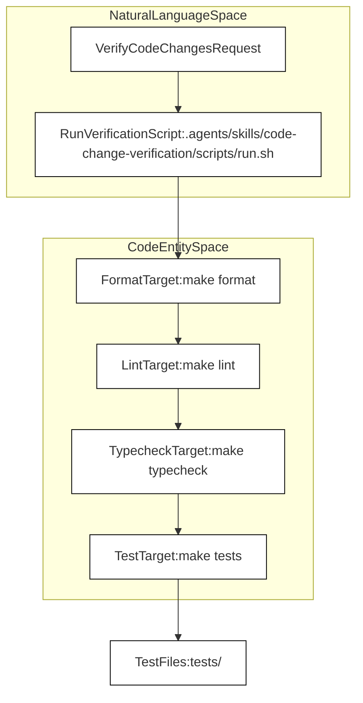

<!-- source: DeepWiki mcp.deepwiki.com · repo openai/openai-agents-python · page 17.5 Agent Skills and Maintainer Workflows · fetched 2026-10-26 -->

# Agent Skills and Maintainer Workflows

Relevant source files

The following files were used as context for generating this wiki page:

- [.agents/skills/code-change-verification/SKILL.md](.agents/skills/code-change-verification/SKILL.md)
- [.agents/skills/code-change-verification/agents/openai.yaml](.agents/skills/code-change-verification/agents/openai.yaml)
- [.agents/skills/code-change-verification/scripts/run.ps1](.agents/skills/code-change-verification/scripts/run.ps1)
- [.agents/skills/code-change-verification/scripts/run.sh](.agents/skills/code-change-verification/scripts/run.sh)
- [.agents/skills/docs-sync/SKILL.md](.agents/skills/docs-sync/SKILL.md)
- [.agents/skills/docs-sync/references/doc-coverage-checklist.md](.agents/skills/docs-sync/references/doc-coverage-checklist.md)
- [.agents/skills/final-release-review/SKILL.md](.agents/skills/final-release-review/SKILL.md)
- [.agents/skills/final-release-review/references/review-checklist.md](.agents/skills/final-release-review/references/review-checklist.md)
- [.agents/skills/final-release-review/scripts/find_latest_release_tag.sh](.agents/skills/final-release-review/scripts/find_latest_release_tag.sh)
- [.agents/skills/implementation-final-review/SKILL.md](.agents/skills/implementation-final-review/SKILL.md)
- [.agents/skills/implementation-final-review/agents/openai.yaml](.agents/skills/implementation-final-review/agents/openai.yaml)
- [.agents/skills/implementation-final-review/references/reviewer-brief.md](.agents/skills/implementation-final-review/references/reviewer-brief.md)
- [.agents/skills/implementation-final-review/scripts/review_protocol.py](.agents/skills/implementation-final-review/scripts/review_protocol.py)
- [.agents/skills/implementation-final-review/scripts/review_state.py](.agents/skills/implementation-final-review/scripts/review_state.py)
- [.agents/skills/implementation-final-review/scripts/test_review_protocol.py](.agents/skills/implementation-final-review/scripts/test_review_protocol.py)
- [.agents/skills/implementation-final-review/scripts/test_review_state.py](.agents/skills/implementation-final-review/scripts/test_review_state.py)
- [.agents/skills/implementation-kickoff/SKILL.md](.agents/skills/implementation-kickoff/SKILL.md)
- [.agents/skills/implementation-kickoff/agents/openai.yaml](.agents/skills/implementation-kickoff/agents/openai.yaml)
- [.agents/skills/implementation-kickoff/scripts/test_validate_handoff.py](.agents/skills/implementation-kickoff/scripts/test_validate_handoff.py)
- [.agents/skills/implementation-kickoff/scripts/validate_handoff.py](.agents/skills/implementation-kickoff/scripts/validate_handoff.py)
- [.agents/skills/implementation-strategy/SKILL.md](.agents/skills/implementation-strategy/SKILL.md)
- [.agents/skills/maintainer-review/SKILL.md](.agents/skills/maintainer-review/SKILL.md)
- [.agents/skills/maintainer-review/agents/openai.yaml](.agents/skills/maintainer-review/agents/openai.yaml)
- [.agents/skills/maintainer-review/references/evaluation-framework.md](.agents/skills/maintainer-review/references/evaluation-framework.md)
- [.agents/skills/openai-knowledge/SKILL.md](.agents/skills/openai-knowledge/SKILL.md)
- [.agents/skills/pr-draft-summary/SKILL.md](.agents/skills/pr-draft-summary/SKILL.md)
- [.agents/skills/release-candidate-prep/SKILL.md](.agents/skills/release-candidate-prep/SKILL.md)
- [.agents/skills/release-candidate-prep/scripts/prepare.py](.agents/skills/release-candidate-prep/scripts/prepare.py)
- [.agents/skills/release-candidate-prep/scripts/test_prepare.py](.agents/skills/release-candidate-prep/scripts/test_prepare.py)
- [.agents/skills/runtime-behavior-probe/SKILL.md](.agents/skills/runtime-behavior-probe/SKILL.md)
- [.agents/skills/runtime-behavior-probe/agents/openai.yaml](.agents/skills/runtime-behavior-probe/agents/openai.yaml)
- [.agents/skills/test-coverage-improver/SKILL.md](.agents/skills/test-coverage-improver/SKILL.md)
- [.github/PULL_REQUEST_TEMPLATE/pull_request_template.md](.github/PULL_REQUEST_TEMPLATE/pull_request_template.md)
- [AGENTS.md](AGENTS.md)
- [tests/sandbox/_filesystem_test_session.py](tests/sandbox/_filesystem_test_session.py)
- [tests/sandbox/integration_tests/_helpers.py](tests/sandbox/integration_tests/_helpers.py)
- [tests/sandbox/integration_tests/test_runner_pause_resume.py](tests/sandbox/integration_tests/test_runner_pause_resume.py)
- [tests/test_code_change_verification_runner.py](tests/test_code_change_verification_runner.py)

## Purpose and Scope

This page details the repository conventions defined in `AGENTS.md` and the automated/maintainer agent skills stored under `.agents/skills/` within the `openai-agents-python` repository. These conventions and skills govern how AI agents and human maintainers plan changes, perform maintainer reviews, establish implementation strategies, execute final reviews, verify code changes, and prepare release candidates.

---

## 1. Repository Conventions and AGENTS.md Architecture

The `AGENTS.md` file serves as the primary operational directive for AI contributors working within the codebase [AGENTS.md:1-10](). It mandates specific policies around security checklists, trust boundaries, dependency management, CI permissions, and mandatory skill usage [AGENTS.md:12-35]().

Contributor workflows rely on strict separation between natural language intent and execution mechanics. When specific operational conditions are met, agents are authorized to invoke skills under `.agents/skills/` without manual prompts [AGENTS.md:25-28]().

*Title: AGENTS.md Policy Routing to Code Entity Execution*

Sources: `AGENTS.md:1-39`

---

## 2. Maintainer Review and Issue Assessment

The `maintainer-review` skill evaluates GitHub issues and pull requests for demonstrated need, supported alternatives, correctness, and maintainer action [[:file: .agents/skills/maintainer-review/SKILL.md:1-25]()]. It is designed as a desk-review-only workflow [[:file: .agents/skills/maintainer-review/SKILL.md:1-4]()].

Reviewers must separate claim validity, downstream consequences, need status, and issue disposition [.agents/skills/maintainer-review/references/evaluation-framework.md:21-40](). Need statuses are classified into four mutually exclusive tiers [.agents/skills/maintainer-review/SKILL.md:47-53]():
- **Demonstrated**: Supported scenario, real-path reproduction, or broad invariant with consequence.
- **Plausible but unproven**: Possible code path without established realistic reach or frequency.
- **Already covered**: Satisfied by existing supported workflows.
- **Unsupported**: Outside the SDK contract or belonging to provider/caller layers.

Sources: [.agents/skills/maintainer-review/SKILL.md:1-75](), [.agents/skills/maintainer-review/references/evaluation-framework.md:21-83]()

---

## 3. Implementation Strategy and Scope Contracts

The `implementation-strategy` skill governs compatibility boundaries and design scope before modifying SDK runtime behavior, public APIs, configuration, persisted schemas, or wire protocols [[:file: .agents/skills/implementation-strategy/SKILL.md:1-10]()]. 

Before coding, contributors must record an implementation scope contract containing four core items [[:file: .agents/skills/implementation-strategy/SKILL.md:23-31]()]:
1. **Required behavior**: The smallest user-visible scenario that must function.
2. **Compatibility requirements**: Supported released behavior or durable boundaries.
3. **Intentionally unsupported cases**: Nearby inputs to reject and how rejection occurs.
4. **Supported alternative**: Existing wrappers or overrides (or `none`).

When successive feedback loops require complex resolution wrappers or type-erasure acrobatics, the skill mandates a **complexity reset** to prevent code bloat and architectural drift [[:file: .agents/skills/implementation-strategy/SKILL.md:74-84]()].

Sources: [.agents/skills/implementation-strategy/SKILL.md:1-84]()

---

## 4. Implementation Final Review Tiers

The `implementation-final-review` skill categorizes completed implementations into three review tiers based on semantic impact rather than line counts [[:file: .agents/skills/implementation-final-review/SKILL.md:1-20]()]:

*Title: Review Tier Selection Mapping to Code Entity Verification*

- **Lightweight**: Spelling, comments, formatting. Independent review optional [[:file: .agents/skills/implementation-final-review/SKILL.md:14-16]()].
- **Ordinary**: Local behavior changes within established contracts. One independent reviewer in a fresh context [[:file: .agents/skills/implementation-final-review/SKILL.md:17-18]()].
- **High Risk**: Changes to security, credentials, persistence/resume, durable state, concurrency, cancellation, released compatibility, or cross-provider lifecycle. Two independent reviewers required [[:file: .agents/skills/implementation-final-review/SKILL.md:18-19]()].

Sources: [.agents/skills/implementation-final-review/SKILL.md:1-49]()

---

## 5. Code Change Verification Pipeline

The `code-change-verification` skill executes the required formatting, linting, type-checking, and test suite after changes pass review [[:file: .agents/skills/code-change-verification/SKILL.md:1-10]()]. 

The verification runner scripts (`.agents/skills/code-change-verification/scripts/run.sh` and `run.ps1`) enforce execution ordering through `make` targets [[:file: .agents/skills/code-change-verification/SKILL.md:18-20]()]:
1. `make format`
2. `make lint`
3. `make typecheck`
4. `make tests`

*Title: Verification Script Execution Flow*

Sources: [.agents/skills/code-change-verification/SKILL.md:1-37]()

---

## 6. Release Preparation and Review Workflows

Release candidate preparation is handled via `.agents/skills/release-candidate-prep/SKILL.md` (manual fallback) and `.agents/skills/final-release-review/SKILL.md` (audit gate) [[:file: .agents/skills/release-candidate-prep/SKILL.md:1-12](), [file: .agents/skills/final-release-review/SKILL.md:1-15]()].

Key release-owned files managed during release preparation:
- `pyproject.toml` [[:file: AGENTS.md:34]()]
- `uv.lock` [[:file: AGENTS.md:34]()]
- `.release-please-manifest.json` [[:file: AGENTS.md:34]()]
- `src/agents/version.py` [[:file: AGENTS.md:34]()]
- `tests/fixtures/released_api_contract.json` [[:file: AGENTS.md:34]()]

The `release-candidate-prep` skill creates an isolated worktree via `prepare.py`, runs synchronization (`make sync`), checks prospective packaged contracts (`make check-prospective-released-api-contract`), and executes the final release review in pre-release planning mode [[:file: .agents/skills/release-candidate-prep/SKILL.md:35-70]()].

Sources: [AGENTS.md:34](), [.agents/skills/release-candidate-prep/SKILL.md:1-71](), [.agents/skills/final-release-review/SKILL.md:1-64]()

---

