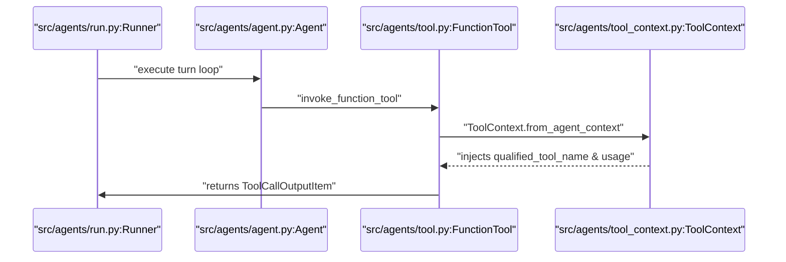

<!-- source: DeepWiki mcp.deepwiki.com · repo openai/openai-agents-python · page 2 Getting Started · fetched 2026-10-26 -->

# Getting Started

<details>
<summary>Relevant source files</summary>

The following files were used as context for generating this wiki page:

- [.release-please-manifest.json](.release-please-manifest.json)
- [.vscode/settings.json](.vscode/settings.json)
- [CHANGELOG.md](CHANGELOG.md)
- [README.md](README.md)
- [docs/config.md](docs/config.md)
- [docs/examples.md](docs/examples.md)
- [docs/guardrails.md](docs/guardrails.md)
- [docs/human_in_the_loop.md](docs/human_in_the_loop.md)
- [docs/index.md](docs/index.md)
- [docs/mcp.md](docs/mcp.md)
- [docs/models/index.md](docs/models/index.md)
- [docs/realtime/guide.md](docs/realtime/guide.md)
- [docs/realtime/quickstart.md](docs/realtime/quickstart.md)
- [docs/ref/sandbox/util/blocking_io.md](docs/ref/sandbox/util/blocking_io.md)
- [docs/release.md](docs/release.md)
- [docs/results.md](docs/results.md)
- [docs/running_agents.md](docs/running_agents.md)
- [docs/sessions/index.md](docs/sessions/index.md)
- [docs/streaming.md](docs/streaming.md)
- [docs/tools.md](docs/tools.md)
- [docs/tracing.md](docs/tracing.md)
- [mkdocs.yml](mkdocs.yml)
- [pyproject.toml](pyproject.toml)
- [src/agents/version.py](src/agents/version.py)
- [tests/fixtures/released_api_contract.json](tests/fixtures/released_api_contract.json)
- [uv.lock](uv.lock)

</details>


This guide provides step-by-step instructions for installing the OpenAI Agents SDK and running your first agent. It covers environment setup, basic agent creation, function tools, and initial configuration. For detailed information about agent configuration and behavior, see [Agent Architecture](#3.1). For comprehensive execution options and configuration, see [Runner and Execution Flow](#3.2).

Sources: `pyproject.toml:1-100](), `README.md:25-50]()

## Installation

The SDK requires Python 3.10 or newer [pyproject.toml:6-6](). It depends on core runtime libraries including `openai`, `pydantic`, `griffelib`, `websockets`, and `mcp` [pyproject.toml:9-16]().

### Installing with venv

```bash
python -m venv .venv
source .venv/bin/activate  # On Windows: .venv\Scripts\activate
pip install openai-agents
```

For optional features, install the appropriate feature groups [pyproject.toml:42-92]():

| Feature Group | Dependencies | Use Case |
| :--- | :--- | :--- |
| `voice` | `numpy`, `websockets` | Audio processing and Realtime voice [pyproject.toml:44-44]() |
| `litellm` | `litellm`, `aiohttp`, `filelock` | Support for 100+ non-OpenAI LLM providers [pyproject.toml:46-46]() |
| `any-llm` | `any-llm-sdk`, `pygments` | Multi-provider support via AnyLLM [pyproject.toml:47-50]() |
| `realtime` | `websockets` | Low-latency WebSocket-based agents [pyproject.toml:51-51]() |
| `sqlalchemy`| `SQLAlchemy[asyncio]`, `asyncpg`| Persistent session storage in SQL databases [pyproject.toml:52-52]() |
| `redis` | `redis` | Persistent session storage in Redis [pyproject.toml:54-54]() |
| `docker` | `docker` | Local containerized sandbox execution [pyproject.toml:62-62]() |
| `temporal` | `temporalio`, `textual` | Durable execution for long-running workflows [pyproject.toml:87-92]() |

### Installing with uv

[uv](https://docs.astral.sh/uv/) is the recommended package manager for this workspace [pyproject.toml:133-138]().

```bash
uv init
uv add openai-agents
uv add 'openai-agents[voice,redis]' # Example with extras
```

Sources: `pyproject.toml:1-92](), `README.md:29-49]()

## Environment Configuration

### API Key Setup

The SDK looks for the `OPENAI_API_KEY` environment variable by default. Alternatively, configure the API key or a custom client programmatically:

```python
from agents import set_default_openai_key, set_default_openai_client
from openai import AsyncOpenAI

# Set key globally
set_default_openai_key("sk-...") 

# Or set a custom client with specific base URL
custom_client = AsyncOpenAI(base_url="...", api_key="...")
set_default_openai_client(custom_client)
```

### Global API Choice
By default, the SDK uses the OpenAI Responses API. You can switch to Chat Completions globally using `set_default_openai_api("chat_completions")` [docs/models/index.md:3-6]().

Sources: `docs/models/index.md:3-12](), `README.md:52-52]()

## Core SDK Components

The following diagram bridges natural language configuration to the corresponding Python code entities in the SDK architecture.

**Diagram: Core SDK Architecture and Code Entity Mapping**

```mermaid
graph TB
    subgraph "Natural_Language_Space"
        UserApp[""User Application""]
        Instructions[""System Instructions & Prompts""]
    end
    
    subgraph "Code_Entity_Space_Orchestration"
        Agent[""src/agents/agent.py:Agent(name, instructions, tools, handoffs)""]
        Runner[""src/agents/run.py:Runner.run() / Runner.run_sync()""]
        RunResult[""src/agents/result.py:RunResult(final_output, new_items)""]
        RunConfig[""src/agents/run.py:RunConfig(model, model_settings, tracing)""]
    end
    
    subgraph "Code_Entity_Space_Model_Providers"
        Model[""src/agents/models/interface.py:Model""]
        OpenAIResponsesModel[""src/agents/models/openai_responses.py:OpenAIResponsesModel""]
        OpenAIChatCompletionsModel[""src/agents/models/openai_chatcompletions.py:OpenAIChatCompletionsModel""]
        MultiProvider[""src/agents/models/multi_provider.py:MultiProvider""]
    end
    
    subgraph "Code_Entity_Space_Capabilities"
        FunctionTool[""src/agents/tool.py:FunctionTool(@function_tool)""]
        ToolContext[""src/agents/tool_context.py:ToolContext""]
    end
    
    UserApp -->|"defines"| Agent
    UserApp -->|"configures"| RunConfig
    Instructions -.->|"becomes"| Agent
    UserApp -->|"calls"| Runner
    Runner -->|"resolves via"| MultiProvider
    MultiProvider -->|"returns"| Model
    Model <|-- OpenAIResponsesModel
    Model <|-- OpenAIChatCompletionsModel
    Runner -->|"executes"| FunctionTool
    FunctionTool -->|"injects"| ToolContext
    Runner -->|"returns"| RunResult
```

Sources: `src/agents/agent.py:1-25](), `src/agents/run.py:1-35](), `src/agents/models/interface.py:1-30](), `src/agents/tool_context.py:1-40]()

## Hello World Example

The simplest agent executes a single instruction and returns a text response [README.md:54-69]().

### Async Execution (Recommended)

The SDK is built on `asyncio`. Use `Runner.run()` to execute an agent asynchronously [docs/running_agents.md:3-6]().

```python
import asyncio
from agents import Agent, Runner

async def main():
    agent = Agent(
        name="History Tutor",
        instructions="You answer history questions clearly and concisely."
    )

    result = await Runner.run(agent, "When did the Roman Empire fall?")
    print(result.final_output)

if __name__ == "__main__":
    asyncio.run(main())
```

### Function Tools

Tools are defined using the `@function_tool` decorator. The SDK automatically generates JSON schemas from docstrings and type hints [docs/tools.md:7-22]().

```python
from agents import Agent, Runner, function_tool

@function_tool
def get_weather(location: str):
    """
    Get the current weather in a given location.
    
    Args:
        location: The city and state, e.g. San Francisco, CA
    """
    return f"The weather in {location} is sunny."

async def main():
    agent = Agent(
        name="Weather Agent",
        tools=[get_weather]
    )
    result = await Runner.run(agent, "What is the weather in NYC?")
    print(result.final_output)
```

Sources: `README.md:54-70](), `docs/tools.md:15-25](), `docs/running_agents.md:1-20]()

## Initial Configuration

### Model Settings
Settings like `temperature`, `top_p`, and `parallel_tool_calls` are configured via [`ModelSettings`](docs/models/index.md#model-settings-and-configuration) [docs/release.md:50-57]().

### Run Configuration
The [`RunConfig`](docs/running_agents.md#run-config) class governs execution behavior, including global model overrides, `max_turns`, `session_settings`, and tool execution limits [docs/running_agents.md:127-140]().

**Diagram: Tool Execution Context Flow and Natural-to-Code Bridge**



Sources: `docs/running_agents.md:127-140](), `docs/tools.md:70-90]()

### Tracing and Logging
Tracing is enabled by default [docs/tracing.md:5-13](). It can be disabled globally via `set_tracing_disabled(True)` or through environment variables (`OPENAI_AGENTS_DISABLE_TRACING=1`) [docs/tracing.md:5-13]().

```python
from agents import set_tracing_export_api_key, set_tracing_disabled

# Configure tracing API key separately if needed
set_tracing_export_api_key("sk-...") 

# Or disable entirely
set_tracing_disabled(True)
```

Sources: `docs/tracing.md:1-25](), `README.md:10-22]()

---

