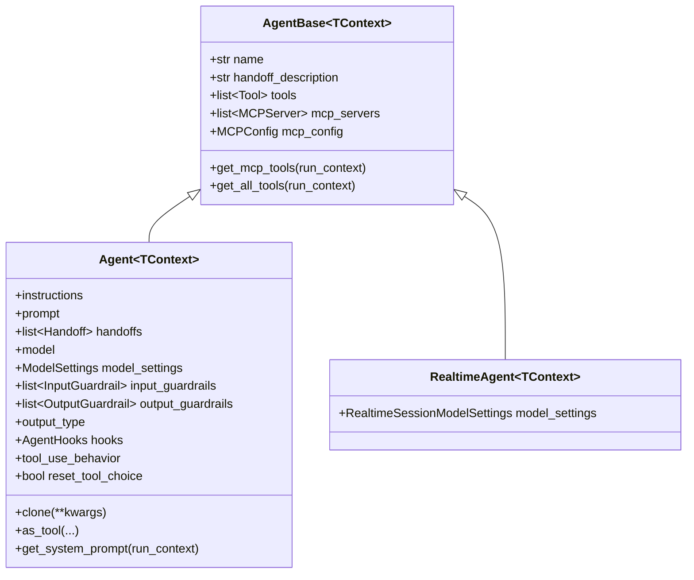
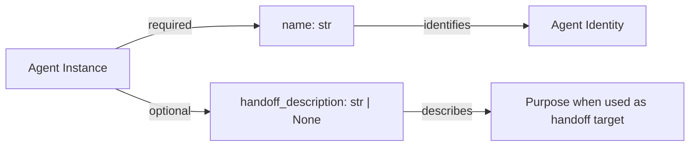
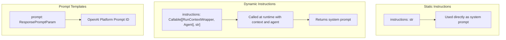
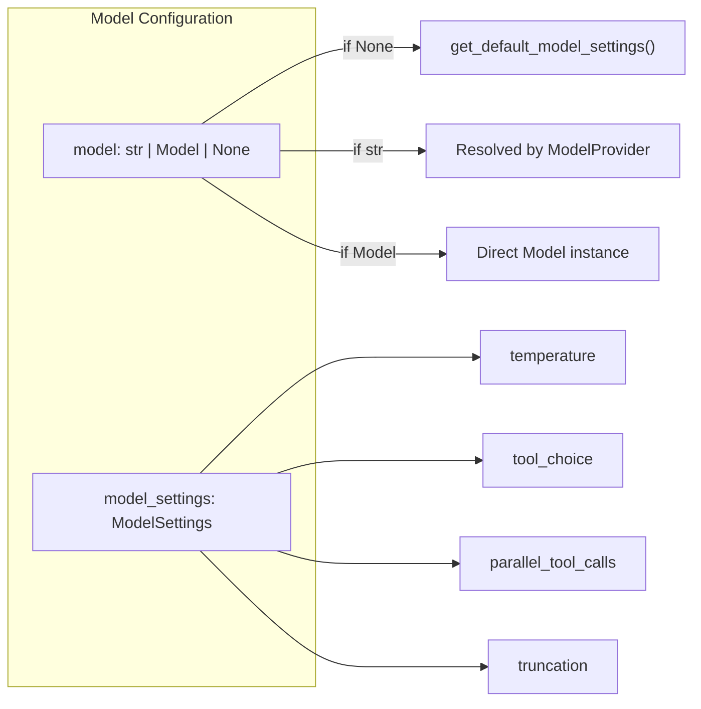
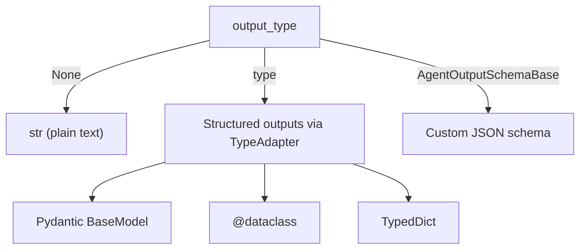
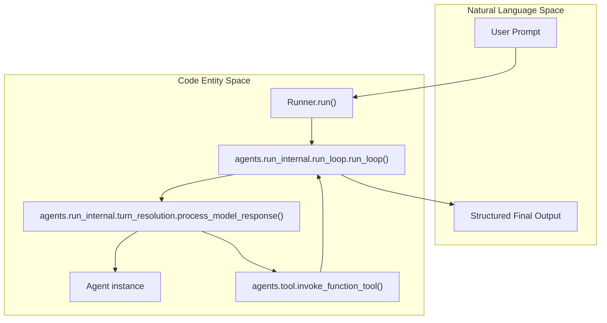

<!-- source: DeepWiki mcp.deepwiki.com · repo openai/openai-agents-python · page 3.1 Agent Architecture · fetched 2026-10-26 -->

# Agent Architecture

Relevant source files

The following files were used as context for generating this wiki page:

- [src/agents/agent.py](src/agents/agent.py)
- [src/agents/agent_output.py](src/agents/agent_output.py)
- [src/agents/run_config.py](src/agents/run_config.py)
- [src/agents/tool_context.py](src/agents/tool_context.py)
- [src/agents/util/_json.py](src/agents/util/_json.py)
- [tests/test_agent_as_tool.py](tests/test_agent_as_tool.py)
- [tests/test_agent_config.py](tests/test_agent_config.py)
- [tests/test_example_workflows.py](tests/test_example_workflows.py)
- [tests/test_output_tool.py](tests/test_output_tool.py)
- [tests/test_run_config.py](tests/test_run_config.py)
- [tests/test_source_compat_constructors.py](tests/test_source_compat_constructors.py)
- [tests/test_tool_context.py](tests/test_tool_context.py)
- [tests/utils/test_json.py](tests/utils/test_json.py)

This page details the structure and configuration of the `Agent` class (`src/agents/agent.py`), which serves as the primary building block for creating AI-powered workflows. An agent is a large language model (LLM) configured with instructions, tools, guardrails, handoffs, and other behavioral settings.

For information about executing agents, see [Runner and Execution Flow](3.2). For details on agent outputs, see [RunResult and Output Management](3.3). For multi-agent patterns, see [Multi-Agent Coordination](5).

---

## Agent Class Hierarchy

The SDK provides two agent classes that share a common base (`src/agents/agent.py`):

Title: Agent Class Hierarchy

- **`AgentBase[TContext]`** provides shared properties for both standard and realtime agents, including core identity (`name`, `handoff_description`), tool configurations (`tools`, `mcp_servers`, `mcp_config`), and tool resolution helpers [src/agents/agent.py:186-200]().
- **`Agent[TContext]`** extends `AgentBase` with text instructions/prompts, models, output schemas, guardrails, hooks, and multi-agent handoffs [src/agents/agent.py:247-333]().
- **`RealtimeAgent[TContext]`** is specialized for low-latency audio/voice interactions [src/agents/agent.py:186-188]().

Sources: `[src/agents/agent.py:174-333]()`

---

## Core Configuration Parameters

### Name and Identity

Title: Agent Identity Mapping

The `name` parameter is required and uniquely identifies the agent [src/agents/agent.py:186](). The `handoff_description` is optional and helps orchestrators or peer LLMs understand when to invoke a handoff [src/agents/agent.py:189-192]().

Sources: `[src/agents/agent.py:186-192]()`

### Instructions and Prompts

Instructions define the agent's system prompt behavior and can be supplied as static strings, sync callables, or async callables:

Title: Instruction and Prompt Resolution

Dynamic instructions receive `RunContextWrapper[TContext]` and `Agent[TContext]` as parameters to build context-aware instructions `[src/agents/agent.py:247-261]()`. The `prompt` parameter permits referencing platform-managed prompt templates via the Responses API `[src/agents/agent.py:263-267]()`.

Sources: `[src/agents/agent.py:247-267]()`

### Model and Model Settings

Title: Model Settings Configuration

The `model` parameter accepts string model identifiers or custom `Model` instances `[src/agents/agent.py:275-278]()`. The `model_settings` parameter configures generation attributes like `temperature`, `parallel_tool_calls`, and token `truncation` `[src/agents/agent.py:280-284]()`.

Sources: `[src/agents/agent.py:275-284]()`, `[src/agents/model_settings.py:1-40]()`

### Output Type

The `output_type` parameter dictates how final results are parsed and validated:

Title: Output Type Hierarchy

When an `output_type` is provided, the SDK wraps it in an `AgentOutputSchema` (`src/agents/agent_output.py`), leveraging OpenAI structured outputs to guarantee schema compliance `[src/agents/agent_output.py:60-120]()`.

Sources: `[src/agents/agent.py:296-303]`, `[src/agents/agent_output.py:60-170]()`

### Tools, MCP Servers, and Tool Use Behavior

- **`tools`**: A list of `Tool` objects (function tools, hosted tools, or agent tools) available to the agent `[src/agents/agent.py:194-198]()`.
- **`mcp_servers` & `mcp_config`**: Integrates Model Context Protocol servers and configures strict schema conversion and error translation `[src/agents/agent.py:197-200, 152-170]()`.
- **`tool_use_behavior`**: Controls loop behavior after tool invocation (e.g., `"run_llm_again"`, `"stop_on_first_tool"`, or `StopAtTools`) `[src/agents/agent.py:309-333]()`.

Sources: `[src/agents/agent.py:152-200, 309-333]()`

---

## Key Agent Methods

### `clone(**kwargs)`
Produces a shallow copy of the agent instance with overridden fields using `dataclasses.replace` `[tests/test_agent_config.py:148-164]()`.

### `as_tool(...)`
Wraps the agent as a `FunctionTool`, enabling multi-agent hierarchy patterns where a manager agent delegates work to specialized sub-agents `[tests/test_agent_as_tool.py:64-104]()`.

### `get_system_prompt(run_context)`
Resolves the system prompt asynchronously, executing instructions whether they are static strings or callables `[tests/test_agent_config.py:15-42]()`.

Sources: `[tests/test_agent_config.py:15-164]`, `[tests/test_agent_as_tool.py:64-123]()`

---

## Agent Lifecycle and Turn Resolution

Execution of an `Agent` follows a structured event and turn loop orchestrated by `Runner` and internal run modules.

Title: Natural Language to Code Entity Mapping

Sources: `[src/agents/agent.py:1-1171]`, `[src/agents/run_config.py:1-185]()`

---

