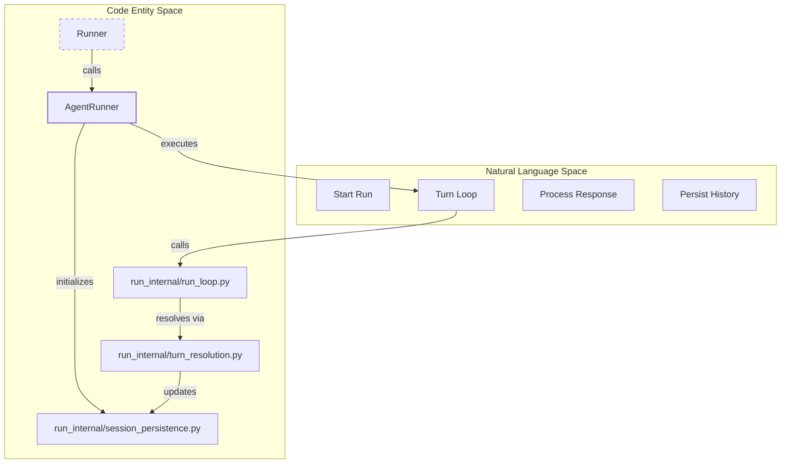
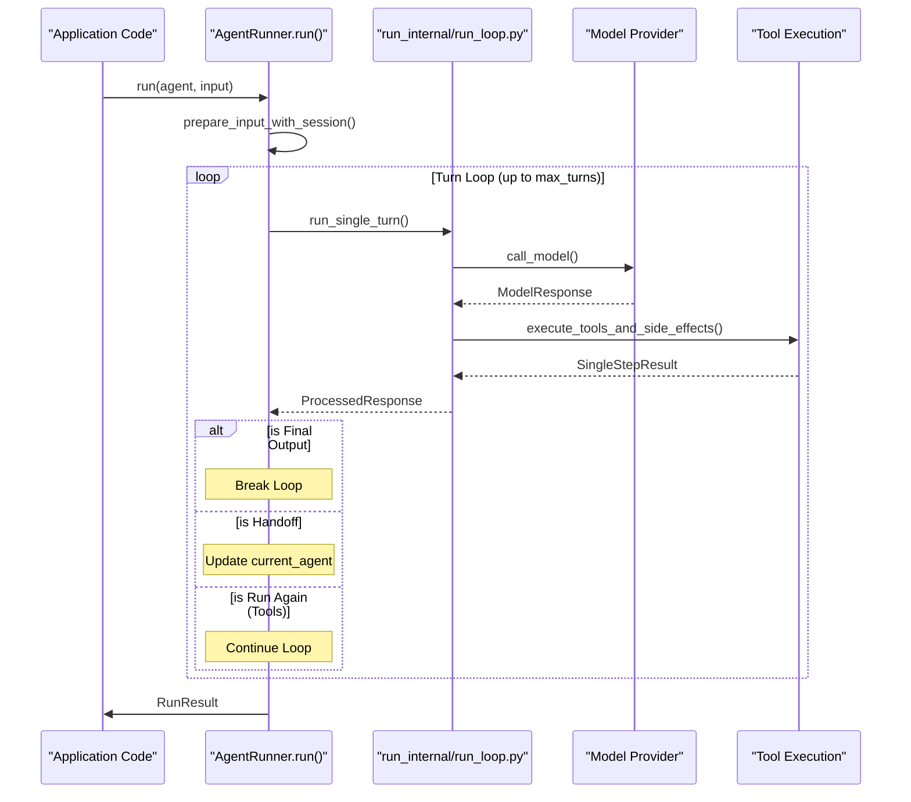
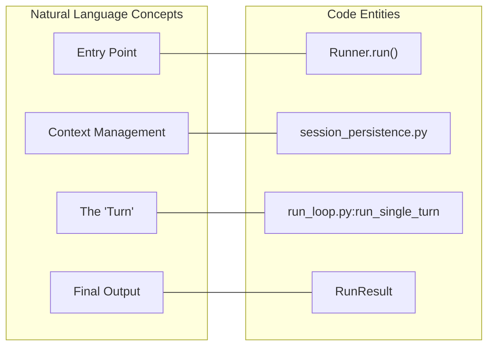

<!-- source: DeepWiki mcp.deepwiki.com · repo openai/openai-agents-python · page 3.2 Runner and Execution Flow · fetched 2026-10-26 -->

# Runner and Execution Flow

Relevant source files

The following files were used as context for generating this wiki page:

- [.github/scripts/check_optional_truthiness.py](.github/scripts/check_optional_truthiness.py)
- [examples/agent_patterns/agents_as_tools_structured.py](examples/agent_patterns/agents_as_tools_structured.py)
- [src/agents/agent_tool_input.py](src/agents/agent_tool_input.py)
- [src/agents/exceptions.py](src/agents/exceptions.py)
- [src/agents/result.py](src/agents/result.py)
- [src/agents/run.py](src/agents/run.py)
- [src/agents/run_error_handlers.py](src/agents/run_error_handlers.py)
- [src/agents/run_internal/agent_runner_helpers.py](src/agents/run_internal/agent_runner_helpers.py)
- [src/agents/run_internal/error_handlers.py](src/agents/run_internal/error_handlers.py)
- [src/agents/run_internal/run_loop.py](src/agents/run_internal/run_loop.py)
- [src/agents/run_internal/run_steps.py](src/agents/run_internal/run_steps.py)
- [src/agents/run_internal/session_persistence.py](src/agents/run_internal/session_persistence.py)
- [src/agents/run_internal/turn_resolution.py](src/agents/run_internal/turn_resolution.py)
- [src/agents/run_state.py](src/agents/run_state.py)
- [tests/test_agent_runner.py](tests/test_agent_runner.py)
- [tests/test_agent_runner_streamed.py](tests/test_agent_runner_streamed.py)
- [tests/test_agent_tool_input.py](tests/test_agent_tool_input.py)
- [tests/test_error_logging_redaction.py](tests/test_error_logging_redaction.py)
- [tests/test_invalid_final_output_handler.py](tests/test_invalid_final_output_handler.py)
- [tests/test_max_turns.py](tests/test_max_turns.py)
- [tests/test_run_impl_resume_paths.py](tests/test_run_impl_resume_paths.py)
- [tests/test_run_internal_error_handlers.py](tests/test_run_internal_error_handlers.py)
- [tests/test_run_state.py](tests/test_run_state.py)
- [tests/test_tool_use_tracker.py](tests/test_tool_use_tracker.py)

This page explains the `Runner` and `AgentRunner` classes, which orchestrate agent execution. It covers the three execution modes (async, sync, streamed), the agent loop lifecycle, turn management, and how the runner integrates with sessions and conversation tracking.

---

## Runner Class Overview

The `Runner` class provides three static methods that serve as the primary entry points for executing agents. These methods are high-level wrappers that delegate to an internal `AgentRunner` instance.

| Method | Execution Mode | Returns | Use Case |
|--------|---------------|---------|----------|
| `run()` | Async | `RunResult` | Standard async execution with full result. |
| `run_sync()` | Synchronous | `RunResult` | Blocking execution for non-async code. |
| `run_streamed()` | Async with streaming | `RunResultStreaming` | Real-time event streaming during execution. |

All three methods eventually call the `AgentRunner` logic to manage the conversation state and model interaction.

**Sources:** [src/agents/run.py:214-235](), [src/agents/run.py:387-401](), [src/agents/run.py:461-475]()

---

## Execution Modes

### Async Execution
`Runner.run()` is the primary entry point for asynchronous workflows. It manages the full lifecycle of a run, including session preparation, trace creation, and the turn-based loop. It accepts a starting agent and input (string, list of items, or `RunState`).

**Sources:** [src/agents/run.py:214-250](), [src/agents/run.py:270-300]()

### Synchronous Execution
`Runner.run_sync()` provides a synchronous interface. It uses `asyncio.run` (or a re-used loop) to execute the underlying async logic. It is designed to handle cases where an event loop might already be running in the background while maintaining thread-safety for session locks.

**Sources:** [src/agents/run.py:387-459]()

### Streamed Execution
`Runner.run_streamed()` returns a `RunResultStreaming` object immediately. This object allows the caller to iterate over `StreamEvent` items (such as `RunItemStreamEvent` or `RawResponsesStreamEvent`) as the model generates output. It supports real-time feedback for UI applications.

**Sources:** [src/agents/run.py:461-531](), [src/agents/result.py:321-325]()

---

## AgentRunner Internals

The `AgentRunner` class (internal) manages the state of the execution. It handles the transition between agents (handoffs), tool execution, and guardrail enforcement.

### Implementation Logic and Data Flow

**Sources:** [src/agents/run.py:533-535](), [src/agents/run_internal/run_loop.py:1-4](), [src/agents/run_internal/turn_resolution.py:1-10]()

---

## The Turn Loop

The execution follows a "Turn Loop" architecture. A turn is defined as a single interaction with the LLM, including any subsequent tool executions or handoffs resulting from that interaction.

### Execution Lifecycle

**Sources:** [src/agents/run.py:214-235](), [src/agents/run_internal/run_loop.py:104-104](), [src/agents/run_internal/turn_resolution.py:192-201]()

### Key Parameters
- **`max_turns`**: Defaults to `DEFAULT_MAX_TURNS` (30). If the loop exceeds this count without reaching a terminal state, a `MaxTurnsExceeded` exception is raised. [src/agents/run_config.py:39](), [src/agents/run.py:767-769]()
- **`input`**: Can be a string, a list of `TResponseInputItem` objects, or a `RunState` for resumption. [src/agents/run.py:217](), [src/agents/run_internal/items.py:121-126]()

---

## Execution Lifecycle and State Management

The runner manages state through the `RunState` object and session persistence helpers.

### Resumption and Responding
If a run is interrupted (e.g., for human-in-the-loop tool approval), the `RunResult` contains a `to_state()` method. This serializes the current execution context into a `RunState` object, allowing the runner to resume exactly where it left off when the state is passed back into `Runner.run()`.

**Sources:** [src/agents/result.py:221-255](), [src/agents/run_internal/session_persistence.py:123-124](), [src/agents/run_state.py:236-248]()

### Session Integration
When a `Session` is provided, the runner performs the following:
1. **Preparation**: Fetches history from the session and merges it with new input using `prepare_input_with_session`. [src/agents/run_internal/session_persistence.py:117-117]()
2. **Persistence**: Saves new items (messages, tool calls, results) back to the session after each turn using `save_result_to_session`. [src/agents/run_internal/session_persistence.py:120-120]()

### Server-Managed Conversations
The runner supports OpenAI-managed conversation tracking via `conversation_id` and `previous_response_id`. The `OpenAIServerConversationTracker` ensures that the SDK does not re-send items the server already possesses, optimizing context window usage.

**Sources:** [src/agents/run_internal/oai_conversation.py:1-10](), [src/agents/run.py:91-91]()

---

## Guardrail Execution Flow

Guardrails are injected into the execution flow at specific lifecycle points:
1. **Input Guardrails**: Executed via `run_input_guardrails` before the model is called. Can be sequential or parallel. [src/agents/run_internal/run_loop.py:111-112]()
2. **Output Guardrails**: Executed via `run_output_guardrails` after the model provides a response but before the result is finalized. [src/agents/run_internal/run_loop.py:113-113]()

If a "tripwire" guardrail triggers, the runner immediately halts execution and raises an `InputGuardrailTripwireTriggered` or `OutputGuardrailTripwireTriggered` exception.

**Sources:** [src/agents/exceptions.py:15-18](), [src/agents/run_internal/run_loop.py:32-35](), [src/agents/run_internal/run_loop.py:110-110]()

---

## Code Mapping: Natural Language to Code Entities

The following diagram maps high-level execution concepts to the specific classes and functions in the codebase.

**Sources:** [src/agents/run.py:214-235](), [src/agents/run_internal/session_persistence.py:114-124](), [src/agents/run_internal/run_loop.py:104-104](), [src/agents/result.py:196-210]()

---

