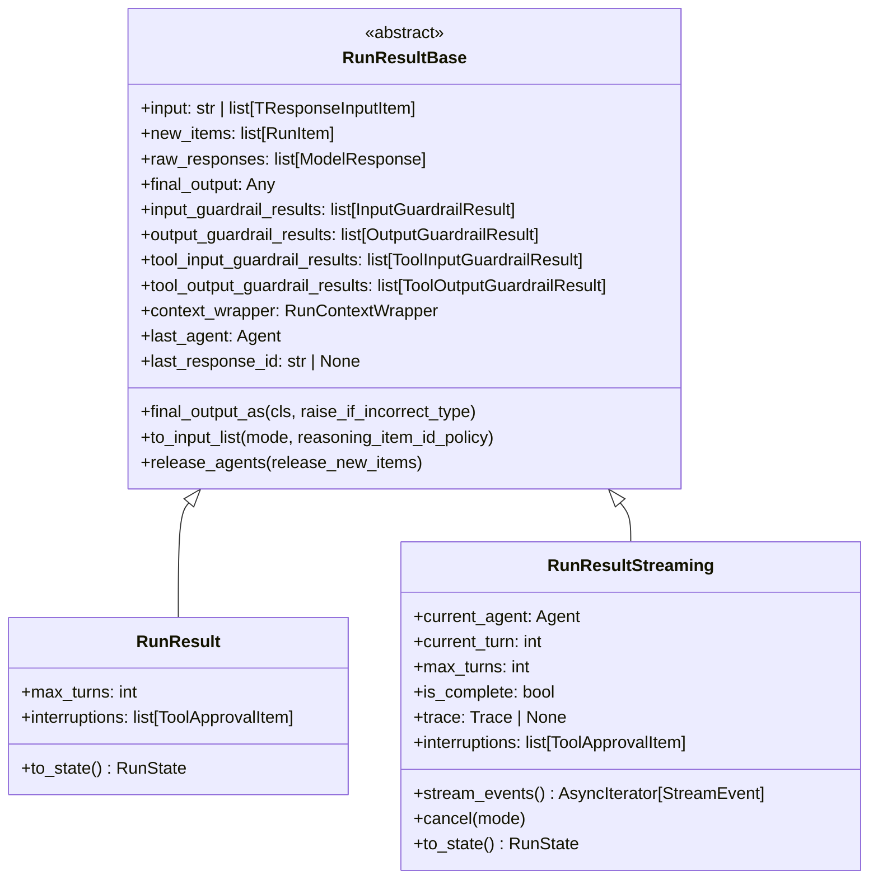
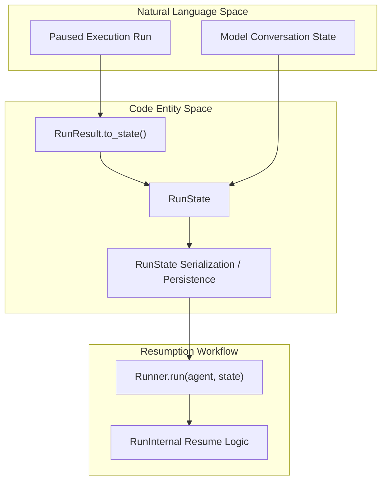
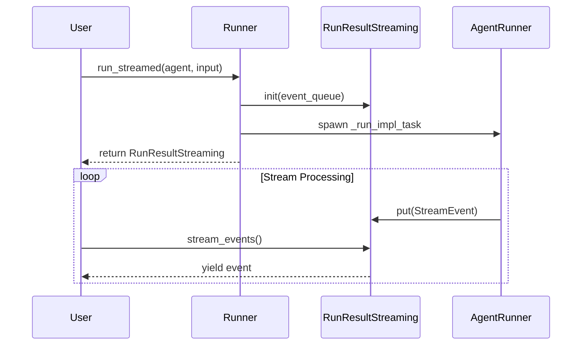
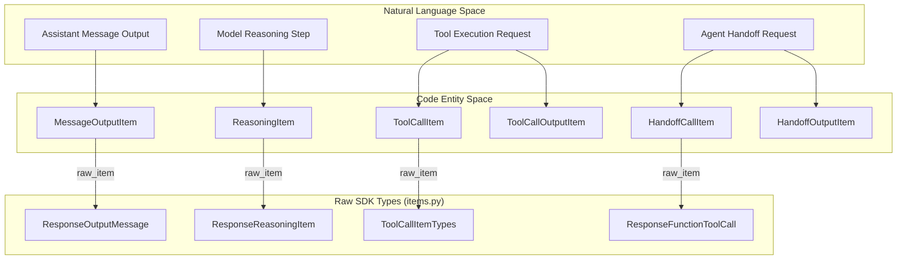

<!-- source: DeepWiki mcp.deepwiki.com · repo openai/openai-agents-python · page 3.3 RunResult and Output Management · fetched 2026-10-26 -->

# RunResult and Output Management

<details>
<summary>Relevant source files</summary>

The following files were used as context for generating this wiki page:

- [docs/ko/results.md](docs/ko/results.md)
- [docs/ko/streaming.md](docs/ko/streaming.md)
- [docs/zh/results.md](docs/zh/results.md)
- [docs/zh/streaming.md](docs/zh/streaming.md)
- [src/agents/exceptions.py](src/agents/exceptions.py)
- [src/agents/result.py](src/agents/result.py)
- [src/agents/run.py](src/agents/run.py)
- [src/agents/run_internal/agent_runner_helpers.py](src/agents/run_internal/agent_runner_helpers.py)
- [src/agents/run_internal/run_loop.py](src/agents/run_internal/run_loop.py)
- [src/agents/run_internal/run_steps.py](src/agents/run_internal/run_steps.py)
- [src/agents/run_internal/session_persistence.py](src/agents/run_internal/session_persistence.py)
- [src/agents/run_internal/turn_resolution.py](src/agents/run_internal/turn_resolution.py)
- [src/agents/run_state.py](src/agents/run_state.py)
- [tests/test_agent_runner.py](tests/test_agent_runner.py)
- [tests/test_agent_runner_streamed.py](tests/test_agent_runner_streamed.py)
- [tests/test_error_logging_redaction.py](tests/test_error_logging_redaction.py)
- [tests/test_run_impl_resume_paths.py](tests/test_run_impl_resume_paths.py)
- [tests/test_run_state.py](tests/test_run_state.py)

</details>


This page details the implementation, architecture, and usage of `RunResult` and `RunResultStreaming` classes within the OpenAI Agents SDK [src/agents/result.py:1-700](). It covers result properties (`final_output`, `new_items`, `interruptions`), item conversion routines via `to_input_list()`, and state serialization through `to_state()`.

---

## Overview

Agent execution returns one of two concrete result types depending on whether the invocation is synchronous or asynchronous/streaming:

- **`RunResult`** - Returned by `Runner.run()` and `Runner.run_sync()`, containing complete execution artifacts and metadata after all execution turns terminate. [src/agents/result.py:212-317]()
- **`RunResultStreaming`** - Returned by `Runner.run_streamed()`, providing asynchronous stream event iteration and support for cancellation controls. [src/agents/result.py:319-700]()

Both types extend `RunResultBase`, providing a unified interface for inputs, generated items, raw model responses, guardrail results, and token usage statistics [src/agents/result.py:175-210]().

Sources: [src/agents/result.py:175-700]()

---

## Result Type Hierarchy



**Diagram: Result Type Hierarchy and Key Properties**

The abstract base class `RunResultBase` defines shared evaluation metrics and conversion facilities, while concrete execution result classes manage lifecycle states like interruptions and active execution handles [src/agents/result.py:175-700]().

Sources: [src/agents/result.py:175-700]()

---

## Core Properties and Output Management

### Properties Reference

| Property | Type | Description |
|----------|------|-------------|
| `input` | `str \| list[TResponseInputItem]` | Original input provided to the runner, subject to any pre-run filtering [src/agents/result.py:177-180](). |
| `new_items` | `list[RunItem]` | All items generated during execution, including messages, tool calls, tool outputs, and handoffs [src/agents/result.py:182-185](). |
| `raw_responses` | `list[ModelResponse]` | Raw model response objects received from each underlying LLM turn [src/agents/result.py:187-188](). |
| `final_output` | `Any` | Processed output from the final agent turn, conforming to `agent.output_type` [src/agents/result.py:190-191](). |
| `last_agent` | `Agent[Any]` | The terminal agent instance active at the conclusion of the run [src/agents/result.py:252-258](). |
| `interruptions` | `list[ToolApprovalItem]` | Pending tool approval requests requiring human intervention [src/agents/result.py:228-229](). |

### Input List Transformation (`to_input_list()`)

The `to_input_list()` method converts accumulated execution items back into list structures suitable for subsequent runs or manual session management [src/agents/result.py:193-202](). It accepts a `mode` parameter:
- **`mode="preserve_all"`**: Retains the full conversion history from `new_items` [src/agents/result.py:170-173]().
- **`mode="normalized"`**: Prefers canonical continuation input when intermediate handoff filtering or history nesting rewrote conversation items [src/agents/result.py:195-202]().

Under the hood, conversion leverages `run_items_to_input_items` to translate internal `RunItem` wrappers into provider-ready `TResponseInputItem` structures while stripping transient approval markers [src/agents/run_internal/items.py:85-95]().

Sources: [src/agents/result.py:175-202](), [src/agents/run_internal/items.py:85-95]()

---

## RunState and Resumption (`to_state()`)

Both `RunResult` and `RunResultStreaming` implement `to_state()`, returning a serializable `RunState` instance [src/agents/result.py:301-317](), [src/agents/result.py:682-700](). 



**Diagram: Mapping Execution State to Resumable Code Entities**

The resulting `RunState` bundles execution metadata, tool usage tracking snapshots (`tool_use_tracker_snapshot`), and the last processed response to allow checkpointing and human-in-the-loop approval workflows [src/agents/result.py:107-167]().

Sources: [src/agents/result.py:107-167](), [src/agents/result.py:301-317](), [src/agents/result.py:682-700]()

---

## RunResultStreaming and Event Management

`RunResultStreaming` handles asynchronous generation streams, exposing incremental stream events and cancellation mechanisms [src/agents/result.py:319-700]().

### Event Streaming Architecture



**Diagram: Streaming Execution and Event Flow**

The async iterator `stream_events()` yields discrete event types [src/agents/result.py:532-581]():
1. **`RawResponsesStreamEvent`**: Streaming LLM responses (text deltas, tool call chunks) [src/agents/stream_events.py:11-21]().
2. **`RunItemStreamEvent`**: Semantic events representing completed items (tool execution, message creation) [src/agents/stream_events.py:24-49]().
3. **`AgentUpdatedStreamEvent`**: Notifications of agent switches via handoffs [src/agents/stream_events.py:52-58]().

### Cancellation Modes

The `cancel()` method supports two strategies [src/agents/result.py:435-481]():
- **`mode="immediate"`**: Cancels background tasks immediately and marks execution complete [src/agents/result.py:448-466]().
- **`mode="after_turn"`**: Permits the current model turn and tool execution steps to finish gracefully before halting [src/agents/result.py:468-474]().

Sources: [src/agents/result.py:319-700](), [src/agents/stream_events.py:1-61]()

---

## RunItem Artifact System

Execution items (`RunItem`) wrap raw model output items and maintain provenance tracking back to their source agent [src/agents/items.py:80-342]().



**Diagram: Mapping Natural Language Artifacts to RunItem Code Entities**

### Common RunItem Subclasses

| Class Name | Item Type String | Description |
|------------|------------------|-------------|
| `MessageOutputItem` | `message_output_item` | Assistant text message output [src/agents/items.py:161-169](). |
| `ReasoningItem` | `reasoning_item` | Internal chain-of-thought or model reasoning elements [src/agents/items.py:330-342](). |
| `ToolCallItem` | `tool_call_item` | Invocation request directed at a registered tool [src/agents/items.py:227-243](). |
| `ToolCallOutputItem` | `tool_call_output_item` | Result payload returned after tool execution [src/agents/items.py:191-224](). |
| `ToolApprovalItem` | `tool_approval_item` | Paused tool call awaiting administrative approval [src/agents/items.py:246-271](). |
| `HandoffCallItem` | `handoff_call_item` | Request transferring control to another agent [src/agents/items.py:274-289](). |

Sources: [src/agents/items.py:80-342]()

---

## Memory Cleanup (`release_agents()`)

Because result objects maintain references to agents via `new_items`, long-running applications can accumulate memory overhead [src/agents/result.py:261-299](). Calling `release_agents()` replaces strong references to agent instances with weak references across the result and its contained items [src/agents/result.py:261-299]():

```python
result = await Runner.run(agent, "Task")
# Process output...
result.release_agents()
# Agent instances are now eligible for garbage collection.
```

Attempting to access `result.last_agent` or item agents after collection raises an `AgentsException` [src/agents/result.py:254-258](), [src/agents/items.py:131-146]().

Sources: [src/agents/result.py:248-299](), [src/agents/items.py:94-158]()

---

