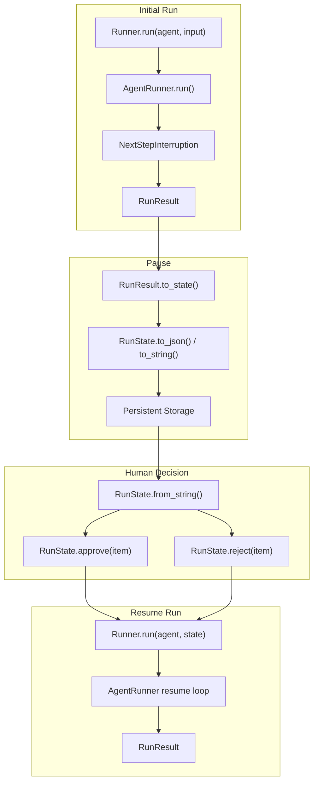
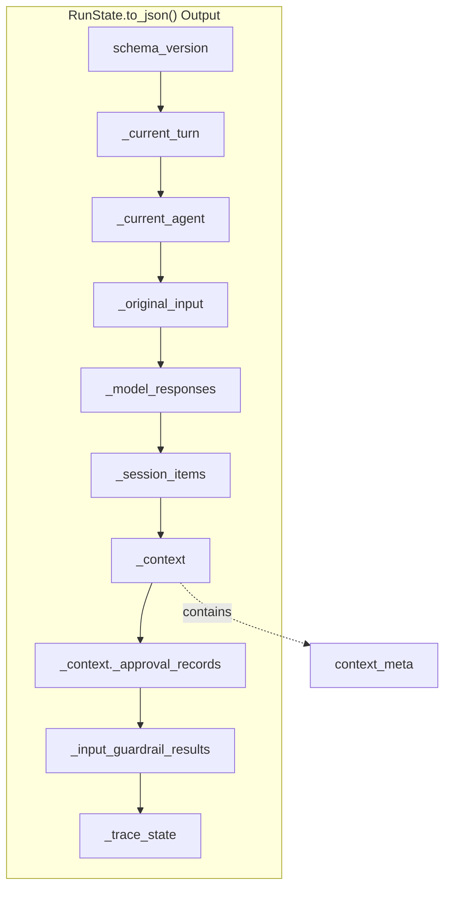
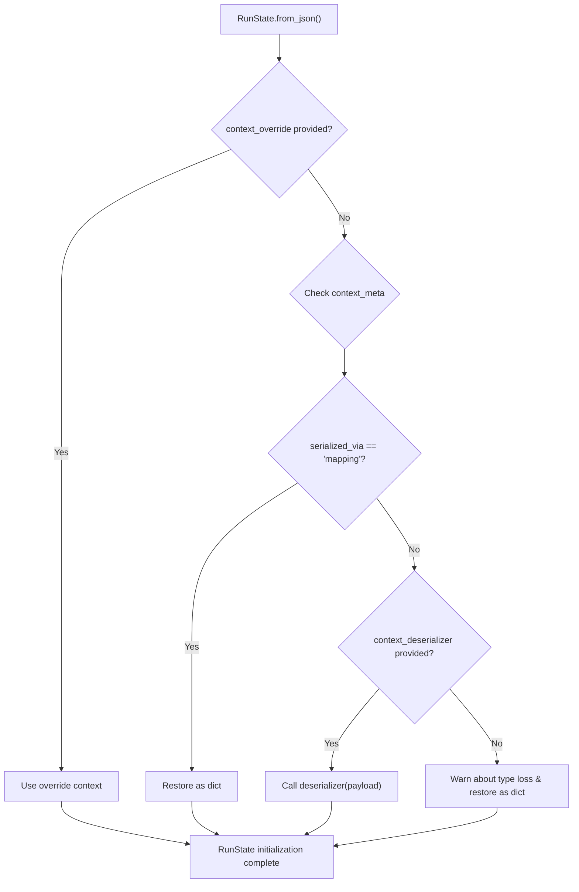
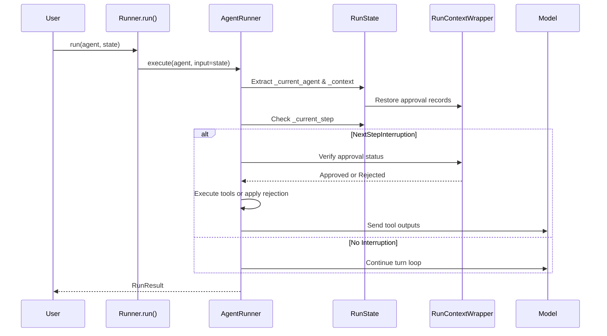

<!-- source: DeepWiki mcp.deepwiki.com · repo openai/openai-agents-python · page 3.4 RunState and Resumption · fetched 2026-10-26 -->

# RunState and Resumption

<details>
<summary>Relevant source files</summary>

The following files were used as context for generating this wiki page:

- [src/agents/_run_state_agent_identity.py](src/agents/_run_state_agent_identity.py)
- [src/agents/exceptions.py](src/agents/exceptions.py)
- [src/agents/result.py](src/agents/result.py)
- [src/agents/run.py](src/agents/run.py)
- [src/agents/run_internal/agent_runner_helpers.py](src/agents/run_internal/agent_runner_helpers.py)
- [src/agents/run_internal/run_loop.py](src/agents/run_internal/run_loop.py)
- [src/agents/run_internal/run_steps.py](src/agents/run_internal/run_steps.py)
- [src/agents/run_internal/session_persistence.py](src/agents/run_internal/session_persistence.py)
- [src/agents/run_internal/turn_resolution.py](src/agents/run_internal/turn_resolution.py)
- [src/agents/run_state.py](src/agents/run_state.py)
- [tests/fixtures/run_state/features/v1_20_tool_output_guardrail_boundary.json](tests/fixtures/run_state/features/v1_20_tool_output_guardrail_boundary.json)
- [tests/fixtures/run_state/generate_corpus.py](tests/fixtures/run_state/generate_corpus.py)
- [tests/fixtures/run_state/minimal/v1_20.json](tests/fixtures/run_state/minimal/v1_20.json)
- [tests/fixtures/run_state/sources.json](tests/fixtures/run_state/sources.json)
- [tests/test_agent_runner.py](tests/test_agent_runner.py)
- [tests/test_agent_runner_streamed.py](tests/test_agent_runner_streamed.py)
- [tests/test_error_logging_redaction.py](tests/test_error_logging_redaction.py)
- [tests/test_run_impl_resume_paths.py](tests/test_run_impl_resume_paths.py)
- [tests/test_run_state.py](tests/test_run_state.py)
- [tests/test_run_state_hook_identity.py](tests/test_run_state_hook_identity.py)

</details>


## Purpose and Scope

This page describes the `RunState` class and its role in enabling pause/resume workflows for agent execution. `RunState` provides serializable snapshots of agent runs that support human-in-the-loop interruptions, approval gates, state persistence, and durable execution patterns [src/agents/run_state.py:1-3]().

---

## RunState Overview

`RunState` is a serializable snapshot of an agent run that captures all information needed to pause and resume execution. It serves as the durable pause/resume boundary for human-in-the-loop flows, enabling workflows where execution stops for human approval and continues later [src/agents/run_state.py:1-3]().

**When to Use RunState**:
- Tool calls require human approval (`needs_approval=True`).
- Long-running workflows need to persist state between restarts [src/agents/run_state.py:1-3]().
- Agents execute across multiple service invocations.
- Execution must survive process crashes or deployments.

**Key Characteristics**:
- JSON-serializable with schema versioning [src/agents/run_state.py:159-187]().
- Preserves conversation history, model responses, and approvals [src/agents/run_state.py:589-678]().
- Supports context serialization with multiple strategies [src/agents/run_state.py:351-474]().
- Maintains tracing state across resume boundaries [src/agents/run_state.py:148-148]().

### Workflow Data Flow

The following diagram bridges the **Natural Language Space** (user actions) to the **Code Entity Space** (class names and functions).

Title: RunState Pause/Resume Workflow


**Sources**: [src/agents/run_state.py:1-3](), [src/agents/run.py:212-214](), [src/agents/result.py:111-172]()

---

## Creating RunState from RunResult

`RunState` instances are typically created from `RunResult` or `RunResultStreaming` objects using the `to_state()` method [src/agents/result.py:111-172](). This conversion captures the current execution state for later resumption.

```python
# Run agent until interruption
result = await Runner.run(agent, "Use the delete_file tool")

if result.interruptions:
    # Create state snapshot
    state = result.to_state()
    
    # Serialize for storage
    state_json = state.to_string()
    save_to_database(state_json)
```

**What Gets Captured**:

| Field | Description | Code Entity |
|-------|-------------|-------------|
| `_current_agent` | Agent currently handling execution | `Agent` [src/agents/agent.py:1-50]() |
| `_original_input` | Input from the first turn | `original_input` [src/agents/result.py:101-107]() |
| `_generated_items` | Items generated during the run | `RunItem` [src/agents/items.py:1-50]() |
| `_model_responses` | All model responses so far | `ModelResponse` [src/agents/items.py:1-50]() |
| `_context` | Run context with approvals and usage | `RunContextWrapper` [src/agents/run_context.py:1-50]() |
| `_input_guardrail_results` | Input guardrail results | `InputGuardrailResult` [src/agents/guardrail.py:1-50]() |
| `_current_step` | Current interruption step | `NextStepInterruption` [src/agents/run_internal/run_steps.py:1-50]() |

**Sources**: [src/agents/result.py:111-172](), [src/agents/run_state.py:1-50]()

---

## Serialization

`RunState` provides two serialization methods: `to_json()` returns a dictionary, while `to_string()` returns a JSON string [src/agents/run_state.py:589-678]().

### Schema Versioning

Every serialized state includes a schema version for forward/backward compatibility. The current version is defined by `CURRENT_SCHEMA_VERSION` [src/agents/run_state.py:99-102]().

**Supported Versions**: Validated via `SUPPORTED_SCHEMA_VERSIONS` [src/agents/run_state.py:99-102]().

**Versioning Policy**:
1. Released schema versions remain readable [src/agents/run_state.py:99-102]().
2. `to_json()` always emits `CURRENT_SCHEMA_VERSION` [src/agents/run_state.py:99-102]().
3. Forward compatibility fails fast (older SDKs reject newer versions) [src/agents/run_state.py:99-102]().

**Sources**: [src/agents/run_state.py:99-102](), [src/agents/run_state.py:589-600]()

### Serialization Format

Title: RunState JSON Structure


**Sources**: [src/agents/run_state.py:351-474](), [src/agents/run_state.py:589-678]()

---

## Deserialization

Deserialize `RunState` using `from_json()` or `from_string()` class methods [src/agents/run_state.py:680-824]().

```python
# From JSON string
state = await RunState.from_string(agent, state_string)

# With context override (replaces serialized context)
new_context = MyContext(user_id="different_user")
state = await RunState.from_json(
    agent,
    state_dict,
    context_override=new_context
)
```

### Context Deserialization Strategies

Title: Context Deserialization Decision Tree


**Context Metadata (`context_meta`)**:

The `context_meta` field describes how the context was serialized [src/agents/run_state.py:351-365]():

| `serialized_via` | Description |
|------------------|-------------|
| `"none"` | Context was `None` |
| `"mapping"` | Context was a dict/mapping, can be restored directly |
| `"context_serializer"` | Custom serializer was used, deserializer required |
| `"model_dump"` | Pydantic model, original type lost without deserializer |
| `"asdict"` | Dataclass, original type lost without deserializer |
| `"omitted"` | Non-serializable context, data omitted |

**Sources**: [src/agents/run_state.py:351-474](), [src/agents/run_state.py:680-824]()

---

## Approval and Rejection

`RunState` provides `approve()` and `reject()` methods to handle tool approval interruptions [src/agents/run_state.py:270-317]().

### Approving Tool Calls

Approving a tool call stores the decision in the `RunContextWrapper`. Setting `always_approve=True` persists this decision for all future calls to that specific tool within the same run [src/agents/run_state.py:270-291]().

```python
if result.interruptions:
    approval_item = result.interruptions[0]
    state = result.to_state()
    state.approve(approval_item, always_approve=True)
```

### Rejecting Tool Calls

Rejecting a tool call prevents its execution. You can provide a custom `rejection_message` which is returned to the model as the tool output [src/agents/run_state.py:293-317]().

```python
if result.interruptions:
    approval_item = result.interruptions[0]
    state = result.to_state()
    state.reject(
        approval_item,
        rejection_message="Access denied"
    )
```

**Sources**: [src/agents/run_state.py:270-317](), [src/agents/run_internal/run_loop.py:1-50]()

---

## Resuming Execution

Pass `RunState` to `Runner.run()` as the `input` parameter to resume execution [src/agents/run.py:1-210]().

Title: RunState Resume Sequence


**Sources**: [src/agents/run.py:1-210](), [src/agents/run_state.py:1-50](), [src/agents/run_internal/run_loop.py:1-50]()

---

## State Contents Detail

### Original Input Preservation
`_original_input` stores the input from the first turn, never updated during execution [src/agents/run_state.py:1-50]().

### Model Responses
All `ModelResponse` objects are serialized with usage metrics and output items [src/agents/run_state.py:319-329]().

### Conversation Identifiers
For server-managed conversation state:
- `_conversation_id`: Named conversation resource on server [src/agents/run_state.py:1-50]().
- `_previous_response_id`: Response ID to chain from [src/agents/run_state.py:1-50]().

### Trace State
Tracing metadata is serialized to enable trace continuity across resume boundaries [src/agents/run_state.py:148-148]().

**Sources**: [src/agents/run_state.py:1-50](), [src/agents/run_state.py:319-349]()

---

