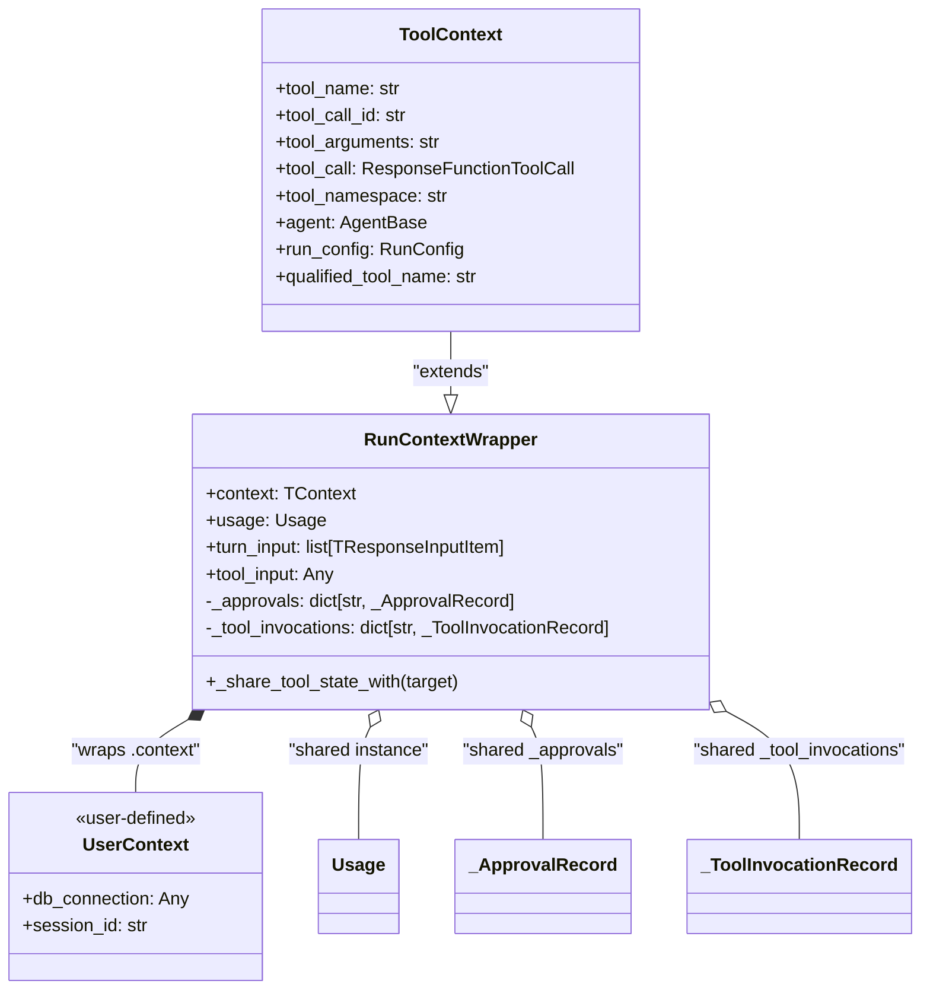
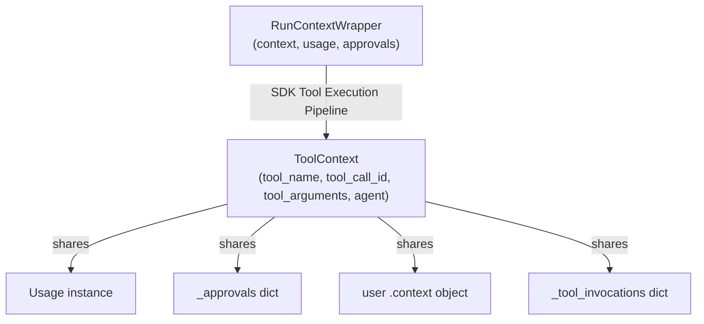
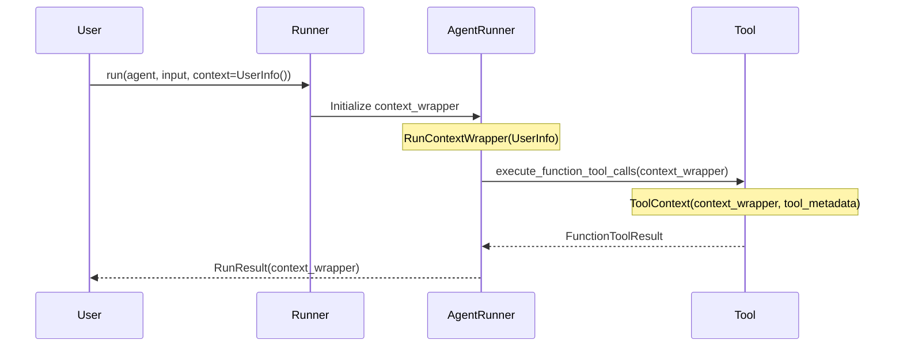

<!-- source: DeepWiki mcp.deepwiki.com · repo openai/openai-agents-python · page 3.5 Context and Dependency Injection · fetched 2026-10-26 -->

# Context and Dependency Injection

<details>
<summary>Relevant source files</summary>

The following files were used as context for generating this wiki page:

- [src/agents/agent.py](src/agents/agent.py)
- [src/agents/run_config.py](src/agents/run_config.py)
- [src/agents/run_context.py](src/agents/run_context.py)
- [src/agents/sandbox/capabilities/tools/apply_patch_tool.py](src/agents/sandbox/capabilities/tools/apply_patch_tool.py)
- [src/agents/tool_context.py](src/agents/tool_context.py)
- [tests/sandbox/capabilities/test_apply_patch_preflight.py](tests/sandbox/capabilities/test_apply_patch_preflight.py)
- [tests/sandbox/capabilities/test_apply_patch_tool.py](tests/sandbox/capabilities/test_apply_patch_tool.py)
- [tests/test_agent_as_tool.py](tests/test_agent_as_tool.py)
- [tests/test_example_workflows.py](tests/test_example_workflows.py)
- [tests/test_run_config.py](tests/test_run_config.py)
- [tests/test_run_context_approvals.py](tests/test_run_context_approvals.py)
- [tests/test_source_compat_constructors.py](tests/test_source_compat_constructors.py)
- [tests/test_tool_context.py](tests/test_tool_context.py)

</details>


This page describes the SDK's dependency injection system built around `RunContextWrapper` and `ToolContext`. These classes act as containers that carry user-defined application state, shared usage tracking, approval state, and tool-specific metadata throughout agent execution.

For information about conversation history and memory persistence, see **8. Session and Memory Management**. For agent-specific lifecycle hooks that receive context, see **10.5 Hooks and Lifecycle Events**.

---

## Overview and Purpose

The SDK uses **context wrappers** as dependency injection containers. The pattern works in three steps:

1. You create any Python object to hold your application state and dependencies (typically a dataclass or Pydantic model) [src/agents/run_context.py:184-185]().
2. You pass that object to the various run methods (e.g., `Runner.run(..., context=your_object)`) [src/agents/agent.py:183-183]().
3. The SDK wraps it in `RunContextWrapper` and passes that wrapper to all callbacks (tools, hooks, guardrails, handoffs) [src/agents/run_context.py:176-182]().

Two primary wrapper classes exist:

| Class | Purpose | When Used |
|-------|---------|-----------|
| `RunContextWrapper` | Base container with user context, usage, and approval state [src/agents/run_context.py:176-182](). | Agent hooks, guardrails, handoffs, and plain tool functions. |
| `ToolContext` | Extends `RunContextWrapper` with tool call metadata [src/agents/tool_context.py:42-43](). | Tool functions that request `ToolContext` as a parameter. |

**Critical invariant**: All derived wrappers in a single run share the same underlying user context, `usage` tracker, and approval state. Mutations are visible across the entire execution chain [src/agents/run_context.py:176-188]().

Sources: [src/agents/run_context.py:176-188](), [src/agents/tool_context.py:42-65](), [src/agents/agent.py:183-205]()

---

## RunContextWrapper Architecture

The following diagram illustrates the relationship between the SDK context wrappers and user-defined state.

**Context Entity Relationship**


**RunContextWrapper contains**:
- **`context`**: Your application object (dataclass, Pydantic model, etc.) [src/agents/run_context.py:184-185]().
- **`usage`**: Shared `Usage` tracker accumulating tokens and requests across the run [src/agents/run_context.py:187-188]().
- **`turn_input`**: The full input list for the current turn [src/agents/run_context.py:86-86]().
- **`tool_input`**: Structured input data for nested `Agent.as_tool()` invocations [src/agents/run_context.py:93-94]().
- **`_approvals`**: Internal dict storing `_ApprovalRecord` objects for authorization state [src/agents/run_context.py:161-174]().
- **`_tool_invocations`**: Tracks canonical identity and lifecycle of tool calls to prevent duplicate execution [src/agents/run_context.py:150-158]().

Sources: [src/agents/run_context.py:150-188](), [src/agents/tool_context.py:42-124]()

---

## ToolContext Extension

When a tool function requests `ToolContext` as a parameter, the SDK injects a specialized wrapper that includes tool call metadata [src/agents/tool_context.py:42-43]().

**Tool Context Data Flow**


**ToolContext adds**:
- **`tool_name`**: The name of the tool being invoked [src/agents/tool_context.py:46-47]().
- **`tool_call_id`**: Unique ID for this specific tool call [src/agents/tool_context.py:49-50]().
- **`tool_arguments`**: Raw JSON arguments string from the model [src/agents/tool_context.py:52-53]().
- **`tool_call`**: Full `ResponseFunctionToolCall` object [src/agents/tool_context.py:55-56]().
- **`tool_namespace`**: The Responses API namespace for the tool call [src/agents/tool_context.py:58-59]().
- **`agent`**: The active agent executing this tool [src/agents/tool_context.py:61-62]().
- **`run_config`**: The active `RunConfig` for this execution [src/agents/tool_context.py:64-65]().

Sources: [src/agents/tool_context.py:42-116](), [src/agents/run_internal/tool_execution.py:88-88]()

---

## Context Propagation Flow

Context is initialized at the start of a run and passed through the execution loop. The SDK ensures that nested agent calls (e.g., `Agent.as_tool()`) share the same usage and approval state by calling `_share_tool_state_with` [src/agents/run_context.py:106-113]().

**Execution Context Propagation**


**Key Propagation Sites**:
1. **Hooks**: `AgentHookContext` is initialized with usage and turn input [src/agents/run_context.py:121-121]().
2. **Tools**: Functions receive `ToolContext` or `RunContextWrapper` based on signature inspection [src/agents/run_internal/tool_execution.py:82-82]().
3. **Guardrails**: Input and output guardrails receive context to validate payloads against application state [src/agents/agent.py:34-34]().
4. **Nested Agents**: When an agent runs as a tool, its internal `RunContextWrapper` is linked to the parent's via `_share_tool_state_with` [src/agents/run_context.py:106-113]().

Sources: [src/agents/run_context.py:106-113](), [src/agents/run_internal/tool_execution.py:82-82](), [src/agents/run_internal/turn_resolution.py:97-97]()

---

## Shared Usage and Approval Tracking

### Usage Tracking
The `usage` property is a shared `Usage` instance that accumulates token counts and request numbers across all model calls in a single run [src/agents/run_context.py:187-188](). For streamed responses, usage is finalized at the end of the stream [src/agents/run_context.py:187-188]().

### Approval State Management
The `_approvals` dictionary tracks decisions for tools requiring human-in-the-loop verification via `_ApprovalRecord` [src/agents/run_context.py:161-174]().

- **`_ApprovalRecord`**: Stores lists of `approved` and `rejected` call IDs, along with custom rejection messages [src/agents/run_context.py:161-174]().
- **Sticky Rejections**: Supports `sticky_rejection_message` which applies to all subsequent calls in a specific `sticky_scope` [src/agents/run_context.py:171-172]().
- **Nested Approvals**: `ToolContext` can resolve approvals for nested agents by searching through `peek_agent_tool_run_result` [src/agents/tool_context.py:127-180]().

### Tool Invocation Tracking
The `_tool_invocations` dictionary prevents duplicate execution of tool calls during resume flows by tracking the canonical identity of each `call_id` [src/agents/run_context.py:150-158]().

Sources: [src/agents/run_context.py:150-174](), [src/agents/run_context.py:187-188](), [src/agents/tool_context.py:127-180]()

---

## Technical Details: Construction and Compatibility

`ToolContext` maintains a positional constructor for backward compatibility with older versions of the SDK [src/agents/tool_context.py:67-81]().

```python
# Positional constructor support
ctx = ToolContext(user_obj, usage_obj, "tool_name", "call_id", '{"arg": 1}')
# [src/agents/tool_context.py:67-103]()
```

The `qualified_tool_name` property handles tool namespacing by combining the tool name with its Responses API namespace [src/agents/tool_context.py:123-125]().

```python
# Returns "namespace.tool_name" or just "tool_name"
full_name = tool_ctx.qualified_tool_name 
# [src/agents/tool_context.py:123-125]()
```

Sources: [src/agents/tool_context.py:67-125](), [tests/test_source_compat_constructors.py:31-31]()

---

