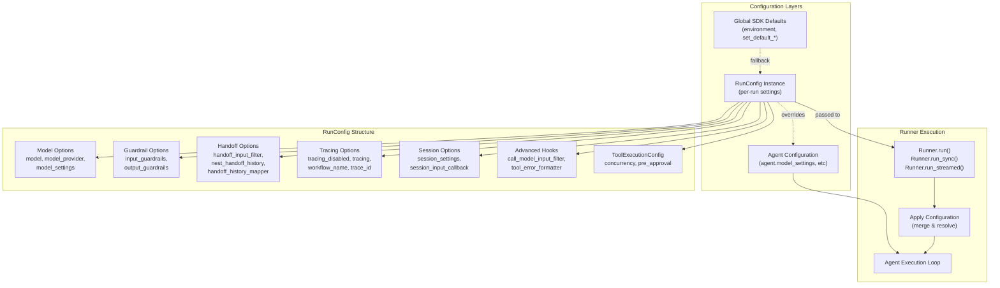
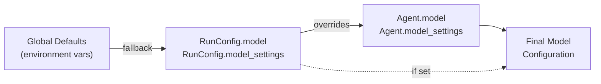

<!-- source: DeepWiki mcp.deepwiki.com · repo openai/openai-agents-python · page 3.6 Run Configuration · fetched 2026-10-26 -->

# Run Configuration

Relevant source files

The following files were used as context for generating this wiki page:

- [docs/ko/config.md](docs/ko/config.md)
- [docs/zh/config.md](docs/zh/config.md)
- [src/agents/agent.py](src/agents/agent.py)
- [src/agents/run_config.py](src/agents/run_config.py)
- [src/agents/tool_context.py](src/agents/tool_context.py)
- [tests/test_agent_as_tool.py](tests/test_agent_as_tool.py)
- [tests/test_example_workflows.py](tests/test_example_workflows.py)
- [tests/test_run_config.py](tests/test_run_config.py)
- [tests/test_source_compat_constructors.py](tests/test_source_compat_constructors.py)
- [tests/test_tool_context.py](tests/test_tool_context.py)

`RunConfig` provides global execution settings that control how agent runs behave. It allows you to override agent-specific configurations, enable cross-cutting concerns like guardrails and tracing, and customize execution behavior without modifying individual agents.

For information about agent-specific configuration (instructions, tools, model settings), see [Agent Architecture](#3.1). For information about the execution flow itself, see [Runner and Execution Flow](#3.2).

## Overview

`RunConfig` is an optional parameter passed to any `Runner` method (`run`, `run_sync`, `run_streamed`). It centralizes configuration that applies to the entire agent run, including all agents involved in handoffs. When not provided, a default `RunConfig` is automatically created.

Sources: [src/agents/run.py:199-213](), [src/agents/run_config.py:159-160]()

## Configuration Architecture

### Data Flow for Configuration Resolution
The diagram below illustrates how configuration layers are merged and applied to the execution loop within the `Runner`.

Sources: [src/agents/run_config.py:159-250](), [src/agents/run.py:39-47]()

## Model Configuration

`RunConfig` allows you to override model selection and settings globally, superseding agent-specific configurations.

### Model Override Options

| Field | Type | Purpose |
|-------|------|---------|
| `model` | `str \| Model` | Global model to use, overriding each agent's `model` [src/agents/run_config.py:193-196]() |
| `model_provider` | `ModelProvider` | Provider for resolving model names (defaults to `MultiProvider`) [src/agents/run_config.py:198-199]() |
| `model_settings` | `ModelSettings` | Global model settings (temperature, top_p, etc.) [src/agents/run_config.py:201-204]() |

### Configuration Resolution Logic
The resolution order is: `RunConfig` > `Agent` > `Global Defaults`. Settings in `RunConfig` take precedence over agent-specific settings during the run.

Sources: [tests/test_run_config.py:45-58](), [tests/test_run_config.py:82-104](), [src/agents/run_config.py:193-204]()

## Guardrails Configuration

`RunConfig` allows you to specify guardrails that apply to all agents in the run, in addition to agent-specific guardrails.

### Guardrail Options

| Field | Type | Purpose |
|-------|------|---------|
| `input_guardrails` | `list[InputGuardrail]` | Input validation applied to initial user input [src/agents/run_config.py:233-234]() |
| `output_guardrails` | `list[OutputGuardrail]` | Output validation applied to final agent output [src/agents/run_config.py:236-237]() |

Sources: [src/agents/run_config.py:233-237](), [src/agents/run_internal/run_loop.py:91-92]()

## Handoff Configuration

`RunConfig` provides global settings for controlling how agent handoffs behave, including conversation history management and input filtering.

### Handoff Options

| Field | Type | Purpose |
|-------|------|---------|
| `handoff_input_filter` | `HandoffInputFilter` | Global filter applied to all handoffs without explicit filters [src/agents/run_config.py:206-212]() |
| `nest_handoff_history` | `bool` | Collapse prior conversation into summary message (default: `False`) [src/agents/run_config.py:214-220]() |
| `handoff_history_mapper` | `HandoffHistoryMapper` | Custom mapper for conversation history summarization [src/agents/run_config.py:222-227]() |

Sources: [src/agents/run_config.py:206-227](), [tests/test_run_config.py:216-217]()

## Tracing Configuration

`RunConfig` controls tracing behavior for the entire run, including identifiers and sensitive data inclusion.

### Tracing Options

| Field | Type | Purpose |
|-------|------|---------|
| `tracing_disabled` | `bool` | Completely disable tracing for the run [src/agents/run_config.py:249-250]() |
| `tracing` | `TracingConfig` | Override exporters, processors, or metadata [src/agents/run_config.py:252-253]() |
| `workflow_name` | `str` | Name for the workflow (recommended to set) [src/agents/run_config.py:255-256]() |
| `trace_id` | `str` | Explicit trace ID (auto-generated if not set) [src/agents/run_config.py:258-259]() |
| `trace_include_sensitive_data` | `bool` | Include LLM inputs/outputs in traces. Defaults to environment variable [src/agents/run_config.py:262-264]() |

Sources: [src/agents/run_config.py:249-264](), [src/agents/run_config.py:51-54]()

## Tool Execution Configuration

The `ToolExecutionConfig` class controls SDK-side behavior for local tool calls.

| Field | Type | Purpose |
|-------|------|---------|
| `max_function_tool_concurrency` | `int \| None` | Limits concurrent execution of local function tools [src/agents/run_config.py:110-115]() |
| `pre_approval_tool_input_guardrails` | `bool` | Run tool input guardrails *before* a pending approval interruption [src/agents/run_config.py:117-121]() |

Sources: [src/agents/run_config.py:107-131](), [src/agents/run_config.py:274-275]()

## Advanced Hooks and Filters

### call_model_input_filter
A hook of type `CallModelInputFilter` used to edit the fully prepared `ModelInputData` (instructions and input items) immediately before the model is called [src/agents/run_config.py:246-247](). It receives a `CallModelData` object containing the current agent and context [src/agents/run_config.py:66-72]().

### tool_error_formatter
A hook of type `ToolErrorFormatter` that customizes the message returned to the model when a tool call fails or is rejected [src/agents/run_config.py:270-272](). It receives `ToolErrorFormatterArgs` containing metadata about the error and the tool [src/agents/run_config.py:81-101]().

### reasoning_item_id_policy
Controls how reasoning item IDs are handled during history conversion. Options are `"preserve"` or `"omit"` [src/agents/run_config.py:75](). This policy is applied when converting `RunItem` objects to model input [src/agents/run_internal/items.py:139-155]().

Sources: [src/agents/run_config.py:48-103](), [src/agents/run_internal/items.py:139-155]()

## Session and Error Handling

`RunConfig` also manages session-level behaviors:
*   **`session_settings`**: Global `SessionSettings` defining context limits and truncation strategies [src/agents/run_config.py:242]().
*   **`session_input_callback`**: A callback to transform or log input before it is added to the session [src/agents/run_config.py:239-240]().
*   **`error_handlers`**: A `RunErrorHandlers` object for catching and recovering from specific run-time exceptions [src/agents/run_config.py:277-278]().

Sources: [src/agents/run_config.py:239-278](), [src/agents/memory/session_settings.py:11-20]()

---

