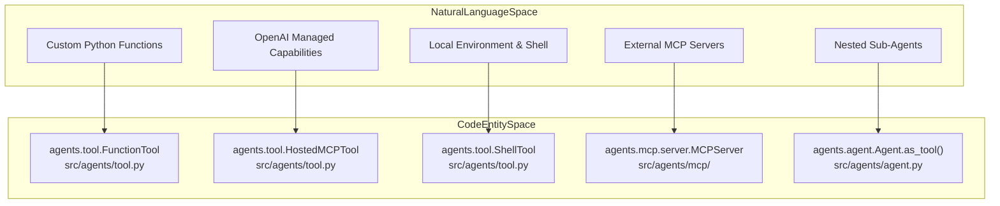
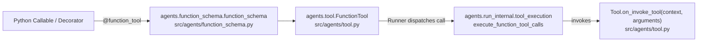

<!-- source: DeepWiki mcp.deepwiki.com · repo openai/openai-agents-python · page 4.1 Tool System Overview · fetched 2026-10-26 -->

# Tool System Overview

Relevant source files

The following files were used as context for generating this wiki page:

- [docs/ref/tool_context.md](docs/ref/tool_context.md)
- [examples/basic/tools.py](examples/basic/tools.py)
- [src/agents/__init__.py](src/agents/__init__.py)
- [src/agents/_function_tool_arguments.py](src/agents/_function_tool_arguments.py)
- [src/agents/function_schema.py](src/agents/function_schema.py)
- [src/agents/run_internal/tool_actions.py](src/agents/run_internal/tool_actions.py)
- [src/agents/run_internal/tool_execution.py](src/agents/run_internal/tool_execution.py)
- [src/agents/run_internal/tool_planning.py](src/agents/run_internal/tool_planning.py)
- [src/agents/tool.py](src/agents/tool.py)
- [src/agents/util/_approvals.py](src/agents/util/_approvals.py)
- [tests/sandbox/test_session_utils.py](tests/sandbox/test_session_utils.py)
- [tests/test_function_schema.py](tests/test_function_schema.py)
- [tests/test_function_schema_logger_restore.py](tests/test_function_schema_logger_restore.py)
- [tests/test_function_tool.py](tests/test_function_tool.py)
- [tests/test_function_tool_approval_arguments.py](tests/test_function_tool_approval_arguments.py)
- [tests/test_function_tool_decorator.py](tests/test_function_tool_decorator.py)
- [tests/test_hitl_error_scenarios.py](tests/test_hitl_error_scenarios.py)
- [tests/test_run_step_execution.py](tests/test_run_step_execution.py)

The Tool System enables agents to perform actions beyond text generation by executing external functions, calling APIs, controlling computers, and orchestrating sub-agents. This document covers the general tool architecture, the core `Tool` interface, tool discovery mechanisms, and how tools are registered and invoked on agents within the OpenAI Agents SDK.

---

## Purpose and Scope

The tool infrastructure bridges natural language requests from models to executable Python code or remote platform services. Its scope encompasses:
- Defining the abstract `Tool` interface and concrete implementations (`FunctionTool`, `HostedTool`, `LocalRuntimeTool`, etc.).
- Automatic schema generation via `function_schema()` [src/agents/function_schema.py:23-45]() and type inspection.
- Managing tool registration, namespacing (`tool_namespace()`), and deferred loading (`defer_loading`) on `Agent` instances.
- Orchestrating tool execution pipelines, input/output guardrails, and human-in-the-loop approvals in `src/agents/run_internal/tool_execution.py` [src/agents/run_internal/tool_execution.py:163-170]().

Sources: [src/agents/tool.py:1-213](), [src/agents/run_internal/tool_execution.py:163-170]()

---

## Tool Categories and Code Architecture

The SDK organizes tools into distinct categories based on where they execute and how they integrate with the agent system. The diagram below bridges the natural language conceptual space with the underlying codebase entities.

**Natural Language to Code Entity Mapping: Tool Categories**

Sources: [src/agents/tool.py:136-201](), [src/agents/__init__.py:9-16]()

### Category Summary

| Category | Representative Classes / Decorators | Execution Environment | Description |
|----------|--------------------------------0|-----------------------|-------------|
| **Function Tools** | `@function_tool`, `FunctionTool` [src/agents/__init__.py:153-154]() | Local Python Runtime | Wraps arbitrary Python callables with automatic Pydantic schema inference. |
| **Hosted Tools** | `WebSearchTool`, `CodeInterpreterTool`, `HostedMCPTool` [src/agents/__init__.py:152-200]() | OpenAI Infrastructure | Server-managed capabilities executed alongside the model. |
| **Local Runtime Tools** | `ComputerTool`, `ShellTool`, `ApplyPatchTool` [src/agents/__init__.py:141-174]() | Local User Environment | Environment-interacting tools for shell commands, patches, and desktop GUI control. |
| **MCP Integration** | `MCPServerStdio`, `MCPServerSse`, `MCPServerStreamableHttp` | External MCP Servers | Discovers and executes tools exposed by Model Context Protocol servers. |
| **Agent as Tool** | `Agent.as_tool()` | Nested Agent Loop | Exposes an entire subordinate agent as a callable tool with structured parameter validation. |

Sources: [src/agents/tool.py:136-201](), [src/agents/__init__.py:141-200]()

---

## The `Tool` Interface and Tool Discovery

Every tool in the system conforms to an underlying interface that exposes metadata, parameter schemas, and an invocation handler [src/agents/tool.py:1-213](). 

### Schema Generation and Introspection

For Python functions, the `@function_tool` decorator (and `@tool` alias) leverages `inspect.signature()` [src/agents/function_schema.py:36-36](), docstring parsing (`generate_func_documentation`) [src/agents/function_schema.py:124-133](), and Pydantic model creation (`create_model`) [src/agents/function_schema.py:13-13]() to produce a strict JSON schema [src/agents/function_schema.py:34-42]() sent to the LLM.

**Tool Discovery and Invocation Flow**

Sources: [src/agents/function_schema.py:23-45](), [src/agents/run_internal/tool_execution.py:163-170]()

Sources: [src/agents/function_schema.py:23-89](), [src/agents/tool.py:1-213]()

---

## Tool Registration and Scoping on Agents

Tools are attached to agents via the `tools` parameter on the `Agent` constructor [src/agents/agent.py:120-135]() or grouped using `tool_namespace()` [src/agents/tool.py:206-206]().

### Namespacing and Qualified Names
The `tool_namespace()` function prefixes tool names with a common namespace string (e.g., `crm.get_customer`), preventing name collisions when multiple tools share similar identifiers across different domains [src/tests/test_function_tool.py:64-80]().

- **Qualified Names**: Namespaced tools expose a `qualified_name` property formatted as `namespace.tool_name` [src/tests/test_function_tool.py:77-79]().
- **Deferred Loading**: Function tools can be configured with `defer_loading=True` to exclude them from the initial model prompt, requiring the model to discover and load them dynamically [src/tests/test_function_tool.py:180-186]().

Sources: [src/agents/tool.py:206-206](), [tests/test_function_tool.py:64-186]()

---

## Tool Execution Pipeline Integration

When a model outputs a tool call, the runner transitions execution through the tool pipeline implemented in `src/agents/run_internal/tool_execution.py` [src/agents/run_internal/tool_execution.py:163-170]() and `src/agents/run_internal/tool_actions.py` [src/agents/run_internal/tool_actions.py:77-83]().

1. **Extraction**: The runner extracts tool call parameters and matches them to registered tool lookup keys [src/agents/run_internal/tool_execution.py:27-43]().
2. **Guardrails**: Input guardrails validate the payload before invocation [src/agents/run_internal/tool_execution.py:95-100]().
3. **Approval Checking**: If `needs_approval` is configured, execution pauses and yields a `ToolApprovalItem` [src/agents/run_internal/tool_execution.py:161-161]().
4. **Invocation**: The tool executes its payload within a `ToolContext` wrapper, capturing return values or raised exceptions [src/agents/run_internal/tool_execution.py:163-170]().
5. **Output Guardrails**: Output guardrails inspect the resulting output prior to feeding it back into the model's conversation history [src/agents/run_internal/tool_execution.py:95-100]().

Sources: [src/agents/run_internal/tool_execution.py:27-170](), [src/agents/run_internal/tool_actions.py:77-83]()

---

