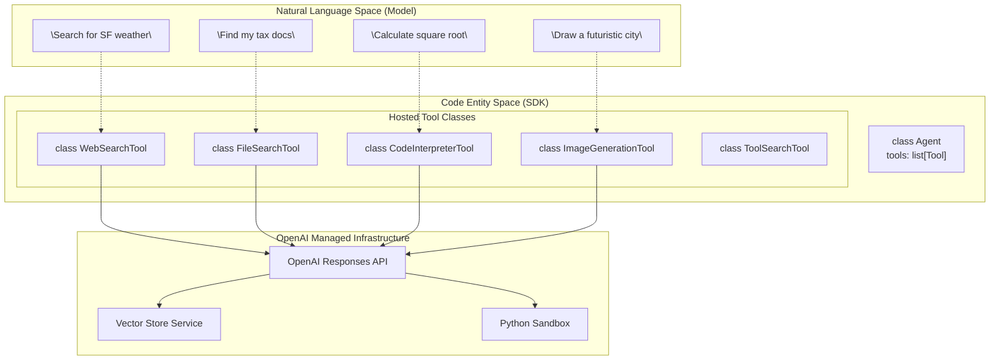
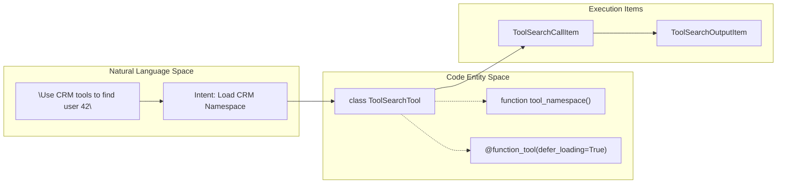

<!-- source: DeepWiki mcp.deepwiki.com · repo openai/openai-agents-python · page 4.3 Hosted Tools · fetched 2026-10-26 -->

# Hosted Tools

<details>
<summary>Relevant source files</summary>

The following files were used as context for generating this wiki page:

- [docs/ref/tool_context.md](docs/ref/tool_context.md)
- [examples/agent_patterns/agents_as_tools_conditional.py](examples/agent_patterns/agents_as_tools_conditional.py)
- [examples/basic/tool_guardrails.py](examples/basic/tool_guardrails.py)
- [examples/basic/tools.py](examples/basic/tools.py)
- [examples/tools/web_search_filters.py](examples/tools/web_search_filters.py)
- [src/agents/__init__.py](src/agents/__init__.py)
- [src/agents/decorators.py](src/agents/decorators.py)
- [src/agents/function_schema.py](src/agents/function_schema.py)
- [src/agents/tool.py](src/agents/tool.py)
- [src/agents/tool_guardrails.py](src/agents/tool_guardrails.py)
- [tests/sandbox/test_session_utils.py](tests/sandbox/test_session_utils.py)
- [tests/test_decorators.py](tests/test_decorators.py)
- [tests/test_function_schema.py](tests/test_function_schema.py)
- [tests/test_function_schema_logger_restore.py](tests/test_function_schema_logger_restore.py)
- [tests/test_function_tool.py](tests/test_function_tool.py)
- [tests/test_function_tool_decorator.py](tests/test_function_tool_decorator.py)

</details>


Hosted tools are OpenAI-managed capabilities that execute alongside the model on OpenAI's infrastructure rather than in the local runtime. When an agent invokes a hosted tool, the request and execution are handled entirely within the OpenAI Responses API, eliminating the need for local callbacks and reducing latency [src/agents/tool.py:35-44]().

This page covers tools that run on OpenAI servers. For tools that execute in your local environment, see **4.4 Local Runtime Tools**. For wrapping Python functions as tools, see **4.2 Function Tools**.

---

## Hosted Tool Ecosystem

The diagram below illustrates how hosted tools bridge the gap between the Python SDK and the OpenAI managed infrastructure, associating system concepts with concrete Python classes defined in `src/agents/tool.py`.

### Natural Language to Code Entity Mapping: Hosted Tools

Sources: [src/agents/tool.py:35-44](), [src/agents/tool.py:121-133]()

---

## Available Hosted Tools

### WebSearchTool
`WebSearchTool` allows the model to perform web searches using OpenAI's hosted search engine. It supports `filters` for domain restriction and `user_location` for localized results [src/agents/tool.py:43-44]().

**Implementation Detail**: In the `Agent` configuration, it is passed as an instance to the `tools` list.
```python
from agents import Agent, WebSearchTool
from openai.types.responses.web_search_tool import Filters

agent = Agent(
    name="Researcher",
    tools=[WebSearchTool(filters=Filters(allowed_domains=["openai.com"]))],
)
```
Sources: [src/agents/tool.py:43-44]()

### FileSearchTool
`FileSearchTool` retrieves information from OpenAI Vector Stores. It uses the `RankingOptions` and `Filters` types from the OpenAI SDK to refine retrieval results [src/agents/tool.py:36]().

Sources: [src/agents/tool.py:36]()

### CodeInterpreterTool
`CodeInterpreterTool` provides a sandboxed Python environment where the LLM can write and execute code. The tool configuration can specify container types and execution parameters [src/agents/tool.py:42-43]().

**Execution Flow**:
1. The model generates a code interpreter tool call item [src/agents/tool.py:42-43]().
2. The SDK captures code attributes from the raw execution payload [src/agents/tool.py:42-43]().
3. Results are returned as text or image outputs from the hosted sandbox.

Sources: [src/agents/tool.py:42-43]()

### ImageGenerationTool
`ImageGenerationTool` enables DALL-E style image creation on OpenAI infrastructure. The model receives file identifiers or URLs representing the generated assets [src/agents/tool.py:44]().

Sources: [src/agents/tool.py:44]()

---

## Hosted Tool Search

Tool search is a feature of the OpenAI Responses API that allows agents to manage massive toolsets by loading them lazily. Instead of sending thousands of tool definitions in every prompt, the model searches for the tools it needs based on descriptions [src/agents/tool.py:199-200]().

### Natural Language to Code Entity Mapping: Tool Search

Sources: [src/agents/tool.py:199-200](), [tests/test_function_tool.py:64-80]()

### Configuration
To use tool search, tools must be marked with `defer_loading=True`. The `ToolSearchTool` must be added to the agent's tool list to enable discovery [tests/test_function_tool.py:64-80]().

```python
from agents import Agent, ToolSearchTool, function_tool, tool_namespace

@function_tool(defer_loading=True)
def get_customer(id: str):
    return f"Customer {id}"

crm_tools = tool_namespace(
    name="crm",
    description="Tools for customer management",
    tools=[get_customer]
)

agent = Agent(
    tools=[*crm_tools, ToolSearchTool()]
)
```
Sources: [src/agents/tool.py:199-200](), [tests/test_function_tool.py:64-80]()

---

## Data Context and Extraction

When a hosted tool executes, the SDK provides specific context objects if custom data extraction or monitoring is required. These classes encapsulate interactions between the SDK and the OpenAI Responses API.

| Context Class | Purpose | Key Attributes |
| :--- | :--- | :--- |
| `ComputerToolCustomDataContext` | Context for computer use tools | `tool_call`, `output`, `raw_item` [src/agents/tool.py:149-165]() |
| `FunctionToolCustomDataContext` | Context for standard function tools | `tool_context`, `tool`, `output` [src/agents/tool.py:112-126]() |
| `CustomToolCustomDataContext` | Context for arbitrary custom tools | `input`, `output`, `raw_item` [src/agents/tool.py:129-146]() |

Sources: [src/agents/tool.py:112-165]()

---

## Guardrails for Hosted Tools

Even though hosted tools run on OpenAI infrastructure, the SDK allows for `ToolInputGuardrail` and `ToolOutputGuardrail` checks. These are executed locally by the SDK before requests are sent to the Responses API or after responses are received [src/agents/tool_guardrails.py:151-207]().

### Guardrail Execution Flow
1. **Input Guardrail**: `ToolInputGuardrail.run(data)` is called with `ToolInputGuardrailData` (containing `ToolContext` and `Agent`) [src/agents/tool_guardrails.py:121-134]().
2. **Behavior**: The guardrail can return `AllowBehavior`, `RejectContentBehavior` (sending a message to the model), or `RaiseExceptionBehavior` (halting execution via a tripwire) [src/agents/tool_guardrails.py:40-77]().

Sources: [src/agents/tool_guardrails.py:40-77](), [src/agents/tool_guardrails.py:121-207]()

---

