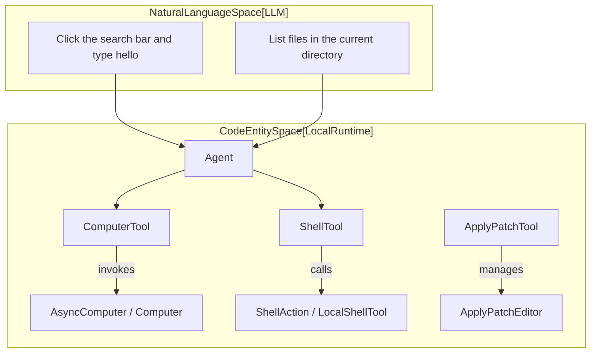
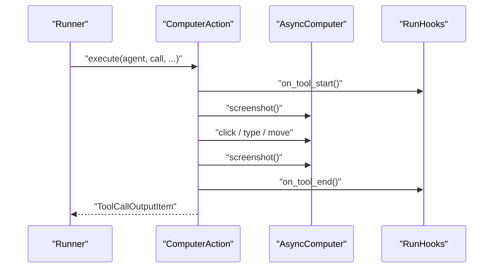

<!-- source: DeepWiki mcp.deepwiki.com · repo openai/openai-agents-python · page 4.4 Local Runtime Tools · fetched 2026-10-26 -->

# Local Runtime Tools

<details>
<summary>Relevant source files</summary>

The following files were used as context for generating this wiki page:

- [examples/sandbox/docs/coding_task.py](examples/sandbox/docs/coding_task.py)
- [examples/sandbox/healthcare_support/skills/prior-auth-packet-builder/SKILL.md](examples/sandbox/healthcare_support/skills/prior-auth-packet-builder/SKILL.md)
- [examples/sandbox/healthcare_support/support_agents.py](examples/sandbox/healthcare_support/support_agents.py)
- [examples/sandbox/healthcare_support/tools.py](examples/sandbox/healthcare_support/tools.py)
- [examples/sandbox/healthcare_support/workflow.py](examples/sandbox/healthcare_support/workflow.py)
- [examples/sandbox/sandbox_agent_capabilities.py](examples/sandbox/sandbox_agent_capabilities.py)
- [examples/tools/computer_use.py](examples/tools/computer_use.py)
- [src/agents/apply_diff.py](src/agents/apply_diff.py)
- [src/agents/computer.py](src/agents/computer.py)
- [src/agents/editor.py](src/agents/editor.py)
- [tests/test_apply_diff.py](tests/test_apply_diff.py)
- [tests/test_apply_diff_helpers.py](tests/test_apply_diff_helpers.py)
- [tests/test_apply_patch_tool.py](tests/test_apply_patch_tool.py)
- [tests/test_computer_action.py](tests/test_computer_action.py)
- [tests/test_custom_tool.py](tests/test_custom_tool.py)
- [tests/test_shell_tool.py](tests/test_shell_tool.py)
- [tests/test_tool_metadata.py](tests/test_tool_metadata.py)

</details>


## Purpose and Scope

Local runtime tools execute in the local environment where the SDK is running, rather than on OpenAI's infrastructure. Unlike **Hosted Tools** (see 4.3) which run on OpenAI servers, or **Function Tools** (see 4.2) which wrap arbitrary Python functions, local runtime tools require implementing specific interfaces to provide standardized capabilities like computer automation, shell access, and file patching. This page covers the three main local runtime tool types: `ComputerTool`, `ShellTool`, and `ApplyPatchTool`.

Sources: [src/agents/tool.py:63-64](), [src/agents/computer.py:8-133]()

---

## Overview

Local runtime tools provide powerful capabilities that execute in the user's environment with custom backend implementations. They are designed for scenarios where an agent needs to interact with the local system (browser automation, desktop GUI control), execute shell commands, or apply file system modifications.

| Characteristic | Description |
|---|---|
| **Execution Location** | User's local environment or controlled runtime |
| **Implementation Requirement** | Must provide interface implementation (`Computer`, `AsyncComputer`, `ApplyPatchEditor`) or executor |
| **Safety Consideration** | Often used with approval policies (see 4.7) |
| **Model Compatibility** | `ComputerTool` is specifically optimized for models supporting the Responses API |

Sources: [src/agents/tool.py:63-64](), [tests/test_computer_action.py:38-41](), [tests/test_shell_tool.py:63-66]()

---

## Architecture and Data Flow

The following diagrams illustrate how natural language intents and model responses map between Natural Language Space and Code Entity Space.

### Intent to Entity Mapping



Sources: [src/agents/computer.py:8-133](), [tests/test_computer_action.py:38-50](), [tests/test_shell_tool.py:22-22]()

### Tool Execution Lifecycle Mapping

```mermaid
graph TD
    subgraph "NaturalLanguageSpace[LLM]"
        ModelOutput[""ModelToolCall(tool='computer_use_preview', arguments=...)""]
        ModelResponse[""ModelResponse(output=ToolCallOutputItem)""]
    end

    subgraph "CodeEntitySpace[SDKRunner]"
        Runner["Runner.run()"]
        Action["ComputerAction.execute()"]
        Driver["AsyncComputer.click() / screenshot()"]
    end

    ModelOutput --> Runner
    Runner --> Action
    Action --> Driver
    Driver --> Action
    Action --> ModelResponse
```

Sources: [tests/test_computer_action.py:48-50](), [src/agents/computer.py:72-133]()

---

## ComputerTool

`ComputerTool` enables agents to perform GUI automation. It requires a driver implementing either the `Computer` (sync) or `AsyncComputer` (async) abstract base classes. This tool is primarily used with models supporting the Responses API.

### Computer Interfaces

The interfaces define the contract for screen interaction. All methods must be implemented by the driver subclass.

| Method | Purpose |
|---|---|
| `screenshot()` | Returns a base64-encoded PNG string of the current display. |
| `click(x, y, button)` | Performs a mouse click at coordinates. `Button` is one of `left`, `right`, `wheel`, `back`, `forward`. |
| `type(text)` | Types text into the focused element. |
| `keypress(keys)` | Presses a list of keys (e.g., `["ctrl", "c"]`). |
| `scroll(x, y, sx, sy)`| Scrolls at a specific location. |
| `drag(path)` | Drags the mouse along a sequence of `(x, y)` waypoints. |

Sources: [src/agents/computer.py:8-133](), [tests/test_computer_action.py:49-50]()

### Computer Action Execution Flow



Sources: [tests/test_computer_action.py:49-50](), [src/agents/computer.py:72-133]()

---

## ShellTool

`ShellTool` allows the agent to run shell commands locally or within a container environment [tests/test_shell_tool.py:63-78]().

### Environment Types
- `local`: Executes on the host machine using local execution logic and a custom executor function [tests/test_shell_tool.py:63-66]().
- `container_reference`: Refers to a managed container ID [tests/test_shell_tool.py:70-78]().
- `container_auto`: Automatically provisions a container configuration with limits and policies [tests/test_shell_tool.py:81-142]().

Sources: [tests/test_shell_tool.py:63-142](), [src/agents/run_internal/run_loop.py:22-23]()

---

## ApplyPatchTool

`ApplyPatchTool` allows an agent to perform structured file system edits (Create, Update, Delete) using an implementation of the `ApplyPatchEditor` interface [tests/test_apply_patch_tool.py:18-20](). It relies on the V4A diff parsing and application engine defined in `src/agents/apply_diff.py` [src/agents/apply_diff.py:52-65]().

Sources: [src/agents/apply_diff.py:52-65](), [tests/test_apply_patch_tool.py:18-20]()

---

## Summary of Key Classes

| Class | Role | Source |
|---|---|---|
| `ComputerTool` | SDK tool wrapper for GUI automation | [tests/test_tool_metadata.py:12]() |
| `AsyncComputer` | Abstract base for async GUI drivers | [src/agents/computer.py:72-133]() |
| `ShellTool` | Tool for command execution (local or hosted) | [tests/test_tool_metadata.py:19]() |
| `ApplyPatchTool` | Tool for structured file edits | [tests/test_tool_metadata.py:10]() |
| `ComputerAction` | Internal executor for computer tool logic | [tests/test_computer_action.py:50]() |

Sources: [tests/test_tool_metadata.py:10-20](), [src/agents/computer.py:72-133](), [tests/test_computer_action.py:50]()

---

