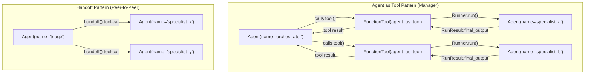
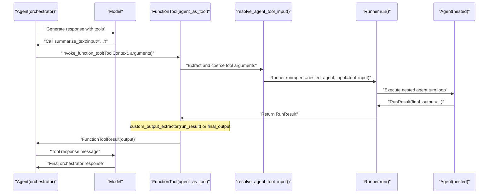
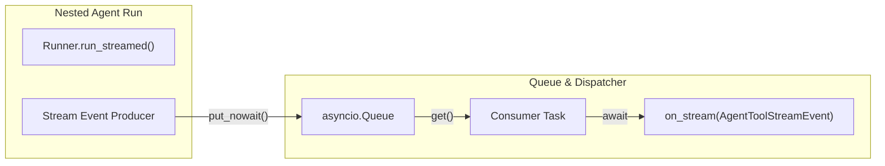

<!-- source: DeepWiki mcp.deepwiki.com · repo openai/openai-agents-python · page 4.5 Agent as Tool · fetched 2026-10-26 -->

# Agent as Tool

<details>
<summary>Relevant source files</summary>

The following files were used as context for generating this wiki page:

- [src/agents/agent.py](src/agents/agent.py)
- [src/agents/run_config.py](src/agents/run_config.py)
- [src/agents/tool_context.py](src/agents/tool_context.py)
- [tests/test_agent_as_tool.py](tests/test_agent_as_tool.py)
- [tests/test_example_workflows.py](tests/test_example_workflows.py)
- [tests/test_run_config.py](tests/test_run_config.py)
- [tests/test_source_compat_constructors.py](tests/test_source_compat_constructors.py)
- [tests/test_tool_context.py](tests/test_tool_context.py)

</details>


This document describes the `Agent.as_tool()` method [src/agents/agent.py:405-446](), which transforms an agent into a `FunctionTool` that can be invoked by other agents. This pattern enables hierarchical multi-agent architectures where a central orchestrator agent calls specialized agents as tools, maintaining control and synthesizing their outputs.

For information about peer-to-peer agent delegation, see [Handoff System](). For comparing these two multi-agent patterns, see [Manager Pattern vs Handoffs]().

---

## Purpose and Scope

The `Agent.as_tool()` method converts an `Agent` instance into a `FunctionTool` that can be added to another agent's tool list [src/agents/agent.py:405-446](). When invoked, the tool executes a complete agent run (via `Runner.run()` or `Runner.run_streamed()`) and returns the result to the calling agent. This enables composition of agents in a synchronous, hierarchical manner.

**Key Characteristics:**

| Aspect | Behavior |
|--------|----------|
| **Execution Model** | Synchronous nested agent run invoked via `FunctionTool` |
| **Control Flow** | Orchestrator maintains control, calling agent tools as sub-routines |
| **History** | Each nested agent receives fresh or built input, not full outer conversation history |
| **Output** | Nested agent's output (or custom extracted result) becomes the tool result for the orchestrator |
| **LLM Visibility** | Orchestrator sees tool descriptions, parameters, and results |

**Sources:** [src/agents/agent.py:405-446]()

---

## Agent as Tool vs Handoffs

The two multi-agent patterns have distinct semantics and architectural boundaries:

### Multi-Agent Interaction Patterns (Natural Language to Code Space)


**Comparison Table:**

| Aspect | Agent as Tool (`Agent.as_tool()`) | Handoffs (`handoff()`) |
|--------|----------------------------------|------------------------|
| **Control** | Orchestrator maintains control and continues conversation | Control transfers permanently to target agent |
| **Input Generation** | Generated via `StructuredToolInputBuilder` / `resolve_agent_tool_input` | Passes full conversation history (with optional filtering) |
| **History Isolation** | Nested agent runs in an isolated scope | Target agent inherits conversation history |
| **Output Handling** | Orchestrator receives tool output and synthesizes response | Target agent produces subsequent turns |
| **Use Case** | Specialized subtasks, parallel tool calling, calculations | Sequential workflow delegation, domain transfer |

From [src/agents/agent.py:425-429]():
> This is different from handoffs in two ways:
> 1. In handoffs, the new agent receives the conversation history. In this tool, the new agent receives generated input.
> 2. In handoffs, the new agent takes over the conversation. In this tool, the new agent is called as a tool, and the conversation is continued by the original agent.

**Sources:** [src/agents/agent.py:405-446](), [src/agents/agent.py:425-429]()

---

## Creating Agent Tools and Implementation

The `as_tool()` method is defined on the `Agent` class at [src/agents/agent.py:405-538](). It returns a `FunctionTool` instance that wraps the nested agent execution.

### Basic Usage

```python
from agents import Agent, Runner

# Create a specialized agent
summarizer = Agent(
    name="summarizer",
    instructions="You summarize text concisely."
)

# Convert to tool
summarizer_tool = summarizer.as_tool(
    tool_name="summarize_text",
    tool_description="Summarizes long text into key points"
)

# Use in orchestrator agent
orchestrator = Agent(
    name="orchestrator",
    instructions="You help users by using available tools.",
    tools=[summarizer_tool]
)

result = await Runner.run(
    orchestrator, 
    "Please summarize this article: [long text]"
)
```

### Internal Implementation Data Flow
The `as_tool()` method constructs a wrapped function tool using `_build_wrapped_function_tool` [src/agents/agent.py:448-538](). When the LLM invokes the tool, the execution follows this lifecycle:



**Sources:** [src/agents/agent.py:405-538](), [src/agents/agent_tool_input.py:20-24]()

---

## Parameters

The `Agent.as_tool()` method signature and parameters are defined at [src/agents/agent.py:405-422]():

```python
def as_tool(
    self,
    tool_name: str | None,
    tool_description: str | None,
    custom_output_extractor: Callable[[RunResult | RunResultStreaming], Awaitable[str]] | None = None,
    is_enabled: bool | Callable[[RunContextWrapper[Any], AgentBase[Any]], MaybeAwaitable[bool]] = True,
    on_stream: Callable[[AgentToolStreamEvent], MaybeAwaitable[None]] | None = None,
    run_config: RunConfig | None = None,
    max_turns: int | None = None,
    hooks: RunHooks[TContext] | None = None,
    previous_response_id: str | None = None,
    conversation_id: str | None = None,
    session: Session | None = None,
    failure_error_function: ToolErrorFunction | None = default_tool_error_function,
    input_builder: StructuredToolInputBuilder | StructuredToolInputBuilderOptions | None = None,
) -> Tool
```

### Core Parameter Reference

| Parameter | Type | Description |
|-----------|------|-------------|
| `tool_name` | `str \| None` | Tool name exposed to LLM. If `None`, derived automatically from `agent.name` [src/agents/agent.py:406](). |
| `tool_description` | `str \| None` | Description of agent capabilities and when to invoke it [src/agents/agent.py:407](). |
| `custom_output_extractor` | `Callable \| None` | Custom coroutine/function to transform `RunResult` or `RunResultStreaming` into tool output [src/agents/agent.py:408](). |
| `is_enabled` | `bool \| Callable` | Dynamic tool visibility check evaluated during `get_all_tools()` [src/agents/agent.py:409](). |
| `on_stream` | `Callable \| None` | Callback receiving `AgentToolStreamEvent` items when running via `run_streamed()` [src/agents/agent.py:410](). |
| `run_config` | `RunConfig \| None` | Execution configuration overrides for the nested agent run [src/agents/agent.py:411](). |
| `max_turns` | `int \| None` | Maximum turns allowed for the nested agent execution [src/agents/agent.py:412](). |
| `hooks` | `RunHooks[TContext] \| None` | Lifecycle hooks for the nested agent run [src/agents/agent.py:413](). |
| `session` | `Session \| None` | Optional conversation session for persistence in nested execution [src/agents/agent.py:416](). |
| `failure_error_function` | `ToolErrorFunction \| None` | Handler converting nested execution failures into model-visible messages [src/agents/agent.py:419](). |
| `input_builder` | `StructuredToolInputBuilder \| ...` | Customizes argument schema inference and input construction [src/agents/agent.py:420](). |

**Sources:** [src/agents/agent.py:405-422]()

---

## Output Extraction

By default, the tool returns `run_result.final_output` from the nested agent execution [src/agents/agent.py:536](). Custom extractors allow tailoring the output structure returned to the orchestrator.

### Default vs Custom Extraction Logic

```python
if custom_output_extractor:
    return await custom_output_extractor(run_result)

return run_result.final_output
```
*Cited from [src/agents/agent.py:533-536]().*

### Example Custom Extractor
Custom extractors receive the full `RunResult` or `RunResultStreaming` object, providing access to `final_output`, `new_items`, and `usage`:

```python
async def _summary_extractor(run_result: RunResult | RunResultStreaming) -> str:
    # Extracts a specific summary attribute from structured nested agent output
    return str(run_result.final_output.summary)
```
*Adapted from [examples/financial_research_agent/manager.py:56-60]().*

**Sources:** [src/agents/agent.py:533-536](), [examples/financial_research_agent/manager.py:56-60]()

---

## Conditional Enabling

The `is_enabled` parameter supports boolean flags or async/sync callables signature `(RunContextWrapper[Any], AgentBase[Any]) -> bool | Awaitable[bool]` [src/agents/agent.py:409]().

### Dynamic Enabling Example

```python
async def cond_enabled(ctx: RunContextWrapper[BoolCtx], agent: AgentBase) -> bool:
    return ctx.context.enable_tools

conditional_tool = agent.as_tool(
    tool_name="conditional_agent_tool",
    tool_description="A conditionally enabled agent tool",
    is_enabled=cond_enabled,
)
```
*Cited from [tests/test_agent_as_tool.py:116-118]().*

Tool enabling is evaluated when gathering available tools via `agent.get_all_tools()` [src/agents/agent.py:200-213]().

**Sources:** [src/agents/agent.py:200-213](), [tests/test_agent_as_tool.py:116-118]()

---

## Streaming Support

When `on_stream` is provided, the tool automatically switches from `Runner.run()` to `Runner.run_streamed()`, dispatching events to the callback via an internal queue [src/agents/agent.py:466-520]().

### AgentToolStreamEvent TypedDict

Defined at [src/agents/agent.py:130-141]():

```python
class AgentToolStreamEvent(TypedDict):
    event: StreamEvent              # The streaming event from the nested agent
    agent: Agent[Any]               # The nested agent emitting the event
    tool_call: ResponseFunctionToolCall | None  # The originating tool call, if available
```

### Streaming Architecture


**Sources:** [src/agents/agent.py:130-141](), [src/agents/agent.py:466-520]()

---

## Error Handling

Error handling for agent tools is governed by `failure_error_function` [src/agents/agent.py:419](). By default, it uses `default_tool_error_function` [src/agents/tool.py:57]() to catch runtime exceptions and return formatted error feedback to the LLM. 

Setting `failure_error_function=None` bypasses error trapping, allowing exceptions to propagate directly to the orchestrator runner.

**Sources:** [src/agents/agent.py:419](), [src/agents/tool.py:57]()

---

## Context and State Propagation

When an agent executes as a tool, the SDK coordinates state between outer and inner contexts:
- **`ToolContext`**: Derived from the parent context via `ToolContext.from_agent_context()` [src/agents/tool_context.py:113-171](), propagating `usage`, run configuration, and invocation identifiers.
- **State Scoping**: Uses `get_agent_tool_state_scope` and `set_agent_tool_state_scope` [src/agents/agent_tool_state.py:27-31]() to isolate nested state persistence and support resumption and human-in-the-loop interruptions across nested boundaries.

**Sources:** [src/agents/tool_context.py:113-171](), [src/agents/agent_tool_state.py:27-31](), [src/agents/agent.py:25-32]()

---

