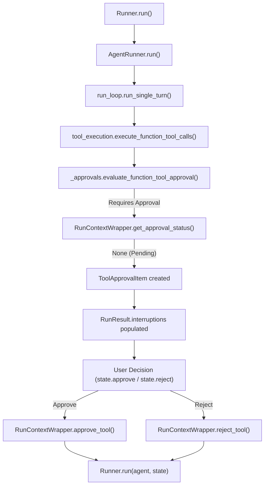
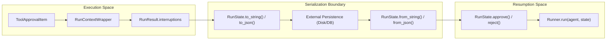

<!-- source: DeepWiki mcp.deepwiki.com · repo openai/openai-agents-python · page 4.7 Tool Approval and Human-in-the-Loop · fetched 2026-10-26 -->

# Tool Approval and Human-in-the-Loop

<details>
<summary>Relevant source files</summary>

The following files were used as context for generating this wiki page:

- [docs/ja/human_in_the_loop.md](docs/ja/human_in_the_loop.md)
- [docs/ko/human_in_the_loop.md](docs/ko/human_in_the_loop.md)
- [docs/zh/human_in_the_loop.md](docs/zh/human_in_the_loop.md)
- [src/agents/_function_tool_arguments.py](src/agents/_function_tool_arguments.py)
- [src/agents/run_internal/tool_actions.py](src/agents/run_internal/tool_actions.py)
- [src/agents/run_internal/tool_execution.py](src/agents/run_internal/tool_execution.py)
- [src/agents/run_internal/tool_planning.py](src/agents/run_internal/tool_planning.py)
- [src/agents/util/_approvals.py](src/agents/util/_approvals.py)
- [tests/test_function_tool_approval_arguments.py](tests/test_function_tool_approval_arguments.py)
- [tests/test_hitl_error_scenarios.py](tests/test_hitl_error_scenarios.py)
- [tests/test_run_step_execution.py](tests/test_run_step_execution.py)

</details>


This page documents the mechanisms for pausing agent execution to require human intervention before sensitive tool calls are performed. It covers the configuration of approval requirements, argument validation and uninspectable payload handling, the approval workflow, interruption handling, state management via `RunState`, and custom rejection messaging.

---

## Overview

The tool approval system provides a Human-in-the-Loop (HITL) workflow that ensures sensitive operations are vetted by a person or a programmatic policy before execution. When a tool is marked as needing approval, the `Runner` evaluates the call, and if approval is required and not yet granted, execution pauses. The resulting `RunResult` or `RunResultStreaming` exposes these pending checks as interruptions (`ToolApprovalItem`), allowing developers to serialize the execution state (`RunState`), record a decision, and resume execution seamlessly.

This system spans all tool types—including standard `@function_tool` decorators, nested agents via `Agent.as_tool()`, local runtime tools (`ShellTool`, `ApplyPatchTool`), and Model Context Protocol (MCP) servers.

Sources: [src/agents/util/_approvals.py:59-91](), [src/agents/run_internal/tool_planning.py:120-182]()

---

## Configuration and Marking Tools

Tools are marked for approval using the `needs_approval` configuration parameter. This can be a static boolean value or a dynamic asynchronous/synchronous callable that evaluates the specific arguments of a tool call.

### needs_approval Options
- `True`: Always require approval for this tool.
- `False`: Never require approval (default).
- `Callable`: A function or coroutine with signature `(ctx: RunContextWrapper, params: dict, call_id: str) -> bool`.

When `needs_approval` is a callable, the SDK attempts to parse and inspect the tool arguments using `parse_function_tool_arguments` [src/agents/util/_approvals.py:23-35]() and evaluate the policy via `evaluate_needs_approval_setting` [src/agents/util/_approvals.py:37-56]().

```python
from agents import Agent
from agents.decorators import tool

@tool(needs_approval=True)
async def delete_database(db_name: str) -> str:
    return f"Deleted {db_name}"

async def check_transfer_amount(ctx, params, call_id) -> bool:
    return params.get("amount", 0) > 1000

@tool(needs_approval=check_transfer_amount)
async def transfer_funds(amount: int, recipient: str) -> str:
    return f"Transferred ${amount} to {recipient}"
```

### Uninspectable Arguments Handling
If the SDK or argument parser cannot safely inspect tool arguments (for instance, if arguments are missing, empty, contain only whitespace, are malformed JSON, evaluate to a non-object type like a list or `null`, or contain non-standard JSON constants such as `NaN`, `Infinity`, or `-Infinity`), the approval policy fails safe by bypassing the custom predicate and requiring manual approval [src/agents/util/_approvals.py:23-35]().

Sources: [src/agents/util/_approvals.py:23-56](), [src/agents/util/_approvals.py:59-91]()

---

## Approval Workflow and Mechanisms

When the LLM requests a tool call that requires approval, the execution flow pauses during turn resolution.

### The Interruption Lifecycle

1. **Evaluation**: During tool preparation, `evaluate_function_tool_approval` checks whether the tool requires approval based on its configuration and arguments [src/agents/util/_approvals.py:59-91]().
2. **Context Check**: The runner checks `RunContextWrapper` to see if an approval or rejection decision has already been recorded for the specific `call_id`.
3. **Interruption**: If no decision exists, execution pauses. `RunResult.interruptions` is populated with `ToolApprovalItem` instances [src/agents/run_internal/tool_planning.py:120-182]().
4. **State Capture**: The developer calls `result.to_state()` to capture the `RunState`.
5. **Resolution**: The developer records a decision using `state.approve(interruption)` or `state.reject(interruption)` [src/agents/run_internal/tool_planning.py:177-182]().
6. **Resumption**: The execution is resumed via `Runner.run(agent, state)` or `Runner.run_streamed(agent, state)` [src/agents/run_internal/tool_planning.py:120-182]().

#### Diagram: Tool Approval and Interruption Flow


Sources: [src/agents/util/_approvals.py:59-91](), [src/agents/run_internal/tool_planning.py:120-182]()

### Sticky Decisions
When approving or rejecting tool calls, decisions can be marked as sticky across a run by associating them with a tool lookup key, ensuring subsequent identical calls in the same run bypass manual prompts. For hosted MCP approval requests, decisions are keyed by `server_label` and tool name [src/agents/run_internal/tool_planning.py:120-182]().

Sources: [src/agents/run_internal/tool_planning.py:120-182]()

---

## Tool Approval State Management

The `RunContextWrapper` tracks decisions by tool identity and call ID during a run [src/agents/run_internal/tool_planning.py:120-182]().

### RunState and Interruption Persistence
`RunState` serializes interruptions and recorded decisions, allowing applications to store paused states in external databases or files and resume them across process boundaries.

#### Diagram: RunState and Tool Approval Architecture


Sources: [src/agents/run_internal/tool_planning.py:120-182]()

---

## Custom Rejection Messages

When a tool call is rejected, the model receives a failure feedback output. Custom rejection messages can be supplied at two distinct levels:

1. **Global Fallback**: Configured via `RunConfig.tool_error_formatter`, which formats approval rejection messages across the entire run [src/agents/run_internal/tool_execution.py:1-170]().
2. **Per-Call Override**: Passed directly into `state.reject(interruption, rejection_message="...")` when resolving an individual interruption.

Per-call rejection messages take precedence over global formatters.

Sources: [src/agents/run_internal/tool_execution.py:1-170]()

---

## Automatic vs. Manual Approvals

While manual interruptions (`ToolApprovalItem`) are the standard pattern for human oversight, certain tools support programmatic callbacks for immediate resolution:

- **Manual Interruptions**: Used by `@function_tool` and `Agent.as_tool()`, requiring explicit state capture and resumption.
- **Programmatic Callbacks**: Used by `ShellTool`, `ApplyPatchTool`, and `HostedMCPTool` (via `on_approval_request`), which accept callbacks to decide approval or rejection inline without pausing the event loop [src/agents/run_internal/tool_planning.py:120-182]().

Sources: [src/agents/run_internal/tool_planning.py:120-182]()

---

