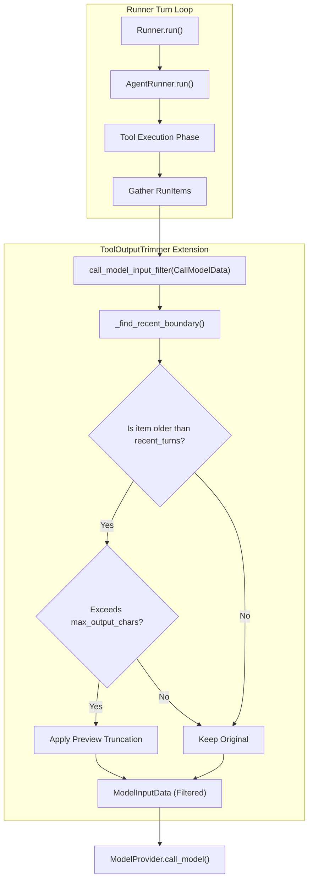
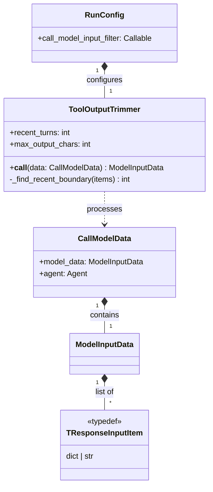

<!-- source: DeepWiki mcp.deepwiki.com · repo openai/openai-agents-python · page 4.8 Tool Output Trimmer · fetched 2026-10-26 -->

# Tool Output Trimmer

<details>
<summary>Relevant source files</summary>

The following files were used as context for generating this wiki page:

- [src/agents/extensions/__init__.py](src/agents/extensions/__init__.py)
- [src/agents/extensions/tool_output_trimmer.py](src/agents/extensions/tool_output_trimmer.py)
- [tests/extensions/test_tool_output_trimmer.py](tests/extensions/test_tool_output_trimmer.py)

</details>


The `ToolOutputTrimmer` is a built-in extension designed to handle large tool outputs—such as search results, code execution logs, or error analyses—that might exceed model context limits or consume excessive tokens. It implements a sliding window trimming strategy that surgically reduces the size of bulky outputs from older turns while keeping recent conversation turns at full fidelity [src/agents/extensions/tool_output_trimmer.py:1-7]().

## Purpose and Scope

As agentic conversations progress, historical tool outputs (e.g., from `ShellTool` or `WebSearchTool`) often lose relevance but continue to occupy token space in every subsequent model call. The `ToolOutputTrimmer` integrates with the `call_model_input_filter` hook to intercept the model payload immediately before transmission [src/agents/extensions/tool_output_trimmer.py:91-95]().

Key features include:
- **Sliding Window Trimming**: Replaces large outputs with a concise preview [src/agents/extensions/tool_output_trimmer.py:94-95]().
- **Turn-based Fidelity**: A `recent_turns` parameter ensures the last $N$ user messages and their associated tool outputs are never modified [src/agents/extensions/tool_output_trimmer.py:112-113]().
- **Targeted Filtering**: Trimming can be restricted to specific tools via `trimmable_tools` [src/agents/extensions/tool_output_trimmer.py:115]().
- **Structured Content Support**: Handles both plain string outputs and complex structured outputs (e.g., `ToolOutputText`, `ToolOutputImage`) [src/agents/extensions/tool_output_trimmer.py:103-105]().

Sources: [src/agents/extensions/tool_output_trimmer.py:1-7](), [src/agents/extensions/tool_output_trimmer.py:91-115]()

## Integration via `call_model_input_filter`

The `ToolOutputTrimmer` implements the `CallModelInputFilter` protocol. It is passed to the `RunConfig` and invoked by the `Runner` during the execution loop [src/agents/extensions/tool_output_trimmer.py:88-92]().

### Data Flow Diagram: Trimming Lifecycle

The following diagram illustrates how the trimmer intercepts `ModelInputData` within the `AgentRunner` pipeline.


Sources: [src/agents/extensions/tool_output_trimmer.py:136-153]()

## Configuration Parameters

The `ToolOutputTrimmer` is configured via its constructor:

| Parameter | Type | Default | Description |
| :--- | :--- | :--- | :--- |
| `recent_turns` | `int` | `2` | Number of recent user messages whose surrounding items are never trimmed [src/agents/extensions/tool_output_trimmer.py:112](). |
| `max_output_chars` | `int` | `500` | Character threshold above which outputs are candidates for trimming [src/agents/extensions/tool_output_trimmer.py:113](). |
| `preview_chars` | `int` | `200` | Maximum characters to preserve in the preview when trimming [src/agents/extensions/tool_output_trimmer.py:114](). |
| `trimmable_tools` | `Iterable[str] \| None` | `None` | Optional whitelist of tool names. If `None`, all tools are eligible [src/agents/extensions/tool_output_trimmer.py:115](). |

Sources: [src/agents/extensions/tool_output_trimmer.py:88-115]()

## Implementation Details

### Boundary Detection
The trimmer identifies the "recent" window by scanning backward through the input items to find the $N$-th `user` message. All items appearing after this boundary are considered high-fidelity and are never modified [src/agents/extensions/tool_output_trimmer.py:151-153]().

### Code Entity Association

This diagram maps the high-level trimming concepts to specific entities in the `agents` package.


Sources: [src/agents/extensions/tool_output_trimmer.py:88-136]()

## Example Usage

The trimmer is typically instantiated once and reused across multiple runs or agents.

```python
from agents import RunConfig
from agents.extensions import ToolOutputTrimmer

# Configure a trimmer that keeps the last 3 turns intact
# and limits older search results to 300 characters.
trimmer = ToolOutputTrimmer(
    recent_turns=3,
    max_output_chars=1000,
    preview_chars=300,
    trimmable_tools={"web_search", "google_search"}
)

config = RunConfig(
    call_model_input_filter=trimmer
)

# Pass config to Runner.run()
```
Sources: [src/agents/extensions/tool_output_trimmer.py:8-20]()

## Key Classes and Functions

### `ToolOutputTrimmer`
Defined in `src/agents/extensions/tool_output_trimmer.py` [src/agents/extensions/tool_output_trimmer.py:88]().
The core logic handler. It performs shallow copies of the input list to ensure that the original conversation state (in the `Session`) remains unmutated while the model receives a trimmed version [src/agents/extensions/tool_output_trimmer.py:139-141]().

### `call_model_input_filter`
Defined in `src/agents/run_config.py` [src/agents/run_config.py:38-40]().
The extension point in `RunConfig`. It supports both synchronous and asynchronous filter functions, allowing the `ToolOutputTrimmer` to fit into any execution pipeline.

Sources: [src/agents/extensions/tool_output_trimmer.py:88-141]()

---

