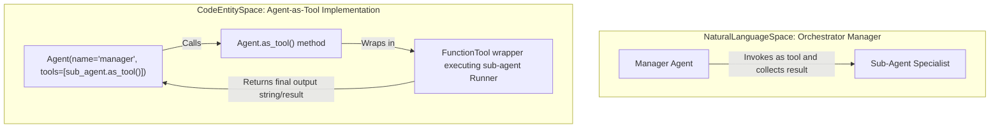
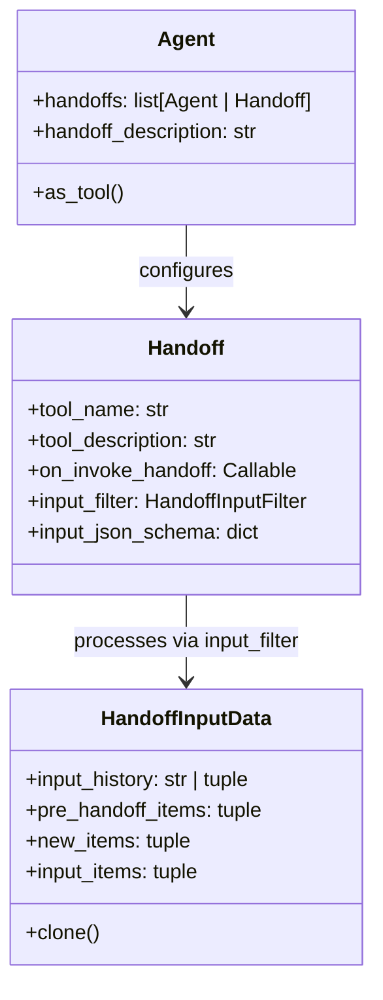

<!-- source: DeepWiki mcp.deepwiki.com · repo openai/openai-agents-python · page 5 Multi-Agent Coordination · fetched 2026-10-26 -->

# Multi-Agent Coordination

Relevant source files

The following files were used as context for generating this wiki page:

- [docs/ja/multi_agent.md](docs/ja/multi_agent.md)
- [src/agents/handoffs/__init__.py](src/agents/handoffs/__init__.py)
- [src/agents/realtime/handoffs.py](src/agents/realtime/handoffs.py)
- [src/agents/util/_transforms.py](src/agents/util/_transforms.py)
- [tests/realtime/test_realtime_handoffs.py](tests/realtime/test_realtime_handoffs.py)
- [tests/test_handoff_tool.py](tests/test_handoff_tool.py)
- [tests/test_tool_use_behavior.py](tests/test_tool_use_behavior.py)
- [tests/test_transforms.py](tests/test_transforms.py)

This page covers patterns and mechanisms for coordinating multiple agents to solve complex tasks. Multi-agent systems solve complex problems by dividing responsibility across specialized agents. Each agent focuses on a specific domain (e.g., billing, technical support, refunds) and can delegate to others when needed.

The OpenAI Agents SDK provides two primary patterns for multi-agent coordination:

1.  **Handoffs** — Peer-to-peer delegation where agents transfer control to specialists. For details, see [Handoff System](#5.1).
2.  **Manager Pattern (Agent-as-Tool)** — Hierarchical orchestration where a central agent invokes sub-agents as tools. For details, see [Manager Pattern vs Handoffs](#5.2).

Sources: [docs/ja/multi_agent.md:5-36](), [src/agents/handoffs/__init__.py:126-132]()

---

## Overview of Coordination Patterns

The SDK supports two distinct patterns with different semantics and control flows:

| Pattern | Control Flow | History Management | Use Case | Code Representation |
| :--- | :--- | :--- | :--- | :--- |
| **Handoffs** | Agent transfers control; target agent continues the conversation. | Full conversation history passed by default; configurable via filters. | Triage → specialist workflows; peer delegation. | `Agent.handoffs`, `handoff()` [src/agents/handoffs/__init__.py:126-156]() |
| **Agent-as-Tool** | Orchestrator maintains control; sub-agent returns result. | Sub-agent sees filtered context; orchestrator synthesizes outputs. | Hierarchical decomposition; parallel execution. | `Agent.as_tool()` [docs/ja/multi_agent.md:30-30]() |

Sources: [docs/ja/multi_agent.md:28-31](), [src/agents/handoffs/__init__.py:126-156]()

---

## Coordination Architecture (Natural Language to Code Entity Space)

The following diagrams map the conceptual multi-agent orchestration patterns to their concrete code entities (`Agent`, `Handoff`, `HandoffInputData`, `Agent.as_tool()`).

Diagram 1: Handoff Peer Delegation Pattern

```mermaid
graph TB
    subgraph "NaturalLanguageSpace: Triage to Specialist Handoff"
        Triage["TriageAgent (Initial Agent)"]
        Billing["BillingSpecialist (Target Agent)"]
        Triage -->|"Transfers conversation and control"| Billing
    end

    subgraph "CodeEntitySpace: Handoff Implementation"
        AgentClass["Agent(name='triage', handoffs=[billing_agent])"]
        HandoffObj["Handoff class instance created via handoff()"]
        InputData["HandoffInputData(input_history, pre_handoff_items, new_items)"]
        FilterFunc["HandoffInputFilter (optional)"]

        AgentClass -->|"Generates tool via get_handoffs()"| HandoffObj
        HandoffObj -->|"Passes state on invocation"| InputData
        InputData -->|"Processed by"| FilterFunc
    end
```

Sources: [src/agents/handoffs/__init__.py:71-156](), [tests/test_handoff_tool.py:50-65]()

Diagram 2: Manager Pattern (Agent-as-Tool)

Sources: [docs/ja/multi_agent.md:30-30](), [docs/ja/multi_agent.md:61-61]()

---

## Handoff System (#5.1)

Handoffs allow an agent to delegate tasks to another agent using tool calls under the hood. When an agent is configured with `handoffs`, the `Runner` automatically injects corresponding tool definitions (typically following the `transfer_to_<agent_name>` naming convention) into the model's tool set.

For details and execution sequence, see [Handoff System](#5.1).

Sources: [src/agents/handoffs/__init__.py:126-156](), [tests/test_handoff_tool.py:50-65]()

---

## Manager Pattern vs Handoffs (#5.2)

Choosing between the **Manager Pattern (Agents-as-tools)** and **Handoffs** depends on who should own the final answer and maintain conversation state:
- **Agents-as-tools**: The orchestrator (`Manager`) invokes sub-agents via `Agent.as_tool()`, maintains overall conversation ownership, and integrates the returned results.
- **Handoffs**: Control is handed entirely to the target specialist, which becomes the active agent for subsequent turns.

For details, see [Manager Pattern vs Handoffs](#5.2).

Sources: [docs/ja/multi_agent.md:28-36]()

---

## Handoff Configuration (#5.3)

The `handoff()` helper function and `Handoff` dataclass provide fine-grained control over delegation behavior:
- `tool_name_override` and `tool_description_override`: Customize how the handoff tool appears to the LLM.
- `on_handoff`: Custom callback executed when the handoff occurs.
- `input_type` and `input_json_schema`: Define structured parameter validation for the handoff call.
- `is_enabled`: Boolean or dynamic callable controlling whether the handoff tool is exposed to the model at runtime.

For details, see [Handoff Configuration](#5.3).

Sources: [src/agents/handoffs/__init__.py:126-183](), [src/agents/realtime/handoffs.py:108-132]()

---

## Handoff History Management (#5.4)

When an agent hands off to another, controlling what context is transmitted is essential for performance and data privacy:
- `input_filter`: A `HandoffInputFilter` callable receiving `HandoffInputData` (`input_history`, `pre_handoff_items`, `new_items`) to modify or trim items before they reach the next agent.
- `nest_handoff_history`: Collapses prior conversation history into a nested summary or assistant payload.
- `handoff_history_mapper`: Maps transcripts to summary payloads.

For details, see [Handoff History Management](#5.4).

Sources: [src/agents/handoffs/__init__.py:71-122](), [src/agents/handoffs/__init__.py:158-179]()

---

## Code Entity Map

Sources: [src/agents/handoffs/__init__.py:71-183](), [tests/test_handoff_tool.py:50-65]()

---

