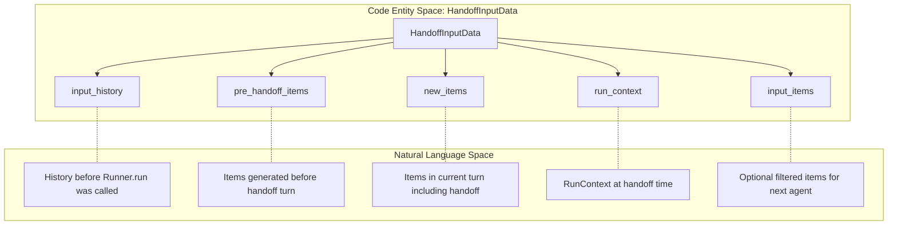
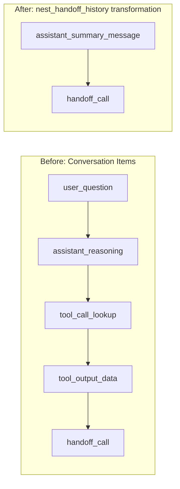
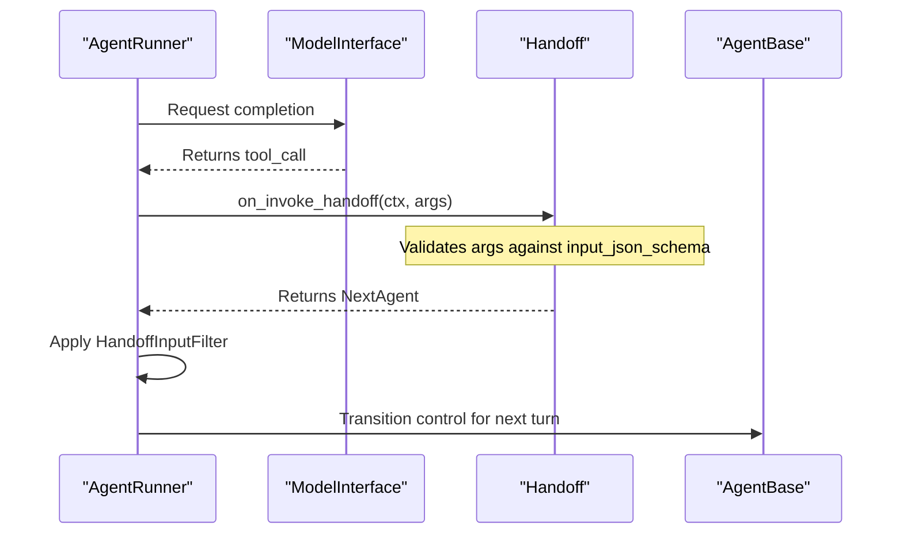
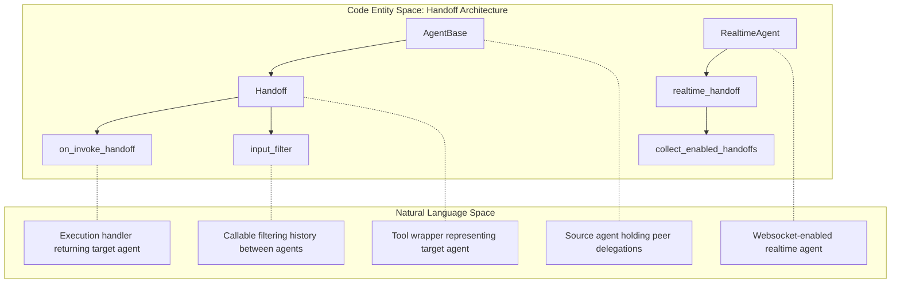

<!-- source: DeepWiki mcp.deepwiki.com · repo openai/openai-agents-python · page 5.1 Handoff System · fetched 2026-10-26 -->

# Handoff System

Relevant source files

The following files were used as context for generating this wiki page:

- [src/agents/handoffs/__init__.py](src/agents/handoffs/__init__.py)
- [src/agents/realtime/handoffs.py](src/agents/realtime/handoffs.py)
- [src/agents/util/_transforms.py](src/agents/util/_transforms.py)
- [tests/realtime/test_realtime_handoffs.py](tests/realtime/test_realtime_handoffs.py)
- [tests/test_handoff_tool.py](tests/test_handoff_tool.py)
- [tests/test_tool_use_behavior.py](tests/test_tool_use_behavior.py)
- [tests/test_transforms.py](tests/test_transforms.py)

The purpose of this page is to document the handoff system in the OpenAI Agents SDK, which enables peer-to-peer delegation between agents. When an agent invokes a handoff, control transfers to the target agent, which continues the conversation with access to prior history. This differs from the manager pattern (agents-as-tools), where the calling agent retains control and interprets the nested agent's output.

---

## Core Concepts

### Handoff Representation

Handoffs are exposed to the LLM as tools. The SDK converts each `Handoff` object into a tool definition that the model can invoke. The default tool name follows the pattern `transfer_to_<agent_name>` [src/agents/handoffs/__init__.py:1-172](), generated via name transformation utilities.

**Key Classes:**
- **`Handoff[TContext, TAgent]`** [src/agents/handoffs/__init__.py:126-172]() - The core handoff specification defining tool names, schemas, and invocation hooks.
- **`HandoffInputData`** [src/agents/handoffs/__init__.py:71-116]() - Encapsulates the conversation state passed to the next agent.
- **`HandoffInputFilter`** [src/agents/handoffs/__init__.py:118-119]() - A type alias for functions that transform `HandoffInputData` before the next agent runs.

### Handoff Lifecycle

When a handoff is invoked:
1. The LLM generates a tool call targeting a handoff tool.
2. The SDK identifies the handoff and executes `on_invoke_handoff` [src/agents/handoffs/__init__.py:49-68]().
3. Optional callbacks execute, receiving structured data defined by `input_type` [src/agents/realtime/handoffs.py:108-176]().
4. The `input_filter` (if configured) transforms the conversation history [src/agents/handoffs/__init__.py:158-172]().
5. Control switches to the target agent.

Sources: [src/agents/handoffs/__init__.py:71-172](), [src/agents/realtime/handoffs.py:108-176]()

---

## Handoff Configuration

### The `handoff()` Function

The `handoff()` helper creates `Handoff` instances with custom tool names, descriptions, input schemas, and filters.

**Key Parameters:**
- `input_type`: The schema for the handoff tool-call arguments. When set, the SDK exposes that schema to the model as the handoff tool's `parameters` [src/agents/handoffs/__init__.py:140-146]().
- `is_enabled`: Can be a boolean or a callable that determines whether the handoff is active at runtime based on `RunContextWrapper` [src/agents/realtime/handoffs.py:35-53]().

### Realtime Handoffs

For `RealtimeAgent` instances, the SDK provides `realtime_handoff()` [src/agents/realtime/handoffs.py:108-176](). Note that `input_filter` is not supported for `RealtimeAgent` handoffs [src/agents/realtime/handoffs.py:131]().

Sources: [src/agents/handoffs/__init__.py:126-172](), [src/agents/realtime/handoffs.py:35-176]()

---

## Input Filtering and History Management

### HandoffInputData Structure

The `HandoffInputData` object encapsulates the conversation state at handoff time [src/agents/handoffs/__init__.py:71-116]().

**Diagram: HandoffInputData Mapping**

Sources: [src/agents/handoffs/__init__.py:71-116]()

### Input Filter Function

The `input_filter` transforms the conversation state. It is a function that receives `HandoffInputData` and returns a modified version [src/agents/handoffs/__init__.py:118-119]().

Sources: [src/agents/handoffs/__init__.py:118-172]()

---

## Nested Handoff History

### History Collapsing Feature

When `nest_handoff_history=True`, the SDK collapses the prior conversation into a summary block [src/agents/handoffs/__init__.py:170-172]().

**Diagram: History Collapsing Transformation**

Sources: [src/agents/handoffs/__init__.py:170-172](), [src/agents/handoffs/history.py:27-33]()

### Implementation of Summary

The system uses a `HandoffHistoryMapper` to map previous transcripts to a summary payload [src/agents/handoffs/__init__.py:121-122](). 

Sources: [src/agents/handoffs/__init__.py:121-122](), [src/agents/handoffs/history.py:27-33]()

---

## Handoff Execution Flow

### Execution Sequence

The handoff process is triggered by the LLM selecting a tool that maps to a `Handoff` object.

**Diagram: Handoff Invocation Sequence**

Sources: [src/agents/handoffs/__init__.py:49-68](), [src/agents/handoffs/__init__.py:126-172]()

### Entity Relationship Mapping

**Diagram: Entity Relationship Mapping**

Sources: [src/agents/handoffs/__init__.py:126-172](), [src/agents/realtime/handoffs.py:55-176]()

---

