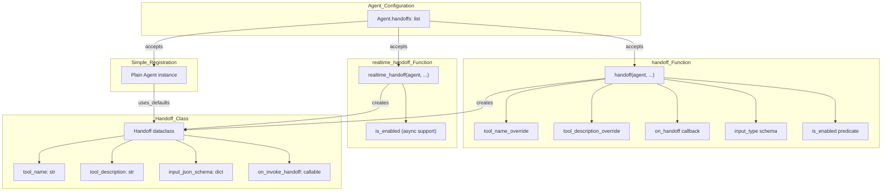
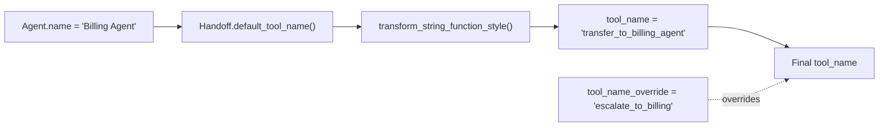
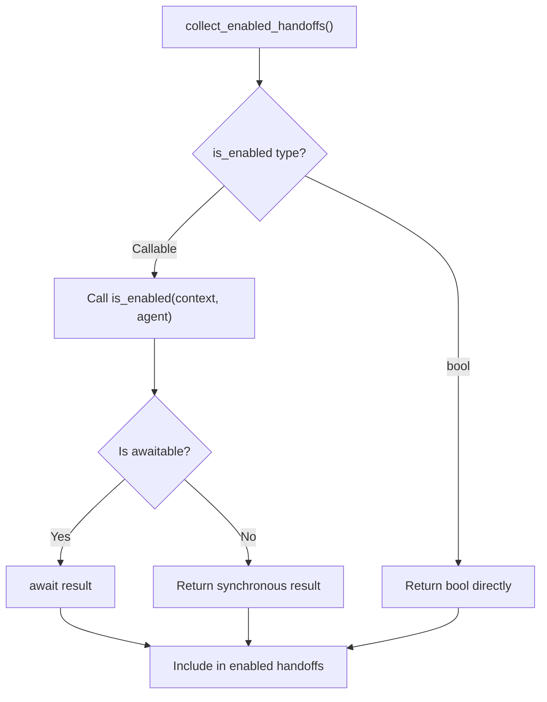

<!-- source: DeepWiki mcp.deepwiki.com · repo openai/openai-agents-python · page 5.3 Handoff Configuration · fetched 2026-10-26 -->

# Handoff Configuration

Relevant source files

The following files were used as context for generating this wiki page:

- [src/agents/handoffs/__init__.py](src/agents/handoffs/__init__.py)
- [src/agents/realtime/handoffs.py](src/agents/realtime/handoffs.py)
- [src/agents/util/_transforms.py](src/agents/util/_transforms.py)
- [tests/realtime/test_realtime_handoffs.py](tests/realtime/test_realtime_handoffs.py)
- [tests/test_handoff_tool.py](tests/test_handoff_tool.py)
- [tests/test_tool_use_behavior.py](tests/test_tool_use_behavior.py)
- [tests/test_transforms.py](tests/test_transforms.py)

## Purpose and Scope

This page documents the full technical configuration options for agent handoffs within the OpenAI Agents SDK. It details the `handoff()` factory function, the `Handoff` class, the `realtime_handoff()` function for realtime agents, and key configuration attributes such as `tool_name_override`, `tool_description_override`, `on_handoff` callbacks, `input_type` schemas, and dynamic enablement predicates (`is_enabled`). For broader conceptual coverage of multi-agent patterns, see [Handoff System](#5.1) and [Manager Pattern vs Handoffs](#5.2). For details regarding conversation history filtering and nesting across handoffs, see [Handoff History Management](#5.4).

Sources: [src/agents/handoffs/__init__.py:125-194](), [src/agents/realtime/handoffs.py:108-132]()

---

## Overview and Configuration Entry Points

Handoffs enable an agent to delegate execution to another agent by exposing a tool to the underlying LLM [src/agents/handoffs/__init__.py:127-132](). When the model invokes this tool, the SDK captures the invocation, executes optional pre-handoff logic, and switches the active agent context for subsequent turns. 

Configuration can be established through several paths:
- **Plain Agent Instance**: Passing an `Agent` directly in `handoffs=[]` utilizes default tool naming and descriptions [tests/test_handoff_tool.py:51-52]().
- **`handoff()` Factory Function**: Provides fine-grained parameter customization for standard agents [src/agents/handoffs/__init__.py:228-342]().
- **`Handoff` Dataclass**: Direct instantiation for advanced or programmatic custom handoff objects [src/agents/handoffs/__init__.py:125-172]().
- **`realtime_handoff()` Function**: Specialized configuration for `RealtimeAgent` workflows supporting asynchronous enablement checks [src/agents/realtime/handoffs.py:108-116]().

**Diagram: Handoff Configuration Architecture**

Sources: [src/agents/handoffs/__init__.py:125-172](), [src/agents/realtime/handoffs.py:108-116](), [tests/test_handoff_tool.py:51-52]()

---

## The `Handoff` Class

The `Handoff` generic dataclass encapsulates all runtime properties required to expose and execute a delegation target [src/agents/handoffs/__init__.py:125-126]().

| Field | Type | Description |
|-------|------|-------------|
| `tool_name` | `str` | Name of the tool exposed to the LLM (e.g., `transfer_to_billing_agent`) [src/agents/handoffs/__init__.py:134-135]() |
| `tool_description` | `str` | Description shown to the LLM explaining when to invoke the handoff [src/agents/handoffs/__init__.py:137-138]() |
| `input_json_schema` | `dict[str, Any]` | JSON schema describing structured tool arguments passed to `on_invoke_handoff` [src/agents/handoffs/__init__.py:140-146]() |
| `on_invoke_handoff` | `Callable` | Async function executing the handoff, taking run context and input JSON, returning target agent [src/agents/handoffs/__init__.py:148-153]() |
| `agent_name` | `str` | Name identifier of the destination agent being handed off to [src/agents/handoffs/__init__.py:155-156]() |
| `input_filter` | `HandoffInputFilter \| None` | Optional transformation function applied to conversation history before forwarding [src/agents/handoffs/__init__.py:158-172]() |
| `is_enabled` | `bool \| Callable` | Evaluation rule (`bool` or callable) controlling runtime visibility of the handoff tool [src/agents/handoffs/__init__.py:186-194]() |

Sources: [src/agents/handoffs/__init__.py:125-194]()

---

## Configuration Parameters

### Tool Name and Description Resolution

By default, the tool name is derived from the target agent's name transformed into valid function identifier format via `transform_string_function_style()` [src/agents/util/_transforms.py:6-23](), prefixed with `transfer_to_`.

**Diagram: Tool Name Generation and Override Flow**

- **`tool_name_override`**: Explicitly overrides the automatically derived tool function identifier to resolve name collisions or tailor naming conventions [tests/test_handoff_tool.py:107-124]().
- **`tool_description_override`**: Replaces the default LLM-facing description to provide precise routing context.

Sources: [src/agents/handoffs/__init__.py:134-138](), [src/agents/util/_transforms.py:6-23](), [tests/test_handoff_tool.py:107-124]()

### `on_handoff` Callback and `input_type`

The `on_handoff` parameter registers a callback executed upon handoff tool invocation [src/agents/handoffs/__init__.py:228-342](). When combined with `input_type` (typically a Pydantic model), the LLM must provide structured parameters satisfying that schema, which are validated using a `TypeAdapter` before execution [src/agents/handoffs/__init__.py:11-12]().

Sources: [src/agents/handoffs/__init__.py:11-12](), [src/agents/realtime/handoffs.py:133-144]()

### Dynamic Enablement (`is_enabled`)

The `is_enabled` parameter supports boolean flags or callables taking the run context and agent instance [src/agents/realtime/handoffs.py:42-49](). If a callable returns `False`, the handoff tool is omitted from the LLM tool definitions at runtime. In realtime agent environments, enablement checks can be asynchronous and execute concurrently with cancellation support [src/agents/realtime/handoffs.py:42-52]().

**Diagram: Dynamic Enablement Evaluation Pipeline**

Sources: [src/agents/realtime/handoffs.py:35-52]()

---

## Realtime Handoff Configuration

For `RealtimeAgent` instances, handoffs are configured via `realtime_handoff()` [src/agents/realtime/handoffs.py:108-116](). While sharing core parameters (`tool_name_override`, `tool_description_override`, `is_enabled`), realtime handoffs do not support `input_filter` [src/agents/realtime/handoffs.py:131-132]() and strictly enforce signature validation on `on_handoff` callbacks depending on whether an `input_type` is specified [src/agents/realtime/handoffs.py:133-152]().

Sources: [src/agents/realtime/handoffs.py:108-183](), [tests/realtime/test_realtime_handoffs.py:19-48]()

---

## Handoff Input Data Structure

The `HandoffInputData` dataclass packages the execution context and conversation fragments transferred during a delegation event [src/agents/handoffs/__init__.py:71-88]():
- `input_history`: Original input history prior to `Runner.run()` [src/agents/handoffs/__init__.py:71-75]().
- `pre_handoff_items`: Items generated prior to the handoff turn [src/agents/handoffs/__init__.py:77-80]().
- `new_items`: Items generated during the current turn, including the triggering tool call and output [src/agents/handoffs/__init__.py:82-86]().
- `input_items`: Optional filtered subset of items passed to the next agent's model input while keeping session history intact [src/agents/handoffs/__init__.py:94-99]().

Sources: [src/agents/handoffs/__init__.py:71-100]()

---

