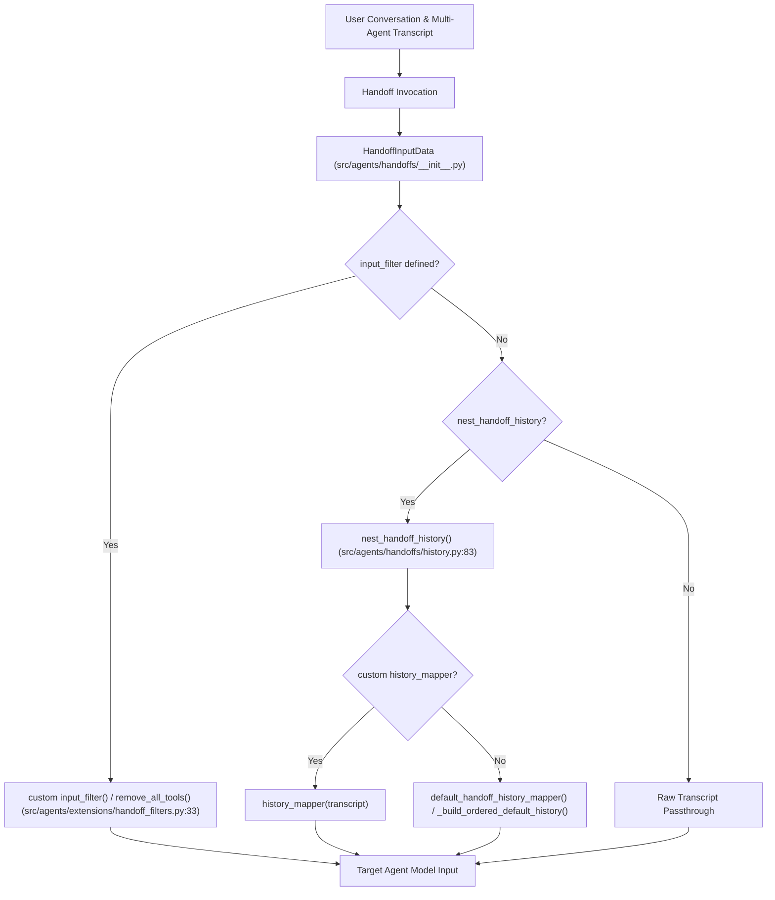
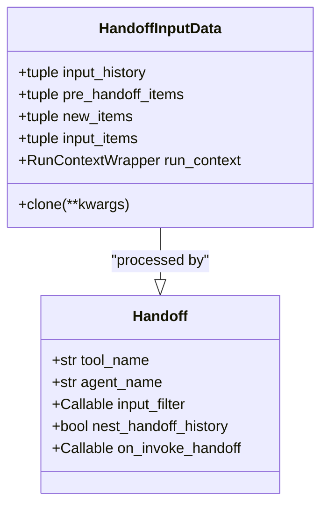
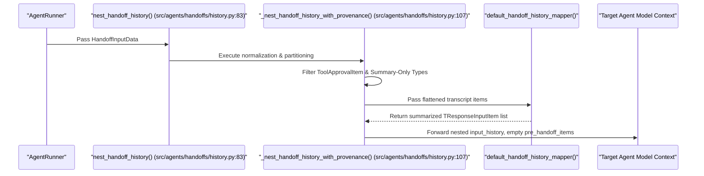
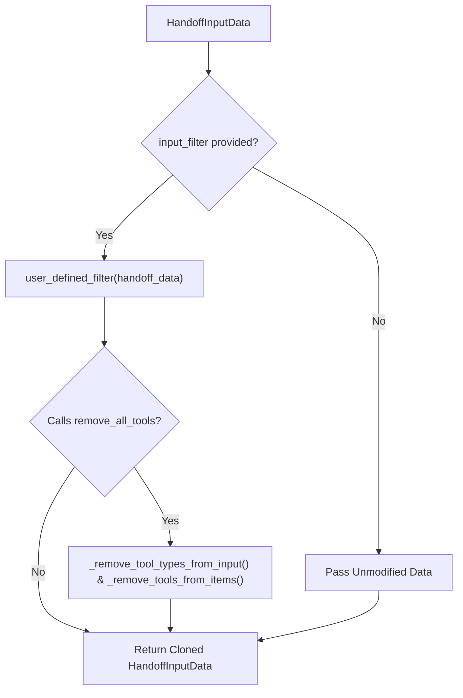

<!-- source: DeepWiki mcp.deepwiki.com · repo openai/openai-agents-python · page 5.4 Handoff History Management · fetched 2026-10-26 -->

# Handoff History Management

Relevant source files

The following files were used as context for generating this wiki page:

- [examples/handoffs/message_filter.py](examples/handoffs/message_filter.py)
- [examples/handoffs/message_filter_streaming.py](examples/handoffs/message_filter_streaming.py)
- [examples/hosted_mcp/simple.py](examples/hosted_mcp/simple.py)
- [examples/mcp/sse_remote_example/README.md](examples/mcp/sse_remote_example/README.md)
- [examples/mcp/streamable_http_remote_example/README.md](examples/mcp/streamable_http_remote_example/README.md)
- [examples/research_bot/agents/writer_agent.py](examples/research_bot/agents/writer_agent.py)
- [examples/voice/static/main.py](examples/voice/static/main.py)
- [examples/voice/static/util.py](examples/voice/static/util.py)
- [src/agents/extensions/handoff_filters.py](src/agents/extensions/handoff_filters.py)
- [src/agents/handoffs/history.py](src/agents/handoffs/history.py)
- [tests/test_extension_filters.py](tests/test_extension_filters.py)
- [tests/test_handoff_history_duplication.py](tests/test_handoff_history_duplication.py)
- [tests/test_programmatic_tool_calling.py](tests/test_programmatic_tool_calling.py)

This document explains how conversation history is managed during agent handoffs, covering the opt-in `nest_handoff_history` summarization feature, custom `handoff_history_mapper` transformations, `input_filter` customization, and the technical distinction between session storage and model input.

---

## Overview and Scope

When an agent executes a handoff to another agent, the target agent requires context to continue the conversation. By default, the SDK passes the complete conversation transcript—including all user messages, assistant responses, intermediate reasoning steps, and tool calls. 

As multi-agent workflows grow longer, passing full transcripts can exhaust token limits and degrade performance. The SDK provides three main mechanisms to control and curate what history the next agent sees:

1. **`nest_handoff_history`**: Opt-in summarization feature that compresses prior transcript history into a single assistant summary block [src/agents/handoffs/history.py:83-94]().
2. **`handoff_history_mapper`**: A custom mapper function that transforms raw transcript history into structured inputs [src/agents/handoffs/history.py:86-86]().
3. **`input_filter`**: Full user-defined transformation of `HandoffInputData` before the handoff reaches the target agent [src/agents/handoffs/history.py:18-19]().

> **Note:** `input_filter` is not supported for `RealtimeAgent` handoffs [src/agents/realtime/handoffs.py:131-131]().

**Diagram: Natural Language Space to Code Entity Space — History Management Pipeline**

Sources: [src/agents/handoffs/history.py:83-94](), [src/agents/extensions/handoff_filters.py:33-56]()

---

## Default Behavior: Full History Passthrough

By default, when Agent A transfers control to Agent B, the runner packages the entire accumulated session history into the input for Agent B. 

**Diagram: Data Structures in Handoff Passthrough**

Sources: [src/agents/handoffs/history.py:83-167]()

---

## nest_handoff_history: Conversation Summarization

The `nest_handoff_history` function compresses prior conversation turns into a single summary block, reducing token consumption while preserving overall context [src/agents/handoffs/history.py:83-98]().

### Implementation Details and Deduplication

When `nest_handoff_history` is invoked:
1. **Normalization**: `_normalize_input_history()` normalizes input history strings or tuples [src/agents/handoffs/history.py:104-114]().
2. **Item Filtering**: Utility items such as `ToolApprovalItem` are omitted from the summary transcript [src/agents/handoffs/history.py:123-124]().
3. **Summarization & Mapping**: The transcript is passed to `history_mapper` or compiled via `_build_ordered_default_history()` [src/agents/handoffs/history.py:140-147]().
4. **Deduplication**: Function calls and function outputs (`_SUMMARY_ONLY_INPUT_TYPES`) are stripped from raw item lists to prevent duplication in model prompts [src/agents/handoffs/history.py:44-49]().

**Diagram: Natural Language Space to Code Entity Space — Summarization & Deduplication Workflow**

Sources: [src/agents/handoffs/history.py:44-167]()

---

## input_filter and Extension Filters (`remove_all_tools`)

The `input_filter` parameter on `handoff()` allows arbitrary programmatic transformation of `HandoffInputData` [src/agents/extensions/handoff_filters.py:33-56]().

### `remove_all_tools` Utility

The SDK provides `remove_all_tools()` in `agents.extensions.handoff_filters` to strip all tool invocation records, search queries, reasoning tokens, and MCP-related artifacts before passing history to the next agent [src/agents/extensions/handoff_filters.py:33-56](). It targets tool types such as `function_call`, `computer_call`, `code_interpreter_call`, `web_search_call`, `mcp_call`, and `local_shell_call` [src/agents/extensions/handoff_filters.py:80-110]().

**Diagram: Handoff Filtering Architecture**

Sources: [src/agents/extensions/handoff_filters.py:33-118]()

---

## Session Storage vs Model Input

A core design principle in the SDK is the separation between **session storage** (persistent audit trail) and **model input** (what the LLM processes in its context window).

| Dimension | Session Storage (`new_items`) | Model Input (`input_history` / `input_items`) |
| :--- | :--- | :--- |
| **Purpose** | Retains full, lossless record of conversation for persistence and debugging | Curated, filtered, or summarized context for the incoming agent turn |
| **Mutation** | Preserved raw across handoffs | Transformed via `input_filter`, `nest_handoff_history`, or mappers |
| **Code Reference** | `handoff_input_data.new_items` [src/agents/handoffs/history.py:130-135]() | `handoff_input_data.input_history` [src/agents/handoffs/history.py:114-118]() |

Sources: [src/agents/handoffs/history.py:114-167](), [src/agents/extensions/handoff_filters.py:33-56]()

---

