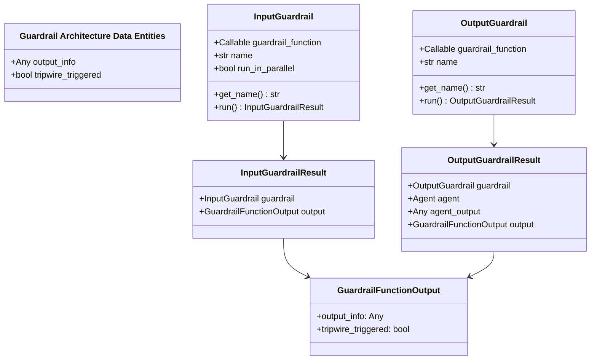
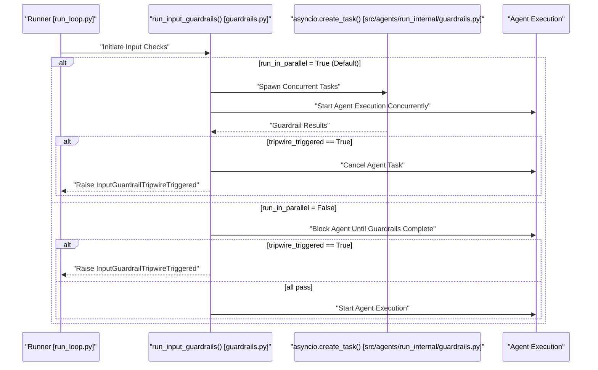
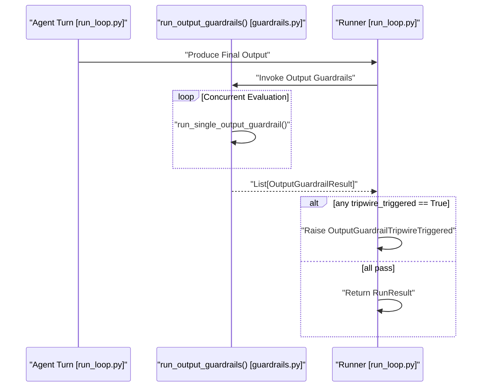

<!-- source: DeepWiki mcp.deepwiki.com · repo openai/openai-agents-python · page 6.1 Guardrail Architecture · fetched 2026-10-26 -->

# Guardrail Architecture

<details>
<summary>Relevant source files</summary>

The following files were used as context for generating this wiki page:

- [examples/agent_patterns/README.md](examples/agent_patterns/README.md)
- [examples/agent_patterns/human_in_the_loop.py](examples/agent_patterns/human_in_the_loop.py)
- [examples/agent_patterns/human_in_the_loop_server.py](examples/agent_patterns/human_in_the_loop_server.py)
- [src/agents/guardrail.py](src/agents/guardrail.py)
- [src/agents/run_internal/guardrails.py](src/agents/run_internal/guardrails.py)
- [src/agents/util/_pretty_print.py](src/agents/util/_pretty_print.py)
- [tests/test_guardrails.py](tests/test_guardrails.py)
- [tests/test_human_in_the_loop_server_example.py](tests/test_human_in_the_loop_server_example.py)
- [tests/test_pretty_print.py](tests/test_pretty_print.py)
- [tests/test_tool_guardrails.py](tests/test_tool_guardrails.py)
- [tests/utils/test_pretty_print_and_items.py](tests/utils/test_pretty_print_and_items.py)

</details>


## Purpose and Scope

This page provides a comprehensive technical overview of the guardrail system in the OpenAI Agents SDK (`openai/openai-agents-python`). It covers the internal architecture, execution pipelines, data structures, concurrency controls, tripwire mechanisms, and tracing integrations that enforce safety and compliance policies on agent inputs, outputs, and tool usage. For practical usage patterns, see **6.2 Input and Output Guardrails** and **6.3 Tool Guardrails**.

Sources: [src/agents/guardrail.py:1-186](), [src/agents/run_internal/guardrails.py:1-251]()

---

## Overview

The guardrail system provides validation layers that execute at critical junctures of an agent's lifecycle. Guardrails are encapsulated by core classes defined in `src/agents/guardrail.py` and executed via internal runner logic in `src/agents/run_internal/guardrails.py` [src/agents/guardrail.py:72-186](), [src/agents/run_internal/guardrails.py:31-52](). 

Guardrail functions receive contextual information and return a `GuardrailFunctionOutput` containing optional output metadata and a `tripwire_triggered` boolean flag [src/agents/guardrail.py:20-32](). When a tripwire triggers, execution halts immediately and raises a specific exception [src/agents/run_internal/guardrails.py:157](), [src/agents/run_internal/guardrails.py:204]().

| Guardrail Type | Code Entity / Class | Execution Point | Result Type |
|----------------|---------------------|-----------------|-------------|
| **Input Guardrails** | `InputGuardrail` [src/agents/guardrail.py:72]() | Before or during first agent invocation | `InputGuardrailResult` [src/agents/guardrail.py:36]() |
| **Output Guardrails** | `OutputGuardrail` [src/agents/guardrail.py:134]() | After final agent output generation | `OutputGuardrailResult` [src/agents/guardrail.py:49]() |
| **Tool Guardrails** | `ToolInputGuardrail` / `ToolOutputGuardrail` [tests/test_tool_guardrails.py:13-16]() | Before and after function tool execution | `ToolGuardrailFunctionOutput` [tests/test_tool_guardrails.py:12]() |

Sources: [src/agents/guardrail.py:20-69](), [src/agents/guardrail.py:72-84](), [src/agents/run_internal/guardrails.py:157](), [src/agents/run_internal/guardrails.py:204]()

---

## Guardrail Execution Points

The guardrail system hooks into the execution lifecycle managed by the runner (`src/agents/run_internal/guardrails.py`) and tool pipelines (`tests/test_tool_guardrails.py`). 

Title: "Guardrail Lifecycle Integration & Code Mapping"
```mermaid
graph TB
    subgraph "NaturalLanguageSpace["Natural Language / User Workflow"]"
        NL_Input["Initial User Prompt"]
        NL_Agent["Agent Processing Turns"]
        NL_Output["Final Agent Response"]
        NL_Tool["Tool Invocation Request"]
    end

    subgraph "CodeEntitySpace["Code Entity Pipeline [src/agents/run_internal/guardrails.py]"]"
        RunInput["run_input_guardrails()<br/>InputGuardrail.run()"]
        RunTurn["Runner Turn Loop<br/>run_loop.py"]
        RunOutput["run_output_guardrails()<br/>OutputGuardrail.run()"]
        ToolPipeline["Tool Execution Pipeline<br/>tests/test_tool_guardrails.py"]
    end

    NL_Input --> RunInput
    RunInput -->|"tripwire=False"| RunTurn
    RunInput -->|"tripwire=True"| Err1["Raise InputGuardrailTripwireTriggered"]
    
    RunTurn --> RunOutput
    RunOutput -->|"tripwire=False"| NL_Output
    RunOutput -->|"tripwire=True"| Err2["Raise OutputGuardrailTripwireTriggered"]

    RunTurn -.->|"Function Call"| ToolPipeline
```

Sources: [src/agents/run_internal/guardrails.py:31-112](), [src/agents/run_internal/guardrails.py:115-206](), [src/agents/guardrail.py:72-186]()

---

## Core Components and Data Structures

### Guardrail Data Entities

All guardrail results are encapsulated in strongly-typed data structures defined in `src/agents/guardrail.py`.

Title: "Guardrail Class Hierarchy [src/agents/guardrail.py]"


### Function Signatures and Decorators

Guardrails can be instantiated manually or declared using decorators from `agents.guardrail` [src/agents/guardrail.py:202-215]():

```python
# Input Guardrail definition pattern [src/agents/guardrail.py:86-89]
async def my_input_guardrail(
    context: RunContextWrapper[TContext], 
    agent: Agent[Any], 
    input: str | list[TResponseInputItem]
) -> GuardrailFunctionOutput: ...

# Output Guardrail definition pattern [src/agents/guardrail.py:145-148]
async def my_output_guardrail(
    context: RunContextWrapper[TContext], 
    agent: Agent[Any], 
    agent_output: Any
) -> GuardrailFunctionOutput: ...
```

Sources: [src/agents/guardrail.py:19-186](), [src/agents/guardrail.py:202-215]()

---

## Execution Pipeline

### Input Guardrail Pipeline

Input guardrails support two execution modes controlled by `run_in_parallel` [src/agents/guardrail.py:100-103]():
1. **Parallel execution** (`run_in_parallel=True`, default): Guardrails execute concurrently alongside the initial agent runner invocation via `asyncio.create_task()` [src/agents/run_internal/guardrails.py:66-69](). If a tripwire triggers, sibling tasks are cancelled and `InputGuardrailTripwireTriggered` is raised [src/agents/run_internal/guardrails.py:79-84]().
2. **Blocking execution** (`run_in_parallel=False`): Guardrails complete fully before agent execution starts [src/agents/run_internal/guardrails.py:115-168]().

Title: "Input Guardrail Concurrency and Tripwire Flow [src/agents/run_internal/guardrails.py]"


Sources: [src/agents/guardrail.py:100-103](), [src/agents/run_internal/guardrails.py:55-168]()

### Output Guardrail Pipeline

Output guardrails inspect final agent outputs. If multiple output guardrails run in parallel and any single guardrail trips, outstanding tasks are cancelled and cleaned up [src/agents/run_internal/guardrails.py:171-206]().

Title: "Output Guardrail Execution Pipeline"


Sources: [src/agents/run_internal/guardrails.py:171-206]()

---

## Tripwire Mechanism and Tracing Integration

When a guardrail tripwire condition is met (`tripwire_triggered=True`), the execution flow halts immediately. Depending on the pipeline stage, specific exceptions are thrown:
- `InputGuardrailTripwireTriggered` [src/agents/run_internal/guardrails.py:157]()
- `OutputGuardrailTripwireTriggered` [src/agents/run_internal/guardrails.py:204]()

### Tracing Spans

Every guardrail invocation is wrapped in a `guardrail_span` context manager [src/agents/run_internal/guardrails.py:37,49](). The span records the guardrail name and attaches error details if a tripwire triggers or an exception occurs [src/agents/run_internal/guardrails.py:37-40](), [src/agents/run_internal/guardrails.py:85-96]().

Sources: [src/agents/guardrail.py:20-32](), [src/agents/run_internal/guardrails.py:37-52](), [src/agents/run_internal/guardrails.py:85-96]()

---

