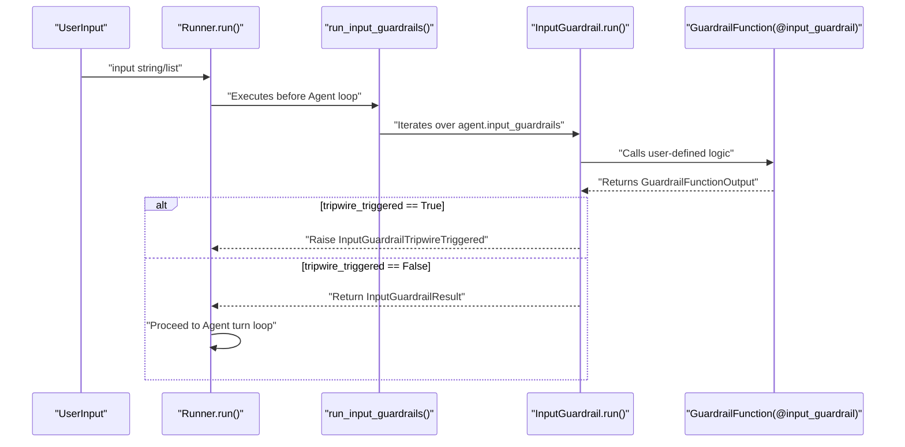
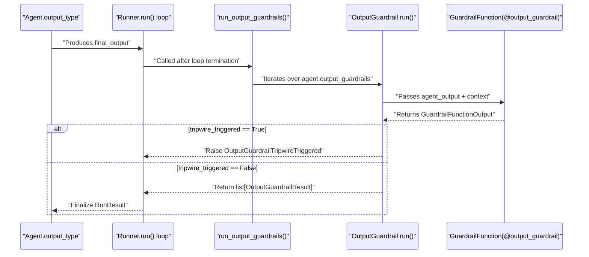

<!-- source: DeepWiki mcp.deepwiki.com · repo openai/openai-agents-python · page 6.2 Input and Output Guardrails · fetched 2026-10-26 -->

# Input and Output Guardrails

Relevant source files

The following files were used as context for generating this wiki page:

- [examples/agent_patterns/README.md](examples/agent_patterns/README.md)
- [examples/agent_patterns/human_in_the_loop.py](examples/agent_patterns/human_in_the_loop.py)
- [examples/agent_patterns/human_in_the_loop_server.py](examples/agent_patterns/human_in_the_loop_server.py)
- [src/agents/guardrail.py](src/agents/guardrail.py)
- [tests/test_human_in_the_loop_server_example.py](tests/test_human_in_the_loop_server_example.py)

This page describes input and output guardrails, which validate user input and agent output respectively. Input guardrails run before or in parallel with the first agent processing input, and output guardrails run after the final agent produces output.

## Purpose and Boundaries

Input and output guardrails operate at conversation boundaries within the `Runner` execution loop:

- **Input guardrails** validate the initial user input before any agent execution begins (or concurrently with it) [src/agents/guardrail.py:73-77]().
- **Output guardrails** validate the final agent output before returning results to the user [src/agents/guardrail.py:135-136]().

**Key Implementation Details:**
- **Input guardrails** are instances of the `InputGuardrail` class [src/agents/guardrail.py:72-84]().
- **Output guardrails** are instances of the `OutputGuardrail` class [src/agents/guardrail.py:134-142]().
- Both use a `GuardrailFunctionOutput` to signal if a "tripwire" was triggered [src/agents/guardrail.py:20-33]().

**Important boundaries:**
- Input guardrails run only for the **first agent** in a `Runner.run` call.
- Output guardrails run only for the **agent that produces the final output**.
- Neither type runs for intermediate handoffs or tool invocations within a multi-agent workflow; for per-tool validation, **Tool Guardrails** should be used instead.

Sources: [src/agents/guardrail.py:1-185](), [examples/agent_patterns/README.md:49-58]()

## Guardrail Logic Flow

The following diagrams bridge the Natural Language concepts to the Code Entities responsible for guardrail execution.

### Input Guardrail Execution (Natural Language to Code Entity Space)

Sources: [src/agents/guardrail.py:111-130]()

### Output Guardrail Execution (Natural Language to Code Entity Space)

Sources: [src/agents/guardrail.py:165-185]()

## Core Data Structures

### GuardrailFunctionOutput
This is the standard return type for any guardrail function [src/agents/guardrail.py:20-33]().

| Field | Type | Purpose |
|-------|------|---------|
| `tripwire_triggered` | `bool` | If `True`, halts execution and raises an exception [src/agents/guardrail.py:29-32](). |
| `output_info` | `Any` | Optional metadata about the guardrail's internal checks [src/agents/guardrail.py:23-27](). |

### Result Wrappers
The SDK wraps function outputs into result objects for tracing and history:
- **`InputGuardrailResult`**: Contains the `InputGuardrail` instance and its output [src/agents/guardrail.py:36-46]().
- **`OutputGuardrailResult`**: Contains the `OutputGuardrail` instance, the agent that produced the output, the agent itself, and the guardrail result [src/agents/guardrail.py:49-69]().

Sources: [src/agents/guardrail.py:19-70]()

## Decorator Patterns

### @input_guardrail
Used to transform a standard function into an `InputGuardrail` [src/agents/guardrail.py:201-215]().

- **`run_in_parallel`**: If `True` (default), the guardrail runs concurrently with the agent's first LLM call to minimize latency [src/agents/guardrail.py:100-103](). If `False`, the runner ensures the guardrail completes before the agent starts, preventing token consumption if the tripwire is triggered.

### @output_guardrail
Used to transform a function into an `OutputGuardrail`.

Sources: [src/agents/guardrail.py:1-215]()

## Execution Strategies

Guardrails are managed internally to allow for parallel or sequential processing:

1. **Parallel Execution**: Input guardrails with `run_in_parallel=True` are launched as concurrent tasks [src/agents/guardrail.py:100-103](). If they trigger a tripwire, execution halts immediately.
2. **Sequential Execution**: If `run_in_parallel=False`, the runner blocks until the input guardrails complete before proceeding with agent turns [src/agents/guardrail.py:100-103]().
3. **Tripwire Handling**: When `tripwire_triggered` is `True`, an exception (`InputGuardrailTripwireTriggered` or `OutputGuardrailTripwireTriggered`) is raised, interrupting the normal run lifecycle [src/agents/guardrail.py:81-84]().

Sources: [src/agents/guardrail.py:71-186]()

## Implementation Example: LLM-Based Input Guardrail

A common pattern is using a secondary checking agent inside a guardrail function to evaluate input safety or classification before letting the primary agent process the prompt [examples/agent_patterns/README.md:49-58]().

When a tripwire triggers, the `Runner` raises the corresponding tripwire exception containing the `InputGuardrailResult` or `OutputGuardrailResult`.

Sources: [examples/agent_patterns/README.md:49-58](), [src/agents/guardrail.py:19-84]()

## Exception Handling

The SDK defines specific exceptions for guardrail violations:
- **`InputGuardrailTripwireTriggered`**: Raised when an input guardrail trips [src/agents/guardrail.py:81-84]().
- **`OutputGuardrailTripwireTriggered`**: Raised when an output guardrail trips [src/agents/guardrail.py:141-142]().

These exceptions should be caught in the main execution loop to handle validation refusals or safety fallbacks gracefully.

Sources: [src/agents/guardrail.py:71-143]()

---

