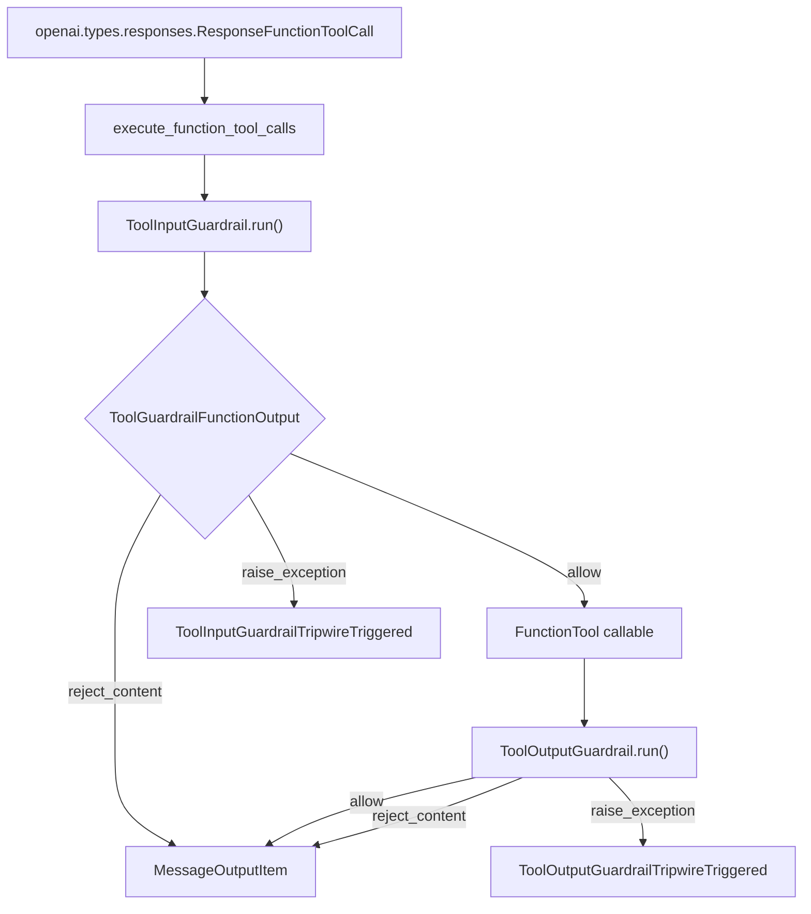
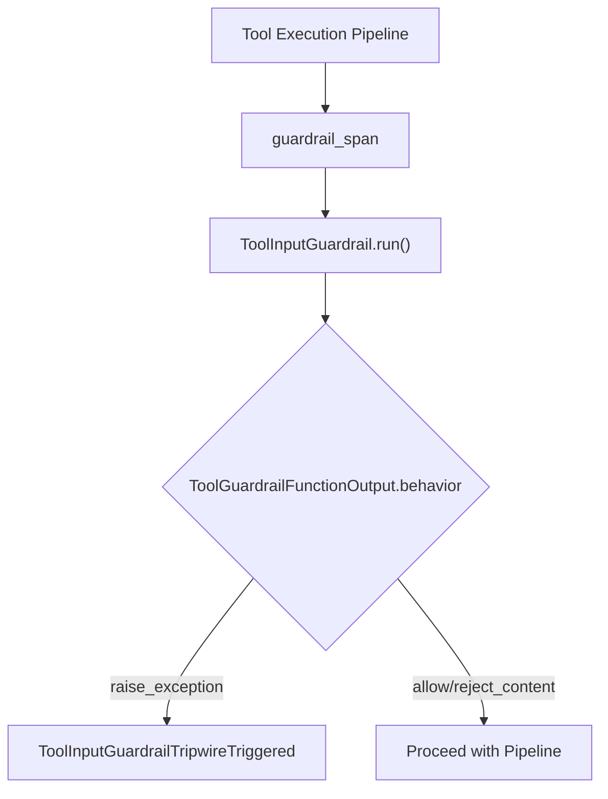

<!-- source: DeepWiki mcp.deepwiki.com · repo openai/openai-agents-python · page 6.3 Tool Guardrails · fetched 2026-10-26 -->

# Tool Guardrails

<details>
<summary>Relevant source files</summary>

The following files were used as context for generating this wiki page:

- [examples/agent_patterns/agents_as_tools_conditional.py](examples/agent_patterns/agents_as_tools_conditional.py)
- [examples/basic/tool_guardrails.py](examples/basic/tool_guardrails.py)
- [examples/tools/web_search_filters.py](examples/tools/web_search_filters.py)
- [src/agents/decorators.py](src/agents/decorators.py)
- [src/agents/run_internal/guardrails.py](src/agents/run_internal/guardrails.py)
- [src/agents/tool_guardrails.py](src/agents/tool_guardrails.py)
- [src/agents/util/_pretty_print.py](src/agents/util/_pretty_print.py)
- [tests/test_decorators.py](tests/test_decorators.py)
- [tests/test_guardrails.py](tests/test_guardrails.py)
- [tests/test_pretty_print.py](tests/test_pretty_print.py)
- [tests/test_tool_guardrails.py](tests/test_tool_guardrails.py)
- [tests/utils/test_pretty_print_and_items.py](tests/utils/test_pretty_print_and_items.py)

</details>


## Purpose and Scope

Tool guardrails provide per-tool validation and safety checks for individual function tool invocations [src/agents/tool_guardrails.py:152-166](). They execute immediately before and after each function tool call, enabling you to inspect arguments, validate inputs, block execution, reject content with a custom message to the model, or trigger tripwires that halt the agent run.

Tool guardrails differ from agent-level guardrails in their execution boundaries:

- **Agent input/output guardrails** run at workflow boundaries (input guardrails for user input, output guardrails for the final agent response).
- **Tool guardrails** run on every invocation of a function tool, regardless of which agent in a multi-agent workflow triggers the tool.

Use tool guardrails when you require granular validation for sensitive operations, such as database modifications, file writes, or credential requests. They apply directly to function tools created with `@function_tool` or the `@tool` alias [src/agents/decorators.py:7-10]().

Sources: [src/agents/decorators.py:1-19](), [src/agents/tool_guardrails.py:152-166](), [src/agents/tool_guardrails.py:181-197]()

---

## Architecture Overview

Tool guardrails integrate into the function tool execution pipeline at two core stages: pre-execution via `ToolInputGuardrail` and post-execution via `ToolOutputGuardrail`. The SDK validates safety compliance before passing arguments to the underlying tool function and before returning outputs to the model.

### Tool Guardrail Execution Pipeline



**Diagram: Tool Guardrail Pipeline Entities**

Tool guardrails receive a `ToolInputGuardrailData` or `ToolOutputGuardrailData` wrapper containing the `ToolContext` (providing `tool_name`, `tool_call_id`, and `tool_arguments`) and the active `Agent` instance [src/agents/tool_guardrails.py:121-146]().

Sources: [src/agents/tool_guardrails.py:60-146](), [src/agents/tool_guardrails.py:152-207]()

---

## Tool Input Guardrails

Tool input guardrails execute before the tool function is invoked [src/agents/tool_guardrails.py:152-169](). They inspect the incoming tool call parameters and context to determine whether the call is safe to proceed.

### Decorator and Function Signature

Use the `@tool_input_guardrail` decorator to register an input guardrail function [src/agents/tool_guardrails.py:214-228]():

```python
from agents import tool_input_guardrail, ToolInputGuardrailData, ToolGuardrailFunctionOutput

@tool_input_guardrail
async def validate_tool_input(data: ToolInputGuardrailData) -> ToolGuardrailFunctionOutput:
    # Inspect arguments via data.context.tool_arguments
    return ToolGuardrailFunctionOutput.allow()
```

Sources: [src/agents/tool_guardrails.py:152-169](), [src/agents/tool_guardrails.py:214-235]()

### ToolInputGuardrailData Structure

The `ToolInputGuardrailData` dataclass encapsulates the context passed to input guardrail functions [src/agents/tool_guardrails.py:121-133]():

| Field | Type | Description |
|-------|------|-------------|
| `context` | `ToolContext[Any]` | Contains `tool_name`, `tool_call_id`, and `tool_arguments` (raw JSON string) [src/agents/tool_context.py:1-25](). |
| `agent` | `Agent[Any]` | The `Agent` instance executing the tool [src/agents/tool_guardrails.py:129-133](). |

Sources: [src/agents/tool_guardrails.py:121-133](), [src/agents/tool_context.py:1-30]()

### Input Guardrail Behaviors

Guardrail functions return a `ToolGuardrailFunctionOutput` object specifying one of three behavior strategies [src/agents/tool_guardrails.py:60-77]():

| Behavior Type | Effect | Factory Method |
|---------------|--------|----------------|
| `allow` | Normal tool execution continues without interference [src/agents/tool_guardrails.py:53-56](). | `ToolGuardrailFunctionOutput.allow()` [src/agents/tool_guardrails.py:79-89]() |
| `reject_content` | Skips tool execution; sends a custom `message` to the model instead [src/agents/tool_guardrails.py:40-45](). | `ToolGuardrailFunctionOutput.reject_content(message=...)` [src/agents/tool_guardrails.py:91-105]() |
| `raise_exception` | Halts execution immediately by raising a tripwire exception [src/agents/tool_guardrails.py:47-51](). | `ToolGuardrailFunctionOutput.raise_exception()` [src/agents/tool_guardrails.py:107-117]() |

Sources: [src/agents/tool_guardrails.py:40-118](), [src/agents/tool_guardrails.py:152-178]()

---

## Tool Output Guardrails

Tool output guardrails execute after the tool function finishes but before the result is delivered to the LLM [src/agents/tool_guardrails.py:181-197]().

### Decorator and Function Signature

Use the `@tool_output_guardrail` decorator to define an output guardrail [src/agents/tool_guardrails.py:251-270]():

```python
from agents import tool_output_guardrail, ToolOutputGuardrailData, ToolGuardrailFunctionOutput

@tool_output_guardrail
def validate_tool_output(data: ToolOutputGuardrailData) -> ToolGuardrailFunctionOutput:
    if "restricted_data" in str(data.output):
        return ToolGuardrailFunctionOutput.reject_content("Data redacted for safety.")
    return ToolGuardrailFunctionOutput.allow()
```

Sources: [src/agents/tool_guardrails.py:181-197](), [src/agents/tool_guardrails.py:251-279]()

### ToolOutputGuardrailData Structure

`ToolOutputGuardrailData` extends `ToolInputGuardrailData` by adding the tool's return value [src/agents/tool_guardrails.py:136-146]():

| Field | Type | Description |
|-------|------|-------------|
| `output` | `Any` | The raw output produced by the invoked tool function [src/agents/tool_guardrails.py:142-146](). |

Sources: [src/agents/tool_guardrails.py:136-146]()

### Output Guardrail Behaviors

| Behavior Type | Effect | Factory Method |
|---------------|--------|----------------|
| `allow` | Tool output is returned to the model normally [src/agents/tool_guardrails.py:53-56](). | `ToolGuardrailFunctionOutput.allow()` [src/agents/tool_guardrails.py:79-89]() |
| `reject_content` | Replaces the tool output with a custom response message for the model [src/agents/tool_guardrails.py:40-45](). | `ToolGuardrailFunctionOutput.reject_content(message=...)` [src/agents/tool_guardrails.py:91-105]() |
| `raise_exception` | Halts execution via a tripwire exception [src/agents/tool_guardrails.py:47-51](). | `ToolGuardrailFunctionOutput.raise_exception()` [src/agents/tool_guardrails.py:107-117]() |

Sources: [src/agents/tool_guardrails.py:40-118](), [src/agents/tool_guardrails.py:181-207]()

---

## Guardrail Execution and Results

### Assignment to Function Tools

Tool guardrails are attached to function tools via attributes defined on the tool instance:

```python
send_email.tool_input_guardrails = [reject_sensitive_words]
get_user_data.tool_output_guardrails = [block_sensitive_output]
```

Sources: [examples/basic/tool_guardrails.py:106-107]()

### Tracing and Result Storage

Guardrail executions are wrapped in dedicated tracing spans (`guardrail_span`) and recorded in the resulting run payloads (`RunResult` and `RunErrorDetails`) [src/agents/util/_pretty_print.py:57-58]().



**Diagram: Guardrail Tracing and Exception Lifecycle**

Sources: [src/agents/run_internal/guardrails.py:31-41](), [src/agents/util/_pretty_print.py:50-61]()

---

