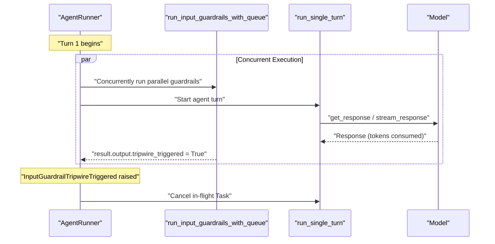
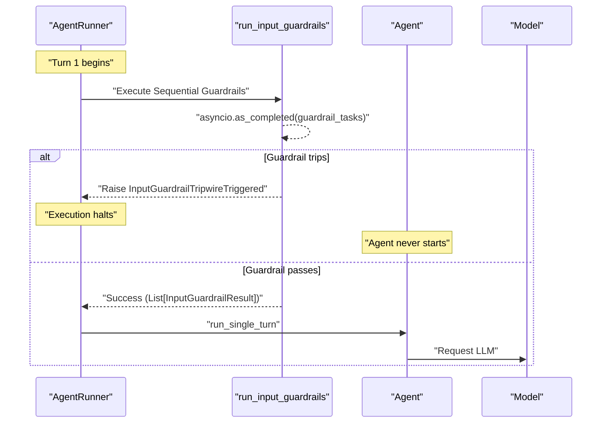

<!-- source: DeepWiki mcp.deepwiki.com · repo openai/openai-agents-python · page 6.4 Guardrail Execution Strategies · fetched 2026-10-26 -->

# Guardrail Execution Strategies

Relevant source files

The following files were used as context for generating this wiki page:

- [src/agents/run_internal/guardrails.py](src/agents/run_internal/guardrails.py)
- [src/agents/util/_pretty_print.py](src/agents/util/_pretty_print.py)
- [tests/test_guardrails.py](tests/test_guardrails.py)
- [tests/test_pretty_print.py](tests/test_pretty_print.py)
- [tests/test_tool_guardrails.py](tests/test_tool_guardrails.py)
- [tests/utils/test_pretty_print_and_items.py](tests/utils/test_pretty_print_and_items.py)

## Purpose and Scope
This page details the execution strategies for input guardrails within the OpenAI Agents SDK, focusing on the `run_in_parallel` configuration parameter. It covers the technical mechanics of synchronous (blocking) versus parallel execution, concurrency management via `asyncio`, tripwire handling, performance trade-offs, and how output guardrails differ.

Sources: [src/agents/guardrail.py:100-103](), [src/agents/run_internal/guardrails.py:55-170]()

---

## Execution Modes Overview

Input guardrails support two execution strategies to control when guardrail validation occurs relative to agent execution. This is configured via the `run_in_parallel` attribute on the `InputGuardrail` class [src/agents/guardrail.py:100-103]().

| Mode | `run_in_parallel` | Timing | Cost Impact | Use Case |
|------|-------------------|---------|-------------|----------|
| **Parallel** | `True` (default) | Guardrail and agent start simultaneously | Agent may consume tokens before guardrail completes | Best latency, acceptable failure cost |
| **Blocking** | `False` | Guardrail completes before agent starts | No agent tokens consumed if guardrail trips | Cost optimization, preventing side effects |

Output guardrails always execute after agent completion and do not support parallel execution strategies [src/agents/run_internal/guardrails.py:172-175]().

Sources: [src/agents/guardrail.py:100-103](), [src/agents/run_internal/guardrails.py:172-175]()

---

## Parallel Execution (Default)

### Execution Flow

In parallel mode, the SDK launches the agent's turn and the parallel guardrails concurrently. If a tripwire is triggered, the runner attempts to cancel the model request. The internal function `run_input_guardrails_with_queue` is used to manage this concurrency [src/agents/run_internal/guardrails.py:55-62]().

Diagram: Parallel guardrail execution flow showing concurrent agent and guardrail processing via `run_input_guardrails_with_queue` [src/agents/run_internal/guardrails.py:55-62]().

Sources: [src/agents/run_internal/guardrails.py:55-114]()

### Implementation

The parallel execution strategy orchestrates guardrails using asynchronous tasks and queue accumulation [src/agents/run_internal/guardrails.py:66-84]().

1. **Task Creation**: `run_input_guardrails_with_queue` wraps each guardrail execution in `run_single_input_guardrail` using `asyncio.create_task` [src/agents/run_internal/guardrails.py:31-41](), [src/agents/run_internal/guardrails.py:66-69]().
2. **Result Polling**: Results are consumed via `asyncio.as_completed` and published immediately to the event queue [src/agents/run_internal/guardrails.py:71-81]().
3. **Tripwire Handling**: If a tripwire triggers (`result.output.tripwire_triggered = True`), all sibling guardrail tasks are cancelled, and an `InputGuardrailTripwireTriggered` error is attached to the span [src/agents/run_internal/guardrails.py:79-97]().

Sources: [src/agents/run_internal/guardrails.py:31-114]()

---

## Blocking Execution

### Execution Flow

Blocking guardrails (`run_in_parallel=False`) must complete and return a successful result before the agent is allowed to start its turn. These are processed by `run_input_guardrails`, which executes them concurrently but blocks the runner until all finish [src/agents/run_internal/guardrails.py:115-127]().

Diagram: Blocking guardrail execution flow showing sequential validation via `run_input_guardrails` [src/agents/run_internal/guardrails.py:115-127]() before agent starts.

Sources: [src/agents/run_internal/guardrails.py:115-170]()

### Characteristics

- **Latency**: Higher latency since the agent waits for guardrail completion.
- **Token consumption**: Zero tokens consumed if a blocking guardrail trips.
- **Side effect prevention**: Prevents initial model calls and subsequent tool calls when input is invalid.

Sources: [src/agents/run_internal/guardrails.py:115-170]()

---

## Technical Details and Cancellation

### Concurrency and Cleanup
Both parallel and blocking strategies manage sibling tasks using `asyncio.gather` with `return_exceptions=True` during cleanup [src/agents/run_internal/guardrails.py:82-84](), [src/agents/run_internal/guardrails.py:163-167](). If an exception occurs, any uncompleted tasks are explicitly cancelled to prevent task leaks.

### Tracing Integration
Every guardrail execution is wrapped in a `guardrail_span` context manager, recording the trigger status directly onto the trace span data [src/agents/run_internal/guardrails.py:31-41]().

Sources: [src/agents/run_internal/guardrails.py:31-41](), [src/agents/run_internal/guardrails.py:82-167]()

---

## Trade-offs and Decision Guide

| Consideration | Parallel (`True`) | Blocking (`False`) |
|--------------|-------------------|-------------------|
| **Latency** | Low (Concurrent) | High (Sequential) |
| **Token Cost** | Potential waste on failure | Zero waste on failure |
| **Side Effects** | Risk of model output generation | Safe from model output generation |
| **Best For** | Fast, cheap models | Expensive models, sensitive inputs |

Sources: [src/agents/guardrail.py:100-103](), [src/agents/run_internal/guardrails.py:55-170]()

---

