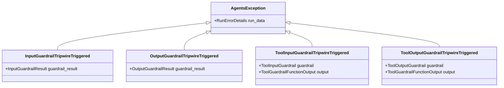
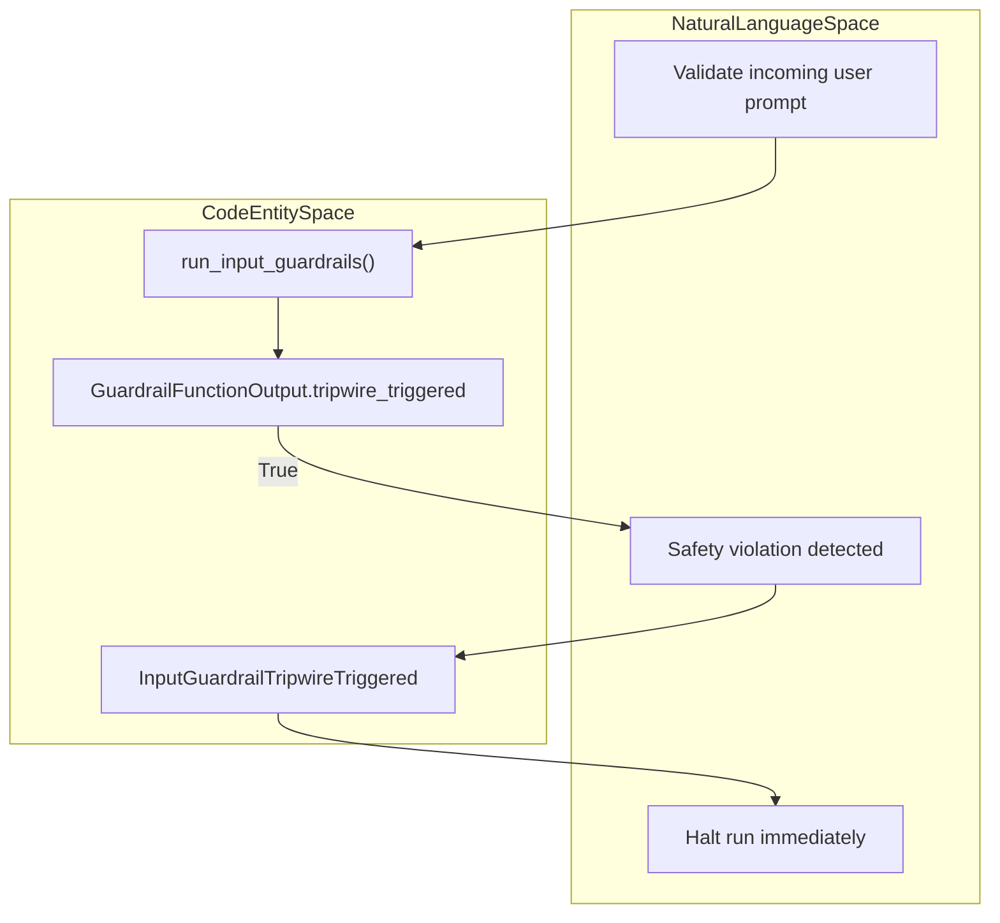
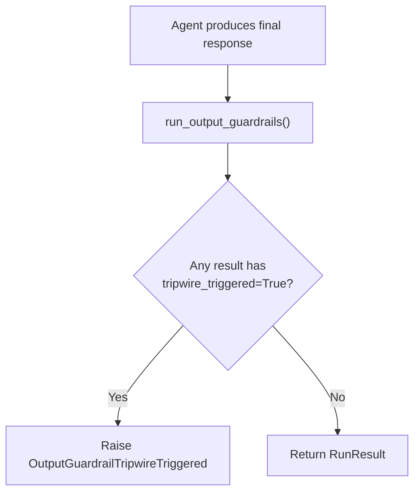
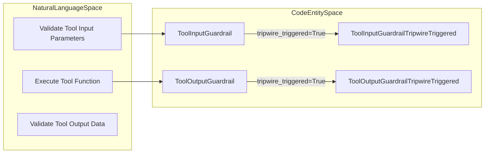
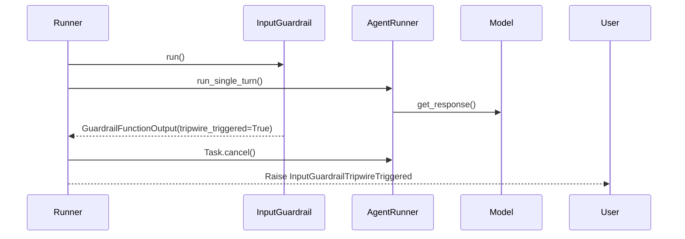

<!-- source: DeepWiki mcp.deepwiki.com · repo openai/openai-agents-python · page 6.5 Tripwire Mechanism · fetched 2026-10-26 -->

# Tripwire Mechanism

<details>
<summary>Relevant source files</summary>

The following files were used as context for generating this wiki page:

- [examples/agent_patterns/README.md](examples/agent_patterns/README.md)
- [examples/agent_patterns/human_in_the_loop.py](examples/agent_patterns/human_in_the_loop.py)
- [examples/agent_patterns/human_in_the_loop_server.py](examples/agent_patterns/human_in_the_loop_server.py)
- [src/agents/exceptions.py](src/agents/exceptions.py)
- [src/agents/guardrail.py](src/agents/guardrail.py)
- [src/agents/result.py](src/agents/result.py)
- [src/agents/run.py](src/agents/run.py)
- [src/agents/run_internal/agent_runner_helpers.py](src/agents/run_internal/agent_runner_helpers.py)
- [src/agents/run_internal/run_loop.py](src/agents/run_internal/run_loop.py)
- [src/agents/run_internal/run_steps.py](src/agents/run_internal/run_steps.py)
- [src/agents/run_internal/session_persistence.py](src/agents/run_internal/session_persistence.py)
- [src/agents/run_internal/turn_resolution.py](src/agents/run_internal/turn_resolution.py)
- [src/agents/run_state.py](src/agents/run_state.py)
- [tests/test_agent_runner.py](tests/test_agent_runner.py)
- [tests/test_agent_runner_streamed.py](tests/test_agent_runner_streamed.py)
- [tests/test_error_logging_redaction.py](tests/test_error_logging_redaction.py)
- [tests/test_human_in_the_loop_server_example.py](tests/test_human_in_the_loop_server_example.py)
- [tests/test_run_impl_resume_paths.py](tests/test_run_impl_resume_paths.py)
- [tests/test_run_state.py](tests/test_run_state.py)

</details>


## Purpose and Scope

The tripwire mechanism provides an immediate execution halt capability for guardrails. When a guardrail detects a safety violation or validation failure, it can set the `is_tripwire` flag (or `tripwire_triggered` field in `GuardrailFunctionOutput`) to trigger an exception that halts agent execution immediately [src/agents/guardrail.py:19-33](). This page details the tripwire flag structure, exception types, execution flow integration across input, output, and tool pipelines, and behavioral differences between parallel and blocking modes.

Sources: [src/agents/guardrail.py:19-33]()

---

## Tripwire Flag Structure

The tripwire configuration relies on boolean flags returned within guardrail result structures. Specifically, `GuardrailFunctionOutput` contains a `tripwire_triggered` boolean field [src/agents/guardrail.py:20-33](). When set to `True`, the execution runner intercepts the result and terminates the active turn or task.

```python
@dataclass
class GuardrailFunctionOutput:
    output_info: Any
    """Optional information about the guardrail's output."""

    tripwire_triggered: bool
    """Whether the tripwire was triggered. If triggered, the agent's execution will be halted."""
```

Sources: [src/agents/guardrail.py:19-33]()

---

## Exception Types and Hierarchy

When a tripwire triggers, the SDK raises specific exception subclasses inheriting from `AgentsException` [src/agents/exceptions.py:15-210](). 

| Exception Class | Raised When | Execution Point |
|----------------|-------------|-----------------|
| `InputGuardrailTripwireTriggered` | Input guardrail detects violation | Before or during the first model call |
| `OutputGuardrailTripwireTriggered` | Output guardrail detects violation | After agent completes final output |
| `ToolInputGuardrailTripwireTriggered` | Tool input guardrail detects violation | Prior to tool execution |
| `ToolOutputGuardrailTripwireTriggered` | Tool output guardrail detects violation | Following tool execution |

### Code Entity Space: Exception Definitions


**Title:** "Tripwire Exception Hierarchy in `src/agents/exceptions.py`"

Sources: [src/agents/exceptions.py:15-210]()

---

## Tripwire Execution Flow

### Natural Language Space to Code Entity Space: Input Guardrails

This diagram bridges the conceptual safety validation of user prompts to the concrete functions and exceptions executed by `AgentRunner`.


**Title:** "Input Guardrail Natural Language to Code Mapping"

Sources: [src/agents/guardrail.py:19-33](), [src/agents/exceptions.py:15-210](), [src/agents/run_internal/guardrails.py:130-143]()

---

### Output Guardrail Tripwire Flow

Output guardrails inspect responses generated by the model before returning them to the user [src/agents/run_internal/guardrails.py:171-205]().


**Title:** "Output Guardrail Tripwire Flow"

Sources: [src/agents/run_internal/guardrails.py:171-205]()

---

## Tool Tripwires

Tool guardrails operate at the tool invocation boundary [src/agents/run_state.py:138-147](). 

### Natural Language Space to Code Entity Space: Tool Pipeline


**Title:** "Tool Guardrail Tripwire Mapping"

Sources: [src/agents/exceptions.py:182-210](), [src/agents/run_state.py:138-147]()

---

## Parallel vs Blocking Execution Impact

When `run_in_parallel=True` on input guardrails, the SDK executes guardrail checks concurrently with model generation tasks [src/agents/guardrail.py:100-103](). If a tripwire triggers, in-flight model tasks are immediately cancelled to prevent wasted token consumption [src/agents/run_internal/guardrails.py:80-84]().


**Title:** "Parallel Execution Tripwire Sequence"

Sources: [src/agents/guardrail.py:100-103](), [src/agents/run_internal/guardrails.py:55-98]()

---

## Key Implementation Components

| Component | Location | Purpose |
|----------|----------|---------|
| `InputGuardrailResult` | [src/agents/guardrail.py:36-47]() | Container for input guardrail execution state. |
| `OutputGuardrailResult` | [src/agents/guardrail.py:49-61]() | Container for output guardrail execution state. |
| `GuardrailFunctionOutput` | [src/agents/guardrail.py:20-33]() | Contains the `tripwire_triggered` boolean field. |
| `RunErrorDetails` | [src/agents/exceptions.py:61-79]() | Captures exception metadata and guardrail results. |

Sources: [src/agents/guardrail.py:20-61](), [src/agents/exceptions.py:61-79]()

---

## Usage Patterns

### Handling Tripwire Exceptions

Applications should catch specific tripwire exceptions to handle safety violations gracefully [src/agents/exceptions.py:156-180]().

```python
from agents import Runner, InputGuardrailTripwireTriggered, OutputGuardrailTripwireTriggered

try:
    result = await Runner.run(agent, user_input)
except InputGuardrailTripwireTriggered as e:
    print(f"Input blocked: {e.guardrail_result.output.output_info}")
except OutputGuardrailTripwireTriggered as e:
    print(f"Output blocked: {e.guardrail_result.output.output_info}")
```

Sources: [src/agents/exceptions.py:156-180]()

---

