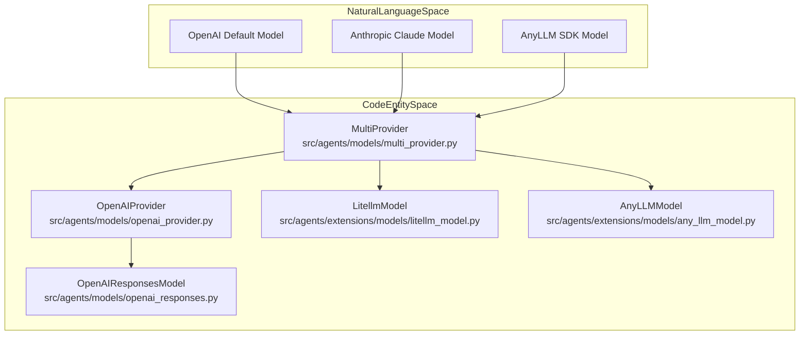
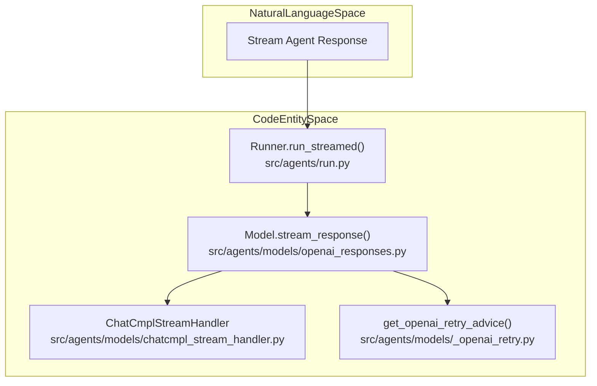

<!-- source: DeepWiki mcp.deepwiki.com · repo openai/openai-agents-python · page 7 Model Integration · fetched 2026-10-26 -->

# Model Integration

Relevant source files

The following files were used as context for generating this wiki page:

- [docs/ja/examples.md](docs/ja/examples.md)
- [docs/ja/models/index.md](docs/ja/models/index.md)
- [docs/ja/release.md](docs/ja/release.md)
- [docs/ja/running_agents.md](docs/ja/running_agents.md)
- [docs/ko/examples.md](docs/ko/examples.md)
- [docs/ko/models/index.md](docs/ko/models/index.md)
- [docs/ko/release.md](docs/ko/release.md)
- [docs/ko/running_agents.md](docs/ko/running_agents.md)
- [docs/zh/examples.md](docs/zh/examples.md)
- [docs/zh/models/index.md](docs/zh/models/index.md)
- [docs/zh/release.md](docs/zh/release.md)
- [docs/zh/running_agents.md](docs/zh/running_agents.md)
- [src/agents/extensions/models/any_llm_model.py](src/agents/extensions/models/any_llm_model.py)
- [src/agents/extensions/models/litellm_model.py](src/agents/extensions/models/litellm_model.py)
- [src/agents/model_settings.py](src/agents/model_settings.py)
- [src/agents/models/chatcmpl_converter.py](src/agents/models/chatcmpl_converter.py)
- [src/agents/models/chatcmpl_helpers.py](src/agents/models/chatcmpl_helpers.py)
- [src/agents/models/chatcmpl_stream_handler.py](src/agents/models/chatcmpl_stream_handler.py)
- [src/agents/models/openai_chatcompletions.py](src/agents/models/openai_chatcompletions.py)
- [src/agents/models/openai_responses.py](src/agents/models/openai_responses.py)
- [src/agents/usage.py](src/agents/usage.py)
- [tests/model_settings/test_serialization.py](tests/model_settings/test_serialization.py)
- [tests/models/test_any_llm_model.py](tests/models/test_any_llm_model.py)
- [tests/models/test_chatcompletions_stream_eof.py](tests/models/test_chatcompletions_stream_eof.py)
- [tests/models/test_kwargs_functionality.py](tests/models/test_kwargs_functionality.py)
- [tests/models/test_litellm_chatcompletions_stream.py](tests/models/test_litellm_chatcompletions_stream.py)
- [tests/models/test_litellm_content_filter.py](tests/models/test_litellm_content_filter.py)
- [tests/models/test_litellm_extra_body.py](tests/models/test_litellm_extra_body.py)
- [tests/models/test_litellm_usage_requests.py](tests/models/test_litellm_usage_requests.py)
- [tests/models/test_litellm_user_agent.py](tests/models/test_litellm_user_agent.py)
- [tests/models/test_openai_chatcompletions.py](tests/models/test_openai_chatcompletions.py)
- [tests/models/test_openai_chatcompletions_converter.py](tests/models/test_openai_chatcompletions_converter.py)
- [tests/models/test_openai_chatcompletions_stream.py](tests/models/test_openai_chatcompletions_stream.py)
- [tests/models/test_openai_responses.py](tests/models/test_openai_responses.py)
- [tests/models/test_openai_responses_converter.py](tests/models/test_openai_responses_converter.py)
- [tests/models/test_reasoning_content.py](tests/models/test_reasoning_content.py)
- [tests/test_prompt_cache_key.py](tests/test_prompt_cache_key.py)
- [tests/test_usage.py](tests/test_usage.py)

This page provides a high-level architectural overview of the model integration layer in the OpenAI Agents SDK. The SDK abstracts language model providers through a unified interface, enabling seamless switching between OpenAI APIs, third-party providers via LiteLLM, and custom model implementations. 

For complete details on execution flows, see [Runner and Execution Flow](#3.2). For realtime audio workflows, see [Realtime and Voice Agents](#9).

## Purpose and Scope

The model integration layer standardizes how agents interact with underlying Large Language Models (LLMs) [src/agents/models/interface.py:49-55](). It handles model name resolution, configuration parameter mapping, transport selection (HTTP and WebSocket), error recovery, and response streaming [src/agents/models/openai_responses.py:206-218]().

As a parent page, this section introduces the core components of model integration. For deep technical specifications, configuration options, and provider-specific quirks, refer to the child pages linked below.

**Diagram: Natural Language Space to Code Entity Space for Model Resolution**

Sources: [src/agents/models/multi_provider.py:61-110](), [src/agents/models/openai_provider.py:16-30](), [src/agents/models/openai_responses.py:412-427](), [src/agents/extensions/models/litellm_model.py:149-165](), [src/agents/extensions/models/any_llm_model.py:220-236]()

---

## 7.1. Model Abstraction Layer

The SDK defines a core `Model` abstract base class [src/agents/models/interface.py:49-55]() that encapsulates text generation, streaming, and retry advice. Model providers (`ModelProvider` [src/agents/models/openai_provider.py:16-30](), `MultiProvider` [src/agents/models/multi_provider.py:61-110]()) resolve string identifiers to concrete model instances based on configured prefixes (`openai/`, `litellm/`, `any-llm/`).

For details, see [Model Abstraction Layer](#7.1).

Sources: [src/agents/models/interface.py:49-55](), [src/agents/models/multi_provider.py:61-110](), [src/agents/models/openai_provider.py:16-30]()

---

## 7.2. OpenAI Responses API

`OpenAIResponsesModel` [src/agents/models/openai_responses.py:412-427]() is the recommended implementation for OpenAI models, leveraging the advanced Responses API. It supports server-managed conversations, tool search, namespace tools, and persistent WebSocket transport via `responses_websocket_session()` [docs/ja/running_agents.md:97-122]().

For details, see [OpenAI Responses API](#7.2).

Sources: [src/agents/models/openai_responses.py:412-427](), [docs/ja/running_agents.md:97-122]()

---

## 7.3. OpenAI Chat Completions API

`OpenAIChatCompletionsModel` [src/agents/models/openai_chatcompletions.py:57-69]() provides support for standard Chat Completions endpoints. Converters translate legacy chat formats into SDK-compatible response output items [src/agents/models/chatcmpl_converter.py:78-132]().

For details, see [OpenAI Chat Completions API](#7.3).

Sources: [src/agents/models/openai_chatcompletions.py:57-69](), [src/agents/models/chatcmpl_converter.py:78-132]()

---

## 7.4. LiteLLM and AnyLLM Multi-Provider Support

To access 100+ non-OpenAI models (Anthropic, Gemini, Mistral, etc.), the SDK provides `LitellmModel` [src/agents/extensions/models/litellm_model.py:149-165]() and `AnyLLMModel` [src/agents/extensions/models/any_llm_model.py:220-236](). These integrations normalize provider-specific responses, reasoning blocks, and tool calls into standard SDK data structures.

For details, see [LiteLLM and AnyLLM Multi-Provider Support](#7.4).

Sources: [src/agents/extensions/models/litellm_model.py:149-165](), [src/agents/extensions/models/any_llm_model.py:220-236]()

---

## 7.5. Model Settings and Configuration

`ModelSettings` [src/agents/model_settings.py:88-100]() controls parameters such as sampling temperature, top_p, parallel tool calls, reasoning effort, prompt caching, and extra provider-specific arguments. These settings merge hierarchically from global runner configurations down to agent-specific definitions.

For details, see [Model Settings and Configuration](#7.5).

Sources: [src/agents/model_settings.py:88-185]()

---

## 7.6. Retry Policies

The SDK incorporates robust retry handling via `ModelRetrySettings` and provider advice functions (`get_openai_retry_advice`) [src/agents/models/_openai_retry.py:1-30](). This manages transient network errors, rate limits, and HTTP status codes with exponential backoff and safety boundaries.

For details, see [Retry Policies](#7.6).

Sources: [src/agents/models/_openai_retry.py:1-30](), [src/agents/retry.py:16-35]()

---

## 7.7. Streaming Responses

Streaming is supported across providers using `stream_response()` [src/agents/models/interface.py:49-55]() and `Runner.run_streamed()` [docs/ja/running_agents.md:7-12](). Events are categorized into raw transport events and normalized run items (`RunItemStreamEvent`), allowing real-time UI updates and cancellation management [src/agents/models/chatcmpl_stream_handler.py:1-50]().

**Diagram: Natural Language Space to Code Entity Space for Streaming Execution**

Sources: [src/agents/models/openai_responses.py:537-559](), [src/agents/models/chatcmpl_stream_handler.py:1-50](), [src/agents/models/_openai_retry.py:1-30](), [docs/ja/running_agents.md:7-12]()

For details, see [Streaming Responses](#7.7).

---

