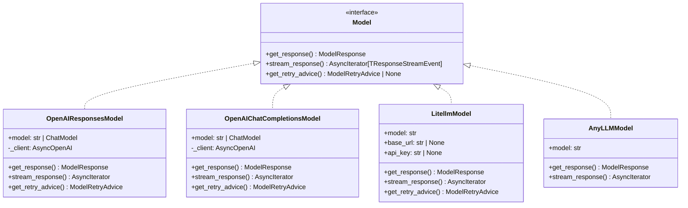
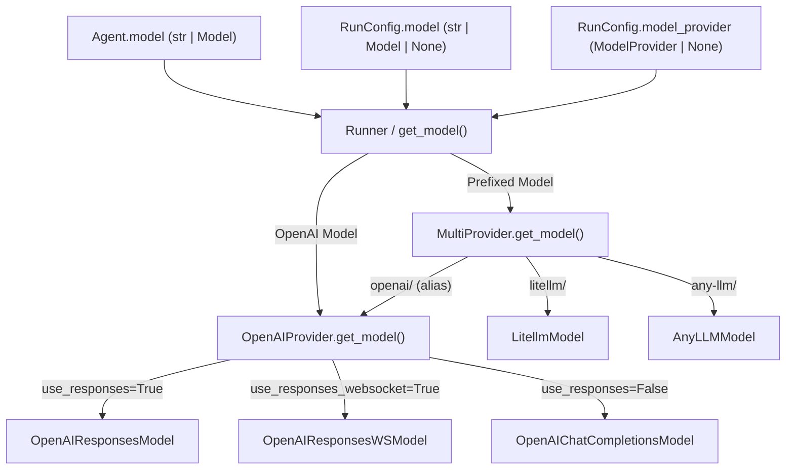

<!-- source: DeepWiki mcp.deepwiki.com · repo openai/openai-agents-python · page 7.1 Model Abstraction Layer · fetched 2026-10-26 -->

# Model Abstraction Layer

Relevant source files

The following files were used as context for generating this wiki page:

- [examples/agent_patterns/forcing_tool_use.py](examples/agent_patterns/forcing_tool_use.py)
- [examples/agent_patterns/human_in_the_loop_custom_rejection.py](examples/agent_patterns/human_in_the_loop_custom_rejection.py)
- [examples/basic/prompt_template.py](examples/basic/prompt_template.py)
- [examples/basic/stream_ws.py](examples/basic/stream_ws.py)
- [examples/mcp/streamable_http_remote_example/main.py](examples/mcp/streamable_http_remote_example/main.py)
- [examples/reasoning_content/main.py](examples/reasoning_content/main.py)
- [examples/reasoning_content/runner_example.py](examples/reasoning_content/runner_example.py)
- [examples/research_bot/agents/planner_agent.py](examples/research_bot/agents/planner_agent.py)
- [examples/tools/file_search.py](examples/tools/file_search.py)
- [src/agents/_config.py](src/agents/_config.py)
- [src/agents/models/_openai_shared.py](src/agents/models/_openai_shared.py)
- [src/agents/models/default_models.py](src/agents/models/default_models.py)
- [src/agents/models/multi_provider.py](src/agents/models/multi_provider.py)
- [src/agents/models/openai_provider.py](src/agents/models/openai_provider.py)
- [src/agents/responses_websocket_session.py](src/agents/responses_websocket_session.py)
- [src/agents/voice/models/openai_model_provider.py](src/agents/voice/models/openai_model_provider.py)
- [tests/models/test_default_models.py](tests/models/test_default_models.py)
- [tests/models/test_map.py](tests/models/test_map.py)
- [tests/test_config.py](tests/test_config.py)
- [tests/test_openai_provider_client_options.py](tests/test_openai_provider_client_options.py)
- [tests/voice/test_openai_model_provider.py](tests/voice/test_openai_model_provider.py)

The model abstraction layer provides a unified interface for interacting with different language model providers and implementations within the SDK. This layer enables seamless integration with OpenAI's Responses API, Chat Completions API, and third-party model providers through LiteLLM and AnyLLM, allowing agents to switch models without code changes. The abstraction handles model resolution, request formatting, response parsing, retry logic, and streaming.

For specific model implementation details, see [OpenAI Responses API](#7.2), [OpenAI Chat Completions API](#7.3), and [LiteLLM and AnyLLM Multi-Provider Support](#7.4). For configuration options, see [Model Settings and Configuration](#7.5) and [Retry Policies](#7.6).

---

## Core Model Interface

The model abstraction centers on the `Model` abstract base class defined in `src/agents/models/interface.py`, which establishes the contract that all model implementations must satisfy.

**Model Interface Structure**

Sources: [src/agents/models/interface.py:15-60](), [src/agents/models/openai_responses.py:374-498](), [src/agents/models/openai_chatcompletions.py:48-196](), [src/agents/extensions/models/litellm_model.py:139-271](), [src/agents/extensions/models/any_llm_model.py:42-53]()

### Key Interface Methods

| Method | Parameters | Return Type | Purpose |
|--------|-----------|-------------|---------|
| `get_response()` | system_instructions, input, model_settings, tools, output_schema, handoffs, tracing, ... | `ModelResponse` | Execute a single model request and return complete response items and usage statistics [src/agents/models/interface.py:30-46]() |
| `stream_response()` | Same as `get_response()` | `AsyncIterator[TResponseStreamEvent]` | Stream model response events incrementally [src/agents/models/interface.py:48-56]() |
| `get_retry_advice()` | `ModelRetryAdviceRequest` | `ModelRetryAdvice \| None` | Determine if a failed model request should be retried [src/agents/models/interface.py:58-60]() |

Sources: [src/agents/models/interface.py:15-60]()

---

## Model Resolution Architecture

The SDK resolves model identifiers to concrete `Model` instances through a multi-layered resolution system involving `ModelProvider` implementations and configuration settings.

**Model Resolution Flow**

Sources: [src/agents/models/multi_provider.py:62-180](), [src/agents/models/openai_provider.py:45-150](), [src/agents/models/default_models.py:99-104]()

### Resolution Priority
Models are resolved following this precedence order:
1. **Agent-level explicit `Model` instance**: If `agent.model` is already a `Model` instance, it is used directly.
2. **RunConfig model override**: If `run_config.model` is provided as a concrete `Model` object or string override.
3. **Prefix-based routing**: `MultiProvider` routes model strings based on prefixes such as `openai/`, `litellm/`, or `any-llm/` [src/agents/models/multi_provider.py:62-68]().
4. **Global default**: If no model name is specified, the SDK defaults to `gpt-5.6-luna` (or the value of `OPENAI_DEFAULT_MODEL`) via `get_default_model()` [src/agents/models/default_models.py:100-104]().

Sources: [src/agents/models/multi_provider.py:62-180](), [src/agents/models/default_models.py:100-104]()

---

## ModelProvider Implementations

The SDK supplies concrete `ModelProvider` subclasses to instantiate and manage models across different provider backends.

### OpenAIProvider
`OpenAIProvider` handles interaction with OpenAI and OpenAI-compatible endpoints [src/agents/models/openai_provider.py:45-124](). It manages connection pooling via a shared `httpx2.AsyncClient` [src/agents/models/openai_provider.py:38-42]() and supports lazy loading of the underlying `AsyncOpenAI` client [src/agents/models/openai_provider.py:138-151]().

**Key Configuration Parameters:**
- `api_key`: Explicit API key string.
- `base_url`: Base URL for API requests.
- `websocket_base_url`: Websocket base URL for responses transport.
- `use_responses`: Whether to default to the Responses API (`True`) or Chat Completions API (`False`).
- `use_responses_websocket`: Whether to use WebSocket transport for the Responses API.
- `strict_feature_validation`: Raises `UserError` if Responses-only features are passed to Chat Completions models [src/agents/models/openai_provider.py:78-81]().

Sources: [src/agents/models/openai_provider.py:45-124]()

### MultiProvider and MultiProviderMap
`MultiProvider` maps model string prefixes to specific `ModelProvider` instances using a `MultiProviderMap` [src/agents/models/multi_provider.py:18-60]() [src/agents/models/multi_provider.py:62-134]().

- **`openai/` prefix or no prefix** → Routes to `OpenAIProvider` [src/agents/models/multi_provider.py:65]().
- **`litellm/` prefix** → Routes to `LitellmProvider` [src/agents/models/multi_provider.py:66]().
- **`any-llm/` prefix** → Routes to `AnyLLMProvider` [src/agents/models/multi_provider.py:67]().

**Prefix Modes:**
- `openai_prefix_mode`: Controls whether the `openai/` prefix is treated as an `"alias"` (stripped before lookup) or preserved as a literal `"model_id"` for compatible gateways [src/agents/models/multi_provider.py:118-121]().
- `unknown_prefix_mode`: Controls whether unrecognized prefixes raise a `UserError` (`"error"`) or pass through as literal model IDs (`"model_id"`) [src/agents/models/multi_provider.py:122-126]().

Sources: [src/agents/models/multi_provider.py:18-134]()

### ResponsesWebSocketSession
`ResponsesWebSocketSession` and its accompanying context manager `responses_websocket_session()` pin runner executions to a shared, persistent WebSocket connection for OpenAI Responses API streaming across multiple agent turns [src/agents/responses_websocket_session.py:23-140]().

Sources: [src/agents/responses_websocket_session.py:23-140]()

---

## Multi-Provider Implementations (LiteLLM & AnyLLM)

### LitellmModel
`LitellmModel` wraps the LiteLLM library to provide access to over 100 LLM providers (Anthropic, Google Gemini, Cohere, etc.) [src/agents/extensions/models/litellm_model.py:139-143](). It handles tool mapping, structured output translation, and provider-specific quirks such as Anthropic thinking blocks.

Sources: [src/agents/extensions/models/litellm_model.py:139-271]()

### AnyLLMModel
`AnyLLMModel` acts as a generic provider integration for third-party or experimental backends, normalizing reasoning content, tool calls, and message payloads into the SDK's standard structures [src/agents/extensions/models/any_llm_model.py:42-202]().

Sources: [src/agents/extensions/models/any_llm_model.py:42-202]()

---

## Model Settings and Configuration

`ModelSettings` defines runtime parameters passed to models, including `temperature`, `top_p`, `parallel_tool_calls`, and `reasoning` effort [src/agents/model_settings.py:64-109]().

### Default Settings Resolution
The SDK provides dynamic defaults for GPT-5 model families through `get_default_model_settings()` [src/agents/models/default_models.py:106-120]():
- **GPT-5 (Standard)**: Defaults to `low` reasoning effort and `low` verbosity [src/agents/models/default_models.py:16-22]().
- **GPT-5 Pro**: Defaults to `medium` reasoning effort [src/agents/models/default_models.py:27-30]().
- **GPT-5.4-mini/nano/5.6**: Defaults to `none` reasoning effort [src/agents/models/default_models.py:62-68]().

Sources: [src/agents/model_settings.py:64-164](), [src/agents/models/default_models.py:16-120]()

---

## Retry Policies

The model abstraction layer utilizes `get_retry_advice()` to inspect exceptions (such as HTTP 429 rate limits or 5xx server errors) and provide retry recommendations [src/agents/models/interface.py:58-60](). WebSocket connections also incorporate pre-event reconnection logic when drops occur before response headers or events are received [src/agents/models/openai_responses.py:315-372]().

Sources: [src/agents/models/interface.py:58-60](), [src/agents/models/openai_responses.py:315-372]()

---

