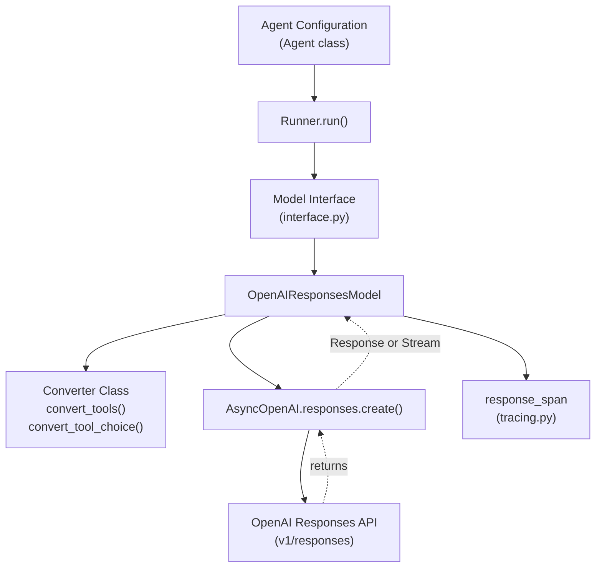
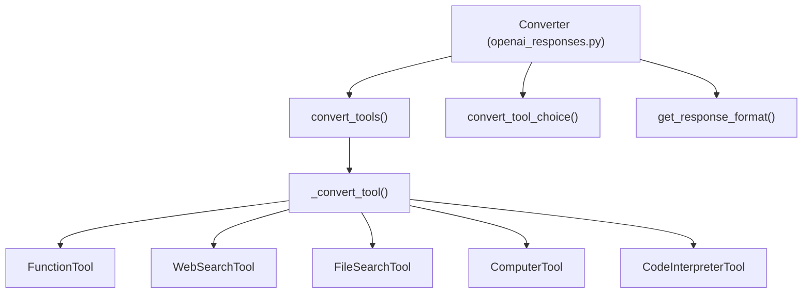

<!-- source: DeepWiki mcp.deepwiki.com · repo openai/openai-agents-python · page 7.2 OpenAI Responses API · fetched 2026-10-26 -->

# OpenAI Responses API

<details>
<summary>Relevant source files</summary>

The following files were used as context for generating this wiki page:

- [src/agents/extensions/models/any_llm_model.py](src/agents/extensions/models/any_llm_model.py)
- [src/agents/extensions/models/litellm_model.py](src/agents/extensions/models/litellm_model.py)
- [src/agents/model_settings.py](src/agents/model_settings.py)
- [src/agents/models/chatcmpl_converter.py](src/agents/models/chatcmpl_converter.py)
- [src/agents/models/chatcmpl_helpers.py](src/agents/models/chatcmpl_helpers.py)
- [src/agents/models/chatcmpl_stream_handler.py](src/agents/models/chatcmpl_stream_handler.py)
- [src/agents/models/openai_chatcompletions.py](src/agents/models/openai_chatcompletions.py)
- [src/agents/models/openai_responses.py](src/agents/models/openai_responses.py)
- [src/agents/usage.py](src/agents/usage.py)
- [tests/model_settings/test_serialization.py](tests/model_settings/test_serialization.py)
- [tests/models/test_any_llm_model.py](tests/models/test_any_llm_model.py)
- [tests/models/test_chatcompletions_stream_eof.py](tests/models/test_chatcompletions_stream_eof.py)
- [tests/models/test_kwargs_functionality.py](tests/models/test_kwargs_functionality.py)
- [tests/models/test_litellm_chatcompletions_stream.py](tests/models/test_litellm_chatcompletions_stream.py)
- [tests/models/test_litellm_content_filter.py](tests/models/test_litellm_content_filter.py)
- [tests/models/test_litellm_extra_body.py](tests/models/test_litellm_extra_body.py)
- [tests/models/test_litellm_usage_requests.py](tests/models/test_litellm_usage_requests.py)
- [tests/models/test_litellm_user_agent.py](tests/models/test_litellm_user_agent.py)
- [tests/models/test_openai_chatcompletions.py](tests/models/test_openai_chatcompletions.py)
- [tests/models/test_openai_chatcompletions_converter.py](tests/models/test_openai_chatcompletions_converter.py)
- [tests/models/test_openai_chatcompletions_stream.py](tests/models/test_openai_chatcompletions_stream.py)
- [tests/models/test_openai_responses.py](tests/models/test_openai_responses.py)
- [tests/models/test_openai_responses_converter.py](tests/models/test_openai_responses_converter.py)
- [tests/models/test_reasoning_content.py](tests/models/test_reasoning_content.py)
- [tests/test_prompt_cache_key.py](tests/test_prompt_cache_key.py)
- [tests/test_usage.py](tests/test_usage.py)

</details>


This page documents the `OpenAIResponsesModel` implementation, which provides integration with OpenAI's Responses API. The Responses API is the recommended interface for agent workflows, offering native support for conversation tracking, server-side state management, and advanced tool capabilities.

For information about the Chat Completions API integration, see `OpenAIChatCompletionsModel` [src/agents/models/openai_chatcompletions.py:55-55](). For general model abstraction concepts, see [Model Abstraction Layer](). For streaming behavior and event handling, see [Streaming Responses]().

---

## OpenAIResponsesModel Class

The `OpenAIResponsesModel` class implements the `Model` interface to call OpenAI's Responses API. It is the default and recommended model provider in the SDK.

**Core Methods**

The class exposes primary methods matching the `Model` interface:

| Method | Return Type | Purpose |
|--------|-------------|---------|
| `get_response()` | `Awaitable[ModelResponse]` | Synchronous (non-streaming) response generation. |
| `stream_response()` | `AsyncIterator[TResponseStreamEvent]` | Streaming response generation yielding real-time chunks. |

Sources: [src/agents/models/openai_responses.py:106-107]()

---

## Architecture Overview

The `OpenAIResponsesModel` acts as a bridge between the high-level `Runner` and the low-level OpenAI SDK `responses` resource.

**OpenAIResponsesModel Integration Flow**



Sources: [src/agents/models/openai_responses.py:106-108](), [src/agents/tracing/__init__.py:77-77]()

---

## Responses API-Specific Features

### Conversation State Management

The model supports server-side conversation tracking through parameters that reduce the payload size in multi-turn interactions:
- **`conversation_id`**: Identifies a server-side conversation; subsequent calls only need to send new items.
- **`previous_response_id`**: Links responses in a chain, enabling the model to resume from a specific point in history.

### Response Include Mechanism

The `include` parameter specifies additional data to return in responses. The system automatically adds includes for tool-specific data and user-specified flags from `ModelSettings` [src/agents/model_settings.py:163-165]().

### Prompt Parameter Support

The Responses API supports a `prompt` parameter for prompt caching and management [src/agents/models/openai_responses.py:39-39](). When a `prompt` is provided and the model was not explicitly set by the user, the `model` parameter is omitted to avoid overriding prompt-defined models.

Sources: [src/agents/models/openai_responses.py:39-40](), [src/agents/model_settings.py:163-165]()

---

## Tool and Schema Conversion

The `Converter` class transforms SDK tool definitions into the specific JSON structures required by the Responses API.

**Tool Conversion Logic**



Sources: [src/agents/models/openai_responses.py:63-72]()

### Tool Conversion Matrix

| Tool Type | API Type | Special Handling |
|-----------|----------|------------------|
| `FunctionTool` | `"function"` | Supports strict JSON schema and parameter inference [src/agents/models/openai_responses.py:29-29](). |
| `WebSearchTool` | `"web_search"` | Maps filters and location to the hosted search tool [src/agents/models/openai_responses.py:72-72](). |
| `FileSearchTool` | `"file_search"` | Configures vector stores and ranking options [src/agents/models/openai_responses.py:28-28](). |
| `ComputerTool` | `"computer_use_preview"` | Maps environment and display settings to the computer tool [src/agents/models/openai_responses.py:50-50](). |
| `CodeInterpreterTool`| `"code_interpreter"` | Maps file attachment and execution settings [src/agents/models/openai_responses.py:59-59](). |

Sources: [src/agents/models/openai_responses.py:27-72]()

---

## HTTP and WebSocket Transport

The SDK supports both HTTP and WebSocket transports for the Responses API.

### OpenAIResponsesWSModel & WebSocket Sessions

The WebSocket implementation allows for a persistent session across multiple turns, reducing handshake overhead and enabling real-time bidirectional communication.
- **HTTP**: Default transport used by `OpenAIResponsesModel`.
- **WebSocket**: Implemented via WebSocket transport handlers and session managers [src/agents/models/_openai_websocket.py:94-99](). It uses a persistent connection and handles message framing for `ResponseStreamEvent` objects [src/agents/models/openai_responses.py:33-33]().

### responses_websocket_session()

This context manager provides a shared WebSocket session for multiple agent turns. It creates a session that can be passed into `RunConfig`.

```python
async with responses_websocket_session() as session:
    result = await Runner.run(agent, "Task 1", run_config=RunConfig(session=session))
    result = await Runner.run(agent, "Task 2", run_config=RunConfig(session=session))
```

Sources: [src/agents/models/openai_responses.py:94-99]()

---

## Input Data Cleaning

The model implements item cleaning logic to ensure cross-provider compatibility. This method strips metadata that OpenAI's API does not recognize but which may be present if the conversation history contains items from other providers.

**Cleaning Operations:**
1. **Remove Fake IDs**: Strips `FAKE_RESPONSES_ID` used by other converters to represent temporary item IDs [src/agents/models/openai_responses.py:105-105]().
2. **Remove Provider Data**: Strips `provider_data` fields containing metadata from other LLMs.
3. **Filter Reasoning**: Removes reasoning items generated by other providers that do not match OpenAI's reasoning schema.

Sources: [src/agents/models/openai_responses.py:105-106]()

---

## Response Handling and Tracing

### Synchronous Response
The `get_response()` method wraps the API call in a `response_span` [src/agents/models/openai_responses.py:77-77](). It extracts usage data (tokens) and captures the response for tracing.

### Streaming Response
The `stream_response()` method yields `TResponseStreamEvent` chunks. It tracks the `ResponseCompletedEvent` [src/agents/models/openai_responses.py:31-31]() to capture final usage statistics and the complete response object for the trace span.

Sources: [src/agents/models/openai_responses.py:31-33](), [src/agents/tracing/__init__.py:77-77]()

---

