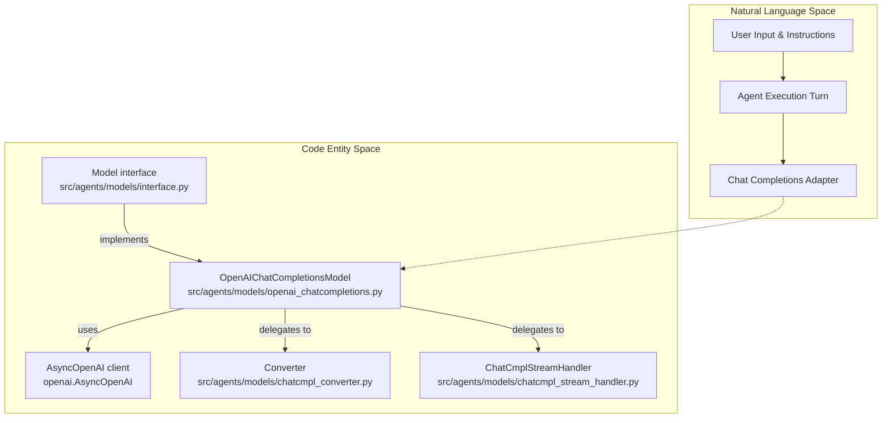
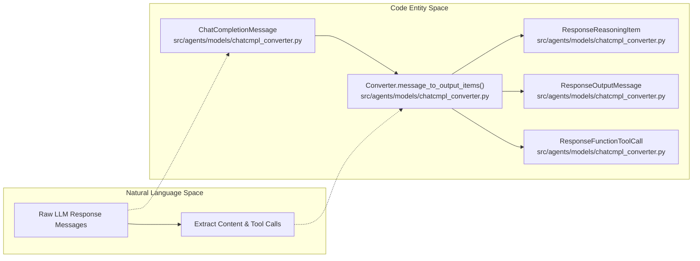
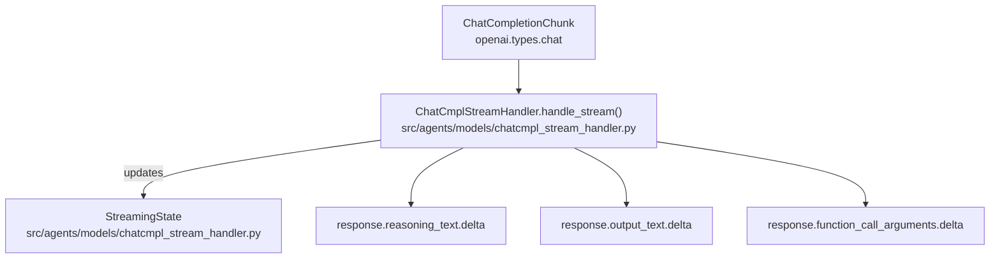

<!-- source: DeepWiki mcp.deepwiki.com · repo openai/openai-agents-python · page 7.3 OpenAI Chat Completions API · fetched 2026-10-26 -->

# OpenAI Chat Completions API

<details>
<summary>Relevant source files</summary>

The following files were used as context for generating this wiki page:

- [src/agents/extensions/models/any_llm_model.py](src/agents/extensions/models/any_llm_model.py)
- [src/agents/extensions/models/litellm_model.py](src/agents/extensions/models/litellm_model.py)
- [src/agents/model_settings.py](src/agents/model_settings.py)
- [src/agents/models/chatcmpl_converter.py](src/agents/models/chatcmpl_converter.py)
- [src/agents/models/chatcmpl_helpers.py](src/agents/models/chatcmpl_helpers.py)
- [src/agents/models/chatcmpl_stream_handler.py](src/agents/models/chatcmpl_stream_handler.py)
- [src/agents/models/openai_chatcompletions.py](src/agents/models/openai_chatcompletions.py)
- [src/agents/models/openai_responses.py](src/agents/models/openai_responses.py)
- [src/agents/usage.py](src/agents/usage.py)
- [tests/model_settings/test_serialization.py](tests/model_settings/test_serialization.py)
- [tests/models/test_any_llm_model.py](tests/models/test_any_llm_model.py)
- [tests/models/test_chatcompletions_stream_eof.py](tests/models/test_chatcompletions_stream_eof.py)
- [tests/models/test_kwargs_functionality.py](tests/models/test_kwargs_functionality.py)
- [tests/models/test_litellm_chatcompletions_stream.py](tests/models/test_litellm_chatcompletions_stream.py)
- [tests/models/test_litellm_content_filter.py](tests/models/test_litellm_content_filter.py)
- [tests/models/test_litellm_extra_body.py](tests/models/test_litellm_extra_body.py)
- [tests/models/test_litellm_usage_requests.py](tests/models/test_litellm_usage_requests.py)
- [tests/models/test_litellm_user_agent.py](tests/models/test_litellm_user_agent.py)
- [tests/models/test_openai_chatcompletions.py](tests/models/test_openai_chatcompletions.py)
- [tests/models/test_openai_chatcompletions_converter.py](tests/models/test_openai_chatcompletions_converter.py)
- [tests/models/test_openai_chatcompletions_stream.py](tests/models/test_openai_chatcompletions_stream.py)
- [tests/models/test_openai_responses.py](tests/models/test_openai_responses.py)
- [tests/models/test_openai_responses_converter.py](tests/models/test_openai_responses_converter.py)
- [tests/models/test_reasoning_content.py](tests/models/test_reasoning_content.py)
- [tests/test_prompt_cache_key.py](tests/test_prompt_cache_key.py)
- [tests/test_usage.py](tests/test_usage.py)

</details>


This page documents the `OpenAIChatCompletionsModel` implementation, which provides access to OpenAI's [Chat Completions API](https://platform.openai.com/docs/api-reference/chat). This model implementation converts SDK-level agent interactions into Chat Completions requests and translates responses back into the SDK's unified Responses format.

**Scope**: This page covers the Chat Completions model adapter, message conversion, reasoning content handling, streaming, and configuration. For the recommended Responses API implementation, see [OpenAI Responses API (7.2)](7.2). For general model abstraction concepts, see [Model Abstraction Layer (7.1)](7.1).

**When to use**: The Responses API is recommended for most use cases. Use Chat Completions when:
- You need compatibility with existing Chat Completions infrastructure or proxy layers.
- Your OpenAI-compatible provider (e.g., DeepSeek, local LLMs, or Anthropic via LiteLLM) only supports the Chat Completions spec.
- You are using reasoning models (like `o1` or `deepseek-reasoner`) and need to handle `reasoning_content` in a specific way.

**Limitations**: The following Responses-specific features are not supported in this mode:
- `ToolSearchTool` [src/agents/models/openai_responses.py:69-70]()
- `tool_namespace()` [src/agents/models/openai_responses.py:44-47]()
- `@function_tool(defer_loading=True)` [src/agents/models/openai_responses.py:62]()
- `previous_response_id` and `conversation_id` parameters (ignored or raise warning/error) [src/agents/models/openai_chatcompletions.py:270-281]()
- Reusable `prompt` parameters (only supported in Responses API) [src/agents/models/openai_chatcompletions.py:85-93]()

Sources: [src/agents/models/openai_chatcompletions.py:57-78](), [src/agents/models/openai_responses.py:56-75]()

---

## Core Architecture

The `OpenAIChatCompletionsModel` class implements the `Model` interface. It serves as an adapter between the SDK's internal Responses-based item model and OpenAI's Chat Completions wire format.

### Class Structure and Natural Language Bridge

Title: "Natural Language to Code Entity Space: Chat Completions Architecture"

Sources: [src/agents/models/openai_chatcompletions.py:55-76](), [src/agents/models/interface.py:46-47]()

**Initialization**: The model requires a model name and an `AsyncOpenAI` client. It also supports an optional `should_replay_reasoning_content` strategy for managing how reasoning is handled in multi-turn conversations [src/agents/models/openai_chatcompletions.py:60-72]().

```python
# From src/agents/models/openai_chatcompletions.py:60-72
def __init__(
    self,
    model: str | ChatModel,
    openai_client: AsyncOpenAI,
    should_replay_reasoning_content: ShouldReplayReasoningContent | None = None,
    strict_feature_validation: bool = False,
    buffer_streamed_tool_calls: bool = False,
) -> None:
    self.model = model
    self._client = openai_client
    self.should_replay_reasoning_content = should_replay_reasoning_content
    self._strict_feature_validation = strict_feature_validation
    self._buffer_streamed_tool_calls = buffer_streamed_tool_calls
```

Sources: [src/agents/models/openai_chatcompletions.py:60-72](), [src/agents/models/interface.py:46-47]()

---

## Message and Item Conversion

Chat Completions expects `ChatCompletionMessageParam` objects, while the SDK works with `TResponseInputItem`. The `Converter` class handles bidirectional translation.

### SDK Items to Chat Completion Messages
The conversion logic maps SDK roles and content types to OpenAI's schema. It specifically handles `reasoning` items by checking if they should be replayed back to the model based on `ShouldReplayReasoningContent` [src/agents/models/chatcmpl_converter.py:64-70](). Most Chat Completion APIs do not accept reasoning content in the input history, so they are typically omitted or conditionally replayed.

### Chat Completion Messages to SDK Items
When a response is received, `Converter.message_to_output_items` transforms the `ChatCompletionMessage` into SDK items [src/agents/models/chatcmpl_converter.py:123-130]().

Title: "Natural Language to Code Entity Space: Message Conversion Flow"

Sources: [src/agents/models/chatcmpl_converter.py:123-180](), [src/agents/extensions/models/litellm_model.py:131-148]()

**Reasoning Content Extraction**: If the message contains `reasoning_content`, the converter creates a `ResponseReasoningItem` [src/agents/models/chatcmpl_converter.py:163-172](). For Anthropic models via `LitellmModel`, it also extracts `thinking_blocks` and signatures from the internal message subclass [src/agents/extensions/models/litellm_model.py:129-146]().

Sources: [src/agents/models/chatcmpl_converter.py:123-228](), [src/agents/extensions/models/litellm_model.py:129-146]()

---

## Request Execution

The request handling methods construct the underlying OpenAI API calls by mapping SDK configurations to Chat Completion parameters.

### Request Parameter Mapping
The SDK maps `ModelSettings` to Chat Completion parameters [src/agents/model_settings.py:88-195]():

| SDK Setting | Chat Completion Param | Description |
|---|---|---|
| `temperature` | `temperature` | Controls randomness. |
| `max_tokens` | `max_tokens` | Limits generation length. |
| `tool_choice` | `tool_choice` | Forced tool or "auto". |
| `reasoning.effort` | `reasoning_effort` | For `o1`/`o3` models. |
| `store` | `store` | Persistence in OpenAI dashboard. |
| `parallel_tool_calls`| `parallel_tool_calls`| Whether to allow multiple tool calls. |

**Input Validation**: For official OpenAI endpoints, the model validates that only supported content types (`input_text`, `input_image`, `input_audio`, `input_file`) are used [src/agents/models/openai_chatcompletions.py:56-58]().

Sources: [src/agents/models/openai_chatcompletions.py:56-78](), [src/agents/model_settings.py:88-195]()

---

## Streaming and Event Handling

Streaming is handled by `ChatCmplStreamHandler`, which iterates over `ChatCompletionChunk` objects and emits SDK `TResponseStreamEvent` types [src/agents/models/chatcmpl_stream_handler.py:1-61]().

### Streaming State Management
The `StreamingState` class tracks the current state of the stream, including accumulated text, reasoning content, and function call deltas [src/agents/models/chatcmpl_stream_handler.py:73-90]().

Title: Chat Completion Stream Event Flow

Sources: [src/agents/models/chatcmpl_stream_handler.py:73-90](), [src/agents/models/chatcmpl_stream_handler.py:183-421]()

**Reasoning in Streams**: When `reasoning_content` appears in a chunk delta, the handler emits `ResponseReasoningTextDeltaEvent` [src/agents/models/chatcmpl_stream_handler.py:313-328](). For Anthropic models, it folds `thinking_delta` chunks into a sequence of thinking blocks [src/agents/models/chatcmpl_stream_handler.py:92-135]().

Sources: [src/agents/models/chatcmpl_stream_handler.py:73-135](), [src/agents/models/chatcmpl_stream_handler.py:313-328]()

---

## Usage and Logprobs

The model extracts usage statistics and logprobs from the final `ChatCompletion` or the last chunk of a stream.

- **Usage**: Maps `prompt_tokens`, `completion_tokens`, and `total_tokens` to the SDK `Usage` class, including detailed breakdowns like `cached_tokens` [src/agents/usage.py:111-147]().
- **Logprobs**: If `top_logprobs` is requested, the model attaches them to the text output items via helper utilities [src/agents/models/openai_chatcompletions.py:339-364]().

Sources: [src/agents/usage.py:111-147](), [src/agents/models/openai_chatcompletions.py:320-364]()

---

## Default Configuration

The SDK provides global helpers to configure the Chat Completions environment.

- **`set_default_openai_api()`**: Sets the default API type to "chat_completions". This affects how models are resolved when using string names.
- **`FAKE_RESPONSES_ID`**: Since Chat Completions does not provide a Response ID until the completion is finished (and some providers don't provide one at all), the SDK uses a constant placeholder `resp_chatcmpl_compat_0000...` to maintain compatibility with the Responses-based internal architecture [src/agents/models/fake_id.py:1-5]().

Sources: [src/agents/models/fake_id.py:1-5](), [src/agents/models/openai_chatcompletions.py:46]()

---

