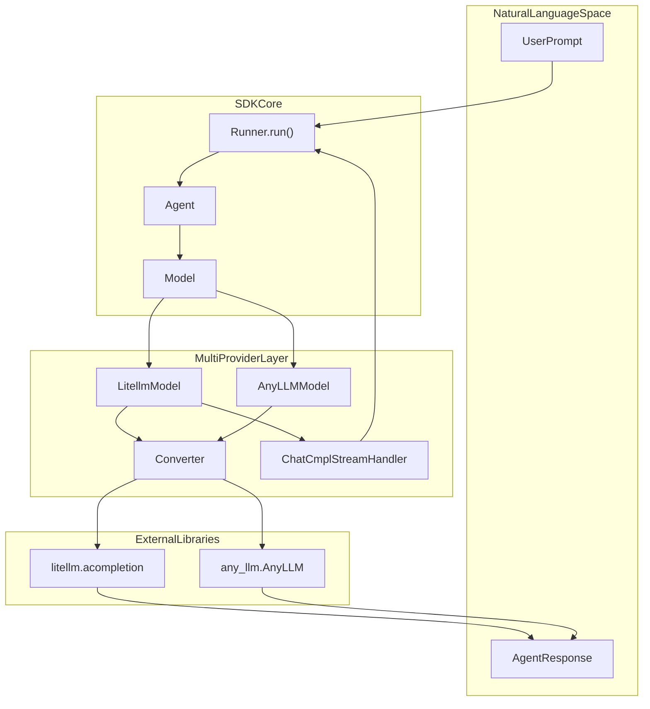
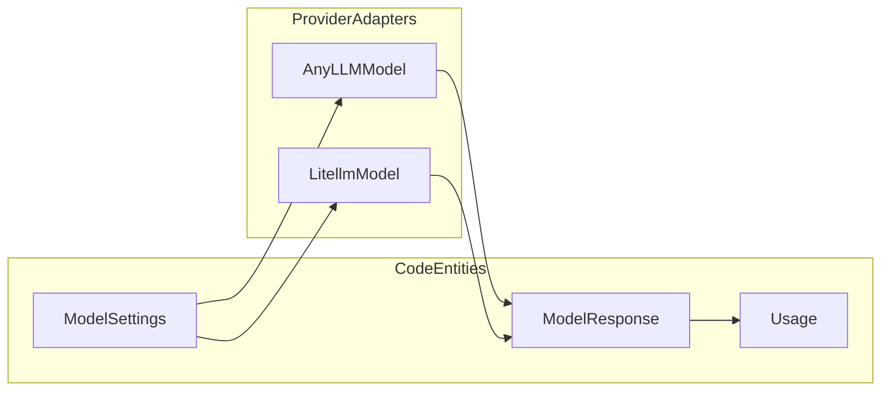

<!-- source: DeepWiki mcp.deepwiki.com · repo openai/openai-agents-python · page 7.4 LiteLLM and AnyLLM Multi-Provider Support · fetched 2026-10-26 -->

# LiteLLM and AnyLLM Multi-Provider Support

<details>
<summary>Relevant source files</summary>

The following files were used as context for generating this wiki page:

- [docs/ja/models/litellm.md](docs/ja/models/litellm.md)
- [examples/model_providers/README.md](examples/model_providers/README.md)
- [examples/model_providers/any_llm_auto.py](examples/model_providers/any_llm_auto.py)
- [examples/model_providers/any_llm_provider.py](examples/model_providers/any_llm_provider.py)
- [examples/model_providers/litellm_auto.py](examples/model_providers/litellm_auto.py)
- [examples/model_providers/litellm_provider.py](examples/model_providers/litellm_provider.py)
- [src/agents/extensions/models/any_llm_model.py](src/agents/extensions/models/any_llm_model.py)
- [src/agents/extensions/models/any_llm_provider.py](src/agents/extensions/models/any_llm_provider.py)
- [src/agents/extensions/models/litellm_model.py](src/agents/extensions/models/litellm_model.py)
- [src/agents/extensions/models/litellm_provider.py](src/agents/extensions/models/litellm_provider.py)
- [src/agents/model_settings.py](src/agents/model_settings.py)
- [src/agents/models/chatcmpl_converter.py](src/agents/models/chatcmpl_converter.py)
- [src/agents/models/chatcmpl_helpers.py](src/agents/models/chatcmpl_helpers.py)
- [src/agents/models/chatcmpl_stream_handler.py](src/agents/models/chatcmpl_stream_handler.py)
- [src/agents/models/openai_chatcompletions.py](src/agents/models/openai_chatcompletions.py)
- [src/agents/models/openai_responses.py](src/agents/models/openai_responses.py)
- [src/agents/usage.py](src/agents/usage.py)
- [tests/model_settings/test_serialization.py](tests/model_settings/test_serialization.py)
- [tests/models/test_any_llm_model.py](tests/models/test_any_llm_model.py)
- [tests/models/test_chatcompletions_stream_eof.py](tests/models/test_chatcompletions_stream_eof.py)
- [tests/models/test_kwargs_functionality.py](tests/models/test_kwargs_functionality.py)
- [tests/models/test_litellm_chatcompletions_stream.py](tests/models/test_litellm_chatcompletions_stream.py)
- [tests/models/test_litellm_content_filter.py](tests/models/test_litellm_content_filter.py)
- [tests/models/test_litellm_extra_body.py](tests/models/test_litellm_extra_body.py)
- [tests/models/test_litellm_usage_requests.py](tests/models/test_litellm_usage_requests.py)
- [tests/models/test_litellm_user_agent.py](tests/models/test_litellm_user_agent.py)
- [tests/models/test_openai_chatcompletions.py](tests/models/test_openai_chatcompletions.py)
- [tests/models/test_openai_chatcompletions_converter.py](tests/models/test_openai_chatcompletions_converter.py)
- [tests/models/test_openai_chatcompletions_stream.py](tests/models/test_openai_chatcompletions_stream.py)
- [tests/models/test_openai_responses.py](tests/models/test_openai_responses.py)
- [tests/models/test_openai_responses_converter.py](tests/models/test_openai_responses_converter.py)
- [tests/models/test_reasoning_content.py](tests/models/test_reasoning_content.py)
- [tests/test_prompt_cache_key.py](tests/test_prompt_cache_key.py)
- [tests/test_usage.py](tests/test_usage.py)

</details>


## Purpose and Scope

This page documents the multi-provider integration layer of the OpenAI Agents SDK, focusing primarily on `LitellmModel` [src/agents/extensions/models/litellm_model.py:147-164]() and `AnyLLMModel` [src/agents/extensions/models/any_llm_model.py:1-75](). These integrations enable the SDK to interact with over 100 language model providers—including Anthropic, Google Gemini, DeepSeek, and Mistral—while preserving the SDK's core agentic capabilities, item hierarchies, and tracing semantics.

For general model abstractions, see [Model Abstraction Layer (7.1)](). For native OpenAI implementations, see [OpenAI Responses API (7.2)]() and [OpenAI Chat Completions API (7.3)]().

Sources: [src/agents/extensions/models/litellm_model.py:147-164](), [src/agents/extensions/models/any_llm_model.py:1-75]().

## Overview

The SDK provides multi-provider support through dedicated extension classes implementing the `Model` interface [src/agents/models/interface.py](). These classes handle the translation between the SDK's internal item representations (`TResponseInputItem`) and the Chat Completions payloads accepted by external client libraries.

- **LitellmModel**: Bridges the SDK to the [LiteLLM](https://docs.litellm.ai/) ecosystem, exposing a unified interface for numerous third-party model providers [src/agents/extensions/models/litellm_model.py:147-164]().
- **AnyLLMModel**: Integrates with the `any-llm-sdk` package to support high-performance streaming and structured generation across diverse model backends [src/agents/extensions/models/any_llm_model.py:1-75]().

### Key Features
- **Provider-Specific Metadata**: Extracts advanced features like reasoning content (DeepSeek), thinking blocks (Anthropic), and thought signatures (Gemini) into the `provider_data` field of SDK items [src/agents/models/chatcmpl_converter.py:122-170]().
- **Automatic Prefix Resolution**: Automatically configures and routes requests when model identifiers use prefixes such as `litellm/` or `any-llm/`.
- **Message Ordering Correction**: Ensures compliance with strict provider sequence rules regarding tool calls and tool responses [src/agents/models/chatcmpl_converter.py:1-120]().

Sources: [src/agents/extensions/models/litellm_model.py:147-164](), [src/agents/extensions/models/any_llm_model.py:1-75](), [src/agents/models/chatcmpl_converter.py:122-170]().

## Implementation Architecture

The following diagram details the execution flow from the SDK `Runner` through the multi-provider integration layer to external LLMs.

### Multi-Provider Data Flow

Sources: [src/agents/extensions/models/litellm_model.py:147-164](), [src/agents/extensions/models/any_llm_model.py:1-75](), [src/agents/models/chatcmpl_converter.py:79-121]().

## LiteLLM Integration (`LitellmModel`)

`LitellmModel` wraps LiteLLM to convert SDK prompt inputs and model configurations into chat completion requests.

### Provider-Specific Handling
- **Anthropic Thinking Blocks**: Accumulates streamed thinking and signature deltas into cohesive output blocks [src/agents/models/chatcmpl_stream_handler.py:92-135]().
- **Usage Normalization**: Maps raw token consumption from LiteLLM responses into the SDK's normalized `Usage` structure, supporting cached tokens and reasoning tokens [src/agents/usage.py:111-147]().
- **Serializer Warnings Patch**: Optionally patches LiteLLM Pydantic serialization helpers when `OPENAI_AGENTS_ENABLE_LITELLM_SERIALIZER_PATCH` is enabled [src/agents/extensions/models/litellm_model.py:70-128]().

### Usage Example
```python
from agents import Agent, Runner
from agents.extensions.models import LitellmModel

model = LitellmModel(model="anthropic/claude-3-5-sonnet")
agent = Agent(name="Assistant", model=model)
```
Sources: [src/agents/extensions/models/litellm_model.py:70-164](), [src/agents/usage.py:111-147]().

## AnyLLM Integration (`AnyLLMModel`)

`AnyLLMModel` provides integration with the `any-llm-sdk` abstraction layer [src/agents/extensions/models/any_llm_model.py:68-75]().

### Reasoning and Thinking Extraction
`AnyLLMModel` inspects response payloads for auxiliary thought channels:
- `_flatten_any_llm_reasoning_value`: Recursively parses complex nested reasoning structures or dictionaries containing `content`, `text`, or `thinking` keys [src/agents/extensions/models/any_llm_model.py:178-199]().
- Normalizes tool call payloads into standard `ChatCompletionMessageFunctionToolCall` or `ChatCompletionMessageCustomToolCall` structures while preserving provider-specific metadata [src/agents/extensions/models/any_llm_model.py:142-176]().

Sources: [src/agents/extensions/models/any_llm_model.py:68-199]().

## Provider Limitations and Troubleshooting

When integrating non-OpenAI models, certain SDK configurations have constraints:

### Common Limitations
- **JSON Schema Strictness**: `Converter.convert_response_format` translates final output schemas into standard OpenAI JSON schema structures [src/agents/models/chatcmpl_converter.py:107-121]().
- **Tool Choice Restrictions**: Advanced features like `MCPToolChoice` are unsupported on Chat Completions-based backends and raise `UserError` [src/agents/models/chatcmpl_converter.py:81-87]().

### Troubleshooting Non-OpenAI Models
1. **Missing Dependencies**: Verify that optional dependency groups are installed via `pip install 'openai-agents[litellm]'` or `pip install 'openai-agents[any-llm]'` [src/agents/extensions/models/litellm_model.py:16-22](), [src/agents/extensions/models/any_llm_model.py:68-75]().
2. **Usage Tracking**: Ensure the underlying provider returns parseable usage dictionaries; otherwise, token metrics default gracefully [src/agents/usage.py:20-46]().
3. **Reasoning Replay**: Use `should_replay_reasoning_content` to manage whether historical model thoughts are re-injected into multi-turn conversations [src/agents/models/chatcmpl_converter.py:64-70]().

Sources: [src/agents/extensions/models/litellm_model.py:16-22](), [src/agents/extensions/models/any_llm_model.py:68-75](), [src/agents/models/chatcmpl_converter.py:81-121](), [src/agents/usage.py:20-46]().

## Data Mapping and Item Conversion

The `Converter` class inside `chatcmpl_converter.py` bridges SDK items and chat completion protocols [src/agents/models/chatcmpl_converter.py:79-121]().

### Mapping Summary
| SDK Item | Provider Format | Implementation Source |
| :--- | :--- | :--- |
| `ResponseReasoningItem` | `reasoning_content` | `Converter.message_to_output_items()` [src/agents/models/chatcmpl_converter.py:123-170]() |
| `ResponseFunctionToolCall` | `tool_calls` | `Converter.message_to_output_items()` [src/agents/models/chatcmpl_converter.py:202-215]() |
| `AgentOutputSchemaBase` | `json_schema` | `Converter.convert_response_format()` [src/agents/models/chatcmpl_converter.py:107-121]() |

### Code Entity Association

Sources: [src/agents/model_settings.py:88-185](), [src/agents/usage.py:111-147](), [src/agents/items.py:25-45](), [src/agents/models/chatcmpl_converter.py:79-121]().

---

