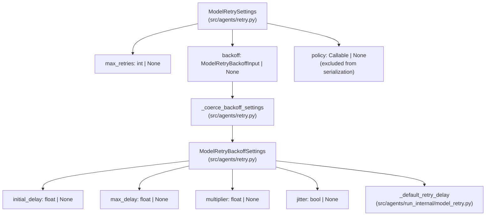
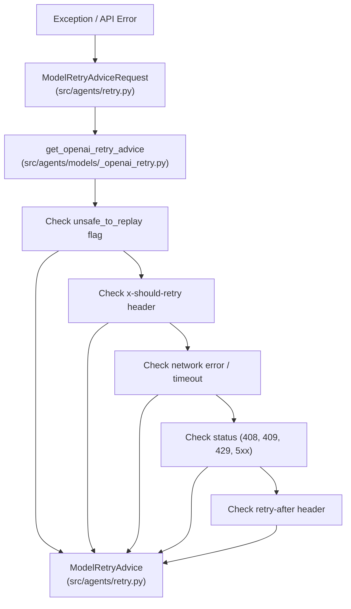

<!-- source: DeepWiki mcp.deepwiki.com · repo openai/openai-agents-python · page 7.6 Retry Policies · fetched 2026-10-26 -->

# Retry Policies

Relevant source files

The following files were used as context for generating this wiki page:

- [examples/basic/retry.py](examples/basic/retry.py)
- [examples/basic/retry_litellm.py](examples/basic/retry_litellm.py)
- [integration_tests/openai/test_retry.py](integration_tests/openai/test_retry.py)
- [integration_tests/packaging/test_mcp_compat.py](integration_tests/packaging/test_mcp_compat.py)
- [src/agents/_httpx_compat.py](src/agents/_httpx_compat.py)
- [src/agents/mcp/_compat.py](src/agents/mcp/_compat.py)
- [src/agents/models/_openai_retry.py](src/agents/models/_openai_retry.py)
- [src/agents/models/_retry_runtime.py](src/agents/models/_retry_runtime.py)
- [src/agents/run_internal/model_retry.py](src/agents/run_internal/model_retry.py)
- [tests/models/test_model_retry.py](tests/models/test_model_retry.py)
- [tests/models/test_openai_retry_helpers.py](tests/models/test_openai_retry_helpers.py)

This page details the **runner-managed retry system** for model API calls within the OpenAI Agents SDK. The retry system provides automatic request retries on transient errors—such as network connection failures, rate limits, and server-side HTTP errors—using configurable backoff algorithms, provider advice integration, and strict safety boundaries. This mechanism is opt-in and controlled via `ModelSettings.retry`.

For foundational model configuration, see [Model Settings and Configuration](7.5). For model provider integration, see [Model Abstraction Layer](7.1).

---

## Overview

The SDK does not retry failed model requests by default. Retries are activated only when `ModelSettings(retry=...)` is populated with a `ModelRetrySettings` configuration containing a valid retry policy [src/agents/retry.py:162-182](). 

The retry execution layer intercepts model requests made via `get_response_with_retry` and `stream_response_with_retry` in [src/agents/run_internal/model_retry.py](), evaluating errors against policies, calculating backoff intervals, and inspecting provider-supplied metadata [src/agents/run_internal/model_retry.py:230-375]().

**Core components**:
- **`ModelRetrySettings`**: Defines maximum retry attempts, backoff settings, and policy callbacks [src/agents/retry.py:162-182]().
- **`RetryPolicy`**: A callable receiving a `RetryPolicyContext` that returns a `RetryDecision` or boolean [src/agents/retry.py:137-137]().
- **`ModelRetryNormalizedError`**: Standardized representation of errors across different HTTP libraries (httpx, httpx2) and exception classes [src/agents/retry.py:50-90]().
- **`ModelRetryAdvice`**: Structured metadata returned by model providers to guide retry decisions [src/agents/retry.py:93-101]().

Sources: [src/agents/retry.py:50-182](), [src/agents/run_internal/model_retry.py:1-200]()

---

## ModelRetrySettings and Backoff Configuration

`ModelRetrySettings` is a Pydantic model configuration object configured inside `ModelSettings` [src/agents/retry.py:162-182](). It specifies how many times a request may be retried and how backoff delays are calculated.

**Code Entity Space Mapping**

**Configuration Fields & Defaults**:
- `max_retries`: Maximum retry attempts after the initial failure [src/agents/retry.py:165-166]().
- `backoff`: Dictionary or `ModelRetryBackoffSettings` instance defining exponential backoff parameters [src/agents/retry.py:168-169]().
- `initial_delay`: Default starting delay of `0.25` seconds [src/agents/run_internal/model_retry.py:46]().
- `max_delay`: Default maximum delay cap of `2.0` seconds [src/agents/run_internal/model_retry.py:47]().
- `multiplier`: Default exponential multiplier of `2.0` [src/agents/run_internal/model_retry.py:48]().
- `jitter`: Default `True`, adding randomization to backoff intervals to prevent thundering herd issues [src/agents/run_internal/model_retry.py:49]().

Sources: [src/agents/retry.py:162-182](), [src/agents/run_internal/model_retry.py:46-50](), [src/agents/run_internal/model_retry.py:175-202]()

---

## Retry Policy Execution Flow and Normalization

When an exception occurs during a model call, the SDK normalizes the error into a `ModelRetryNormalizedError` [src/agents/run_internal/model_retry.py:116-156](). This normalized structure extracts status codes, error codes, request IDs, retry-after headers, network error classifications, and timeout states [src/agents/run_internal/model_retry.py:120-132]().

**Code Entity Space Mapping**

```mermaid
graph LR
    ModelCall["Model Call<br/>(src/agents/run_internal/model_retry.py)"]
    RawError["Exception (httpx / openai)"]
    Normalize["_normalize_retry_error<br/>(src/agents/run_internal/model_retry.py)"]
    Context["RetryPolicyContext<br/>(src/agents/retry.py)"]
    PolicyCallback["RetryPolicy<br/>(src/agents/retry.py)"]
    Decision["RetryDecision<br/>(src/agents/retry.py)"]
    DelayCalc["_default_retry_delay<br/>(src/agents/run_internal/model_retry.py)"]
    Retry["Retry Attempt"]
    Abort["Raise Exception"]

    ModelCall -->|"Raises"| RawError
    RawError --> Normalize
    Normalize --> Context
    Context --> PolicyCallback
    PolicyCallback --> Decision
    Decision -->|"retry=True"| DelayCalc
    Decision -->|"retry=False"| Abort
    DelayCalc --> Retry
```

### Context and Decision Structures
- `RetryPolicyContext`: Bundles attempt counters, maximum retry settings, stream flags, raw exceptions, normalized errors, and provider advice [src/agents/retry.py:126-135]().
- `RetryDecision`: Contains boolean `retry`, explicit `delay`, `reason`, and metadata [src/agents/retry.py:31-48]().

Sources: [src/agents/retry.py:31-135](), [src/agents/run_internal/model_retry.py:116-173]()

---

## Built-in Retry Policies

The SDK provides composable policy helpers under `retry_policies` [src/agents/retry.py:228-350]() to evaluate specific error classes:

- **`provider_suggested()`**: Respects provider advice (`provider_advice.suggested` and `replay_safety`) [src/agents/retry.py:237-252]().
- **`network_error()`**: Evaluates `is_network_error` or `is_timeout` flags on the normalized error [src/agents/retry.py:255-266]().
- **`http_status(codes)`**: Matches specific HTTP status codes (e.g., rate limits `429` or server errors `5xx`) [src/agents/retry.py:269-287]().
- **`retry_after()`**: Retries when a `retry_after` delay header is present [src/agents/retry.py:290-304]().

Policies can be combined using logical combinators like `retry_policies.any(...)` and `retry_policies.all(...)` [src/agents/retry.py:307-350]().

Sources: [src/agents/retry.py:228-350]()

---

## Provider Advice Logic

Model adapters (such as the OpenAI integration) implement provider-specific advice functions like `get_openai_retry_advice()` [src/agents/models/_openai_retry.py:41-112]() to analyze exceptions and headers before generic runner policies execute.

**OpenAI Retry Advice Resolution**

The advice evaluator inspects:
1. **`unsafe_to_replay` attribute**: Prevents retries when marked unsafe [src/agents/models/_openai_retry.py:43-48]().
2. **`x-should-retry` header**: Honors explicit server instructions (`true` or `false`) [src/agents/models/_openai_retry.py:65-82]().
3. **Transient HTTP Status Codes**: Automatically flags codes `408`, `409`, `429`, and `5xx` as retryable [src/agents/models/_openai_retry.py:92-103]().

Sources: [src/agents/models/_openai_retry.py:41-112](), [src/agents/models/_retry_runtime.py:86-133]()

---

## Safety Boundaries

The retry engine enforces strict safety limits to prevent duplicate executions or state corruption:

- **Stateful Request Protection**: Requests involving `previous_response_id` or `conversation_id` are considered stateful and blocked from automatic replay unless explicitly permitted by provider advice (`replay_safety == "safe"`) [src/agents/models/_openai_retry.py:16-17](), [src/agents/models/_openai_retry.py:101-103]().
- **Streaming Guardrails**: Streaming calls only allow retries if the error occurs prior to content emission (specifically during initial event types like `response.created` or `response.in_progress`). Once content tokens stream, retries are disabled [src/agents/run_internal/model_retry.py:51](), [src/agents/run_internal/model_retry.py:355-375]().
- **Abort Shielding**: `asyncio.CancelledError` and abort-like exceptions are recognized by `_is_abort_like_error()` and never retried [src/agents/run_internal/model_retry.py:74-87]().

Sources: [src/agents/run_internal/model_retry.py:51-87](), [src/agents/run_internal/model_retry.py:355-375](), [src/agents/models/_openai_retry.py:16-103]()

---

