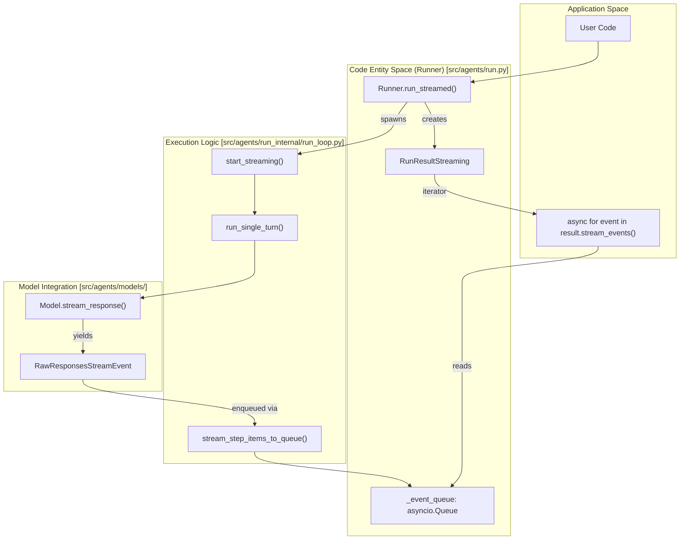
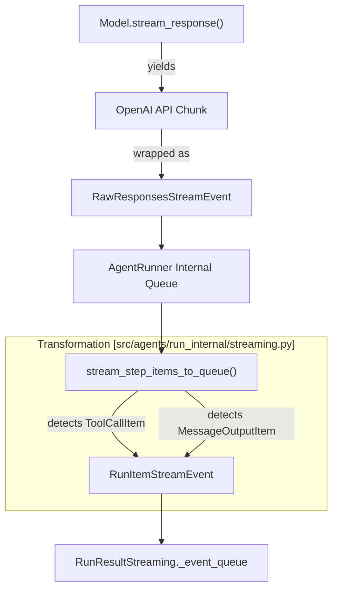

<!-- source: DeepWiki mcp.deepwiki.com · repo openai/openai-agents-python · page 7.7 Streaming Responses · fetched 2026-10-26 -->

# Streaming Responses

Relevant source files

The following files were used as context for generating this wiki page:

- [examples/memory/compaction_session_example.py](examples/memory/compaction_session_example.py)
- [examples/memory/compaction_session_stateless_example.py](examples/memory/compaction_session_stateless_example.py)
- [src/agents/memory/__init__.py](src/agents/memory/__init__.py)
- [src/agents/memory/util.py](src/agents/memory/util.py)
- [src/agents/run_internal/model_provider_lifecycle.py](src/agents/run_internal/model_provider_lifecycle.py)
- [src/agents/run_internal/streaming.py](src/agents/run_internal/streaming.py)
- [tests/test_agent_tool_state.py](tests/test_agent_tool_state.py)
- [tests/test_cancel_streaming.py](tests/test_cancel_streaming.py)
- [tests/test_runner_model_provider_lifecycle.py](tests/test_runner_model_provider_lifecycle.py)
- [tests/test_soft_cancel.py](tests/test_soft_cancel.py)
- [tests/test_stream_events.py](tests/test_stream_events.py)
- [tests/tracing/test_setup.py](tests/tracing/test_setup.py)

Streaming allows you to subscribe to updates while an agent execution is in progress. This is essential for providing real-time feedback in user interfaces, such as displaying partial text responses as they are generated by the model.

## Purpose and Scope

This page covers the technical implementation of streaming within the SDK, focusing on:
- The internal `Runner.run_streamed()` and `stream_response()` execution flow `[src/agents/run.py:237-270]()`.
- The `RunResultStreaming` class and its event management capabilities `[src/agents/result.py:343-380]()`.
- The hierarchy of `StreamEvent` types, including `RawResponsesStreamEvent` and `RunItemStreamEvent` `[src/agents/stream_events.py:10-62]()`.
- How streaming translates step items via `stream_step_items_to_queue()` and `stream_step_result_to_queue()` `[src/agents/run_internal/streaming.py:28-73]()`.
- Robust cancellation workflows supporting both `immediate` and `after_turn` (soft cancel) modes `[tests/test_cancel_streaming.py:39-178](), [tests/test_soft_cancel.py:24-37]()`.

For high-level usage patterns, see [Streaming Patterns](#13.3).

Sources: `[src/agents/run.py:237-270]()`, `[src/agents/result.py:343-380](), [src/agents/stream_events.py:10-62](), [src/agents/run_internal/streaming.py:28-73]()`.

---

## Streaming Architecture Overview

The streaming pipeline operates by coordinating an asynchronous execution task with a consumer-facing queue. When `Runner.run_streamed()` is invoked, it initializes a `RunResultStreaming` instance and starts the agent turn loop asynchronously in a background task.

Title: Natural Language Space to Code Entity Space - Streaming Flow

Sources: `[src/agents/run.py:237-270]`, `[src/agents/run_internal/run_loop.py:104-105]`, `[src/agents/result.py:343-380]()`.

---

## Core Streaming Entities

### Runner.run_streamed()
This is the primary entry point for streaming. Unlike `Runner.run()`, it does not block until execution completes. Instead, it instantly returns a `RunResultStreaming` instance after instantiating the background execution task `[src/agents/run.py:237-270]()`.

### RunResultStreaming
A subclass of `RunResultBase` that manages the lifecycle of a streamed run:
- **`stream_events()`**: Returns an `AsyncIterator[StreamEvent]`. It drains the internal `_event_queue` until the run finishes or is canceled `[src/agents/result.py:382-416]()`.
- **`cancel(mode="immediate")`**: Stops execution. Supports `immediate` or `after_turn` modes `[src/agents/result.py:440-474]`, `[tests/test_soft_cancel.py:36-36]()`.
- **`is_complete`**: A boolean property indicating if the background execution task has terminated and all queued events have been consumed `[src/agents/result.py:335-337]()`.

### StreamEvent Hierarchy
The SDK defines a robust hierarchy of event types to represent model tokens and run items `[src/agents/stream_events.py:10-62]()`:

| Event Class | `type` | Description |
| :--- | :--- | :--- |
| `RawResponsesStreamEvent` | `raw_response_event` | Encapsulates raw streaming chunks directly from the underlying LLM interface `[src/agents/stream_events.py:11-22]()`. |
| `RunItemStreamEvent` | `run_item_stream_event` | Emitted when a high-level `RunItem` (such as a message, tool call, or reasoning step) is created or completed `[src/agents/stream_events.py:24-50]()`. |
| `AgentUpdatedStreamEvent` | `agent_updated_stream_event` | Emitted when the active agent transitions, typically during a handoff `[src/agents/stream_events.py:52-59]()`. |

Sources: `[src/agents/run.py:237-270]`, `[src/agents/result.py:335-474]`, `[src/agents/stream_events.py:10-62]()`.

---

## Event Generation and Data Flow

During execution, `run_loop.py` invokes the model's `stream_response` method. Step results are processed into queueable streaming items using dedicated helpers found in `src/agents/run_internal/streaming.py` `[src/agents/run_internal/streaming.py:28-73]()`.

Title: Data Flow - Event Processing Logic

Sources: `[src/agents/run_internal/run_loop.py:162-162]`, `[src/agents/run_internal/streaming.py:28-73]()`.

### RunItemStreamEvent Names
The `RunItemStreamEvent` wraps high-level run items with a semantic `name` field [src/agents/stream_events.py:29-42]():
- `message_output_created`: A text response message item is ready.
- `tool_called`: A function or system tool call has been initiated.
- `tool_output`: The result of a tool execution has been received.
- `handoff_requested`: The agent has initiated a transfer to a peer agent.
- `handoff_occured`: The handoff transaction is complete.
- `reasoning_item_created`: A model reasoning/thought block is finalized.
- `mcp_approval_requested`: Model Context Protocol (MCP) tool execution requires user permission.

Sources: `[src/agents/stream_events.py:24-50]`, `[src/agents/run_internal/streaming.py:28-66]()`.

---

## Streaming and Interruptions

Streaming integrates seamlessly with the human-in-the-loop (HITL) approval system:
1. When a tool requiring authorization is encountered, the `stream_events()` iterator wraps up or suspends once the model yields the tool call item `[src/agents/result.py:382-416]()`.
2. Pending authorization requests populate `RunResultStreaming.interruptions` as `ToolApprovalItem` or `MCPApprovalRequestItem` objects `[src/agents/result.py:317-319]()`.
3. Developers can capture state using `result.to_state()`, approve or reject the action, and resume execution `[src/agents/result.py:418-438]()`.

Sources: `[src/agents/result.py:317-438]()`.

---

## Cancellation and Resource Cleanup

The `RunResultStreaming` object supports fine-grained task cancellation to abort execution safely without leaking background coroutines or resources `[tests/test_cancel_streaming.py:39-178](), [tests/test_soft_cancel.py:24-37]()`.

### Cancellation Modes
- **`immediate`**: Instantly signals the background runner task to abort, closing network sessions and flushing event queues right away `[tests/test_cancel_streaming.py:171-176]()`.
- **`after_turn` (Soft Cancel)**: Allows the current active turn (including any pending tool executions) to finish running before terminating further turns. This ensures that session logs and states remain fully consistent and serializable `[tests/test_soft_cancel.py:24-37]()`.

### Resource Management
`RunResultStreaming` ensures thread-safe and task-safe queue cleanups, maintaining strict idempotency when `cancel()` is called multiple times or even before streaming has started `[tests/test_cancel_streaming.py:105-143]()`.

Sources: `[tests/test_cancel_streaming.py:39-178]`, `[tests/test_soft_cancel.py:24-37]()`.

---

