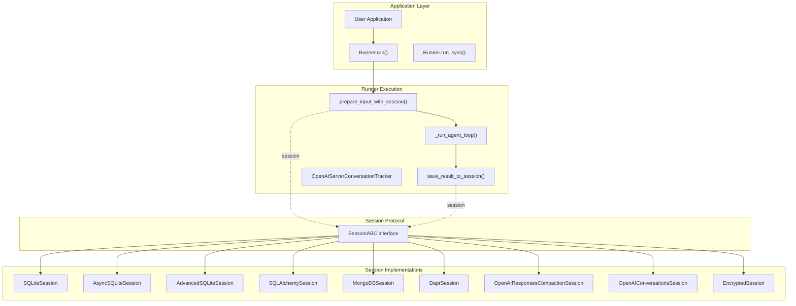

<!-- source: DeepWiki mcp.deepwiki.com · repo openai/openai-agents-python · page 8 Session and Memory Management · fetched 2026-10-26 -->

# Session and Memory Management

Relevant source files

The following files were used as context for generating this wiki page:

- [docs/ja/sessions/index.md](docs/ja/sessions/index.md)
- [docs/ko/sessions/index.md](docs/ko/sessions/index.md)
- [docs/zh/sessions/index.md](docs/zh/sessions/index.md)
- [src/agents/extensions/memory/advanced_sqlite_session.py](src/agents/extensions/memory/advanced_sqlite_session.py)
- [src/agents/extensions/memory/async_sqlite_session.py](src/agents/extensions/memory/async_sqlite_session.py)
- [src/agents/memory/sqlite_session.py](src/agents/memory/sqlite_session.py)
- [tests/extensions/memory/test_advanced_sqlite_session.py](tests/extensions/memory/test_advanced_sqlite_session.py)
- [tests/extensions/memory/test_async_sqlite_session.py](tests/extensions/memory/test_async_sqlite_session.py)
- [tests/memory/test_session.py](tests/memory/test_session.py)

## Purpose and Scope
This page serves as the parent overview for conversation history management strategies, the `Session` abstraction layer, concrete session implementations, and server-managed alternatives within the OpenAI Agents SDK. Detailed explorations of protocols, storage engines, tracking modes, and server-side tracking are delegated to dedicated child pages.

For details on the interface, methods, and lifecycle, see [Session Protocol](#8.1). For concrete backends, see [Session Implementations](#8.2). For tracking options, see [Conversation Tracking Modes](#8.3). For server-managed alternatives, see [Server-Managed Conversations](#8.4).

Sources: `docs/sessions/index.md:5-12` [docs/sessions/index.md:5-12]()

---

## Overview of Memory Management Approaches

The SDK supports multiple conversation management strategies to maintain context between turns:

| Strategy | State Location | Developer Control | Token Optimization | Typical Use Case |
|----------|----------------|-------------------|-------------------|------------------|
| **Manual** | Application memory | Full control over history | None (sends all history) | Custom conversation logic |
| **Session-based** | Local/distributed storage | Automatic via `Session` protocol | None (sends all history) | Persistent chat applications |
| **conversation_id** | OpenAI servers | Minimal (create conversation once) | Server reconstructs history | Offload storage to OpenAI |
| **previous_response_id** | OpenAI servers | Track `last_response_id` | Chains responses server-side | Explicit response linking |
| **auto_previous_response_id** | OpenAI servers | Automatic chaining | Automatic chaining | Convenience + optimization |

Sources: `docs/sessions/index.md:7-11` [docs/sessions/index.md:7-11](), `src/agents/result.py:228-243` [src/agents/result.py:228-243](), `src/agents/run_internal/oai_conversation.py:1-50` [src/agents/run_internal/oai_conversation.py:1-50]()

---

## Memory Management Architecture

**Diagram: Session and Memory Management System Architecture**

Sources: `src/agents/run_internal/session_persistence.py:54-62` [src/agents/run_internal/session_persistence.py:54-62](), `src/agents/run_internal/oai_conversation.py:38-38` [src/agents/run_internal/oai_conversation.py:38-38](), `src/agents/memory/session.py:52-56` [src/agents/memory/session.py:52-56]()

---

## Session Protocol Interface

The `SessionABC` abstract base class defines the contract for session storage, requiring methods like `get_items()`, `add_items()`, `pop_item()`, and `clear_session()`. 

For details on the interface, its methods, and the session lifecycle, see [Session Protocol](#8.1).

Sources: `src/agents/memory/session.py:52-56` [src/agents/memory/session.py:52-56]()

---

## Session Implementations

The SDK provides multiple built-in session implementations spanning local embedded files, asynchronous drivers, distributed databases, cloud state stores, and wrappers:

* `SQLiteSession` (`src/agents/memory/sqlite_session.py`): Local thread-safe SQLite storage.
* `AsyncSQLiteSession` (`src/agents/extensions/memory/async_sqlite_session.py`): Asynchronous SQLite persistence using `aiosqlite`.
* `AdvancedSQLiteSession` (`src/agents/extensions/memory/advanced_sqlite_session.py`): SQLite backend supporting conversation branching and analytics.
* `SQLAlchemySession` (`src/agents/extensions/memory/sqlalchemy_session.py`): Production relational database storage.
* `MongoDBSession` (`src/agents/extensions/memory/mongodb_session.py`): MongoDB-backed asynchronous store with atomic sequence counters.
* `RedisSession` (`src/agents/extensions/memory/redis_session.py`): Distributed Redis storage with TTL.
* `DaprSession` (`src/agents/extensions/memory/dapr_session.py`): Cloud-native state store integration.
* `OpenAIConversationsSession` (`src/agents/memory/openai_conversations_session.py`): OpenAI-hosted storage via the Conversations API.
* `OpenAIResponsesCompactionSession` / `EncryptedSession`: Wrapper sessions providing compaction and encryption features.

For details on configuration and usage, see [Session Implementations](#8.2).

Sources: `docs/sessions/index.md:203-218` [docs/sessions/index.md:203-218](), `src/agents/memory/sqlite_session.py:18-24` [src/agents/memory/sqlite_session.py:18-24]()

---

## Conversation Tracking Modes

Developers can manage conversation state through manual history handling (`RunResult.to_input_list()`), automated session injection, or custom input callback processing (`RunConfig.session_input_callback`).

For a complete decision tree and rules, see [Conversation Tracking Modes](#8.3).

Sources: `docs/sessions/index.md:7-11` [docs/sessions/index.md:7-11](), `docs/sessions/index.md:76-91` [docs/sessions/index.md:76-91]()

---

## Server-Managed Conversations

When offloading history maintenance to OpenAI servers, parameters such as `conversation_id`, `previous_response_id`, and `auto_previous_response_id` handle message chaining automatically, supported by `OpenAIServerConversationTracker`.

For details on server-side options, see [Server-Managed Conversations](#8.4).

Sources: `docs/sessions/index.md:11-11` [docs/sessions/index.md:11-11](), `src/agents/run_internal/oai_conversation.py:1-50` [src/agents/run_internal/oai_conversation.py:1-50]()

---

## Child Pages
- [Session Protocol](#8.1) — SessionABC interface, get_items(), add_items(), session lifecycle, SessionSettings
- [Session Implementations](#8.2) — SQLiteSession, AsyncSQLiteSession, RedisSession, SQLAlchemySession, MongoDBSession, DaprSession, OpenAIConversationsSession, wrapper sessions (Compaction, Encrypted)
- [Conversation Tracking Modes](#8.3) — Manual history management (to_input_list), automated sessions, session_input_callback, memory strategy decision tree
- [Server-Managed Conversations](#8.4) — conversation_id, previous_response_id, auto_previous_response_id, OpenAIServerConversationTracker, deduplication

---

