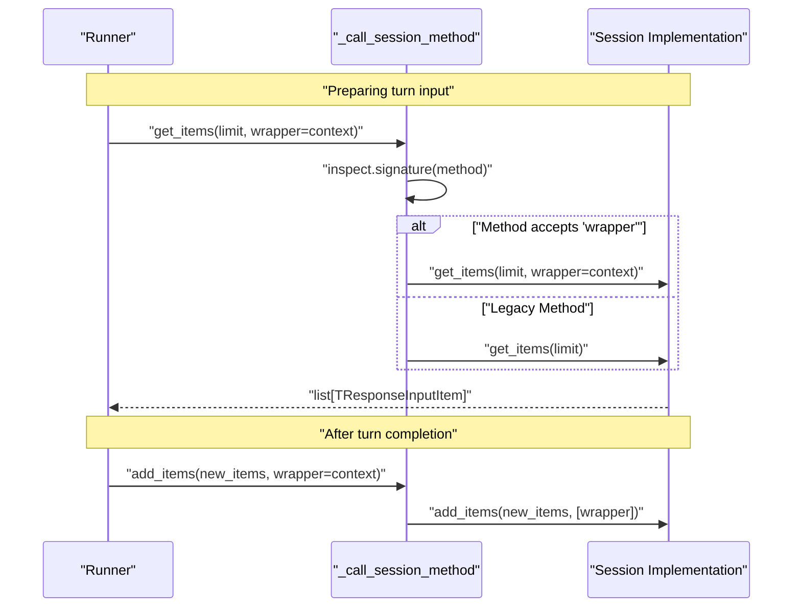

<!-- source: DeepWiki mcp.deepwiki.com · repo openai/openai-agents-python · page 8.1 Session Protocol · fetched 2026-10-26 -->

# Session Protocol

<details>
<summary>Relevant source files</summary>

The following files were used as context for generating this wiki page:

- [docs/realtime/transport.md](docs/realtime/transport.md)
- [docs/sessions/advanced_sqlite_session.md](docs/sessions/advanced_sqlite_session.md)
- [docs/sessions/encrypted_session.md](docs/sessions/encrypted_session.md)
- [docs/sessions/sqlalchemy_session.md](docs/sessions/sqlalchemy_session.md)
- [examples/memory/encrypted_session_example.py](examples/memory/encrypted_session_example.py)
- [src/agents/extensions/memory/advanced_sqlite_session.py](src/agents/extensions/memory/advanced_sqlite_session.py)
- [src/agents/extensions/memory/async_sqlite_session.py](src/agents/extensions/memory/async_sqlite_session.py)
- [src/agents/extensions/memory/encrypt_session.py](src/agents/extensions/memory/encrypt_session.py)
- [src/agents/memory/openai_responses_compaction_session.py](src/agents/memory/openai_responses_compaction_session.py)
- [src/agents/memory/session.py](src/agents/memory/session.py)
- [src/agents/memory/sqlite_session.py](src/agents/memory/sqlite_session.py)
- [tests/extensions/memory/test_advanced_sqlite_session.py](tests/extensions/memory/test_advanced_sqlite_session.py)
- [tests/extensions/memory/test_async_sqlite_session.py](tests/extensions/memory/test_async_sqlite_session.py)
- [tests/extensions/memory/test_encrypt_session.py](tests/extensions/memory/test_encrypt_session.py)
- [tests/memory/test_compaction_model_visibility.py](tests/memory/test_compaction_model_visibility.py)
- [tests/memory/test_openai_responses_compaction_session.py](tests/memory/test_openai_responses_compaction_session.py)
- [tests/memory/test_session.py](tests/memory/test_session.py)

</details>


## Purpose and Scope

This document describes the `Session` protocol (`Session`) and `SessionABC` interface (`SessionABC`), which define the abstract contract that all session implementations must conform to. The Session protocol specifies the core methods for storing and retrieving conversation history (`get_items`, `add_items`), managing individual items (`pop_item`), and clearing state (`clear_session`). It also defines how session-level configuration is managed via `SessionSettings`.

Sources: `[src/agents/memory/session.py:53-144]()`

---

## The Session Interface

The `Session` protocol defines the contract for persistent memory layers (`Session`). The SDK uses these interfaces to maintain conversation context across multiple agent runs without requiring manual history passing by the user.

**Core Design Principles:**

| Principle | Description |
|-----------|-------------|
| **Asynchronous** | All primary operations are `async` to accommodate database and network latency. |
| **Item-Based Storage** | Sessions operate on `TResponseInputItem`, the standard input format for the OpenAI Responses API. |
| **Context Awareness** | Sessions can opt-in to receiving a `RunContextWrapper` to implement multi-tenant or scoped storage. |
| **Pluggable Architecture** | The protocol allows for wrappers like `EncryptedSession` to add capabilities (encryption, TTL) to any underlying store. |

Sources: `[src/agents/memory/session.py:53-94]`, `[src/agents/extensions/memory/encrypt_session.py:116-140]()`

---

## Core Methods

### Session Interface Hierarchy

The following diagram illustrates the relationship between the base protocol, the abstract base class, and specialized capabilities like compaction.

**Natural Language to Code Entity Space: Session Hierarchy**
```mermaid
classDiagram
    class "Session" {
        <<protocol>>
        +session_id: str
        +session_settings: SessionSettings
        +get_items(limit) list
        +add_items(items) None
        +pop_item() item
        +clear_session() None
    }
    
    class "SessionABC" {
        <<abstract>>
        +session_id: str
        +session_settings: SessionSettings
    }

    class "OpenAIResponsesCompactionAwareSession" {
        <<protocol>>
        +run_compaction(args) None
    }
    
    "Session" <|.. "SessionABC" : "implements"
    "Session" <|-- "OpenAIResponsesCompactionAwareSession" : "extends"

    note for Session "Defined in src/agents/memory/session.py.\nUses TResponseInputItem for all data."
```

Sources: `[src/agents/memory/session.py:53-144]()`

---

### get_items()

**Purpose:** Retrieves conversation history for the current session. The `Runner` calls this before each turn to construct the full context for the model.

**Behavior:**
- **Limit Argument:** When provided, the implementation should return the latest $N$ items.
- **Chronological Order:** Items must be returned in the order they occurred (oldest first).
- **Context Injection:** If the method signature includes a `wrapper` parameter, the SDK passes the current `RunContextWrapper` to allow for scoped retrieval (e.g., tenant-based filtering).

Sources: `[src/agents/memory/session.py:63-73]`, `[src/agents/memory/session.py:110-120]`, `[src/agents/memory/session.py:192-206]()`

---

### add_items()

**Purpose:** Persists new items (messages, tool calls, tool outputs) generated during a run turn.

**Behavior:**
- **Atomicity:** Implementations should ensure that the list of items is added sequentially.
- **Encryption Wrapper:** When using `EncryptedSession`, items are converted to an `EncryptedEnvelope` containing a base64-encoded Fernet token before being passed to the underlying storage.

Sources: `[src/agents/memory/session.py:75-81]`, `[src/agents/extensions/memory/encrypt_session.py:61-68]()`

---

### pop_item() and clear_session()

- **pop_item():** Removes and returns the most recent item. Useful for "undo" functionality or handling interruptions.
- **clear_session():** Wipes all history associated with the `session_id`.

Sources: `[src/agents/memory/session.py:83-93]`, `[src/agents/memory/session.py:131-143]()`

---

## Session Lifecycle and Context Propagation

The SDK uses internal utility functions to determine how to call session methods, ensuring backward compatibility with legacy session implementations while supporting new context-aware features.

**Code Entity Space: Session Execution Flow**


Sources: `[src/agents/memory/session.py:192-225]()`

---

## SessionSettings

`SessionSettings` provides global defaults for session behavior.

- **limit:** An optional integer that defines the default maximum number of history items to load.
- **Resolution:** The function `resolve_session_limit` determines the effective limit by checking the specific call argument first, then the `SessionSettings` on the session object.

Sources: `[src/agents/memory/sqlite_session.py:15-16]`, `[src/agents/extensions/memory/encrypt_session.py:56-56]()`

---

## Specialized Protocols

### Compaction Protocol
The `OpenAIResponsesCompactionAwareSession` protocol defines a `run_compaction` method. This allows sessions to integrate with the OpenAI Responses Compaction API to summarize long histories.

**Compaction Arguments:**
- `compaction_mode`: Can be `auto`, `input`, or `previous_response_id`.
- `force`: Boolean to trigger compaction regardless of internal thresholds.

Sources: `[src/agents/memory/session.py:146-176]()`

### Encryption Wrapper
`EncryptedSession` is a `SessionABC` implementation that wraps another session. It uses **HKDF** (HMAC-based Key Derivation Function) to derive a per-session Fernet key from a master key and the `session_id`.

- **TTL Support:** It supports a Time-To-Live (TTL) for messages. During `get_items`, if a token has expired relative to the current system clock, the `_unwrap` method returns `None` and the item is filtered out.
- **Data Integrity:** It uses an `EncryptedEnvelope` TypedDict to structure the data stored in the underlying database, including a version (`v`) and key ID (`kid`).

Sources: `[src/agents/extensions/memory/encrypt_session.py:61-95]`, `[src/agents/extensions/memory/encrypt_session.py:116-140]()`

---

