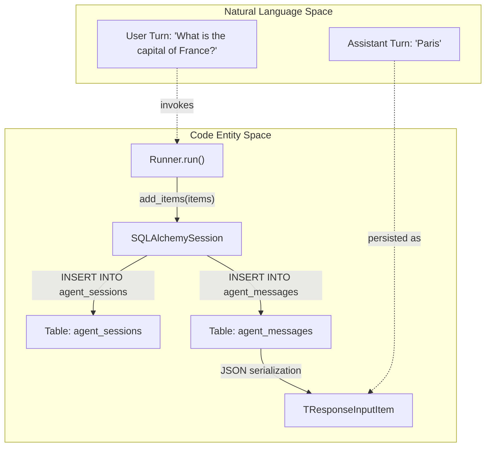
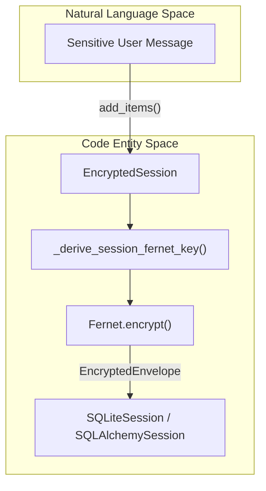

<!-- source: DeepWiki mcp.deepwiki.com · repo openai/openai-agents-python · page 8.2 Session Implementations · fetched 2026-10-26 -->

# Session Implementations

Relevant source files

The following files were used as context for generating this wiki page:

- [docs/realtime/transport.md](docs/realtime/transport.md)
- [docs/sessions/advanced_sqlite_session.md](docs/sessions/advanced_sqlite_session.md)
- [docs/sessions/encrypted_session.md](docs/sessions/encrypted_session.md)
- [docs/sessions/sqlalchemy_session.md](docs/sessions/sqlalchemy_session.md)
- [examples/memory/advanced_sqlite_session_example.py](examples/memory/advanced_sqlite_session_example.py)
- [examples/memory/encrypted_session_example.py](examples/memory/encrypted_session_example.py)
- [src/agents/extensions/memory/__init__.py](src/agents/extensions/memory/__init__.py)
- [src/agents/extensions/memory/advanced_sqlite_session.py](src/agents/extensions/memory/advanced_sqlite_session.py)
- [src/agents/extensions/memory/async_sqlite_session.py](src/agents/extensions/memory/async_sqlite_session.py)
- [src/agents/extensions/memory/dapr_session.py](src/agents/extensions/memory/dapr_session.py)
- [src/agents/extensions/memory/encrypt_session.py](src/agents/extensions/memory/encrypt_session.py)
- [src/agents/extensions/memory/mongodb_session.py](src/agents/extensions/memory/mongodb_session.py)
- [src/agents/extensions/memory/redis_session.py](src/agents/extensions/memory/redis_session.py)
- [src/agents/extensions/memory/sqlalchemy_session.py](src/agents/extensions/memory/sqlalchemy_session.py)
- [src/agents/memory/openai_responses_compaction_session.py](src/agents/memory/openai_responses_compaction_session.py)
- [src/agents/memory/session.py](src/agents/memory/session.py)
- [src/agents/memory/sqlite_session.py](src/agents/memory/sqlite_session.py)
- [tests/extensions/memory/test_advanced_sqlite_session.py](tests/extensions/memory/test_advanced_sqlite_session.py)
- [tests/extensions/memory/test_async_sqlite_session.py](tests/extensions/memory/test_async_sqlite_session.py)
- [tests/extensions/memory/test_dapr_session.py](tests/extensions/memory/test_dapr_session.py)
- [tests/extensions/memory/test_encrypt_session.py](tests/extensions/memory/test_encrypt_session.py)
- [tests/extensions/memory/test_mongodb_session.py](tests/extensions/memory/test_mongodb_session.py)
- [tests/extensions/memory/test_redis_session.py](tests/extensions/memory/test_redis_session.py)
- [tests/extensions/memory/test_sqlalchemy_session.py](tests/extensions/memory/test_sqlalchemy_session.py)
- [tests/memory/test_compaction_model_visibility.py](tests/memory/test_compaction_model_visibility.py)
- [tests/memory/test_openai_responses_compaction_session.py](tests/memory/test_openai_responses_compaction_session.py)
- [tests/memory/test_session.py](tests/memory/test_session.py)

This page documents the concrete session implementations provided by the Agents SDK. Each implementation fulfills the `SessionABC` protocol while targeting different deployment scenarios and storage backends. For the protocol interface definition, see [Session Protocol (8.1)](). For conversation tracking patterns and when to use sessions versus server-managed state, see [Conversation Tracking Modes (8.3)]().

The SDK provides several core implementations and extension-based backends:

**Client-Managed Storage:**
- `SQLiteSession` — Thread-safe file-based or in-memory SQLite [src/agents/memory/sqlite_session.py:18-25]().
- `AsyncSQLiteSession` — Async SQLite via `aiosqlite` [src/agents/extensions/memory/async_sqlite_session.py:10-13]().
- `RedisSession` — Distributed Redis cache with TTL support [src/agents/extensions/memory/redis_session.py:1-20]().
- `SQLAlchemySession` — Production databases via SQLAlchemy (Postgres, MySQL, SQLite) [src/agents/extensions/memory/sqlalchemy_session.py:1-22]().
- `DaprSession` — Cloud-native state stores via Dapr sidecars [src/agents/extensions/memory/dapr_session.py:70-84]().
- `MongoDBSession` — Document-based storage using MongoDB [src/agents/extensions/memory/mongodb_session.py:76-95]().

**Server-Managed Storage:**
- `OpenAIConversationsSession` — OpenAI Conversations API (server-side history) [src/agents/memory/openai_conversations_session.py:23-23]().

**Wrapper Sessions:**
- `EncryptedSession` — Transparent encryption and TTL wrapper using `cryptography` [src/agents/extensions/memory/encrypt_session.py:1-32]().
- `AdvancedSQLiteSession` — SQLite with branching, tool tracking, and usage analytics [src/agents/extensions/memory/advanced_sqlite_session.py:59-61]().
- `OpenAIResponsesCompactionSession` — Decorator that triggers `responses.compact` when history grows [src/agents/memory/openai_responses_compaction_session.py:92-111]().

Sources: [src/agents/memory/session.py:7-51]()

---

## Implementation Selection Guide

| Session Type | Best For | Storage Backend | Distribution | Extra Dependency |
|--------------|----------|----------------|--------------|------------------|
| `SQLiteSession` | Local dev, testing | SQLite file / `:memory:` | Single process | None |
| `AsyncSQLiteSession` | Async-native apps | SQLite file | Single process | `aiosqlite` |
| `RedisSession` | Distributed low-latency | Redis server | Multi-server | `redis` |
| `SQLAlchemySession` | Existing RDBMS infra | Postgres, MySQL, etc. | Multi-server | `sqlalchemy` |
| `DaprSession` | Cloud-native sidecars | Dapr State Store | Multi-server | `dapr` |
| `MongoDBSession` | Scalable document store | MongoDB | Multi-server | `mongodb` |
| `OpenAIConversationsSession` | Managed history | OpenAI Cloud | Cross-service | None |
| `EncryptedSession` | Security compliance | Wraps another session | Same as wrapped | `cryptography` |
| `AdvancedSQLiteSession` | Analytics & Branching | SQLite file | Single process | `sqlalchemy` |
| `OpenAIResponsesCompactionSession` | Context window mgmt | Wraps another session | Same as wrapped | None |

Sources: [src/agents/memory/sqlite_session.py:41-47](), [src/agents/extensions/memory/sqlalchemy_session.py:1-22]()

---

## Core Session Implementations

### SQLiteSession
`SQLiteSession` is the default implementation. It uses `threading.local` for connection management to ensure thread safety while allowing multiple sessions to share the same file lock via `_file_locks` [src/agents/memory/sqlite_session.py:27-64]().

- **In-memory**: Uses `check_same_thread=False` and a `_shared_connection` to allow cross-thread access to `:memory:` [src/agents/memory/sqlite_session.py:68-80]().
- **Persistence**: Creates session and message tables with a `CASCADE` delete relationship [src/agents/memory/sqlite_session.py:31-59]().
- **Journaling**: Enables `WAL` (Write-Ahead Logging) mode when applicable for improved concurrency [src/agents/extensions/memory/sqlalchemy_session.py:120-128]().

Sources: [src/agents/memory/sqlite_session.py:18-166]()

### AsyncSQLiteSession
`AsyncSQLiteSession` provides an asynchronous interface for SQLite operations, built on top of `aiosqlite` and SQLAlchemy integration [src/agents/extensions/memory/async_sqlite_session.py:10-13]().

- **Asynchronous Operations**: All database interactions are `await`able, ensuring compatibility with async execution flows.
- **Underlying Engine**: Leverages robust connection management and schema initialization patterns [src/agents/extensions/memory/async_sqlite_session.py:10-13]().

Sources: [src/agents/extensions/memory/async_sqlite_session.py:10-13]()

### RedisSession
`RedisSession` uses Redis lists (`RPUSH`, `LRANGE`) to store conversation items [src/agents/extensions/memory/redis_session.py:1-20]().

- **TTL**: Can automatically expire session keys if a `ttl` parameter is provided [src/agents/extensions/memory/redis_session.py:69-80]().
- **Serialization**: Items are JSON-serialized using `json.dumps` [src/agents/extensions/memory/redis_session.py:24-28]().
- **Async Support**: Built on `redis.asyncio` for non-blocking I/O [src/agents/extensions/memory/redis_session.py:33-37]().

Sources: [src/agents/extensions/memory/redis_session.py:1-58]()

### SQLAlchemySession
`SQLAlchemySession` provides an async-first implementation using an `AsyncEngine` [src/agents/extensions/memory/sqlalchemy_session.py:74-82](). It handles SQLite-specific locking issues with a `_run_sqlite_write_with_retry` mechanism and `PRAGMA busy_timeout` [src/agents/extensions/memory/sqlalchemy_session.py:110-161]().

- **Schema**: Defines a structured `MetaData` with sessions and messages tables, including timestamps [src/agents/extensions/memory/sqlalchemy_session.py:88-92]().
- **Isolation**: Supports multiple sessions concurrently by filtering on `session_id` [src/agents/extensions/memory/sqlalchemy_session.py:162-180]().

Sources: [src/agents/extensions/memory/sqlalchemy_session.py:74-180]()

### DaprSession
`DaprSession` integrates with Dapr's state management building block [src/agents/extensions/memory/dapr_session.py:1-20](). It uses optimistic concurrency control for safe updates across distributed workflows.

- **Consistency Levels**: Supports configurable consistency levels for state operations.
- **Retries**: Employs retry logic to handle concurrent writes and state store collisions.

Sources: [src/agents/extensions/memory/dapr_session.py:1-84]()

### MongoDBSession
`MongoDBSession` stores items in a `messages` collection and session metadata in a `sessions` collection using `AsyncMongoClient` [src/agents/extensions/memory/mongodb_session.py:76-95]().

- **Monotonic Order**: Uses an atomic increment counter on the session document to assign a sequence field to each message batch [src/agents/extensions/memory/mongodb_session.py:89-94]().
- **Index Management**: Automatically creates required indexes on the first operation using a class-level registry [src/agents/extensions/memory/mongodb_session.py:97-111]().

Sources: [src/agents/extensions/memory/mongodb_session.py:76-143]()

---

## Wrapper Sessions

### EncryptedSession
`EncryptedSession` wraps any `SessionABC` implementation to provide transparent Fernet encryption with per-session key derivation and TTL-based expiration [src/agents/extensions/memory/encrypt_session.py:116-140]().

- **Envelopes**: Stores items inside an `EncryptedEnvelope` TypedDict containing the payload, key ID, and version [src/agents/extensions/memory/encrypt_session.py:61-68]().
- **Expiration**: Silently skips expired items during retrieval based on system timestamps [src/agents/extensions/memory/encrypt_session.py:128-130]().

Sources: [src/agents/extensions/memory/encrypt_session.py:116-172]()

### AdvancedSQLiteSession
Extends `SQLiteSession` to provide a relational view of conversation metadata, branching, and analytics [src/agents/extensions/memory/advanced_sqlite_session.py:59-61]().

- **Branching**: Supports creating a new timeline branch from a specific turn by mapping sequence numbers [src/agents/extensions/memory/advanced_sqlite_session.py:104-123]().
- **Usage Persistence**: Persists token counts and request metrics into dedicated usage tables [src/agents/extensions/memory/advanced_sqlite_session.py:114-131]().

Sources: [src/agents/extensions/memory/advanced_sqlite_session.py:59-169]()

### OpenAIResponsesCompactionSession
A session decorator that triggers the OpenAI `responses.compact` API when stored history grows beyond a threshold [src/agents/memory/openai_responses_compaction_session.py:92-111]().

- **Compaction Modes**: Supports `input`, `previous_response_id`, and `auto` modes [src/agents/memory/openai_responses_compaction_session.py:40-40]().
- **Decision Hook**: Defaults to triggering compaction when candidate items reach a configured threshold [src/agents/memory/openai_responses_compaction_session.py:68-70]().

Sources: [src/agents/memory/openai_responses_compaction_session.py:92-166]()

---

## Data Flow Diagrams

### Session Persistence Architecture (Natural Language to Code Entity)
This diagram maps natural language conversation turns to underlying database storage entities using SQLAlchemySession.

Sources: [src/agents/extensions/memory/sqlalchemy_session.py:74-92](), [src/agents/memory/session.py:7-15]()

### Encrypted Storage Pipeline (Natural Language to Code Entity)
This diagram illustrates how plaintext conversation messages flow through encryption wrappers before reaching persistent storage backends.

Sources: [src/agents/extensions/memory/encrypt_session.py:86-95](), [src/agents/extensions/memory/encrypt_session.py:116-150]()

---

## Technical Comparison Matrix

| Implementation | `get_items` Mechanism | `add_items` Mechanism | Concurrency Strategy |
|----------------|----------------------|-----------------------|----------------------|
| **SQLiteSession** | `SELECT message_data FROM ...` | `INSERT INTO ...` | `threading.RLock` + `WAL` mode [src/agents/memory/sqlite_session.py:121-126]() |
| **RedisSession** | `lrange(key, -limit, -1)` | `rpush(key, *items)` | `asyncio.Lock` [src/agents/extensions/memory/redis_session.py:33-37]() |
| **SQLAlchemySession** | `select(messages).where(...)` | `insert(messages).values(...)` | Async Engine connection pooling [src/agents/extensions/memory/sqlalchemy_session.py:54-60]() |
| **DaprSession** | State store get | State store save | Optimistic concurrency retries [src/agents/extensions/memory/dapr_session.py:70-84]() |
| **MongoDBSession** | `find().sort("seq", 1)` | `insert_many(...)` | Atomic `$inc` on session doc [src/agents/extensions/memory/mongodb_session.py:89-94]() |
| **EncryptedSession** | Wraps `get_items()` + decrypt | Encrypt + wraps `add_items()` | Delegates to underlying session |

Sources: [src/agents/memory/sqlite_session.py:121-126](), [src/agents/extensions/memory/redis_session.py:33-37](), [src/agents/extensions/memory/sqlalchemy_session.py:54-60](), [src/agents/extensions/memory/mongodb_session.py:89-94]()

---

