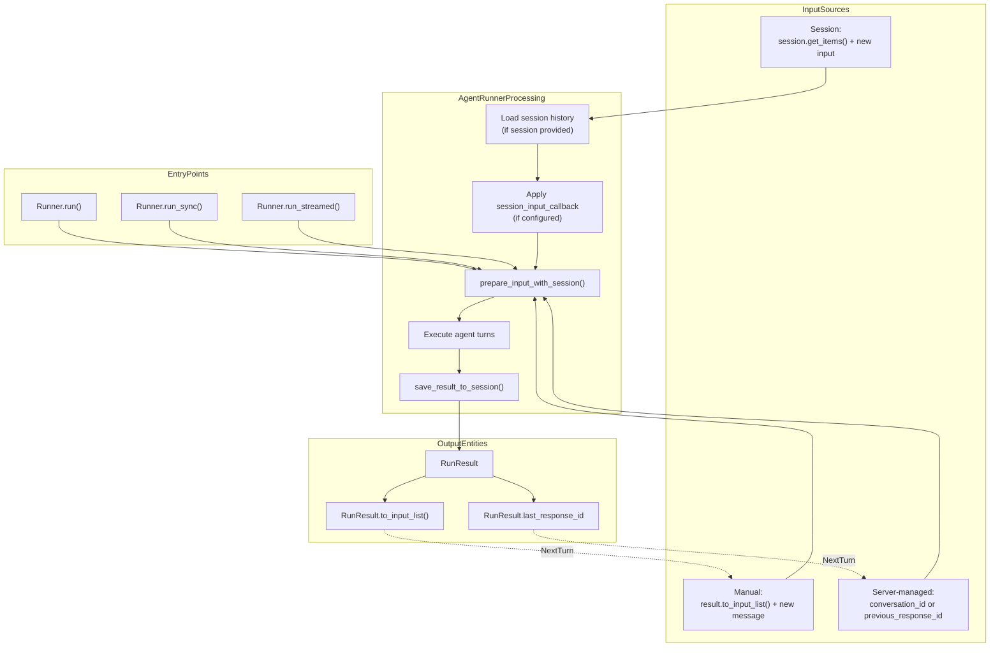
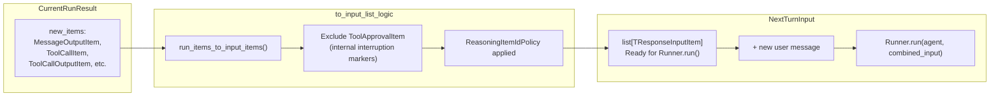
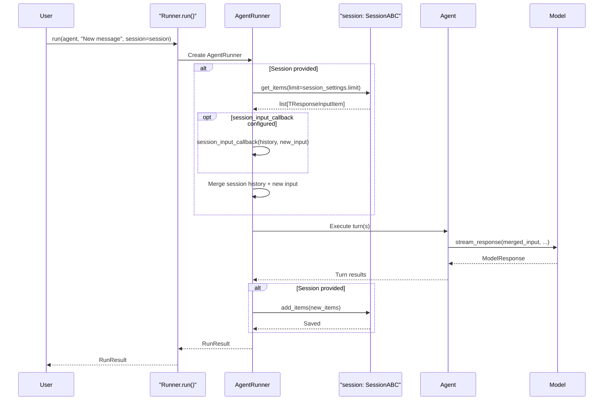
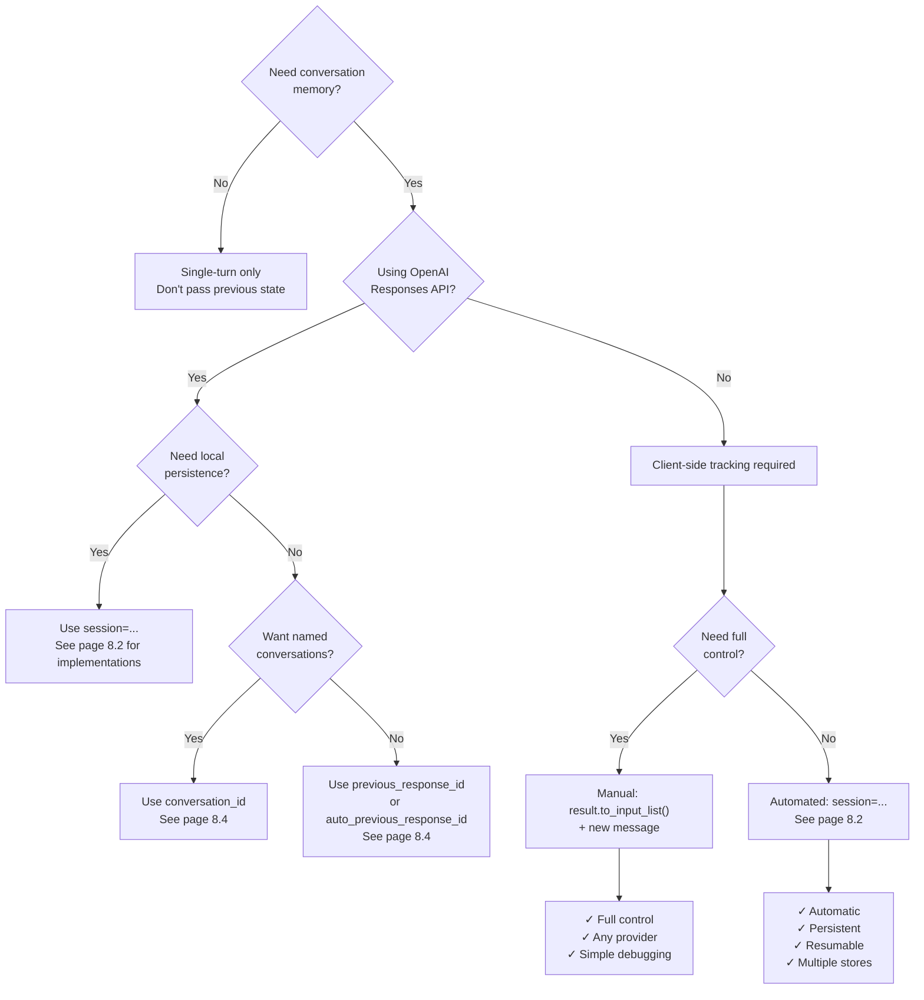

<!-- source: DeepWiki mcp.deepwiki.com · repo openai/openai-agents-python · page 8.3 Conversation Tracking Modes · fetched 2026-10-26 -->

# Conversation Tracking Modes

<details>
<summary>Relevant source files</summary>

The following files were used as context for generating this wiki page:

- [docs/ja/sessions/index.md](docs/ja/sessions/index.md)
- [docs/ko/sessions/index.md](docs/ko/sessions/index.md)
- [docs/zh/sessions/index.md](docs/zh/sessions/index.md)
- [src/agents/exceptions.py](src/agents/exceptions.py)
- [src/agents/result.py](src/agents/result.py)
- [src/agents/run.py](src/agents/run.py)
- [src/agents/run_internal/agent_runner_helpers.py](src/agents/run_internal/agent_runner_helpers.py)
- [src/agents/run_internal/run_loop.py](src/agents/run_internal/run_loop.py)
- [src/agents/run_internal/run_steps.py](src/agents/run_internal/run_steps.py)
- [src/agents/run_internal/session_persistence.py](src/agents/run_internal/session_persistence.py)
- [src/agents/run_internal/turn_resolution.py](src/agents/run_internal/turn_resolution.py)
- [src/agents/run_state.py](src/agents/run_state.py)
- [tests/test_agent_runner.py](tests/test_agent_runner.py)
- [tests/test_agent_runner_streamed.py](tests/test_agent_runner_streamed.py)
- [tests/test_error_logging_redaction.py](tests/test_error_logging_redaction.py)
- [tests/test_run_impl_resume_paths.py](tests/test_run_impl_resume_paths.py)
- [tests/test_run_state.py](tests/test_run_state.py)

</details>


**Purpose**: This document explains the primary modes for carrying conversation state across turns: manual history management with `to_input_list()`, automated session-based tracking, and server-managed state. This page focuses on manual and session-based approaches, while server-managed alternatives are detailed in [8.4 Server-Managed Conversations]().

Related documentation: For session implementations, see [8.1 Session Protocol]() and [8.2 Session Implementations](). For OpenAI server-managed options, see [8.4 Server-Managed Conversations]().

## Overview

The SDK provides three fundamental approaches to maintaining conversation context across multiple agent turns:

| Strategy | Where state lives | Best for | What you pass on the next turn |
|----------|------------------|----------|-------------------------------|
| `result.to_input_list()` | Your app memory | Small chat loops, full manual control, any provider | The list from `result.to_input_list()` plus the next user message |
| `session` | Your storage plus the SDK | Persistent chat state, resumable runs, custom stores | The same `session` instance or another instance pointed at the same store |
| `conversation_id` / `previous_response_id` | OpenAI Conversations API | Server-managed continuation without local storage | The same `conversation_id` or `previous_response_id` plus only the new user turn |

**Mutual Exclusivity**: Client-managed approaches (`to_input_list()` and `session`) can be used with any model provider. Server-managed approaches (`conversation_id`, `previous_response_id`) work only with OpenAI's Responses API and cannot be combined with local sessions in the same run.

Sources: [src/agents/run.py:224-226]()

## Architecture: Conversation State Flow

The SDK's conversation tracking integrates at the `Runner` entry points and flows through the turn execution pipeline managed by `AgentRunner` [src/agents/run_internal/session_persistence.py:58-64]().

**Conversation State Flow Diagram**



Sources: [src/agents/run_internal/session_persistence.py:58-64](), [src/agents/run.py:214-226]()

## Manual History Management

Manual history management gives full control over conversation state by explicitly constructing the input for each turn. Use `RunResult.to_input_list()` to convert the result into a format suitable for the next turn.

### RunResult.to_input_list() Method

The `to_input_list()` method converts all items from the current run into input items for the next turn. It supports filtering and normalization modes [src/agents/result.py:170-192]().

**Conversion Process**:



**Key Behaviors**:
- Converts items using `run_items_to_input_items` [src/agents/result.py:41-45]().
- Automatically excludes `tool_approval_item` types as they are internal interruption markers [src/agents/result.py:33-36]().
- Manages nested history ownership via `_reconciled_result_owned_item_refs` to prevent duplicate replaying in nested agent architectures [src/agents/result.py:84-93]().

Sources: [src/agents/result.py:33-46](), [src/agents/result.py:84-108]()

## Session-Based Tracking

Session-based tracking automates conversation history management by delegating storage and retrieval to a `Session` implementation. The SDK loads history before each turn and saves new items after.

### Session Integration in AgentRunner

The `AgentRunner` integrates sessions by retrieving history via `prepare_input_with_session` before the turn loop and persisting new items via `save_result_to_session` after completion [src/agents/run_internal/session_persistence.py:58-69]().

**Session Lifecycle Diagram**



Sources: [src/agents/run_internal/session_persistence.py:58-69](), [src/agents/run.py:739-756]()

## Customizing Session Input Merge

The `session_input_callback` in `RunConfig` allows customization of how session history merges with new input before model calls.

### session_input_callback Configuration

The callback receives two lists:
1. `history`: Retrieved session items (normalized).
2. `new_input`: Current turn's new input items.

**Implementation Detail**: The SDK performs complex reference and frequency mapping to ensure that even if the callback reorders or filters history, only truly "new" items from the current turn are persisted back to the session. This is managed via `reconcile_nested_history_owned_session_item_refs` which tracks item provenance across rewrites [src/agents/run_internal/session_persistence.py:181-205]().

**Callback Signature**:
```python
SessionInputCallback = Callable[
    [list[TResponseInputItem], list[TResponseInputItem]],
    MaybeAwaitable[list[TResponseInputItem]]
]
```

Sources: [src/agents/memory/session.py:40-45](), [src/agents/run_internal/session_persistence.py:181-205]()

## Memory Strategy Decision Tree

Use this decision tree to choose the appropriate conversation tracking mode.

**Decision Tree Diagram**



Sources: [src/agents/run.py:224-228]()

## Internal Tracking Mechanisms

### OpenAIServerConversationTracker
When using server-managed state or resuming runs, the SDK utilizes `OpenAIServerConversationTracker` [src/agents/run_internal/oai_conversation.py:118-129](). This class maintains synchronization between local run items and server-side items to prevent duplication.

### Reasoning Item Management
The SDK handles reasoning items with specific logic. During history preparation, the `ReasoningItemIdPolicy` dictates whether reasoning IDs are preserved or omitted to comply with model provider requirements [src/agents/run_internal/items.py:39-40]().

**Reasoning ID Policy**:
When converting items for input, the SDK applies the policy via `apply_reasoning_item_id_policy` [src/agents/run_internal/session_persistence.py:63-63](). This is crucial when resuming runs from a `RunState` to ensure the model receives a consistent history.

Sources: [src/agents/run_internal/items.py:39-53](), [src/agents/run_internal/session_persistence.py:63-63]()

---

