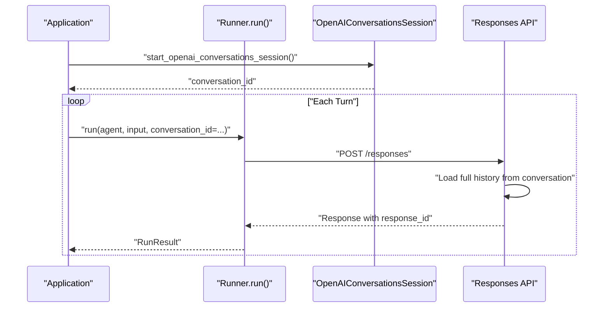
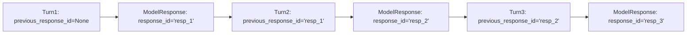
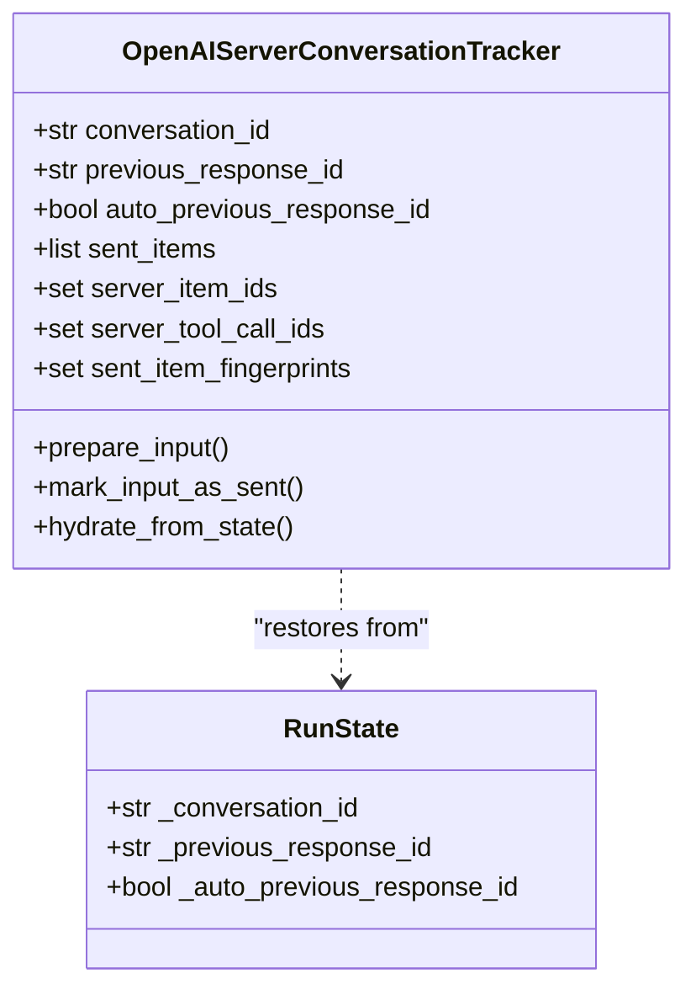

<!-- source: DeepWiki mcp.deepwiki.com · repo openai/openai-agents-python · page 8.4 Server-Managed Conversations · fetched 2026-10-26 -->

# Server-Managed Conversations

Relevant source files

The following files were used as context for generating this wiki page:

- [examples/memory/file_session.py](examples/memory/file_session.py)
- [src/agents/memory/openai_conversations_session.py](src/agents/memory/openai_conversations_session.py)
- [src/agents/models/openai_agent_registration.py](src/agents/models/openai_agent_registration.py)
- [src/agents/run_internal/oai_conversation.py](src/agents/run_internal/oai_conversation.py)
- [tests/memory/test_openai_conversations_session.py](tests/memory/test_openai_conversations_session.py)
- [tests/memory/test_session_persistence_sanitize.py](tests/memory/test_session_persistence_sanitize.py)
- [tests/test_server_conversation_tracker.py](tests/test_server_conversation_tracker.py)
- [tests/utils/simple_session.py](tests/utils/simple_session.py)

This page describes server-managed conversation state when using the OpenAI Responses API. Server-managed conversations allow OpenAI's server to track conversation history across turns, eliminating the need to re-send full conversation history with each request.

For client-managed conversation history using Sessions, see [Session Implementations (8.2)](). For an overview of all memory strategies, see [Conversation Tracking Modes (8.3)]().

## Overview

Server-managed conversations delegate conversation state storage to OpenAI's infrastructure rather than maintaining history in client-side memory or databases. The SDK supports two distinct mechanisms:

| Mechanism | Resource Type | Primary Use Case | RunState Compatibility |
|-----------|---------------|------------------|------------------------|
| `conversation_id` | Named conversation via Conversations API | Shareable state across workers/services | Yes |
| `previous_response_id` | Lightweight response chaining | Minimal continuation primitive | Yes |

Both mechanisms are **mutually exclusive** with client-managed `Session` persistence. You cannot use `conversation_id`, `previous_response_id`, or `auto_previous_response_id` in the same run call that specifies a `session` parameter.

Sources: [src/agents/run_internal/oai_conversation.py:137-140](), [src/agents/memory/openai_conversations_session.py:29-39]()

## Conversation ID Mode

### Creating and Using Named Conversations

The `conversation_id` parameter identifies a server-side conversation resource created through the OpenAI Conversations API. The `OpenAIConversationsSession` class implements the `SessionABC` interface to interact with these remote resources [src/agents/memory/openai_conversations_session.py:29]().

**Diagram: Conversation ID Lifecycle and Code Mapping**

When `conversation_id` is specified, the SDK sends only the new user turn to the Responses API. OpenAI's server reconstructs full conversation context from the stored conversation resource. The `start_openai_conversations_session` helper function [src/agents/memory/openai_conversations_session.py:17-26]() provides a standalone way to initialize these IDs, while `OpenAIConversationsSession` manages lazy initialization via `_get_session_id()` [src/agents/memory/openai_conversations_session.py:79-83]() and batched writes via `add_items()` [src/agents/memory/openai_conversations_session.py:122-164]().

Sources: [src/agents/memory/openai_conversations_session.py:17-83](), [src/agents/memory/openai_conversations_session.py:92-164]()

### RunState Persistence

`RunState` serialization preserves the `conversation_id` field, enabling pause/resume workflows to continue in the same server-managed conversation. The `OpenAIServerConversationTracker` is hydrated from this state during resumption to ensure consistent deduplication [src/agents/run_internal/oai_conversation.py:124-168]().

Sources: [src/agents/run_internal/oai_conversation.py:124-168](), [tests/memory/test_openai_conversations_session.py:141-149]()

## Response Chaining Mode

### previous_response_id

Response chaining links each turn to the previous turn's `response_id` without creating a named conversation resource. This is the most lightweight server-managed continuation primitive.

**Diagram: Response Chaining Flow**

Each `RunResult` exposes `last_response_id` which you pass as `previous_response_id` to the next turn. The tracker uses `_normalize_server_item_id()` and `FAKE_RESPONSES_ID` to handle placeholders from non-Responses providers, ignoring them for deduplication purposes [src/agents/run_internal/oai_conversation.py:37-43]().

Sources: [src/agents/run_internal/oai_conversation.py:37-43](), [src/agents/run_internal/oai_conversation.py:137-140]()

### auto_previous_response_id

Setting `auto_previous_response_id=True` enables response chaining even when `previous_response_id` is `None` (first turn). The SDK tracks the response ID internally and continues the chain on subsequent turns when resuming from `RunState`.

Sources: [src/agents/run_internal/oai_conversation.py:137-140]()

## OpenAIServerConversationTracker

### Purpose and Architecture

`OpenAIServerConversationTracker` [src/agents/run_internal/oai_conversation.py:124-168]() deduplicates input items when using server-managed conversations. The server already has prior conversation context, so the SDK must filter out items the server has already seen to prevent duplicate context.

**Diagram: Conversation Tracker Structure**

The tracker maintains three complementary views of acknowledged state: object identity (`sent_items`), stable server IDs (`server_item_ids`, `server_tool_call_ids`), and content fingerprints (`sent_item_fingerprints`) [src/agents/run_internal/oai_conversation.py:143-154]().

Sources: [src/agents/run_internal/oai_conversation.py:124-168]()

### Deduplication and Sanitization

The tracker filters input items using several layers:

1. **Object identity tracking**: `sent_items` [src/agents/run_internal/oai_conversation.py:143]() stores Python object references.
2. **Stable Server IDs**: `server_item_ids` [src/agents/run_internal/oai_conversation.py:147]() and `server_tool_call_ids` [src/agents/run_internal/oai_conversation.py:148]() track IDs returned by the Responses API.
3. **Content Fingerprints**: `sent_item_fingerprints` [src/agents/run_internal/oai_conversation.py:152]() handles resume/retry paths where objects are reconstructed.

Before items are sent to the server, they are sanitized via `_sanitize_openai_conversation_item()` [tests/memory/test_session_persistence_sanitize.py:8](). This process strips optional or policy-controlled IDs while preserving required identifiers for specific types like `file_search_call` or `program` [tests/memory/test_session_persistence_sanitize.py:33-41]().

Sources: [src/agents/run_internal/oai_conversation.py:143-168](), [tests/memory/test_session_persistence_sanitize.py:8-128]()

### Hydration from RunState

When resuming from `RunState`, the tracker must reconstruct its deduplication state. The `hydrate_from_state()` method seeds the tracker from original inputs, saved model responses, and session history. It specifically handles preservation of unsent tool outputs from interrupted turns by excluding their IDs from `server_tool_call_ids` [tests/test_server_conversation_tracker.py:102-176]().

Sources: [src/agents/run_internal/oai_conversation.py:124-168](), [tests/test_server_conversation_tracker.py:102-176]()

---

