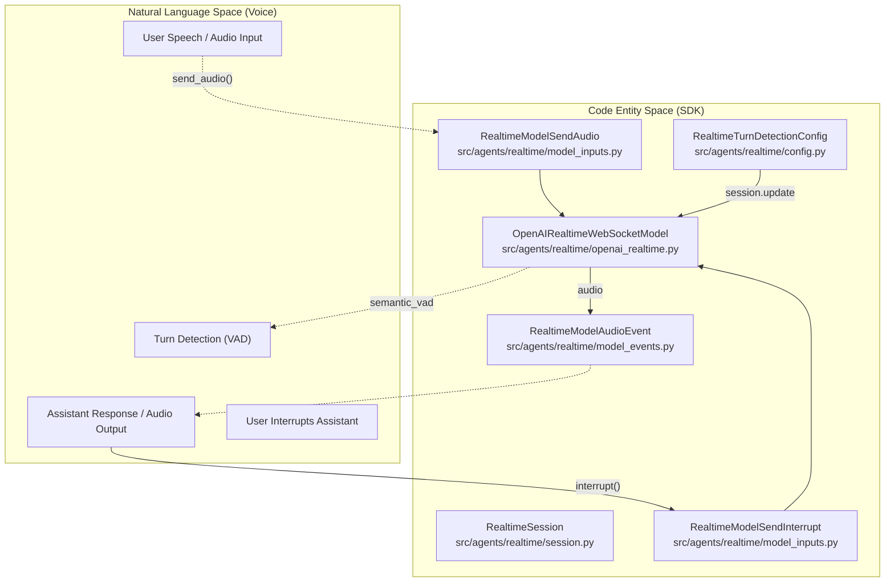
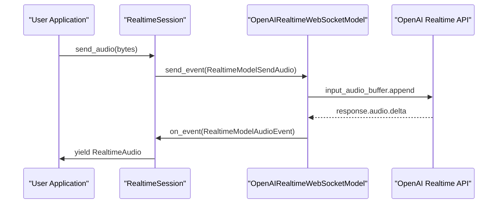

<!-- source: DeepWiki mcp.deepwiki.com · repo openai/openai-agents-python · page 9 Realtime and Voice Agents · fetched 2026-10-26 -->

# Realtime and Voice Agents

Relevant source files

The following files were used as context for generating this wiki page:

- [docs/ja/index.md](docs/ja/index.md)
- [docs/ja/realtime/guide.md](docs/ja/realtime/guide.md)
- [docs/ja/realtime/quickstart.md](docs/ja/realtime/quickstart.md)
- [docs/ko/index.md](docs/ko/index.md)
- [docs/ko/realtime/guide.md](docs/ko/realtime/guide.md)
- [docs/ko/realtime/quickstart.md](docs/ko/realtime/quickstart.md)
- [docs/zh/index.md](docs/zh/index.md)
- [docs/zh/realtime/guide.md](docs/zh/realtime/guide.md)
- [docs/zh/realtime/quickstart.md](docs/zh/realtime/quickstart.md)
- [src/agents/realtime/__init__.py](src/agents/realtime/__init__.py)
- [src/agents/realtime/config.py](src/agents/realtime/config.py)
- [src/agents/realtime/model.py](src/agents/realtime/model.py)
- [src/agents/realtime/model_events.py](src/agents/realtime/model_events.py)
- [src/agents/realtime/model_inputs.py](src/agents/realtime/model_inputs.py)
- [src/agents/realtime/openai_realtime.py](src/agents/realtime/openai_realtime.py)
- [src/agents/realtime/session.py](src/agents/realtime/session.py)
- [tests/realtime/test_model_events.py](tests/realtime/test_model_events.py)
- [tests/realtime/test_openai_realtime.py](tests/realtime/test_openai_realtime.py)
- [tests/realtime/test_session.py](tests/realtime/test_session.py)

The realtime agent system enables bidirectional audio streaming and low-latency interactions via WebSocket connections. Unlike standard turn-based agents, realtime agents maintain persistent connections to models supporting native audio I/O, allowing for natural conversation, mid-utterance interruptions, and server-side voice activity detection (VAD).

For details on the architecture and event-driven execution model, see [Realtime System Overview](#9.1).

## System Architecture

The realtime system is organized into three distinct layers that manage the lifecycle of a voice-enabled interaction:

1.  **Runner Layer**: `RealtimeRunner` acts as a factory to initialize sessions with specific configurations and starting agents [src/agents/realtime/runner.py:18-77]().
2.  **Session Layer**: `RealtimeSession` orchestrates the conversation, managing history, tool execution, guardrails, and agent handoffs [src/agents/realtime/session.py:174-210]().
3.  **Model Layer**: `OpenAIRealtimeWebSocketModel` handles the low-level WebSocket transport, message serialization, and audio state tracking [src/agents/realtime/openai_realtime.py:270-339]().

### Conceptual to Code Mapping

The following diagram bridges the high-level voice interaction concepts to the specific code entities that implement them.

**Voice Interaction Entity Map:**

Sources: [src/agents/realtime/session.py:174-210](), [src/agents/realtime/openai_realtime.py:482-501](), [src/agents/realtime/model_events.py:35-49](), [src/agents/realtime/config.py:96-126]()

## Core Components

### RealtimeRunner and Session Orchestration
`RealtimeRunner` provides a high-level interface to start sessions. The resulting `RealtimeSession` manages the internal `_event_queue` and maintains the conversation `_history` as a list of `RealtimeItem` objects [src/agents/realtime/session.py:215-217](). It is responsible for switching the `_current_agent` during handoffs and managing pending tool outputs [src/agents/realtime/session.py:212-214]().

For details on session lifecycle and history management, see [RealtimeSession Orchestration](#9.2).

### Model Transport
The `OpenAIRealtimeWebSocketModel` manages the `websockets.ClientConnection` [src/agents/realtime/openai_realtime.py:284-285](). It transforms raw JSON messages from the OpenAI API into typed `RealtimeModelEvent` objects, such as `RealtimeModelTranscriptDeltaEvent` or `RealtimeModelAudioEvent` [src/agents/realtime/model_events.py:1-197](). It defaults to `gpt-realtime-2.1` for new connections [src/agents/realtime/openai_realtime.py:166]().

For details on WebSocket management and message serialization, see [OpenAI Realtime WebSocket Model](#9.3).

**Component Interaction Diagram:**

Sources: [src/agents/realtime/session.py:174-210](), [src/agents/realtime/openai_realtime.py:482-501](), [src/agents/realtime/events.py:1-51]()

## Audio and Interruption Handling

The system processes audio in small chunks to maintain low latency. `RealtimePlaybackTracker` allows applications to report exactly how much audio has been played back to the user [src/agents/realtime/model.py:122-123](). When an interruption occurs, the SDK uses this data to send a `conversation.item.truncate` event to the API via `RealtimeModelSendInterrupt`, ensuring the model's memory matches what the user actually heard [src/agents/realtime/openai_realtime.py:533-593]().

- For audio pipeline details, see [Audio Pipeline and Voice Activity Detection](#9.4).
- For interruption logic and truncation, see [Interruption Handling](#9.7).

## Configuration and Tools

### Realtime Configuration
Configuration is handled via `RealtimeRunConfig` and `RealtimeSessionModelSettings` [src/agents/realtime/config.py:158-215](). This includes setting the `voice` (e.g., "ash", "ballad"), `modalities`, and `turn_detection` parameters. New configurations should prefer the nested `audio` object structure [src/agents/realtime/config.py:144-149]().

For details on all available settings, see [Realtime Configuration](#9.5).

### Tool Execution
Tools in realtime sessions can be executed asynchronously. The session manages `_pending_tool_calls` and `_active_tool_call_ids` to ensure that function execution does not block the primary audio stream [src/agents/realtime/session.py:228-230](). It also supports debounced guardrail execution on streaming transcripts using `debounce_text_length` [src/agents/realtime/session.py:225-227]().

For details on tool execution and safety, see [Realtime Tool Execution and Guardrails](#9.6).

## Voice Pipelines (Alternative)

While `RealtimeAgent` uses native audio via WebSockets, the SDK also supports a `VoicePipeline` for standard agents [docs/ja/index.md:27-27](). This pipeline follows a sequential **Transcribe -> Execute Agent -> Synthesize** flow using discrete `STTModel` and `TTSModel` components [src/agents/voice/result.py:34-53]().

**Voice Pipeline Flow:**

| Step | Component | Role |
| :--- | :--- | :--- |
| 1 | `STTModel` | Speech-to-Text (e.g., Whisper) [src/agents/voice/models/openai_stt.py:84-95]() |
| 2 | `Agent` | Core logic and tool use |
| 3 | `TTSModel` | Text-to-Speech [src/agents/voice/result.py:39-40]() |

Sources: [src/agents/voice/result.py:34-53](), [src/agents/voice/models/openai_stt.py:84-95](), [docs/ja/index.md:27-27]()

## Child Pages
- [Realtime System Overview](#9.1) — Architecture differences from standard agents, RealtimeAgent vs Agent, event-driven execution model, RealtimeRunner
- [RealtimeSession Orchestration](#9.2) — RealtimeSession class, session lifecycle, event queue, history management, tool execution, guardrails
- [OpenAI Realtime WebSocket Model](#9.3) — OpenAIRealtimeWebSocketModel, WebSocket/SIP transport, connection management, message serialization
- [Audio Pipeline and Voice Activity Detection](#9.4) — Audio input/output flow, send_audio(), VAD configuration, transcription, audio format configuration
- [Realtime Configuration](#9.5) — RealtimeRunConfig, RealtimeModelConfig, RealtimeSessionModelSettings, audio config, turn_detection settings
- [Realtime Tool Execution and Guardrails](#9.6) — Tool execution in realtime mode, async_tool_calls, approval gates, tool guardrails in realtime context
- [Interruption Handling](#9.7) — interrupt() method, AudioStateTracker, conversation.item.truncate, audio_end_ms calculation, playback tracking
- [Voice Pipeline (STT/TTS)](#9.8) — VoicePipeline class, STTModel, TTSModel, VoiceWorkflowBase, AudioInput, StreamedAudioInput, VoicePipelineConfig, tracing for voice
- [Realtime Example Applications](#9.9) — Reference apps: realtime web app server, Twilio and Twilio SIP telephony bridges, CLI demo - architecture and how to run

---

