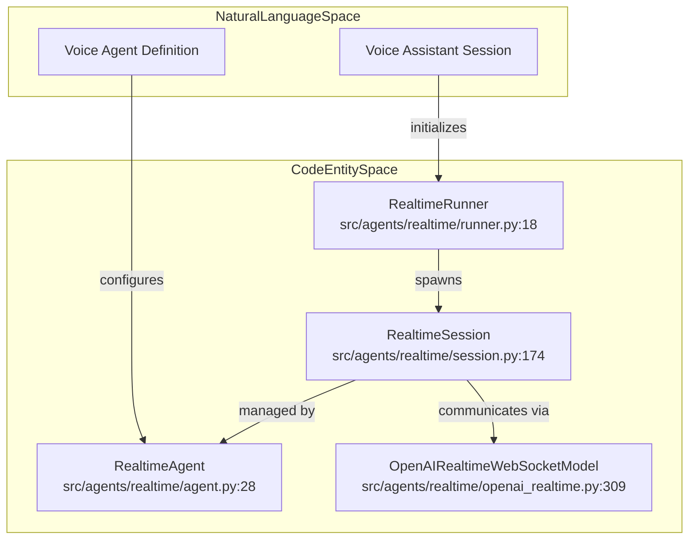
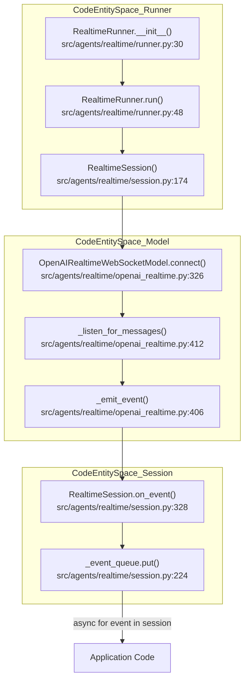

<!-- source: DeepWiki mcp.deepwiki.com · repo openai/openai-agents-python · page 9.1 Realtime System Overview · fetched 2026-10-26 -->

# Realtime System Overview

<details>
<summary>Relevant source files</summary>

The following files were used as context for generating this wiki page:

- [.vscode/launch.json](.vscode/launch.json)
- [examples/basic/stream_function_call_args.py](examples/basic/stream_function_call_args.py)
- [src/agents/realtime/_default_tracker.py](src/agents/realtime/_default_tracker.py)
- [src/agents/realtime/_util.py](src/agents/realtime/_util.py)
- [src/agents/realtime/agent.py](src/agents/realtime/agent.py)
- [src/agents/realtime/events.py](src/agents/realtime/events.py)
- [src/agents/realtime/runner.py](src/agents/realtime/runner.py)
- [tests/realtime/test_agent.py](tests/realtime/test_agent.py)
- [tests/realtime/test_playback_tracker.py](tests/realtime/test_playback_tracker.py)
- [tests/realtime/test_playback_tracker_manual_unit.py](tests/realtime/test_playback_tracker_manual_unit.py)
- [tests/realtime/test_runner.py](tests/realtime/test_runner.py)
- [tests/test_agent_clone_shallow_copy.py](tests/test_agent_clone_shallow_copy.py)
- [tests/test_agent_instructions_signature.py](tests/test_agent_instructions_signature.py)

</details>


This page provides a technical overview of the realtime agent system within the OpenAI Agents SDK (`https://github.com/openai/openai-agents-python`). It details how the realtime architecture differs from standard agent execution, introduces `RealtimeAgent` and `RealtimeRunner`, and explains the event-driven execution model used for low-latency voice and audio interactions.

For standard (non-realtime) agent execution, see [Runner and Execution Flow (3.2)]().

---

## Architecture Differences: Standard vs. Realtime Agents

Standard agents (using `Runner`) operate on a request-response turn loop where inputs and outputs are discrete lists of items, and execution terminates when a turn finishes or a stop condition is met. In contrast, realtime agents are designed for persistent, bidirectional WebSocket connections where audio streams continuously, and execution is event-driven.

| Dimension | Standard Agents (`Agent` / `Runner`) | Realtime Agents (`RealtimeAgent` / `RealtimeRunner`) |
|-----------|--------------------------------------|-------------------------------------------------------|
| **Transport** | HTTP Request/Response (REST/Chat Completions/Responses API) | Persistent WebSocket (`websockets.connect()`) [src/agents/realtime/openai_realtime.py:370-375]() |
| **Execution Model** | Synchronous turn loops (`Runner.run()`, `run_sync()`) | Asynchronous event-driven streaming loop (`async for event in session`) [src/agents/realtime/runner.py:64-67]() |
| **Modality** | Text (and structured output via `output_type`) | Bidirectional Audio (PCM/G.711) + Text Transcripts [src/agents/realtime/_util.py:21-36]() |
| **Interruption** | Not applicable (runs to completion) | Real-time barge-in via VAD (`input_audio_buffer.speech_started`) or manual `interrupt()` [src/agents/realtime/openai_realtime.py:441-491]() |
| **Tool Execution** | Blocking or sequential tool rounds within turns | Asynchronous background task execution (`_async_tool_calls=True`) [src/agents/realtime/session.py:246]() |

Title: Realtime System Entity Mapping


Sources: [src/agents/realtime/runner.py:18-79](), [src/agents/realtime/agent.py:28-146](), [src/agents/realtime/openai_realtime.py:309-375](), [src/agents/realtime/_util.py:21-36]()

---

## RealtimeAgent vs. Agent

`RealtimeAgent` inherits from `AgentBase` [src/agents/realtime/agent.py:28]() but is specialized for real-time streaming constraints. Certain configuration parameters available on standard `Agent` instances are unsupported or handled globally at the session level:

- **Model Choice:** Not supported per agent; all `RealtimeAgent` instances within a session share the same model instance managed by `RealtimeSession` [src/agents/realtime/agent.py:32-33]().
- **Model Settings:** Model parameters are configured at the session/run level rather than per agent [src/agents/realtime/agent.py:34-35]().
- **Structured Outputs (`output_type`):** Not supported, as realtime sessions stream raw audio and text deltas rather than validated Pydantic structures [src/agents/realtime/agent.py:36]().
- **Tool Use Behavior (`tool_use_behavior`):** Handled globally by the realtime model layer [src/agents/realtime/agent.py:37-38]().
- **Voice:** Can be configured per agent, but cannot be changed after the first agent in a session has spoken [src/agents/realtime/agent.py:39-40]().

`RealtimeAgent` supports instructions (static strings or dynamic callables receiving `RunContextWrapper` and the agent instance), prompts, tools, handoffs, output guardrails, and lifecycle hooks [src/agents/realtime/agent.py:45-82]().

```python
# Example initialization of a RealtimeAgent
agent = RealtimeAgent(
    name="VoiceAssistant",
    instructions="You are a helpful and concise voice assistant.",
    tools=[weather_tool],
    handoffs=[support_agent]
)
```

Sources: [src/agents/realtime/agent.py:28-146]()

---

## Event-Driven Execution Model and RealtimeRunner

`RealtimeRunner` is the realtime counterpart to `Runner`. It establishes and manages the persistent model lifecycle and yields `RealtimeSession` instances [src/agents/realtime/runner.py:18-50]().

Title: Realtime Event-Driven Execution Flow


The execution model relies on `asyncio.Queue` passing `RealtimeSessionEvent` instances (`RealtimeAudio`, `RealtimeToolStart`, `RealtimeToolEnd`, `RealtimeHandoffEvent`, `RealtimeHistoryUpdated`, etc.) to consuming application code [src/agents/realtime/events.py:15-273]().

Sources: [src/agents/realtime/runner.py:18-79](), [src/agents/realtime/session.py:174-246](), [src/agents/realtime/openai_realtime.py:326-448](), [src/agents/realtime/events.py:15-273]()

---

## Audio Pipeline and State Tracking

The realtime system tracks audio playback duration and audio format specifications (such as PCM16 at 24kHz or G.711 u-law/a-law at 8kHz) via `ModelAudioTracker` and utility functions [src/agents/realtime/_default_tracker.py:22-97](), [src/agents/realtime/_util.py:21-48]().

- **Audio Delta Handling:** `ModelAudioTracker.on_audio_delta()` computes incoming audio chunk durations in milliseconds using `calculate_audio_length_ms()` [src/agents/realtime/_default_tracker.py:38-46](), [src/agents/realtime/_util.py:39-48]().
- **Interruption and Truncation:** When a user interrupts the model (via Voice Activity Detection or explicit `session.interrupt()`), the model calculates elapsed playback time and sends a `conversation.item.truncate` event with the correct `audio_end_ms` [src/agents/realtime/openai_realtime.py:441-491](), [tests/realtime/test_playback_tracker.py:21-46]().

Sources: [src/agents/realtime/_default_tracker.py:22-97](), [src/agents/realtime/_util.py:21-48](), [src/agents/realtime/openai_realtime.py:441-491](), [tests/realtime/test_playback_tracker.py:21-129]()

---

