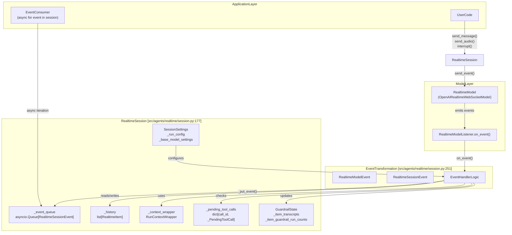
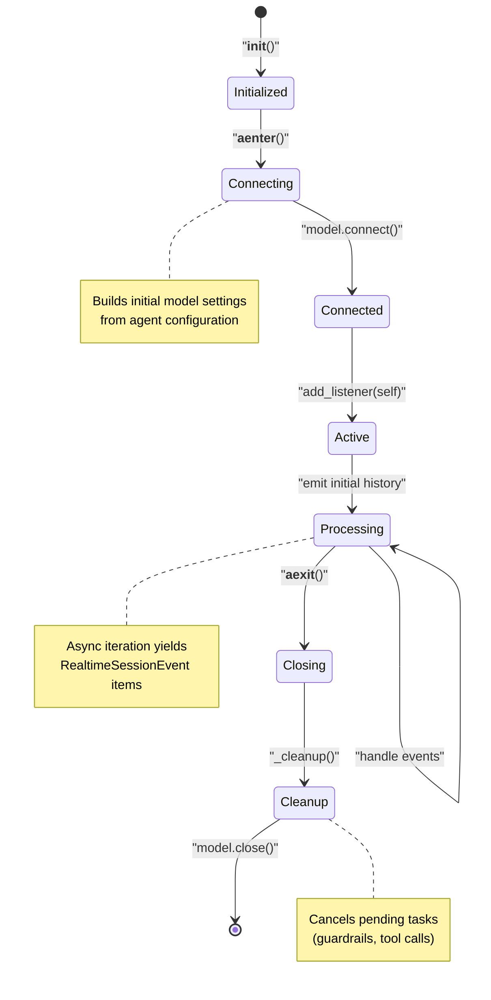
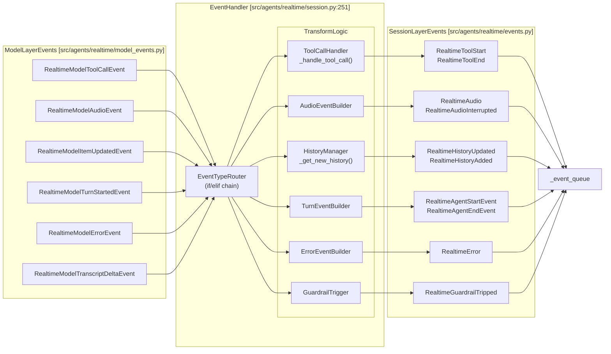
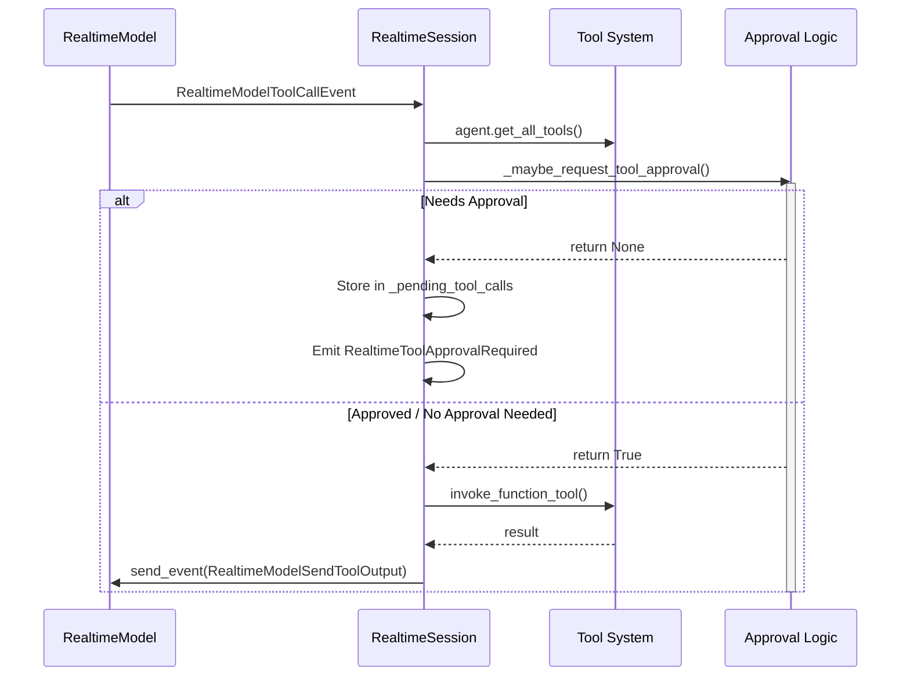

<!-- source: DeepWiki mcp.deepwiki.com · repo openai/openai-agents-python · page 9.2 RealtimeSession Orchestration · fetched 2026-10-26 -->

# RealtimeSession Orchestration

Relevant source files

The following files were used as context for generating this wiki page:

- [src/agents/realtime/__init__.py](src/agents/realtime/__init__.py)
- [src/agents/realtime/config.py](src/agents/realtime/config.py)
- [src/agents/realtime/model.py](src/agents/realtime/model.py)
- [src/agents/realtime/model_events.py](src/agents/realtime/model_events.py)
- [src/agents/realtime/model_inputs.py](src/agents/realtime/model_inputs.py)
- [src/agents/realtime/openai_realtime.py](src/agents/realtime/openai_realtime.py)
- [src/agents/realtime/session.py](src/agents/realtime/session.py)
- [tests/realtime/test_model_events.py](tests/realtime/test_model_events.py)
- [tests/realtime/test_openai_realtime.py](tests/realtime/test_openai_realtime.py)
- [tests/realtime/test_session.py](tests/realtime/test_session.py)

The `RealtimeSession` class orchestrates realtime voice agent interactions by managing bidirectional event flow between the model layer (`RealtimeModel`) and the application layer. It transforms low-level model events into high-level session events, executes tools with approval gates, applies streaming guardrails, and maintains session history.

**Scope**: This page documents the session orchestration layer for realtime agents located in `src/agents/realtime/session.py`. For the underlying WebSocket model transport, see [#9.3](). For the runner that creates and manages sessions, see [#9.1](). For standard turn-based execution, see [#3.2]().

---

## Core Architecture

### Session Components and Responsibilities

The `RealtimeSession` serves as the coordination layer between the model transport and application consumers. It multiplexes concurrent concerns including event queues, conversation history tracking, tool dispatch, guardrail evaluation, and run configuration.

Title: "RealtimeSession Component Architecture"

Sources: [src/agents/realtime/session.py:177-240](), [src/agents/realtime/session.py:251-424]()

The session initializes with a model, agent, context, and optional configurations:

| Parameter | Type | Purpose |
|-----------|------|---------|
| `model` | `RealtimeModel` | Transport layer interface [src/agents/realtime/session.py:199]() |
| `agent` | `RealtimeAgent` | Active agent containing tools, handoffs, and guardrails [src/agents/realtime/session.py:200]() |
| `context` | `TContext \| None` | User-provided execution context object [src/agents/realtime/session.py:201]() |
| `model_config` | `RealtimeModelConfig \| None` | Model connection settings [src/agents/realtime/session.py:202]() |
| `run_config` | `RealtimeRunConfig \| None` | Runtime execution parameters [src/agents/realtime/session.py:203]() |

Sources: [src/agents/realtime/session.py:197-224]()

---

### Lifecycle and Context Manager Pattern

The session uses Python's async context manager protocol (`__aenter__` / `__aexit__`) to manage connection lifecycles and background resource teardown.

Title: "RealtimeSession Lifecycle State Machine"

Sources: [src/agents/realtime/session.py:824-864](), [src/agents/realtime/session.py:866-890]()

**Entry Sequence** (`__aenter__` at [src/agents/realtime/session.py:866-890]()):
1. Register session as a listener on the model via `self._model.add_listener(self)` [src/agents/realtime/session.py:871]().
2. Resolve agent settings (instructions, tools, handoffs) into `RealtimeSessionModelSettings` [src/agents/realtime/session.py:874-877]().
3. Call `await self._model.connect(model_config)` to establish connection [src/agents/realtime/session.py:880]().
4. Emit initial `RealtimeHistoryUpdated` event [src/agents/realtime/session.py:883-888]().

**Exit Sequence** (`_cleanup` at [src/agents/realtime/session.py:824-864]()):
1. Set `self._closed = True` to terminate event iteration [src/agents/realtime/session.py:825]().
2. Cancel all pending guardrail tasks in `self._guardrail_tasks` [src/agents/realtime/session.py:827-832]().
3. Cancel all pending tool call tasks in `self._tool_call_tasks` [src/agents/realtime/session.py:849-854]().
4. Remove session as model listener [src/agents/realtime/session.py:859]().
5. Close the underlying model transport [src/agents/realtime/session.py:860]().

Sources: [src/agents/realtime/session.py:824-864](), [src/agents/realtime/session.py:866-890]()

---

## Event Processing Pipeline

### Model Event to Session Event Transformation

The session implements the `RealtimeModelListener` interface [src/agents/realtime/model.py:98-104]() to receive low-level model events (`RealtimeModelEvent`) and map them to application-level session events (`RealtimeSessionEvent`) [src/agents/realtime/session.py:177]().

Title: "Event Transformation Dataflow"

Sources: [src/agents/realtime/session.py:251-424](), [src/agents/realtime/events.py:21-72]()

**Event Transformation Mapping**:

| Model Event Type | Handler Location | Session Events Emitted | Side Effects |
|------------------|------------------|------------------------|--------------|
| `RealtimeModelToolCallEvent` | [src/agents/realtime/session.py:256-261]() | `RealtimeToolStart`, `RealtimeToolEnd` | Executes tool, evaluates approval gates |
| `RealtimeModelAudioEvent` | [src/agents/realtime/session.py:262-270]() | `RealtimeAudio` | Yields audio bytes for playback |
| `RealtimeModelAudioInterruptedEvent` | [src/agents/realtime/session.py:271-276]() | `RealtimeAudioInterrupted` | Halts local audio playback |
| `RealtimeModelAudioDoneEvent` | [src/agents/realtime/session.py:277-282]() | `RealtimeAudioEnd` | Marks completion of audio stream |
| `RealtimeModelInputAudioTranscriptionCompletedEvent` | [src/agents/realtime/session.py:283-294]() | `RealtimeHistoryUpdated` | Updates history with user transcript |
| `RealtimeModelTranscriptDeltaEvent` | [src/agents/realtime/session.py:301-325]() | None | Updates `_item_transcripts`, triggers guardrails |
| `RealtimeModelItemUpdatedEvent` | [src/agents/realtime/session.py:326-388]() | `RealtimeHistoryAdded` or `RealtimeHistoryUpdated` | Syncs internal `_history` state |
| `RealtimeModelTurnStartedEvent` | [src/agents/realtime/session.py:397-403]() | `RealtimeAgentStartEvent` | Marks beginning of generation turn |
| `RealtimeModelTurnEndedEvent` | [src/agents/realtime/session.py:404-414]() | `RealtimeAgentEndEvent` | Resets turn state |
| `RealtimeModelErrorEvent` | [src/agents/realtime/session.py:254-255]() | `RealtimeError` | Forwards transport errors |

Sources: [src/agents/realtime/session.py:251-424]()

---

### Event Queue and Async Iteration

Events are delivered to consumers via asynchronous iteration over the `RealtimeSession` instance [src/agents/realtime/session.py:901-909](). An `asyncio.Queue` buffers events between background model callbacks and consumer loops.

Sources: [src/agents/realtime/session.py:425-427](), [src/agents/realtime/session.py:901-909]()

---

## History Management

The session maintains conversation history in `self._history: list[RealtimeItem]` [src/agents/realtime/session.py:215](). Transcript text accumulated through `RealtimeModelTranscriptDeltaEvent` is merged during `RealtimeModelItemUpdatedEvent` processing using `_get_new_history()` [src/agents/realtime/session.py:733-823]().

Sources: [src/agents/realtime/session.py:215](), [src/agents/realtime/session.py:301-388](), [src/agents/realtime/session.py:733-823]()

---

## Tool Execution System

Function tool calls triggered by the model are evaluated for permission and execution.

Title: "Tool Execution and Approval Sequence"

Sources: [src/agents/realtime/session.py:429-497](), [src/agents/realtime/session.py:606-731]()

**Key Mechanisms**:
- **`_pending_tool_calls`**: Stores `_PendingToolCall` instances awaiting manual resolution [src/agents/realtime/session.py:202]().
- **Tool Concurrency**: Controlled by `async_tool_calls` configuration (default `True`), running tools in background tasks [src/agents/realtime/config.py:228]().
- **Resolution APIs**: `approve_tool_call()` and `reject_tool_call()` allow resolving pending items [src/agents/realtime/session.py:572-604]().

Sources: [src/agents/realtime/session.py:202](), [src/agents/realtime/session.py:572-604](), [src/agents/realtime/config.py:228]()

---

## Guardrails Integration

Output guardrails are executed against streaming transcripts with debouncing:
1. **Debouncing**: Guardrails trigger when accumulated transcript length crosses multiples of `debounce_text_length` [src/agents/realtime/session.py:207-209](), [src/agents/realtime/session.py:317-325]().
2. **Execution**: Background tasks via `_enqueue_guardrail_task()` evaluate the text [src/agents/realtime/session.py:942-955]().
3. **Tripwire Handling**: If a guardrail trips, `RealtimeModelSendInterrupt` is dispatched and `RealtimeGuardrailTripped` is emitted [src/agents/realtime/session.py:1012-1026]().

Sources: [src/agents/realtime/session.py:204-209](), [src/agents/realtime/session.py:317-325](), [src/agents/realtime/session.py:942-1026]()

---

## Configuration and Settings

Model settings are resolved by merging agent defaults, run configurations, and model connection overrides [src/agents/realtime/session.py:911-940]().

### Public Interaction API

| Method | Description |
|--------|-------------|
| `send_message(message: RealtimeUserInput)` | Sends text messages or structured input to the model [src/agents/realtime/session.py:534-541](). |
| `send_audio(audio: bytes, commit: bool)` | Sends raw audio bytes to the input buffer [src/agents/realtime/session.py:543-548](). |
| `interrupt()` | Sends an interrupt signal to stop generation [src/agents/realtime/session.py:550-555](). |
| `update_agent(agent: RealtimeAgent)` | Hot-swaps the active agent and reconfigures the session [src/agents/realtime/session.py:557-570](). |

Sources: [src/agents/realtime/session.py:534-570]()

---

