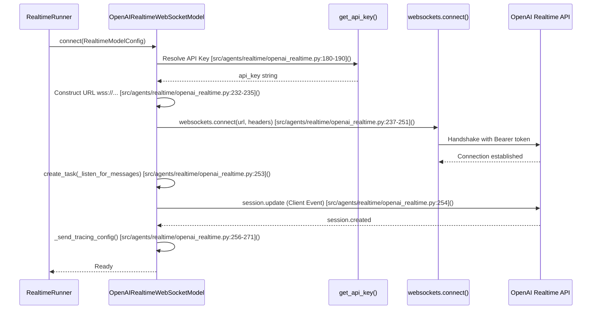

<!-- source: DeepWiki mcp.deepwiki.com · repo openai/openai-agents-python · page 9.3 OpenAI Realtime WebSocket Model · fetched 2026-10-26 -->

# OpenAI Realtime WebSocket Model

<details>
<summary>Relevant source files</summary>

The following files were used as context for generating this wiki page:

- [examples/realtime/twilio_sip/README.md](examples/realtime/twilio_sip/README.md)
- [examples/realtime/twilio_sip/__init__.py](examples/realtime/twilio_sip/__init__.py)
- [examples/realtime/twilio_sip/requirements.txt](examples/realtime/twilio_sip/requirements.txt)
- [examples/realtime/twilio_sip/server.py](examples/realtime/twilio_sip/server.py)
- [src/agents/realtime/__init__.py](src/agents/realtime/__init__.py)
- [src/agents/realtime/_tool_filtering.py](src/agents/realtime/_tool_filtering.py)
- [src/agents/realtime/config.py](src/agents/realtime/config.py)
- [src/agents/realtime/model.py](src/agents/realtime/model.py)
- [src/agents/realtime/model_events.py](src/agents/realtime/model_events.py)
- [src/agents/realtime/model_inputs.py](src/agents/realtime/model_inputs.py)
- [src/agents/realtime/openai_realtime.py](src/agents/realtime/openai_realtime.py)
- [src/agents/realtime/session.py](src/agents/realtime/session.py)
- [src/agents/run_internal/turn_preparation.py](src/agents/run_internal/turn_preparation.py)
- [tests/realtime/test_conversion_helpers.py](tests/realtime/test_conversion_helpers.py)
- [tests/realtime/test_model_events.py](tests/realtime/test_model_events.py)
- [tests/realtime/test_openai_realtime.py](tests/realtime/test_openai_realtime.py)
- [tests/realtime/test_openai_realtime_sip_model.py](tests/realtime/test_openai_realtime_sip_model.py)
- [tests/realtime/test_realtime_model_settings.py](tests/realtime/test_realtime_model_settings.py)
- [tests/realtime/test_session.py](tests/realtime/test_session.py)
- [tests/realtime/test_session_payload_and_formats.py](tests/realtime/test_session_payload_and_formats.py)
- [tests/realtime/test_tracing.py](tests/realtime/test_tracing.py)
- [tests/realtime/test_twilio_sip_server.py](tests/realtime/test_twilio_sip_server.py)

</details>


This document describes the `OpenAIRealtimeWebSocketModel` class, which implements the `RealtimeModel` interface to connect to OpenAI's Realtime API via WebSocket (`src/agents/realtime/openai_realtime.py:41-43`()). This is the low-level transport layer managing WebSocket connection persistence, protocol-level event translation, and bidirectional communication.

For higher-level orchestration, see [RealtimeSession Orchestration](9.2). For realtime event types and audio pipeline details, see [Audio Pipeline and Voice Activity Detection](9.4). For configuration options, see [Realtime Configuration](9.5).

## Purpose and Responsibilities

`OpenAIRealtimeWebSocketModel` is responsible for:
- **WebSocket Connection Management**: Establishing and maintaining persistent connections to `wss://api.openai.com/v1/realtime` [src/agents/realtime/openai_realtime.py:203-254]().
- **Protocol Translation**: Converting between SDK events (`RealtimeModelSendEvent`) and OpenAI protocol messages (client events) [src/agents/realtime/openai_realtime.py:326-346]().
- **Event Parsing and Validation**: Deserializing server events using Pydantic type adapters [src/agents/realtime/openai_realtime.py:186-187](), [src/agents/realtime/openai_realtime.py:594-610]().
- **Audio State Tracking**: Monitoring audio playback position for precise interruption handling via `ModelAudioTracker` [src/agents/realtime/openai_realtime.py:89-90]().
- **Session Configuration**: Managing tools, instructions, audio settings, and tracing configuration [src/agents/realtime/openai_realtime.py:822-895]().
- **Error Recovery**: Handling connection failures, validation errors, and protocol exceptions [src/agents/realtime/openai_realtime.py:289-324]().

This class does **not** handle business logic like tool execution, agent handoffs, or guardrail evaluation—those are handled by `RealtimeSession` [src/agents/realtime/session.py:175-213]().

Sources: [src/agents/realtime/openai_realtime.py:203-254](), [src/agents/realtime/model.py:151-173](), [src/agents/realtime/session.py:175-213](), [src/agents/realtime/openai_realtime.py:186-187]()

## Architecture Overview and Code Entities

The following diagram bridges natural language descriptions of the transport architecture to the concrete Python code entities in `src/agents/realtime/openai_realtime.py` and `src/agents/realtime/session.py`.

### Diagram: Realtime WebSocket Architecture to Code Mapping
```mermaid
graph TB
    subgraph "NaturalLanguageSpace"
        S1[""High-Level Session Orchestration""]
        S2[""WebSocket Connection & Transport""]
        S3[""Message & Audio Serialization""]
    end

    subgraph "CodeEntitySpace"
        RS[""RealtimeSession<br/>(src/agents/realtime/session.py)""]
        WM[""OpenAIRealtimeWebSocketModel<br/>(src/agents/realtime/openai_realtime.py)""]
        CC[""ClientConnection<br/>(websockets.asyncio.client.ClientConnection)""]
        MAT[""ModelAudioTracker<br/>(src/agents/realtime/_default_tracker.py)""]
        SE[""RealtimeModelSendEvent<br/>(src/agents/realtime/model_inputs.py)""]
    end

    S1 --> RS
    S2 --> WM
    S2 --> CC
    S3 --> SE
    RS -->|"listens/dispatches"| WM
    WM -->|"sends raw messages"| CC
    WM -->|"tracks playback"| MAT
    WM -->|"accepts input events"| SE
```

**Architecture Notes**:
- `RealtimeSession` registers itself as a listener via `add_listener()` [src/agents/realtime/session.py:211]().
- The model maintains a background task `_websocket_task` running `_listen_for_messages()` [src/agents/realtime/openai_realtime.py:253]().
- All outgoing events route through `send_event()`, dispatching to specialized handlers like `_send_audio` or `_send_user_input` [src/agents/realtime/openai_realtime.py:326-346]().

Sources: [src/agents/realtime/openai_realtime.py:203-254](), [src/agents/realtime/session.py:175-213](), [src/agents/realtime/_default_tracker.py:1-50]()

## Connection Lifecycle and Authentication

### Establishing the Connection

The `connect()` method establishes the WebSocket connection, configures headers, and initiates the session update handshake.

### Diagram: Connection Sequence and Authentication


**Key Implementation Details**:
- **API Key Resolution**: Supports string, callable, or async callable API keys via `get_api_key()` [src/agents/realtime/openai_realtime.py:180-190]().
- **URL Construction**: Uses `wss://api.openai.com/v1/realtime?model={model}` or `?call_id={call_id}` for attaching to existing calls [src/agents/realtime/openai_realtime.py:232-235]().
- **Header Configuration**: Sets `Authorization: Bearer {api_key}` and custom user agent `Agents/Python {version}` [src/agents/realtime/openai_realtime.py:165](), [src/agents/realtime/openai_realtime.py:237-251]().
- **Custom Headers and Azure**: If `headers` is provided in `RealtimeModelConfig`, the SDK uses them verbatim and skips default `Authorization` generation [src/agents/realtime/openai_realtime.py:246-251]().

Sources: [src/agents/realtime/openai_realtime.py:165](), [src/agents/realtime/openai_realtime.py:180-190](), [src/agents/realtime/openai_realtime.py:232-254](), [src/agents/realtime/model.py:121-126]()

## Event Flow and Protocol Translation

### Outgoing Events (Client → Server)

The `send_event()` method dispatches SDK inputs (`model_inputs.py`) to protocol-specific JSON client events.

| SDK Event (`model_inputs.py`) | Handler Method | OpenAI Protocol Event |
|:---|:---|:---|
| `RealtimeModelSendUserInput` | `_send_user_input()` | `conversation.item.create` + `response.create` [src/agents/realtime/openai_realtime.py:354-384]() |
| `RealtimeModelSendAudio` | `_send_audio()` | `input_audio_buffer.append` (+ `commit`) [src/agents/realtime/openai_realtime.py:468-490]() |
| `RealtimeModelSendToolOutput` | `_send_tool_output()` | `conversation.item.create` (+ `response.create`) [src/agents/realtime/openai_realtime.py:492-519]() |
| `RealtimeModelSendInterrupt` | `_send_interrupt()` | `conversation.item.truncate` + `response.cancel` [src/agents/realtime/openai_realtime.py:409-463]() |
| `RealtimeModelSendSessionUpdate` | `_send_session_update()` | `session.update` [src/agents/realtime/openai_realtime.py:521-531]() |

Sources: [src/agents/realtime/openai_realtime.py:326-531]()

### Incoming Events (Server → Client)

The background listener (`_listen_for_messages`) parses incoming frames into SDK model events (`model_events.py`).

| Server Event Type | Emitted SDK Event (`model_events.py`) | Description |
|:---|:---|:---|
| `response.audio.delta` | `RealtimeModelAudioEvent` | Raw audio bytes [src/agents/realtime/openai_realtime.py:680-692]() |
| `response.audio.done` | `RealtimeModelAudioDoneEvent` | Audio stream finished [src/agents/realtime/openai_realtime.py:694-703]() |
| `response.audio_transcript.delta` | `RealtimeModelTranscriptDeltaEvent` | Partial text transcript [src/agents/realtime/openai_realtime.py:661-670]() |
| `response.done` | `RealtimeModelTurnEndedEvent` | Model finished turn [src/agents/realtime/openai_realtime.py:734-738]() |
| `error` | `RealtimeModelErrorEvent` | Server-side error [src/agents/realtime/openai_realtime.py:612-618]() |
| `response.function_call_arguments.done` | `RealtimeModelToolCallEvent` | Function tool invocation [src/agents/realtime/openai_realtime.py:620-630]() |
| `response.cancel` | `RealtimeModelAudioInterruptedEvent` | Audio interrupted [src/agents/realtime/openai_realtime.py:712-719]() |

Sources: [src/agents/realtime/openai_realtime.py:551-738](), [src/agents/realtime/model_events.py:12-257]()

## Audio State Tracking and Interruptions

The model tracks audio playback to enable precise truncation during interruptions.

1. **Default Tracking**: If no tracker is provided, `ModelAudioTracker` assumes audio is played immediately at realtime speed [src/agents/realtime/openai_realtime.py:89-90]().
2. **Custom Tracking**: Users can provide a `RealtimePlaybackTracker` to report actual playback progress [src/agents/realtime/model.py:29-33]().
3. **Truncation Calculation**: When an interruption occurs (via VAD or manual trigger), the model queries the tracker for `elapsed_ms` and sends a `conversation.item.truncate` event to the API [src/agents/realtime/openai_realtime.py:433-447]().

Sources: [src/agents/realtime/model.py:29-96](), [src/agents/realtime/openai_realtime.py:386-407](), [src/agents/realtime/openai_realtime.py:409-463]()

## Session Configuration and Tracing

The `_get_session_config()` method constructs the `session.update` payload from the current agent state and runtime configuration.

### Configuration Hierarchy
1. **Global Defaults**: Defined in `DEFAULT_MODEL_SETTINGS` (e.g., `voice: "ash"`, `pcm16`) [src/agents/realtime/openai_realtime.py:168-177]().
2. **Run Config**: Settings passed to `RealtimeRunner.run()` [src/agents/realtime/config.py:158-210]().
3. **Agent Definition**: Tools, handoffs, and instructions defined on `RealtimeAgent` [src/agents/realtime/openai_realtime.py:822-895]().

### Tracing Integration
If `tracing` settings are provided, the model sends a separate `session.update` with `TracingConfiguration` after the session is created [src/agents/realtime/openai_realtime.py:256-271](), [src/agents/realtime/openai_realtime.py:657-659]().

Sources: [src/agents/realtime/openai_realtime.py:822-895](), [src/agents/realtime/config.py:158-210](), [tests/realtime/test_tracing.py:80-126]()

---

