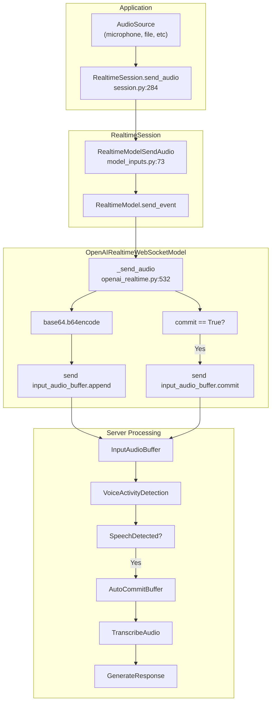
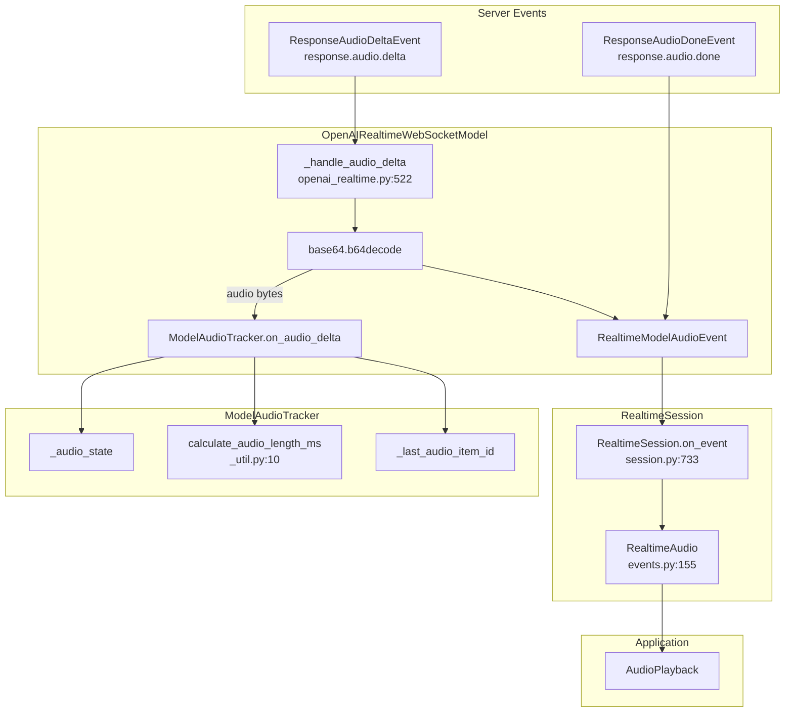
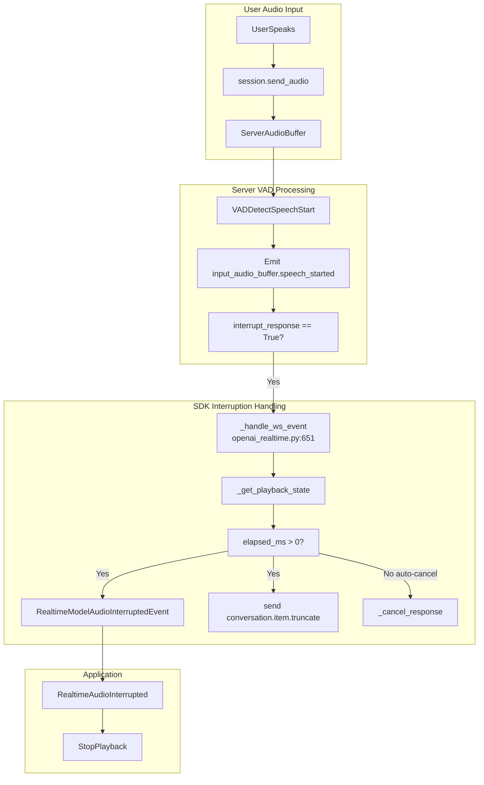

<!-- source: DeepWiki mcp.deepwiki.com · repo openai/openai-agents-python · page 9.4 Audio Pipeline and Voice Activity Detection · fetched 2026-10-26 -->

# Audio Pipeline and Voice Activity Detection

<details>
<summary>Relevant source files</summary>

The following files were used as context for generating this wiki page:

- [src/agents/realtime/__init__.py](src/agents/realtime/__init__.py)
- [src/agents/realtime/config.py](src/agents/realtime/config.py)
- [src/agents/realtime/model.py](src/agents/realtime/model.py)
- [src/agents/realtime/model_events.py](src/agents/realtime/model_events.py)
- [src/agents/realtime/model_inputs.py](src/agents/realtime/model_inputs.py)
- [src/agents/realtime/openai_realtime.py](src/agents/realtime/openai_realtime.py)
- [src/agents/realtime/session.py](src/agents/realtime/session.py)
- [src/agents/voice/input.py](src/agents/voice/input.py)
- [tests/realtime/test_model_events.py](tests/realtime/test_model_events.py)
- [tests/realtime/test_openai_realtime.py](tests/realtime/test_openai_realtime.py)
- [tests/realtime/test_session.py](tests/realtime/test_session.py)
- [tests/voice/test_input.py](tests/voice/test_input.py)

</details>


This page documents the audio processing pipeline and Voice Activity Detection (VAD) system in the OpenAI Realtime subsystem. It covers audio input/output flow, the `send_audio()` method, VAD configuration, transcription, and audio format handling.

For the broader realtime system architecture, see [Realtime System Overview (9.1)](). For session orchestration details, see [RealtimeSession Orchestration (9.2)](). For WebSocket transport, see [OpenAI Realtime WebSocket Model (9.3)](). For complete configuration options, see [Realtime Configuration (9.5)]().

## Audio Input Flow

The realtime system provides the `send_audio()` method for streaming user audio to the model. Audio is processed through VAD to detect speech boundaries and trigger model responses.

### Sending Audio with `send_audio()`

The `RealtimeSession.send_audio()` method [src/agents/realtime/session.py:284-286]() is used to send raw audio chunks to the model. It wraps the data in a `RealtimeModelSendAudio` input object.

**Usage pattern:**

```python
session = RealtimeSession(model, agent, context)
async with session:
    # Stream audio chunks (e.g., from microphone)
    for chunk in audio_stream:
        await session.send_audio(chunk)
    
    # Or manually commit buffer to trigger processing
    await session.send_audio(chunk, commit=True)
```

**Flow diagram - Audio Input to Model:**



**Key implementation details:**

1. **Buffer append**: `_send_audio` [src/agents/realtime/openai_realtime.py:532-538]() handles sending audio chunks to the model.
2. **Manual commit**: When `commit=True`, the model sends an `input_audio_buffer.commit` event to force processing [src/agents/realtime/openai_realtime.py:535-538]().
3. **Base64 encoding**: Audio bytes are base64-encoded before sending over the WebSocket [src/agents/realtime/openai_realtime.py:534]().
4. **Auto-commit**: With VAD enabled (default), the buffer auto-commits on speech detection [src/agents/realtime/openai_realtime.py:176]().

Sources: [src/agents/realtime/session.py:284-286](), [src/agents/realtime/openai_realtime.py:532-538](), [src/agents/realtime/model_inputs.py:73-78]()

## Audio Output Pipeline

The audio output pipeline handles streaming audio generation from the model, state tracking, and interruption management.

### Audio Delta Processing



**Audio delta handling:**

1. **Receive delta**: Server sends base64-encoded audio chunks via `response.audio.delta` events [src/agents/realtime/openai_realtime.py:73]().
2. **Decode**: [src/agents/realtime/openai_realtime.py:526]() decodes base64 to raw bytes.
3. **Track state**: [src/agents/realtime/openai_realtime.py:528]() updates `ModelAudioTracker` with chunk metadata to support future interruptions.
4. **Calculate length**: [src/agents/realtime/model.py:49]() computes audio duration in milliseconds based on format using `calculate_audio_length_ms`.
5. **Emit event**: [src/agents/realtime/openai_realtime.py:530]() emits `RealtimeModelAudioEvent` [src/agents/realtime/model_events.py:36-49]() with raw audio bytes.
6. **Transform**: `RealtimeSession` wraps this in a `RealtimeAudio` event for application consumption [src/agents/realtime/events.py:155-172]().

Sources: [src/agents/realtime/openai_realtime.py:522-538](), [src/agents/realtime/model.py:49](), [src/agents/realtime/events.py:155-172](), [src/agents/realtime/session.py:733-737]()

### Audio Format Configuration

Audio formats must be configured for both input and output streams. The SDK supports PCM16, G.711 µ-law, and G.711 A-law formats [src/agents/realtime/config.py:42-48]().

**Format configuration in `RealtimeSessionModelSettings`**: [src/agents/realtime/config.py:192-197]()

```python
model_settings: RealtimeSessionModelSettings = {
    "input_audio_format": "pcm16",      # or "g711_ulaw", "g711_alaw"
    "output_audio_format": "pcm16",     # or "g711_ulaw", "g711_alaw"
}
```

**Default formats**: [src/agents/realtime/openai_realtime.py:171-172]()

```python
DEFAULT_MODEL_SETTINGS: RealtimeSessionModelSettings = {
    "input_audio_format": "pcm16",
    "output_audio_format": "pcm16",
    # ...
}
```

**Audio format usage for duration calculation:**

The format is used to calculate audio duration in milliseconds from raw bytes in `calculate_audio_length_ms` [src/agents/realtime/model.py:49]():

| Format | Sample Rate | Bits per Sample | Calculation |
|--------|-------------|-----------------|-------------|
| `pcm16` | 24000 Hz | 16 bits | `len(bytes) / (24000 * 2) * 1000` |
| `g711_ulaw` | 8000 Hz | 8 bits | `len(bytes) / 8000 * 1000` |
| `g711_alaw` | 8000 Hz | 8 bits | `len(bytes) / 8000 * 1000` |

Sources: [src/agents/realtime/config.py:42-48](), [src/agents/realtime/openai_realtime.py:171-172](), [src/agents/realtime/model.py:49]()

### Playback Tracking for Interruptions

For custom playback scenarios (e.g., hardware buffers with latency), applications can provide a `RealtimePlaybackTracker` [src/agents/realtime/model.py:29-33]().

**Usage pattern:**

```python
# Create custom tracker
tracker = RealtimePlaybackTracker()

# Pass to model config
config = RealtimeModelConfig(
    playback_tracker=tracker,
    # ...
)

# In your audio playback code
def on_audio_played(item_id: str, content_index: int, bytes_played: bytes):
    tracker.on_play_bytes(item_id, content_index, bytes_played)
```

**Interruption flow:**

1. **Track playback**: Application calls `on_play_bytes()` or `on_play_ms()` as audio is played [src/agents/realtime/model.py:41-59]().
2. **Get state**: On interruption, `_get_playback_state()` queries the tracker [src/agents/realtime/openai_realtime.py:440-462]().
3. **Truncate**: If `elapsed_ms > 0`, the model sends `conversation.item.truncate` to the server [src/agents/realtime/openai_realtime.py:485-490]().
4. **Emit event**: Emit `RealtimeModelAudioInterruptedEvent` [src/agents/realtime/model_events.py:52-62]() to notify the application.

Sources: [src/agents/realtime/model.py:29-96](), [src/agents/realtime/openai_realtime.py:440-517]()

## Voice Activity Detection (VAD)

Voice Activity Detection automatically detects when the user is speaking and when they've finished, enabling natural turn-taking.

### VAD Configuration

VAD is configured via the `turn_detection` setting in `RealtimeSessionModelSettings` [src/agents/realtime/config.py:204-206]().

**Configuration structure**: [src/agents/realtime/config.py:96-126]()

```python
turn_detection: RealtimeTurnDetectionConfig = {
    "type": "semantic_vad",           # or "server_vad"
    "interrupt_response": True,        # Allow interrupting assistant
    "eagerness": "medium",             # How eagerly to detect boundaries
    "silence_duration_ms": 500,        # Silence to trigger turn end
    "threshold": 0.5,                  # VAD sensitivity
}
```

**Default VAD settings**: [src/agents/realtime/openai_realtime.py:176]()

```python
DEFAULT_MODEL_SETTINGS = {
    # ...
    "turn_detection": {"type": "semantic_vad", "interrupt_response": True},
}
```

Sources: [src/agents/realtime/config.py:96-126](), [src/agents/realtime/openai_realtime.py:176]()

### VAD Event Flow

**VAD-triggered interruption flow:**



**Key implementation points:**

1. **Speech detection**: Server emits `input_audio_buffer.speech_started` when VAD detects speech [src/agents/realtime/openai_realtime.py:806-810]().
2. **Playback state query**: SDK queries current playback position via `_get_playback_state()` [src/agents/realtime/openai_realtime.py:440-462]().
3. **Audio truncation**: If audio is playing, send `conversation.item.truncate` at current playback position [src/agents/realtime/openai_realtime.py:485-490]().
4. **Response cancellation**: If `interrupt_response=True`, the model cancels the current response with `response.cancel` [src/agents/realtime/openai_realtime.py:491-494]().

Sources: [src/agents/realtime/openai_realtime.py:440-517](), [src/agents/realtime/openai_realtime.py:806-872]()

## Transcript Processing

The realtime system processes input audio transcription (user speech) and output audio transcription (assistant speech).

### Input Audio Transcription

**Processing flow:**

1. **Receive event**: Server sends `conversation.item.input_audio_transcription.completed` [src/agents/realtime/openai_realtime.py:899-914]().
2. **Update history**: `RealtimeSession` handles the `RealtimeModelInputAudioTranscriptionCompletedEvent` [src/agents/realtime/model_events.py:78-86]() in `on_event` [src/agents/realtime/session.py:756-766]().
3. **Add user item**: A new `UserMessageItem` is appended to history with the transcript [src/agents/realtime/session.py:760-765]().

**Transcript configuration**: [src/agents/realtime/config.py:76-88]()

```python
input_audio_transcription: RealtimeInputAudioTranscriptionConfig = {
    "model": "gpt-4o-mini-transcribe",  # or "gpt-4o-transcribe"
    "language": "en",                    # Optional language code
}
```

Sources: [src/agents/realtime/config.py:76-88](), [src/agents/realtime/openai_realtime.py:173-175](), [src/agents/realtime/session.py:756-766]()

### Output Audio Transcription and Guardrail Debouncing

Output transcripts are processed incrementally. The `RealtimeSession` accumulates deltas and can apply guardrails.

**Debounce configuration**: [src/agents/realtime/session.py:743-745]()

```python
# Default: run guardrails every 100 characters
self._debounce_text_length = self._run_config.get("guardrails_settings", {}).get(
    "debounce_text_length", 100
)
```

Sources: [src/agents/realtime/session.py:740-754]()

---

