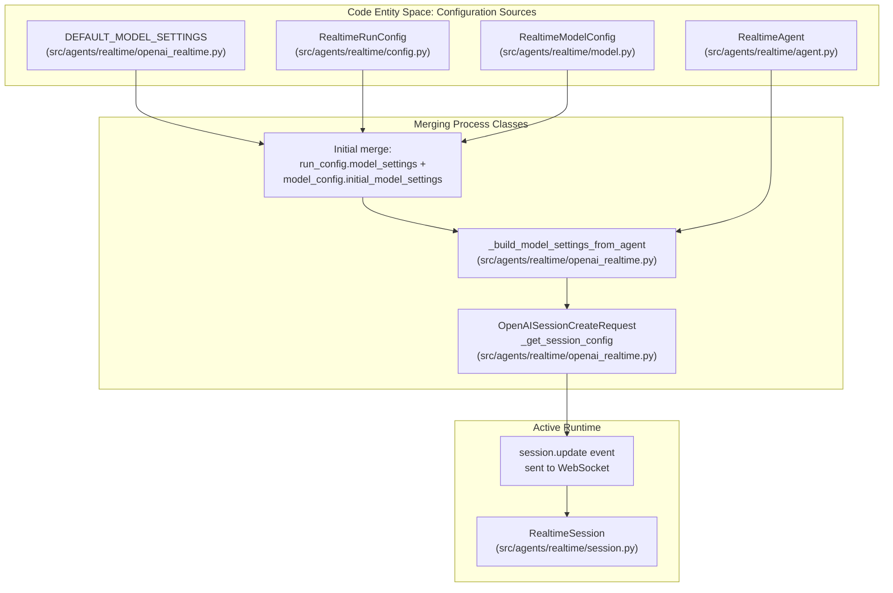
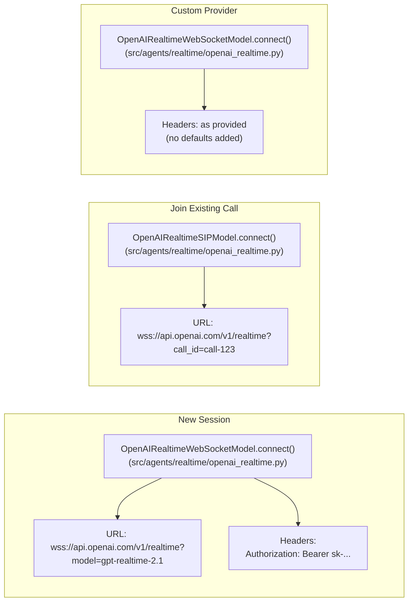
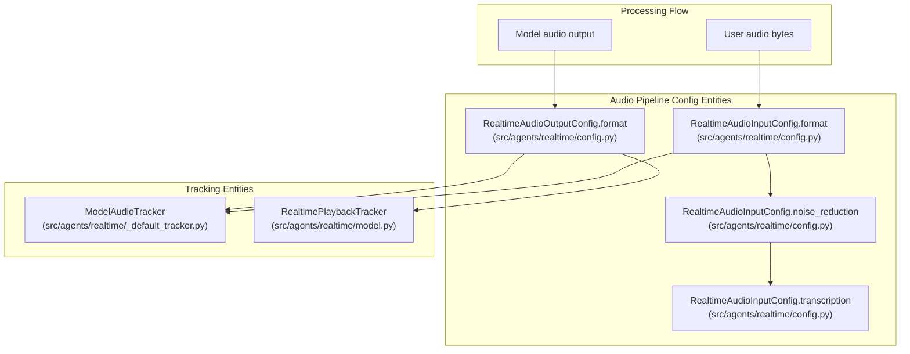
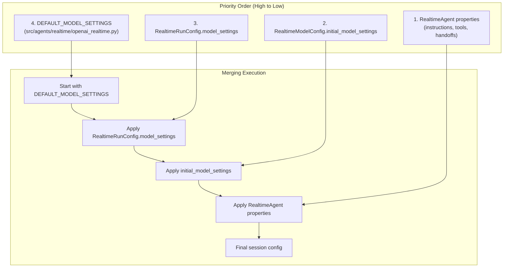

<!-- source: DeepWiki mcp.deepwiki.com · repo openai/openai-agents-python · page 9.5 Realtime Configuration · fetched 2026-10-26 -->

# Realtime Configuration

Relevant source files

The following files were used as context for generating this wiki page:

- [src/agents/realtime/__init__.py](src/agents/realtime/__init__.py)
- [src/agents/realtime/config.py](src/agents/realtime/config.py)
- [src/agents/realtime/model.py](src/agents/realtime/model.py)
- [src/agents/realtime/model_events.py](src/agents/realtime/model_events.py)
- [src/agents/realtime/model_inputs.py](src/agents/realtime/model_inputs.py)
- [src/agents/realtime/openai_realtime.py](src/agents/realtime/openai_realtime.py)
- [src/agents/realtime/session.py](src/agents/realtime/session.py)
- [tests/realtime/test_model_events.py](tests/realtime/test_model_events.py)
- [tests/realtime/test_openai_realtime.py](tests/realtime/test_openai_realtime.py)
- [tests/realtime/test_session.py](tests/realtime/test_session.py)

This page documents the configuration options for realtime agent sessions, including model settings, audio parameters, turn detection, tracing, and guardrails. For general realtime system architecture, see [9.1 Realtime System Overview](). For runtime session management, see [9.2 RealtimeSession Orchestration]().

## Configuration Hierarchy

Realtime agent configuration is split across multiple layers that are merged at runtime to produce the final session settings. The process begins with SDK defaults defined in `src/agents/realtime/openai_realtime.py`, followed by connection-level settings via `RealtimeModelConfig`, and finally runtime-specific overrides via `RealtimeRunConfig` and agent-level properties.

Title: Realtime Configuration Resolution Flow

Sources: [src/agents/realtime/session.py:218-226](), [src/agents/realtime/openai_realtime.py:168-177](), [src/agents/realtime/openai_realtime.py:915-920](), [src/agents/realtime/openai_realtime.py:922-1014](), [src/agents/realtime/model.py:107-150](), [src/agents/realtime/config.py:258-283]()

## Model Configuration (`RealtimeModelConfig`)

`RealtimeModelConfig` is a `TypedDict` defined in `src/agents/realtime/model.py` and passed to `model.connect()` to establish the underlying transport layer.

| Field | Type | Description |
|-------|------|-------------|
| `api_key` | `str \| Callable[[], MaybeAwaitable[str]]` | OpenAI API key or a function/coroutine that returns one. [src/agents/realtime/model.py:110-114]() |
| `url` | `str` | WebSocket URL. Defaults to standard OpenAI Realtime endpoint. [src/agents/realtime/model.py:116-119]() |
| `headers` | `dict[str, str]` | Custom headers. If set, standard Authorization headers are skipped. [src/agents/realtime/model.py:121-125]() |
| `initial_model_settings` | `RealtimeSessionModelSettings` | Session settings applied immediately upon connection. [src/agents/realtime/model.py:127-128]() |
| `playback_tracker` | `RealtimePlaybackTracker` | Custom tracker for audio playback progress, critical for accurate interruptions. [src/agents/realtime/model.py:130-140]() |
| `call_id` | `str` | Join an existing call (e.g., SIP) instead of creating a new session. [src/agents/realtime/model.py:142-148]() |

### Connection Modes

The SDK handles different connection strategies based on the provided config:

Title: Connection Strategy Resolution

Sources: [src/agents/realtime/openai_realtime.py:288-357](), [tests/realtime/test_openai_realtime.py:61-126]()

## Session Model Settings (`RealtimeSessionModelSettings`)

`RealtimeSessionModelSettings` is the primary structure for controlling model behavior, defined in `src/agents/realtime/config.py`. It is merged from the `RealtimeRunConfig` and the `RealtimeAgent` properties.

### Core Settings

| Field | Type | Description |
|-------|------|-------------|
| `model_name` | `RealtimeModelName` | The model identifier (e.g., `gpt-realtime-2.1`). [src/agents/realtime/config.py:183-184]() |
| `instructions` | `str` | System instructions. Usually derived from `agent.instructions`. [src/agents/realtime/config.py:186-187]() |
| `modalities` | `list["text" \| "audio"]` | Supported input modalities. [src/agents/realtime/config.py:192-193]() |
| `voice` | `RealtimeVoice` | Voice for audio output (e.g., `ash`). [src/agents/realtime/config.py:201-202]() |
| `turn_detection` | `RealtimeTurnDetectionConfig` | Configuration for Voice Activity Detection (VAD). [src/agents/realtime/config.py:214-215]() |
| `tool_choice` | `ToolChoice` | How the model should choose tools. [src/agents/realtime/config.py:217-218]() |
| `parallel_tool_calls` | `bool` | Whether parallel tool calls are allowed. [src/agents/realtime/config.py:220-221]() |

Sources: [src/agents/realtime/config.py:180-235](), [src/agents/realtime/openai_realtime.py:168-177]()

## Audio Configuration

Audio configuration is managed via `RealtimeAudioConfig`, which separates input and output parameters into `RealtimeAudioInputConfig` and `RealtimeAudioOutputConfig`.

### Audio Pipeline and Tracking

Title: Realtime Audio Data Flow

Sources: [src/agents/realtime/config.py:148-172](), [src/agents/realtime/openai_realtime.py:280-283](), [src/agents/realtime/model.py:29-96]()

### Format and Transcription
- **Formats:** Supports `pcm16`, `g711_ulaw`, and `g711_alaw`. [src/agents/realtime/config.py:42-47]()
- **Transcription:** Configured via `RealtimeInputAudioTranscriptionConfig`. Supports models like `gpt-4o-mini-transcribe`. [src/agents/realtime/config.py:76-108]()
- **Noise Reduction:** Can be set to `near_field` or `far_field` via `RealtimeInputAudioNoiseReductionConfig`. [src/agents/realtime/config.py:110-115]()

Sources: [src/agents/realtime/config.py:42-115]()

## Turn Detection Configuration

`RealtimeTurnDetectionConfig` defines how the server detects when a user has finished speaking and when the assistant should be interrupted.

| Field | Type | Description |
|-------|------|-------------|
| `type` | `Literal["semantic_vad", "server_vad"]` | `semantic_vad` is the default. [src/agents/realtime/config.py:120-121]() |
| `interrupt_response` | `bool` | If true, the server cancels the current response when user speech is detected. [src/agents/realtime/config.py:129-130]() |
| `eagerness` | `Literal["auto", "low", "medium", "high"]` | Sensitivity of turn detection. [src/agents/realtime/config.py:126-127]() |
| `silence_duration_ms` | `int` | Required silence before the server considers the turn ended. [src/agents/realtime/config.py:135-136]() |

Sources: [src/agents/realtime/config.py:117-146](), [src/agents/realtime/openai_realtime.py:178]()

## Tracing Configuration

`RealtimeModelTracingConfig` allows linking realtime sessions to observability backends and is defined in `src/agents/realtime/config.py`.

- **Workflow Name:** Custom identifier for the logic flow.
- **Group ID:** Links multiple turns or sessions together.
- **Metadata:** Arbitrary key-value pairs for trace context.

The SDK defaults to session-level tracing if enabled. Tracing is configured via `RealtimeRunConfig.tracing`.

Sources: [src/agents/realtime/openai_realtime.py:343-346](), [src/agents/realtime/config.py:244-255]()

## Run Configuration (`RealtimeRunConfig`)

The `RealtimeRunConfig` provides high-level control over the `RealtimeSession` execution and is defined in `src/agents/realtime/config.py`.

| Field | Type | Description |
|-------|------|-------------|
| `model_settings` | `RealtimeSessionModelSettings` | Overrides for model behavior. |
| `output_guardrails` | `list[OutputGuardrail]` | Guardrails applied to model transcripts. |
| `guardrails_settings` | `RealtimeGuardrailsSettings` | Tuning for guardrail execution (e.g., `debounce_text_length`). |
| `async_tool_calls` | `bool` | Whether to execute tool calls in parallel with the audio stream. |

### Guardrail Debouncing
To prevent excessive API calls, guardrails use `debounce_text_length`. Guardrails only run when the accumulated transcript length crosses this threshold.

Sources: [src/agents/realtime/config.py:258-283](), [src/agents/realtime/session.py:245-247]()

## Configuration Merging and Precedence

Settings are resolved in the following order (last one wins):
1. **SDK Defaults:** `DEFAULT_MODEL_SETTINGS` in `src/agents/realtime/openai_realtime.py`. [src/agents/realtime/openai_realtime.py:170-179]()
2. **Run Settings:** `model_settings` in `RealtimeRunConfig`. [src/agents/realtime/config.py:258-283]()
3. **Connection Settings:** `initial_model_settings` in `RealtimeModelConfig`. [src/agents/realtime/model.py:127-128]()
4. **Agent Properties:** Values from the active `RealtimeAgent` (e.g., `agent.instructions`). [src/agents/realtime/agent.py]()

Title: Priority-Based Configuration Merging

Sources: [src/agents/realtime/session.py:218-226](), [src/agents/realtime/openai_realtime.py:170-179](), [src/agents/realtime/openai_realtime.py:922-1014]()

---

