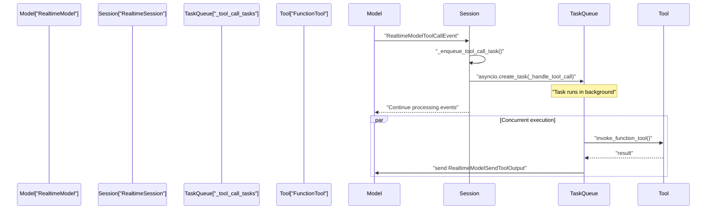
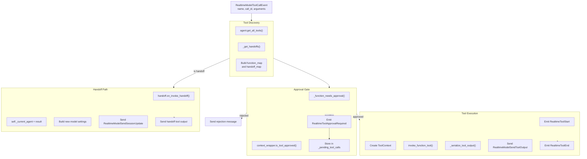
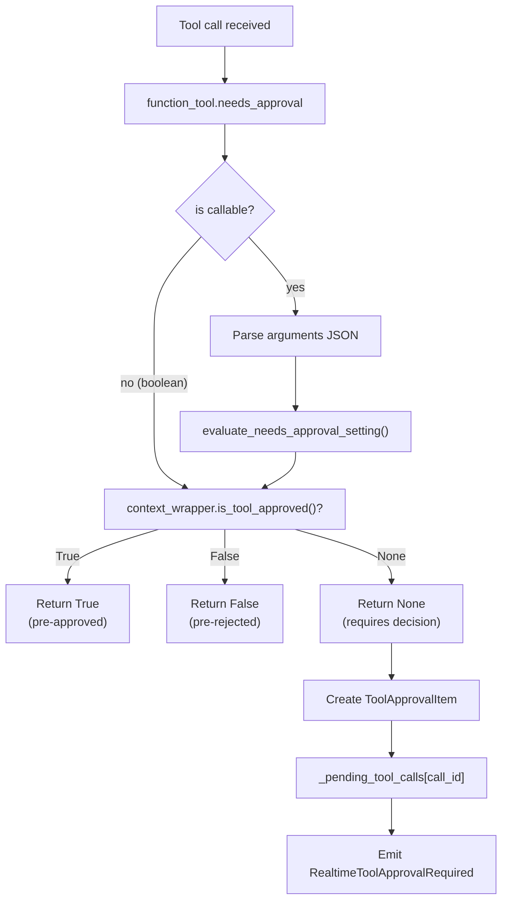
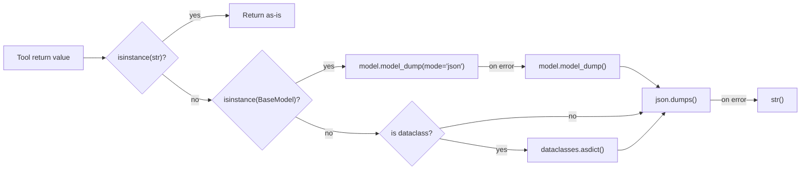
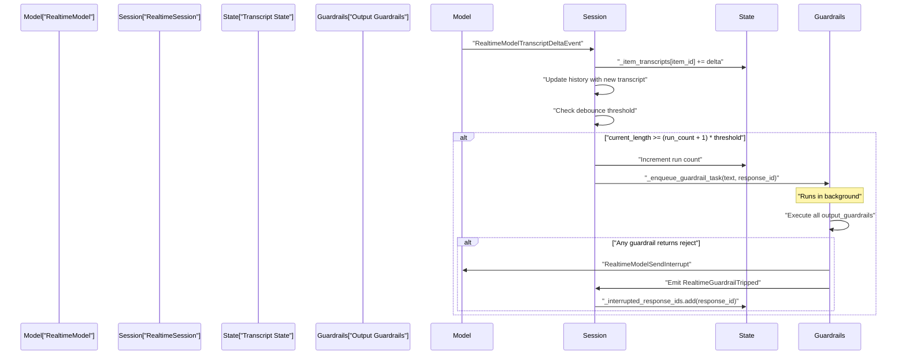
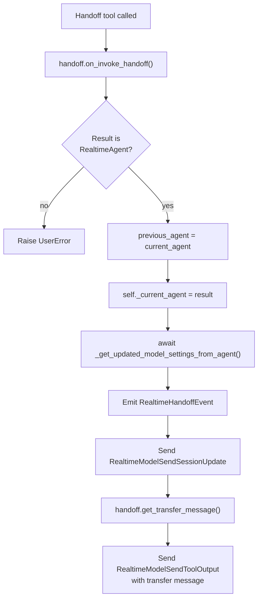

<!-- source: DeepWiki mcp.deepwiki.com · repo openai/openai-agents-python · page 9.6 Realtime Tool Execution and Guardrails · fetched 2026-10-26 -->

# Realtime Tool Execution and Guardrails

Relevant source files

The following files were used as context for generating this wiki page:

- [src/agents/handoffs/__init__.py](src/agents/handoffs/__init__.py)
- [src/agents/realtime/__init__.py](src/agents/realtime/__init__.py)
- [src/agents/realtime/config.py](src/agents/realtime/config.py)
- [src/agents/realtime/handoffs.py](src/agents/realtime/handoffs.py)
- [src/agents/realtime/model.py](src/agents/realtime/model.py)
- [src/agents/realtime/model_events.py](src/agents/realtime/model_events.py)
- [src/agents/realtime/model_inputs.py](src/agents/realtime/model_inputs.py)
- [src/agents/realtime/openai_realtime.py](src/agents/realtime/openai_realtime.py)
- [src/agents/realtime/session.py](src/agents/realtime/session.py)
- [src/agents/util/_transforms.py](src/agents/util/_transforms.py)
- [tests/realtime/test_model_events.py](tests/realtime/test_model_events.py)
- [tests/realtime/test_openai_realtime.py](tests/realtime/test_openai_realtime.py)
- [tests/realtime/test_realtime_handoffs.py](tests/realtime/test_realtime_handoffs.py)
- [tests/realtime/test_session.py](tests/realtime/test_session.py)
- [tests/test_handoff_tool.py](tests/test_handoff_tool.py)
- [tests/test_tool_use_behavior.py](tests/test_tool_use_behavior.py)
- [tests/test_transforms.py](tests/test_transforms.py)

This page describes how tools are executed and guardrails are applied in the realtime agent system. Unlike standard agents that use synchronous turn-based execution, realtime agents operate in an event-driven, asynchronous model that requires specialized handling for tool calls and safety validation.

**Related pages**: For general tool concepts, see [Tool System Overview](4.1). For tool approval in standard agents, see [Tool Approval and Human-in-the-Loop](4.7). For realtime session orchestration, see [RealtimeSession Orchestration](9.2). For output guardrails in standard agents, see [Input and Output Guardrails](6.2).

---

## Execution Model: Async vs Sync Tool Calls

Realtime sessions support two tool execution modes configured via `RealtimeRunConfig` [src/agents/realtime/config.py]():

| Configuration | Behavior | Use Case |
|--------------|----------|----------|
| `async_tool_calls: True` (default) | Tools execute in background tasks, allowing multiple concurrent tool calls [src/agents/realtime/session.py]() | Low-latency voice interactions where blocking is unacceptable |
| `async_tool_calls: False` | Tools execute sequentially, blocking event processing until completion [src/agents/realtime/session.py]() | Scenarios requiring strict ordering or debugging |

**Async Execution Flow**:

The `RealtimeSession` manages concurrent tool execution using an internal set of tasks `_tool_call_tasks` [src/agents/realtime/session.py]().

Title: "Realtime Tool Execution Flow"

Sources: [src/agents/realtime/session.py](), [src/agents/realtime/config.py]()

---

## Tool Call Handling Pipeline

When the model emits a `RealtimeModelToolCallEvent` [src/agents/realtime/model_events.py](), `RealtimeSession` processes it through a multi-stage pipeline within `_handle_tool_call` [src/agents/realtime/session.py]():

Title: "Realtime Tool Call Pipeline"

Sources: [src/agents/realtime/session.py]()

---

## Tool Approval Workflow

### Approval Evaluation

Tools requiring approval are evaluated using the `needs_approval` mechanism [src/agents/realtime/session.py](), which checks the `FunctionTool` configuration and the `RunContextWrapper` state.

Title: "Realtime Approval Logic"

Sources: [src/agents/realtime/session.py]()

### Approval and Rejection Methods

The session provides methods for human operators to approve or reject pending tool calls stored in `_pending_tool_calls` [src/agents/realtime/session.py]():

| Method | Parameters | Behavior |
|--------|-----------|----------|
| `approve_tool_call(call_id, always=False)` [src/agents/realtime/session.py]() | `call_id`: Tool call identifier `always`: Permanent approval flag | Marks approval in `context_wrapper`, removes from pending, resumes execution [src/agents/realtime/session.py]() |
| `reject_tool_call(call_id, always=False, rejection_message=None)` [src/agents/realtime/session.py]() | `call_id`: Tool call identifier `always`: Permanent rejection flag `rejection_message`: Custom error text | Marks rejection, sends error to model, emits `RealtimeToolEnd` [src/agents/realtime/session.py]() |

Sources: [src/agents/realtime/session.py]()

---

## Tool Output Serialization

The `_serialize_tool_output` function [src/agents/realtime/session.py]() handles conversion of tool results (Pydantic models, dataclasses, or dicts) into JSON strings for the model transport.

Title: "Realtime Tool Output Serialization"

Sources: [src/agents/realtime/session.py]()

---

## Output Guardrails in Realtime

Output guardrails operate on transcript text as it streams from the model, using a debouncing mechanism configured by `debounce_text_length` [src/agents/realtime/session.py]().

### Transcript Accumulation

The session maintains per-item transcript state to trigger guardrail checks at regular intervals.

Title: "Realtime Guardrail Accumulation"

Sources: [src/agents/realtime/session.py]()

### Guardrail Execution Logic

Guardrails are executed asynchronously in background tasks `_run_guardrails_on_transcript` [src/agents/realtime/session.py](). If a guardrail rejects, the session sends a `RealtimeModelSendInterrupt` [src/agents/realtime/model_inputs.py]() to the model and emits a `RealtimeGuardrailTripped` event [src/agents/realtime/events.py]().

Sources: [src/agents/realtime/session.py](), [src/agents/realtime/model_inputs.py](), [src/agents/realtime/events.py]()

---

## Tool Execution Events

The session emits structured events [src/agents/realtime/events.py]() at each stage of tool execution:

*   **`RealtimeToolStart`**: Emitted after approval is granted but before invocation [src/agents/realtime/session.py]().
*   **`RealtimeToolEnd`**: Emitted after successful execution or rejection [src/agents/realtime/session.py]().
*   **`RealtimeToolApprovalRequired`**: Emitted when a tool requires human intervention [src/agents/realtime/session.py]().

Sources: [src/agents/realtime/events.py](), [src/agents/realtime/session.py]()

---

## Handoffs as Special Tool Calls

Handoffs in realtime trigger agent switching via `realtime_handoff` [src/agents/realtime/handoffs.py](). Unlike standard handoffs, realtime handoffs in the `RealtimeSession` loop handle session updates and model settings adjustments.

Title: "Realtime Handoff Logic"

Sources: [src/agents/realtime/session.py](), [src/agents/realtime/handoffs.py]()

---

## Configuration and Task Management

The session manages background task lifecycles for both tool calls and guardrails in `_cleanup` [src/agents/realtime/session.py]().

*   **`_tool_call_tasks`**: Set of active tool execution tasks [src/agents/realtime/session.py]().
*   **`_guardrail_tasks`**: Set of active transcript guardrail tasks [src/agents/realtime/session.py]().

Sources: [src/agents/realtime/session.py](), [src/agents/realtime/config.py]()

---

