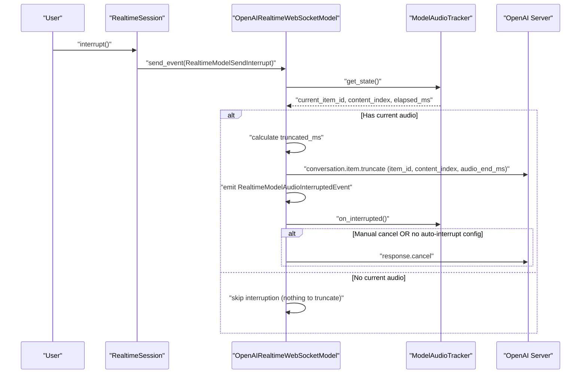
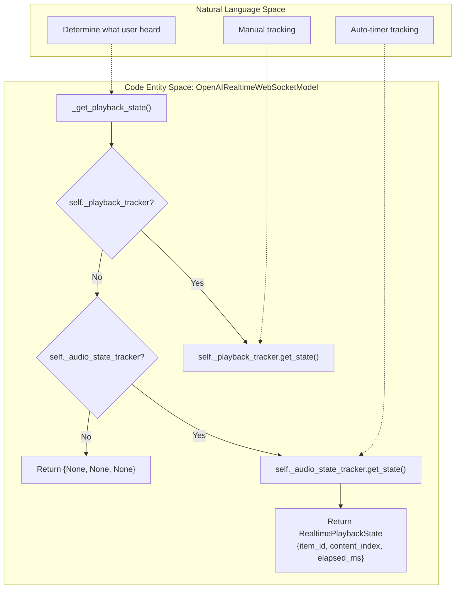
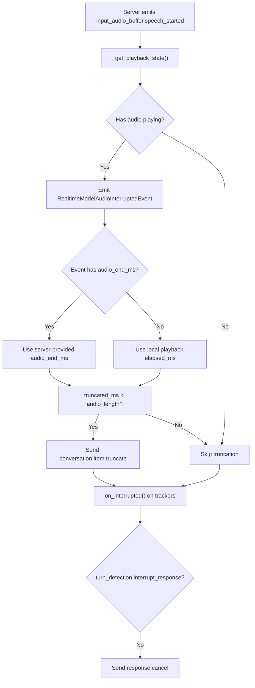

<!-- source: DeepWiki mcp.deepwiki.com · repo openai/openai-agents-python · page 9.7 Interruption Handling · fetched 2026-10-26 -->

# Interruption Handling

<details>
<summary>Relevant source files</summary>

The following files were used as context for generating this wiki page:

- [examples/basic/stream_function_call_args.py](examples/basic/stream_function_call_args.py)
- [src/agents/realtime/_default_tracker.py](src/agents/realtime/_default_tracker.py)
- [src/agents/realtime/_util.py](src/agents/realtime/_util.py)
- [src/agents/realtime/agent.py](src/agents/realtime/agent.py)
- [tests/realtime/test_agent.py](tests/realtime/test_agent.py)
- [tests/realtime/test_playback_tracker.py](tests/realtime/test_playback_tracker.py)
- [tests/realtime/test_playback_tracker_manual_unit.py](tests/realtime/test_playback_tracker_manual_unit.py)
- [tests/test_agent_clone_shallow_copy.py](tests/test_agent_clone_shallow_copy.py)
- [tests/test_agent_instructions_signature.py](tests/test_agent_instructions_signature.py)

</details>


## Purpose and Scope

Interruption handling enables users to stop the assistant's speech mid-utterance in realtime voice sessions. This is a critical feature for natural conversation flow, allowing users to "barge in" when they want to correct, clarify, or redirect the conversation without waiting for the assistant to finish speaking.

This page covers:
- Manual interruption via the `interrupt()` method [src/agents/realtime/session.py:174-192]().
- Automatic interruption triggered by Voice Activity Detection (VAD) [src/agents/realtime/openai_realtime.py:821-887]().
- Playback state tracking via `AudioStateTracker` and `RealtimePlaybackTracker` [src/agents/realtime/model.py:29-96]().
- The `conversation.item.truncate` event and `audio_end_ms` calculation logic [src/agents/realtime/openai_realtime.py:596-665]().

For general realtime session management, see [RealtimeSession Orchestration](9.2). For VAD configuration, see [Audio Pipeline and Voice Activity Detection](9.4).

Sources: [src/agents/realtime/openai_realtime.py:596-665](), [src/agents/realtime/session.py:174-192](), [src/agents/realtime/model.py:29-96]()

---

## Interruption Flow Overview

When an interruption occurs, the system must determine the playback position, emit interruption events, and notify the server to truncate the specific conversation item so the model's context matches what the user actually heard.

### Interruption Sequence Diagram



Sources: [src/agents/realtime/openai_realtime.py:596-665](), [src/agents/realtime/session.py:174-192](), [src/agents/realtime/model_inputs.py:95-114]()

---

## Playback State Tracking

Accurate interruption requires knowing how much audio the user has actually heard. The SDK manages this through two primary tracking mechanisms.

### Default: Realtime Assumption
By default, `ModelAudioTracker` (aliased as `AudioStateTracker` in internal logic) assumes audio is played immediately at realtime speed once received from the server [src/agents/realtime/openai_realtime.py:90-90]().

| Component | Responsibility | Code Reference |
|-----------|---------------|----------------|
| `ModelAudioTracker` | Tracks when audio deltas arrive from server | [src/agents/realtime/_default_tracker.py:22-97]() |
| `initial_received_time` | Records when first audio byte received for an item | [src/agents/realtime/_default_tracker.py:12-12]() |
| `elapsed_ms` | Calculated based on the time delta since receipt | [src/agents/realtime/_default_tracker.py:58-63]() |
| `audio_length_ms` | Total duration of received audio calculated via `calculate_audio_length_ms` | [src/agents/realtime/_util.py:39-48]() |

### Custom: `RealtimePlaybackTracker`
For scenarios with playback delays (e.g., phone calls, Twilio SIP), developers provide a custom `RealtimePlaybackTracker` [src/agents/realtime/model.py:29-34]().

| Method | Purpose | Called By |
|--------|---------|-----------|
| `on_play_bytes` | Notify when audio bytes are played | Application [src/agents/realtime/model.py:41-50]() |
| `on_play_ms` | Notify when audio duration is played | Application [src/agents/realtime/model.py:52-66]() |
| `on_interrupted` | Reset state after interruption | Model [src/agents/realtime/model.py:67-70]() |
| `get_state` | Return current playback position | Model [src/agents/realtime/model.py:80-95]() |

### Playback State Resolution Diagram

This diagram bridges natural language concepts of tracking playback to the underlying codebase entities in `OpenAIRealtimeWebSocketModel` and `ModelAudioTracker`.



Sources: [src/agents/realtime/openai_realtime.py:566-587](), [src/agents/realtime/model.py:29-96](), [src/agents/realtime/_default_tracker.py:22-97]()

---

## Manual Interruption

Users can manually interrupt the assistant by calling `session.interrupt()` [src/agents/realtime/session.py:246-248](). This method sends a `RealtimeModelSendInterrupt` event to the underlying model implementation [src/agents/realtime/model_inputs.py:95-114]().

```python
# Usage Example
async with await runner.run() as session:
    # ... session processing ...
    await session.interrupt()
    await session.send_message("Actually, let's talk about something else.")
```

**Configuration Options**:

| Field | Type | Location | Purpose |
|-------|------|----------|---------|
| `force_response_cancel` | `bool` | `RealtimeModelSendInterrupt` | Force cancellation even if auto-interrupt is enabled [src/agents/realtime/model_inputs.py:98-99]() |
| `interrupt_response` | `bool` | `RealtimeTurnDetectionConfig` | Whether VAD auto-interrupts responses [src/agents/realtime/config.py:108-109]() |

Sources: [src/agents/realtime/session.py:246-248](), [src/agents/realtime/model_inputs.py:95-114](), [src/agents/realtime/config.py:96-126]()

---

## Automatic Interruption via VAD

Voice Activity Detection (VAD) can automatically interrupt the assistant when the user starts speaking. This is managed by the server emitting `input_audio_buffer.speech_started` [src/agents/realtime/openai_realtime.py:821-821]().

### VAD Auto-Interrupt Flow Diagram



Sources: [src/agents/realtime/openai_realtime.py:821-887](), [src/agents/realtime/config.py:96-126]()

---

## Truncation Calculation

The truncation point (`audio_end_ms`) is calculated to ensure the conversation history accurately reflects what was heard.

### Calculation Logic in `_send_interrupt`

1. **Get State**: Retrieve `current_item_id` and `elapsed_ms` from trackers [src/agents/realtime/openai_realtime.py:597-600]().
2. **Validate**: If no audio is playing, skip truncation [src/agents/realtime/openai_realtime.py:602-608]().
3. **Clamp**: Get audio limits for the item and clamp `elapsed_ms` to the total length generated [src/agents/realtime/openai_realtime.py:618-623]().
4. **Send**: Construct and send `conversation.item.truncate` (OpenAI Event) [src/agents/realtime/openai_realtime.py:624-632]().

### Protocol Event: `conversation.item.truncate`
This event is defined in the OpenAI Realtime API and wrapped by the SDK [src/agents/realtime/openai_realtime.py:27-29]().

| Field | Description |
|-------|-------------|
| `item_id` | The ID of the assistant message to truncate. |
| `content_index` | The index of the audio content within the message. |
| `audio_end_ms` | The timestamp (in ms) where the audio should end. |

Sources: [src/agents/realtime/openai_realtime.py:596-665](), [src/agents/realtime/openai_realtime.py:835-874]()

---

## Response Cancellation Logic

After truncating audio, the SDK determines if an explicit `response.cancel` is required.

```python
# Logic from OpenAIRealtimeWebSocketModel._send_interrupt
should_cancel = event.force_response_cancel
if not should_cancel:
    turn_detection = self._session_config.get("turn_detection")
    # If auto-interrupt is NOT enabled, we must manually cancel
    should_cancel = not (turn_detection and turn_detection.get("interrupt_response"))

if should_cancel:
    await self._send_raw_message(OpenAIResponseCancelEvent(type="response.cancel"))
```

Sources: [src/agents/realtime/openai_realtime.py:638-650](), [src/agents/realtime/openai_realtime.py:876-887]()

---

## State Reset After Interruption

To prevent stale data from affecting the next turn, the SDK resets all internal trackers immediately after the interruption is processed.

| Method | Target | File Reference |
|--------|--------|----------------|
| `self._audio_state_tracker.on_interrupted()` | `ModelAudioTracker` | [src/agents/realtime/openai_realtime.py:662-662]() |
| `self._playback_tracker.on_interrupted()` | `RealtimePlaybackTracker` | [src/agents/realtime/openai_realtime.py:664-664]() |

This clears the `current_item` and `elapsed_ms` references to ensure the system is ready for new audio [src/agents/realtime/model.py:67-70]().

Sources: [src/agents/realtime/openai_realtime.py:662-664](), [src/agents/realtime/model.py:67-70]()

---

## Event Emission

The interruption process triggers specific events that applications can use to synchronize UI or hardware.

| Event Type | Layer | Description | Reference |
|------------|-------|-------------|-----------|
| `RealtimeModelAudioInterruptedEvent` | Model | Emitted when truncation is initiated at the transport layer | [src/agents/realtime/model_events.py:52-62]() |
| `RealtimeAudioInterrupted` | Session | High-level event for application consumers | [src/agents/realtime/events.py:56-56]() |

Sources: [src/agents/realtime/model_events.py:52-62](), [src/agents/realtime/events.py:56-56](), [src/agents/realtime/session.py:56-56]()

---

