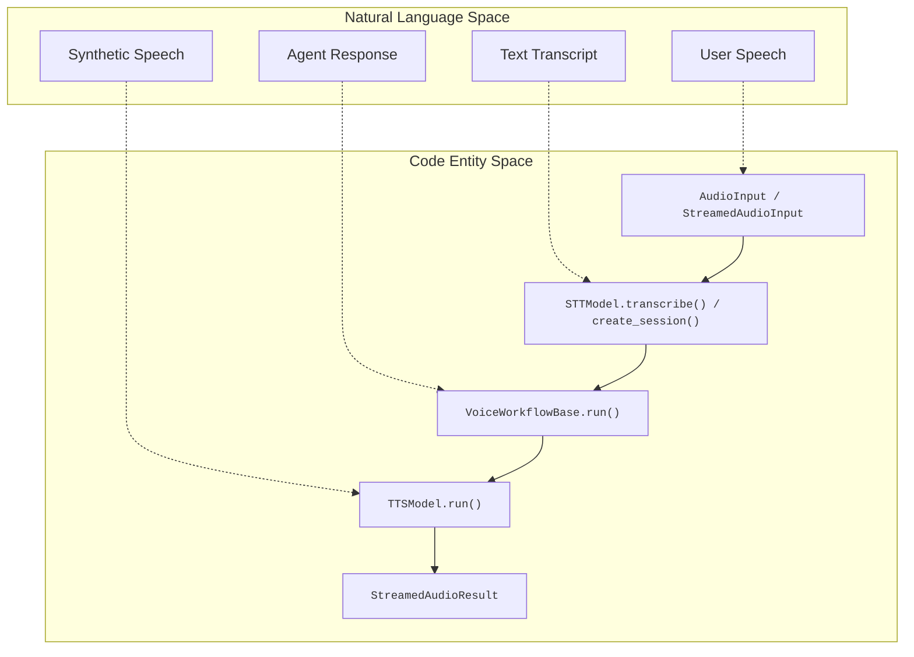
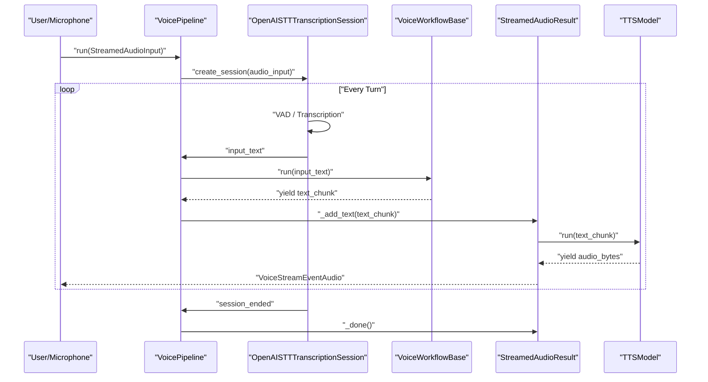

<!-- source: DeepWiki mcp.deepwiki.com · repo openai/openai-agents-python · page 9.8 Voice Pipeline (STT/TTS) · fetched 2026-10-26 -->

# Voice Pipeline (STT/TTS)

Relevant source files

The following files were used as context for generating this wiki page:

- [docs/ja/voice/pipeline.md](docs/ja/voice/pipeline.md)
- [src/agents/models/_openai_websocket.py](src/agents/models/_openai_websocket.py)
- [src/agents/voice/__init__.py](src/agents/voice/__init__.py)
- [src/agents/voice/model.py](src/agents/voice/model.py)
- [src/agents/voice/models/openai_stt.py](src/agents/voice/models/openai_stt.py)
- [src/agents/voice/pipeline.py](src/agents/voice/pipeline.py)
- [src/agents/voice/pipeline_config.py](src/agents/voice/pipeline_config.py)
- [src/agents/voice/result.py](src/agents/voice/result.py)
- [src/agents/voice/workflow.py](src/agents/voice/workflow.py)
- [tests/voice/test_openai_stt.py](tests/voice/test_openai_stt.py)
- [tests/voice/test_openai_stt_api_key_refresh.py](tests/voice/test_openai_stt_api_key_refresh.py)
- [tests/voice/test_openai_stt_client_config.py](tests/voice/test_openai_stt_client_config.py)
- [tests/voice/test_openai_stt_eof.py](tests/voice/test_openai_stt_eof.py)
- [tests/voice/test_openai_stt_session_config.py](tests/voice/test_openai_stt_session_config.py)
- [tests/voice/test_pipeline.py](tests/voice/test_pipeline.py)
- [tests/voice/test_pipeline_config.py](tests/voice/test_pipeline_config.py)
- [tests/voice/test_pipeline_tracing.py](tests/voice/test_pipeline_tracing.py)
- [tests/voice/test_tts_voice_types.py](tests/voice/test_tts_voice_types.py)

The `VoicePipeline` is a high-level orchestration class designed to bridge the gap between raw audio streams and agentic workflows. It automates a three-step pipeline: transcribing audio input via Speech-to-Text (STT), executing custom logic or an agent workflow, and synthesizing the resulting text responses back into audio via Text-to-Speech (TTS) [src/agents/voice/pipeline.py:24-29]().

## Architecture and Data Flow

The pipeline operates by wrapping a `VoiceWorkflowBase` implementation and coordinating it with `STTModel` and `TTSModel` components [src/agents/voice/pipeline.py:31-49]().

### Natural Language to Code Entity Mapping

This diagram maps conceptual voice processing stages to the specific classes and methods in the SDK codebase.

**Voice Pipeline Entity Mapping**

Sources: [src/agents/voice/pipeline.py:24-29](), [src/agents/voice/model.py:91-110](), [src/agents/voice/workflow.py:13-33]()

### Component Interaction Diagram

The following diagram illustrates the internal lifecycle of a pipeline run, specifically for multi-turn streamed interactions involving `OpenAISTTTranscriptionSession` and `StreamedAudioResult`.

**Multi-Turn Execution Flow**

Sources: [src/agents/voice/pipeline.py:149-164](), [src/agents/voice/result.py:100-114](), [src/agents/voice/models/openai_stt.py:119-151]()

---

## Key Classes and Interfaces

### VoicePipeline
`VoicePipeline` is defined in [src/agents/voice/pipeline.py:24](). It supports two primary execution modes via `run()` [src/agents/voice/pipeline.py:61-78]():
- **Single Turn**: Processes a static `AudioInput` buffer through `_run_single_turn()` [src/agents/voice/pipeline.py:73-74]().
- **Multi-Turn**: Processes a `StreamedAudioInput` through `_run_multi_turn()` using a streamed transcription session [src/agents/voice/pipeline.py:75-76]().

Sources: [src/agents/voice/pipeline.py:24-78]()

### Audio Input Types
- `AudioInput`: Represents a static audio buffer for pre-recorded files or push-to-talk scenarios.
- `StreamedAudioInput`: Represents a dynamic asynchronous queue of audio chunks where Voice Activity Detection (VAD) governs turn boundaries.

Sources: [src/agents/voice/pipeline.py:61-78](), [src/agents/voice/model.py:11](), [src/agents/voice/models/openai_stt.py:27]()

### VoiceWorkflowBase
`VoiceWorkflowBase` is an abstract base class defined in [src/agents/voice/workflow.py:13]() that defines how text transcriptions are processed into responses.
- `run(transcription)`: An abstract method that receives transcribed text and yields text responses [src/agents/voice/workflow.py:25-33]().
- `on_start()`: An optional hook that executes before user input is received, useful for greeting prompts [src/agents/voice/workflow.py:35-41]().
- `SingleAgentVoiceWorkflow`: A concrete implementation that executes a single `Agent` using `Runner.run_streamed()` [src/agents/voice/workflow.py:62-113]().

Sources: [src/agents/voice/workflow.py:13-113]()

### StreamedAudioResult
`StreamedAudioResult` is defined in [src/agents/voice/result.py:34]() and returned immediately by `VoicePipeline.run()` [src/agents/voice/pipeline.py:61](). It coordinates background tasks that stream text chunks into the `TTSModel` and exposes an async generator via `stream()` [src/agents/voice/result.py:34-78]().

It emits events of type `VoiceStreamEvent` [src/agents/voice/result.py:59]():
- `VoiceStreamEventAudio`: Contains synthesized PCM audio buffers [src/agents/voice/result.py:175-185]()
- `VoiceStreamEventLifecycle`: Signals lifecycle checkpoints such as `turn_started`, `turn_ended`, or `session_ended` [src/agents/voice/result.py:88]()
- `VoiceStreamEventError`: Encapsulates processing exceptions [src/agents/voice/result.py:93-94]()

Sources: [src/agents/voice/result.py:34-97]()

---

## Model Implementations

### STTModel (Speech-to-Text)
`STTModel` defines the abstract interface for speech-to-text conversion [src/agents/voice/model.py:156-206](). The SDK provides `OpenAISTTModel` and `OpenAISTTTranscriptionSession`, which utilize WebSocket connections to OpenAI's Realtime API for low-latency transcription and semantic VAD [src/agents/voice/models/openai_stt.py:34, 119-151]().
- **Turn Detection**: Configured via `STTModelSettings.turn_detection`, defaulting to semantic VAD (`{"type": "semantic_vad"}`) [src/agents/voice/models/openai_stt.py:34, 135]().
- **Configuration**: Managed through `STTModelSettings` supporting parameters like `prompt`, `language`, `languages`, `keywords`, and `temperature` [src/agents/voice/model.py:131-154]().

Sources: [src/agents/voice/model.py:131-206](), [src/agents/voice/models/openai_stt.py:34-151]()

### TTSModel (Text-to-Speech)
`TTSModel` defines the abstract interface for converting text strings into PCM audio byte streams [src/agents/voice/model.py:91-110](). The SDK provides `OpenAITTSModel` [src/agents/voice/__init__.py:21]().
- **Buffering & Chunking**: `StreamedAudioResult` utilizes `TTSModelSettings.buffer_size` to accumulate text before invoking synthesis [src/agents/voice/model.py:58-59](), [src/agents/voice/result.py:70]().
- **Data Transformation**: Converts raw PCM bytes into NumPy arrays of type `int16` or `float32` via `_transform_audio_buffer()` [src/agents/voice/result.py:116-142]().

Sources: [src/agents/voice/model.py:48-110](), [src/agents/voice/result.py:116-142]()

---

## Configuration and Tracing

### VoicePipelineConfig
`VoicePipelineConfig` (defined in [src/agents/voice/pipeline_config.py:33]()) controls pipeline execution parameters:
- `model_provider`: Maps string identifiers to concrete `VoiceModelProvider` instances [src/agents/voice/pipeline_config.py:36]().
- `stt_settings` & `tts_settings`: Model configuration objects (`STTModelSettings` and `TTSModelSettings`) [src/agents/voice/pipeline_config.py:68-71]().
- `tracing_disabled`: Global telemetry toggle for the pipeline [src/agents/voice/pipeline_config.py:39]().
- `trace_include_sensitive_data` & `trace_include_sensitive_audio_data`: Privacy controls that determine whether transcripts, prompts, and audio bytes are recorded in traces [src/agents/voice/pipeline_config.py:47-52]().

Sources: [src/agents/voice/pipeline_config.py:33-120]()

### Tracing Lifecycle
The pipeline wraps execution using `TraceCtxManager` [src/agents/voice/pipeline.py:100-124]() and generates hierarchical spans:
1. **Transcription Span**: Created during STT streaming sessions to measure audio-to-text latency [src/agents/voice/models/openai_stt.py:149]().
2. **Speech Group Span**: Created by `StreamedAudioResult` to group multi-turn TTS generations (`speech_group_span`) [src/agents/voice/result.py:83]().
3. **Speech Span**: Created for individual text-to-audio synthesis chunks (`speech_span`) [src/agents/voice/result.py:149-163]().

Sources: [src/agents/voice/pipeline.py:100-124](), [src/agents/voice/result.py:77-87](), [src/agents/voice/models/openai_stt.py:149]()

---

