# Page: Overview

# Overview

<details>
<summary>Relevant source files</summary>

The following files were used as context for generating this wiki page:

- [.release-please-manifest.json](.release-please-manifest.json)
- [.vscode/settings.json](.vscode/settings.json)
- [CHANGELOG.md](CHANGELOG.md)
- [README.md](README.md)
- [docs/config.md](docs/config.md)
- [docs/examples.md](docs/examples.md)
- [docs/guardrails.md](docs/guardrails.md)
- [docs/human_in_the_loop.md](docs/human_in_the_loop.md)
- [docs/index.md](docs/index.md)
- [docs/mcp.md](docs/mcp.md)
- [docs/models/index.md](docs/models/index.md)
- [docs/realtime/guide.md](docs/realtime/guide.md)
- [docs/realtime/quickstart.md](docs/realtime/quickstart.md)
- [docs/ref/sandbox/util/blocking_io.md](docs/ref/sandbox/util/blocking_io.md)
- [docs/release.md](docs/release.md)
- [docs/results.md](docs/results.md)
- [docs/running_agents.md](docs/running_agents.md)
- [docs/sessions/index.md](docs/sessions/index.md)
- [docs/streaming.md](docs/streaming.md)
- [docs/tools.md](docs/tools.md)
- [docs/tracing.md](docs/tracing.md)
- [mkdocs.yml](mkdocs.yml)
- [pyproject.toml](pyproject.toml)
- [src/agents/version.py](src/agents/version.py)
- [tests/fixtures/released_api_contract.json](tests/fixtures/released_api_contract.json)
- [uv.lock](uv.lock)

</details>


## Purpose and Scope

The OpenAI Agents SDK (`openai-agents`) is a lightweight, provider-agnostic Python framework designed for building stateful multi-agent workflows with large language models [README.md:1-4](). The scope of this page is to introduce the SDK's core purpose, its high-level architectural layers, execution mechanics, tool systems, multi-agent coordination primitives, session management, and persistence models.

Sources: [README.md:1-4]()

## High-Level Architecture

The SDK is structured into clean modular layers, separating user-facing execution APIs from agent definitions, model adapters, tool integrations, state persistence, and observability telemetry.

### Architectural Layering and Code Entities

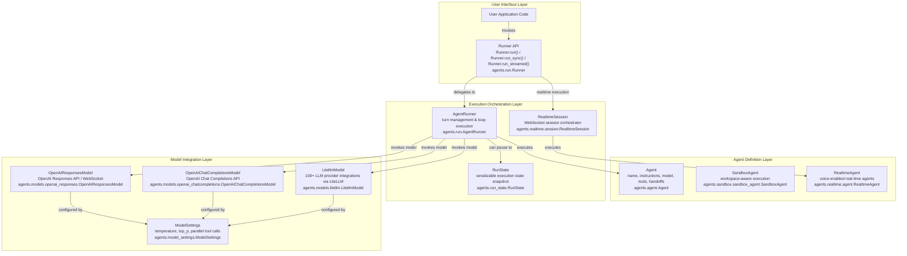

Sources: [README.md:10-21](), [docs/running_agents.md:3-8](), [docs/models/index.md:3-7]()

## Agent Execution Model

The execution flow is managed by the `AgentRunner` orchestrator class, which executes a turn-based loop combining input guardrails, model invocations, tool execution, and agent handoffs [docs/running_agents.md:24-43]().

### Turn Loop Execution and Code Entities

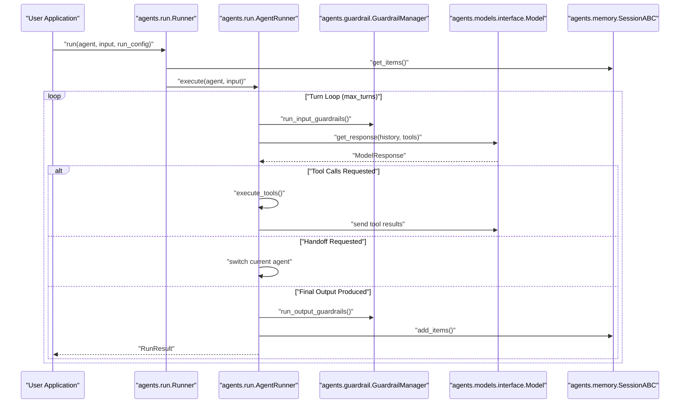

Sources: [docs/running_agents.md:24-43](), [docs/guardrails.md:32-38](), [docs/sessions/index.md:54-58]()

## Tool System Overview

The SDK provides a unified abstraction over five primary categories of tools [docs/tools.md:3-9]():
- **Function Tools**: Python functions wrapped via the `@function_tool` decorator with automated Pydantic schema inference [docs/tools.md:7]().
- **Hosted Tools**: OpenAI-managed capabilities such as `WebSearchTool`, `FileSearchTool`, `CodeInterpreterTool`, `ImageGenerationTool`, and `HostedMCPTool` [docs/tools.md:27-34]().
- **Local Runtime Tools**: Tools executing directly in the local environment (`ComputerTool`, `ShellTool`, `ApplyPatchTool`) [docs/tools.md:6]().
- **Model Context Protocol (MCP)**: Integration with local and remote MCP servers via `MCPServer` implementations [docs/mcp.md:10-25]().
- **Agents as Tools**: Exposing an agent as a callable tool via `Agent.as_tool()` [docs/tools.md:8]().

Sources: [docs/tools.md:3-9](), [docs/mcp.md:10-25]()

## Multi-Agent Coordination

Multi-agent workflows are supported through two core design patterns [docs/agents.md:16-19]():
1. **Handoffs**: Peer-to-peer conversation transfer using the `handoff()` function, where control switches entirely to the target agent [docs/handoffs.md:1]() (linked via `Agent.handoffs`).
2. **Manager Pattern**: Hierarchical delegation where a manager agent retains control by calling specialist sub-agents exposed as tools via `Agent.as_tool()` [docs/tools.md:8]().

Sources: [docs/tools.md:8](), [README.md:16]()

## Realtime and Voice Agents

For low-latency multimodal and voice experiences, the SDK provides `RealtimeAgent`, `RealtimeRunner`, and `RealtimeSession`, connecting over WebSockets to support incremental audio processing, tool execution, and interruption handling [docs/realtime/guide.md:9-18](). Additionally, `VoicePipeline` combines speech-to-text, an agent workflow, and text-to-speech [README.md:15]().

Sources: [README.md:14-15](), [docs/realtime/guide.md:9-18]()

## State and Persistence

State management is split across three layers:
- **In-Memory Run State**: Managed during active execution by `AgentRunner` [docs/running_agents.md:24-43]().
- **Serializable Snapshots**: `RunState` captures checkpoints for human-in-the-loop approvals and resume workflows [docs/running_agents.md:32-33]().
- **Persistent Sessions**: Conforming to the `SessionABC` protocol, implementations such as `SQLiteSession`, `RedisSession`, `SQLAlchemySession`, and `MongoDBSession` store conversation history across turns [docs/sessions/index.md:1-8](), [pyproject.toml:51-61]().

Sources: [docs/running_agents.md:32-33](), [docs/sessions/index.md:1-8](), [pyproject.toml:51-61]()

## Installation

Install the core SDK package via pip [README.md:27-35]():

```bash
pip install openai-agents
```

Optional dependency groups are available for specific backends and extensions (e.g., `voice`, `redis`, `sqlalchemy`, `mongodb`, `docker`, `realtime`, `viz`) [pyproject.toml:42-63]().

Sources: [README.md:27-35](), [pyproject.toml:42-63]()

---

# Page: Getting Started

# Getting Started

<details>
<summary>Relevant source files</summary>

The following files were used as context for generating this wiki page:

- [.release-please-manifest.json](.release-please-manifest.json)
- [.vscode/settings.json](.vscode/settings.json)
- [CHANGELOG.md](CHANGELOG.md)
- [README.md](README.md)
- [docs/config.md](docs/config.md)
- [docs/examples.md](docs/examples.md)
- [docs/guardrails.md](docs/guardrails.md)
- [docs/human_in_the_loop.md](docs/human_in_the_loop.md)
- [docs/index.md](docs/index.md)
- [docs/mcp.md](docs/mcp.md)
- [docs/models/index.md](docs/models/index.md)
- [docs/realtime/guide.md](docs/realtime/guide.md)
- [docs/realtime/quickstart.md](docs/realtime/quickstart.md)
- [docs/ref/sandbox/util/blocking_io.md](docs/ref/sandbox/util/blocking_io.md)
- [docs/release.md](docs/release.md)
- [docs/results.md](docs/results.md)
- [docs/running_agents.md](docs/running_agents.md)
- [docs/sessions/index.md](docs/sessions/index.md)
- [docs/streaming.md](docs/streaming.md)
- [docs/tools.md](docs/tools.md)
- [docs/tracing.md](docs/tracing.md)
- [mkdocs.yml](mkdocs.yml)
- [pyproject.toml](pyproject.toml)
- [src/agents/version.py](src/agents/version.py)
- [tests/fixtures/released_api_contract.json](tests/fixtures/released_api_contract.json)
- [uv.lock](uv.lock)

</details>


This guide provides step-by-step instructions for installing the OpenAI Agents SDK and running your first agent. It covers environment setup, basic agent creation, function tools, and initial configuration. For detailed information about agent configuration and behavior, see [Agent Architecture](#3.1). For comprehensive execution options and configuration, see [Runner and Execution Flow](#3.2).

Sources: `pyproject.toml:1-100](), `README.md:25-50]()

## Installation

The SDK requires Python 3.10 or newer [pyproject.toml:6-6](). It depends on core runtime libraries including `openai`, `pydantic`, `griffelib`, `websockets`, and `mcp` [pyproject.toml:9-16]().

### Installing with venv

```bash
python -m venv .venv
source .venv/bin/activate  # On Windows: .venv\Scripts\activate
pip install openai-agents
```

For optional features, install the appropriate feature groups [pyproject.toml:42-92]():

| Feature Group | Dependencies | Use Case |
| :--- | :--- | :--- |
| `voice` | `numpy`, `websockets` | Audio processing and Realtime voice [pyproject.toml:44-44]() |
| `litellm` | `litellm`, `aiohttp`, `filelock` | Support for 100+ non-OpenAI LLM providers [pyproject.toml:46-46]() |
| `any-llm` | `any-llm-sdk`, `pygments` | Multi-provider support via AnyLLM [pyproject.toml:47-50]() |
| `realtime` | `websockets` | Low-latency WebSocket-based agents [pyproject.toml:51-51]() |
| `sqlalchemy`| `SQLAlchemy[asyncio]`, `asyncpg`| Persistent session storage in SQL databases [pyproject.toml:52-52]() |
| `redis` | `redis` | Persistent session storage in Redis [pyproject.toml:54-54]() |
| `docker` | `docker` | Local containerized sandbox execution [pyproject.toml:62-62]() |
| `temporal` | `temporalio`, `textual` | Durable execution for long-running workflows [pyproject.toml:87-92]() |

### Installing with uv

[uv](https://docs.astral.sh/uv/) is the recommended package manager for this workspace [pyproject.toml:133-138]().

```bash
uv init
uv add openai-agents
uv add 'openai-agents[voice,redis]' # Example with extras
```

Sources: `pyproject.toml:1-92](), `README.md:29-49]()

## Environment Configuration

### API Key Setup

The SDK looks for the `OPENAI_API_KEY` environment variable by default. Alternatively, configure the API key or a custom client programmatically:

```python
from agents import set_default_openai_key, set_default_openai_client
from openai import AsyncOpenAI

# Set key globally
set_default_openai_key("sk-...") 

# Or set a custom client with specific base URL
custom_client = AsyncOpenAI(base_url="...", api_key="...")
set_default_openai_client(custom_client)
```

### Global API Choice
By default, the SDK uses the OpenAI Responses API. You can switch to Chat Completions globally using `set_default_openai_api("chat_completions")` [docs/models/index.md:3-6]().

Sources: `docs/models/index.md:3-12](), `README.md:52-52]()

## Core SDK Components

The following diagram bridges natural language configuration to the corresponding Python code entities in the SDK architecture.

**Diagram: Core SDK Architecture and Code Entity Mapping**

```mermaid
graph TB
    subgraph "Natural_Language_Space"
        UserApp[""User Application""]
        Instructions[""System Instructions & Prompts""]
    end
    
    subgraph "Code_Entity_Space_Orchestration"
        Agent[""src/agents/agent.py:Agent(name, instructions, tools, handoffs)""]
        Runner[""src/agents/run.py:Runner.run() / Runner.run_sync()""]
        RunResult[""src/agents/result.py:RunResult(final_output, new_items)""]
        RunConfig[""src/agents/run.py:RunConfig(model, model_settings, tracing)""]
    end
    
    subgraph "Code_Entity_Space_Model_Providers"
        Model[""src/agents/models/interface.py:Model""]
        OpenAIResponsesModel[""src/agents/models/openai_responses.py:OpenAIResponsesModel""]
        OpenAIChatCompletionsModel[""src/agents/models/openai_chatcompletions.py:OpenAIChatCompletionsModel""]
        MultiProvider[""src/agents/models/multi_provider.py:MultiProvider""]
    end
    
    subgraph "Code_Entity_Space_Capabilities"
        FunctionTool[""src/agents/tool.py:FunctionTool(@function_tool)""]
        ToolContext[""src/agents/tool_context.py:ToolContext""]
    end
    
    UserApp -->|"defines"| Agent
    UserApp -->|"configures"| RunConfig
    Instructions -.->|"becomes"| Agent
    UserApp -->|"calls"| Runner
    Runner -->|"resolves via"| MultiProvider
    MultiProvider -->|"returns"| Model
    Model <|-- OpenAIResponsesModel
    Model <|-- OpenAIChatCompletionsModel
    Runner -->|"executes"| FunctionTool
    FunctionTool -->|"injects"| ToolContext
    Runner -->|"returns"| RunResult
```

Sources: `src/agents/agent.py:1-25](), `src/agents/run.py:1-35](), `src/agents/models/interface.py:1-30](), `src/agents/tool_context.py:1-40]()

## Hello World Example

The simplest agent executes a single instruction and returns a text response [README.md:54-69]().

### Async Execution (Recommended)

The SDK is built on `asyncio`. Use `Runner.run()` to execute an agent asynchronously [docs/running_agents.md:3-6]().

```python
import asyncio
from agents import Agent, Runner

async def main():
    agent = Agent(
        name="History Tutor",
        instructions="You answer history questions clearly and concisely."
    )

    result = await Runner.run(agent, "When did the Roman Empire fall?")
    print(result.final_output)

if __name__ == "__main__":
    asyncio.run(main())
```

### Function Tools

Tools are defined using the `@function_tool` decorator. The SDK automatically generates JSON schemas from docstrings and type hints [docs/tools.md:7-22]().

```python
from agents import Agent, Runner, function_tool

@function_tool
def get_weather(location: str):
    """
    Get the current weather in a given location.
    
    Args:
        location: The city and state, e.g. San Francisco, CA
    """
    return f"The weather in {location} is sunny."

async def main():
    agent = Agent(
        name="Weather Agent",
        tools=[get_weather]
    )
    result = await Runner.run(agent, "What is the weather in NYC?")
    print(result.final_output)
```

Sources: `README.md:54-70](), `docs/tools.md:15-25](), `docs/running_agents.md:1-20]()

## Initial Configuration

### Model Settings
Settings like `temperature`, `top_p`, and `parallel_tool_calls` are configured via [`ModelSettings`](docs/models/index.md#model-settings-and-configuration) [docs/release.md:50-57]().

### Run Configuration
The [`RunConfig`](docs/running_agents.md#run-config) class governs execution behavior, including global model overrides, `max_turns`, `session_settings`, and tool execution limits [docs/running_agents.md:127-140]().

**Diagram: Tool Execution Context Flow and Natural-to-Code Bridge**

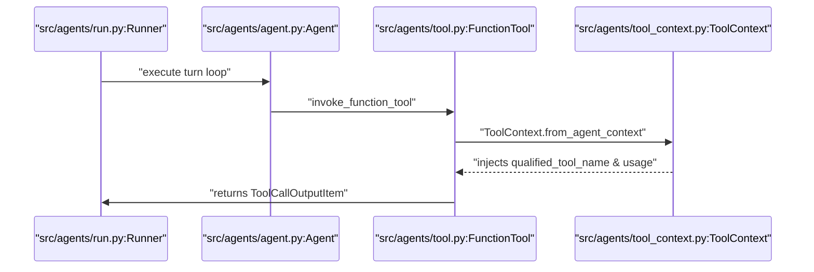

Sources: `docs/running_agents.md:127-140](), `docs/tools.md:70-90]()

### Tracing and Logging
Tracing is enabled by default [docs/tracing.md:5-13](). It can be disabled globally via `set_tracing_disabled(True)` or through environment variables (`OPENAI_AGENTS_DISABLE_TRACING=1`) [docs/tracing.md:5-13]().

```python
from agents import set_tracing_export_api_key, set_tracing_disabled

# Configure tracing API key separately if needed
set_tracing_export_api_key("sk-...") 

# Or disable entirely
set_tracing_disabled(True)
```

Sources: `docs/tracing.md:1-25](), `README.md:10-22]()

---

# Page: Core Concepts

# Core Concepts

<details>
<summary>Relevant source files</summary>

The following files were used as context for generating this wiki page:

- [src/agents/agent.py](src/agents/agent.py)
- [src/agents/exceptions.py](src/agents/exceptions.py)
- [src/agents/result.py](src/agents/result.py)
- [src/agents/run.py](src/agents/run.py)
- [src/agents/run_config.py](src/agents/run_config.py)
- [src/agents/run_internal/agent_runner_helpers.py](src/agents/run_internal/agent_runner_helpers.py)
- [src/agents/run_internal/run_loop.py](src/agents/run_internal/run_loop.py)
- [src/agents/run_internal/run_steps.py](src/agents/run_internal/run_steps.py)
- [src/agents/run_internal/session_persistence.py](src/agents/run_internal/session_persistence.py)
- [src/agents/run_internal/turn_resolution.py](src/agents/run_internal/turn_resolution.py)
- [src/agents/run_state.py](src/agents/run_state.py)
- [src/agents/tool_context.py](src/agents/tool_context.py)
- [tests/test_agent_as_tool.py](tests/test_agent_as_tool.py)
- [tests/test_agent_runner.py](tests/test_agent_runner.py)
- [tests/test_agent_runner_streamed.py](tests/test_agent_runner_streamed.py)
- [tests/test_error_logging_redaction.py](tests/test_error_logging_redaction.py)
- [tests/test_example_workflows.py](tests/test_example_workflows.py)
- [tests/test_run_config.py](tests/test_run_config.py)
- [tests/test_run_impl_resume_paths.py](tests/test_run_impl_resume_paths.py)
- [tests/test_run_state.py](tests/test_run_state.py)
- [tests/test_source_compat_constructors.py](tests/test_source_compat_constructors.py)
- [tests/test_tool_context.py](tests/test_tool_context.py)

</details>


This document establishes the foundational abstractions that underpin the OpenAI Agents SDK: agents, execution mechanisms, result and output handling, serializable state, dependency injection contexts, and global run configurations. 

As a PARENT page, this section provides a high-level overview of these core concepts and links to detailed child pages for deep technical dives.

For detailed information, see:
- [Agent Architecture](#3.1)
- [Runner and Execution Flow](#3.2)
- [RunResult and Output Management](#3.3)
- [RunState and Resumption](#3.4)
- [Context and Dependency Injection](#3.5)
- [Run Configuration](#3.6)

## Core Abstractions Overview

The SDK architecture centers on typed objects that manage instructions, execution state, tool dispatch, and runtime boundaries.

Title: Core Concept Relationships
```mermaid
graph TB
    subgraph "User Application Space"
        ["ApplicationCode"]
        ["CustomContextObject"]
    end
    
    subgraph "Code Entity Space: Core Orchestration"
        ["Runner"]
        ["Agent"]
        ["RunResult"]
        ["RunState"]
    end
    
    subgraph "Code Entity Space: Context & Injection"
        ["RunContextWrapper"]
        ["ToolContext"]
    end
    
    ["ApplicationCode"] -->|"configures"| ["Agent"]
    ["ApplicationCode"] -->|"invokes"| ["Runner"]
    ["Runner"] -->|"executes"| ["Agent"]
    ["Runner"] -->|"wraps context in"| ["RunContextWrapper"]
    ["Runner"] -->|"returns"| ["RunResult"]
    ["RunResult"] -->|"snapshots into"| ["RunState"]
    ["RunState"] -->|"resumes via"| ["Runner"]
    ["RunContextWrapper"] -->|"specialized as"| ["ToolContext"]
    ["ToolContext"] -->|"injected into"| ["FunctionTool"]
```
Sources: [src/agents/run.py:213-227](), [src/agents/agent.py:183-187](), [src/agents/result.py:107-120](), [src/agents/run_state.py:94-98](), [src/agents/tool_context.py:36-40]()

---

## Agent Architecture

The `Agent` class defines an LLM-powered assistant with specific behavioral properties, system prompts, available tools, handoff targets, guardrails, and structured output formatting [src/agents/agent.py:183-261](). Agents serve as the atomic unit of reasoning and delegation within a multi-agent topology.

For full details on configuration parameters, hook integrations, and agent lifecycles, see [Agent Architecture](#3.1).

Sources: [src/agents/agent.py:183-318]()

---

## Runner and Execution Flow

The `Runner` class orchestrates the execution lifecycle via methods such as `Runner.run()`, `run_sync()`, and `Runner.run_streamed()` [src/agents/run.py:213-271](). It drives the internal turn loop, manages `max_turns`, evaluates guardrails, and coordinates model calls and tool executions [src/agents/run.py:39-39](), [src/agents/run_internal/run_loop.py:104-104]().

Title: Natural Language to Code Flow
```mermaid
sequenceDiagram
    participant User as "Application Code"
    participant Runner as "Runner"
    participant Loop as "run_loop.py"
    participant Agent as "Agent"
    participant Model as "Model Interface"
    
    User->>Runner: "Runner.run(agent, input)"
    Runner->>Loop: "run_single_turn()"
    Loop->>Agent: "get_all_tools(context)"
    Loop->>Model: "get_response(input, tools)"
    Model-->>Loop: "ModelResponse"
    Loop->>Loop: "process_model_response()"
    Note over Loop: "Execute tools / handoffs / guardrails"
    Loop-->>Runner: "SingleStepResult"
    Runner-->>User: "RunResult"
```
Sources: [src/agents/run.py:214-227](), [src/agents/run_internal/run_loop.py:104-104](), [src/agents/run_internal/turn_resolution.py:198-199]()

For complete details on turn loops and streaming mechanics, see [Runner and Execution Flow](#3.2).

Sources: [src/agents/run.py:213-271](), [src/agents/run_internal/run_loop.py:104-104]()

---

## RunResult and Output Management

`RunResult` and `RunResultStreaming` encapsulate the terminal outputs, generated items, raw model responses, and usage metrics of an agent run [src/agents/result.py:107-167](), [src/agents/result.py:441-454](). They provide helper methods like `to_input_list()` and `to_state()` for continuation workflows.

For detailed documentation on output attributes, streaming events, and item conversions, see [RunResult and Output Management](#3.3).

Sources: [src/agents/result.py:107-167](), [src/agents/result.py:441-454]()

---

## RunState and Resumption

`RunState` provides a serializable snapshot of execution state [src/agents/run_state.py:94-98](). It enables Human-in-the-Loop (HITL) workflows by allowing runs to pause at approval gates, serialize state to JSON, persist across storage layers, and resume cleanly via `approve()` or `reject()` logic [src/agents/run_state.py:330-366]().

For deep dives into serialization schemas, pause/resume workflows, and persistence backends, see [RunState and Resumption](#3.4).

Sources: [src/agents/run_state.py:94-1033]()

---

## Context and Dependency Injection

`RunContextWrapper` and `ToolContext` manage state propagation and dependency injection across agent turns and tool calls [src/agents/run_context.py:50-54](), [src/agents/tool_context.py:36-50](). They provide runtime access to user-defined context objects, usage tracking, and tool execution metadata.

For details on context propagation and dependency injection patterns, see [Context and Dependency Injection](#3.5).

Sources: [src/agents/run_context.py:50-134](), [src/agents/tool_context.py:36-171]()

---

## Run Configuration

The `RunConfig` class specifies global execution overrides, model settings, tracing options, error handlers, and tool execution parameters [src/agents/run_config.py:330-410](). It configures guardrail behaviors and input filters applied across all turns in a run.

For full configuration options, see [Run Configuration](#3.6).

Sources: [src/agents/run_config.py:329-410]()

---

## Data Structures and Conversation Items

The SDK uses strongly-typed conversation items inheriting from `RunItem` to track session history and model exchanges [src/agents/items.py:26]().

| Item Type | Description | Code Entity |
|-----------|-------------|-------------|
| **Message** | Assistant message from the LLM | `MessageOutputItem` [src/agents/__init__.py:63]() |
| **Tool Call** | LLM request to execute a tool | `ToolCallItem` [src/agents/__init__.py:68]() |
| **Tool Output** | Result of a tool execution | `ToolCallOutputItem` [src/agents/__init__.py:69]() |
| **Handoff** | LLM request to switch active agents | `HandoffCallItem` [src/agents/__init__.py:57]() |
| **Reasoning** | Internal model reasoning steps | `ReasoningItem` [src/agents/__init__.py:65]() |

Sources: [src/agents/items.py:26-110](), [src/agents/__init__.py:55-73]()

---

# Page: Agent Architecture

# Agent Architecture

<details>
<summary>Relevant source files</summary>

The following files were used as context for generating this wiki page:

- [src/agents/agent.py](src/agents/agent.py)
- [src/agents/agent_output.py](src/agents/agent_output.py)
- [src/agents/run_config.py](src/agents/run_config.py)
- [src/agents/tool_context.py](src/agents/tool_context.py)
- [src/agents/util/_json.py](src/agents/util/_json.py)
- [tests/test_agent_as_tool.py](tests/test_agent_as_tool.py)
- [tests/test_agent_config.py](tests/test_agent_config.py)
- [tests/test_example_workflows.py](tests/test_example_workflows.py)
- [tests/test_output_tool.py](tests/test_output_tool.py)
- [tests/test_run_config.py](tests/test_run_config.py)
- [tests/test_source_compat_constructors.py](tests/test_source_compat_constructors.py)
- [tests/test_tool_context.py](tests/test_tool_context.py)
- [tests/utils/test_json.py](tests/utils/test_json.py)

</details>


This page details the structure and configuration of the `Agent` class (`src/agents/agent.py`), which serves as the primary building block for creating AI-powered workflows. An agent is a large language model (LLM) configured with instructions, tools, guardrails, handoffs, and other behavioral settings.

For information about executing agents, see [Runner and Execution Flow](3.2). For details on agent outputs, see [RunResult and Output Management](3.3). For multi-agent patterns, see [Multi-Agent Coordination](5).

---

## Agent Class Hierarchy

The SDK provides two agent classes that share a common base (`src/agents/agent.py`):

Title: Agent Class Hierarchy
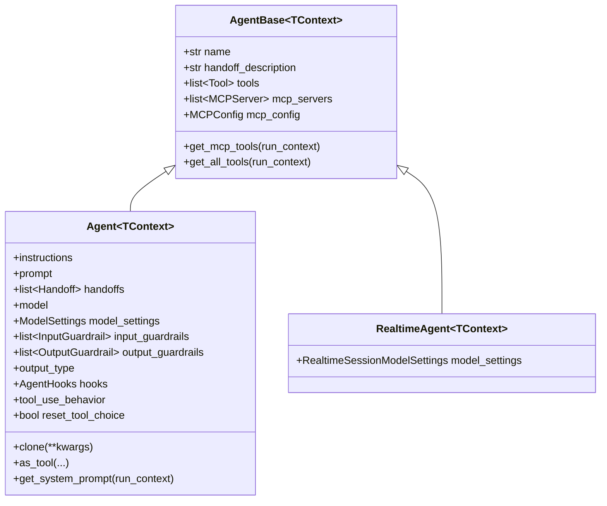

- **`AgentBase[TContext]`** provides shared properties for both standard and realtime agents, including core identity (`name`, `handoff_description`), tool configurations (`tools`, `mcp_servers`, `mcp_config`), and tool resolution helpers [src/agents/agent.py:186-200]().
- **`Agent[TContext]`** extends `AgentBase` with text instructions/prompts, models, output schemas, guardrails, hooks, and multi-agent handoffs [src/agents/agent.py:247-333]().
- **`RealtimeAgent[TContext]`** is specialized for low-latency audio/voice interactions [src/agents/agent.py:186-188]().

Sources: `[src/agents/agent.py:174-333]()`

---

## Core Configuration Parameters

### Name and Identity

Title: Agent Identity Mapping
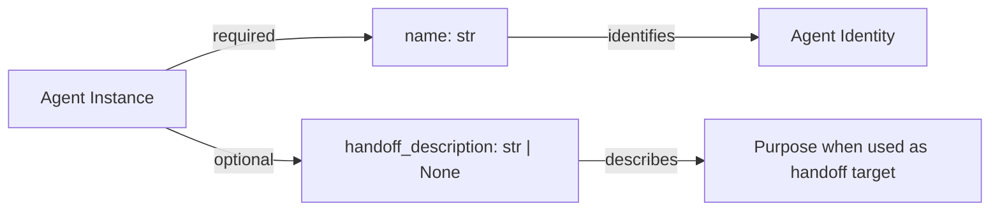

The `name` parameter is required and uniquely identifies the agent [src/agents/agent.py:186](). The `handoff_description` is optional and helps orchestrators or peer LLMs understand when to invoke a handoff [src/agents/agent.py:189-192]().

Sources: `[src/agents/agent.py:186-192]()`

### Instructions and Prompts

Instructions define the agent's system prompt behavior and can be supplied as static strings, sync callables, or async callables:

Title: Instruction and Prompt Resolution
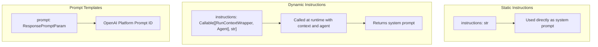

Dynamic instructions receive `RunContextWrapper[TContext]` and `Agent[TContext]` as parameters to build context-aware instructions `[src/agents/agent.py:247-261]()`. The `prompt` parameter permits referencing platform-managed prompt templates via the Responses API `[src/agents/agent.py:263-267]()`.

Sources: `[src/agents/agent.py:247-267]()`

### Model and Model Settings

Title: Model Settings Configuration
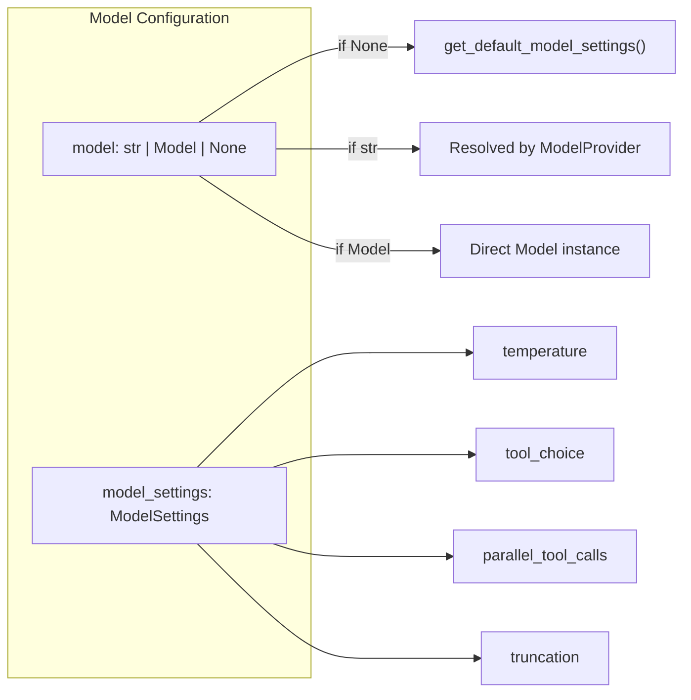

The `model` parameter accepts string model identifiers or custom `Model` instances `[src/agents/agent.py:275-278]()`. The `model_settings` parameter configures generation attributes like `temperature`, `parallel_tool_calls`, and token `truncation` `[src/agents/agent.py:280-284]()`.

Sources: `[src/agents/agent.py:275-284]()`, `[src/agents/model_settings.py:1-40]()`

### Output Type

The `output_type` parameter dictates how final results are parsed and validated:

Title: Output Type Hierarchy
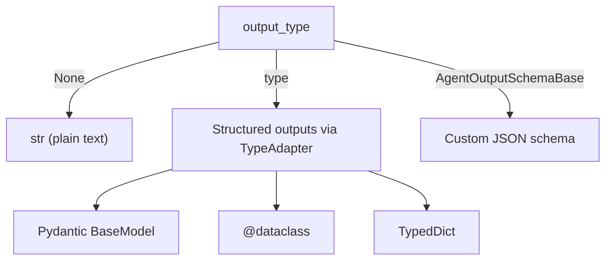

When an `output_type` is provided, the SDK wraps it in an `AgentOutputSchema` (`src/agents/agent_output.py`), leveraging OpenAI structured outputs to guarantee schema compliance `[src/agents/agent_output.py:60-120]()`.

Sources: `[src/agents/agent.py:296-303]`, `[src/agents/agent_output.py:60-170]()`

### Tools, MCP Servers, and Tool Use Behavior

- **`tools`**: A list of `Tool` objects (function tools, hosted tools, or agent tools) available to the agent `[src/agents/agent.py:194-198]()`.
- **`mcp_servers` & `mcp_config`**: Integrates Model Context Protocol servers and configures strict schema conversion and error translation `[src/agents/agent.py:197-200, 152-170]()`.
- **`tool_use_behavior`**: Controls loop behavior after tool invocation (e.g., `"run_llm_again"`, `"stop_on_first_tool"`, or `StopAtTools`) `[src/agents/agent.py:309-333]()`.

Sources: `[src/agents/agent.py:152-200, 309-333]()`

---

## Key Agent Methods

### `clone(**kwargs)`
Produces a shallow copy of the agent instance with overridden fields using `dataclasses.replace` `[tests/test_agent_config.py:148-164]()`.

### `as_tool(...)`
Wraps the agent as a `FunctionTool`, enabling multi-agent hierarchy patterns where a manager agent delegates work to specialized sub-agents `[tests/test_agent_as_tool.py:64-104]()`.

### `get_system_prompt(run_context)`
Resolves the system prompt asynchronously, executing instructions whether they are static strings or callables `[tests/test_agent_config.py:15-42]()`.

Sources: `[tests/test_agent_config.py:15-164]`, `[tests/test_agent_as_tool.py:64-123]()`

---

## Agent Lifecycle and Turn Resolution

Execution of an `Agent` follows a structured event and turn loop orchestrated by `Runner` and internal run modules.

Title: Natural Language to Code Entity Mapping
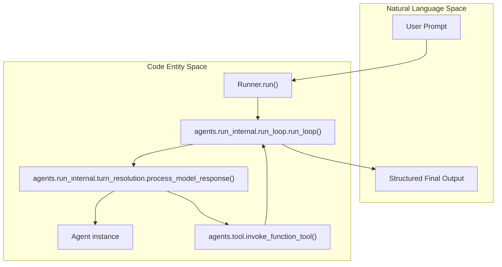

Sources: `[src/agents/agent.py:1-1171]`, `[src/agents/run_config.py:1-185]()`

---

# Page: Runner and Execution Flow

# Runner and Execution Flow

<details>
<summary>Relevant source files</summary>

The following files were used as context for generating this wiki page:

- [.github/scripts/check_optional_truthiness.py](.github/scripts/check_optional_truthiness.py)
- [examples/agent_patterns/agents_as_tools_structured.py](examples/agent_patterns/agents_as_tools_structured.py)
- [src/agents/agent_tool_input.py](src/agents/agent_tool_input.py)
- [src/agents/exceptions.py](src/agents/exceptions.py)
- [src/agents/result.py](src/agents/result.py)
- [src/agents/run.py](src/agents/run.py)
- [src/agents/run_error_handlers.py](src/agents/run_error_handlers.py)
- [src/agents/run_internal/agent_runner_helpers.py](src/agents/run_internal/agent_runner_helpers.py)
- [src/agents/run_internal/error_handlers.py](src/agents/run_internal/error_handlers.py)
- [src/agents/run_internal/run_loop.py](src/agents/run_internal/run_loop.py)
- [src/agents/run_internal/run_steps.py](src/agents/run_internal/run_steps.py)
- [src/agents/run_internal/session_persistence.py](src/agents/run_internal/session_persistence.py)
- [src/agents/run_internal/turn_resolution.py](src/agents/run_internal/turn_resolution.py)
- [src/agents/run_state.py](src/agents/run_state.py)
- [tests/test_agent_runner.py](tests/test_agent_runner.py)
- [tests/test_agent_runner_streamed.py](tests/test_agent_runner_streamed.py)
- [tests/test_agent_tool_input.py](tests/test_agent_tool_input.py)
- [tests/test_error_logging_redaction.py](tests/test_error_logging_redaction.py)
- [tests/test_invalid_final_output_handler.py](tests/test_invalid_final_output_handler.py)
- [tests/test_max_turns.py](tests/test_max_turns.py)
- [tests/test_run_impl_resume_paths.py](tests/test_run_impl_resume_paths.py)
- [tests/test_run_internal_error_handlers.py](tests/test_run_internal_error_handlers.py)
- [tests/test_run_state.py](tests/test_run_state.py)
- [tests/test_tool_use_tracker.py](tests/test_tool_use_tracker.py)

</details>


This page explains the `Runner` and `AgentRunner` classes, which orchestrate agent execution. It covers the three execution modes (async, sync, streamed), the agent loop lifecycle, turn management, and how the runner integrates with sessions and conversation tracking.

---

## Runner Class Overview

The `Runner` class provides three static methods that serve as the primary entry points for executing agents. These methods are high-level wrappers that delegate to an internal `AgentRunner` instance.

| Method | Execution Mode | Returns | Use Case |
|--------|---------------|---------|----------|
| `run()` | Async | `RunResult` | Standard async execution with full result. |
| `run_sync()` | Synchronous | `RunResult` | Blocking execution for non-async code. |
| `run_streamed()` | Async with streaming | `RunResultStreaming` | Real-time event streaming during execution. |

All three methods eventually call the `AgentRunner` logic to manage the conversation state and model interaction.

**Sources:** [src/agents/run.py:214-235](), [src/agents/run.py:387-401](), [src/agents/run.py:461-475]()

---

## Execution Modes

### Async Execution
`Runner.run()` is the primary entry point for asynchronous workflows. It manages the full lifecycle of a run, including session preparation, trace creation, and the turn-based loop. It accepts a starting agent and input (string, list of items, or `RunState`).

**Sources:** [src/agents/run.py:214-250](), [src/agents/run.py:270-300]()

### Synchronous Execution
`Runner.run_sync()` provides a synchronous interface. It uses `asyncio.run` (or a re-used loop) to execute the underlying async logic. It is designed to handle cases where an event loop might already be running in the background while maintaining thread-safety for session locks.

**Sources:** [src/agents/run.py:387-459]()

### Streamed Execution
`Runner.run_streamed()` returns a `RunResultStreaming` object immediately. This object allows the caller to iterate over `StreamEvent` items (such as `RunItemStreamEvent` or `RawResponsesStreamEvent`) as the model generates output. It supports real-time feedback for UI applications.

**Sources:** [src/agents/run.py:461-531](), [src/agents/result.py:321-325]()

---

## AgentRunner Internals

The `AgentRunner` class (internal) manages the state of the execution. It handles the transition between agents (handoffs), tool execution, and guardrail enforcement.

### Implementation Logic and Data Flow

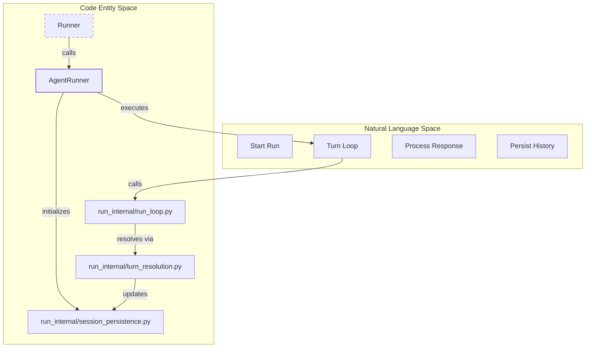

**Sources:** [src/agents/run.py:533-535](), [src/agents/run_internal/run_loop.py:1-4](), [src/agents/run_internal/turn_resolution.py:1-10]()

---

## The Turn Loop

The execution follows a "Turn Loop" architecture. A turn is defined as a single interaction with the LLM, including any subsequent tool executions or handoffs resulting from that interaction.

### Execution Lifecycle

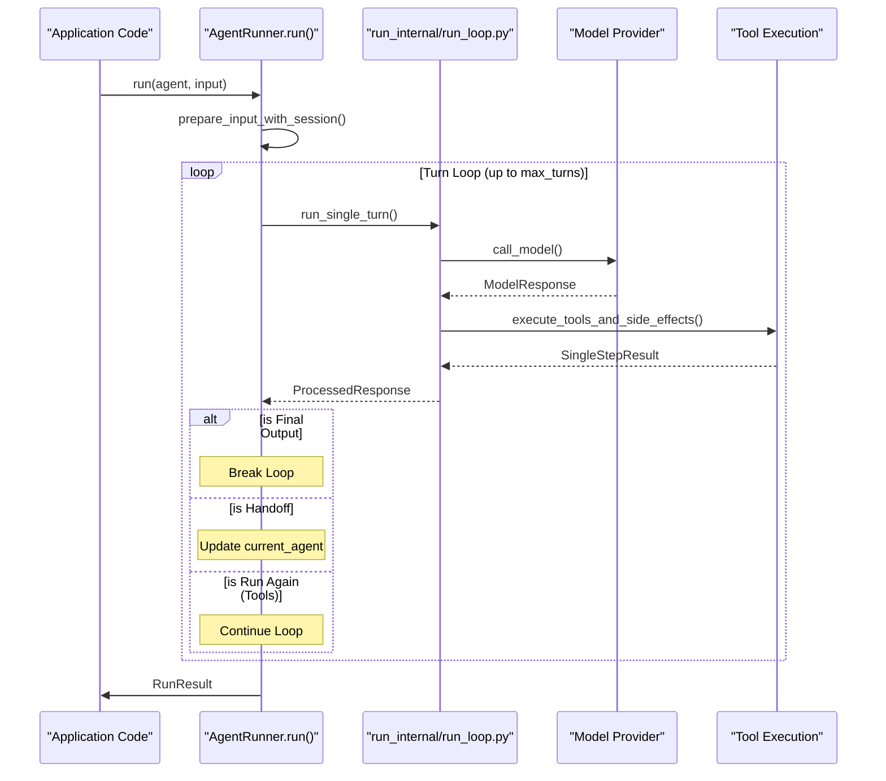

**Sources:** [src/agents/run.py:214-235](), [src/agents/run_internal/run_loop.py:104-104](), [src/agents/run_internal/turn_resolution.py:192-201]()

### Key Parameters
- **`max_turns`**: Defaults to `DEFAULT_MAX_TURNS` (30). If the loop exceeds this count without reaching a terminal state, a `MaxTurnsExceeded` exception is raised. [src/agents/run_config.py:39](), [src/agents/run.py:767-769]()
- **`input`**: Can be a string, a list of `TResponseInputItem` objects, or a `RunState` for resumption. [src/agents/run.py:217](), [src/agents/run_internal/items.py:121-126]()

---

## Execution Lifecycle and State Management

The runner manages state through the `RunState` object and session persistence helpers.

### Resumption and Responding
If a run is interrupted (e.g., for human-in-the-loop tool approval), the `RunResult` contains a `to_state()` method. This serializes the current execution context into a `RunState` object, allowing the runner to resume exactly where it left off when the state is passed back into `Runner.run()`.

**Sources:** [src/agents/result.py:221-255](), [src/agents/run_internal/session_persistence.py:123-124](), [src/agents/run_state.py:236-248]()

### Session Integration
When a `Session` is provided, the runner performs the following:
1. **Preparation**: Fetches history from the session and merges it with new input using `prepare_input_with_session`. [src/agents/run_internal/session_persistence.py:117-117]()
2. **Persistence**: Saves new items (messages, tool calls, results) back to the session after each turn using `save_result_to_session`. [src/agents/run_internal/session_persistence.py:120-120]()

### Server-Managed Conversations
The runner supports OpenAI-managed conversation tracking via `conversation_id` and `previous_response_id`. The `OpenAIServerConversationTracker` ensures that the SDK does not re-send items the server already possesses, optimizing context window usage.

**Sources:** [src/agents/run_internal/oai_conversation.py:1-10](), [src/agents/run.py:91-91]()

---

## Guardrail Execution Flow

Guardrails are injected into the execution flow at specific lifecycle points:
1. **Input Guardrails**: Executed via `run_input_guardrails` before the model is called. Can be sequential or parallel. [src/agents/run_internal/run_loop.py:111-112]()
2. **Output Guardrails**: Executed via `run_output_guardrails` after the model provides a response but before the result is finalized. [src/agents/run_internal/run_loop.py:113-113]()

If a "tripwire" guardrail triggers, the runner immediately halts execution and raises an `InputGuardrailTripwireTriggered` or `OutputGuardrailTripwireTriggered` exception.

**Sources:** [src/agents/exceptions.py:15-18](), [src/agents/run_internal/run_loop.py:32-35](), [src/agents/run_internal/run_loop.py:110-110]()

---

## Code Mapping: Natural Language to Code Entities

The following diagram maps high-level execution concepts to the specific classes and functions in the codebase.

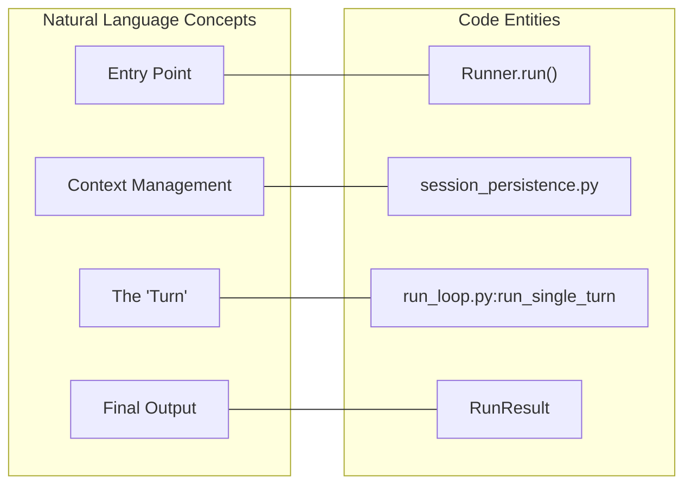

**Sources:** [src/agents/run.py:214-235](), [src/agents/run_internal/session_persistence.py:114-124](), [src/agents/run_internal/run_loop.py:104-104](), [src/agents/result.py:196-210]()

---

# Page: RunResult and Output Management

# RunResult and Output Management

<details>
<summary>Relevant source files</summary>

The following files were used as context for generating this wiki page:

- [docs/ko/results.md](docs/ko/results.md)
- [docs/ko/streaming.md](docs/ko/streaming.md)
- [docs/zh/results.md](docs/zh/results.md)
- [docs/zh/streaming.md](docs/zh/streaming.md)
- [src/agents/exceptions.py](src/agents/exceptions.py)
- [src/agents/result.py](src/agents/result.py)
- [src/agents/run.py](src/agents/run.py)
- [src/agents/run_internal/agent_runner_helpers.py](src/agents/run_internal/agent_runner_helpers.py)
- [src/agents/run_internal/run_loop.py](src/agents/run_internal/run_loop.py)
- [src/agents/run_internal/run_steps.py](src/agents/run_internal/run_steps.py)
- [src/agents/run_internal/session_persistence.py](src/agents/run_internal/session_persistence.py)
- [src/agents/run_internal/turn_resolution.py](src/agents/run_internal/turn_resolution.py)
- [src/agents/run_state.py](src/agents/run_state.py)
- [tests/test_agent_runner.py](tests/test_agent_runner.py)
- [tests/test_agent_runner_streamed.py](tests/test_agent_runner_streamed.py)
- [tests/test_error_logging_redaction.py](tests/test_error_logging_redaction.py)
- [tests/test_run_impl_resume_paths.py](tests/test_run_impl_resume_paths.py)
- [tests/test_run_state.py](tests/test_run_state.py)

</details>


This page details the implementation, architecture, and usage of `RunResult` and `RunResultStreaming` classes within the OpenAI Agents SDK [src/agents/result.py:1-700](). It covers result properties (`final_output`, `new_items`, `interruptions`), item conversion routines via `to_input_list()`, and state serialization through `to_state()`.

---

## Overview

Agent execution returns one of two concrete result types depending on whether the invocation is synchronous or asynchronous/streaming:

- **`RunResult`** - Returned by `Runner.run()` and `Runner.run_sync()`, containing complete execution artifacts and metadata after all execution turns terminate. [src/agents/result.py:212-317]()
- **`RunResultStreaming`** - Returned by `Runner.run_streamed()`, providing asynchronous stream event iteration and support for cancellation controls. [src/agents/result.py:319-700]()

Both types extend `RunResultBase`, providing a unified interface for inputs, generated items, raw model responses, guardrail results, and token usage statistics [src/agents/result.py:175-210]().

Sources: [src/agents/result.py:175-700]()

---

## Result Type Hierarchy

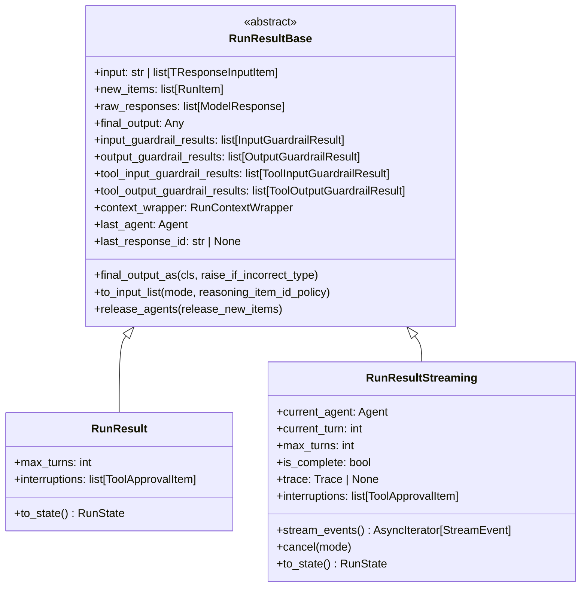

**Diagram: Result Type Hierarchy and Key Properties**

The abstract base class `RunResultBase` defines shared evaluation metrics and conversion facilities, while concrete execution result classes manage lifecycle states like interruptions and active execution handles [src/agents/result.py:175-700]().

Sources: [src/agents/result.py:175-700]()

---

## Core Properties and Output Management

### Properties Reference

| Property | Type | Description |
|----------|------|-------------|
| `input` | `str \| list[TResponseInputItem]` | Original input provided to the runner, subject to any pre-run filtering [src/agents/result.py:177-180](). |
| `new_items` | `list[RunItem]` | All items generated during execution, including messages, tool calls, tool outputs, and handoffs [src/agents/result.py:182-185](). |
| `raw_responses` | `list[ModelResponse]` | Raw model response objects received from each underlying LLM turn [src/agents/result.py:187-188](). |
| `final_output` | `Any` | Processed output from the final agent turn, conforming to `agent.output_type` [src/agents/result.py:190-191](). |
| `last_agent` | `Agent[Any]` | The terminal agent instance active at the conclusion of the run [src/agents/result.py:252-258](). |
| `interruptions` | `list[ToolApprovalItem]` | Pending tool approval requests requiring human intervention [src/agents/result.py:228-229](). |

### Input List Transformation (`to_input_list()`)

The `to_input_list()` method converts accumulated execution items back into list structures suitable for subsequent runs or manual session management [src/agents/result.py:193-202](). It accepts a `mode` parameter:
- **`mode="preserve_all"`**: Retains the full conversion history from `new_items` [src/agents/result.py:170-173]().
- **`mode="normalized"`**: Prefers canonical continuation input when intermediate handoff filtering or history nesting rewrote conversation items [src/agents/result.py:195-202]().

Under the hood, conversion leverages `run_items_to_input_items` to translate internal `RunItem` wrappers into provider-ready `TResponseInputItem` structures while stripping transient approval markers [src/agents/run_internal/items.py:85-95]().

Sources: [src/agents/result.py:175-202](), [src/agents/run_internal/items.py:85-95]()

---

## RunState and Resumption (`to_state()`)

Both `RunResult` and `RunResultStreaming` implement `to_state()`, returning a serializable `RunState` instance [src/agents/result.py:301-317](), [src/agents/result.py:682-700](). 

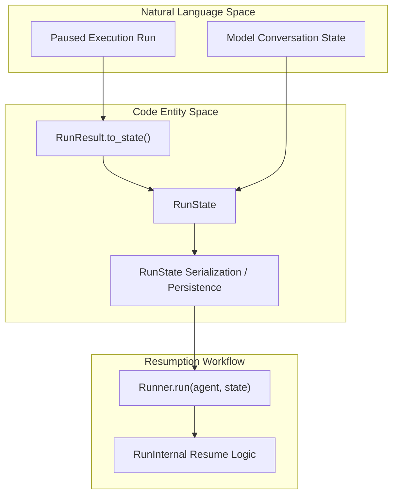

**Diagram: Mapping Execution State to Resumable Code Entities**

The resulting `RunState` bundles execution metadata, tool usage tracking snapshots (`tool_use_tracker_snapshot`), and the last processed response to allow checkpointing and human-in-the-loop approval workflows [src/agents/result.py:107-167]().

Sources: [src/agents/result.py:107-167](), [src/agents/result.py:301-317](), [src/agents/result.py:682-700]()

---

## RunResultStreaming and Event Management

`RunResultStreaming` handles asynchronous generation streams, exposing incremental stream events and cancellation mechanisms [src/agents/result.py:319-700]().

### Event Streaming Architecture

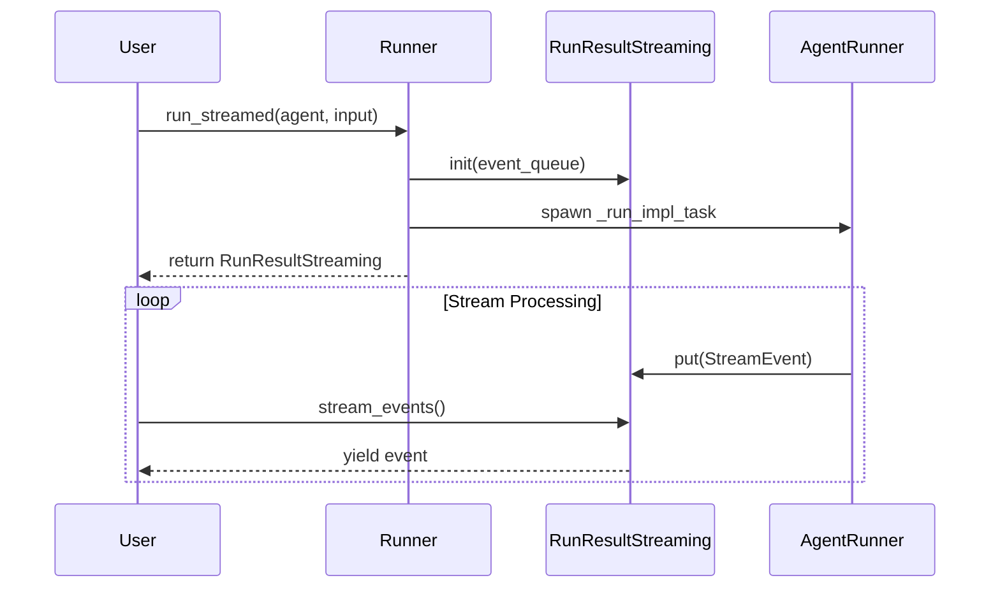

**Diagram: Streaming Execution and Event Flow**

The async iterator `stream_events()` yields discrete event types [src/agents/result.py:532-581]():
1. **`RawResponsesStreamEvent`**: Streaming LLM responses (text deltas, tool call chunks) [src/agents/stream_events.py:11-21]().
2. **`RunItemStreamEvent`**: Semantic events representing completed items (tool execution, message creation) [src/agents/stream_events.py:24-49]().
3. **`AgentUpdatedStreamEvent`**: Notifications of agent switches via handoffs [src/agents/stream_events.py:52-58]().

### Cancellation Modes

The `cancel()` method supports two strategies [src/agents/result.py:435-481]():
- **`mode="immediate"`**: Cancels background tasks immediately and marks execution complete [src/agents/result.py:448-466]().
- **`mode="after_turn"`**: Permits the current model turn and tool execution steps to finish gracefully before halting [src/agents/result.py:468-474]().

Sources: [src/agents/result.py:319-700](), [src/agents/stream_events.py:1-61]()

---

## RunItem Artifact System

Execution items (`RunItem`) wrap raw model output items and maintain provenance tracking back to their source agent [src/agents/items.py:80-342]().

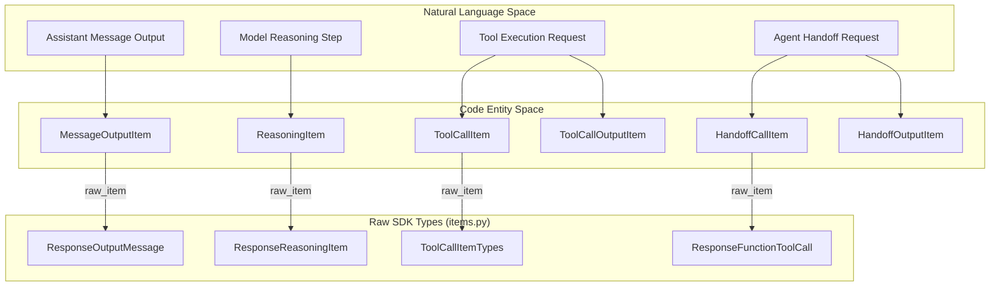

**Diagram: Mapping Natural Language Artifacts to RunItem Code Entities**

### Common RunItem Subclasses

| Class Name | Item Type String | Description |
|------------|------------------|-------------|
| `MessageOutputItem` | `message_output_item` | Assistant text message output [src/agents/items.py:161-169](). |
| `ReasoningItem` | `reasoning_item` | Internal chain-of-thought or model reasoning elements [src/agents/items.py:330-342](). |
| `ToolCallItem` | `tool_call_item` | Invocation request directed at a registered tool [src/agents/items.py:227-243](). |
| `ToolCallOutputItem` | `tool_call_output_item` | Result payload returned after tool execution [src/agents/items.py:191-224](). |
| `ToolApprovalItem` | `tool_approval_item` | Paused tool call awaiting administrative approval [src/agents/items.py:246-271](). |
| `HandoffCallItem` | `handoff_call_item` | Request transferring control to another agent [src/agents/items.py:274-289](). |

Sources: [src/agents/items.py:80-342]()

---

## Memory Cleanup (`release_agents()`)

Because result objects maintain references to agents via `new_items`, long-running applications can accumulate memory overhead [src/agents/result.py:261-299](). Calling `release_agents()` replaces strong references to agent instances with weak references across the result and its contained items [src/agents/result.py:261-299]():

```python
result = await Runner.run(agent, "Task")
# Process output...
result.release_agents()
# Agent instances are now eligible for garbage collection.
```

Attempting to access `result.last_agent` or item agents after collection raises an `AgentsException` [src/agents/result.py:254-258](), [src/agents/items.py:131-146]().

Sources: [src/agents/result.py:248-299](), [src/agents/items.py:94-158]()

---

# Page: RunState and Resumption

# RunState and Resumption

<details>
<summary>Relevant source files</summary>

The following files were used as context for generating this wiki page:

- [src/agents/_run_state_agent_identity.py](src/agents/_run_state_agent_identity.py)
- [src/agents/exceptions.py](src/agents/exceptions.py)
- [src/agents/result.py](src/agents/result.py)
- [src/agents/run.py](src/agents/run.py)
- [src/agents/run_internal/agent_runner_helpers.py](src/agents/run_internal/agent_runner_helpers.py)
- [src/agents/run_internal/run_loop.py](src/agents/run_internal/run_loop.py)
- [src/agents/run_internal/run_steps.py](src/agents/run_internal/run_steps.py)
- [src/agents/run_internal/session_persistence.py](src/agents/run_internal/session_persistence.py)
- [src/agents/run_internal/turn_resolution.py](src/agents/run_internal/turn_resolution.py)
- [src/agents/run_state.py](src/agents/run_state.py)
- [tests/fixtures/run_state/features/v1_20_tool_output_guardrail_boundary.json](tests/fixtures/run_state/features/v1_20_tool_output_guardrail_boundary.json)
- [tests/fixtures/run_state/generate_corpus.py](tests/fixtures/run_state/generate_corpus.py)
- [tests/fixtures/run_state/minimal/v1_20.json](tests/fixtures/run_state/minimal/v1_20.json)
- [tests/fixtures/run_state/sources.json](tests/fixtures/run_state/sources.json)
- [tests/test_agent_runner.py](tests/test_agent_runner.py)
- [tests/test_agent_runner_streamed.py](tests/test_agent_runner_streamed.py)
- [tests/test_error_logging_redaction.py](tests/test_error_logging_redaction.py)
- [tests/test_run_impl_resume_paths.py](tests/test_run_impl_resume_paths.py)
- [tests/test_run_state.py](tests/test_run_state.py)
- [tests/test_run_state_hook_identity.py](tests/test_run_state_hook_identity.py)

</details>


## Purpose and Scope

This page describes the `RunState` class and its role in enabling pause/resume workflows for agent execution. `RunState` provides serializable snapshots of agent runs that support human-in-the-loop interruptions, approval gates, state persistence, and durable execution patterns [src/agents/run_state.py:1-3]().

---

## RunState Overview

`RunState` is a serializable snapshot of an agent run that captures all information needed to pause and resume execution. It serves as the durable pause/resume boundary for human-in-the-loop flows, enabling workflows where execution stops for human approval and continues later [src/agents/run_state.py:1-3]().

**When to Use RunState**:
- Tool calls require human approval (`needs_approval=True`).
- Long-running workflows need to persist state between restarts [src/agents/run_state.py:1-3]().
- Agents execute across multiple service invocations.
- Execution must survive process crashes or deployments.

**Key Characteristics**:
- JSON-serializable with schema versioning [src/agents/run_state.py:159-187]().
- Preserves conversation history, model responses, and approvals [src/agents/run_state.py:589-678]().
- Supports context serialization with multiple strategies [src/agents/run_state.py:351-474]().
- Maintains tracing state across resume boundaries [src/agents/run_state.py:148-148]().

### Workflow Data Flow

The following diagram bridges the **Natural Language Space** (user actions) to the **Code Entity Space** (class names and functions).

Title: RunState Pause/Resume Workflow
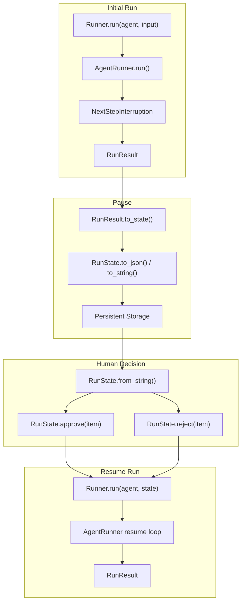

**Sources**: [src/agents/run_state.py:1-3](), [src/agents/run.py:212-214](), [src/agents/result.py:111-172]()

---

## Creating RunState from RunResult

`RunState` instances are typically created from `RunResult` or `RunResultStreaming` objects using the `to_state()` method [src/agents/result.py:111-172](). This conversion captures the current execution state for later resumption.

```python
# Run agent until interruption
result = await Runner.run(agent, "Use the delete_file tool")

if result.interruptions:
    # Create state snapshot
    state = result.to_state()
    
    # Serialize for storage
    state_json = state.to_string()
    save_to_database(state_json)
```

**What Gets Captured**:

| Field | Description | Code Entity |
|-------|-------------|-------------|
| `_current_agent` | Agent currently handling execution | `Agent` [src/agents/agent.py:1-50]() |
| `_original_input` | Input from the first turn | `original_input` [src/agents/result.py:101-107]() |
| `_generated_items` | Items generated during the run | `RunItem` [src/agents/items.py:1-50]() |
| `_model_responses` | All model responses so far | `ModelResponse` [src/agents/items.py:1-50]() |
| `_context` | Run context with approvals and usage | `RunContextWrapper` [src/agents/run_context.py:1-50]() |
| `_input_guardrail_results` | Input guardrail results | `InputGuardrailResult` [src/agents/guardrail.py:1-50]() |
| `_current_step` | Current interruption step | `NextStepInterruption` [src/agents/run_internal/run_steps.py:1-50]() |

**Sources**: [src/agents/result.py:111-172](), [src/agents/run_state.py:1-50]()

---

## Serialization

`RunState` provides two serialization methods: `to_json()` returns a dictionary, while `to_string()` returns a JSON string [src/agents/run_state.py:589-678]().

### Schema Versioning

Every serialized state includes a schema version for forward/backward compatibility. The current version is defined by `CURRENT_SCHEMA_VERSION` [src/agents/run_state.py:99-102]().

**Supported Versions**: Validated via `SUPPORTED_SCHEMA_VERSIONS` [src/agents/run_state.py:99-102]().

**Versioning Policy**:
1. Released schema versions remain readable [src/agents/run_state.py:99-102]().
2. `to_json()` always emits `CURRENT_SCHEMA_VERSION` [src/agents/run_state.py:99-102]().
3. Forward compatibility fails fast (older SDKs reject newer versions) [src/agents/run_state.py:99-102]().

**Sources**: [src/agents/run_state.py:99-102](), [src/agents/run_state.py:589-600]()

### Serialization Format

Title: RunState JSON Structure
```mermaid
graph TB
    subgraph "RunState.to_json() Output"
        Schema["schema_version"] --> Turn["_current_turn"]
        Turn --> Agent["_current_agent"]
        Agent --> Input["_original_input"]
        Input --> Responses["_model_responses"]
        Responses --> Items["_session_items"]
        Items --> Context["_context"]
        Context --> Approvals["_context._approval_records"]
        Approvals --> Guardrails["_input_guardrail_results"]
        Guardrails --> Trace["_trace_state"]
    end
    
    Context -.contains.-> ContextMeta["context_meta"]
```

**Sources**: [src/agents/run_state.py:351-474](), [src/agents/run_state.py:589-678]()

---

## Deserialization

Deserialize `RunState` using `from_json()` or `from_string()` class methods [src/agents/run_state.py:680-824]().

```python
# From JSON string
state = await RunState.from_string(agent, state_string)

# With context override (replaces serialized context)
new_context = MyContext(user_id="different_user")
state = await RunState.from_json(
    agent,
    state_dict,
    context_override=new_context
)
```

### Context Deserialization Strategies

Title: Context Deserialization Decision Tree
```mermaid
graph TB
    Deserialize["RunState.from_json()"] --> CheckOverride{"context_override provided?"}
    CheckOverride -->|Yes| UseOverride["Use override context"]
    CheckOverride -->|No| CheckMeta{"Check context_meta"}
    
    CheckMeta --> IsMapping{"serialized_via == 'mapping'?"}
    IsMapping -->|Yes| DirectMapping["Restore as dict"]
    IsMapping -->|No| HasDeserializer{"context_deserializer provided?"}
    
    HasDeserializer -->|Yes| UseDeserializer["Call deserializer(payload)"]
    HasDeserializer -->|No| WarnAndMap["Warn about type loss & restore as dict"]
    
    UseOverride --> Done["RunState initialization complete"]
    DirectMapping --> Done
    UseDeserializer --> Done
    WarnAndMap --> Done
```

**Context Metadata (`context_meta`)**:

The `context_meta` field describes how the context was serialized [src/agents/run_state.py:351-365]():

| `serialized_via` | Description |
|------------------|-------------|
| `"none"` | Context was `None` |
| `"mapping"` | Context was a dict/mapping, can be restored directly |
| `"context_serializer"` | Custom serializer was used, deserializer required |
| `"model_dump"` | Pydantic model, original type lost without deserializer |
| `"asdict"` | Dataclass, original type lost without deserializer |
| `"omitted"` | Non-serializable context, data omitted |

**Sources**: [src/agents/run_state.py:351-474](), [src/agents/run_state.py:680-824]()

---

## Approval and Rejection

`RunState` provides `approve()` and `reject()` methods to handle tool approval interruptions [src/agents/run_state.py:270-317]().

### Approving Tool Calls

Approving a tool call stores the decision in the `RunContextWrapper`. Setting `always_approve=True` persists this decision for all future calls to that specific tool within the same run [src/agents/run_state.py:270-291]().

```python
if result.interruptions:
    approval_item = result.interruptions[0]
    state = result.to_state()
    state.approve(approval_item, always_approve=True)
```

### Rejecting Tool Calls

Rejecting a tool call prevents its execution. You can provide a custom `rejection_message` which is returned to the model as the tool output [src/agents/run_state.py:293-317]().

```python
if result.interruptions:
    approval_item = result.interruptions[0]
    state = result.to_state()
    state.reject(
        approval_item,
        rejection_message="Access denied"
    )
```

**Sources**: [src/agents/run_state.py:270-317](), [src/agents/run_internal/run_loop.py:1-50]()

---

## Resuming Execution

Pass `RunState` to `Runner.run()` as the `input` parameter to resume execution [src/agents/run.py:1-210]().

Title: RunState Resume Sequence
```mermaid
sequenceDiagram
    participant User
    participant Runner as Runner.run()
    participant AgentRunner as AgentRunner
    participant State as RunState
    participant Context as RunContextWrapper
    participant Model as Model
    
    User->>Runner: run(agent, state)
    Runner->>AgentRunner: execute(agent, input=state)
    AgentRunner->>State: Extract _current_agent & _context
    State->>Context: Restore approval records
    AgentRunner->>State: Check _current_step
    
    alt NextStepInterruption
        AgentRunner->>Context: Verify approval status
        Context-->>AgentRunner: Approved or Rejected
        AgentRunner->>AgentRunner: Execute tools or apply rejection
        AgentRunner->>Model: Send tool outputs
    else No Interruption
        AgentRunner->>Model: Continue turn loop
    end
    
    AgentRunner-->>User: RunResult
```

**Sources**: [src/agents/run.py:1-210](), [src/agents/run_state.py:1-50](), [src/agents/run_internal/run_loop.py:1-50]()

---

## State Contents Detail

### Original Input Preservation
`_original_input` stores the input from the first turn, never updated during execution [src/agents/run_state.py:1-50]().

### Model Responses
All `ModelResponse` objects are serialized with usage metrics and output items [src/agents/run_state.py:319-329]().

### Conversation Identifiers
For server-managed conversation state:
- `_conversation_id`: Named conversation resource on server [src/agents/run_state.py:1-50]().
- `_previous_response_id`: Response ID to chain from [src/agents/run_state.py:1-50]().

### Trace State
Tracing metadata is serialized to enable trace continuity across resume boundaries [src/agents/run_state.py:148-148]().

**Sources**: [src/agents/run_state.py:1-50](), [src/agents/run_state.py:319-349]()

---

# Page: Context and Dependency Injection

# Context and Dependency Injection

<details>
<summary>Relevant source files</summary>

The following files were used as context for generating this wiki page:

- [src/agents/agent.py](src/agents/agent.py)
- [src/agents/run_config.py](src/agents/run_config.py)
- [src/agents/run_context.py](src/agents/run_context.py)
- [src/agents/sandbox/capabilities/tools/apply_patch_tool.py](src/agents/sandbox/capabilities/tools/apply_patch_tool.py)
- [src/agents/tool_context.py](src/agents/tool_context.py)
- [tests/sandbox/capabilities/test_apply_patch_preflight.py](tests/sandbox/capabilities/test_apply_patch_preflight.py)
- [tests/sandbox/capabilities/test_apply_patch_tool.py](tests/sandbox/capabilities/test_apply_patch_tool.py)
- [tests/test_agent_as_tool.py](tests/test_agent_as_tool.py)
- [tests/test_example_workflows.py](tests/test_example_workflows.py)
- [tests/test_run_config.py](tests/test_run_config.py)
- [tests/test_run_context_approvals.py](tests/test_run_context_approvals.py)
- [tests/test_source_compat_constructors.py](tests/test_source_compat_constructors.py)
- [tests/test_tool_context.py](tests/test_tool_context.py)

</details>


This page describes the SDK's dependency injection system built around `RunContextWrapper` and `ToolContext`. These classes act as containers that carry user-defined application state, shared usage tracking, approval state, and tool-specific metadata throughout agent execution.

For information about conversation history and memory persistence, see **8. Session and Memory Management**. For agent-specific lifecycle hooks that receive context, see **10.5 Hooks and Lifecycle Events**.

---

## Overview and Purpose

The SDK uses **context wrappers** as dependency injection containers. The pattern works in three steps:

1. You create any Python object to hold your application state and dependencies (typically a dataclass or Pydantic model) [src/agents/run_context.py:184-185]().
2. You pass that object to the various run methods (e.g., `Runner.run(..., context=your_object)`) [src/agents/agent.py:183-183]().
3. The SDK wraps it in `RunContextWrapper` and passes that wrapper to all callbacks (tools, hooks, guardrails, handoffs) [src/agents/run_context.py:176-182]().

Two primary wrapper classes exist:

| Class | Purpose | When Used |
|-------|---------|-----------|
| `RunContextWrapper` | Base container with user context, usage, and approval state [src/agents/run_context.py:176-182](). | Agent hooks, guardrails, handoffs, and plain tool functions. |
| `ToolContext` | Extends `RunContextWrapper` with tool call metadata [src/agents/tool_context.py:42-43](). | Tool functions that request `ToolContext` as a parameter. |

**Critical invariant**: All derived wrappers in a single run share the same underlying user context, `usage` tracker, and approval state. Mutations are visible across the entire execution chain [src/agents/run_context.py:176-188]().

Sources: [src/agents/run_context.py:176-188](), [src/agents/tool_context.py:42-65](), [src/agents/agent.py:183-205]()

---

## RunContextWrapper Architecture

The following diagram illustrates the relationship between the SDK context wrappers and user-defined state.

**Context Entity Relationship**
```mermaid
classDiagram
    class RunContextWrapper {
        +context: TContext
        +usage: Usage
        +turn_input: list[TResponseInputItem]
        +tool_input: Any
        -_approvals: dict[str, _ApprovalRecord]
        -_tool_invocations: dict[str, _ToolInvocationRecord]
        +_share_tool_state_with(target)
    }
    
    class ToolContext {
        +tool_name: str
        +tool_call_id: str
        +tool_arguments: str
        +tool_call: ResponseFunctionToolCall
        +tool_namespace: str
        +agent: AgentBase
        +run_config: RunConfig
        +qualified_tool_name: str
    }
    
    class UserContext {
        <<user-defined>>
        +db_connection: Any
        +session_id: str
    }
    
    RunContextWrapper *-- UserContext : "wraps .context"
    ToolContext --|> RunContextWrapper : "extends"
    RunContextWrapper o-- Usage : "shared instance"
    RunContextWrapper o-- _ApprovalRecord : "shared _approvals"
    RunContextWrapper o-- _ToolInvocationRecord : "shared _tool_invocations"
```

**RunContextWrapper contains**:
- **`context`**: Your application object (dataclass, Pydantic model, etc.) [src/agents/run_context.py:184-185]().
- **`usage`**: Shared `Usage` tracker accumulating tokens and requests across the run [src/agents/run_context.py:187-188]().
- **`turn_input`**: The full input list for the current turn [src/agents/run_context.py:86-86]().
- **`tool_input`**: Structured input data for nested `Agent.as_tool()` invocations [src/agents/run_context.py:93-94]().
- **`_approvals`**: Internal dict storing `_ApprovalRecord` objects for authorization state [src/agents/run_context.py:161-174]().
- **`_tool_invocations`**: Tracks canonical identity and lifecycle of tool calls to prevent duplicate execution [src/agents/run_context.py:150-158]().

Sources: [src/agents/run_context.py:150-188](), [src/agents/tool_context.py:42-124]()

---

## ToolContext Extension

When a tool function requests `ToolContext` as a parameter, the SDK injects a specialized wrapper that includes tool call metadata [src/agents/tool_context.py:42-43]().

**Tool Context Data Flow**
```mermaid
graph TB
    RunContextWrapper["RunContextWrapper<br/>(context, usage, approvals)"]
    ToolContext["ToolContext<br/>(tool_name, tool_call_id, tool_arguments, agent)"]
    
    RunContextWrapper -->|"SDK Tool Execution Pipeline"| ToolContext
    
    ToolContext -->|"shares"| Usage["Usage instance"]
    ToolContext -->|"shares"| Approvals["_approvals dict"]
    ToolContext -->|"shares"| UserContext["user .context object"]
    ToolContext -->|"shares"| Invocations["_tool_invocations dict"]
```

**ToolContext adds**:
- **`tool_name`**: The name of the tool being invoked [src/agents/tool_context.py:46-47]().
- **`tool_call_id`**: Unique ID for this specific tool call [src/agents/tool_context.py:49-50]().
- **`tool_arguments`**: Raw JSON arguments string from the model [src/agents/tool_context.py:52-53]().
- **`tool_call`**: Full `ResponseFunctionToolCall` object [src/agents/tool_context.py:55-56]().
- **`tool_namespace`**: The Responses API namespace for the tool call [src/agents/tool_context.py:58-59]().
- **`agent`**: The active agent executing this tool [src/agents/tool_context.py:61-62]().
- **`run_config`**: The active `RunConfig` for this execution [src/agents/tool_context.py:64-65]().

Sources: [src/agents/tool_context.py:42-116](), [src/agents/run_internal/tool_execution.py:88-88]()

---

## Context Propagation Flow

Context is initialized at the start of a run and passed through the execution loop. The SDK ensures that nested agent calls (e.g., `Agent.as_tool()`) share the same usage and approval state by calling `_share_tool_state_with` [src/agents/run_context.py:106-113]().

**Execution Context Propagation**
```mermaid
sequenceDiagram
    participant User
    participant Runner
    participant AgentRunner
    participant Tool
    
    User->>Runner: run(agent, input, context=UserInfo())
    Runner->>AgentRunner: Initialize context_wrapper
    Note over AgentRunner: RunContextWrapper(UserInfo)
    
    AgentRunner->>Tool: execute_function_tool_calls(context_wrapper)
    Note over Tool: ToolContext(context_wrapper, tool_metadata)
    Tool-->>AgentRunner: FunctionToolResult
    
    AgentRunner-->>User: RunResult(context_wrapper)
```

**Key Propagation Sites**:
1. **Hooks**: `AgentHookContext` is initialized with usage and turn input [src/agents/run_context.py:121-121]().
2. **Tools**: Functions receive `ToolContext` or `RunContextWrapper` based on signature inspection [src/agents/run_internal/tool_execution.py:82-82]().
3. **Guardrails**: Input and output guardrails receive context to validate payloads against application state [src/agents/agent.py:34-34]().
4. **Nested Agents**: When an agent runs as a tool, its internal `RunContextWrapper` is linked to the parent's via `_share_tool_state_with` [src/agents/run_context.py:106-113]().

Sources: [src/agents/run_context.py:106-113](), [src/agents/run_internal/tool_execution.py:82-82](), [src/agents/run_internal/turn_resolution.py:97-97]()

---

## Shared Usage and Approval Tracking

### Usage Tracking
The `usage` property is a shared `Usage` instance that accumulates token counts and request numbers across all model calls in a single run [src/agents/run_context.py:187-188](). For streamed responses, usage is finalized at the end of the stream [src/agents/run_context.py:187-188]().

### Approval State Management
The `_approvals` dictionary tracks decisions for tools requiring human-in-the-loop verification via `_ApprovalRecord` [src/agents/run_context.py:161-174]().

- **`_ApprovalRecord`**: Stores lists of `approved` and `rejected` call IDs, along with custom rejection messages [src/agents/run_context.py:161-174]().
- **Sticky Rejections**: Supports `sticky_rejection_message` which applies to all subsequent calls in a specific `sticky_scope` [src/agents/run_context.py:171-172]().
- **Nested Approvals**: `ToolContext` can resolve approvals for nested agents by searching through `peek_agent_tool_run_result` [src/agents/tool_context.py:127-180]().

### Tool Invocation Tracking
The `_tool_invocations` dictionary prevents duplicate execution of tool calls during resume flows by tracking the canonical identity of each `call_id` [src/agents/run_context.py:150-158]().

Sources: [src/agents/run_context.py:150-174](), [src/agents/run_context.py:187-188](), [src/agents/tool_context.py:127-180]()

---

## Technical Details: Construction and Compatibility

`ToolContext` maintains a positional constructor for backward compatibility with older versions of the SDK [src/agents/tool_context.py:67-81]().

```python
# Positional constructor support
ctx = ToolContext(user_obj, usage_obj, "tool_name", "call_id", '{"arg": 1}')
# [src/agents/tool_context.py:67-103]()
```

The `qualified_tool_name` property handles tool namespacing by combining the tool name with its Responses API namespace [src/agents/tool_context.py:123-125]().

```python
# Returns "namespace.tool_name" or just "tool_name"
full_name = tool_ctx.qualified_tool_name 
# [src/agents/tool_context.py:123-125]()
```

Sources: [src/agents/tool_context.py:67-125](), [tests/test_source_compat_constructors.py:31-31]()

---

# Page: Run Configuration

# Run Configuration

<details>
<summary>Relevant source files</summary>

The following files were used as context for generating this wiki page:

- [docs/ko/config.md](docs/ko/config.md)
- [docs/zh/config.md](docs/zh/config.md)
- [src/agents/agent.py](src/agents/agent.py)
- [src/agents/run_config.py](src/agents/run_config.py)
- [src/agents/tool_context.py](src/agents/tool_context.py)
- [tests/test_agent_as_tool.py](tests/test_agent_as_tool.py)
- [tests/test_example_workflows.py](tests/test_example_workflows.py)
- [tests/test_run_config.py](tests/test_run_config.py)
- [tests/test_source_compat_constructors.py](tests/test_source_compat_constructors.py)
- [tests/test_tool_context.py](tests/test_tool_context.py)

</details>


`RunConfig` provides global execution settings that control how agent runs behave. It allows you to override agent-specific configurations, enable cross-cutting concerns like guardrails and tracing, and customize execution behavior without modifying individual agents.

For information about agent-specific configuration (instructions, tools, model settings), see [Agent Architecture](#3.1). For information about the execution flow itself, see [Runner and Execution Flow](#3.2).

## Overview

`RunConfig` is an optional parameter passed to any `Runner` method (`run`, `run_sync`, `run_streamed`). It centralizes configuration that applies to the entire agent run, including all agents involved in handoffs. When not provided, a default `RunConfig` is automatically created.

Sources: [src/agents/run.py:199-213](), [src/agents/run_config.py:159-160]()

## Configuration Architecture

### Data Flow for Configuration Resolution
The diagram below illustrates how configuration layers are merged and applied to the execution loop within the `Runner`.

```mermaid
graph TB
    subgraph "Configuration Layers"
        GlobalDefaults["Global SDK Defaults<br/>(environment, set_default_*)"]
        RunConfigInstance["RunConfig Instance<br/>(per-run settings)"]
        AgentConfig["Agent Configuration<br/>(agent.model_settings, etc)"]
    end
    
    subgraph "Runner Execution"
        RunMethod["Runner.run()<br/>Runner.run_sync()<br/>Runner.run_streamed()"]
        ApplyConfig["Apply Configuration<br/>(merge & resolve)"]
        AgentLoop["Agent Execution Loop"]
    end
    
    GlobalDefaults -.->|"fallback"| RunConfigInstance
    RunConfigInstance -->|"passed to"| RunMethod
    RunMethod --> ApplyConfig
    ApplyConfig --> AgentLoop
    RunConfigInstance -.->|"overrides"| AgentConfig
    AgentConfig --> AgentLoop
    
    subgraph "RunConfig Structure"
        ModelOpts["Model Options<br/>model, model_provider,<br/>model_settings"]
        GuardrailOpts["Guardrail Options<br/>input_guardrails,<br/>output_guardrails"]
        HandoffOpts["Handoff Options<br/>handoff_input_filter,<br/>nest_handoff_history,<br/>handoff_history_mapper"]
        TracingOpts["Tracing Options<br/>tracing_disabled, tracing,<br/>workflow_name, trace_id"]
        SessionOpts["Session Options<br/>session_settings,<br/>session_input_callback"]
        AdvancedOpts["Advanced Hooks<br/>call_model_input_filter,<br/>tool_error_formatter"]
        ToolExecOpts["ToolExecutionConfig<br/>concurrency, pre_approval"]
    end
    
    RunConfigInstance --> ModelOpts
    RunConfigInstance --> GuardrailOpts
    RunConfigInstance --> HandoffOpts
    RunConfigInstance --> TracingOpts
    RunConfigInstance --> SessionOpts
    RunConfigInstance --> AdvancedOpts
    RunConfigInstance --> ToolExecOpts
```

Sources: [src/agents/run_config.py:159-250](), [src/agents/run.py:39-47]()

## Model Configuration

`RunConfig` allows you to override model selection and settings globally, superseding agent-specific configurations.

### Model Override Options

| Field | Type | Purpose |
|-------|------|---------|
| `model` | `str \| Model` | Global model to use, overriding each agent's `model` [src/agents/run_config.py:193-196]() |
| `model_provider` | `ModelProvider` | Provider for resolving model names (defaults to `MultiProvider`) [src/agents/run_config.py:198-199]() |
| `model_settings` | `ModelSettings` | Global model settings (temperature, top_p, etc.) [src/agents/run_config.py:201-204]() |

### Configuration Resolution Logic
The resolution order is: `RunConfig` > `Agent` > `Global Defaults`. Settings in `RunConfig` take precedence over agent-specific settings during the run.

```mermaid
graph LR
    GlobalDefaults["Global Defaults<br/>(environment vars)"]
    RunConfigModel["RunConfig.model<br/>RunConfig.model_settings"]
    AgentModel["Agent.model<br/>Agent.model_settings"]
    FinalModel["Final Model<br/>Configuration"]
    
    GlobalDefaults -->|"fallback"| RunConfigModel
    RunConfigModel -->|"overrides"| AgentModel
    AgentModel --> FinalModel
    RunConfigModel -.->|"if set"| FinalModel
```

Sources: [tests/test_run_config.py:45-58](), [tests/test_run_config.py:82-104](), [src/agents/run_config.py:193-204]()

## Guardrails Configuration

`RunConfig` allows you to specify guardrails that apply to all agents in the run, in addition to agent-specific guardrails.

### Guardrail Options

| Field | Type | Purpose |
|-------|------|---------|
| `input_guardrails` | `list[InputGuardrail]` | Input validation applied to initial user input [src/agents/run_config.py:233-234]() |
| `output_guardrails` | `list[OutputGuardrail]` | Output validation applied to final agent output [src/agents/run_config.py:236-237]() |

Sources: [src/agents/run_config.py:233-237](), [src/agents/run_internal/run_loop.py:91-92]()

## Handoff Configuration

`RunConfig` provides global settings for controlling how agent handoffs behave, including conversation history management and input filtering.

### Handoff Options

| Field | Type | Purpose |
|-------|------|---------|
| `handoff_input_filter` | `HandoffInputFilter` | Global filter applied to all handoffs without explicit filters [src/agents/run_config.py:206-212]() |
| `nest_handoff_history` | `bool` | Collapse prior conversation into summary message (default: `False`) [src/agents/run_config.py:214-220]() |
| `handoff_history_mapper` | `HandoffHistoryMapper` | Custom mapper for conversation history summarization [src/agents/run_config.py:222-227]() |

Sources: [src/agents/run_config.py:206-227](), [tests/test_run_config.py:216-217]()

## Tracing Configuration

`RunConfig` controls tracing behavior for the entire run, including identifiers and sensitive data inclusion.

### Tracing Options

| Field | Type | Purpose |
|-------|------|---------|
| `tracing_disabled` | `bool` | Completely disable tracing for the run [src/agents/run_config.py:249-250]() |
| `tracing` | `TracingConfig` | Override exporters, processors, or metadata [src/agents/run_config.py:252-253]() |
| `workflow_name` | `str` | Name for the workflow (recommended to set) [src/agents/run_config.py:255-256]() |
| `trace_id` | `str` | Explicit trace ID (auto-generated if not set) [src/agents/run_config.py:258-259]() |
| `trace_include_sensitive_data` | `bool` | Include LLM inputs/outputs in traces. Defaults to environment variable [src/agents/run_config.py:262-264]() |

Sources: [src/agents/run_config.py:249-264](), [src/agents/run_config.py:51-54]()

## Tool Execution Configuration

The `ToolExecutionConfig` class controls SDK-side behavior for local tool calls.

| Field | Type | Purpose |
|-------|------|---------|
| `max_function_tool_concurrency` | `int \| None` | Limits concurrent execution of local function tools [src/agents/run_config.py:110-115]() |
| `pre_approval_tool_input_guardrails` | `bool` | Run tool input guardrails *before* a pending approval interruption [src/agents/run_config.py:117-121]() |

Sources: [src/agents/run_config.py:107-131](), [src/agents/run_config.py:274-275]()

## Advanced Hooks and Filters

### call_model_input_filter
A hook of type `CallModelInputFilter` used to edit the fully prepared `ModelInputData` (instructions and input items) immediately before the model is called [src/agents/run_config.py:246-247](). It receives a `CallModelData` object containing the current agent and context [src/agents/run_config.py:66-72]().

### tool_error_formatter
A hook of type `ToolErrorFormatter` that customizes the message returned to the model when a tool call fails or is rejected [src/agents/run_config.py:270-272](). It receives `ToolErrorFormatterArgs` containing metadata about the error and the tool [src/agents/run_config.py:81-101]().

### reasoning_item_id_policy
Controls how reasoning item IDs are handled during history conversion. Options are `"preserve"` or `"omit"` [src/agents/run_config.py:75](). This policy is applied when converting `RunItem` objects to model input [src/agents/run_internal/items.py:139-155]().

Sources: [src/agents/run_config.py:48-103](), [src/agents/run_internal/items.py:139-155]()

## Session and Error Handling

`RunConfig` also manages session-level behaviors:
*   **`session_settings`**: Global `SessionSettings` defining context limits and truncation strategies [src/agents/run_config.py:242]().
*   **`session_input_callback`**: A callback to transform or log input before it is added to the session [src/agents/run_config.py:239-240]().
*   **`error_handlers`**: A `RunErrorHandlers` object for catching and recovering from specific run-time exceptions [src/agents/run_config.py:277-278]().

Sources: [src/agents/run_config.py:239-278](), [src/agents/memory/session_settings.py:11-20]()

---

# Page: Tools and Capabilities

# Tools and Capabilities

<details>
<summary>Relevant source files</summary>

The following files were used as context for generating this wiki page:

- [docs/ja/tools.md](docs/ja/tools.md)
- [docs/ko/agents.md](docs/ko/agents.md)
- [docs/ko/guardrails.md](docs/ko/guardrails.md)
- [docs/ko/mcp.md](docs/ko/mcp.md)
- [docs/ko/tools.md](docs/ko/tools.md)
- [docs/ko/voice/quickstart.md](docs/ko/voice/quickstart.md)
- [docs/ref/tool_context.md](docs/ref/tool_context.md)
- [docs/zh/agents.md](docs/zh/agents.md)
- [docs/zh/guardrails.md](docs/zh/guardrails.md)
- [docs/zh/mcp.md](docs/zh/mcp.md)
- [docs/zh/tools.md](docs/zh/tools.md)
- [docs/zh/voice/quickstart.md](docs/zh/voice/quickstart.md)
- [examples/basic/tools.py](examples/basic/tools.py)
- [src/agents/__init__.py](src/agents/__init__.py)
- [src/agents/function_schema.py](src/agents/function_schema.py)
- [src/agents/tool.py](src/agents/tool.py)
- [tests/sandbox/test_session_utils.py](tests/sandbox/test_session_utils.py)
- [tests/test_function_schema.py](tests/test_function_schema.py)
- [tests/test_function_schema_logger_restore.py](tests/test_function_schema_logger_restore.py)
- [tests/test_function_tool.py](tests/test_function_tool.py)
- [tests/test_function_tool_decorator.py](tests/test_function_tool_decorator.py)

</details>


Tools are the primary mechanism for agents to take actions beyond text generation. A tool is a callable capability that the model can invoke to perform operations such as fetching data, executing code, calling external APIs, searching the web, or delegating to other agents [docs/ja/tools.md:5-13](). The SDK provides a unified abstraction layer that supports multiple tool execution strategies while maintaining consistent patterns for approval, error handling, and context management.

This page provides an overview of the tool system architecture, tool categories, execution patterns, and integration mechanisms. Because this is a parent page, keep high-level details here and refer to the child pages for complete specifications:

- For general tool architecture and the `Tool` interface, see [Tool System Overview](#4.1)
- For Python function wrapping and schema inference, see [Function Tools](#4.2)
- For OpenAI-managed capabilities, see [Hosted Tools](#4.3)
- For environment-bound tools, see [Local Runtime Tools](#4.4)
- For nested agent execution, see [Agent as Tool](#4.5)
- For turn termination and repetition rules, see [Tool Use Behavior](#4.6)
- For approval workflows and human-in-the-loop gates, see [Tool Approval and Human-in-the-Loop](#4.7)
- For managing large tool outputs via sliding windows, see [Tool Output Trimmer](#4.8)

For Model Context Protocol integration, see [Model Context Protocol (MCP)](#11). For guardrails that validate tool inputs and outputs, see [Safety and Validation](#6).

---

## Tool Categories and Execution Locations

The SDK organizes tools into primary categories based on where and how they execute [docs/ja/tools.md:7-13](). 

Title: Tool Category Architecture (Natural Language Space to Code Entity Space)
```mermaid
graph TB
    subgraph "Natural_Language_Space"
        NLHosted[""OpenAI-Managed Capabilities"""]
        NLLocal[""Local Environment Execution"""]
        NLFunc[""Python Function Wrappers"""]
        NLAgent[""Nested Agent Workflows"""]
    end
    
    subgraph "Code_Entity_Space"
        HostedModel[""OpenAIResponsesModel""<br/>src/agents/models/openai_responses.py]
        CompTool[""ComputerTool""<br/>src/agents/tool.py]
        ShellTool[""ShellTool""<br/>src/agents/tool.py]
        ApplyPatch[""ApplyPatchTool""<br/>src/agents/tool.py]
        FuncTool[""FunctionTool / @function_tool""<br/>src/agents/tool.py]
        AgentTool[""Agent.as_tool()""<br/>src/agents/agent.py]
    end
    
    NLHosted --> HostedModel
    NLLocal --> CompTool
    NLLocal --> ShellTool
    NLLocal --> ApplyPatch
    NLFunc --> FuncTool
    NLAgent --> AgentTool
```
Sources: [docs/ja/tools.md:7-13](), [src/agents/tool.py:35-45](), [src/agents/agent.py:166-178]()

**Execution Location Matrix**

| Tool Category | Execution Location | SDK Component | Request Round-Trip |
|--------------|-------------------|---------------|-------------------|
| **Hosted Tools** | OpenAI servers | `OpenAIResponsesModel` [src/agents/models/openai_responses.py:]() | Single request (results streaming) |
| **Local Runtime** | Your environment | `ComputerTool`, `ShellTool` [src/agents/tool.py:35-45]() | Request → tool exec → continuation |
| **Function Tools** | Your Python process | `@function_tool`, `FunctionTool` [src/agents/tool.py:35-45]() | Request → tool exec → continuation |
| **Agent as Tool** | Your Python process | `Agent.as_tool()` [src/agents/agent.py:166-178]() | Request → nested run → continuation |
| **MCP Tools** | External MCP servers | `MCPServer` implementations | Request → MCP call → continuation |

Sources: [docs/ja/tools.md:7-28](), [src/agents/tool.py:35-45]()

---

## Tool Registration and Discovery

Tools are registered on agents through direct lists, MCP servers, or implicit handoffs [src/agents/agent.py:166-178](). The resolution logic filters tools based on their `is_enabled` status. For details on discovery mechanisms and tool registration on agents, see [Tool System Overview](#4.1).

Sources: [src/agents/agent.py:166-218](), [tests/test_function_tool.py:43-59]()

---

## Tool Execution Pipeline

Title: Tool Execution Pipeline (Natural Language Space to Code Entity Space)
```mermaid
graph TB
    subgraph "Natural_Language_Space"
        NLIdent[""Identify Tool Calls"""]
        NLApprove[""Check Approvals"""]
        NLExec[""Execute Tool Function"""]
        NLOutput[""Serialize Output"""]
    end
    
    subgraph "Code_Entity_Space"
        ModelResp[""Runner.run() / Runner.run_sync()""<br/>src/agents/run.py]
        ProcessResp[""ProcessedResponse.create()""<br/>src/agents/run_internal/]
        ResolveApprove[""resolve_approval_status()""<br/>src/agents/run_internal/]
        InvokeFunc[""invoke_function_tool()""<br/>src/agents/tool.py]
        ToolInvoke[""FunctionTool.on_invoke_tool()""<br/>src/agents/tool.py]
        Serialize[""ToolCallOutputItem""<br/>src/agents/items.py]
    end
    
    NLIdent --> ModelResp
    ModelResp --> ProcessResp
    NLApprove --> ResolveApprove
    NLExec --> InvokeFunc
    InvokeFunc --> ToolInvoke
    NLOutput --> Serialize
```
Sources: [src/agents/run.py:113-124](), [src/agents/tool.py:734-750](), [src/agents/items.py:56-75]()

The execution pipeline processes tool invocations by parsing model outputs, resolving human-in-the-loop requirements, enforcing timeouts and guardrails, and serializing results back into the session history. For detailed execution steps, see [Tool System Overview](#4.1).

Sources: [src/agents/run_internal/tool_execution.py:1-157](), [src/agents/tool.py:734-775]()

---

## Tool Context and Dependency Injection

The SDK provides context wrappers that pass execution state down to tools [src/agents/run_context.py:108-115]() and inject invocation metadata via `ToolContext` [src/agents/tool_context.py:35-58](). For details, see [Function Tools](#4.2) and [Tool System Overview](#4.1).

Sources: [src/agents/run_context.py:108-115](), [src/agents/tool_context.py:35-58]()

---

## Tool Namespaces and Deferred Loading

Namespaces group related tools under a shared label and description for the OpenAI Responses API **Tool Search** feature [docs/ja/tools.md:94-98](). `defer_loading=True` hides tools from initial schemas until loaded on demand [docs/ja/tools.md:78-91](). For details, see [Function Tools](#4.2) and [Hosted Tools](#4.3).

Sources: [docs/ja/tools.md:65-128](), [src/agents/tool.py:56-62]()

---

## Tool Error Handling

The `failure_error_function` parameter controls exception presentation to models [src/agents/tool.py:196-196](). Uncaught errors or custom failure formatters determine whether an exception propagates or returns an error string. For details, see [Function Tools](#4.2).

Sources: [src/agents/tool.py:196-196](), [src/agents/run_internal/tool_execution.py:79-80](), [tests/test_function_tool.py:136-137]()

---

## Advanced Tool Patterns

- **Agent as Tool**: Expose agents as callable tools via `Agent.as_tool()` [docs/ja/tools.md:26-26](). For details, see [Agent as Tool](#4.5).
- **Tool Timeouts**: Configure execution limits and behavior [src/agents/tool.py:195-195](). For details, see [Function Tools](#4.2).
- **Tool Use Behavior**: Configure termination vs continuation rules using `tool_use_behavior` [docs/ko/agents.md:48-48](). For details, see [Tool Use Behavior](#4.6).
- **Tool Approval**: Require human sign-off via `needs_approval`. For details, see [Tool Approval and Human-in-the-Loop](#4.7).
- **Tool Output Trimmer**: Prune large payloads via sliding window filters. For details, see [Tool Output Trimmer](#4.8).

Sources: [src/agents/tool.py:195-195](), [docs/ja/tools.md:26-26](), [docs/ko/agents.md:48-48]()

---

# Page: Tool System Overview

# Tool System Overview

<details>
<summary>Relevant source files</summary>

The following files were used as context for generating this wiki page:

- [docs/ref/tool_context.md](docs/ref/tool_context.md)
- [examples/basic/tools.py](examples/basic/tools.py)
- [src/agents/__init__.py](src/agents/__init__.py)
- [src/agents/_function_tool_arguments.py](src/agents/_function_tool_arguments.py)
- [src/agents/function_schema.py](src/agents/function_schema.py)
- [src/agents/run_internal/tool_actions.py](src/agents/run_internal/tool_actions.py)
- [src/agents/run_internal/tool_execution.py](src/agents/run_internal/tool_execution.py)
- [src/agents/run_internal/tool_planning.py](src/agents/run_internal/tool_planning.py)
- [src/agents/tool.py](src/agents/tool.py)
- [src/agents/util/_approvals.py](src/agents/util/_approvals.py)
- [tests/sandbox/test_session_utils.py](tests/sandbox/test_session_utils.py)
- [tests/test_function_schema.py](tests/test_function_schema.py)
- [tests/test_function_schema_logger_restore.py](tests/test_function_schema_logger_restore.py)
- [tests/test_function_tool.py](tests/test_function_tool.py)
- [tests/test_function_tool_approval_arguments.py](tests/test_function_tool_approval_arguments.py)
- [tests/test_function_tool_decorator.py](tests/test_function_tool_decorator.py)
- [tests/test_hitl_error_scenarios.py](tests/test_hitl_error_scenarios.py)
- [tests/test_run_step_execution.py](tests/test_run_step_execution.py)

</details>


The Tool System enables agents to perform actions beyond text generation by executing external functions, calling APIs, controlling computers, and orchestrating sub-agents. This document covers the general tool architecture, the core `Tool` interface, tool discovery mechanisms, and how tools are registered and invoked on agents within the OpenAI Agents SDK.

---

## Purpose and Scope

The tool infrastructure bridges natural language requests from models to executable Python code or remote platform services. Its scope encompasses:
- Defining the abstract `Tool` interface and concrete implementations (`FunctionTool`, `HostedTool`, `LocalRuntimeTool`, etc.).
- Automatic schema generation via `function_schema()` [src/agents/function_schema.py:23-45]() and type inspection.
- Managing tool registration, namespacing (`tool_namespace()`), and deferred loading (`defer_loading`) on `Agent` instances.
- Orchestrating tool execution pipelines, input/output guardrails, and human-in-the-loop approvals in `src/agents/run_internal/tool_execution.py` [src/agents/run_internal/tool_execution.py:163-170]().

Sources: [src/agents/tool.py:1-213](), [src/agents/run_internal/tool_execution.py:163-170]()

---

## Tool Categories and Code Architecture

The SDK organizes tools into distinct categories based on where they execute and how they integrate with the agent system. The diagram below bridges the natural language conceptual space with the underlying codebase entities.

**Natural Language to Code Entity Mapping: Tool Categories**
```mermaid
graph TB
    subgraph "NaturalLanguageSpace"
            NLP_Func["Custom Python Functions"]
            NLP_Hosted["OpenAI Managed Capabilities"]
            NLP_Local["Local Environment & Shell"]
            NLP_MCP["External MCP Servers"]
            NLP_Agent["Nested Sub-Agents"]
    end

    subgraph "CodeEntitySpace"
            FT["agents.tool.FunctionTool<br/>src/agents/tool.py"]
            HT["agents.tool.HostedMCPTool<br/>src/agents/tool.py"]
            LRT["agents.tool.ShellTool<br/>src/agents/tool.py"]
            MCP["agents.mcp.server.MCPServer<br/>src/agents/mcp/"]
            AGT["agents.agent.Agent.as_tool()<br/>src/agents/agent.py"]
    end

    NLP_Func --> FT
    NLP_Hosted --> HT
    NLP_Local --> LRT
    NLP_MCP --> MCP
    NLP_Agent --> AGT
```
Sources: [src/agents/tool.py:136-201](), [src/agents/__init__.py:9-16]()

### Category Summary

| Category | Representative Classes / Decorators | Execution Environment | Description |
|----------|--------------------------------0|-----------------------|-------------|
| **Function Tools** | `@function_tool`, `FunctionTool` [src/agents/__init__.py:153-154]() | Local Python Runtime | Wraps arbitrary Python callables with automatic Pydantic schema inference. |
| **Hosted Tools** | `WebSearchTool`, `CodeInterpreterTool`, `HostedMCPTool` [src/agents/__init__.py:152-200]() | OpenAI Infrastructure | Server-managed capabilities executed alongside the model. |
| **Local Runtime Tools** | `ComputerTool`, `ShellTool`, `ApplyPatchTool` [src/agents/__init__.py:141-174]() | Local User Environment | Environment-interacting tools for shell commands, patches, and desktop GUI control. |
| **MCP Integration** | `MCPServerStdio`, `MCPServerSse`, `MCPServerStreamableHttp` | External MCP Servers | Discovers and executes tools exposed by Model Context Protocol servers. |
| **Agent as Tool** | `Agent.as_tool()` | Nested Agent Loop | Exposes an entire subordinate agent as a callable tool with structured parameter validation. |

Sources: [src/agents/tool.py:136-201](), [src/agents/__init__.py:141-200]()

---

## The `Tool` Interface and Tool Discovery

Every tool in the system conforms to an underlying interface that exposes metadata, parameter schemas, and an invocation handler [src/agents/tool.py:1-213](). 

### Schema Generation and Introspection

For Python functions, the `@function_tool` decorator (and `@tool` alias) leverages `inspect.signature()` [src/agents/function_schema.py:36-36](), docstring parsing (`generate_func_documentation`) [src/agents/function_schema.py:124-133](), and Pydantic model creation (`create_model`) [src/agents/function_schema.py:13-13]() to produce a strict JSON schema [src/agents/function_schema.py:34-42]() sent to the LLM.

**Tool Discovery and Invocation Flow**
```mermaid
graph LR
    UserCode["Python Callable / Decorator"] -->|"@function_tool"| FuncSchema["agents.function_schema.function_schema<br/>src/agents/function_schema.py"]
    FuncSchema --> FuncTool["agents.tool.FunctionTool<br/>src/agents/tool.py"]
    FuncTool -->|"Runner dispatches call"| Exec["agents.run_internal.tool_execution<br/>execute_function_tool_calls"]
    Exec -->|"invokes"| Invoke["Tool.on_invoke_tool(context, arguments)<br/>src/agents/tool.py"]
```
Sources: [src/agents/function_schema.py:23-45](), [src/agents/run_internal/tool_execution.py:163-170]()

Sources: [src/agents/function_schema.py:23-89](), [src/agents/tool.py:1-213]()

---

## Tool Registration and Scoping on Agents

Tools are attached to agents via the `tools` parameter on the `Agent` constructor [src/agents/agent.py:120-135]() or grouped using `tool_namespace()` [src/agents/tool.py:206-206]().

### Namespacing and Qualified Names
The `tool_namespace()` function prefixes tool names with a common namespace string (e.g., `crm.get_customer`), preventing name collisions when multiple tools share similar identifiers across different domains [src/tests/test_function_tool.py:64-80]().

- **Qualified Names**: Namespaced tools expose a `qualified_name` property formatted as `namespace.tool_name` [src/tests/test_function_tool.py:77-79]().
- **Deferred Loading**: Function tools can be configured with `defer_loading=True` to exclude them from the initial model prompt, requiring the model to discover and load them dynamically [src/tests/test_function_tool.py:180-186]().

Sources: [src/agents/tool.py:206-206](), [tests/test_function_tool.py:64-186]()

---

## Tool Execution Pipeline Integration

When a model outputs a tool call, the runner transitions execution through the tool pipeline implemented in `src/agents/run_internal/tool_execution.py` [src/agents/run_internal/tool_execution.py:163-170]() and `src/agents/run_internal/tool_actions.py` [src/agents/run_internal/tool_actions.py:77-83]().

1. **Extraction**: The runner extracts tool call parameters and matches them to registered tool lookup keys [src/agents/run_internal/tool_execution.py:27-43]().
2. **Guardrails**: Input guardrails validate the payload before invocation [src/agents/run_internal/tool_execution.py:95-100]().
3. **Approval Checking**: If `needs_approval` is configured, execution pauses and yields a `ToolApprovalItem` [src/agents/run_internal/tool_execution.py:161-161]().
4. **Invocation**: The tool executes its payload within a `ToolContext` wrapper, capturing return values or raised exceptions [src/agents/run_internal/tool_execution.py:163-170]().
5. **Output Guardrails**: Output guardrails inspect the resulting output prior to feeding it back into the model's conversation history [src/agents/run_internal/tool_execution.py:95-100]().

Sources: [src/agents/run_internal/tool_execution.py:27-170](), [src/agents/run_internal/tool_actions.py:77-83]()

---

# Page: Function Tools

# Function Tools

<details>
<summary>Relevant source files</summary>

The following files were used as context for generating this wiki page:

- [docs/ref/repl.md](docs/ref/repl.md)
- [docs/ref/tool_context.md](docs/ref/tool_context.md)
- [docs/repl.md](docs/repl.md)
- [examples/basic/tools.py](examples/basic/tools.py)
- [src/agents/__init__.py](src/agents/__init__.py)
- [src/agents/_debug.py](src/agents/_debug.py)
- [src/agents/function_schema.py](src/agents/function_schema.py)
- [src/agents/repl.py](src/agents/repl.py)
- [src/agents/strict_schema.py](src/agents/strict_schema.py)
- [src/agents/tool.py](src/agents/tool.py)
- [tests/sandbox/test_session_utils.py](tests/sandbox/test_session_utils.py)
- [tests/test_debug.py](tests/test_debug.py)
- [tests/test_function_schema.py](tests/test_function_schema.py)
- [tests/test_function_schema_logger_restore.py](tests/test_function_schema_logger_restore.py)
- [tests/test_function_tool.py](tests/test_function_tool.py)
- [tests/test_function_tool_decorator.py](tests/test_function_tool_decorator.py)
- [tests/test_repl.py](tests/test_repl.py)
- [tests/test_strict_schema.py](tests/test_strict_schema.py)
- [tests/test_strict_schema_oneof.py](tests/test_strict_schema_oneof.py)

</details>


This page covers the function tool system in the OpenAI Agents SDK (`openai-agents-python`). Function tools wrap regular Python functions and async callable objects, enabling LLM agents to invoke local code with automatic schema inference, runtime validation, context propagation, execution timeouts, namespacing, and programmatic interception.

Sources: [src/agents/tool.py:1-100](), [src/agents/__init__.py:140-207]()

---

## 1. FunctionTool Architecture and Decorators

The `FunctionTool` class encapsulates a Python callable, exposing metadata (`name`, `description`, `params_json_schema`, `is_enabled`, `_tool_namespace`) and an execution handler (`on_invoke_tool`) [src/agents/tool.py:284-394](). 

The SDK provides two primary entry points for defining function tools:
- `@function_tool`: The primary decorator supporting rich configuration arguments [src/agents/tool.py:495-540]().
- `@tool`: A convenient shorthand alias for `@function_tool` [src/agents/__init__.py:204](), [src/agents/decorators.py:19]().

```mermaid
graph TB
    subgraph "Natural Language Space"
        ModelRequest["Model Tool Call request"] --> ParseArgs["JSON Argument Parsing & Pydantic Validation"]
    end

    subgraph "Code Entity Space"
        PyFunc["Callable Function / Async Object"]
        Decorator["@function_tool / @tool"]
        FTClass["FunctionTool"]
        SchemaInf["FuncSchema"]
        
        PyFunc --> Decorator
        Decorator --> FTClass
        FTClass --> SchemaInf
        ParseArgs --> FTClass
        FTClass --> Execute["on_invoke_tool()"]
        Execute --> PyFunc
    end

    Sources: [src/agents/tool.py:284-394](), [src/agents/tool.py:495-540](), [src/agents/function_schema.py:22-44]()
```

Sources: [src/agents/tool.py:284-394](), [src/agents/tool.py:495-540](), [src/agents/function_schema.py:22-44]()

---

## 2. Schema Inference and Strict Mode

When a function is decorated with `@function_tool`, the SDK inspects its type hints and docstring to build a parameter schema using `function_schema()` [src/agents/function_schema.py:22-44]().

### Schema Generation Pipeline

```mermaid
graph LR
    subgraph "Code Entity Space"
        Func["Python Function Signature"]
        Docstring["Docstring (Google/Sphinx/Numpy)"]
        TypeHints["Python Type Annotations"]
    end

    subgraph "Schema Engine"
        FS["FuncSchema"]
        GriffeParser["generate_func_documentation()"]
        Strict["ensure_strict_json_schema()"]
    end

    subgraph "Natural Language Space"
        JSONSchema["OpenAI Strict JSON Schema"]
    end

    Func --> FS
    Docstring --> GriffeParser --> FS
    TypeHints --> FS
    FS --> Strict --> JSONSchema

    Sources: [src/agents/function_schema.py:22-44](), [src/agents/function_schema.py:124-231](), [src/agents/strict_schema.py:116-135]()
```

Sources: [src/agents/function_schema.py:22-44](), [src/agents/function_schema.py:124-231](), [src/agents/strict_schema.py:116-135]()

- **Docstring Parsing**: Uses `griffe` to extract description strings for the tool and its parameters [src/agents/function_schema.py:11-12]().
- **Strict Mode**: By default (`strict_mode=True`), schemas are processed through `ensure_strict_json_schema()` to ensure compatibility with OpenAI's structured outputs requirements (e.g., setting `additionalProperties: False` and marking all properties as `required`) [src/agents/function_schema.py:40-42](), [src/agents/strict_schema.py:116-135]().

Sources: [src/agents/function_schema.py:40-42](), [src/agents/strict_schema.py:116-135]()

---

## 3. Function Signatures and Invocation Context

Function tools support flexible signature patterns, allowing functions to receive context objects as their first parameter:

1. **Without Context**: Standard Python parameters matching the JSON schema properties [src/agents/tool.py:100]().
2. **With RunContextWrapper**: Accepts `RunContextWrapper[TContext]` as the first argument to access shared runner state [src/agents/tool.py:101]().
3. **With ToolContext**: Accepts `ToolContext` as the first argument to access execution metadata such as `tool_call_id`, `tool_name`, and raw arguments [src/agents/tool.py:102](), [src/agents/tool_context.py:36-58]().

Sources: [src/agents/tool.py:100-108](), [src/agents/tool_context.py:36-58]()

---

## 4. Decorator Parameters and Configuration

The `@function_tool` and `@tool` decorators accept configuration parameters to customize execution behavior:

| Parameter | Type | Default | Description |
|-----------|------|---------|-------------|
| `name_override` | `str \| None` | `None` | Custom name for the tool exposed to the model [src/agents/tool.py:499]() |
| `description_override` | `str \| None` | `None` | Custom description overriding the docstring [src/agents/tool.py:500]() |
| `docstring_style` | `DocstringStyle \| None` | Auto-detect | Docstring parser style (`google`, `numpy`, `sphinx`) [src/agents/tool.py:501]() |
| `use_docstring_info` | `bool` | `True` | Whether to parse docstring for descriptions [src/agents/tool.py:502]() |
| `strict_mode` | `bool` | `True` | Enforce OpenAI strict JSON schema rules [src/agents/tool.py:503]() |
| `failure_error_function` | `ToolErrorFunction \| None` | `default_tool_error_function` | Handler invoked when tool execution raises an exception [src/agents/tool.py:504]() |
| `is_enabled` | `bool \| Callable` | `True` | Static or dynamic check determining if the tool is available [src/agents/tool.py:505]() |
| `timeout` | `float \| None` | `None` | Execution timeout limit in seconds [src/agents/tool.py:506]() |
| `defer_loading` | `bool` | `False` | Whether to defer tool loading / discovery until requested [src/agents/tool.py:523]() |

Sources: [src/agents/tool.py:495-528](), [tests/test_function_tool.py:180-188]()

---

## 5. Tool Namespacing

The `tool_namespace()` function groups multiple function tools under a shared namespace prefix [src/agents/tool.py:673-727]().

```python
from agents import tool_namespace, function_tool

@function_tool
def get_user(user_id: str) -> str:
    return f"User {user_id}"

namespaced = tool_namespace(
    name="crm",
    description="CRM operations namespace",
    tools=[get_user],
)
# Resulting tool qualified name: "crm.get_user"
```

- **Metadata Propagation**: Creates shallow copies of tools, assigning `_tool_namespace`, `_tool_namespace_description`, and updating `qualified_name` [tests/test_function_tool.py:64-80]().
- **Validation**: Rejects empty descriptions and prevents name collisions where a synthetic namespace conflicts with tool identifiers [tests/test_function_tool.py:82-116]().

Sources: [src/agents/tool.py:673-727](), [tests/test_function_tool.py:64-116]()

---

## 6. Programmatic Tool Calling

The `ProgrammaticToolCallingTool` class represents tools that are not executed directly by the SDK runtime [src/agents/tool.py:166](). Instead, when the model invokes a programmatic tool, the call is intercepted and surfaced back to the client application for execution.

- **Tool Caller Identifier**: Configured with `tool_caller="programmatic"` [src/agents/tool.py:97-98]() to distinguish them from direct runtime execution tools.
- **Use Cases**: Useful for client-side side effects, restricted sandbox execution, or manual workflow stepping.

Sources: [src/agents/tool.py:96-99](), [src/agents/tool.py:166]()

---

## 7. Async Callables and Timeouts

Function tools seamlessly wrap both synchronous and asynchronous callables [src/agents/tool.py:614-623]():
- Synchronous functions are automatically dispatched via `asyncio.to_thread` to prevent blocking the event loop [src/agents/tool.py:614-623]().
- Asynchronous callables are awaited natively.
- **Timeouts**: When `timeout` is configured, execution is bounded by the timeout duration. Exceeding this limit raises `ToolTimeoutError`, which is handled according to the runner's `ToolTimeoutBehavior` (`error_as_result` or `raise_exception`) [src/agents/tool.py:65](), [src/agents/tool.py:195](), [src/agents/tool.py:506]().

Sources: [src/agents/tool.py:65](), [src/agents/tool.py:195](), [src/agents/tool.py:506](), [src/agents/tool.py:614-623]()

---

# Page: Hosted Tools

# Hosted Tools

<details>
<summary>Relevant source files</summary>

The following files were used as context for generating this wiki page:

- [docs/ref/tool_context.md](docs/ref/tool_context.md)
- [examples/agent_patterns/agents_as_tools_conditional.py](examples/agent_patterns/agents_as_tools_conditional.py)
- [examples/basic/tool_guardrails.py](examples/basic/tool_guardrails.py)
- [examples/basic/tools.py](examples/basic/tools.py)
- [examples/tools/web_search_filters.py](examples/tools/web_search_filters.py)
- [src/agents/__init__.py](src/agents/__init__.py)
- [src/agents/decorators.py](src/agents/decorators.py)
- [src/agents/function_schema.py](src/agents/function_schema.py)
- [src/agents/tool.py](src/agents/tool.py)
- [src/agents/tool_guardrails.py](src/agents/tool_guardrails.py)
- [tests/sandbox/test_session_utils.py](tests/sandbox/test_session_utils.py)
- [tests/test_decorators.py](tests/test_decorators.py)
- [tests/test_function_schema.py](tests/test_function_schema.py)
- [tests/test_function_schema_logger_restore.py](tests/test_function_schema_logger_restore.py)
- [tests/test_function_tool.py](tests/test_function_tool.py)
- [tests/test_function_tool_decorator.py](tests/test_function_tool_decorator.py)

</details>


Hosted tools are OpenAI-managed capabilities that execute alongside the model on OpenAI's infrastructure rather than in the local runtime. When an agent invokes a hosted tool, the request and execution are handled entirely within the OpenAI Responses API, eliminating the need for local callbacks and reducing latency [src/agents/tool.py:35-44]().

This page covers tools that run on OpenAI servers. For tools that execute in your local environment, see **4.4 Local Runtime Tools**. For wrapping Python functions as tools, see **4.2 Function Tools**.

---

## Hosted Tool Ecosystem

The diagram below illustrates how hosted tools bridge the gap between the Python SDK and the OpenAI managed infrastructure, associating system concepts with concrete Python classes defined in `src/agents/tool.py`.

### Natural Language to Code Entity Mapping: Hosted Tools
```mermaid
graph TB
    subgraph "Code Entity Space (SDK)"
        Agent["class Agent<br/>tools: list[Tool]"]
        
        subgraph "Hosted Tool Classes"
            WebSearchTool["class WebSearchTool"]
            FileSearchTool["class FileSearchTool"]
            CodeInterpreterTool["class CodeInterpreterTool"]
            ImageGenerationTool["class ImageGenerationTool"]
            ToolSearchTool["class ToolSearchTool"]
        end
    end
    
    subgraph "Natural Language Space (Model)"
        SearchQuery["\"Search for SF weather\""]
        FileQuery["\"Find my tax docs\""]
        CodeTask["\"Calculate square root\""]
        GenImage["\"Draw a futuristic city\""]
    end
    
    subgraph "OpenAI Managed Infrastructure"
        ResponsesAPI["OpenAI Responses API"]
        VectorStore["Vector Store Service"]
        CodeSandbox["Python Sandbox"]
    end
    
    SearchQuery -.-> WebSearchTool
    FileQuery -.-> FileSearchTool
    CodeTask -.-> CodeInterpreterTool
    GenImage -.-> ImageGenerationTool
    
    WebSearchTool --> ResponsesAPI
    FileSearchTool --> ResponsesAPI
    CodeInterpreterTool --> ResponsesAPI
    ImageGenerationTool --> ResponsesAPI
    
    ResponsesAPI --> VectorStore
    ResponsesAPI --> CodeSandbox
```
Sources: [src/agents/tool.py:35-44](), [src/agents/tool.py:121-133]()

---

## Available Hosted Tools

### WebSearchTool
`WebSearchTool` allows the model to perform web searches using OpenAI's hosted search engine. It supports `filters` for domain restriction and `user_location` for localized results [src/agents/tool.py:43-44]().

**Implementation Detail**: In the `Agent` configuration, it is passed as an instance to the `tools` list.
```python
from agents import Agent, WebSearchTool
from openai.types.responses.web_search_tool import Filters

agent = Agent(
    name="Researcher",
    tools=[WebSearchTool(filters=Filters(allowed_domains=["openai.com"]))],
)
```
Sources: [src/agents/tool.py:43-44]()

### FileSearchTool
`FileSearchTool` retrieves information from OpenAI Vector Stores. It uses the `RankingOptions` and `Filters` types from the OpenAI SDK to refine retrieval results [src/agents/tool.py:36]().

Sources: [src/agents/tool.py:36]()

### CodeInterpreterTool
`CodeInterpreterTool` provides a sandboxed Python environment where the LLM can write and execute code. The tool configuration can specify container types and execution parameters [src/agents/tool.py:42-43]().

**Execution Flow**:
1. The model generates a code interpreter tool call item [src/agents/tool.py:42-43]().
2. The SDK captures code attributes from the raw execution payload [src/agents/tool.py:42-43]().
3. Results are returned as text or image outputs from the hosted sandbox.

Sources: [src/agents/tool.py:42-43]()

### ImageGenerationTool
`ImageGenerationTool` enables DALL-E style image creation on OpenAI infrastructure. The model receives file identifiers or URLs representing the generated assets [src/agents/tool.py:44]().

Sources: [src/agents/tool.py:44]()

---

## Hosted Tool Search

Tool search is a feature of the OpenAI Responses API that allows agents to manage massive toolsets by loading them lazily. Instead of sending thousands of tool definitions in every prompt, the model searches for the tools it needs based on descriptions [src/agents/tool.py:199-200]().

### Natural Language to Code Entity Mapping: Tool Search
```mermaid
graph LR
    subgraph "Code Entity Space"
        ToolSearchTool["class ToolSearchTool"]
        Namespace["function tool_namespace()"]
        DeferFlag["@function_tool(defer_loading=True)"]
    end

    subgraph "Natural Language Space"
        UserQuery["\"Use CRM tools to find user 42\""]
        SearchIntent["Intent: Load CRM Namespace"]
    end

    subgraph "Execution Items"
        TSCall["ToolSearchCallItem"]
        TSOutput["ToolSearchOutputItem"]
    end

    UserQuery --> SearchIntent
    SearchIntent --> ToolSearchTool
    ToolSearchTool -.-> Namespace
    ToolSearchTool -.-> DeferFlag
    ToolSearchTool --> TSCall
    TSCall --> TSOutput
```
Sources: [src/agents/tool.py:199-200](), [tests/test_function_tool.py:64-80]()

### Configuration
To use tool search, tools must be marked with `defer_loading=True`. The `ToolSearchTool` must be added to the agent's tool list to enable discovery [tests/test_function_tool.py:64-80]().

```python
from agents import Agent, ToolSearchTool, function_tool, tool_namespace

@function_tool(defer_loading=True)
def get_customer(id: str):
    return f"Customer {id}"

crm_tools = tool_namespace(
    name="crm",
    description="Tools for customer management",
    tools=[get_customer]
)

agent = Agent(
    tools=[*crm_tools, ToolSearchTool()]
)
```
Sources: [src/agents/tool.py:199-200](), [tests/test_function_tool.py:64-80]()

---

## Data Context and Extraction

When a hosted tool executes, the SDK provides specific context objects if custom data extraction or monitoring is required. These classes encapsulate interactions between the SDK and the OpenAI Responses API.

| Context Class | Purpose | Key Attributes |
| :--- | :--- | :--- |
| `ComputerToolCustomDataContext` | Context for computer use tools | `tool_call`, `output`, `raw_item` [src/agents/tool.py:149-165]() |
| `FunctionToolCustomDataContext` | Context for standard function tools | `tool_context`, `tool`, `output` [src/agents/tool.py:112-126]() |
| `CustomToolCustomDataContext` | Context for arbitrary custom tools | `input`, `output`, `raw_item` [src/agents/tool.py:129-146]() |

Sources: [src/agents/tool.py:112-165]()

---

## Guardrails for Hosted Tools

Even though hosted tools run on OpenAI infrastructure, the SDK allows for `ToolInputGuardrail` and `ToolOutputGuardrail` checks. These are executed locally by the SDK before requests are sent to the Responses API or after responses are received [src/agents/tool_guardrails.py:151-207]().

### Guardrail Execution Flow
1. **Input Guardrail**: `ToolInputGuardrail.run(data)` is called with `ToolInputGuardrailData` (containing `ToolContext` and `Agent`) [src/agents/tool_guardrails.py:121-134]().
2. **Behavior**: The guardrail can return `AllowBehavior`, `RejectContentBehavior` (sending a message to the model), or `RaiseExceptionBehavior` (halting execution via a tripwire) [src/agents/tool_guardrails.py:40-77]().

Sources: [src/agents/tool_guardrails.py:40-77](), [src/agents/tool_guardrails.py:121-207]()

---

# Page: Local Runtime Tools

# Local Runtime Tools

<details>
<summary>Relevant source files</summary>

The following files were used as context for generating this wiki page:

- [examples/sandbox/docs/coding_task.py](examples/sandbox/docs/coding_task.py)
- [examples/sandbox/healthcare_support/skills/prior-auth-packet-builder/SKILL.md](examples/sandbox/healthcare_support/skills/prior-auth-packet-builder/SKILL.md)
- [examples/sandbox/healthcare_support/support_agents.py](examples/sandbox/healthcare_support/support_agents.py)
- [examples/sandbox/healthcare_support/tools.py](examples/sandbox/healthcare_support/tools.py)
- [examples/sandbox/healthcare_support/workflow.py](examples/sandbox/healthcare_support/workflow.py)
- [examples/sandbox/sandbox_agent_capabilities.py](examples/sandbox/sandbox_agent_capabilities.py)
- [examples/tools/computer_use.py](examples/tools/computer_use.py)
- [src/agents/apply_diff.py](src/agents/apply_diff.py)
- [src/agents/computer.py](src/agents/computer.py)
- [src/agents/editor.py](src/agents/editor.py)
- [tests/test_apply_diff.py](tests/test_apply_diff.py)
- [tests/test_apply_diff_helpers.py](tests/test_apply_diff_helpers.py)
- [tests/test_apply_patch_tool.py](tests/test_apply_patch_tool.py)
- [tests/test_computer_action.py](tests/test_computer_action.py)
- [tests/test_custom_tool.py](tests/test_custom_tool.py)
- [tests/test_shell_tool.py](tests/test_shell_tool.py)
- [tests/test_tool_metadata.py](tests/test_tool_metadata.py)

</details>


## Purpose and Scope

Local runtime tools execute in the local environment where the SDK is running, rather than on OpenAI's infrastructure. Unlike **Hosted Tools** (see 4.3) which run on OpenAI servers, or **Function Tools** (see 4.2) which wrap arbitrary Python functions, local runtime tools require implementing specific interfaces to provide standardized capabilities like computer automation, shell access, and file patching. This page covers the three main local runtime tool types: `ComputerTool`, `ShellTool`, and `ApplyPatchTool`.

Sources: [src/agents/tool.py:63-64](), [src/agents/computer.py:8-133]()

---

## Overview

Local runtime tools provide powerful capabilities that execute in the user's environment with custom backend implementations. They are designed for scenarios where an agent needs to interact with the local system (browser automation, desktop GUI control), execute shell commands, or apply file system modifications.

| Characteristic | Description |
|---|---|
| **Execution Location** | User's local environment or controlled runtime |
| **Implementation Requirement** | Must provide interface implementation (`Computer`, `AsyncComputer`, `ApplyPatchEditor`) or executor |
| **Safety Consideration** | Often used with approval policies (see 4.7) |
| **Model Compatibility** | `ComputerTool` is specifically optimized for models supporting the Responses API |

Sources: [src/agents/tool.py:63-64](), [tests/test_computer_action.py:38-41](), [tests/test_shell_tool.py:63-66]()

---

## Architecture and Data Flow

The following diagrams illustrate how natural language intents and model responses map between Natural Language Space and Code Entity Space.

### Intent to Entity Mapping

```mermaid
graph TD
    subgraph "NaturalLanguageSpace[LLM]"
        Intent[""Click the search bar and type hello""]
        ShellIntent[""List files in the current directory""]
    end

    subgraph "CodeEntitySpace[LocalRuntime]"
        Agent["Agent"]
        CT["ComputerTool"]
        ST["ShellTool"]
        APT["ApplyPatchTool"]
        
        Impl["AsyncComputer / Computer"]
        Exec["ShellAction / LocalShellTool"]
        Edit["ApplyPatchEditor"]
    end

    Intent --> Agent
    Agent --> CT
    CT -- "invokes" --> Impl
    
    ShellIntent --> Agent
    Agent --> ST
    ST -- "calls" --> Exec
    
    APT -- "manages" --> Edit
```

Sources: [src/agents/computer.py:8-133](), [tests/test_computer_action.py:38-50](), [tests/test_shell_tool.py:22-22]()

### Tool Execution Lifecycle Mapping

```mermaid
graph TD
    subgraph "NaturalLanguageSpace[LLM]"
        ModelOutput[""ModelToolCall(tool='computer_use_preview', arguments=...)""]
        ModelResponse[""ModelResponse(output=ToolCallOutputItem)""]
    end

    subgraph "CodeEntitySpace[SDKRunner]"
        Runner["Runner.run()"]
        Action["ComputerAction.execute()"]
        Driver["AsyncComputer.click() / screenshot()"]
    end

    ModelOutput --> Runner
    Runner --> Action
    Action --> Driver
    Driver --> Action
    Action --> ModelResponse
```

Sources: [tests/test_computer_action.py:48-50](), [src/agents/computer.py:72-133]()

---

## ComputerTool

`ComputerTool` enables agents to perform GUI automation. It requires a driver implementing either the `Computer` (sync) or `AsyncComputer` (async) abstract base classes. This tool is primarily used with models supporting the Responses API.

### Computer Interfaces

The interfaces define the contract for screen interaction. All methods must be implemented by the driver subclass.

| Method | Purpose |
|---|---|
| `screenshot()` | Returns a base64-encoded PNG string of the current display. |
| `click(x, y, button)` | Performs a mouse click at coordinates. `Button` is one of `left`, `right`, `wheel`, `back`, `forward`. |
| `type(text)` | Types text into the focused element. |
| `keypress(keys)` | Presses a list of keys (e.g., `["ctrl", "c"]`). |
| `scroll(x, y, sx, sy)`| Scrolls at a specific location. |
| `drag(path)` | Drags the mouse along a sequence of `(x, y)` waypoints. |

Sources: [src/agents/computer.py:8-133](), [tests/test_computer_action.py:49-50]()

### Computer Action Execution Flow

```mermaid
sequenceDiagram
    participant R as "Runner"
    participant CA as "ComputerAction"
    participant U as "AsyncComputer"
    participant H as "RunHooks"

    R->>CA: "execute(agent, call, ...)"
    CA->>H: "on_tool_start()"
    CA->>U: "screenshot()"
    CA->>U: "click / type / move"
    CA->>U: "screenshot()"
    CA->>H: "on_tool_end()"
    CA-->>R: "ToolCallOutputItem"
```

Sources: [tests/test_computer_action.py:49-50](), [src/agents/computer.py:72-133]()

---

## ShellTool

`ShellTool` allows the agent to run shell commands locally or within a container environment [tests/test_shell_tool.py:63-78]().

### Environment Types
- `local`: Executes on the host machine using local execution logic and a custom executor function [tests/test_shell_tool.py:63-66]().
- `container_reference`: Refers to a managed container ID [tests/test_shell_tool.py:70-78]().
- `container_auto`: Automatically provisions a container configuration with limits and policies [tests/test_shell_tool.py:81-142]().

Sources: [tests/test_shell_tool.py:63-142](), [src/agents/run_internal/run_loop.py:22-23]()

---

## ApplyPatchTool

`ApplyPatchTool` allows an agent to perform structured file system edits (Create, Update, Delete) using an implementation of the `ApplyPatchEditor` interface [tests/test_apply_patch_tool.py:18-20](). It relies on the V4A diff parsing and application engine defined in `src/agents/apply_diff.py` [src/agents/apply_diff.py:52-65]().

Sources: [src/agents/apply_diff.py:52-65](), [tests/test_apply_patch_tool.py:18-20]()

---

## Summary of Key Classes

| Class | Role | Source |
|---|---|---|
| `ComputerTool` | SDK tool wrapper for GUI automation | [tests/test_tool_metadata.py:12]() |
| `AsyncComputer` | Abstract base for async GUI drivers | [src/agents/computer.py:72-133]() |
| `ShellTool` | Tool for command execution (local or hosted) | [tests/test_tool_metadata.py:19]() |
| `ApplyPatchTool` | Tool for structured file edits | [tests/test_tool_metadata.py:10]() |
| `ComputerAction` | Internal executor for computer tool logic | [tests/test_computer_action.py:50]() |

Sources: [tests/test_tool_metadata.py:10-20](), [src/agents/computer.py:72-133](), [tests/test_computer_action.py:50]()

---

# Page: Agent as Tool

# Agent as Tool

<details>
<summary>Relevant source files</summary>

The following files were used as context for generating this wiki page:

- [src/agents/agent.py](src/agents/agent.py)
- [src/agents/run_config.py](src/agents/run_config.py)
- [src/agents/tool_context.py](src/agents/tool_context.py)
- [tests/test_agent_as_tool.py](tests/test_agent_as_tool.py)
- [tests/test_example_workflows.py](tests/test_example_workflows.py)
- [tests/test_run_config.py](tests/test_run_config.py)
- [tests/test_source_compat_constructors.py](tests/test_source_compat_constructors.py)
- [tests/test_tool_context.py](tests/test_tool_context.py)

</details>


This document describes the `Agent.as_tool()` method [src/agents/agent.py:405-446](), which transforms an agent into a `FunctionTool` that can be invoked by other agents. This pattern enables hierarchical multi-agent architectures where a central orchestrator agent calls specialized agents as tools, maintaining control and synthesizing their outputs.

For information about peer-to-peer agent delegation, see [Handoff System](). For comparing these two multi-agent patterns, see [Manager Pattern vs Handoffs]().

---

## Purpose and Scope

The `Agent.as_tool()` method converts an `Agent` instance into a `FunctionTool` that can be added to another agent's tool list [src/agents/agent.py:405-446](). When invoked, the tool executes a complete agent run (via `Runner.run()` or `Runner.run_streamed()`) and returns the result to the calling agent. This enables composition of agents in a synchronous, hierarchical manner.

**Key Characteristics:**

| Aspect | Behavior |
|--------|----------|
| **Execution Model** | Synchronous nested agent run invoked via `FunctionTool` |
| **Control Flow** | Orchestrator maintains control, calling agent tools as sub-routines |
| **History** | Each nested agent receives fresh or built input, not full outer conversation history |
| **Output** | Nested agent's output (or custom extracted result) becomes the tool result for the orchestrator |
| **LLM Visibility** | Orchestrator sees tool descriptions, parameters, and results |

**Sources:** [src/agents/agent.py:405-446]()

---

## Agent as Tool vs Handoffs

The two multi-agent patterns have distinct semantics and architectural boundaries:

### Multi-Agent Interaction Patterns (Natural Language to Code Space)
```mermaid
graph TB
    subgraph "Agent as Tool Pattern (Manager)"
        Orchestrator["Agent(name='orchestrator')"]
        ToolA["FunctionTool(agent_as_tool)"]
        ToolB["FunctionTool(agent_as_tool)"]
        NestedA["Agent(name='specialist_a')"]
        NestedB["Agent(name='specialist_b')"]
        
        Orchestrator -->|"calls tool()"| ToolA
        Orchestrator -->|"calls tool()"| ToolB
        ToolA -->|"Runner.run()"| NestedA
        ToolB -->|"Runner.run()"| NestedB
        NestedA -->|"RunResult.final_output"| ToolA
        NestedB -->|"RunResult.final_output"| ToolB
        ToolA -->|"tool result"| Orchestrator
        ToolB -->|"tool result"| Orchestrator
    end
    
    subgraph "Handoff Pattern (Peer-to-Peer)"
        TriageAgent["Agent(name='triage')"]
        AgentX["Agent(name='specialist_x')"]
        AgentY["Agent(name='specialist_y')"]
        
        TriageAgent -->|"handoff() tool call"| AgentX
        TriageAgent -->|"handoff() tool call"| AgentY
    end
```

**Comparison Table:**

| Aspect | Agent as Tool (`Agent.as_tool()`) | Handoffs (`handoff()`) |
|--------|----------------------------------|------------------------|
| **Control** | Orchestrator maintains control and continues conversation | Control transfers permanently to target agent |
| **Input Generation** | Generated via `StructuredToolInputBuilder` / `resolve_agent_tool_input` | Passes full conversation history (with optional filtering) |
| **History Isolation** | Nested agent runs in an isolated scope | Target agent inherits conversation history |
| **Output Handling** | Orchestrator receives tool output and synthesizes response | Target agent produces subsequent turns |
| **Use Case** | Specialized subtasks, parallel tool calling, calculations | Sequential workflow delegation, domain transfer |

From [src/agents/agent.py:425-429]():
> This is different from handoffs in two ways:
> 1. In handoffs, the new agent receives the conversation history. In this tool, the new agent receives generated input.
> 2. In handoffs, the new agent takes over the conversation. In this tool, the new agent is called as a tool, and the conversation is continued by the original agent.

**Sources:** [src/agents/agent.py:405-446](), [src/agents/agent.py:425-429]()

---

## Creating Agent Tools and Implementation

The `as_tool()` method is defined on the `Agent` class at [src/agents/agent.py:405-538](). It returns a `FunctionTool` instance that wraps the nested agent execution.

### Basic Usage

```python
from agents import Agent, Runner

# Create a specialized agent
summarizer = Agent(
    name="summarizer",
    instructions="You summarize text concisely."
)

# Convert to tool
summarizer_tool = summarizer.as_tool(
    tool_name="summarize_text",
    tool_description="Summarizes long text into key points"
)

# Use in orchestrator agent
orchestrator = Agent(
    name="orchestrator",
    instructions="You help users by using available tools.",
    tools=[summarizer_tool]
)

result = await Runner.run(
    orchestrator, 
    "Please summarize this article: [long text]"
)
```

### Internal Implementation Data Flow
The `as_tool()` method constructs a wrapped function tool using `_build_wrapped_function_tool` [src/agents/agent.py:448-538](). When the LLM invokes the tool, the execution follows this lifecycle:

```mermaid
sequenceDiagram
    participant OA as "Agent(orchestrator)"
    participant LLM as "Model"
    participant Tool as "FunctionTool(agent_as_tool)"
    participant RAI as "resolve_agent_tool_input()"
    participant Runner as "Runner.run()"
    participant NA as "Agent(nested)"
    
    OA->>LLM: "Generate response with tools"
    LLM->>OA: "Call summarize_text(input='...')"
    OA->>Tool: "invoke_function_tool(ToolContext, arguments)"
    Tool->>RAI: "Extract and coerce tool arguments"
    RAI->>Runner: "Runner.run(agent=nested_agent, input=tool_input)"
    Runner->>NA: "Execute nested agent turn loop"
    NA->>Runner: "RunResult(final_output=...)"
    Runner->>Tool: "Return RunResult"
    Note over Tool: custom_output_extractor(run_result) or final_output
    Tool->>OA: "FunctionToolResult(output)"
    OA->>LLM: "Tool response message"
    LLM->>OA: "Final orchestrator response"
```

**Sources:** [src/agents/agent.py:405-538](), [src/agents/agent_tool_input.py:20-24]()

---

## Parameters

The `Agent.as_tool()` method signature and parameters are defined at [src/agents/agent.py:405-422]():

```python
def as_tool(
    self,
    tool_name: str | None,
    tool_description: str | None,
    custom_output_extractor: Callable[[RunResult | RunResultStreaming], Awaitable[str]] | None = None,
    is_enabled: bool | Callable[[RunContextWrapper[Any], AgentBase[Any]], MaybeAwaitable[bool]] = True,
    on_stream: Callable[[AgentToolStreamEvent], MaybeAwaitable[None]] | None = None,
    run_config: RunConfig | None = None,
    max_turns: int | None = None,
    hooks: RunHooks[TContext] | None = None,
    previous_response_id: str | None = None,
    conversation_id: str | None = None,
    session: Session | None = None,
    failure_error_function: ToolErrorFunction | None = default_tool_error_function,
    input_builder: StructuredToolInputBuilder | StructuredToolInputBuilderOptions | None = None,
) -> Tool
```

### Core Parameter Reference

| Parameter | Type | Description |
|-----------|------|-------------|
| `tool_name` | `str \| None` | Tool name exposed to LLM. If `None`, derived automatically from `agent.name` [src/agents/agent.py:406](). |
| `tool_description` | `str \| None` | Description of agent capabilities and when to invoke it [src/agents/agent.py:407](). |
| `custom_output_extractor` | `Callable \| None` | Custom coroutine/function to transform `RunResult` or `RunResultStreaming` into tool output [src/agents/agent.py:408](). |
| `is_enabled` | `bool \| Callable` | Dynamic tool visibility check evaluated during `get_all_tools()` [src/agents/agent.py:409](). |
| `on_stream` | `Callable \| None` | Callback receiving `AgentToolStreamEvent` items when running via `run_streamed()` [src/agents/agent.py:410](). |
| `run_config` | `RunConfig \| None` | Execution configuration overrides for the nested agent run [src/agents/agent.py:411](). |
| `max_turns` | `int \| None` | Maximum turns allowed for the nested agent execution [src/agents/agent.py:412](). |
| `hooks` | `RunHooks[TContext] \| None` | Lifecycle hooks for the nested agent run [src/agents/agent.py:413](). |
| `session` | `Session \| None` | Optional conversation session for persistence in nested execution [src/agents/agent.py:416](). |
| `failure_error_function` | `ToolErrorFunction \| None` | Handler converting nested execution failures into model-visible messages [src/agents/agent.py:419](). |
| `input_builder` | `StructuredToolInputBuilder \| ...` | Customizes argument schema inference and input construction [src/agents/agent.py:420](). |

**Sources:** [src/agents/agent.py:405-422]()

---

## Output Extraction

By default, the tool returns `run_result.final_output` from the nested agent execution [src/agents/agent.py:536](). Custom extractors allow tailoring the output structure returned to the orchestrator.

### Default vs Custom Extraction Logic

```python
if custom_output_extractor:
    return await custom_output_extractor(run_result)

return run_result.final_output
```
*Cited from [src/agents/agent.py:533-536]().*

### Example Custom Extractor
Custom extractors receive the full `RunResult` or `RunResultStreaming` object, providing access to `final_output`, `new_items`, and `usage`:

```python
async def _summary_extractor(run_result: RunResult | RunResultStreaming) -> str:
    # Extracts a specific summary attribute from structured nested agent output
    return str(run_result.final_output.summary)
```
*Adapted from [examples/financial_research_agent/manager.py:56-60]().*

**Sources:** [src/agents/agent.py:533-536](), [examples/financial_research_agent/manager.py:56-60]()

---

## Conditional Enabling

The `is_enabled` parameter supports boolean flags or async/sync callables signature `(RunContextWrapper[Any], AgentBase[Any]) -> bool | Awaitable[bool]` [src/agents/agent.py:409]().

### Dynamic Enabling Example

```python
async def cond_enabled(ctx: RunContextWrapper[BoolCtx], agent: AgentBase) -> bool:
    return ctx.context.enable_tools

conditional_tool = agent.as_tool(
    tool_name="conditional_agent_tool",
    tool_description="A conditionally enabled agent tool",
    is_enabled=cond_enabled,
)
```
*Cited from [tests/test_agent_as_tool.py:116-118]().*

Tool enabling is evaluated when gathering available tools via `agent.get_all_tools()` [src/agents/agent.py:200-213]().

**Sources:** [src/agents/agent.py:200-213](), [tests/test_agent_as_tool.py:116-118]()

---

## Streaming Support

When `on_stream` is provided, the tool automatically switches from `Runner.run()` to `Runner.run_streamed()`, dispatching events to the callback via an internal queue [src/agents/agent.py:466-520]().

### AgentToolStreamEvent TypedDict

Defined at [src/agents/agent.py:130-141]():

```python
class AgentToolStreamEvent(TypedDict):
    event: StreamEvent              # The streaming event from the nested agent
    agent: Agent[Any]               # The nested agent emitting the event
    tool_call: ResponseFunctionToolCall | None  # The originating tool call, if available
```

### Streaming Architecture
```mermaid
graph LR
    subgraph "Nested Agent Run"
        Runner["Runner.run_streamed()"]
        Gen["Stream Event Producer"]
    end
    
    subgraph "Queue & Dispatcher"
        Queue["asyncio.Queue"]
        Consumer["Consumer Task"]
        Handler["on_stream(AgentToolStreamEvent)"]
    end
    
    Gen -->|"put_nowait()"| Queue
    Queue -->|"get()"| Consumer
    Consumer -->|"await"| Handler
```

**Sources:** [src/agents/agent.py:130-141](), [src/agents/agent.py:466-520]()

---

## Error Handling

Error handling for agent tools is governed by `failure_error_function` [src/agents/agent.py:419](). By default, it uses `default_tool_error_function` [src/agents/tool.py:57]() to catch runtime exceptions and return formatted error feedback to the LLM. 

Setting `failure_error_function=None` bypasses error trapping, allowing exceptions to propagate directly to the orchestrator runner.

**Sources:** [src/agents/agent.py:419](), [src/agents/tool.py:57]()

---

## Context and State Propagation

When an agent executes as a tool, the SDK coordinates state between outer and inner contexts:
- **`ToolContext`**: Derived from the parent context via `ToolContext.from_agent_context()` [src/agents/tool_context.py:113-171](), propagating `usage`, run configuration, and invocation identifiers.
- **State Scoping**: Uses `get_agent_tool_state_scope` and `set_agent_tool_state_scope` [src/agents/agent_tool_state.py:27-31]() to isolate nested state persistence and support resumption and human-in-the-loop interruptions across nested boundaries.

**Sources:** [src/agents/tool_context.py:113-171](), [src/agents/agent_tool_state.py:27-31](), [src/agents/agent.py:25-32]()

---

# Page: Tool Use Behavior

# Tool Use Behavior

<details>
<summary>Relevant source files</summary>

The following files were used as context for generating this wiki page:

- [src/agents/agent.py](src/agents/agent.py)
- [src/agents/handoffs/__init__.py](src/agents/handoffs/__init__.py)
- [src/agents/realtime/handoffs.py](src/agents/realtime/handoffs.py)
- [src/agents/run_config.py](src/agents/run_config.py)
- [src/agents/tool_context.py](src/agents/tool_context.py)
- [src/agents/util/_transforms.py](src/agents/util/_transforms.py)
- [tests/realtime/test_realtime_handoffs.py](tests/realtime/test_realtime_handoffs.py)
- [tests/test_agent_as_tool.py](tests/test_agent_as_tool.py)
- [tests/test_example_workflows.py](tests/test_example_workflows.py)
- [tests/test_handoff_tool.py](tests/test_handoff_tool.py)
- [tests/test_run_config.py](tests/test_run_config.py)
- [tests/test_source_compat_constructors.py](tests/test_source_compat_constructors.py)
- [tests/test_tool_context.py](tests/test_tool_context.py)
- [tests/test_tool_use_behavior.py](tests/test_tool_use_behavior.py)
- [tests/test_transforms.py](tests/test_transforms.py)

</details>


This page documents the `tool_use_behavior` configuration on the `Agent` class and the `reset_tool_choice` mechanism for controlling how agents handle tool call outputs and preventing infinite tool-use loops.

For information about tool approval flows and guardrails, see [Tool Approval and Human-in-the-Loop (4.7)](). For details on the agent execution loop, see [Runner and Execution Flow (3.2)]().

---

## Overview

The `tool_use_behavior` parameter controls what happens after function tools execute during an agent turn. By default, the agent sends tool outputs back to the LLM for further processing, but you can configure the agent to treat tool outputs as final results or implement custom logic to determine whether to continue.

**Key distinction**: This setting applies primarily to `FunctionTool` instances [src/agents/agent.py:46-49](). Hosted tools (web search, file search, code interpreter) follow standard model-integrated paths.

The `reset_tool_choice` parameter prevents infinite loops when `tool_choice` is set to require a specific tool. After a tool executes, this setting automatically resets `tool_choice` to `"auto"` (or `None`) to allow the LLM to produce a final output instead of calling the same tool repeatedly [src/agents/agent.py:314-316]().

Sources: [src/agents/agent.py:46-49](), [src/agents/agent.py:292-316]()

---

## Tool Use Behavior Modes

### Mode Comparison

The following diagram illustrates how the execution pipeline evaluates tool results based on the configured behavior.

**Tool Execution Result Flow**
```mermaid
graph TD
    "execute_function_tool_calls"["execute_function_tool_calls()"] --> "CheckBehavior"{"tool_use_behavior<br/>mode?"}
    
    "CheckBehavior" -->|"run_llm_again"<br/>default| "SendToLLM"["Send output to LLM"]
    "SendToLLM" --> "LLMProcesses"["LLM processes results"]
    "LLMProcesses" --> "FinalOutput1"["Final output generated"]
    
    "CheckBehavior" -->|"stop_on_first_tool"| "UseFirstOutput"["First tool output becomes<br/>final output"]
    "UseFirstOutput" --> "FinalOutput2"["Return RunResult"]
    
    "CheckBehavior" -->|"StopAtTools"| "CheckToolName"{"Tool name in<br/>stop_at_tool_names?"}
    "CheckToolName" -->|Yes| "UseOutput3"["Tool output becomes<br/>final output"]
    "CheckToolName" -->|No| "SendToLLM2"["Send to LLM"]
    "SendToLLM2" --> "FinalOutput3"["Final output generated"]
    "UseOutput3" --> "FinalOutput4"["Return RunResult"]
    
    "CheckBehavior" -->|"Custom function"| "InvokeCustom"["Invoke ToolsToFinalOutputFunction"]
    "InvokeCustom" --> "CustomDecides"{"is_final_output?"}
    "CustomDecides" -->|True| "ReturnFinal"["Return final_output<br/>from result"]
    "CustomDecides" -->|False| "SendToLLM3"["Send to LLM"]
    "SendToLLM3" --> "FinalOutput5"["Final output generated"]
    "ReturnFinal" --> "FinalOutput6"["Return RunResult"]
```

Sources: [src/agents/agent.py:78-96](), [src/agents/agent.py:292-312]()

---

### Mode 1: run_llm_again (Default)

**Behavior**: Tool results are sent back to the LLM, which processes them and generates a final response or potentially more tool calls.

**Type**: `Literal["run_llm_again"]` [src/agents/agent.py:297-299]()

**Use case**: Standard agentic workflows where the LLM needs to interpret tool results and compose a human-readable response.

**Example**:
```python
agent = Agent(
    name="Weather Agent",
    instructions="Provide weather information",
    tools=[get_weather],
    tool_use_behavior="run_llm_again",  # Default
)
```

Sources: [src/agents/agent.py:297-299]()

---

### Mode 2: stop_on_first_tool

**Behavior**: The output of the first tool call becomes the final result immediately. No further LLM processing occurs.

**Type**: `Literal["stop_on_first_tool"]` [src/agents/agent.py:299-302]()

**Use case**: When tool outputs are already in the desired final format and no LLM post-processing is needed. This reduces latency and token usage.

**Example**:
```python
@function_tool
def get_weather(city: str) -> str:
    """Returns weather info for the specified city."""
    return f"The weather in {city} is sunny"

agent = Agent(
    name="Weather Agent",
    tools=[get_weather],
    tool_use_behavior="stop_on_first_tool"
)
```

Sources: [src/agents/agent.py:299-302]()

---

### Mode 3: StopAtTools

**Behavior**: Stops execution if any tool in `stop_at_tool_names` is called, using that specific tool's output as the final result. Other tools not in the list follow default behavior.

**Type**: `StopAtTools` [src/agents/agent.py:147-150]()

**Use case**: Selective early termination when specific tools produce final-ready outputs while allowing other tools to be processed normally.

**Example**:
```python
from agents import Agent, StopAtTools

agent = Agent(
    name="Mixed Agent",
    tools=[get_weather, sum_numbers],
    tool_use_behavior=StopAtTools(stop_at_tool_names=["get_weather"])
)
```

**StopAtTools Definition**:
```python
class StopAtTools(TypedDict):
    stop_at_tool_names: list[str]
    """A list of tool names, any of which will stop the agent from running further."""
```

Sources: [src/agents/agent.py:147-150](), [src/agents/agent.py:302-305]()

---

### Mode 4: Custom Function (ToolsToFinalOutputFunction)

**Behavior**: A custom function receives the run context and a list of tool results, returning a `ToolsToFinalOutputResult` that determines whether to stop or continue.

**Type**: `ToolsToFinalOutputFunction` [src/agents/agent.py:94-100]()

**Function signature**:
```python
ToolsToFinalOutputFunction: TypeAlias = Callable[
    [RunContextWrapper[TContext], list[FunctionToolResult]],
    MaybeAwaitable[ToolsToFinalOutputResult],
]
```

**ToolsToFinalOutputResult structure**:
| Field | Type | Description |
|-------|------|-------------|
| `is_final_output` | `bool` | If `True`, execution stops and `final_output` is returned [src/agents/agent.py:82-86]() |
| `final_output` | `Any \| None` | The final output value returned to the user [src/agents/agent.py:88-91]() |

**Example**:
```python
from agents import FunctionToolResult, RunContextWrapper, ToolsToFinalOutputResult

async def custom_tool_handler(
    context: RunContextWrapper[Any],
    tool_results: list[FunctionToolResult]
) -> ToolsToFinalOutputResult:
    for result in tool_results:
        if "sunny" in str(result.output):
            return ToolsToFinalOutputResult(
                is_final_output=True,
                final_output=f"Confirmed sunny: {result.output}"
            )
    return ToolsToFinalOutputResult(is_final_output=False)

agent = Agent(
    name="Weather Agent",
    tools=[get_weather],
    tool_use_behavior=custom_tool_handler
)
```

Sources: [src/agents/agent.py:82-100](), [src/agents/agent.py:306-309]()

---

## Reset Tool Choice Loop Prevention

### The Problem

When `ModelSettings.tool_choice` is set to force a specific tool (e.g., `tool_choice="get_weather"`), the LLM is required to call that tool on every turn. If `tool_choice` remains set after execution, the LLM is again forced to call the same tool in the next turn, creating an infinite loop.

### The Solution: reset_tool_choice

The `reset_tool_choice` parameter (default: `True`) automatically resets `tool_choice` to `None` (equivalent to `"auto"`) after any tool has been called by an agent during the turn [src/agents/agent.py:314-316](). This allows the LLM to produce a final text output on the next turn.

**Agent Configuration**:
```python
class Agent:
    reset_tool_choice: bool = True
```

Sources: [src/agents/agent.py:314-316]()

---

## Implementation Architecture

### Code Entity Relationships

This diagram maps the high-level configuration to the internal code entities that manage tool behavior.

**Tool Use Configuration Entities**
```mermaid
graph TB
    "Agent"["Agent"] --> "TUB"["tool_use_behavior:<br/>Literal | StopAtTools | Function"]
    "Agent" --> "RTC"["reset_tool_choice: bool"]
    
    "TUB" --> "StopAtToolsType"["StopAtTools"]
    "TUB" --> "CustomFunc"["ToolsToFinalOutputFunction"]
    
    "CustomFunc" --> "TTFOR"["ToolsToFinalOutputResult"]
    "TTFOR" --> "IsFinal"["is_final_output: bool"]
    "TTFOR" --> "FinalOut"["final_output: Any"]
    
    "RTC" --> "ResetLogic"["If reset_tool_choice=True<br/>and agent used tools:<br/>set tool_choice to None"]
    
    subgraph "src/agents/agent.py"
        "Agent"
        "StopAtToolsType"
        "CustomFunc"
        "TTFOR"
    end
```

Sources: [src/agents/agent.py:82-100](), [src/agents/agent.py:147-150](), [src/agents/agent.py:292-316]()

---

### Implementation Details

#### Type Validation
The `Agent` class validates the `tool_use_behavior` parameter during initialization to ensure it matches expected types.

```python
# src/agents/agent.py
if (
    not (
        isinstance(self.tool_use_behavior, str)
        and self.tool_use_behavior in ["run_llm_again", "stop_on_first_tool"]
    )
    and not isinstance(self.tool_use_behavior, dict)
    and not callable(self.tool_use_behavior)
):
    raise TypeError(...)
```

Sources: [src/agents/agent.py:440-452]()

---

## Summary

| Configuration | Default | Purpose |
|---------------|---------|---------|
| `tool_use_behavior` | `"run_llm_again"` | Determines if the agent stops or continues after tool calls [src/agents/agent.py:292-312](). |
| `reset_tool_choice` | `True` | Prevents infinite loops when `tool_choice` is locked to a specific tool [src/agents/agent.py:314-316](). |
| `StopAtTools` | N/A | Selective early termination based on tool names [src/agents/agent.py:147-150](). |
| `ToolsToFinalOutputFunction` | N/A | Dynamic termination logic based on tool results and context [src/agents/agent.py:94-100](). |

Sources: [src/agents/agent.py:82-100](), [src/agents/agent.py:147-150](), [src/agents/agent.py:292-316]()

---

# Page: Tool Approval and Human-in-the-Loop

# Tool Approval and Human-in-the-Loop

<details>
<summary>Relevant source files</summary>

The following files were used as context for generating this wiki page:

- [docs/ja/human_in_the_loop.md](docs/ja/human_in_the_loop.md)
- [docs/ko/human_in_the_loop.md](docs/ko/human_in_the_loop.md)
- [docs/zh/human_in_the_loop.md](docs/zh/human_in_the_loop.md)
- [src/agents/_function_tool_arguments.py](src/agents/_function_tool_arguments.py)
- [src/agents/run_internal/tool_actions.py](src/agents/run_internal/tool_actions.py)
- [src/agents/run_internal/tool_execution.py](src/agents/run_internal/tool_execution.py)
- [src/agents/run_internal/tool_planning.py](src/agents/run_internal/tool_planning.py)
- [src/agents/util/_approvals.py](src/agents/util/_approvals.py)
- [tests/test_function_tool_approval_arguments.py](tests/test_function_tool_approval_arguments.py)
- [tests/test_hitl_error_scenarios.py](tests/test_hitl_error_scenarios.py)
- [tests/test_run_step_execution.py](tests/test_run_step_execution.py)

</details>


This page documents the mechanisms for pausing agent execution to require human intervention before sensitive tool calls are performed. It covers the configuration of approval requirements, argument validation and uninspectable payload handling, the approval workflow, interruption handling, state management via `RunState`, and custom rejection messaging.

---

## Overview

The tool approval system provides a Human-in-the-Loop (HITL) workflow that ensures sensitive operations are vetted by a person or a programmatic policy before execution. When a tool is marked as needing approval, the `Runner` evaluates the call, and if approval is required and not yet granted, execution pauses. The resulting `RunResult` or `RunResultStreaming` exposes these pending checks as interruptions (`ToolApprovalItem`), allowing developers to serialize the execution state (`RunState`), record a decision, and resume execution seamlessly.

This system spans all tool types—including standard `@function_tool` decorators, nested agents via `Agent.as_tool()`, local runtime tools (`ShellTool`, `ApplyPatchTool`), and Model Context Protocol (MCP) servers.

Sources: [src/agents/util/_approvals.py:59-91](), [src/agents/run_internal/tool_planning.py:120-182]()

---

## Configuration and Marking Tools

Tools are marked for approval using the `needs_approval` configuration parameter. This can be a static boolean value or a dynamic asynchronous/synchronous callable that evaluates the specific arguments of a tool call.

### needs_approval Options
- `True`: Always require approval for this tool.
- `False`: Never require approval (default).
- `Callable`: A function or coroutine with signature `(ctx: RunContextWrapper, params: dict, call_id: str) -> bool`.

When `needs_approval` is a callable, the SDK attempts to parse and inspect the tool arguments using `parse_function_tool_arguments` [src/agents/util/_approvals.py:23-35]() and evaluate the policy via `evaluate_needs_approval_setting` [src/agents/util/_approvals.py:37-56]().

```python
from agents import Agent
from agents.decorators import tool

@tool(needs_approval=True)
async def delete_database(db_name: str) -> str:
    return f"Deleted {db_name}"

async def check_transfer_amount(ctx, params, call_id) -> bool:
    return params.get("amount", 0) > 1000

@tool(needs_approval=check_transfer_amount)
async def transfer_funds(amount: int, recipient: str) -> str:
    return f"Transferred ${amount} to {recipient}"
```

### Uninspectable Arguments Handling
If the SDK or argument parser cannot safely inspect tool arguments (for instance, if arguments are missing, empty, contain only whitespace, are malformed JSON, evaluate to a non-object type like a list or `null`, or contain non-standard JSON constants such as `NaN`, `Infinity`, or `-Infinity`), the approval policy fails safe by bypassing the custom predicate and requiring manual approval [src/agents/util/_approvals.py:23-35]().

Sources: [src/agents/util/_approvals.py:23-56](), [src/agents/util/_approvals.py:59-91]()

---

## Approval Workflow and Mechanisms

When the LLM requests a tool call that requires approval, the execution flow pauses during turn resolution.

### The Interruption Lifecycle

1. **Evaluation**: During tool preparation, `evaluate_function_tool_approval` checks whether the tool requires approval based on its configuration and arguments [src/agents/util/_approvals.py:59-91]().
2. **Context Check**: The runner checks `RunContextWrapper` to see if an approval or rejection decision has already been recorded for the specific `call_id`.
3. **Interruption**: If no decision exists, execution pauses. `RunResult.interruptions` is populated with `ToolApprovalItem` instances [src/agents/run_internal/tool_planning.py:120-182]().
4. **State Capture**: The developer calls `result.to_state()` to capture the `RunState`.
5. **Resolution**: The developer records a decision using `state.approve(interruption)` or `state.reject(interruption)` [src/agents/run_internal/tool_planning.py:177-182]().
6. **Resumption**: The execution is resumed via `Runner.run(agent, state)` or `Runner.run_streamed(agent, state)` [src/agents/run_internal/tool_planning.py:120-182]().

#### Diagram: Tool Approval and Interruption Flow

```mermaid
graph TD
    A["Runner.run()"] --> B["AgentRunner.run()"]
    B --> C["run_loop.run_single_turn()"]
    C --> D["tool_execution.execute_function_tool_calls()"]
    D --> E["_approvals.evaluate_function_tool_approval()"]
    E -- "Requires Approval" --> F["RunContextWrapper.get_approval_status()"]
    F -- "None (Pending)" --> G["ToolApprovalItem created"]
    G --> H["RunResult.interruptions populated"]
    H --> I["User Decision (state.approve / state.reject)"]
    I -- "Approve" --> J["RunContextWrapper.approve_tool()"]
    I -- "Reject" --> K["RunContextWrapper.reject_tool()"]
    J --> L["Runner.run(agent, state)"]
    K --> L
```
Sources: [src/agents/util/_approvals.py:59-91](), [src/agents/run_internal/tool_planning.py:120-182]()

### Sticky Decisions
When approving or rejecting tool calls, decisions can be marked as sticky across a run by associating them with a tool lookup key, ensuring subsequent identical calls in the same run bypass manual prompts. For hosted MCP approval requests, decisions are keyed by `server_label` and tool name [src/agents/run_internal/tool_planning.py:120-182]().

Sources: [src/agents/run_internal/tool_planning.py:120-182]()

---

## Tool Approval State Management

The `RunContextWrapper` tracks decisions by tool identity and call ID during a run [src/agents/run_internal/tool_planning.py:120-182]().

### RunState and Interruption Persistence
`RunState` serializes interruptions and recorded decisions, allowing applications to store paused states in external databases or files and resume them across process boundaries.

#### Diagram: RunState and Tool Approval Architecture

```mermaid
graph LR
    subgraph "Execution Space"
        A["ToolApprovalItem"] --> B["RunContextWrapper"]
        B --> C["RunResult.interruptions"]
    end
    subgraph "Serialization Boundary"
        C --> D["RunState.to_string() / to_json()"]
        D --> E["External Persistence (Disk/DB)"]
        E --> F["RunState.from_string() / from_json()"]
    end
    subgraph "Resumption Space"
        F --> G["RunState.approve() / reject()"]
        G --> H["Runner.run(agent, state)"]
    end
```
Sources: [src/agents/run_internal/tool_planning.py:120-182]()

---

## Custom Rejection Messages

When a tool call is rejected, the model receives a failure feedback output. Custom rejection messages can be supplied at two distinct levels:

1. **Global Fallback**: Configured via `RunConfig.tool_error_formatter`, which formats approval rejection messages across the entire run [src/agents/run_internal/tool_execution.py:1-170]().
2. **Per-Call Override**: Passed directly into `state.reject(interruption, rejection_message="...")` when resolving an individual interruption.

Per-call rejection messages take precedence over global formatters.

Sources: [src/agents/run_internal/tool_execution.py:1-170]()

---

## Automatic vs. Manual Approvals

While manual interruptions (`ToolApprovalItem`) are the standard pattern for human oversight, certain tools support programmatic callbacks for immediate resolution:

- **Manual Interruptions**: Used by `@function_tool` and `Agent.as_tool()`, requiring explicit state capture and resumption.
- **Programmatic Callbacks**: Used by `ShellTool`, `ApplyPatchTool`, and `HostedMCPTool` (via `on_approval_request`), which accept callbacks to decide approval or rejection inline without pausing the event loop [src/agents/run_internal/tool_planning.py:120-182]().

Sources: [src/agents/run_internal/tool_planning.py:120-182]()

---

# Page: Tool Output Trimmer

# Tool Output Trimmer

<details>
<summary>Relevant source files</summary>

The following files were used as context for generating this wiki page:

- [src/agents/extensions/__init__.py](src/agents/extensions/__init__.py)
- [src/agents/extensions/tool_output_trimmer.py](src/agents/extensions/tool_output_trimmer.py)
- [tests/extensions/test_tool_output_trimmer.py](tests/extensions/test_tool_output_trimmer.py)

</details>


The `ToolOutputTrimmer` is a built-in extension designed to handle large tool outputs—such as search results, code execution logs, or error analyses—that might exceed model context limits or consume excessive tokens. It implements a sliding window trimming strategy that surgically reduces the size of bulky outputs from older turns while keeping recent conversation turns at full fidelity [src/agents/extensions/tool_output_trimmer.py:1-7]().

## Purpose and Scope

As agentic conversations progress, historical tool outputs (e.g., from `ShellTool` or `WebSearchTool`) often lose relevance but continue to occupy token space in every subsequent model call. The `ToolOutputTrimmer` integrates with the `call_model_input_filter` hook to intercept the model payload immediately before transmission [src/agents/extensions/tool_output_trimmer.py:91-95]().

Key features include:
- **Sliding Window Trimming**: Replaces large outputs with a concise preview [src/agents/extensions/tool_output_trimmer.py:94-95]().
- **Turn-based Fidelity**: A `recent_turns` parameter ensures the last $N$ user messages and their associated tool outputs are never modified [src/agents/extensions/tool_output_trimmer.py:112-113]().
- **Targeted Filtering**: Trimming can be restricted to specific tools via `trimmable_tools` [src/agents/extensions/tool_output_trimmer.py:115]().
- **Structured Content Support**: Handles both plain string outputs and complex structured outputs (e.g., `ToolOutputText`, `ToolOutputImage`) [src/agents/extensions/tool_output_trimmer.py:103-105]().

Sources: [src/agents/extensions/tool_output_trimmer.py:1-7](), [src/agents/extensions/tool_output_trimmer.py:91-115]()

## Integration via `call_model_input_filter`

The `ToolOutputTrimmer` implements the `CallModelInputFilter` protocol. It is passed to the `RunConfig` and invoked by the `Runner` during the execution loop [src/agents/extensions/tool_output_trimmer.py:88-92]().

### Data Flow Diagram: Trimming Lifecycle

The following diagram illustrates how the trimmer intercepts `ModelInputData` within the `AgentRunner` pipeline.

```mermaid
graph TD
    subgraph "Runner Turn Loop"
        A["Runner.run()"] --> B["AgentRunner.run()"]
        B --> C["Tool Execution Phase"]
        C --> D["Gather RunItems"]
    end

    subgraph "ToolOutputTrimmer Extension"
        D --> E["call_model_input_filter(CallModelData)"]
        E --> F["_find_recent_boundary()"]
        F --> G{"Is item older than recent_turns?"}
        G -- "Yes" --> H{"Exceeds max_output_chars?"}
        H -- "Yes" --> I["Apply Preview Truncation"]
        H -- "No" --> J["Keep Original"]
        G -- "No" --> J
        I --> K["ModelInputData (Filtered)"]
        J --> K
    end

    K --> L["ModelProvider.call_model()"]
```
Sources: [src/agents/extensions/tool_output_trimmer.py:136-153]()

## Configuration Parameters

The `ToolOutputTrimmer` is configured via its constructor:

| Parameter | Type | Default | Description |
| :--- | :--- | :--- | :--- |
| `recent_turns` | `int` | `2` | Number of recent user messages whose surrounding items are never trimmed [src/agents/extensions/tool_output_trimmer.py:112](). |
| `max_output_chars` | `int` | `500` | Character threshold above which outputs are candidates for trimming [src/agents/extensions/tool_output_trimmer.py:113](). |
| `preview_chars` | `int` | `200` | Maximum characters to preserve in the preview when trimming [src/agents/extensions/tool_output_trimmer.py:114](). |
| `trimmable_tools` | `Iterable[str] \| None` | `None` | Optional whitelist of tool names. If `None`, all tools are eligible [src/agents/extensions/tool_output_trimmer.py:115](). |

Sources: [src/agents/extensions/tool_output_trimmer.py:88-115]()

## Implementation Details

### Boundary Detection
The trimmer identifies the "recent" window by scanning backward through the input items to find the $N$-th `user` message. All items appearing after this boundary are considered high-fidelity and are never modified [src/agents/extensions/tool_output_trimmer.py:151-153]().

### Code Entity Association

This diagram maps the high-level trimming concepts to specific entities in the `agents` package.

```mermaid
classDiagram
    class RunConfig {
        +call_model_input_filter: Callable
    }
    class CallModelData {
        +model_data: ModelInputData
        +agent: Agent
    }
    class ToolOutputTrimmer {
        +recent_turns: int
        +max_output_chars: int
        +__call__(data: CallModelData) ModelInputData
        -_find_recent_boundary(items) int
    }
    class TResponseInputItem {
        <<typedef>>
        dict | str
    }

    RunConfig "1" *-- "1" ToolOutputTrimmer : configures
    ToolOutputTrimmer ..> CallModelData : processes
    CallModelData "1" *-- "1" ModelInputData : contains
    ModelInputData "1" *-- "*" TResponseInputItem : list of
```
Sources: [src/agents/extensions/tool_output_trimmer.py:88-136]()

## Example Usage

The trimmer is typically instantiated once and reused across multiple runs or agents.

```python
from agents import RunConfig
from agents.extensions import ToolOutputTrimmer

# Configure a trimmer that keeps the last 3 turns intact
# and limits older search results to 300 characters.
trimmer = ToolOutputTrimmer(
    recent_turns=3,
    max_output_chars=1000,
    preview_chars=300,
    trimmable_tools={"web_search", "google_search"}
)

config = RunConfig(
    call_model_input_filter=trimmer
)

# Pass config to Runner.run()
```
Sources: [src/agents/extensions/tool_output_trimmer.py:8-20]()

## Key Classes and Functions

### `ToolOutputTrimmer`
Defined in `src/agents/extensions/tool_output_trimmer.py` [src/agents/extensions/tool_output_trimmer.py:88]().
The core logic handler. It performs shallow copies of the input list to ensure that the original conversation state (in the `Session`) remains unmutated while the model receives a trimmed version [src/agents/extensions/tool_output_trimmer.py:139-141]().

### `call_model_input_filter`
Defined in `src/agents/run_config.py` [src/agents/run_config.py:38-40]().
The extension point in `RunConfig`. It supports both synchronous and asynchronous filter functions, allowing the `ToolOutputTrimmer` to fit into any execution pipeline.

Sources: [src/agents/extensions/tool_output_trimmer.py:88-141]()

---

# Page: Multi-Agent Coordination

# Multi-Agent Coordination

<details>
<summary>Relevant source files</summary>

The following files were used as context for generating this wiki page:

- [docs/ja/multi_agent.md](docs/ja/multi_agent.md)
- [src/agents/handoffs/__init__.py](src/agents/handoffs/__init__.py)
- [src/agents/realtime/handoffs.py](src/agents/realtime/handoffs.py)
- [src/agents/util/_transforms.py](src/agents/util/_transforms.py)
- [tests/realtime/test_realtime_handoffs.py](tests/realtime/test_realtime_handoffs.py)
- [tests/test_handoff_tool.py](tests/test_handoff_tool.py)
- [tests/test_tool_use_behavior.py](tests/test_tool_use_behavior.py)
- [tests/test_transforms.py](tests/test_transforms.py)

</details>


This page covers patterns and mechanisms for coordinating multiple agents to solve complex tasks. Multi-agent systems solve complex problems by dividing responsibility across specialized agents. Each agent focuses on a specific domain (e.g., billing, technical support, refunds) and can delegate to others when needed.

The OpenAI Agents SDK provides two primary patterns for multi-agent coordination:

1.  **Handoffs** — Peer-to-peer delegation where agents transfer control to specialists. For details, see [Handoff System](#5.1).
2.  **Manager Pattern (Agent-as-Tool)** — Hierarchical orchestration where a central agent invokes sub-agents as tools. For details, see [Manager Pattern vs Handoffs](#5.2).

Sources: [docs/ja/multi_agent.md:5-36](), [src/agents/handoffs/__init__.py:126-132]()

---

## Overview of Coordination Patterns

The SDK supports two distinct patterns with different semantics and control flows:

| Pattern | Control Flow | History Management | Use Case | Code Representation |
| :--- | :--- | :--- | :--- | :--- |
| **Handoffs** | Agent transfers control; target agent continues the conversation. | Full conversation history passed by default; configurable via filters. | Triage → specialist workflows; peer delegation. | `Agent.handoffs`, `handoff()` [src/agents/handoffs/__init__.py:126-156]() |
| **Agent-as-Tool** | Orchestrator maintains control; sub-agent returns result. | Sub-agent sees filtered context; orchestrator synthesizes outputs. | Hierarchical decomposition; parallel execution. | `Agent.as_tool()` [docs/ja/multi_agent.md:30-30]() |

Sources: [docs/ja/multi_agent.md:28-31](), [src/agents/handoffs/__init__.py:126-156]()

---

## Coordination Architecture (Natural Language to Code Entity Space)

The following diagrams map the conceptual multi-agent orchestration patterns to their concrete code entities (`Agent`, `Handoff`, `HandoffInputData`, `Agent.as_tool()`).

Diagram 1: Handoff Peer Delegation Pattern

```mermaid
graph TB
    subgraph "NaturalLanguageSpace: Triage to Specialist Handoff"
        Triage["TriageAgent (Initial Agent)"]
        Billing["BillingSpecialist (Target Agent)"]
        Triage -->|"Transfers conversation and control"| Billing
    end

    subgraph "CodeEntitySpace: Handoff Implementation"
        AgentClass["Agent(name='triage', handoffs=[billing_agent])"]
        HandoffObj["Handoff class instance created via handoff()"]
        InputData["HandoffInputData(input_history, pre_handoff_items, new_items)"]
        FilterFunc["HandoffInputFilter (optional)"]

        AgentClass -->|"Generates tool via get_handoffs()"| HandoffObj
        HandoffObj -->|"Passes state on invocation"| InputData
        InputData -->|"Processed by"| FilterFunc
    end
```
Sources: [src/agents/handoffs/__init__.py:71-156](), [tests/test_handoff_tool.py:50-65]()

Diagram 2: Manager Pattern (Agent-as-Tool)

```mermaid
graph TB
    subgraph "NaturalLanguageSpace: Orchestrator Manager"
        Manager["Manager Agent"]
        SubAgent["Sub-Agent Specialist"]
        Manager -->|"Invokes as tool and collects result"| SubAgent
    end

    subgraph "CodeEntitySpace: Agent-as-Tool Implementation"
        ManagerAgent["Agent(name='manager', tools=[sub_agent.as_tool()])"]
        AsToolMethod["Agent.as_tool() method"]
        ToolRunner["FunctionTool wrapper executing sub-agent Runner"]

        ManagerAgent -->|"Calls"| AsToolMethod
        AsToolMethod -->|"Wraps in"| ToolRunner
        ToolRunner -->|"Returns final output string/result"| ManagerAgent
    end
```
Sources: [docs/ja/multi_agent.md:30-30](), [docs/ja/multi_agent.md:61-61]()

---

## Handoff System (#5.1)

Handoffs allow an agent to delegate tasks to another agent using tool calls under the hood. When an agent is configured with `handoffs`, the `Runner` automatically injects corresponding tool definitions (typically following the `transfer_to_<agent_name>` naming convention) into the model's tool set.

For details and execution sequence, see [Handoff System](#5.1).

Sources: [src/agents/handoffs/__init__.py:126-156](), [tests/test_handoff_tool.py:50-65]()

---

## Manager Pattern vs Handoffs (#5.2)

Choosing between the **Manager Pattern (Agents-as-tools)** and **Handoffs** depends on who should own the final answer and maintain conversation state:
- **Agents-as-tools**: The orchestrator (`Manager`) invokes sub-agents via `Agent.as_tool()`, maintains overall conversation ownership, and integrates the returned results.
- **Handoffs**: Control is handed entirely to the target specialist, which becomes the active agent for subsequent turns.

For details, see [Manager Pattern vs Handoffs](#5.2).

Sources: [docs/ja/multi_agent.md:28-36]()

---

## Handoff Configuration (#5.3)

The `handoff()` helper function and `Handoff` dataclass provide fine-grained control over delegation behavior:
- `tool_name_override` and `tool_description_override`: Customize how the handoff tool appears to the LLM.
- `on_handoff`: Custom callback executed when the handoff occurs.
- `input_type` and `input_json_schema`: Define structured parameter validation for the handoff call.
- `is_enabled`: Boolean or dynamic callable controlling whether the handoff tool is exposed to the model at runtime.

For details, see [Handoff Configuration](#5.3).

Sources: [src/agents/handoffs/__init__.py:126-183](), [src/agents/realtime/handoffs.py:108-132]()

---

## Handoff History Management (#5.4)

When an agent hands off to another, controlling what context is transmitted is essential for performance and data privacy:
- `input_filter`: A `HandoffInputFilter` callable receiving `HandoffInputData` (`input_history`, `pre_handoff_items`, `new_items`) to modify or trim items before they reach the next agent.
- `nest_handoff_history`: Collapses prior conversation history into a nested summary or assistant payload.
- `handoff_history_mapper`: Maps transcripts to summary payloads.

For details, see [Handoff History Management](#5.4).

Sources: [src/agents/handoffs/__init__.py:71-122](), [src/agents/handoffs/__init__.py:158-179]()

---

## Code Entity Map

```mermaid
classDiagram
    class Agent {
        +handoffs: list[Agent | Handoff]
        +handoff_description: str
        +as_tool()
    }
    class Handoff {
        +tool_name: str
        +tool_description: str
        +on_invoke_handoff: Callable
        +input_filter: HandoffInputFilter
        +input_json_schema: dict
    }
    class HandoffInputData {
        +input_history: str | tuple
        +pre_handoff_items: tuple
        +new_items: tuple
        +input_items: tuple
        +clone()
    }

    Agent --> Handoff : configures
    Handoff --> HandoffInputData : processes via input_filter
```

Sources: [src/agents/handoffs/__init__.py:71-183](), [tests/test_handoff_tool.py:50-65]()

---

# Page: Handoff System

# Handoff System

<details>
<summary>Relevant source files</summary>

The following files were used as context for generating this wiki page:

- [src/agents/handoffs/__init__.py](src/agents/handoffs/__init__.py)
- [src/agents/realtime/handoffs.py](src/agents/realtime/handoffs.py)
- [src/agents/util/_transforms.py](src/agents/util/_transforms.py)
- [tests/realtime/test_realtime_handoffs.py](tests/realtime/test_realtime_handoffs.py)
- [tests/test_handoff_tool.py](tests/test_handoff_tool.py)
- [tests/test_tool_use_behavior.py](tests/test_tool_use_behavior.py)
- [tests/test_transforms.py](tests/test_transforms.py)

</details>


The purpose of this page is to document the handoff system in the OpenAI Agents SDK, which enables peer-to-peer delegation between agents. When an agent invokes a handoff, control transfers to the target agent, which continues the conversation with access to prior history. This differs from the manager pattern (agents-as-tools), where the calling agent retains control and interprets the nested agent's output.

---

## Core Concepts

### Handoff Representation

Handoffs are exposed to the LLM as tools. The SDK converts each `Handoff` object into a tool definition that the model can invoke. The default tool name follows the pattern `transfer_to_<agent_name>` [src/agents/handoffs/__init__.py:1-172](), generated via name transformation utilities.

**Key Classes:**
- **`Handoff[TContext, TAgent]`** [src/agents/handoffs/__init__.py:126-172]() - The core handoff specification defining tool names, schemas, and invocation hooks.
- **`HandoffInputData`** [src/agents/handoffs/__init__.py:71-116]() - Encapsulates the conversation state passed to the next agent.
- **`HandoffInputFilter`** [src/agents/handoffs/__init__.py:118-119]() - A type alias for functions that transform `HandoffInputData` before the next agent runs.

### Handoff Lifecycle

When a handoff is invoked:
1. The LLM generates a tool call targeting a handoff tool.
2. The SDK identifies the handoff and executes `on_invoke_handoff` [src/agents/handoffs/__init__.py:49-68]().
3. Optional callbacks execute, receiving structured data defined by `input_type` [src/agents/realtime/handoffs.py:108-176]().
4. The `input_filter` (if configured) transforms the conversation history [src/agents/handoffs/__init__.py:158-172]().
5. Control switches to the target agent.

Sources: [src/agents/handoffs/__init__.py:71-172](), [src/agents/realtime/handoffs.py:108-176]()

---

## Handoff Configuration

### The `handoff()` Function

The `handoff()` helper creates `Handoff` instances with custom tool names, descriptions, input schemas, and filters.

**Key Parameters:**
- `input_type`: The schema for the handoff tool-call arguments. When set, the SDK exposes that schema to the model as the handoff tool's `parameters` [src/agents/handoffs/__init__.py:140-146]().
- `is_enabled`: Can be a boolean or a callable that determines whether the handoff is active at runtime based on `RunContextWrapper` [src/agents/realtime/handoffs.py:35-53]().

### Realtime Handoffs

For `RealtimeAgent` instances, the SDK provides `realtime_handoff()` [src/agents/realtime/handoffs.py:108-176](). Note that `input_filter` is not supported for `RealtimeAgent` handoffs [src/agents/realtime/handoffs.py:131]().

Sources: [src/agents/handoffs/__init__.py:126-172](), [src/agents/realtime/handoffs.py:35-176]()

---

## Input Filtering and History Management

### HandoffInputData Structure

The `HandoffInputData` object encapsulates the conversation state at handoff time [src/agents/handoffs/__init__.py:71-116]().

```mermaid
graph TB
    subgraph CodeEntitySpace ["Code Entity Space: HandoffInputData"]
        HID["HandoffInputData"]
        HID --> IH["input_history"]
        HID --> PHI["pre_handoff_items"]
        HID --> NI["new_items"]
        HID --> RC["run_context"]
        HID --> II["input_items"]
    end
    
    subgraph NaturalLanguageSpace ["Natural Language Space"]
        IH -.- IH_DESC["History before Runner.run was called"]
        PHI -.- PHI_DESC["Items generated before handoff turn"]
        NI -.- NI_DESC["Items in current turn including handoff"]
        RC -.- RC_DESC["RunContext at handoff time"]
        II -.- II_DESC["Optional filtered items for next agent"]
    end
```

**Diagram: HandoffInputData Mapping**

Sources: [src/agents/handoffs/__init__.py:71-116]()

### Input Filter Function

The `input_filter` transforms the conversation state. It is a function that receives `HandoffInputData` and returns a modified version [src/agents/handoffs/__init__.py:118-119]().

Sources: [src/agents/handoffs/__init__.py:118-172]()

---

## Nested Handoff History

### History Collapsing Feature

When `nest_handoff_history=True`, the SDK collapses the prior conversation into a summary block [src/agents/handoffs/__init__.py:170-172]().

```mermaid
graph LR
    subgraph "Before: Conversation Items"
        U1["user_question"]
        A1["assistant_reasoning"]
        T1["tool_call_lookup"]
        T2["tool_output_data"]
        H["handoff_call"]
    end
    
    subgraph "After: nest_handoff_history transformation"
        S["assistant_summary_message"]
        HC["handoff_call"]
    end
    
    U1 --> A1 --> T1 --> T2 --> H
    S --> HC
```

**Diagram: History Collapsing Transformation**

Sources: [src/agents/handoffs/__init__.py:170-172](), [src/agents/handoffs/history.py:27-33]()

### Implementation of Summary

The system uses a `HandoffHistoryMapper` to map previous transcripts to a summary payload [src/agents/handoffs/__init__.py:121-122](). 

Sources: [src/agents/handoffs/__init__.py:121-122](), [src/agents/handoffs/history.py:27-33]()

---

## Handoff Execution Flow

### Execution Sequence

The handoff process is triggered by the LLM selecting a tool that maps to a `Handoff` object.

```mermaid
sequenceDiagram
    participant Runner as "AgentRunner"
    participant Model as "ModelInterface"
    participant HandoffObj as "Handoff"
    participant NextAgent as "AgentBase"
    
    Runner->>Model: Request completion
    Model-->>Runner: Returns tool_call
    Runner->>HandoffObj: on_invoke_handoff(ctx, args)
    Note over HandoffObj: Validates args against input_json_schema
    HandoffObj-->>Runner: Returns NextAgent
    Runner->>Runner: Apply HandoffInputFilter
    Runner->>NextAgent: Transition control for next turn
```

**Diagram: Handoff Invocation Sequence**

Sources: [src/agents/handoffs/__init__.py:49-68](), [src/agents/handoffs/__init__.py:126-172]()

### Entity Relationship Mapping

```mermaid
graph TB
    subgraph CodeEntitySpace ["Code Entity Space: Handoff Architecture"]
        A["AgentBase"] --> H["Handoff"]
        H --> OIH["on_invoke_handoff"]
        H --> IF["input_filter"]
        RA["RealtimeAgent"] --> RH["realtime_handoff"]
        RH --> FEH["collect_enabled_handoffs"]
    end

    subgraph NaturalLanguageSpace ["Natural Language Space"]
        A -.- A_DESC["Source agent holding peer delegations"]
        H -.- H_DESC["Tool wrapper representing target agent"]
        OIH -.- OIH_DESC["Execution handler returning target agent"]
        IF -.- IF_DESC["Callable filtering history between agents"]
        RA -.- RA_DESC["Websocket-enabled realtime agent"]
    end
```

**Diagram: Entity Relationship Mapping**

Sources: [src/agents/handoffs/__init__.py:126-172](), [src/agents/realtime/handoffs.py:55-176]()

---

# Page: Manager Pattern vs Handoffs

# Manager Pattern vs Handoffs

<details>
<summary>Relevant source files</summary>

The following files were used as context for generating this wiki page:

- [docs/ja/multi_agent.md](docs/ja/multi_agent.md)
- [examples/agent_patterns/agents_as_tools.py](examples/agent_patterns/agents_as_tools.py)
- [examples/agent_patterns/deterministic.py](examples/agent_patterns/deterministic.py)
- [examples/agent_patterns/input_guardrails.py](examples/agent_patterns/input_guardrails.py)
- [examples/agent_patterns/llm_as_a_judge.py](examples/agent_patterns/llm_as_a_judge.py)
- [examples/agent_patterns/parallelization.py](examples/agent_patterns/parallelization.py)
- [examples/agent_patterns/routing.py](examples/agent_patterns/routing.py)
- [examples/auto_mode.py](examples/auto_mode.py)
- [examples/basic/previous_response_id.py](examples/basic/previous_response_id.py)

</details>


This page compares two fundamental patterns for multi-agent coordination in the OpenAI Agents SDK: the **Manager Pattern** (implemented via `Agent.as_tool()`) and **Handoffs**. Both enable specialized agents to collaborate, but they differ fundamentally in control flow, context transfer, and orchestration responsibility.

## Core Architectural Difference

The two patterns represent contrasting control models: centralized orchestration versus peer-to-peer delegation [docs/ja/multi_agent.md:14-34]().

Title: Comparison of Control Flows between Manager Pattern and Handoffs
```mermaid
graph TB
    subgraph "NaturalLanguageSpace"
        U1["User Request"]
    end

    subgraph "CodeEntitySpace"
        subgraph "ManagerPattern [Centralized Control]"
            M1["Agent (orchestrator_agent)"]
            S1["FunctionTool (spanish_agent.as_tool)"]
            S2["FunctionTool (french_agent.as_tool)"]
            Exec1["Runner.run()"]
            
            U1 -->|input| Exec1
            Exec1 --> M1
            M1 -->|invoke_tool| S1
            S1 -->|RunResult| M1
            M1 -->|invoke_tool| S2
            S2 -->|RunResult| M1
            M1 -->|final_output| U1
        end
        
        subgraph "HandoffPattern [Peer Delegation]"
            T["Agent (triage_agent)"]
            SA["Agent (french_agent)"]
            SB["Agent (spanish_agent)"]
            Exec2["Runner.run_streamed()"]
            
            U1 -.->|input| Exec2
            Exec2 --> T
            T -->|handoff tool call| SA
            SA -->|final_output| U1
            
            T -.->|handoff tool call| SB
            SB -.->|final_output| U1
        end
    ```

**Sources:** [docs/ja/multi_agent.md:14-36](), [examples/agent_patterns/agents_as_tools.py:30-51](), [examples/agent_patterns/routing.py:30-34]()

## Manager Pattern (Agents-as-Tools)

### Mechanism

The manager pattern uses the `Agent.as_tool()` method to expose a specialized `Agent` as a callable function (`FunctionTool`) to another manager or orchestrator agent [docs/ja/multi_agent.md:28-31](). The manager agent retains conversation control throughout the entire execution, treating the sub-agent as a modular capability rather than a transfer of conversation ownership [docs/ja/multi_agent.md:28-31]().

**Control Flow:**
1. The manager agent receives user input via `Runner.run()` [examples/agent_patterns/agents_as_tools.py:67-67]().
2. The model decides to invoke one or more specialized agents exposed in `tools` [examples/agent_patterns/agents_as_tools.py:37-50]().
3. Each sub-agent executes in a nested run context, returning its `RunResult` containing `new_items` back to the manager [examples/agent_patterns/agents_as_tools.py:69-76]().
4. The manager inspects or synthesizes the sub-agent's output before responding to the user [examples/agent_patterns/agents_as_tools.py:53-56]().

### Code Structure

Title: Agent-as-Tool Runtime Entity Mapping
```mermaid
graph LR
    subgraph "CodeEntitySpace"
        MA["Agent (orchestrator_agent)"]
        T1["FunctionTool (translate_to_spanish)"]
        T2["FunctionTool (translate_to_french)"]
        BA["Agent (spanish_agent)"]
        RA["Agent (french_agent)"]
        Exec["Runner.run()"]
    end
    
    MA -->|tools| T1
    MA -->|tools| T2
    
    T1 -.wraps.-> BA
    T2 -.wraps.-> RA
    
    Exec -->|calls| MA
    MA -->|triggers nested run| BA
```

**Sources:** [examples/agent_patterns/agents_as_tools.py:12-51]()

### Configuration Options

The `as_tool()` method supports customization parameters to control how the specialist agent is exposed:

| Parameter | Purpose |
|-----------|---------|
| `tool_name` | Custom name of the tool exposed to the manager's LLM [examples/agent_patterns/agents_as_tools.py:39-39](). |
| `tool_description` | Description helping the manager's LLM determine when to invoke the sub-agent [examples/agent_patterns/agents_as_tools.py:40-40](). |
| `input_builder` | Transforms inputs from the manager into the appropriate sub-agent input format. |
| `custom_output_extractor` | Extracts specific data structures or text from the sub-agent's `RunResult`. |
| `on_stream` | Callback function for handling streaming events from the nested agent run. |

**Sources:** [examples/agent_patterns/agents_as_tools.py:38-49]()

## Handoffs

### Mechanism

Handoffs enable an agent to transfer the active conversation state directly to another peer agent [docs/ja/multi_agent.md:31-31](). When a handoff executes, the target agent takes over the remaining turns of the conversation loop within `Runner` [docs/ja/multi_agent.md:31-31]().

**Control Flow:**
1. A triage agent (e.g., `triage_agent`) receives the user's initial message [examples/agent_patterns/routing.py:30-34]().
2. Based on criteria such as language or intent, the model triggers a handoff tool call to a specialist (e.g., `french_agent`, `spanish_agent`, or `english_agent`) [examples/agent_patterns/routing.py:15-34]().
3. The execution runner switches `current_agent` to the target specialist [examples/agent_patterns/routing.py:73-73]().
4. The specialist agent directly addresses the user for subsequent conversation turns [docs/ja/multi_agent.md:31-31]().

**Sources:** [docs/ja/multi_agent.md:30-34](), [examples/agent_patterns/routing.py:15-34]()

## Side-by-Side Comparison

| Aspect | Manager Pattern (`Agent.as_tool()`) | Handoffs (`Agent.handoffs`) |
|--------|----------------|----------|
| **Control flow** | Manager retains primary control and execution loop [docs/ja/multi_agent.md:30-30]() | Target specialist takes over conversation ownership [docs/ja/multi_agent.md:31-31]() |
| **Context transfer** | Generated tool arguments / structured input [docs/ja/multi_agent.md:30-30]() | Full conversation history / filtered input history [docs/ja/multi_agent.md:31-31]() |
| **Primary use case** | Task aggregation, parallel sub-tasks, and output synthesis [docs/ja/multi_agent.md:30-30]() | Triage routing, departmental switching, and direct persona engagement [docs/ja/multi_agent.md:31-31]() |
| **Result handling** | Manager receives sub-agent return values as tool outputs [docs/ja/multi_agent.md:30-30]() | Target agent produces `final_output` directly for the user [docs/ja/multi_agent.md:31-31]() |
| **Return to original** | Automatic upon tool completion | Requires explicit secondary handoff back |

**Sources:** [docs/ja/multi_agent.md:28-34]()

## Decision Guide

### When to Use Manager Pattern
- **Synthesis:** You need to combine or post-process outputs from multiple specialists (e.g., translating text into multiple languages and having a synthesizer agent combine them) [examples/agent_patterns/agents_as_tools.py:30-56]().
- **Sub-tasks:** Specialists perform narrow, auxiliary tasks and should not communicate directly with the user [docs/ja/multi_agent.md:30-30]().
- **Centralized Guardrails:** You want common safety checks and validation applied in a single manager context [docs/ja/multi_agent.md:30-30]().

**Sources:** [docs/ja/multi_agent.md:28-33](), [examples/agent_patterns/agents_as_tools.py:30-56]()

### When to Use Handoffs
- **Direct Interaction:** You want the specialist agent to respond directly to the user using its dedicated instructions and persona [docs/ja/multi_agent.md:31-31]().
- **Context Efficiency:** You want to transition the conversation cleanly to a specialized prompt without keeping orchestrator overhead in context [docs/ja/multi_agent.md:31-31]().
- **Routing Workflows:** The application follows a natural triage-to-department flow (e.g., routing support tickets by language or domain) [examples/agent_patterns/routing.py:30-34]().

**Sources:** [docs/ja/multi_agent.md:30-34](), [examples/agent_patterns/routing.py:15-34]()

## Advanced Considerations

### Approval Gates and Tool Interruption
Both patterns integrate with human-in-the-loop controls. In the Manager pattern, individual agent tools created via `as_tool()` can require approval before execution. In handoff routing, guardrails and approvals can inspect the incoming state before transferring conversation control.

### Streaming
The Manager pattern emits nested events through callbacks like `on_stream`, allowing the parent orchestrator to monitor sub-agent progress. Handoffs appear as distinct item events in streaming runners, indicating when the active agent context has successfully switched.

**Sources:** [docs/ja/multi_agent.md:14-36](), [examples/agent_patterns/agents_as_tools.py:30-51](), [examples/agent_patterns/routing.py:53-65]()

---

# Page: Handoff Configuration

# Handoff Configuration

<details>
<summary>Relevant source files</summary>

The following files were used as context for generating this wiki page:

- [src/agents/handoffs/__init__.py](src/agents/handoffs/__init__.py)
- [src/agents/realtime/handoffs.py](src/agents/realtime/handoffs.py)
- [src/agents/util/_transforms.py](src/agents/util/_transforms.py)
- [tests/realtime/test_realtime_handoffs.py](tests/realtime/test_realtime_handoffs.py)
- [tests/test_handoff_tool.py](tests/test_handoff_tool.py)
- [tests/test_tool_use_behavior.py](tests/test_tool_use_behavior.py)
- [tests/test_transforms.py](tests/test_transforms.py)

</details>


## Purpose and Scope

This page documents the full technical configuration options for agent handoffs within the OpenAI Agents SDK. It details the `handoff()` factory function, the `Handoff` class, the `realtime_handoff()` function for realtime agents, and key configuration attributes such as `tool_name_override`, `tool_description_override`, `on_handoff` callbacks, `input_type` schemas, and dynamic enablement predicates (`is_enabled`). For broader conceptual coverage of multi-agent patterns, see [Handoff System](#5.1) and [Manager Pattern vs Handoffs](#5.2). For details regarding conversation history filtering and nesting across handoffs, see [Handoff History Management](#5.4).

Sources: [src/agents/handoffs/__init__.py:125-194](), [src/agents/realtime/handoffs.py:108-132]()

---

## Overview and Configuration Entry Points

Handoffs enable an agent to delegate execution to another agent by exposing a tool to the underlying LLM [src/agents/handoffs/__init__.py:127-132](). When the model invokes this tool, the SDK captures the invocation, executes optional pre-handoff logic, and switches the active agent context for subsequent turns. 

Configuration can be established through several paths:
- **Plain Agent Instance**: Passing an `Agent` directly in `handoffs=[]` utilizes default tool naming and descriptions [tests/test_handoff_tool.py:51-52]().
- **`handoff()` Factory Function**: Provides fine-grained parameter customization for standard agents [src/agents/handoffs/__init__.py:228-342]().
- **`Handoff` Dataclass**: Direct instantiation for advanced or programmatic custom handoff objects [src/agents/handoffs/__init__.py:125-172]().
- **`realtime_handoff()` Function**: Specialized configuration for `RealtimeAgent` workflows supporting asynchronous enablement checks [src/agents/realtime/handoffs.py:108-116]().

```mermaid
graph TB
    subgraph "Agent_Configuration"
        AgentHandoffs["Agent.handoffs: list"]
    end
    
    subgraph "Simple_Registration"
        PlainAgent["Plain Agent instance"]
    end
    
    subgraph "handoff_Function"
        HandoffFunc["handoff(agent, ...)"]
        ToolNameOverride["tool_name_override"]
        ToolDescOverride["tool_description_override"]
        OnHandoff["on_handoff callback"]
        InputType["input_type schema"]
        IsEnabled["is_enabled predicate"]
    end

    subgraph "realtime_handoff_Function"
        RTHandoffFunc["realtime_handoff(agent, ...)"]
        RTIsEnabled["is_enabled (async support)"]
    end
    
    subgraph "Handoff_Class"
        HandoffClass["Handoff dataclass"]
        ToolName["tool_name: str"]
        ToolDesc["tool_description: str"]
        InputSchema["input_json_schema: dict"]
        OnInvoke["on_invoke_handoff: callable"]
    end
    
    AgentHandoffs -->|accepts| PlainAgent
    AgentHandoffs -->|accepts| HandoffFunc
    AgentHandoffs -->|accepts| RTHandoffFunc
    
    PlainAgent -->|uses_defaults| HandoffClass
    
    HandoffFunc --> ToolNameOverride
    HandoffFunc --> ToolDescOverride
    HandoffFunc --> OnHandoff
    HandoffFunc --> InputType
    HandoffFunc --> IsEnabled
    HandoffFunc -->|creates| HandoffClass

    RTHandoffFunc --> RTIsEnabled
    RTHandoffFunc -->|creates| HandoffClass
    
    HandoffClass --> ToolName
    HandoffClass --> ToolDesc
    HandoffClass --> InputSchema
    HandoffClass --> OnInvoke
```

**Diagram: Handoff Configuration Architecture**

Sources: [src/agents/handoffs/__init__.py:125-172](), [src/agents/realtime/handoffs.py:108-116](), [tests/test_handoff_tool.py:51-52]()

---

## The `Handoff` Class

The `Handoff` generic dataclass encapsulates all runtime properties required to expose and execute a delegation target [src/agents/handoffs/__init__.py:125-126]().

| Field | Type | Description |
|-------|------|-------------|
| `tool_name` | `str` | Name of the tool exposed to the LLM (e.g., `transfer_to_billing_agent`) [src/agents/handoffs/__init__.py:134-135]() |
| `tool_description` | `str` | Description shown to the LLM explaining when to invoke the handoff [src/agents/handoffs/__init__.py:137-138]() |
| `input_json_schema` | `dict[str, Any]` | JSON schema describing structured tool arguments passed to `on_invoke_handoff` [src/agents/handoffs/__init__.py:140-146]() |
| `on_invoke_handoff` | `Callable` | Async function executing the handoff, taking run context and input JSON, returning target agent [src/agents/handoffs/__init__.py:148-153]() |
| `agent_name` | `str` | Name identifier of the destination agent being handed off to [src/agents/handoffs/__init__.py:155-156]() |
| `input_filter` | `HandoffInputFilter \| None` | Optional transformation function applied to conversation history before forwarding [src/agents/handoffs/__init__.py:158-172]() |
| `is_enabled` | `bool \| Callable` | Evaluation rule (`bool` or callable) controlling runtime visibility of the handoff tool [src/agents/handoffs/__init__.py:186-194]() |

Sources: [src/agents/handoffs/__init__.py:125-194]()

---

## Configuration Parameters

### Tool Name and Description Resolution

By default, the tool name is derived from the target agent's name transformed into valid function identifier format via `transform_string_function_style()` [src/agents/util/_transforms.py:6-23](), prefixed with `transfer_to_`.

```mermaid
graph LR
    AgentName["Agent.name = 'Billing Agent'"]
    DefaultName["Handoff.default_tool_name()"]
    Transform["transform_string_function_style()"]
    ToolName["tool_name = 'transfer_to_billing_agent'"]
    Override["tool_name_override = 'escalate_to_billing'"]
    FinalName["Final tool_name"]
    
    AgentName --> DefaultName
    DefaultName --> Transform
    Transform --> ToolName
    ToolName --> FinalName
    Override -.overrides.-> FinalName
```

**Diagram: Tool Name Generation and Override Flow**

- **`tool_name_override`**: Explicitly overrides the automatically derived tool function identifier to resolve name collisions or tailor naming conventions [tests/test_handoff_tool.py:107-124]().
- **`tool_description_override`**: Replaces the default LLM-facing description to provide precise routing context.

Sources: [src/agents/handoffs/__init__.py:134-138](), [src/agents/util/_transforms.py:6-23](), [tests/test_handoff_tool.py:107-124]()

### `on_handoff` Callback and `input_type`

The `on_handoff` parameter registers a callback executed upon handoff tool invocation [src/agents/handoffs/__init__.py:228-342](). When combined with `input_type` (typically a Pydantic model), the LLM must provide structured parameters satisfying that schema, which are validated using a `TypeAdapter` before execution [src/agents/handoffs/__init__.py:11-12]().

Sources: [src/agents/handoffs/__init__.py:11-12](), [src/agents/realtime/handoffs.py:133-144]()

### Dynamic Enablement (`is_enabled`)

The `is_enabled` parameter supports boolean flags or callables taking the run context and agent instance [src/agents/realtime/handoffs.py:42-49](). If a callable returns `False`, the handoff tool is omitted from the LLM tool definitions at runtime. In realtime agent environments, enablement checks can be asynchronous and execute concurrently with cancellation support [src/agents/realtime/handoffs.py:42-52]().

```mermaid
graph TD
    CheckEnabled["collect_enabled_handoffs()"] --> Evaluate{"is_enabled type?"}
    Evaluate -->|bool| BoolResult["Return bool directly"]
    Evaluate -->|Callable| InvokeCallable["Call is_enabled(context, agent)"]
    InvokeCallable --> IsAwaitable{"Is awaitable?"}
    IsAwaitable -->|Yes| AwaitAsync["await result"]
    IsAwaitable -->|No| SyncResult["Return synchronous result"]
    AwaitAsync --> FilterList["Include in enabled handoffs"]
    SyncResult --> FilterList
    BoolResult --> FilterList
```

**Diagram: Dynamic Enablement Evaluation Pipeline**

Sources: [src/agents/realtime/handoffs.py:35-52]()

---

## Realtime Handoff Configuration

For `RealtimeAgent` instances, handoffs are configured via `realtime_handoff()` [src/agents/realtime/handoffs.py:108-116](). While sharing core parameters (`tool_name_override`, `tool_description_override`, `is_enabled`), realtime handoffs do not support `input_filter` [src/agents/realtime/handoffs.py:131-132]() and strictly enforce signature validation on `on_handoff` callbacks depending on whether an `input_type` is specified [src/agents/realtime/handoffs.py:133-152]().

Sources: [src/agents/realtime/handoffs.py:108-183](), [tests/realtime/test_realtime_handoffs.py:19-48]()

---

## Handoff Input Data Structure

The `HandoffInputData` dataclass packages the execution context and conversation fragments transferred during a delegation event [src/agents/handoffs/__init__.py:71-88]():
- `input_history`: Original input history prior to `Runner.run()` [src/agents/handoffs/__init__.py:71-75]().
- `pre_handoff_items`: Items generated prior to the handoff turn [src/agents/handoffs/__init__.py:77-80]().
- `new_items`: Items generated during the current turn, including the triggering tool call and output [src/agents/handoffs/__init__.py:82-86]().
- `input_items`: Optional filtered subset of items passed to the next agent's model input while keeping session history intact [src/agents/handoffs/__init__.py:94-99]().

Sources: [src/agents/handoffs/__init__.py:71-100]()

---

# Page: Handoff History Management

# Handoff History Management

<details>
<summary>Relevant source files</summary>

The following files were used as context for generating this wiki page:

- [examples/handoffs/message_filter.py](examples/handoffs/message_filter.py)
- [examples/handoffs/message_filter_streaming.py](examples/handoffs/message_filter_streaming.py)
- [examples/hosted_mcp/simple.py](examples/hosted_mcp/simple.py)
- [examples/mcp/sse_remote_example/README.md](examples/mcp/sse_remote_example/README.md)
- [examples/mcp/streamable_http_remote_example/README.md](examples/mcp/streamable_http_remote_example/README.md)
- [examples/research_bot/agents/writer_agent.py](examples/research_bot/agents/writer_agent.py)
- [examples/voice/static/main.py](examples/voice/static/main.py)
- [examples/voice/static/util.py](examples/voice/static/util.py)
- [src/agents/extensions/handoff_filters.py](src/agents/extensions/handoff_filters.py)
- [src/agents/handoffs/history.py](src/agents/handoffs/history.py)
- [tests/test_extension_filters.py](tests/test_extension_filters.py)
- [tests/test_handoff_history_duplication.py](tests/test_handoff_history_duplication.py)
- [tests/test_programmatic_tool_calling.py](tests/test_programmatic_tool_calling.py)

</details>


This document explains how conversation history is managed during agent handoffs, covering the opt-in `nest_handoff_history` summarization feature, custom `handoff_history_mapper` transformations, `input_filter` customization, and the technical distinction between session storage and model input.

---

## Overview and Scope

When an agent executes a handoff to another agent, the target agent requires context to continue the conversation. By default, the SDK passes the complete conversation transcript—including all user messages, assistant responses, intermediate reasoning steps, and tool calls. 

As multi-agent workflows grow longer, passing full transcripts can exhaust token limits and degrade performance. The SDK provides three main mechanisms to control and curate what history the next agent sees:

1. **`nest_handoff_history`**: Opt-in summarization feature that compresses prior transcript history into a single assistant summary block [src/agents/handoffs/history.py:83-94]().
2. **`handoff_history_mapper`**: A custom mapper function that transforms raw transcript history into structured inputs [src/agents/handoffs/history.py:86-86]().
3. **`input_filter`**: Full user-defined transformation of `HandoffInputData` before the handoff reaches the target agent [src/agents/handoffs/history.py:18-19]().

> **Note:** `input_filter` is not supported for `RealtimeAgent` handoffs [src/agents/realtime/handoffs.py:131-131]().

**Diagram: Natural Language Space to Code Entity Space — History Management Pipeline**
```mermaid
graph TD
    UserQuery["User Conversation & Multi-Agent Transcript"] --> HandoffTrigger["Handoff Invocation"]
    HandoffTrigger --> InputData["HandoffInputData (src/agents/handoffs/__init__.py)"]
    
    InputData --> CheckFilter{"input_filter defined?"}
    CheckFilter -- "Yes" --> CustomFilter["custom input_filter() / remove_all_tools() (src/agents/extensions/handoff_filters.py:33)"]
    CheckFilter -- "No" --> CheckNest{"nest_handoff_history?"}
    
    CustomFilter --> TargetAgent["Target Agent Model Input"]
    CheckNest -- "Yes" --> NestHistory["nest_handoff_history() (src/agents/handoffs/history.py:83)"]
    CheckNest -- "No" --> FullPassthrough["Raw Transcript Passthrough"]
    
    NestHistory --> Mapper{"custom history_mapper?"}
    Mapper -- "Yes" --> CustomMapper["history_mapper(transcript)"]
    Mapper -- "No" --> DefaultMapper["default_handoff_history_mapper() / _build_ordered_default_history()"]
    
    CustomMapper --> TargetAgent
    DefaultMapper --> TargetAgent
    FullPassthrough --> TargetAgent
```
Sources: [src/agents/handoffs/history.py:83-94](), [src/agents/extensions/handoff_filters.py:33-56]()

---

## Default Behavior: Full History Passthrough

By default, when Agent A transfers control to Agent B, the runner packages the entire accumulated session history into the input for Agent B. 

**Diagram: Data Structures in Handoff Passthrough**
```mermaid
classDiagram
    class HandoffInputData {
        +tuple input_history
        +tuple pre_handoff_items
        +tuple new_items
        +tuple input_items
        +RunContextWrapper run_context
        +clone(**kwargs)
    }
    class Handoff {
        +str tool_name
        +str agent_name
        +Callable input_filter
        +bool nest_handoff_history
        +Callable on_invoke_handoff
    }
    HandoffInputData --|> Handoff : "processed by"
```
Sources: [src/agents/handoffs/history.py:83-167]()

---

## nest_handoff_history: Conversation Summarization

The `nest_handoff_history` function compresses prior conversation turns into a single summary block, reducing token consumption while preserving overall context [src/agents/handoffs/history.py:83-98]().

### Implementation Details and Deduplication

When `nest_handoff_history` is invoked:
1. **Normalization**: `_normalize_input_history()` normalizes input history strings or tuples [src/agents/handoffs/history.py:104-114]().
2. **Item Filtering**: Utility items such as `ToolApprovalItem` are omitted from the summary transcript [src/agents/handoffs/history.py:123-124]().
3. **Summarization & Mapping**: The transcript is passed to `history_mapper` or compiled via `_build_ordered_default_history()` [src/agents/handoffs/history.py:140-147]().
4. **Deduplication**: Function calls and function outputs (`_SUMMARY_ONLY_INPUT_TYPES`) are stripped from raw item lists to prevent duplication in model prompts [src/agents/handoffs/history.py:44-49]().

**Diagram: Natural Language Space to Code Entity Space — Summarization & Deduplication Workflow**
```mermaid
sequenceDiagram
    participant Runner as "AgentRunner"
    participant NestFunc as "nest_handoff_history() (src/agents/handoffs/history.py:83)"
    participant Provenance as "_nest_handoff_history_with_provenance() (src/agents/handoffs/history.py:107)"
    participant Mapper as "default_handoff_history_mapper()"
    participant Target as "Target Agent Model Context"

    Runner->>NestFunc: Pass HandoffInputData
    NestFunc->>Provenance: Execute normalization & partitioning
    Provenance->>Provenance: Filter ToolApprovalItem & Summary-Only Types
    Provenance->>Mapper: Pass flattened transcript items
    Mapper-->>Provenance: Return summarized TResponseInputItem list
    Provenance->>Target: Forward nested input_history, empty pre_handoff_items
```
Sources: [src/agents/handoffs/history.py:44-167]()

---

## input_filter and Extension Filters (`remove_all_tools`)

The `input_filter` parameter on `handoff()` allows arbitrary programmatic transformation of `HandoffInputData` [src/agents/extensions/handoff_filters.py:33-56]().

### `remove_all_tools` Utility

The SDK provides `remove_all_tools()` in `agents.extensions.handoff_filters` to strip all tool invocation records, search queries, reasoning tokens, and MCP-related artifacts before passing history to the next agent [src/agents/extensions/handoff_filters.py:33-56](). It targets tool types such as `function_call`, `computer_call`, `code_interpreter_call`, `web_search_call`, `mcp_call`, and `local_shell_call` [src/agents/extensions/handoff_filters.py:80-110]().

**Diagram: Handoff Filtering Architecture**
```mermaid
graph TD
    HandoffData["HandoffInputData"] --> CheckUserFilter{"input_filter provided?"}
    CheckUserFilter -- "Yes" --> RunUserFilter["user_defined_filter(handoff_data)"]
    CheckUserFilter -- "No" --> Passthrough["Pass Unmodified Data"]
    RunUserFilter --> CheckRemoveTools{"Calls remove_all_tools?"}
    CheckRemoveTools -- "Yes" --> FilterTools["_remove_tool_types_from_input() & _remove_tools_from_items()"]
    CheckRemoveTools -- "No" --> Finalize["Return Cloned HandoffInputData"]
    FilterTools --> Finalize
    Passthrough --> Finalize
```
Sources: [src/agents/extensions/handoff_filters.py:33-118]()

---

## Session Storage vs Model Input

A core design principle in the SDK is the separation between **session storage** (persistent audit trail) and **model input** (what the LLM processes in its context window).

| Dimension | Session Storage (`new_items`) | Model Input (`input_history` / `input_items`) |
| :--- | :--- | :--- |
| **Purpose** | Retains full, lossless record of conversation for persistence and debugging | Curated, filtered, or summarized context for the incoming agent turn |
| **Mutation** | Preserved raw across handoffs | Transformed via `input_filter`, `nest_handoff_history`, or mappers |
| **Code Reference** | `handoff_input_data.new_items` [src/agents/handoffs/history.py:130-135]() | `handoff_input_data.input_history` [src/agents/handoffs/history.py:114-118]() |

Sources: [src/agents/handoffs/history.py:114-167](), [src/agents/extensions/handoff_filters.py:33-56]()

---

# Page: Safety and Validation

# Safety and Validation

<details>
<summary>Relevant source files</summary>

The following files were used as context for generating this wiki page:

- [examples/agent_patterns/README.md](examples/agent_patterns/README.md)
- [examples/agent_patterns/human_in_the_loop.py](examples/agent_patterns/human_in_the_loop.py)
- [examples/agent_patterns/human_in_the_loop_server.py](examples/agent_patterns/human_in_the_loop_server.py)
- [src/agents/guardrail.py](src/agents/guardrail.py)
- [src/agents/run_internal/guardrails.py](src/agents/run_internal/guardrails.py)
- [src/agents/util/_pretty_print.py](src/agents/util/_pretty_print.py)
- [tests/test_guardrails.py](tests/test_guardrails.py)
- [tests/test_human_in_the_loop_server_example.py](tests/test_human_in_the_loop_server_example.py)
- [tests/test_pretty_print.py](tests/test_pretty_print.py)
- [tests/test_tool_guardrails.py](tests/test_tool_guardrails.py)
- [tests/utils/test_pretty_print_and_items.py](tests/utils/test_pretty_print_and_items.py)

</details>


## Purpose and Scope

This page provides a high-level overview of the safety and validation system in the OpenAI Agents SDK. The safety infrastructure enforces runtime compliance, security, and quality policies on agent inputs, final outputs, and function tool interactions. 

As a PARENT page, this document outlines the core concepts and links to detailed child pages for implementation specifics.

Sources: `src/agents/guardrail.py:73-84` [src/agents/guardrail.py:73-84](), `src/agents/run_internal/guardrails.py:31-52` [src/agents/run_internal/guardrails.py:31-52]()

---

## Guardrail Architecture

The guardrail system integrates directly into the execution lifecycle of `Runner` [src/agents/run_internal/guardrails.py:31-52](). Guardrails inspect data at distinct boundaries within agent turns.

| Guardrail Type | Execution Point | Primary Purpose |
|----------------|-----------------|-----------------|
| **Input Guardrails** | Before or concurrently with the agent processing user input [src/agents/guardrail.py:73-77]() | Validate incoming user requests and intercept off-topic or policy-violating queries. |
| **Output Guardrails** | After the agent produces its final response [src/agents/guardrail.py:134-137]() | Ensure final outputs meet quality, safety, or formatting criteria before delivery. |
| **Tool Guardrails** | Before and after function tool execution [tests/test_tool_guardrails.py:88-189]() | Validate tool arguments or inspect tool return payloads. |

For a deep dive into execution points, see [Guardrail Architecture](#6.1).

### Diagram: Guardrail Lifecycle Integration

```mermaid
graph TD
    subgraph "NaturalLanguageSpace"
        UserQuery[""User Input Request"""]
        AgentOutput[""Final Agent Output"""]
    end

    subgraph "CodeEntitySpace"
        Runner[""Runner.run()""]
        InputCheck[""run_input_guardrails()""]
        AgentCore[""Agent Turn Loop"""]
        OutputCheck[""run_output_guardrails()""]
    end

    UserQuery --> Runner
    Runner --> InputCheck
    InputCheck --> AgentCore
    AgentCore --> OutputCheck
    OutputCheck --> AgentOutput
```

Sources: `src/agents/guardrail.py:73-137` [src/agents/guardrail.py:73-137](), `src/agents/run_internal/guardrails.py:31-175` [src/agents/run_internal/guardrails.py:31-175]()

---

## Input and Output Guardrails

Input and output guardrails are configured via decorators (`@input_guardrail` and `@output_guardrail`) [src/agents/guardrail.py:202-245]() or dataclasses (`InputGuardrail` and `OutputGuardrail`) [src/agents/guardrail.py:72-134](). They receive a `RunContextWrapper`, the current `Agent`, and the target data, returning a `GuardrailFunctionOutput` [src/agents/guardrail.py:19-33]().

### Core Entities

```mermaid
classDiagram
    class GuardrailFunctionOutput {
        +Any output_info
        +bool tripwire_triggered
    }
    class InputGuardrailResult {
        +InputGuardrail guardrail
        +GuardrailFunctionOutput output
    }
    class OutputGuardrailResult {
        +OutputGuardrail guardrail
        +Any agent_output
        +Agent agent
        +GuardrailFunctionOutput output
    }
    class InputGuardrail {
        +Callable guardrail_function
        +bool run_in_parallel
        +run(agent, input, context)
    }
    class OutputGuardrail {
        +Callable guardrail_function
        +run(context, agent, agent_output)
    }
    GuardrailFunctionOutput --* InputGuardrailResult : "[src/agents/guardrail.py:44-45]"
    GuardrailFunctionOutput --* OutputGuardrailResult : "[src/agents/guardrail.py:67-68]"
    InputGuardrail --* InputGuardrailResult : "[src/agents/guardrail.py:39-39]"
    OutputGuardrail --* OutputGuardrailResult : "[src/agents/guardrail.py:52-52]"
```

For decorators, result structures, and examples, see [Input and Output Guardrails](#6.2).

Sources: `src/agents/guardrail.py:19-186` [src/agents/guardrail.py:19-186]()

---

## Tool Guardrails

Tool input and output guardrails specialize in intercepting calls to function tools [tests/test_tool_guardrails.py:88-189](). They operate on tool arguments and execution outputs independently of agent-level guardrails.

* **Tool Input Guardrails**: Validate arguments before a tool executes [tests/test_tool_guardrails.py:91-117]().
* **Tool Output Guardrails**: Inspect and validate return values produced by tool functions [tests/test_tool_guardrails.py:155-181]().

For detailed per-tool validation flows, see [Tool Guardrails](#6.3).

Sources: `tests/test_tool_guardrails.py:88-189` [tests/test_tool_guardrails.py:88-189]()

---

## Guardrail Execution Strategies

Input guardrails support concurrent execution via the `run_in_parallel` configuration parameter [src/agents/guardrail.py:100-103]().

| Strategy | `run_in_parallel` | Description |
|----------|-------------------|-------------|
| **Parallel** | `True` (Default) | Guardrail runs concurrently with the agent turn using `asyncio.create_task` [src/agents/run_internal/guardrails.py:66-69](). Optimizes latency. |
| **Blocking** | `False` | Guardrail completes entirely before the agent starts processing, preventing token consumption if validation fails. |

For synchronization models and performance tradeoffs, see [Guardrail Execution Strategies](#6.4).

Sources: `src/agents/guardrail.py:100-103` [src/agents/guardrail.py:100-103](), `src/agents/run_internal/guardrails.py:66-69` [src/agents/run_internal/guardrails.py:66-69]()

---

## Tripwire Mechanism

When a guardrail function indicates a policy breach by setting `tripwire_triggered=True`, the SDK raises a tripwire exception (`InputGuardrailTripwireTriggered` or `OutputGuardrailTripwireTriggered`), halting execution immediately [src/agents/guardrail.py:81-84](), [src/agents/run_internal/guardrails.py:157-158]().

### Diagram: Tripwire Execution Halt

```mermaid
graph TD
    subgraph "NaturalLanguageSpace"
        UserMsg[""Unsafe User Request"""]
    end

    subgraph "CodeEntitySpace"
        Runner[""Runner.run()""]
        Internal[""run_input_guardrails()""]
        Guard[""InputGuardrail.run()""]
        Result[""GuardrailFunctionOutput(tripwire_triggered=True)""]
        Exc[""InputGuardrailTripwireTriggered""]
    end

    UserMsg --> Runner
    Runner --> Internal
    Internal --> Guard
    Guard --> Result
    Result --> Exc
    Exc --> Runner
```

For exception hierarchy details and recovery patterns, see [Tripwire Mechanism](#6.5).

Sources: `src/agents/guardrail.py:71-84` [src/agents/guardrail.py:71-84](), `src/agents/run_internal/guardrails.py:116-169` [src/agents/run_internal/guardrails.py:116-169]()

---

## Child Pages

* [Guardrail Architecture](#6.1) — Detailed overview of system design, types, and execution points.
* [Input and Output Guardrails](#6.2) — `@input_guardrail` and `@output_guardrail` decorators, result types, and behaviors.
* [Tool Guardrails](#6.3) — `@tool_input_guardrail` and `@tool_output_guardrail` for per-tool validation.
* [Guardrail Execution Strategies](#6.4) — Synchronous vs parallel configuration and performance considerations.
* [Tripwire Mechanism](#6.5) — `is_tripwire` configurations, exceptions, and immediate halt handling.

---

# Page: Guardrail Architecture

# Guardrail Architecture

<details>
<summary>Relevant source files</summary>

The following files were used as context for generating this wiki page:

- [examples/agent_patterns/README.md](examples/agent_patterns/README.md)
- [examples/agent_patterns/human_in_the_loop.py](examples/agent_patterns/human_in_the_loop.py)
- [examples/agent_patterns/human_in_the_loop_server.py](examples/agent_patterns/human_in_the_loop_server.py)
- [src/agents/guardrail.py](src/agents/guardrail.py)
- [src/agents/run_internal/guardrails.py](src/agents/run_internal/guardrails.py)
- [src/agents/util/_pretty_print.py](src/agents/util/_pretty_print.py)
- [tests/test_guardrails.py](tests/test_guardrails.py)
- [tests/test_human_in_the_loop_server_example.py](tests/test_human_in_the_loop_server_example.py)
- [tests/test_pretty_print.py](tests/test_pretty_print.py)
- [tests/test_tool_guardrails.py](tests/test_tool_guardrails.py)
- [tests/utils/test_pretty_print_and_items.py](tests/utils/test_pretty_print_and_items.py)

</details>


## Purpose and Scope

This page provides a comprehensive technical overview of the guardrail system in the OpenAI Agents SDK (`openai/openai-agents-python`). It covers the internal architecture, execution pipelines, data structures, concurrency controls, tripwire mechanisms, and tracing integrations that enforce safety and compliance policies on agent inputs, outputs, and tool usage. For practical usage patterns, see **6.2 Input and Output Guardrails** and **6.3 Tool Guardrails**.

Sources: [src/agents/guardrail.py:1-186](), [src/agents/run_internal/guardrails.py:1-251]()

---

## Overview

The guardrail system provides validation layers that execute at critical junctures of an agent's lifecycle. Guardrails are encapsulated by core classes defined in `src/agents/guardrail.py` and executed via internal runner logic in `src/agents/run_internal/guardrails.py` [src/agents/guardrail.py:72-186](), [src/agents/run_internal/guardrails.py:31-52](). 

Guardrail functions receive contextual information and return a `GuardrailFunctionOutput` containing optional output metadata and a `tripwire_triggered` boolean flag [src/agents/guardrail.py:20-32](). When a tripwire triggers, execution halts immediately and raises a specific exception [src/agents/run_internal/guardrails.py:157](), [src/agents/run_internal/guardrails.py:204]().

| Guardrail Type | Code Entity / Class | Execution Point | Result Type |
|----------------|---------------------|-----------------|-------------|
| **Input Guardrails** | `InputGuardrail` [src/agents/guardrail.py:72]() | Before or during first agent invocation | `InputGuardrailResult` [src/agents/guardrail.py:36]() |
| **Output Guardrails** | `OutputGuardrail` [src/agents/guardrail.py:134]() | After final agent output generation | `OutputGuardrailResult` [src/agents/guardrail.py:49]() |
| **Tool Guardrails** | `ToolInputGuardrail` / `ToolOutputGuardrail` [tests/test_tool_guardrails.py:13-16]() | Before and after function tool execution | `ToolGuardrailFunctionOutput` [tests/test_tool_guardrails.py:12]() |

Sources: [src/agents/guardrail.py:20-69](), [src/agents/guardrail.py:72-84](), [src/agents/run_internal/guardrails.py:157](), [src/agents/run_internal/guardrails.py:204]()

---

## Guardrail Execution Points

The guardrail system hooks into the execution lifecycle managed by the runner (`src/agents/run_internal/guardrails.py`) and tool pipelines (`tests/test_tool_guardrails.py`). 

Title: "Guardrail Lifecycle Integration & Code Mapping"
```mermaid
graph TB
    subgraph "NaturalLanguageSpace["Natural Language / User Workflow"]"
        NL_Input["Initial User Prompt"]
        NL_Agent["Agent Processing Turns"]
        NL_Output["Final Agent Response"]
        NL_Tool["Tool Invocation Request"]
    end

    subgraph "CodeEntitySpace["Code Entity Pipeline [src/agents/run_internal/guardrails.py]"]"
        RunInput["run_input_guardrails()<br/>InputGuardrail.run()"]
        RunTurn["Runner Turn Loop<br/>run_loop.py"]
        RunOutput["run_output_guardrails()<br/>OutputGuardrail.run()"]
        ToolPipeline["Tool Execution Pipeline<br/>tests/test_tool_guardrails.py"]
    end

    NL_Input --> RunInput
    RunInput -->|"tripwire=False"| RunTurn
    RunInput -->|"tripwire=True"| Err1["Raise InputGuardrailTripwireTriggered"]
    
    RunTurn --> RunOutput
    RunOutput -->|"tripwire=False"| NL_Output
    RunOutput -->|"tripwire=True"| Err2["Raise OutputGuardrailTripwireTriggered"]

    RunTurn -.->|"Function Call"| ToolPipeline
```

Sources: [src/agents/run_internal/guardrails.py:31-112](), [src/agents/run_internal/guardrails.py:115-206](), [src/agents/guardrail.py:72-186]()

---

## Core Components and Data Structures

### Guardrail Data Entities

All guardrail results are encapsulated in strongly-typed data structures defined in `src/agents/guardrail.py`.

Title: "Guardrail Class Hierarchy [src/agents/guardrail.py]"
```mermaid
classDiagram
    class GuardfileData["Guardrail Architecture Data Entities"] {
        +Any output_info
        +bool tripwire_triggered
    }

    class GuardrailFunctionOutput {
        +output_info: Any
        +tripwire_triggered: bool
    }
    
    class InputGuardrailResult {
        +InputGuardrail guardrail
        +GuardrailFunctionOutput output
    }
    
    class OutputGuardrailResult {
        +OutputGuardrail guardrail
        +Agent agent
        +Any agent_output
        +GuardrailFunctionOutput output
    }
    
    class InputGuardrail {
        +Callable guardrail_function
        +str name
        +bool run_in_parallel
        +get_name() str
        +run() InputGuardrailResult
    }
    
    class OutputGuardrail {
        +Callable guardrail_function
        +str name
        +get_name() str
        +run() OutputGuardrailResult
    }
    
    InputGuardrailResult --> GuardrailFunctionOutput
    OutputGuardrailResult --> GuardrailFunctionOutput
    InputGuardrail --> InputGuardrailResult
    OutputGuardrail --> OutputGuardrailResult
```

### Function Signatures and Decorators

Guardrails can be instantiated manually or declared using decorators from `agents.guardrail` [src/agents/guardrail.py:202-215]():

```python
# Input Guardrail definition pattern [src/agents/guardrail.py:86-89]
async def my_input_guardrail(
    context: RunContextWrapper[TContext], 
    agent: Agent[Any], 
    input: str | list[TResponseInputItem]
) -> GuardrailFunctionOutput: ...

# Output Guardrail definition pattern [src/agents/guardrail.py:145-148]
async def my_output_guardrail(
    context: RunContextWrapper[TContext], 
    agent: Agent[Any], 
    agent_output: Any
) -> GuardrailFunctionOutput: ...
```

Sources: [src/agents/guardrail.py:19-186](), [src/agents/guardrail.py:202-215]()

---

## Execution Pipeline

### Input Guardrail Pipeline

Input guardrails support two execution modes controlled by `run_in_parallel` [src/agents/guardrail.py:100-103]():
1. **Parallel execution** (`run_in_parallel=True`, default): Guardrails execute concurrently alongside the initial agent runner invocation via `asyncio.create_task()` [src/agents/run_internal/guardrails.py:66-69](). If a tripwire triggers, sibling tasks are cancelled and `InputGuardrailTripwireTriggered` is raised [src/agents/run_internal/guardrails.py:79-84]().
2. **Blocking execution** (`run_in_parallel=False`): Guardrails complete fully before agent execution starts [src/agents/run_internal/guardrails.py:115-168]().

Title: "Input Guardrail Concurrency and Tripwire Flow [src/agents/run_internal/guardrails.py]"
```mermaid
sequenceDiagram
    participant Runner as "Runner [run_loop.py]"
    participant GuardrailRunner as "run_input_guardrails() [guardrails.py]"
    participant Task as "asyncio.create_task() [src/agents/run_internal/guardrails.py]"
    participant Agent as "Agent Execution"

    Runner->>GuardrailRunner: "Initiate Input Checks"
    alt run_in_parallel = True (Default)
        GuardrailRunner->>Task: "Spawn Concurrent Tasks"
        GuardrailRunner->>Agent: "Start Agent Execution Concurrently"
        Task-->>GuardrailRunner: "Guardrail Results"
        alt tripwire_triggered == True
            GuardrailRunner->>Agent: "Cancel Agent Task"
            GuardrailRunner-->>Runner: "Raise InputGuardrailTripwireTriggered"
        end
    else run_in_parallel = False
        GuardrailRunner->>Agent: "Block Agent Until Guardrails Complete"
        alt tripwire_triggered == True
            GuardrailRunner-->>Runner: "Raise InputGuardrailTripwireTriggered"
        else all pass
            GuardrailRunner->>Agent: "Start Agent Execution"
        end
    end
```

Sources: [src/agents/guardrail.py:100-103](), [src/agents/run_internal/guardrails.py:55-168]()

### Output Guardrail Pipeline

Output guardrails inspect final agent outputs. If multiple output guardrails run in parallel and any single guardrail trips, outstanding tasks are cancelled and cleaned up [src/agents/run_internal/guardrails.py:171-206]().

Title: "Output Guardrail Execution Pipeline"
```mermaid
sequenceDiagram
    participant Agent as "Agent Turn [run_loop.py]"
    participant OGR as "run_output_guardrails() [guardrails.py]"
    participant Runner as "Runner [run_loop.py]"

    Agent->>Runner: "Produce Final Output"
    Runner->>OGR: "Invoke Output Guardrails"
    
    loop Concurrent Evaluation
        OGR->>OGR: "run_single_output_guardrail()"
    end

    OGR-->>Runner: "List[OutputGuardrailResult]"
    
    alt any tripwire_triggered == True
        Runner->>Runner: "Raise OutputGuardrailTripwireTriggered"
    else all pass
        Runner->>Runner: "Return RunResult"
    end
```

Sources: [src/agents/run_internal/guardrails.py:171-206]()

---

## Tripwire Mechanism and Tracing Integration

When a guardrail tripwire condition is met (`tripwire_triggered=True`), the execution flow halts immediately. Depending on the pipeline stage, specific exceptions are thrown:
- `InputGuardrailTripwireTriggered` [src/agents/run_internal/guardrails.py:157]()
- `OutputGuardrailTripwireTriggered` [src/agents/run_internal/guardrails.py:204]()

### Tracing Spans

Every guardrail invocation is wrapped in a `guardrail_span` context manager [src/agents/run_internal/guardrails.py:37,49](). The span records the guardrail name and attaches error details if a tripwire triggers or an exception occurs [src/agents/run_internal/guardrails.py:37-40](), [src/agents/run_internal/guardrails.py:85-96]().

Sources: [src/agents/guardrail.py:20-32](), [src/agents/run_internal/guardrails.py:37-52](), [src/agents/run_internal/guardrails.py:85-96]()

---

# Page: Input and Output Guardrails

# Input and Output Guardrails

<details>
<summary>Relevant source files</summary>

The following files were used as context for generating this wiki page:

- [examples/agent_patterns/README.md](examples/agent_patterns/README.md)
- [examples/agent_patterns/human_in_the_loop.py](examples/agent_patterns/human_in_the_loop.py)
- [examples/agent_patterns/human_in_the_loop_server.py](examples/agent_patterns/human_in_the_loop_server.py)
- [src/agents/guardrail.py](src/agents/guardrail.py)
- [tests/test_human_in_the_loop_server_example.py](tests/test_human_in_the_loop_server_example.py)

</details>


This page describes input and output guardrails, which validate user input and agent output respectively. Input guardrails run before or in parallel with the first agent processing input, and output guardrails run after the final agent produces output.

## Purpose and Boundaries

Input and output guardrails operate at conversation boundaries within the `Runner` execution loop:

- **Input guardrails** validate the initial user input before any agent execution begins (or concurrently with it) [src/agents/guardrail.py:73-77]().
- **Output guardrails** validate the final agent output before returning results to the user [src/agents/guardrail.py:135-136]().

**Key Implementation Details:**
- **Input guardrails** are instances of the `InputGuardrail` class [src/agents/guardrail.py:72-84]().
- **Output guardrails** are instances of the `OutputGuardrail` class [src/agents/guardrail.py:134-142]().
- Both use a `GuardrailFunctionOutput` to signal if a "tripwire" was triggered [src/agents/guardrail.py:20-33]().

**Important boundaries:**
- Input guardrails run only for the **first agent** in a `Runner.run` call.
- Output guardrails run only for the **agent that produces the final output**.
- Neither type runs for intermediate handoffs or tool invocations within a multi-agent workflow; for per-tool validation, **Tool Guardrails** should be used instead.

Sources: [src/agents/guardrail.py:1-185](), [examples/agent_patterns/README.md:49-58]()

## Guardrail Logic Flow

The following diagrams bridge the Natural Language concepts to the Code Entities responsible for guardrail execution.

### Input Guardrail Execution (Natural Language to Code Entity Space)

```mermaid
sequenceDiagram
    participant User as "UserInput"
    participant Runner as "Runner.run()"
    participant Guardrails as "run_input_guardrails()"
    participant GuardrailObj as "InputGuardrail.run()"
    participant Func as "GuardrailFunction(@input_guardrail)"

    User->>Runner: "input string/list"
    Runner->>Guardrails: "Executes before Agent loop"
    Guardrails->>GuardrailObj: "Iterates over agent.input_guardrails"
    GuardrailObj->>Func: "Calls user-defined logic"
    Func-->>GuardrailObj: "Returns GuardrailFunctionOutput"
    
    alt tripwire_triggered == True
        GuardrailObj-->>Runner: "Raise InputGuardrailTripwireTriggered"
    else tripwire_triggered == False
        GuardrailObj-->>Runner: "Return InputGuardrailResult"
        Runner->>Runner: "Proceed to Agent turn loop"
    end
```
Sources: [src/agents/guardrail.py:111-130]()

### Output Guardrail Execution (Natural Language to Code Entity Space)

```mermaid
sequenceDiagram
    participant Agent as "Agent.output_type"
    participant Runner as "Runner.run() loop"
    participant Guardrails as "run_output_guardrails()"
    participant GuardrailObj as "OutputGuardrail.run()"
    participant Func as "GuardrailFunction(@output_guardrail)"

    Agent->>Runner: "Produces final_output"
    Runner->>Guardrails: "Called after loop termination"
    Guardrails->>GuardrailObj: "Iterates over agent.output_guardrails"
    GuardrailObj->>Func: "Passes agent_output + context"
    Func-->>GuardrailObj: "Returns GuardrailFunctionOutput"
    
    alt tripwire_triggered == True
        GuardrailObj-->>Runner: "Raise OutputGuardrailTripwireTriggered"
    else tripwire_triggered == False
        GuardrailObj-->>Runner: "Return list[OutputGuardrailResult]"
        Runner-->>Agent: "Finalize RunResult"
    end
```
Sources: [src/agents/guardrail.py:165-185]()

## Core Data Structures

### GuardrailFunctionOutput
This is the standard return type for any guardrail function [src/agents/guardrail.py:20-33]().

| Field | Type | Purpose |
|-------|------|---------|
| `tripwire_triggered` | `bool` | If `True`, halts execution and raises an exception [src/agents/guardrail.py:29-32](). |
| `output_info` | `Any` | Optional metadata about the guardrail's internal checks [src/agents/guardrail.py:23-27](). |

### Result Wrappers
The SDK wraps function outputs into result objects for tracing and history:
- **`InputGuardrailResult`**: Contains the `InputGuardrail` instance and its output [src/agents/guardrail.py:36-46]().
- **`OutputGuardrailResult`**: Contains the `OutputGuardrail` instance, the agent that produced the output, the agent itself, and the guardrail result [src/agents/guardrail.py:49-69]().

Sources: [src/agents/guardrail.py:19-70]()

## Decorator Patterns

### @input_guardrail
Used to transform a standard function into an `InputGuardrail` [src/agents/guardrail.py:201-215]().

- **`run_in_parallel`**: If `True` (default), the guardrail runs concurrently with the agent's first LLM call to minimize latency [src/agents/guardrail.py:100-103](). If `False`, the runner ensures the guardrail completes before the agent starts, preventing token consumption if the tripwire is triggered.

### @output_guardrail
Used to transform a function into an `OutputGuardrail`.

Sources: [src/agents/guardrail.py:1-215]()

## Execution Strategies

Guardrails are managed internally to allow for parallel or sequential processing:

1. **Parallel Execution**: Input guardrails with `run_in_parallel=True` are launched as concurrent tasks [src/agents/guardrail.py:100-103](). If they trigger a tripwire, execution halts immediately.
2. **Sequential Execution**: If `run_in_parallel=False`, the runner blocks until the input guardrails complete before proceeding with agent turns [src/agents/guardrail.py:100-103]().
3. **Tripwire Handling**: When `tripwire_triggered` is `True`, an exception (`InputGuardrailTripwireTriggered` or `OutputGuardrailTripwireTriggered`) is raised, interrupting the normal run lifecycle [src/agents/guardrail.py:81-84]().

Sources: [src/agents/guardrail.py:71-186]()

## Implementation Example: LLM-Based Input Guardrail

A common pattern is using a secondary checking agent inside a guardrail function to evaluate input safety or classification before letting the primary agent process the prompt [examples/agent_patterns/README.md:49-58]().

When a tripwire triggers, the `Runner` raises the corresponding tripwire exception containing the `InputGuardrailResult` or `OutputGuardrailResult`.

Sources: [examples/agent_patterns/README.md:49-58](), [src/agents/guardrail.py:19-84]()

## Exception Handling

The SDK defines specific exceptions for guardrail violations:
- **`InputGuardrailTripwireTriggered`**: Raised when an input guardrail trips [src/agents/guardrail.py:81-84]().
- **`OutputGuardrailTripwireTriggered`**: Raised when an output guardrail trips [src/agents/guardrail.py:141-142]().

These exceptions should be caught in the main execution loop to handle validation refusals or safety fallbacks gracefully.

Sources: [src/agents/guardrail.py:71-143]()

---

# Page: Tool Guardrails

# Tool Guardrails

<details>
<summary>Relevant source files</summary>

The following files were used as context for generating this wiki page:

- [examples/agent_patterns/agents_as_tools_conditional.py](examples/agent_patterns/agents_as_tools_conditional.py)
- [examples/basic/tool_guardrails.py](examples/basic/tool_guardrails.py)
- [examples/tools/web_search_filters.py](examples/tools/web_search_filters.py)
- [src/agents/decorators.py](src/agents/decorators.py)
- [src/agents/run_internal/guardrails.py](src/agents/run_internal/guardrails.py)
- [src/agents/tool_guardrails.py](src/agents/tool_guardrails.py)
- [src/agents/util/_pretty_print.py](src/agents/util/_pretty_print.py)
- [tests/test_decorators.py](tests/test_decorators.py)
- [tests/test_guardrails.py](tests/test_guardrails.py)
- [tests/test_pretty_print.py](tests/test_pretty_print.py)
- [tests/test_tool_guardrails.py](tests/test_tool_guardrails.py)
- [tests/utils/test_pretty_print_and_items.py](tests/utils/test_pretty_print_and_items.py)

</details>


## Purpose and Scope

Tool guardrails provide per-tool validation and safety checks for individual function tool invocations [src/agents/tool_guardrails.py:152-166](). They execute immediately before and after each function tool call, enabling you to inspect arguments, validate inputs, block execution, reject content with a custom message to the model, or trigger tripwires that halt the agent run.

Tool guardrails differ from agent-level guardrails in their execution boundaries:

- **Agent input/output guardrails** run at workflow boundaries (input guardrails for user input, output guardrails for the final agent response).
- **Tool guardrails** run on every invocation of a function tool, regardless of which agent in a multi-agent workflow triggers the tool.

Use tool guardrails when you require granular validation for sensitive operations, such as database modifications, file writes, or credential requests. They apply directly to function tools created with `@function_tool` or the `@tool` alias [src/agents/decorators.py:7-10]().

Sources: [src/agents/decorators.py:1-19](), [src/agents/tool_guardrails.py:152-166](), [src/agents/tool_guardrails.py:181-197]()

---

## Architecture Overview

Tool guardrails integrate into the function tool execution pipeline at two core stages: pre-execution via `ToolInputGuardrail` and post-execution via `ToolOutputGuardrail`. The SDK validates safety compliance before passing arguments to the underlying tool function and before returning outputs to the model.

### Tool Guardrail Execution Pipeline

```mermaid
graph TB
    Model["openai.types.responses.ResponseFunctionToolCall"] --> ToolExec["execute_function_tool_calls"]
    ToolExec --> InputGuard["ToolInputGuardrail.run()"]
    InputGuard --> GuardOutput{"ToolGuardrailFunctionOutput"}
    GuardOutput -- "allow" --> ToolFunc["FunctionTool callable"]
    GuardOutput -- "reject_content" --> OutputItem["MessageOutputItem"]
    GuardOutput -- "raise_exception" --> TripwireIn["ToolInputGuardrailTripwireTriggered"]
    ToolFunc --> OutputGuard["ToolOutputGuardrail.run()"]
    OutputGuard -- "allow" --> OutputItem
    OutputGuard -- "reject_content" --> OutputItem
    OutputGuard -- "raise_exception" --> TripwireOut["ToolOutputGuardrailTripwireTriggered"]
```

**Diagram: Tool Guardrail Pipeline Entities**

Tool guardrails receive a `ToolInputGuardrailData` or `ToolOutputGuardrailData` wrapper containing the `ToolContext` (providing `tool_name`, `tool_call_id`, and `tool_arguments`) and the active `Agent` instance [src/agents/tool_guardrails.py:121-146]().

Sources: [src/agents/tool_guardrails.py:60-146](), [src/agents/tool_guardrails.py:152-207]()

---

## Tool Input Guardrails

Tool input guardrails execute before the tool function is invoked [src/agents/tool_guardrails.py:152-169](). They inspect the incoming tool call parameters and context to determine whether the call is safe to proceed.

### Decorator and Function Signature

Use the `@tool_input_guardrail` decorator to register an input guardrail function [src/agents/tool_guardrails.py:214-228]():

```python
from agents import tool_input_guardrail, ToolInputGuardrailData, ToolGuardrailFunctionOutput

@tool_input_guardrail
async def validate_tool_input(data: ToolInputGuardrailData) -> ToolGuardrailFunctionOutput:
    # Inspect arguments via data.context.tool_arguments
    return ToolGuardrailFunctionOutput.allow()
```

Sources: [src/agents/tool_guardrails.py:152-169](), [src/agents/tool_guardrails.py:214-235]()

### ToolInputGuardrailData Structure

The `ToolInputGuardrailData` dataclass encapsulates the context passed to input guardrail functions [src/agents/tool_guardrails.py:121-133]():

| Field | Type | Description |
|-------|------|-------------|
| `context` | `ToolContext[Any]` | Contains `tool_name`, `tool_call_id`, and `tool_arguments` (raw JSON string) [src/agents/tool_context.py:1-25](). |
| `agent` | `Agent[Any]` | The `Agent` instance executing the tool [src/agents/tool_guardrails.py:129-133](). |

Sources: [src/agents/tool_guardrails.py:121-133](), [src/agents/tool_context.py:1-30]()

### Input Guardrail Behaviors

Guardrail functions return a `ToolGuardrailFunctionOutput` object specifying one of three behavior strategies [src/agents/tool_guardrails.py:60-77]():

| Behavior Type | Effect | Factory Method |
|---------------|--------|----------------|
| `allow` | Normal tool execution continues without interference [src/agents/tool_guardrails.py:53-56](). | `ToolGuardrailFunctionOutput.allow()` [src/agents/tool_guardrails.py:79-89]() |
| `reject_content` | Skips tool execution; sends a custom `message` to the model instead [src/agents/tool_guardrails.py:40-45](). | `ToolGuardrailFunctionOutput.reject_content(message=...)` [src/agents/tool_guardrails.py:91-105]() |
| `raise_exception` | Halts execution immediately by raising a tripwire exception [src/agents/tool_guardrails.py:47-51](). | `ToolGuardrailFunctionOutput.raise_exception()` [src/agents/tool_guardrails.py:107-117]() |

Sources: [src/agents/tool_guardrails.py:40-118](), [src/agents/tool_guardrails.py:152-178]()

---

## Tool Output Guardrails

Tool output guardrails execute after the tool function finishes but before the result is delivered to the LLM [src/agents/tool_guardrails.py:181-197]().

### Decorator and Function Signature

Use the `@tool_output_guardrail` decorator to define an output guardrail [src/agents/tool_guardrails.py:251-270]():

```python
from agents import tool_output_guardrail, ToolOutputGuardrailData, ToolGuardrailFunctionOutput

@tool_output_guardrail
def validate_tool_output(data: ToolOutputGuardrailData) -> ToolGuardrailFunctionOutput:
    if "restricted_data" in str(data.output):
        return ToolGuardrailFunctionOutput.reject_content("Data redacted for safety.")
    return ToolGuardrailFunctionOutput.allow()
```

Sources: [src/agents/tool_guardrails.py:181-197](), [src/agents/tool_guardrails.py:251-279]()

### ToolOutputGuardrailData Structure

`ToolOutputGuardrailData` extends `ToolInputGuardrailData` by adding the tool's return value [src/agents/tool_guardrails.py:136-146]():

| Field | Type | Description |
|-------|------|-------------|
| `output` | `Any` | The raw output produced by the invoked tool function [src/agents/tool_guardrails.py:142-146](). |

Sources: [src/agents/tool_guardrails.py:136-146]()

### Output Guardrail Behaviors

| Behavior Type | Effect | Factory Method |
|---------------|--------|----------------|
| `allow` | Tool output is returned to the model normally [src/agents/tool_guardrails.py:53-56](). | `ToolGuardrailFunctionOutput.allow()` [src/agents/tool_guardrails.py:79-89]() |
| `reject_content` | Replaces the tool output with a custom response message for the model [src/agents/tool_guardrails.py:40-45](). | `ToolGuardrailFunctionOutput.reject_content(message=...)` [src/agents/tool_guardrails.py:91-105]() |
| `raise_exception` | Halts execution via a tripwire exception [src/agents/tool_guardrails.py:47-51](). | `ToolGuardrailFunctionOutput.raise_exception()` [src/agents/tool_guardrails.py:107-117]() |

Sources: [src/agents/tool_guardrails.py:40-118](), [src/agents/tool_guardrails.py:181-207]()

---

## Guardrail Execution and Results

### Assignment to Function Tools

Tool guardrails are attached to function tools via attributes defined on the tool instance:

```python
send_email.tool_input_guardrails = [reject_sensitive_words]
get_user_data.tool_output_guardrails = [block_sensitive_output]
```

Sources: [examples/basic/tool_guardrails.py:106-107]()

### Tracing and Result Storage

Guardrail executions are wrapped in dedicated tracing spans (`guardrail_span`) and recorded in the resulting run payloads (`RunResult` and `RunErrorDetails`) [src/agents/util/_pretty_print.py:57-58]().

```mermaid
graph TD
    Pipeline["Tool Execution Pipeline"] --> Span["guardrail_span"]
    Span --> RunLogic["ToolInputGuardrail.run()"]
    RunLogic --> ResultEval{"ToolGuardrailFunctionOutput.behavior"}
    ResultEval -- "raise_exception" --> Error["ToolInputGuardrailTripwireTriggered"]
    ResultEval -- "allow/reject_content" --> Resume["Proceed with Pipeline"]
```

**Diagram: Guardrail Tracing and Exception Lifecycle**

Sources: [src/agents/run_internal/guardrails.py:31-41](), [src/agents/util/_pretty_print.py:50-61]()

---

# Page: Guardrail Execution Strategies

# Guardrail Execution Strategies

<details>
<summary>Relevant source files</summary>

The following files were used as context for generating this wiki page:

- [src/agents/run_internal/guardrails.py](src/agents/run_internal/guardrails.py)
- [src/agents/util/_pretty_print.py](src/agents/util/_pretty_print.py)
- [tests/test_guardrails.py](tests/test_guardrails.py)
- [tests/test_pretty_print.py](tests/test_pretty_print.py)
- [tests/test_tool_guardrails.py](tests/test_tool_guardrails.py)
- [tests/utils/test_pretty_print_and_items.py](tests/utils/test_pretty_print_and_items.py)

</details>


## Purpose and Scope
This page details the execution strategies for input guardrails within the OpenAI Agents SDK, focusing on the `run_in_parallel` configuration parameter. It covers the technical mechanics of synchronous (blocking) versus parallel execution, concurrency management via `asyncio`, tripwire handling, performance trade-offs, and how output guardrails differ.

Sources: [src/agents/guardrail.py:100-103](), [src/agents/run_internal/guardrails.py:55-170]()

---

## Execution Modes Overview

Input guardrails support two execution strategies to control when guardrail validation occurs relative to agent execution. This is configured via the `run_in_parallel` attribute on the `InputGuardrail` class [src/agents/guardrail.py:100-103]().

| Mode | `run_in_parallel` | Timing | Cost Impact | Use Case |
|------|-------------------|---------|-------------|----------|
| **Parallel** | `True` (default) | Guardrail and agent start simultaneously | Agent may consume tokens before guardrail completes | Best latency, acceptable failure cost |
| **Blocking** | `False` | Guardrail completes before agent starts | No agent tokens consumed if guardrail trips | Cost optimization, preventing side effects |

Output guardrails always execute after agent completion and do not support parallel execution strategies [src/agents/run_internal/guardrails.py:172-175]().

Sources: [src/agents/guardrail.py:100-103](), [src/agents/run_internal/guardrails.py:172-175]()

---

## Parallel Execution (Default)

### Execution Flow

In parallel mode, the SDK launches the agent's turn and the parallel guardrails concurrently. If a tripwire is triggered, the runner attempts to cancel the model request. The internal function `run_input_guardrails_with_queue` is used to manage this concurrency [src/agents/run_internal/guardrails.py:55-62]().

Diagram: Parallel guardrail execution flow showing concurrent agent and guardrail processing via `run_input_guardrails_with_queue` [src/agents/run_internal/guardrails.py:55-62]().
```mermaid
sequenceDiagram
    participant Runner as "AgentRunner"
    participant ParGuards as "run_input_guardrails_with_queue"
    participant Agent as "run_single_turn"
    participant Model as "Model"
    
    Note over Runner: "Turn 1 begins"
    
    par Concurrent Execution
        Runner->>ParGuards: "Concurrently run parallel guardrails"
        Runner->>Agent: "Start agent turn"
        Agent->>Model: "get_response / stream_response"
        Model-->>Agent: "Response (tokens consumed)"
        ParGuards-->>Runner: "result.output.tripwire_triggered = True"
    end
    
    Note over Runner: "InputGuardrailTripwireTriggered raised"
    Runner->>Agent: "Cancel in-flight Task"
```
Sources: [src/agents/run_internal/guardrails.py:55-114]()

### Implementation

The parallel execution strategy orchestrates guardrails using asynchronous tasks and queue accumulation [src/agents/run_internal/guardrails.py:66-84]().

1. **Task Creation**: `run_input_guardrails_with_queue` wraps each guardrail execution in `run_single_input_guardrail` using `asyncio.create_task` [src/agents/run_internal/guardrails.py:31-41](), [src/agents/run_internal/guardrails.py:66-69]().
2. **Result Polling**: Results are consumed via `asyncio.as_completed` and published immediately to the event queue [src/agents/run_internal/guardrails.py:71-81]().
3. **Tripwire Handling**: If a tripwire triggers (`result.output.tripwire_triggered = True`), all sibling guardrail tasks are cancelled, and an `InputGuardrailTripwireTriggered` error is attached to the span [src/agents/run_internal/guardrails.py:79-97]().

Sources: [src/agents/run_internal/guardrails.py:31-114]()

---

## Blocking Execution

### Execution Flow

Blocking guardrails (`run_in_parallel=False`) must complete and return a successful result before the agent is allowed to start its turn. These are processed by `run_input_guardrails`, which executes them concurrently but blocks the runner until all finish [src/agents/run_internal/guardrails.py:115-127]().

Diagram: Blocking guardrail execution flow showing sequential validation via `run_input_guardrails` [src/agents/run_internal/guardrails.py:115-127]() before agent starts.
```mermaid
sequenceDiagram
    participant Runner as "AgentRunner"
    participant BlockGuards as "run_input_guardrails"
    participant Agent as "Agent"
    participant Model as "Model"
    
    Note over Runner: "Turn 1 begins"
    
    Runner->>BlockGuards: "Execute Sequential Guardrails"
    BlockGuards-->>BlockGuards: "asyncio.as_completed(guardrail_tasks)"
    
    alt Guardrail trips
        BlockGuards-->>Runner: "Raise InputGuardrailTripwireTriggered"
        Note over Runner: "Execution halts"
        Note over Agent: "Agent never starts"
    else Guardrail passes
        BlockGuards-->>Runner: "Success (List[InputGuardrailResult])"
        Runner->>Agent: "run_single_turn"
        Agent->>Model: "Request LLM"
    end
```
Sources: [src/agents/run_internal/guardrails.py:115-170]()

### Characteristics

- **Latency**: Higher latency since the agent waits for guardrail completion.
- **Token consumption**: Zero tokens consumed if a blocking guardrail trips.
- **Side effect prevention**: Prevents initial model calls and subsequent tool calls when input is invalid.

Sources: [src/agents/run_internal/guardrails.py:115-170]()

---

## Technical Details and Cancellation

### Concurrency and Cleanup
Both parallel and blocking strategies manage sibling tasks using `asyncio.gather` with `return_exceptions=True` during cleanup [src/agents/run_internal/guardrails.py:82-84](), [src/agents/run_internal/guardrails.py:163-167](). If an exception occurs, any uncompleted tasks are explicitly cancelled to prevent task leaks.

### Tracing Integration
Every guardrail execution is wrapped in a `guardrail_span` context manager, recording the trigger status directly onto the trace span data [src/agents/run_internal/guardrails.py:31-41]().

Sources: [src/agents/run_internal/guardrails.py:31-41](), [src/agents/run_internal/guardrails.py:82-167]()

---

## Trade-offs and Decision Guide

| Consideration | Parallel (`True`) | Blocking (`False`) |
|--------------|-------------------|-------------------|
| **Latency** | Low (Concurrent) | High (Sequential) |
| **Token Cost** | Potential waste on failure | Zero waste on failure |
| **Side Effects** | Risk of model output generation | Safe from model output generation |
| **Best For** | Fast, cheap models | Expensive models, sensitive inputs |

Sources: [src/agents/guardrail.py:100-103](), [src/agents/run_internal/guardrails.py:55-170]()

---

# Page: Tripwire Mechanism

# Tripwire Mechanism

<details>
<summary>Relevant source files</summary>

The following files were used as context for generating this wiki page:

- [examples/agent_patterns/README.md](examples/agent_patterns/README.md)
- [examples/agent_patterns/human_in_the_loop.py](examples/agent_patterns/human_in_the_loop.py)
- [examples/agent_patterns/human_in_the_loop_server.py](examples/agent_patterns/human_in_the_loop_server.py)
- [src/agents/exceptions.py](src/agents/exceptions.py)
- [src/agents/guardrail.py](src/agents/guardrail.py)
- [src/agents/result.py](src/agents/result.py)
- [src/agents/run.py](src/agents/run.py)
- [src/agents/run_internal/agent_runner_helpers.py](src/agents/run_internal/agent_runner_helpers.py)
- [src/agents/run_internal/run_loop.py](src/agents/run_internal/run_loop.py)
- [src/agents/run_internal/run_steps.py](src/agents/run_internal/run_steps.py)
- [src/agents/run_internal/session_persistence.py](src/agents/run_internal/session_persistence.py)
- [src/agents/run_internal/turn_resolution.py](src/agents/run_internal/turn_resolution.py)
- [src/agents/run_state.py](src/agents/run_state.py)
- [tests/test_agent_runner.py](tests/test_agent_runner.py)
- [tests/test_agent_runner_streamed.py](tests/test_agent_runner_streamed.py)
- [tests/test_error_logging_redaction.py](tests/test_error_logging_redaction.py)
- [tests/test_human_in_the_loop_server_example.py](tests/test_human_in_the_loop_server_example.py)
- [tests/test_run_impl_resume_paths.py](tests/test_run_impl_resume_paths.py)
- [tests/test_run_state.py](tests/test_run_state.py)

</details>


## Purpose and Scope

The tripwire mechanism provides an immediate execution halt capability for guardrails. When a guardrail detects a safety violation or validation failure, it can set the `is_tripwire` flag (or `tripwire_triggered` field in `GuardrailFunctionOutput`) to trigger an exception that halts agent execution immediately [src/agents/guardrail.py:19-33](). This page details the tripwire flag structure, exception types, execution flow integration across input, output, and tool pipelines, and behavioral differences between parallel and blocking modes.

Sources: [src/agents/guardrail.py:19-33]()

---

## Tripwire Flag Structure

The tripwire configuration relies on boolean flags returned within guardrail result structures. Specifically, `GuardrailFunctionOutput` contains a `tripwire_triggered` boolean field [src/agents/guardrail.py:20-33](). When set to `True`, the execution runner intercepts the result and terminates the active turn or task.

```python
@dataclass
class GuardrailFunctionOutput:
    output_info: Any
    """Optional information about the guardrail's output."""

    tripwire_triggered: bool
    """Whether the tripwire was triggered. If triggered, the agent's execution will be halted."""
```

Sources: [src/agents/guardrail.py:19-33]()

---

## Exception Types and Hierarchy

When a tripwire triggers, the SDK raises specific exception subclasses inheriting from `AgentsException` [src/agents/exceptions.py:15-210](). 

| Exception Class | Raised When | Execution Point |
|----------------|-------------|-----------------|
| `InputGuardrailTripwireTriggered` | Input guardrail detects violation | Before or during the first model call |
| `OutputGuardrailTripwireTriggered` | Output guardrail detects violation | After agent completes final output |
| `ToolInputGuardrailTripwireTriggered` | Tool input guardrail detects violation | Prior to tool execution |
| `ToolOutputGuardrailTripwireTriggered` | Tool output guardrail detects violation | Following tool execution |

### Code Entity Space: Exception Definitions

```mermaid
classDiagram
    class AgentsException {
        +RunErrorDetails run_data
    }
    class InputGuardrailTripwireTriggered {
        +InputGuardrailResult guardrail_result
    }
    class OutputGuardrailTripwireTriggered {
        +OutputGuardrailResult guardrail_result
    }
    class ToolInputGuardrailTripwireTriggered {
        +ToolInputGuardrail guardrail
        +ToolGuardrailFunctionOutput output
    }
    class ToolOutputGuardrailTripwireTriggered {
        +ToolOutputGuardrail guardrail
        +ToolGuardrailFunctionOutput output
    }

    AgentsException <|-- InputGuardrailTripwireTriggered
    AgentsException <|-- OutputGuardrailTripwireTriggered
    AgentsException <|-- ToolInputGuardrailTripwireTriggered
    AgentsException <|-- ToolOutputGuardrailTripwireTriggered
```
**Title:** "Tripwire Exception Hierarchy in `src/agents/exceptions.py`"

Sources: [src/agents/exceptions.py:15-210]()

---

## Tripwire Execution Flow

### Natural Language Space to Code Entity Space: Input Guardrails

This diagram bridges the conceptual safety validation of user prompts to the concrete functions and exceptions executed by `AgentRunner`.

```mermaid
flowchart TD
    subgraph "NaturalLanguageSpace"
        UserPrompt["Validate incoming user prompt"]
        DetectViolation["Safety violation detected"]
        HaltExecution["Halt run immediately"]
    end

    subgraph "CodeEntitySpace"
        InputGuards["run_input_guardrails()"]
        CheckFlag["GuardrailFunctionOutput.tripwire_triggered"]
        RaiseEx["InputGuardrailTripwireTriggered"]
    end

    UserPrompt --> InputGuards
    InputGuards --> CheckFlag
    CheckFlag -->|True| DetectViolation
    DetectViolation --> RaiseEx
    RaiseEx --> HaltExecution
```
**Title:** "Input Guardrail Natural Language to Code Mapping"

Sources: [src/agents/guardrail.py:19-33](), [src/agents/exceptions.py:15-210](), [src/agents/run_internal/guardrails.py:130-143]()

---

### Output Guardrail Tripwire Flow

Output guardrails inspect responses generated by the model before returning them to the user [src/agents/run_internal/guardrails.py:171-205]().

```mermaid
flowchart TD
    AgentComplete["Agent produces final response"] --> RunOutputGuards["run_output_guardrails()"]
    RunOutputGuards --> CheckResults{"Any result has<br/>tripwire_triggered=True?"}
    CheckResults -->|Yes| RaiseException["Raise OutputGuardrailTripwireTriggered"]
    CheckResults -->|No| ReturnResult["Return RunResult"]
```
**Title:** "Output Guardrail Tripwire Flow"

Sources: [src/agents/run_internal/guardrails.py:171-205]()

---

## Tool Tripwires

Tool guardrails operate at the tool invocation boundary [src/agents/run_state.py:138-147](). 

### Natural Language Space to Code Entity Space: Tool Pipeline

```mermaid
flowchart LR
    subgraph "NaturalLanguageSpace"
        InputVal["Validate Tool Input Parameters"]
        Exec["Execute Tool Function"]
        OutputVal["Validate Tool Output Data"]
    end

    subgraph "CodeEntitySpace"
        TIG["ToolInputGuardrail"]
        TOG["ToolOutputGuardrail"]
        TIGT["ToolInputGuardrailTripwireTriggered"]
        TOGT["ToolOutputGuardrailTripwireTriggered"]
    end

    InputVal --> TIG
    TIG -- "tripwire_triggered=True" --> TIGT
    Exec --> TOG
    TOG -- "tripwire_triggered=True" --> TOGT
```
**Title:** "Tool Guardrail Tripwire Mapping"

Sources: [src/agents/exceptions.py:182-210](), [src/agents/run_state.py:138-147]()

---

## Parallel vs Blocking Execution Impact

When `run_in_parallel=True` on input guardrails, the SDK executes guardrail checks concurrently with model generation tasks [src/agents/guardrail.py:100-103](). If a tripwire triggers, in-flight model tasks are immediately cancelled to prevent wasted token consumption [src/agents/run_internal/guardrails.py:80-84]().

```mermaid
sequenceDiagram
    participant Runner
    participant InputGuardrail
    participant AgentRunner
    participant Model
    
    Runner->>InputGuardrail: run()
    Runner->>AgentRunner: run_single_turn()
    AgentRunner->>Model: get_response()
    InputGuardrail-->>Runner: GuardrailFunctionOutput(tripwire_triggered=True)
    Runner->>AgentRunner: Task.cancel()
    Runner-->>User: Raise InputGuardrailTripwireTriggered
```
**Title:** "Parallel Execution Tripwire Sequence"

Sources: [src/agents/guardrail.py:100-103](), [src/agents/run_internal/guardrails.py:55-98]()

---

## Key Implementation Components

| Component | Location | Purpose |
|----------|----------|---------|
| `InputGuardrailResult` | [src/agents/guardrail.py:36-47]() | Container for input guardrail execution state. |
| `OutputGuardrailResult` | [src/agents/guardrail.py:49-61]() | Container for output guardrail execution state. |
| `GuardrailFunctionOutput` | [src/agents/guardrail.py:20-33]() | Contains the `tripwire_triggered` boolean field. |
| `RunErrorDetails` | [src/agents/exceptions.py:61-79]() | Captures exception metadata and guardrail results. |

Sources: [src/agents/guardrail.py:20-61](), [src/agents/exceptions.py:61-79]()

---

## Usage Patterns

### Handling Tripwire Exceptions

Applications should catch specific tripwire exceptions to handle safety violations gracefully [src/agents/exceptions.py:156-180]().

```python
from agents import Runner, InputGuardrailTripwireTriggered, OutputGuardrailTripwireTriggered

try:
    result = await Runner.run(agent, user_input)
except InputGuardrailTripwireTriggered as e:
    print(f"Input blocked: {e.guardrail_result.output.output_info}")
except OutputGuardrailTripwireTriggered as e:
    print(f"Output blocked: {e.guardrail_result.output.output_info}")
```

Sources: [src/agents/exceptions.py:156-180]()

---

# Page: Model Integration

# Model Integration

<details>
<summary>Relevant source files</summary>

The following files were used as context for generating this wiki page:

- [docs/ja/examples.md](docs/ja/examples.md)
- [docs/ja/models/index.md](docs/ja/models/index.md)
- [docs/ja/release.md](docs/ja/release.md)
- [docs/ja/running_agents.md](docs/ja/running_agents.md)
- [docs/ko/examples.md](docs/ko/examples.md)
- [docs/ko/models/index.md](docs/ko/models/index.md)
- [docs/ko/release.md](docs/ko/release.md)
- [docs/ko/running_agents.md](docs/ko/running_agents.md)
- [docs/zh/examples.md](docs/zh/examples.md)
- [docs/zh/models/index.md](docs/zh/models/index.md)
- [docs/zh/release.md](docs/zh/release.md)
- [docs/zh/running_agents.md](docs/zh/running_agents.md)
- [src/agents/extensions/models/any_llm_model.py](src/agents/extensions/models/any_llm_model.py)
- [src/agents/extensions/models/litellm_model.py](src/agents/extensions/models/litellm_model.py)
- [src/agents/model_settings.py](src/agents/model_settings.py)
- [src/agents/models/chatcmpl_converter.py](src/agents/models/chatcmpl_converter.py)
- [src/agents/models/chatcmpl_helpers.py](src/agents/models/chatcmpl_helpers.py)
- [src/agents/models/chatcmpl_stream_handler.py](src/agents/models/chatcmpl_stream_handler.py)
- [src/agents/models/openai_chatcompletions.py](src/agents/models/openai_chatcompletions.py)
- [src/agents/models/openai_responses.py](src/agents/models/openai_responses.py)
- [src/agents/usage.py](src/agents/usage.py)
- [tests/model_settings/test_serialization.py](tests/model_settings/test_serialization.py)
- [tests/models/test_any_llm_model.py](tests/models/test_any_llm_model.py)
- [tests/models/test_chatcompletions_stream_eof.py](tests/models/test_chatcompletions_stream_eof.py)
- [tests/models/test_kwargs_functionality.py](tests/models/test_kwargs_functionality.py)
- [tests/models/test_litellm_chatcompletions_stream.py](tests/models/test_litellm_chatcompletions_stream.py)
- [tests/models/test_litellm_content_filter.py](tests/models/test_litellm_content_filter.py)
- [tests/models/test_litellm_extra_body.py](tests/models/test_litellm_extra_body.py)
- [tests/models/test_litellm_usage_requests.py](tests/models/test_litellm_usage_requests.py)
- [tests/models/test_litellm_user_agent.py](tests/models/test_litellm_user_agent.py)
- [tests/models/test_openai_chatcompletions.py](tests/models/test_openai_chatcompletions.py)
- [tests/models/test_openai_chatcompletions_converter.py](tests/models/test_openai_chatcompletions_converter.py)
- [tests/models/test_openai_chatcompletions_stream.py](tests/models/test_openai_chatcompletions_stream.py)
- [tests/models/test_openai_responses.py](tests/models/test_openai_responses.py)
- [tests/models/test_openai_responses_converter.py](tests/models/test_openai_responses_converter.py)
- [tests/models/test_reasoning_content.py](tests/models/test_reasoning_content.py)
- [tests/test_prompt_cache_key.py](tests/test_prompt_cache_key.py)
- [tests/test_usage.py](tests/test_usage.py)

</details>


This page provides a high-level architectural overview of the model integration layer in the OpenAI Agents SDK. The SDK abstracts language model providers through a unified interface, enabling seamless switching between OpenAI APIs, third-party providers via LiteLLM, and custom model implementations. 

For complete details on execution flows, see [Runner and Execution Flow](#3.2). For realtime audio workflows, see [Realtime and Voice Agents](#9).

## Purpose and Scope

The model integration layer standardizes how agents interact with underlying Large Language Models (LLMs) [src/agents/models/interface.py:49-55](). It handles model name resolution, configuration parameter mapping, transport selection (HTTP and WebSocket), error recovery, and response streaming [src/agents/models/openai_responses.py:206-218]().

As a parent page, this section introduces the core components of model integration. For deep technical specifications, configuration options, and provider-specific quirks, refer to the child pages linked below.

**Diagram: Natural Language Space to Code Entity Space for Model Resolution**

```mermaid
graph TB
    subgraph "NaturalLanguageSpace"
        NL_OpenAI["OpenAI Default Model"]
        NL_LiteLLM["Anthropic Claude Model"]
        NL_AnyLLM["AnyLLM SDK Model"]
    end
    
    subgraph "CodeEntitySpace"
        MultiProvider["MultiProvider<br/>src/agents/models/multi_provider.py"]
        OpenAIProvider["OpenAIProvider<br/>src/agents/models/openai_provider.py"]
        OpenAIResponsesModel["OpenAIResponsesModel<br/>src/agents/models/openai_responses.py"]
        LitellmModel["LitellmModel<br/>src/agents/extensions/models/litellm_model.py"]
        AnyLLMModel["AnyLLMModel<br/>src/agents/extensions/models/any_llm_model.py"]
    end
    
    NL_OpenAI --> MultiProvider
    NL_LiteLLM --> MultiProvider
    NL_AnyLLM --> MultiProvider
    
    MultiProvider --> OpenAIProvider
    OpenAIProvider --> OpenAIResponsesModel
    MultiProvider --> LitellmModel
    MultiProvider --> AnyLLMModel
```

Sources: [src/agents/models/multi_provider.py:61-110](), [src/agents/models/openai_provider.py:16-30](), [src/agents/models/openai_responses.py:412-427](), [src/agents/extensions/models/litellm_model.py:149-165](), [src/agents/extensions/models/any_llm_model.py:220-236]()

---

## 7.1. Model Abstraction Layer

The SDK defines a core `Model` abstract base class [src/agents/models/interface.py:49-55]() that encapsulates text generation, streaming, and retry advice. Model providers (`ModelProvider` [src/agents/models/openai_provider.py:16-30](), `MultiProvider` [src/agents/models/multi_provider.py:61-110]()) resolve string identifiers to concrete model instances based on configured prefixes (`openai/`, `litellm/`, `any-llm/`).

For details, see [Model Abstraction Layer](#7.1).

Sources: [src/agents/models/interface.py:49-55](), [src/agents/models/multi_provider.py:61-110](), [src/agents/models/openai_provider.py:16-30]()

---

## 7.2. OpenAI Responses API

`OpenAIResponsesModel` [src/agents/models/openai_responses.py:412-427]() is the recommended implementation for OpenAI models, leveraging the advanced Responses API. It supports server-managed conversations, tool search, namespace tools, and persistent WebSocket transport via `responses_websocket_session()` [docs/ja/running_agents.md:97-122]().

For details, see [OpenAI Responses API](#7.2).

Sources: [src/agents/models/openai_responses.py:412-427](), [docs/ja/running_agents.md:97-122]()

---

## 7.3. OpenAI Chat Completions API

`OpenAIChatCompletionsModel` [src/agents/models/openai_chatcompletions.py:57-69]() provides support for standard Chat Completions endpoints. Converters translate legacy chat formats into SDK-compatible response output items [src/agents/models/chatcmpl_converter.py:78-132]().

For details, see [OpenAI Chat Completions API](#7.3).

Sources: [src/agents/models/openai_chatcompletions.py:57-69](), [src/agents/models/chatcmpl_converter.py:78-132]()

---

## 7.4. LiteLLM and AnyLLM Multi-Provider Support

To access 100+ non-OpenAI models (Anthropic, Gemini, Mistral, etc.), the SDK provides `LitellmModel` [src/agents/extensions/models/litellm_model.py:149-165]() and `AnyLLMModel` [src/agents/extensions/models/any_llm_model.py:220-236](). These integrations normalize provider-specific responses, reasoning blocks, and tool calls into standard SDK data structures.

For details, see [LiteLLM and AnyLLM Multi-Provider Support](#7.4).

Sources: [src/agents/extensions/models/litellm_model.py:149-165](), [src/agents/extensions/models/any_llm_model.py:220-236]()

---

## 7.5. Model Settings and Configuration

`ModelSettings` [src/agents/model_settings.py:88-100]() controls parameters such as sampling temperature, top_p, parallel tool calls, reasoning effort, prompt caching, and extra provider-specific arguments. These settings merge hierarchically from global runner configurations down to agent-specific definitions.

For details, see [Model Settings and Configuration](#7.5).

Sources: [src/agents/model_settings.py:88-185]()

---

## 7.6. Retry Policies

The SDK incorporates robust retry handling via `ModelRetrySettings` and provider advice functions (`get_openai_retry_advice`) [src/agents/models/_openai_retry.py:1-30](). This manages transient network errors, rate limits, and HTTP status codes with exponential backoff and safety boundaries.

For details, see [Retry Policies](#7.6).

Sources: [src/agents/models/_openai_retry.py:1-30](), [src/agents/retry.py:16-35]()

---

## 7.7. Streaming Responses

Streaming is supported across providers using `stream_response()` [src/agents/models/interface.py:49-55]() and `Runner.run_streamed()` [docs/ja/running_agents.md:7-12](). Events are categorized into raw transport events and normalized run items (`RunItemStreamEvent`), allowing real-time UI updates and cancellation management [src/agents/models/chatcmpl_stream_handler.py:1-50]().

**Diagram: Natural Language Space to Code Entity Space for Streaming Execution**

```mermaid
graph TB
    subgraph "NaturalLanguageSpace"
        NL_Stream["Stream Agent Response"]
    end
    
    subgraph "CodeEntitySpace"
        RunnerStream["Runner.run_streamed()<br/>src/agents/run.py"]
        ModelStream["Model.stream_response()<br/>src/agents/models/openai_responses.py"]
        StreamHandler["ChatCmplStreamHandler<br/>src/agents/models/chatcmpl_stream_handler.py"]
        RetryAdvice["get_openai_retry_advice()<br/>src/agents/models/_openai_retry.py"]
    end
    
    NL_Stream --> RunnerStream
    RunnerStream --> ModelStream
    ModelStream --> StreamHandler
    ModelStream --> RetryAdvice
```

Sources: [src/agents/models/openai_responses.py:537-559](), [src/agents/models/chatcmpl_stream_handler.py:1-50](), [src/agents/models/_openai_retry.py:1-30](), [docs/ja/running_agents.md:7-12]()

For details, see [Streaming Responses](#7.7).

---

# Page: Model Abstraction Layer

# Model Abstraction Layer

<details>
<summary>Relevant source files</summary>

The following files were used as context for generating this wiki page:

- [examples/agent_patterns/forcing_tool_use.py](examples/agent_patterns/forcing_tool_use.py)
- [examples/agent_patterns/human_in_the_loop_custom_rejection.py](examples/agent_patterns/human_in_the_loop_custom_rejection.py)
- [examples/basic/prompt_template.py](examples/basic/prompt_template.py)
- [examples/basic/stream_ws.py](examples/basic/stream_ws.py)
- [examples/mcp/streamable_http_remote_example/main.py](examples/mcp/streamable_http_remote_example/main.py)
- [examples/reasoning_content/main.py](examples/reasoning_content/main.py)
- [examples/reasoning_content/runner_example.py](examples/reasoning_content/runner_example.py)
- [examples/research_bot/agents/planner_agent.py](examples/research_bot/agents/planner_agent.py)
- [examples/tools/file_search.py](examples/tools/file_search.py)
- [src/agents/_config.py](src/agents/_config.py)
- [src/agents/models/_openai_shared.py](src/agents/models/_openai_shared.py)
- [src/agents/models/default_models.py](src/agents/models/default_models.py)
- [src/agents/models/multi_provider.py](src/agents/models/multi_provider.py)
- [src/agents/models/openai_provider.py](src/agents/models/openai_provider.py)
- [src/agents/responses_websocket_session.py](src/agents/responses_websocket_session.py)
- [src/agents/voice/models/openai_model_provider.py](src/agents/voice/models/openai_model_provider.py)
- [tests/models/test_default_models.py](tests/models/test_default_models.py)
- [tests/models/test_map.py](tests/models/test_map.py)
- [tests/test_config.py](tests/test_config.py)
- [tests/test_openai_provider_client_options.py](tests/test_openai_provider_client_options.py)
- [tests/voice/test_openai_model_provider.py](tests/voice/test_openai_model_provider.py)

</details>


The model abstraction layer provides a unified interface for interacting with different language model providers and implementations within the SDK. This layer enables seamless integration with OpenAI's Responses API, Chat Completions API, and third-party model providers through LiteLLM and AnyLLM, allowing agents to switch models without code changes. The abstraction handles model resolution, request formatting, response parsing, retry logic, and streaming.

For specific model implementation details, see [OpenAI Responses API](#7.2), [OpenAI Chat Completions API](#7.3), and [LiteLLM and AnyLLM Multi-Provider Support](#7.4). For configuration options, see [Model Settings and Configuration](#7.5) and [Retry Policies](#7.6).

---

## Core Model Interface

The model abstraction centers on the `Model` abstract base class defined in `src/agents/models/interface.py`, which establishes the contract that all model implementations must satisfy.

**Model Interface Structure**
```mermaid
classDiagram
    class Model {
        <<interface>>
        +get_response() ModelResponse
        +stream_response() AsyncIterator[TResponseStreamEvent]
        +get_retry_advice() ModelRetryAdvice | None
    }
    
    class OpenAIResponsesModel {
        +model: str | ChatModel
        -_client: AsyncOpenAI
        +get_response() ModelResponse
        +stream_response() AsyncIterator
        +get_retry_advice() ModelRetryAdvice
    }
    
    class OpenAIChatCompletionsModel {
        +model: str | ChatModel
        -_client: AsyncOpenAI
        +get_response() ModelResponse
        +stream_response() AsyncIterator
        +get_retry_advice() ModelRetryAdvice
    }
    
    class LitellmModel {
        +model: str
        +base_url: str | None
        +api_key: str | None
        +get_response() ModelResponse
        +stream_response() AsyncIterator
        +get_retry_advice() ModelRetryAdvice
    }

    class AnyLLMModel {
        +model: str
        +get_response() ModelResponse
        +stream_response() AsyncIterator
    }
    
    Model <|.. OpenAIResponsesModel
    Model <|.. OpenAIChatCompletionsModel
    Model <|.. LitellmModel
    Model <|.. AnyLLMModel
```
Sources: [src/agents/models/interface.py:15-60](), [src/agents/models/openai_responses.py:374-498](), [src/agents/models/openai_chatcompletions.py:48-196](), [src/agents/extensions/models/litellm_model.py:139-271](), [src/agents/extensions/models/any_llm_model.py:42-53]()

### Key Interface Methods

| Method | Parameters | Return Type | Purpose |
|--------|-----------|-------------|---------|
| `get_response()` | system_instructions, input, model_settings, tools, output_schema, handoffs, tracing, ... | `ModelResponse` | Execute a single model request and return complete response items and usage statistics [src/agents/models/interface.py:30-46]() |
| `stream_response()` | Same as `get_response()` | `AsyncIterator[TResponseStreamEvent]` | Stream model response events incrementally [src/agents/models/interface.py:48-56]() |
| `get_retry_advice()` | `ModelRetryAdviceRequest` | `ModelRetryAdvice \| None` | Determine if a failed model request should be retried [src/agents/models/interface.py:58-60]() |

Sources: [src/agents/models/interface.py:15-60]()

---

## Model Resolution Architecture

The SDK resolves model identifiers to concrete `Model` instances through a multi-layered resolution system involving `ModelProvider` implementations and configuration settings.

**Model Resolution Flow**
```mermaid
graph TB
    AgentModel["Agent.model (str | Model)"] --> Resolution["Runner / get_model()"]
    RunConfigModel["RunConfig.model (str | Model | None)"] --> Resolution
    RunConfigProvider["RunConfig.model_provider (ModelProvider | None)"] --> Resolution
    
    Resolution -->|"OpenAI Model"| OpenAIProvider["OpenAIProvider.get_model()"]
    Resolution -->|"Prefixed Model"| MultiProvider["MultiProvider.get_model()"]
    
    OpenAIProvider -->|"use_responses=True"| ORModel["OpenAIResponsesModel"]
    OpenAIProvider -->|"use_responses_websocket=True"| ORWSModel["OpenAIResponsesWSModel"]
    OpenAIProvider -->|"use_responses=False"| OCCModel["OpenAIChatCompletionsModel"]
    
    MultiProvider -->|"litellm/"| LModel["LitellmModel"]
    MultiProvider -->|"any-llm/"| ALModel["AnyLLMModel"]
    MultiProvider -->|"openai/ (alias)"| OpenAIProvider
```
Sources: [src/agents/models/multi_provider.py:62-180](), [src/agents/models/openai_provider.py:45-150](), [src/agents/models/default_models.py:99-104]()

### Resolution Priority
Models are resolved following this precedence order:
1. **Agent-level explicit `Model` instance**: If `agent.model` is already a `Model` instance, it is used directly.
2. **RunConfig model override**: If `run_config.model` is provided as a concrete `Model` object or string override.
3. **Prefix-based routing**: `MultiProvider` routes model strings based on prefixes such as `openai/`, `litellm/`, or `any-llm/` [src/agents/models/multi_provider.py:62-68]().
4. **Global default**: If no model name is specified, the SDK defaults to `gpt-5.6-luna` (or the value of `OPENAI_DEFAULT_MODEL`) via `get_default_model()` [src/agents/models/default_models.py:100-104]().

Sources: [src/agents/models/multi_provider.py:62-180](), [src/agents/models/default_models.py:100-104]()

---

## ModelProvider Implementations

The SDK supplies concrete `ModelProvider` subclasses to instantiate and manage models across different provider backends.

### OpenAIProvider
`OpenAIProvider` handles interaction with OpenAI and OpenAI-compatible endpoints [src/agents/models/openai_provider.py:45-124](). It manages connection pooling via a shared `httpx2.AsyncClient` [src/agents/models/openai_provider.py:38-42]() and supports lazy loading of the underlying `AsyncOpenAI` client [src/agents/models/openai_provider.py:138-151]().

**Key Configuration Parameters:**
- `api_key`: Explicit API key string.
- `base_url`: Base URL for API requests.
- `websocket_base_url`: Websocket base URL for responses transport.
- `use_responses`: Whether to default to the Responses API (`True`) or Chat Completions API (`False`).
- `use_responses_websocket`: Whether to use WebSocket transport for the Responses API.
- `strict_feature_validation`: Raises `UserError` if Responses-only features are passed to Chat Completions models [src/agents/models/openai_provider.py:78-81]().

Sources: [src/agents/models/openai_provider.py:45-124]()

### MultiProvider and MultiProviderMap
`MultiProvider` maps model string prefixes to specific `ModelProvider` instances using a `MultiProviderMap` [src/agents/models/multi_provider.py:18-60]() [src/agents/models/multi_provider.py:62-134]().

- **`openai/` prefix or no prefix** → Routes to `OpenAIProvider` [src/agents/models/multi_provider.py:65]().
- **`litellm/` prefix** → Routes to `LitellmProvider` [src/agents/models/multi_provider.py:66]().
- **`any-llm/` prefix** → Routes to `AnyLLMProvider` [src/agents/models/multi_provider.py:67]().

**Prefix Modes:**
- `openai_prefix_mode`: Controls whether the `openai/` prefix is treated as an `"alias"` (stripped before lookup) or preserved as a literal `"model_id"` for compatible gateways [src/agents/models/multi_provider.py:118-121]().
- `unknown_prefix_mode`: Controls whether unrecognized prefixes raise a `UserError` (`"error"`) or pass through as literal model IDs (`"model_id"`) [src/agents/models/multi_provider.py:122-126]().

Sources: [src/agents/models/multi_provider.py:18-134]()

### ResponsesWebSocketSession
`ResponsesWebSocketSession` and its accompanying context manager `responses_websocket_session()` pin runner executions to a shared, persistent WebSocket connection for OpenAI Responses API streaming across multiple agent turns [src/agents/responses_websocket_session.py:23-140]().

Sources: [src/agents/responses_websocket_session.py:23-140]()

---

## Multi-Provider Implementations (LiteLLM & AnyLLM)

### LitellmModel
`LitellmModel` wraps the LiteLLM library to provide access to over 100 LLM providers (Anthropic, Google Gemini, Cohere, etc.) [src/agents/extensions/models/litellm_model.py:139-143](). It handles tool mapping, structured output translation, and provider-specific quirks such as Anthropic thinking blocks.

Sources: [src/agents/extensions/models/litellm_model.py:139-271]()

### AnyLLMModel
`AnyLLMModel` acts as a generic provider integration for third-party or experimental backends, normalizing reasoning content, tool calls, and message payloads into the SDK's standard structures [src/agents/extensions/models/any_llm_model.py:42-202]().

Sources: [src/agents/extensions/models/any_llm_model.py:42-202]()

---

## Model Settings and Configuration

`ModelSettings` defines runtime parameters passed to models, including `temperature`, `top_p`, `parallel_tool_calls`, and `reasoning` effort [src/agents/model_settings.py:64-109]().

### Default Settings Resolution
The SDK provides dynamic defaults for GPT-5 model families through `get_default_model_settings()` [src/agents/models/default_models.py:106-120]():
- **GPT-5 (Standard)**: Defaults to `low` reasoning effort and `low` verbosity [src/agents/models/default_models.py:16-22]().
- **GPT-5 Pro**: Defaults to `medium` reasoning effort [src/agents/models/default_models.py:27-30]().
- **GPT-5.4-mini/nano/5.6**: Defaults to `none` reasoning effort [src/agents/models/default_models.py:62-68]().

Sources: [src/agents/model_settings.py:64-164](), [src/agents/models/default_models.py:16-120]()

---

## Retry Policies

The model abstraction layer utilizes `get_retry_advice()` to inspect exceptions (such as HTTP 429 rate limits or 5xx server errors) and provide retry recommendations [src/agents/models/interface.py:58-60](). WebSocket connections also incorporate pre-event reconnection logic when drops occur before response headers or events are received [src/agents/models/openai_responses.py:315-372]().

Sources: [src/agents/models/interface.py:58-60](), [src/agents/models/openai_responses.py:315-372]()

---

# Page: OpenAI Responses API

# OpenAI Responses API

<details>
<summary>Relevant source files</summary>

The following files were used as context for generating this wiki page:

- [src/agents/extensions/models/any_llm_model.py](src/agents/extensions/models/any_llm_model.py)
- [src/agents/extensions/models/litellm_model.py](src/agents/extensions/models/litellm_model.py)
- [src/agents/model_settings.py](src/agents/model_settings.py)
- [src/agents/models/chatcmpl_converter.py](src/agents/models/chatcmpl_converter.py)
- [src/agents/models/chatcmpl_helpers.py](src/agents/models/chatcmpl_helpers.py)
- [src/agents/models/chatcmpl_stream_handler.py](src/agents/models/chatcmpl_stream_handler.py)
- [src/agents/models/openai_chatcompletions.py](src/agents/models/openai_chatcompletions.py)
- [src/agents/models/openai_responses.py](src/agents/models/openai_responses.py)
- [src/agents/usage.py](src/agents/usage.py)
- [tests/model_settings/test_serialization.py](tests/model_settings/test_serialization.py)
- [tests/models/test_any_llm_model.py](tests/models/test_any_llm_model.py)
- [tests/models/test_chatcompletions_stream_eof.py](tests/models/test_chatcompletions_stream_eof.py)
- [tests/models/test_kwargs_functionality.py](tests/models/test_kwargs_functionality.py)
- [tests/models/test_litellm_chatcompletions_stream.py](tests/models/test_litellm_chatcompletions_stream.py)
- [tests/models/test_litellm_content_filter.py](tests/models/test_litellm_content_filter.py)
- [tests/models/test_litellm_extra_body.py](tests/models/test_litellm_extra_body.py)
- [tests/models/test_litellm_usage_requests.py](tests/models/test_litellm_usage_requests.py)
- [tests/models/test_litellm_user_agent.py](tests/models/test_litellm_user_agent.py)
- [tests/models/test_openai_chatcompletions.py](tests/models/test_openai_chatcompletions.py)
- [tests/models/test_openai_chatcompletions_converter.py](tests/models/test_openai_chatcompletions_converter.py)
- [tests/models/test_openai_chatcompletions_stream.py](tests/models/test_openai_chatcompletions_stream.py)
- [tests/models/test_openai_responses.py](tests/models/test_openai_responses.py)
- [tests/models/test_openai_responses_converter.py](tests/models/test_openai_responses_converter.py)
- [tests/models/test_reasoning_content.py](tests/models/test_reasoning_content.py)
- [tests/test_prompt_cache_key.py](tests/test_prompt_cache_key.py)
- [tests/test_usage.py](tests/test_usage.py)

</details>


This page documents the `OpenAIResponsesModel` implementation, which provides integration with OpenAI's Responses API. The Responses API is the recommended interface for agent workflows, offering native support for conversation tracking, server-side state management, and advanced tool capabilities.

For information about the Chat Completions API integration, see `OpenAIChatCompletionsModel` [src/agents/models/openai_chatcompletions.py:55-55](). For general model abstraction concepts, see [Model Abstraction Layer](). For streaming behavior and event handling, see [Streaming Responses]().

---

## OpenAIResponsesModel Class

The `OpenAIResponsesModel` class implements the `Model` interface to call OpenAI's Responses API. It is the default and recommended model provider in the SDK.

**Core Methods**

The class exposes primary methods matching the `Model` interface:

| Method | Return Type | Purpose |
|--------|-------------|---------|
| `get_response()` | `Awaitable[ModelResponse]` | Synchronous (non-streaming) response generation. |
| `stream_response()` | `AsyncIterator[TResponseStreamEvent]` | Streaming response generation yielding real-time chunks. |

Sources: [src/agents/models/openai_responses.py:106-107]()

---

## Architecture Overview

The `OpenAIResponsesModel` acts as a bridge between the high-level `Runner` and the low-level OpenAI SDK `responses` resource.

**OpenAIResponsesModel Integration Flow**

```mermaid
graph TB
    Agent["Agent Configuration<br/>(Agent class)"]
    Runner["Runner.run()"]
    ModelInterface["Model Interface<br/>(interface.py)"]
    ResponsesModel["OpenAIResponsesModel"]
    Converter["Converter Class<br/>convert_tools()<br/>convert_tool_choice()"]
    ClientCall["AsyncOpenAI.responses.create()"]
    ResponsesAPI["OpenAI Responses API<br/>(v1/responses)"]
    ResponseSpan["response_span<br/>(tracing.py)"]
    
    Agent --> Runner
    Runner --> ModelInterface
    ModelInterface --> ResponsesModel
    ResponsesModel --> Converter
    ResponsesModel --> ResponseSpan
    ResponsesModel --> ClientCall
    ClientCall --> ResponsesAPI
    
    ResponsesAPI -.returns.-> ClientCall
    ClientCall -.Response or Stream.-> ResponsesModel
```

Sources: [src/agents/models/openai_responses.py:106-108](), [src/agents/tracing/__init__.py:77-77]()

---

## Responses API-Specific Features

### Conversation State Management

The model supports server-side conversation tracking through parameters that reduce the payload size in multi-turn interactions:
- **`conversation_id`**: Identifies a server-side conversation; subsequent calls only need to send new items.
- **`previous_response_id`**: Links responses in a chain, enabling the model to resume from a specific point in history.

### Response Include Mechanism

The `include` parameter specifies additional data to return in responses. The system automatically adds includes for tool-specific data and user-specified flags from `ModelSettings` [src/agents/model_settings.py:163-165]().

### Prompt Parameter Support

The Responses API supports a `prompt` parameter for prompt caching and management [src/agents/models/openai_responses.py:39-39](). When a `prompt` is provided and the model was not explicitly set by the user, the `model` parameter is omitted to avoid overriding prompt-defined models.

Sources: [src/agents/models/openai_responses.py:39-40](), [src/agents/model_settings.py:163-165]()

---

## Tool and Schema Conversion

The `Converter` class transforms SDK tool definitions into the specific JSON structures required by the Responses API.

**Tool Conversion Logic**

```mermaid
graph TB
    ConverterClass["Converter (openai_responses.py)"]
    
    convert_tools["convert_tools()"]
    convert_tool_choice["convert_tool_choice()"]
    get_response_format["get_response_format()"]
    _convert_tool["_convert_tool()"]
    
    ConverterClass --> convert_tools
    ConverterClass --> convert_tool_choice
    ConverterClass --> get_response_format
    
    convert_tools --> _convert_tool
    
    FunctionTool["FunctionTool"]
    WebSearchTool["WebSearchTool"]
    FileSearchTool["FileSearchTool"]
    ComputerTool["ComputerTool"]
    CodeInterpreterTool["CodeInterpreterTool"]
    
    _convert_tool --> FunctionTool
    _convert_tool --> WebSearchTool
    _convert_tool --> FileSearchTool
    _convert_tool --> ComputerTool
    _convert_tool --> CodeInterpreterTool
```

Sources: [src/agents/models/openai_responses.py:63-72]()

### Tool Conversion Matrix

| Tool Type | API Type | Special Handling |
|-----------|----------|------------------|
| `FunctionTool` | `"function"` | Supports strict JSON schema and parameter inference [src/agents/models/openai_responses.py:29-29](). |
| `WebSearchTool` | `"web_search"` | Maps filters and location to the hosted search tool [src/agents/models/openai_responses.py:72-72](). |
| `FileSearchTool` | `"file_search"` | Configures vector stores and ranking options [src/agents/models/openai_responses.py:28-28](). |
| `ComputerTool` | `"computer_use_preview"` | Maps environment and display settings to the computer tool [src/agents/models/openai_responses.py:50-50](). |
| `CodeInterpreterTool`| `"code_interpreter"` | Maps file attachment and execution settings [src/agents/models/openai_responses.py:59-59](). |

Sources: [src/agents/models/openai_responses.py:27-72]()

---

## HTTP and WebSocket Transport

The SDK supports both HTTP and WebSocket transports for the Responses API.

### OpenAIResponsesWSModel & WebSocket Sessions

The WebSocket implementation allows for a persistent session across multiple turns, reducing handshake overhead and enabling real-time bidirectional communication.
- **HTTP**: Default transport used by `OpenAIResponsesModel`.
- **WebSocket**: Implemented via WebSocket transport handlers and session managers [src/agents/models/_openai_websocket.py:94-99](). It uses a persistent connection and handles message framing for `ResponseStreamEvent` objects [src/agents/models/openai_responses.py:33-33]().

### responses_websocket_session()

This context manager provides a shared WebSocket session for multiple agent turns. It creates a session that can be passed into `RunConfig`.

```python
async with responses_websocket_session() as session:
    result = await Runner.run(agent, "Task 1", run_config=RunConfig(session=session))
    result = await Runner.run(agent, "Task 2", run_config=RunConfig(session=session))
```

Sources: [src/agents/models/openai_responses.py:94-99]()

---

## Input Data Cleaning

The model implements item cleaning logic to ensure cross-provider compatibility. This method strips metadata that OpenAI's API does not recognize but which may be present if the conversation history contains items from other providers.

**Cleaning Operations:**
1. **Remove Fake IDs**: Strips `FAKE_RESPONSES_ID` used by other converters to represent temporary item IDs [src/agents/models/openai_responses.py:105-105]().
2. **Remove Provider Data**: Strips `provider_data` fields containing metadata from other LLMs.
3. **Filter Reasoning**: Removes reasoning items generated by other providers that do not match OpenAI's reasoning schema.

Sources: [src/agents/models/openai_responses.py:105-106]()

---

## Response Handling and Tracing

### Synchronous Response
The `get_response()` method wraps the API call in a `response_span` [src/agents/models/openai_responses.py:77-77](). It extracts usage data (tokens) and captures the response for tracing.

### Streaming Response
The `stream_response()` method yields `TResponseStreamEvent` chunks. It tracks the `ResponseCompletedEvent` [src/agents/models/openai_responses.py:31-31]() to capture final usage statistics and the complete response object for the trace span.

Sources: [src/agents/models/openai_responses.py:31-33](), [src/agents/tracing/__init__.py:77-77]()

---

# Page: OpenAI Chat Completions API

# OpenAI Chat Completions API

<details>
<summary>Relevant source files</summary>

The following files were used as context for generating this wiki page:

- [src/agents/extensions/models/any_llm_model.py](src/agents/extensions/models/any_llm_model.py)
- [src/agents/extensions/models/litellm_model.py](src/agents/extensions/models/litellm_model.py)
- [src/agents/model_settings.py](src/agents/model_settings.py)
- [src/agents/models/chatcmpl_converter.py](src/agents/models/chatcmpl_converter.py)
- [src/agents/models/chatcmpl_helpers.py](src/agents/models/chatcmpl_helpers.py)
- [src/agents/models/chatcmpl_stream_handler.py](src/agents/models/chatcmpl_stream_handler.py)
- [src/agents/models/openai_chatcompletions.py](src/agents/models/openai_chatcompletions.py)
- [src/agents/models/openai_responses.py](src/agents/models/openai_responses.py)
- [src/agents/usage.py](src/agents/usage.py)
- [tests/model_settings/test_serialization.py](tests/model_settings/test_serialization.py)
- [tests/models/test_any_llm_model.py](tests/models/test_any_llm_model.py)
- [tests/models/test_chatcompletions_stream_eof.py](tests/models/test_chatcompletions_stream_eof.py)
- [tests/models/test_kwargs_functionality.py](tests/models/test_kwargs_functionality.py)
- [tests/models/test_litellm_chatcompletions_stream.py](tests/models/test_litellm_chatcompletions_stream.py)
- [tests/models/test_litellm_content_filter.py](tests/models/test_litellm_content_filter.py)
- [tests/models/test_litellm_extra_body.py](tests/models/test_litellm_extra_body.py)
- [tests/models/test_litellm_usage_requests.py](tests/models/test_litellm_usage_requests.py)
- [tests/models/test_litellm_user_agent.py](tests/models/test_litellm_user_agent.py)
- [tests/models/test_openai_chatcompletions.py](tests/models/test_openai_chatcompletions.py)
- [tests/models/test_openai_chatcompletions_converter.py](tests/models/test_openai_chatcompletions_converter.py)
- [tests/models/test_openai_chatcompletions_stream.py](tests/models/test_openai_chatcompletions_stream.py)
- [tests/models/test_openai_responses.py](tests/models/test_openai_responses.py)
- [tests/models/test_openai_responses_converter.py](tests/models/test_openai_responses_converter.py)
- [tests/models/test_reasoning_content.py](tests/models/test_reasoning_content.py)
- [tests/test_prompt_cache_key.py](tests/test_prompt_cache_key.py)
- [tests/test_usage.py](tests/test_usage.py)

</details>


This page documents the `OpenAIChatCompletionsModel` implementation, which provides access to OpenAI's [Chat Completions API](https://platform.openai.com/docs/api-reference/chat). This model implementation converts SDK-level agent interactions into Chat Completions requests and translates responses back into the SDK's unified Responses format.

**Scope**: This page covers the Chat Completions model adapter, message conversion, reasoning content handling, streaming, and configuration. For the recommended Responses API implementation, see [OpenAI Responses API (7.2)](7.2). For general model abstraction concepts, see [Model Abstraction Layer (7.1)](7.1).

**When to use**: The Responses API is recommended for most use cases. Use Chat Completions when:
- You need compatibility with existing Chat Completions infrastructure or proxy layers.
- Your OpenAI-compatible provider (e.g., DeepSeek, local LLMs, or Anthropic via LiteLLM) only supports the Chat Completions spec.
- You are using reasoning models (like `o1` or `deepseek-reasoner`) and need to handle `reasoning_content` in a specific way.

**Limitations**: The following Responses-specific features are not supported in this mode:
- `ToolSearchTool` [src/agents/models/openai_responses.py:69-70]()
- `tool_namespace()` [src/agents/models/openai_responses.py:44-47]()
- `@function_tool(defer_loading=True)` [src/agents/models/openai_responses.py:62]()
- `previous_response_id` and `conversation_id` parameters (ignored or raise warning/error) [src/agents/models/openai_chatcompletions.py:270-281]()
- Reusable `prompt` parameters (only supported in Responses API) [src/agents/models/openai_chatcompletions.py:85-93]()

Sources: [src/agents/models/openai_chatcompletions.py:57-78](), [src/agents/models/openai_responses.py:56-75]()

---

## Core Architecture

The `OpenAIChatCompletionsModel` class implements the `Model` interface. It serves as an adapter between the SDK's internal Responses-based item model and OpenAI's Chat Completions wire format.

### Class Structure and Natural Language Bridge

Title: "Natural Language to Code Entity Space: Chat Completions Architecture"
```mermaid
graph TB
    subgraph "Natural Language Space"
        UserQuery[""User Input & Instructions""] --> AgentExec[""Agent Execution Turn""]
        AgentExec --> ModelAdapter[""Chat Completions Adapter""]
    end

    subgraph "Code Entity Space"
        ModelABC["Model interface<br/>src/agents/models/interface.py"]
        ChatCmplModel["OpenAIChatCompletionsModel<br/>src/agents/models/openai_chatcompletions.py"]
        Client["AsyncOpenAI client<br/>openai.AsyncOpenAI"]
        Conv["Converter<br/>src/agents/models/chatcmpl_converter.py"]
        StreamHandler["ChatCmplStreamHandler<br/>src/agents/models/chatcmpl_stream_handler.py"]

        ModelABC -->|implements| ChatCmplModel
        ChatCmplModel -->|uses| Client
        ChatCmplModel -->|delegates to| Conv
        ChatCmplModel -->|delegates to| StreamHandler
    end

    ModelAdapter -.-> ChatCmplModel
```
Sources: [src/agents/models/openai_chatcompletions.py:55-76](), [src/agents/models/interface.py:46-47]()

**Initialization**: The model requires a model name and an `AsyncOpenAI` client. It also supports an optional `should_replay_reasoning_content` strategy for managing how reasoning is handled in multi-turn conversations [src/agents/models/openai_chatcompletions.py:60-72]().

```python
# From src/agents/models/openai_chatcompletions.py:60-72
def __init__(
    self,
    model: str | ChatModel,
    openai_client: AsyncOpenAI,
    should_replay_reasoning_content: ShouldReplayReasoningContent | None = None,
    strict_feature_validation: bool = False,
    buffer_streamed_tool_calls: bool = False,
) -> None:
    self.model = model
    self._client = openai_client
    self.should_replay_reasoning_content = should_replay_reasoning_content
    self._strict_feature_validation = strict_feature_validation
    self._buffer_streamed_tool_calls = buffer_streamed_tool_calls
```

Sources: [src/agents/models/openai_chatcompletions.py:60-72](), [src/agents/models/interface.py:46-47]()

---

## Message and Item Conversion

Chat Completions expects `ChatCompletionMessageParam` objects, while the SDK works with `TResponseInputItem`. The `Converter` class handles bidirectional translation.

### SDK Items to Chat Completion Messages
The conversion logic maps SDK roles and content types to OpenAI's schema. It specifically handles `reasoning` items by checking if they should be replayed back to the model based on `ShouldReplayReasoningContent` [src/agents/models/chatcmpl_converter.py:64-70](). Most Chat Completion APIs do not accept reasoning content in the input history, so they are typically omitted or conditionally replayed.

### Chat Completion Messages to SDK Items
When a response is received, `Converter.message_to_output_items` transforms the `ChatCompletionMessage` into SDK items [src/agents/models/chatcmpl_converter.py:123-130]().

Title: "Natural Language to Code Entity Space: Message Conversion Flow"
```mermaid
graph LR
    subgraph "Natural Language Space"
        LLMOutput[""Raw LLM Response Messages""] --> ParseOutput[""Extract Content & Tool Calls""]
    end

    subgraph "Code Entity Space"
        CCMsg["ChatCompletionMessage<br/>src/agents/models/chatcmpl_converter.py"]
        ConvMethod["Converter.message_to_output_items()<br/>src/agents/models/chatcmpl_converter.py"]
        ReasoningItem["ResponseReasoningItem<br/>src/agents/models/chatcmpl_converter.py"]
        MessageItem["ResponseOutputMessage<br/>src/agents/models/chatcmpl_converter.py"]
        ToolCallItem["ResponseFunctionToolCall<br/>src/agents/models/chatcmpl_converter.py"]

        CCMsg --> ConvMethod
        ConvMethod --> ReasoningItem
        ConvMethod --> MessageItem
        ConvMethod --> ToolCallItem
    end

    LLMOutput -.-> CCMsg
    ParseOutput -.-> ConvMethod
```
Sources: [src/agents/models/chatcmpl_converter.py:123-180](), [src/agents/extensions/models/litellm_model.py:131-148]()

**Reasoning Content Extraction**: If the message contains `reasoning_content`, the converter creates a `ResponseReasoningItem` [src/agents/models/chatcmpl_converter.py:163-172](). For Anthropic models via `LitellmModel`, it also extracts `thinking_blocks` and signatures from the internal message subclass [src/agents/extensions/models/litellm_model.py:129-146]().

Sources: [src/agents/models/chatcmpl_converter.py:123-228](), [src/agents/extensions/models/litellm_model.py:129-146]()

---

## Request Execution

The request handling methods construct the underlying OpenAI API calls by mapping SDK configurations to Chat Completion parameters.

### Request Parameter Mapping
The SDK maps `ModelSettings` to Chat Completion parameters [src/agents/model_settings.py:88-195]():

| SDK Setting | Chat Completion Param | Description |
|---|---|---|
| `temperature` | `temperature` | Controls randomness. |
| `max_tokens` | `max_tokens` | Limits generation length. |
| `tool_choice` | `tool_choice` | Forced tool or "auto". |
| `reasoning.effort` | `reasoning_effort` | For `o1`/`o3` models. |
| `store` | `store` | Persistence in OpenAI dashboard. |
| `parallel_tool_calls`| `parallel_tool_calls`| Whether to allow multiple tool calls. |

**Input Validation**: For official OpenAI endpoints, the model validates that only supported content types (`input_text`, `input_image`, `input_audio`, `input_file`) are used [src/agents/models/openai_chatcompletions.py:56-58]().

Sources: [src/agents/models/openai_chatcompletions.py:56-78](), [src/agents/model_settings.py:88-195]()

---

## Streaming and Event Handling

Streaming is handled by `ChatCmplStreamHandler`, which iterates over `ChatCompletionChunk` objects and emits SDK `TResponseStreamEvent` types [src/agents/models/chatcmpl_stream_handler.py:1-61]().

### Streaming State Management
The `StreamingState` class tracks the current state of the stream, including accumulated text, reasoning content, and function call deltas [src/agents/models/chatcmpl_stream_handler.py:73-90]().

Title: Chat Completion Stream Event Flow
```mermaid
graph TD
    Chunk["ChatCompletionChunk<br/>openai.types.chat"]
    Handler["ChatCmplStreamHandler.handle_stream()<br/>src/agents/models/chatcmpl_stream_handler.py"]
    State["StreamingState<br/>src/agents/models/chatcmpl_stream_handler.py"]
    
    Event1["response.reasoning_text.delta"]
    Event2["response.output_text.delta"]
    Event3["response.function_call_arguments.delta"]
    
    Chunk --> Handler
    Handler -->|updates| State
    Handler --> Event1
    Handler --> Event2
    Handler --> Event3
```
Sources: [src/agents/models/chatcmpl_stream_handler.py:73-90](), [src/agents/models/chatcmpl_stream_handler.py:183-421]()

**Reasoning in Streams**: When `reasoning_content` appears in a chunk delta, the handler emits `ResponseReasoningTextDeltaEvent` [src/agents/models/chatcmpl_stream_handler.py:313-328](). For Anthropic models, it folds `thinking_delta` chunks into a sequence of thinking blocks [src/agents/models/chatcmpl_stream_handler.py:92-135]().

Sources: [src/agents/models/chatcmpl_stream_handler.py:73-135](), [src/agents/models/chatcmpl_stream_handler.py:313-328]()

---

## Usage and Logprobs

The model extracts usage statistics and logprobs from the final `ChatCompletion` or the last chunk of a stream.

- **Usage**: Maps `prompt_tokens`, `completion_tokens`, and `total_tokens` to the SDK `Usage` class, including detailed breakdowns like `cached_tokens` [src/agents/usage.py:111-147]().
- **Logprobs**: If `top_logprobs` is requested, the model attaches them to the text output items via helper utilities [src/agents/models/openai_chatcompletions.py:339-364]().

Sources: [src/agents/usage.py:111-147](), [src/agents/models/openai_chatcompletions.py:320-364]()

---

## Default Configuration

The SDK provides global helpers to configure the Chat Completions environment.

- **`set_default_openai_api()`**: Sets the default API type to "chat_completions". This affects how models are resolved when using string names.
- **`FAKE_RESPONSES_ID`**: Since Chat Completions does not provide a Response ID until the completion is finished (and some providers don't provide one at all), the SDK uses a constant placeholder `resp_chatcmpl_compat_0000...` to maintain compatibility with the Responses-based internal architecture [src/agents/models/fake_id.py:1-5]().

Sources: [src/agents/models/fake_id.py:1-5](), [src/agents/models/openai_chatcompletions.py:46]()

---

# Page: LiteLLM and AnyLLM Multi-Provider Support

# LiteLLM and AnyLLM Multi-Provider Support

<details>
<summary>Relevant source files</summary>

The following files were used as context for generating this wiki page:

- [docs/ja/models/litellm.md](docs/ja/models/litellm.md)
- [examples/model_providers/README.md](examples/model_providers/README.md)
- [examples/model_providers/any_llm_auto.py](examples/model_providers/any_llm_auto.py)
- [examples/model_providers/any_llm_provider.py](examples/model_providers/any_llm_provider.py)
- [examples/model_providers/litellm_auto.py](examples/model_providers/litellm_auto.py)
- [examples/model_providers/litellm_provider.py](examples/model_providers/litellm_provider.py)
- [src/agents/extensions/models/any_llm_model.py](src/agents/extensions/models/any_llm_model.py)
- [src/agents/extensions/models/any_llm_provider.py](src/agents/extensions/models/any_llm_provider.py)
- [src/agents/extensions/models/litellm_model.py](src/agents/extensions/models/litellm_model.py)
- [src/agents/extensions/models/litellm_provider.py](src/agents/extensions/models/litellm_provider.py)
- [src/agents/model_settings.py](src/agents/model_settings.py)
- [src/agents/models/chatcmpl_converter.py](src/agents/models/chatcmpl_converter.py)
- [src/agents/models/chatcmpl_helpers.py](src/agents/models/chatcmpl_helpers.py)
- [src/agents/models/chatcmpl_stream_handler.py](src/agents/models/chatcmpl_stream_handler.py)
- [src/agents/models/openai_chatcompletions.py](src/agents/models/openai_chatcompletions.py)
- [src/agents/models/openai_responses.py](src/agents/models/openai_responses.py)
- [src/agents/usage.py](src/agents/usage.py)
- [tests/model_settings/test_serialization.py](tests/model_settings/test_serialization.py)
- [tests/models/test_any_llm_model.py](tests/models/test_any_llm_model.py)
- [tests/models/test_chatcompletions_stream_eof.py](tests/models/test_chatcompletions_stream_eof.py)
- [tests/models/test_kwargs_functionality.py](tests/models/test_kwargs_functionality.py)
- [tests/models/test_litellm_chatcompletions_stream.py](tests/models/test_litellm_chatcompletions_stream.py)
- [tests/models/test_litellm_content_filter.py](tests/models/test_litellm_content_filter.py)
- [tests/models/test_litellm_extra_body.py](tests/models/test_litellm_extra_body.py)
- [tests/models/test_litellm_usage_requests.py](tests/models/test_litellm_usage_requests.py)
- [tests/models/test_litellm_user_agent.py](tests/models/test_litellm_user_agent.py)
- [tests/models/test_openai_chatcompletions.py](tests/models/test_openai_chatcompletions.py)
- [tests/models/test_openai_chatcompletions_converter.py](tests/models/test_openai_chatcompletions_converter.py)
- [tests/models/test_openai_chatcompletions_stream.py](tests/models/test_openai_chatcompletions_stream.py)
- [tests/models/test_openai_responses.py](tests/models/test_openai_responses.py)
- [tests/models/test_openai_responses_converter.py](tests/models/test_openai_responses_converter.py)
- [tests/models/test_reasoning_content.py](tests/models/test_reasoning_content.py)
- [tests/test_prompt_cache_key.py](tests/test_prompt_cache_key.py)
- [tests/test_usage.py](tests/test_usage.py)

</details>


## Purpose and Scope

This page documents the multi-provider integration layer of the OpenAI Agents SDK, focusing primarily on `LitellmModel` [src/agents/extensions/models/litellm_model.py:147-164]() and `AnyLLMModel` [src/agents/extensions/models/any_llm_model.py:1-75](). These integrations enable the SDK to interact with over 100 language model providers—including Anthropic, Google Gemini, DeepSeek, and Mistral—while preserving the SDK's core agentic capabilities, item hierarchies, and tracing semantics.

For general model abstractions, see [Model Abstraction Layer (7.1)](). For native OpenAI implementations, see [OpenAI Responses API (7.2)]() and [OpenAI Chat Completions API (7.3)]().

Sources: [src/agents/extensions/models/litellm_model.py:147-164](), [src/agents/extensions/models/any_llm_model.py:1-75]().

## Overview

The SDK provides multi-provider support through dedicated extension classes implementing the `Model` interface [src/agents/models/interface.py](). These classes handle the translation between the SDK's internal item representations (`TResponseInputItem`) and the Chat Completions payloads accepted by external client libraries.

- **LitellmModel**: Bridges the SDK to the [LiteLLM](https://docs.litellm.ai/) ecosystem, exposing a unified interface for numerous third-party model providers [src/agents/extensions/models/litellm_model.py:147-164]().
- **AnyLLMModel**: Integrates with the `any-llm-sdk` package to support high-performance streaming and structured generation across diverse model backends [src/agents/extensions/models/any_llm_model.py:1-75]().

### Key Features
- **Provider-Specific Metadata**: Extracts advanced features like reasoning content (DeepSeek), thinking blocks (Anthropic), and thought signatures (Gemini) into the `provider_data` field of SDK items [src/agents/models/chatcmpl_converter.py:122-170]().
- **Automatic Prefix Resolution**: Automatically configures and routes requests when model identifiers use prefixes such as `litellm/` or `any-llm/`.
- **Message Ordering Correction**: Ensures compliance with strict provider sequence rules regarding tool calls and tool responses [src/agents/models/chatcmpl_converter.py:1-120]().

Sources: [src/agents/extensions/models/litellm_model.py:147-164](), [src/agents/extensions/models/any_llm_model.py:1-75](), [src/agents/models/chatcmpl_converter.py:122-170]().

## Implementation Architecture

The following diagram details the execution flow from the SDK `Runner` through the multi-provider integration layer to external LLMs.

### Multi-Provider Data Flow
```mermaid
graph TD
    subgraph "NaturalLanguageSpace"
        UserPrompt["UserPrompt"]
        AgentResponse["AgentResponse"]
    end

    subgraph "SDKCore"
        Runner["Runner.run()"]
        Agent["Agent"]
        ModelInterface["Model"]
    end

    subgraph "MultiProviderLayer"
        LitellmModel["LitellmModel"]
        AnyLLMModel["AnyLLMModel"]
        Converter["Converter"]
        StreamHandler["ChatCmplStreamHandler"]
    end

    subgraph "ExternalLibraries"
        LiteLLMLib["litellm.acompletion"]
        AnyLLMLib["any_llm.AnyLLM"]
    end

    UserPrompt --> Runner
    Runner --> Agent
    Agent --> ModelInterface
    ModelInterface --> LitellmModel
    ModelInterface --> AnyLLMModel

    LitellmModel --> Converter
    AnyLLMModel --> Converter
    
    Converter --> LiteLLMLib
    Converter --> AnyLLMLib

    LiteLLMLib --> AgentResponse
    AnyLLMLib --> AgentResponse

    LitellmModel --> StreamHandler
    StreamHandler --> Runner
```
Sources: [src/agents/extensions/models/litellm_model.py:147-164](), [src/agents/extensions/models/any_llm_model.py:1-75](), [src/agents/models/chatcmpl_converter.py:79-121]().

## LiteLLM Integration (`LitellmModel`)

`LitellmModel` wraps LiteLLM to convert SDK prompt inputs and model configurations into chat completion requests.

### Provider-Specific Handling
- **Anthropic Thinking Blocks**: Accumulates streamed thinking and signature deltas into cohesive output blocks [src/agents/models/chatcmpl_stream_handler.py:92-135]().
- **Usage Normalization**: Maps raw token consumption from LiteLLM responses into the SDK's normalized `Usage` structure, supporting cached tokens and reasoning tokens [src/agents/usage.py:111-147]().
- **Serializer Warnings Patch**: Optionally patches LiteLLM Pydantic serialization helpers when `OPENAI_AGENTS_ENABLE_LITELLM_SERIALIZER_PATCH` is enabled [src/agents/extensions/models/litellm_model.py:70-128]().

### Usage Example
```python
from agents import Agent, Runner
from agents.extensions.models import LitellmModel

model = LitellmModel(model="anthropic/claude-3-5-sonnet")
agent = Agent(name="Assistant", model=model)
```
Sources: [src/agents/extensions/models/litellm_model.py:70-164](), [src/agents/usage.py:111-147]().

## AnyLLM Integration (`AnyLLMModel`)

`AnyLLMModel` provides integration with the `any-llm-sdk` abstraction layer [src/agents/extensions/models/any_llm_model.py:68-75]().

### Reasoning and Thinking Extraction
`AnyLLMModel` inspects response payloads for auxiliary thought channels:
- `_flatten_any_llm_reasoning_value`: Recursively parses complex nested reasoning structures or dictionaries containing `content`, `text`, or `thinking` keys [src/agents/extensions/models/any_llm_model.py:178-199]().
- Normalizes tool call payloads into standard `ChatCompletionMessageFunctionToolCall` or `ChatCompletionMessageCustomToolCall` structures while preserving provider-specific metadata [src/agents/extensions/models/any_llm_model.py:142-176]().

Sources: [src/agents/extensions/models/any_llm_model.py:68-199]().

## Provider Limitations and Troubleshooting

When integrating non-OpenAI models, certain SDK configurations have constraints:

### Common Limitations
- **JSON Schema Strictness**: `Converter.convert_response_format` translates final output schemas into standard OpenAI JSON schema structures [src/agents/models/chatcmpl_converter.py:107-121]().
- **Tool Choice Restrictions**: Advanced features like `MCPToolChoice` are unsupported on Chat Completions-based backends and raise `UserError` [src/agents/models/chatcmpl_converter.py:81-87]().

### Troubleshooting Non-OpenAI Models
1. **Missing Dependencies**: Verify that optional dependency groups are installed via `pip install 'openai-agents[litellm]'` or `pip install 'openai-agents[any-llm]'` [src/agents/extensions/models/litellm_model.py:16-22](), [src/agents/extensions/models/any_llm_model.py:68-75]().
2. **Usage Tracking**: Ensure the underlying provider returns parseable usage dictionaries; otherwise, token metrics default gracefully [src/agents/usage.py:20-46]().
3. **Reasoning Replay**: Use `should_replay_reasoning_content` to manage whether historical model thoughts are re-injected into multi-turn conversations [src/agents/models/chatcmpl_converter.py:64-70]().

Sources: [src/agents/extensions/models/litellm_model.py:16-22](), [src/agents/extensions/models/any_llm_model.py:68-75](), [src/agents/models/chatcmpl_converter.py:81-121](), [src/agents/usage.py:20-46]().

## Data Mapping and Item Conversion

The `Converter` class inside `chatcmpl_converter.py` bridges SDK items and chat completion protocols [src/agents/models/chatcmpl_converter.py:79-121]().

### Mapping Summary
| SDK Item | Provider Format | Implementation Source |
| :--- | :--- | :--- |
| `ResponseReasoningItem` | `reasoning_content` | `Converter.message_to_output_items()` [src/agents/models/chatcmpl_converter.py:123-170]() |
| `ResponseFunctionToolCall` | `tool_calls` | `Converter.message_to_output_items()` [src/agents/models/chatcmpl_converter.py:202-215]() |
| `AgentOutputSchemaBase` | `json_schema` | `Converter.convert_response_format()` [src/agents/models/chatcmpl_converter.py:107-121]() |

### Code Entity Association
```mermaid
graph LR
    subgraph "CodeEntities"
        ModelSettings["ModelSettings"]
        Usage["Usage"]
        ModelResponse["ModelResponse"]
    end

    subgraph "ProviderAdapters"
        AnyLLMModel["AnyLLMModel"]
        LitellmModel["LitellmModel"]
    end

    ModelSettings --> AnyLLMModel
    ModelSettings --> LitellmModel
    
    AnyLLMModel --> ModelResponse
    LitellmModel --> ModelResponse
    
    ModelResponse --> Usage
```
Sources: [src/agents/model_settings.py:88-185](), [src/agents/usage.py:111-147](), [src/agents/items.py:25-45](), [src/agents/models/chatcmpl_converter.py:79-121]().

---

# Page: Model Settings and Configuration

# Model Settings and Configuration

<details>
<summary>Relevant source files</summary>

The following files were used as context for generating this wiki page:

- [docs/llms-full.txt](docs/llms-full.txt)
- [docs/llms.txt](docs/llms.txt)
- [docs/models/litellm.md](docs/models/litellm.md)
- [docs/ref/extensions/litellm.md](docs/ref/extensions/litellm.md)
- [docs/stylesheets/extra.css](docs/stylesheets/extra.css)
- [docs/usage.md](docs/usage.md)
- [examples/basic/usage_tracking.py](examples/basic/usage_tracking.py)
- [src/agents/extensions/models/any_llm_model.py](src/agents/extensions/models/any_llm_model.py)
- [src/agents/extensions/models/litellm_model.py](src/agents/extensions/models/litellm_model.py)
- [src/agents/model_settings.py](src/agents/model_settings.py)
- [src/agents/models/chatcmpl_converter.py](src/agents/models/chatcmpl_converter.py)
- [src/agents/models/chatcmpl_helpers.py](src/agents/models/chatcmpl_helpers.py)
- [src/agents/models/chatcmpl_stream_handler.py](src/agents/models/chatcmpl_stream_handler.py)
- [src/agents/models/openai_chatcompletions.py](src/agents/models/openai_chatcompletions.py)
- [src/agents/models/openai_responses.py](src/agents/models/openai_responses.py)
- [src/agents/usage.py](src/agents/usage.py)
- [tests/model_settings/test_serialization.py](tests/model_settings/test_serialization.py)
- [tests/models/test_any_llm_model.py](tests/models/test_any_llm_model.py)
- [tests/models/test_chatcompletions_stream_eof.py](tests/models/test_chatcompletions_stream_eof.py)
- [tests/models/test_kwargs_functionality.py](tests/models/test_kwargs_functionality.py)
- [tests/models/test_litellm_chatcompletions_stream.py](tests/models/test_litellm_chatcompletions_stream.py)
- [tests/models/test_litellm_content_filter.py](tests/models/test_litellm_content_filter.py)
- [tests/models/test_litellm_extra_body.py](tests/models/test_litellm_extra_body.py)
- [tests/models/test_litellm_usage_requests.py](tests/models/test_litellm_usage_requests.py)
- [tests/models/test_litellm_user_agent.py](tests/models/test_litellm_user_agent.py)
- [tests/models/test_openai_chatcompletions.py](tests/models/test_openai_chatcompletions.py)
- [tests/models/test_openai_chatcompletions_converter.py](tests/models/test_openai_chatcompletions_converter.py)
- [tests/models/test_openai_chatcompletions_stream.py](tests/models/test_openai_chatcompletions_stream.py)
- [tests/models/test_openai_responses.py](tests/models/test_openai_responses.py)
- [tests/models/test_openai_responses_converter.py](tests/models/test_openai_responses_converter.py)
- [tests/models/test_reasoning_content.py](tests/models/test_reasoning_content.py)
- [tests/test_prompt_cache_key.py](tests/test_prompt_cache_key.py)
- [tests/test_usage.py](tests/test_usage.py)

</details>


This page documents the `ModelSettings` class and how it configures model behavior across different LLM providers. For information about configuring which model to use, see [Model Abstraction Layer](). For streaming-specific configuration, see [Streaming Responses]().

## Purpose and Scope

The `ModelSettings` dataclass provides a unified interface for configuring LLM behavior parameters such as temperature, token limits, tool usage policies, and provider-specific options. These settings are passed to `Model.get_response()` and `Model.stream_response()` methods and apply to all model implementations (`OpenAIResponsesModel`, `OpenAIChatCompletionsModel`, `LitellmModel`, and `AnyLLMModel`), though not all parameters are supported by all providers.

This page covers:
- Core model configuration parameters (temperature, top_p, penalties)
- Output control (max_tokens, truncation, verbosity)
- Tool configuration (tool_choice, parallel_tool_calls)
- Reasoning model settings (reasoning.effort, reasoning.mode, reasoning.context)
- Caching and storage (prompt_cache_retention, store)
- Observability (metadata, response_include, top_logprobs)
- Extension mechanisms (extra_headers, extra_query, extra_body, extra_args)
- Settings resolution and merging behavior
- Provider-specific conversion and usage patterns

Sources: [src/agents/model_settings.py:87-185]()

## ModelSettings Class Structure

The `ModelSettings` dataclass is a Pydantic-compatible dataclass that holds optional configuration parameters. All fields default to `None`, allowing granular control over which parameters to set.

### Code to Natural Language Mapping

The following diagram maps the logical configuration categories to the specific fields in the `ModelSettings` class.

```mermaid
graph TB
    subgraph "Natural Language Space"
        SAMP["Sampling Controls"]
        OUT["Output Constraints"]
        TOOL["Tooling Policies"]
        REAS["Reasoning Logic"]
        OPT["Optimization & Storage"]
        EXT["Provider Extensions"]
        RETRY["Retry Policies"]
        CONTEXT["Context Management"]
    end

    subgraph "Code Entity Space: ModelSettings"
        direction LR
        MS["ModelSettings (dataclass)"]
        
        MS --- temp["temperature: float"]
        MS --- topp["top_p: float"]
        MS --- freq["frequency_penalty: float"]
        MS --- pres["presence_penalty: float"]
        
        MS --- max_t["max_tokens: int"]
        MS --- trunc["truncation: 'auto' | 'disabled'"]
        MS --- verb["verbosity: 'low' | 'medium' | 'high'"]
        MS --- incl_usage["include_usage: bool"]
        MS --- resp_incl["response_include: list[ResponseIncludable | str]"]
        MS --- top_log["top_logprobs: int"]
        
        MS --- tch["tool_choice: ToolChoice"]
        MS --- ptc["parallel_tool_calls: bool"]
        
        MS --- reas_f["reasoning: Reasoning"]
        
        MS --- pcr["prompt_cache_retention: 'in_memory' | '24h'"]
        MS --- str["store: bool"]
        MS --- meta["metadata: dict[str, str]"]
        
        MS --- e_args["extra_args: dict[str, Any]"]
        MS --- e_body["extra_body: Body"]
        MS --- e_query["extra_query: Query"]
        MS --- e_headers["extra_headers: Headers"]

        MS --- retry["retry: ModelRetrySettings"]
        MS --- ctx_mgmt["context_management: list[ContextManagement]"]
    end

    SAMP -.-> temp
    SAMP -.-> topp
    SAMP -.-> freq
    SAMP -.-> pres

    OUT -.-> max_t
    OUT -.-> trunc
    OUT -.-> verb
    OUT -.-> incl_usage
    OUT -.-> resp_incl
    OUT -.-> top_log

    TOOL -.-> tch
    TOOL -.-> ptc

    REAS -.-> reas_f

    OPT -.-> pcr
    OPT -.-> str
    OPT -.-> meta

    EXT -.-> e_args
    EXT -.-> e_body
    EXT -.-> e_query
    EXT -.-> e_headers

    RETRY -.-> retry
    CONTEXT -.-> ctx_mgmt
```

Sources: [src/agents/model_settings.py:87-185]()

## Core Sampling and Output Parameters

These parameters control the stochastic behavior and physical constraints of the model's generation process.

| Parameter | Type | Description | API Support |
|-----------|------|-------------|-------------|
| `temperature` | `float \| None` | Controls randomness (0.0 to 2.0). | All |
| `top_p` | `float \| None` | Nucleus sampling threshold. | All |
| `frequency_penalty`| `float \| None` | Penalizes token repetition based on frequency. | All |
| `presence_penalty` | `float \| None` | Penalizes token repetition based on existence. | All |
| `max_tokens` | `int \| None` | Maximum number of output tokens to generate. | All |
| `truncation` | `str \| None` | Strategy for context limits (`"auto"`, `"disabled"`). | Responses API |
| `verbosity` | `str \| None` | Constrains response verbosity (`"low"`, `"medium"`, `"high"`). | Responses API |
| `include_usage` | `bool \| None` | Whether to include usage chunk. | Chat Completions API |
| `response_include` | `list[ResponseIncludable \| str] \| None` | Additional output data to include in the model response. | Responses API |
| `top_logprobs` | `int \| None` | Number of top tokens to return logprobs for. | Responses API |

Sources: [src/agents/model_settings.py:98-168]()

## Tool Configuration

### `tool_choice`
Determines which tool(s) the model should use. It can be a standard string (`"auto"`, `"required"`, `"none"`), a specific function name, or an `MCPToolChoice` object for Model Context Protocol tools [src/agents/model_settings.py:55-62](). The `Converter` class in `chatcmpl_converter.py` handles the translation of these choices into OpenAI Chat Completion parameters, throwing a `UserError` if `MCPToolChoice` is used with standard Chat Completions [src/agents/models/chatcmpl_converter.py:80-86]().

### `parallel_tool_calls`
Controls whether the model can invoke multiple tools in a single turn. Set to `False` to restrict the model to at most one tool call per turn [src/agents/model_settings.py:113-120](). If set to `None`, the behavior defers to the provider default.

Sources: [src/agents/model_settings.py:110-120](), [src/agents/models/chatcmpl_converter.py:80-103]()

## Reasoning Model Configuration

For reasoning models (e.g., `o1`, `gpt-5.6-sol`), the `reasoning` parameter (of type `openai.types.shared.Reasoning`) provides control over the "thinking" process [src/agents/model_settings.py:131-134]().

### API Surface Differences
*   **Responses API**: Supports configuration options provided by the underlying Responses endpoint [src/agents/model_settings.py:131-134]().
*   **Chat Completions API**: Only supports `reasoning.effort`. Other reasoning fields are ignored with a warning (or error if `strict_feature_validation` is enabled) [src/agents/models/openai_chatcompletions.py:102-129]().

### LiteLLM Support
The `LitellmModel` resolves reasoning effort by checking `model_settings.reasoning.effort`. LiteLLM's `acompletion` typically accepts a scalar for reasoning effort [src/agents/extensions/models/litellm_model.py:170-181]().

Sources: [src/agents/model_settings.py:131-134](), [src/agents/models/openai_chatcompletions.py:102-129](), [src/agents/extensions/models/litellm_model.py:170-181]()

## Caching and Storage

### `store`
A boolean indicating whether to store the generated model response for later retrieval. For the Responses API, this is automatically enabled when not specified. For the Chat Completions API, it is enabled when not specified for official OpenAI but omitted for other providers [src/agents/model_settings.py:143-148]().

### `prompt_cache_retention`
The retention policy for the prompt cache. Setting this to `"24h"` enables extended prompt caching, which keeps cached prefixes active for longer, up to a maximum of 24 hours [src/agents/model_settings.py:150-154]().

Sources: [src/agents/model_settings.py:143-154]()

## Extension Mechanisms

The `ModelSettings` class provides several fields for passing arbitrary data to the underlying model API call:

- **`extra_query`**: Additional query fields to provide with the request [src/agents/model_settings.py:170-173]().
- **`extra_body`**: Additional body fields to provide with the request [src/agents/model_settings.py:175-177]().
- **`extra_headers`**: Additional headers to provide with the request [src/agents/model_settings.py:179-181]().
- **`extra_args`**: Arbitrary keyword arguments passed directly to the underlying model provider's API [src/agents/model_settings.py:183-185]().

Sources: [src/agents/model_settings.py:170-185]()

## Provider Implementations

### OpenAI Chat Completions
The `OpenAIChatCompletionsModel` maps `ModelSettings` to standard parameters. It uses a `_non_null_or_omit` helper to convert `None` to the OpenAI SDK's `omit` type [src/agents/models/openai_chatcompletions.py:77-78]().

### OpenAI Responses API
The `OpenAIResponsesModel` handles complex parameters like `response_include` and context structures. It uses `_coerce_response_includables` to validate strings against the `ResponseIncludable` union [src/agents/models/openai_responses.py:161-169]().

### LiteLLM and AnyLLM
`LitellmModel` and `AnyLLMModel` translate `ModelSettings` for various providers. `AnyLLMModel` uses a field mapping (`_ANY_LLM_RESPONSES_PARAM_FIELDS`) to filter `ModelSettings` fields into a format accepted by the `any_llm` SDK [src/agents/extensions/models/any_llm_model.py:108-139]().

Sources: [src/agents/models/openai_chatcompletions.py:77-78](), [src/agents/models/openai_responses.py:161-169](), [src/agents/extensions/models/any_llm_model.py:108-139]()

---

# Page: Retry Policies

# Retry Policies

<details>
<summary>Relevant source files</summary>

The following files were used as context for generating this wiki page:

- [examples/basic/retry.py](examples/basic/retry.py)
- [examples/basic/retry_litellm.py](examples/basic/retry_litellm.py)
- [integration_tests/openai/test_retry.py](integration_tests/openai/test_retry.py)
- [integration_tests/packaging/test_mcp_compat.py](integration_tests/packaging/test_mcp_compat.py)
- [src/agents/_httpx_compat.py](src/agents/_httpx_compat.py)
- [src/agents/mcp/_compat.py](src/agents/mcp/_compat.py)
- [src/agents/models/_openai_retry.py](src/agents/models/_openai_retry.py)
- [src/agents/models/_retry_runtime.py](src/agents/models/_retry_runtime.py)
- [src/agents/run_internal/model_retry.py](src/agents/run_internal/model_retry.py)
- [tests/models/test_model_retry.py](tests/models/test_model_retry.py)
- [tests/models/test_openai_retry_helpers.py](tests/models/test_openai_retry_helpers.py)

</details>


This page details the **runner-managed retry system** for model API calls within the OpenAI Agents SDK. The retry system provides automatic request retries on transient errors—such as network connection failures, rate limits, and server-side HTTP errors—using configurable backoff algorithms, provider advice integration, and strict safety boundaries. This mechanism is opt-in and controlled via `ModelSettings.retry`.

For foundational model configuration, see [Model Settings and Configuration](7.5). For model provider integration, see [Model Abstraction Layer](7.1).

---

## Overview

The SDK does not retry failed model requests by default. Retries are activated only when `ModelSettings(retry=...)` is populated with a `ModelRetrySettings` configuration containing a valid retry policy [src/agents/retry.py:162-182](). 

The retry execution layer intercepts model requests made via `get_response_with_retry` and `stream_response_with_retry` in [src/agents/run_internal/model_retry.py](), evaluating errors against policies, calculating backoff intervals, and inspecting provider-supplied metadata [src/agents/run_internal/model_retry.py:230-375]().

**Core components**:
- **`ModelRetrySettings`**: Defines maximum retry attempts, backoff settings, and policy callbacks [src/agents/retry.py:162-182]().
- **`RetryPolicy`**: A callable receiving a `RetryPolicyContext` that returns a `RetryDecision` or boolean [src/agents/retry.py:137-137]().
- **`ModelRetryNormalizedError`**: Standardized representation of errors across different HTTP libraries (httpx, httpx2) and exception classes [src/agents/retry.py:50-90]().
- **`ModelRetryAdvice`**: Structured metadata returned by model providers to guide retry decisions [src/agents/retry.py:93-101]().

Sources: [src/agents/retry.py:50-182](), [src/agents/run_internal/model_retry.py:1-200]()

---

## ModelRetrySettings and Backoff Configuration

`ModelRetrySettings` is a Pydantic model configuration object configured inside `ModelSettings` [src/agents/retry.py:162-182](). It specifies how many times a request may be retried and how backoff delays are calculated.

**Code Entity Space Mapping**
```mermaid
graph TB
    ModelRetrySettings["ModelRetrySettings<br/>(src/agents/retry.py)"]
    ModelRetryBackoffSettings["ModelRetryBackoffSettings<br/>(src/agents/retry.py)"]
    _coerce_backoff_settings["_coerce_backoff_settings<br/>(src/agents/retry.py)"]
    _default_retry_delay["_default_retry_delay<br/>(src/agents/run_internal/model_retry.py)"]

    MaxRetries["max_retries: int | None"]
    BackoffInput["backoff: ModelRetryBackoffInput | None"]
    Policy["policy: Callable | None<br/>(excluded from serialization)"]

    InitialDelay["initial_delay: float | None"]
    MaxDelay["max_delay: float | None"]
    Multiplier["multiplier: float | None"]
    Jitter["jitter: bool | None"]

    ModelRetrySettings --> MaxRetries
    ModelRetrySettings --> BackoffInput
    ModelRetrySettings --> Policy

    BackoffInput --> _coerce_backoff_settings
    _coerce_backoff_settings --> ModelRetryBackoffSettings
    ModelRetryBackoffSettings --> InitialDelay
    ModelRetryBackoffSettings --> MaxDelay
    ModelRetryBackoffSettings --> Multiplier
    ModelRetryBackoffSettings --> Jitter

    ModelRetryBackoffSettings --> _default_retry_delay
```

**Configuration Fields & Defaults**:
- `max_retries`: Maximum retry attempts after the initial failure [src/agents/retry.py:165-166]().
- `backoff`: Dictionary or `ModelRetryBackoffSettings` instance defining exponential backoff parameters [src/agents/retry.py:168-169]().
- `initial_delay`: Default starting delay of `0.25` seconds [src/agents/run_internal/model_retry.py:46]().
- `max_delay`: Default maximum delay cap of `2.0` seconds [src/agents/run_internal/model_retry.py:47]().
- `multiplier`: Default exponential multiplier of `2.0` [src/agents/run_internal/model_retry.py:48]().
- `jitter`: Default `True`, adding randomization to backoff intervals to prevent thundering herd issues [src/agents/run_internal/model_retry.py:49]().

Sources: [src/agents/retry.py:162-182](), [src/agents/run_internal/model_retry.py:46-50](), [src/agents/run_internal/model_retry.py:175-202]()

---

## Retry Policy Execution Flow and Normalization

When an exception occurs during a model call, the SDK normalizes the error into a `ModelRetryNormalizedError` [src/agents/run_internal/model_retry.py:116-156](). This normalized structure extracts status codes, error codes, request IDs, retry-after headers, network error classifications, and timeout states [src/agents/run_internal/model_retry.py:120-132]().

**Code Entity Space Mapping**
```mermaid
graph LR
    ModelCall["Model Call<br/>(src/agents/run_internal/model_retry.py)"]
    RawError["Exception (httpx / openai)"]
    Normalize["_normalize_retry_error<br/>(src/agents/run_internal/model_retry.py)"]
    Context["RetryPolicyContext<br/>(src/agents/retry.py)"]
    PolicyCallback["RetryPolicy<br/>(src/agents/retry.py)"]
    Decision["RetryDecision<br/>(src/agents/retry.py)"]
    DelayCalc["_default_retry_delay<br/>(src/agents/run_internal/model_retry.py)"]
    Retry["Retry Attempt"]
    Abort["Raise Exception"]

    ModelCall -->|"Raises"| RawError
    RawError --> Normalize
    Normalize --> Context
    Context --> PolicyCallback
    PolicyCallback --> Decision
    Decision -->|"retry=True"| DelayCalc
    Decision -->|"retry=False"| Abort
    DelayCalc --> Retry
```

### Context and Decision Structures
- `RetryPolicyContext`: Bundles attempt counters, maximum retry settings, stream flags, raw exceptions, normalized errors, and provider advice [src/agents/retry.py:126-135]().
- `RetryDecision`: Contains boolean `retry`, explicit `delay`, `reason`, and metadata [src/agents/retry.py:31-48]().

Sources: [src/agents/retry.py:31-135](), [src/agents/run_internal/model_retry.py:116-173]()

---

## Built-in Retry Policies

The SDK provides composable policy helpers under `retry_policies` [src/agents/retry.py:228-350]() to evaluate specific error classes:

- **`provider_suggested()`**: Respects provider advice (`provider_advice.suggested` and `replay_safety`) [src/agents/retry.py:237-252]().
- **`network_error()`**: Evaluates `is_network_error` or `is_timeout` flags on the normalized error [src/agents/retry.py:255-266]().
- **`http_status(codes)`**: Matches specific HTTP status codes (e.g., rate limits `429` or server errors `5xx`) [src/agents/retry.py:269-287]().
- **`retry_after()`**: Retries when a `retry_after` delay header is present [src/agents/retry.py:290-304]().

Policies can be combined using logical combinators like `retry_policies.any(...)` and `retry_policies.all(...)` [src/agents/retry.py:307-350]().

Sources: [src/agents/retry.py:228-350]()

---

## Provider Advice Logic

Model adapters (such as the OpenAI integration) implement provider-specific advice functions like `get_openai_retry_advice()` [src/agents/models/_openai_retry.py:41-112]() to analyze exceptions and headers before generic runner policies execute.

**OpenAI Retry Advice Resolution**
```mermaid
graph TB
    Exception["Exception / API Error"]
    AdviceReq["ModelRetryAdviceRequest<br/>(src/agents/retry.py)"]
    OpenAIAdvice["get_openai_retry_advice<br/>(src/agents/models/_openai_retry.py)"]

    CheckUnsafe["Check unsafe_to_replay flag"]
    CheckHeader["Check x-should-retry header"]
    CheckNetwork["Check network error / timeout"]
    CheckStatus["Check status (408, 409, 429, 5xx)"]
    CheckRetryAfter["Check retry-after header"]

    Advice["ModelRetryAdvice<br/>(src/agents/retry.py)"]

    Exception --> AdviceReq
    AdviceReq --> OpenAIAdvice
    OpenAIAdvice --> CheckUnsafe
    CheckUnsafe --> CheckHeader
    CheckHeader --> CheckNetwork
    CheckNetwork --> CheckStatus
    CheckStatus --> CheckRetryAfter
    CheckUnsafe --> Advice
    CheckHeader --> Advice
    CheckNetwork --> Advice
    CheckStatus --> Advice
    CheckRetryAfter --> Advice
```

The advice evaluator inspects:
1. **`unsafe_to_replay` attribute**: Prevents retries when marked unsafe [src/agents/models/_openai_retry.py:43-48]().
2. **`x-should-retry` header**: Honors explicit server instructions (`true` or `false`) [src/agents/models/_openai_retry.py:65-82]().
3. **Transient HTTP Status Codes**: Automatically flags codes `408`, `409`, `429`, and `5xx` as retryable [src/agents/models/_openai_retry.py:92-103]().

Sources: [src/agents/models/_openai_retry.py:41-112](), [src/agents/models/_retry_runtime.py:86-133]()

---

## Safety Boundaries

The retry engine enforces strict safety limits to prevent duplicate executions or state corruption:

- **Stateful Request Protection**: Requests involving `previous_response_id` or `conversation_id` are considered stateful and blocked from automatic replay unless explicitly permitted by provider advice (`replay_safety == "safe"`) [src/agents/models/_openai_retry.py:16-17](), [src/agents/models/_openai_retry.py:101-103]().
- **Streaming Guardrails**: Streaming calls only allow retries if the error occurs prior to content emission (specifically during initial event types like `response.created` or `response.in_progress`). Once content tokens stream, retries are disabled [src/agents/run_internal/model_retry.py:51](), [src/agents/run_internal/model_retry.py:355-375]().
- **Abort Shielding**: `asyncio.CancelledError` and abort-like exceptions are recognized by `_is_abort_like_error()` and never retried [src/agents/run_internal/model_retry.py:74-87]().

Sources: [src/agents/run_internal/model_retry.py:51-87](), [src/agents/run_internal/model_retry.py:355-375](), [src/agents/models/_openai_retry.py:16-103]()

---

# Page: Streaming Responses

# Streaming Responses

<details>
<summary>Relevant source files</summary>

The following files were used as context for generating this wiki page:

- [examples/memory/compaction_session_example.py](examples/memory/compaction_session_example.py)
- [examples/memory/compaction_session_stateless_example.py](examples/memory/compaction_session_stateless_example.py)
- [src/agents/memory/__init__.py](src/agents/memory/__init__.py)
- [src/agents/memory/util.py](src/agents/memory/util.py)
- [src/agents/run_internal/model_provider_lifecycle.py](src/agents/run_internal/model_provider_lifecycle.py)
- [src/agents/run_internal/streaming.py](src/agents/run_internal/streaming.py)
- [tests/test_agent_tool_state.py](tests/test_agent_tool_state.py)
- [tests/test_cancel_streaming.py](tests/test_cancel_streaming.py)
- [tests/test_runner_model_provider_lifecycle.py](tests/test_runner_model_provider_lifecycle.py)
- [tests/test_soft_cancel.py](tests/test_soft_cancel.py)
- [tests/test_stream_events.py](tests/test_stream_events.py)
- [tests/tracing/test_setup.py](tests/tracing/test_setup.py)

</details>


Streaming allows you to subscribe to updates while an agent execution is in progress. This is essential for providing real-time feedback in user interfaces, such as displaying partial text responses as they are generated by the model.

## Purpose and Scope

This page covers the technical implementation of streaming within the SDK, focusing on:
- The internal `Runner.run_streamed()` and `stream_response()` execution flow `[src/agents/run.py:237-270]()`.
- The `RunResultStreaming` class and its event management capabilities `[src/agents/result.py:343-380]()`.
- The hierarchy of `StreamEvent` types, including `RawResponsesStreamEvent` and `RunItemStreamEvent` `[src/agents/stream_events.py:10-62]()`.
- How streaming translates step items via `stream_step_items_to_queue()` and `stream_step_result_to_queue()` `[src/agents/run_internal/streaming.py:28-73]()`.
- Robust cancellation workflows supporting both `immediate` and `after_turn` (soft cancel) modes `[tests/test_cancel_streaming.py:39-178](), [tests/test_soft_cancel.py:24-37]()`.

For high-level usage patterns, see [Streaming Patterns](#13.3).

Sources: `[src/agents/run.py:237-270]()`, `[src/agents/result.py:343-380](), [src/agents/stream_events.py:10-62](), [src/agents/run_internal/streaming.py:28-73]()`.

---

## Streaming Architecture Overview

The streaming pipeline operates by coordinating an asynchronous execution task with a consumer-facing queue. When `Runner.run_streamed()` is invoked, it initializes a `RunResultStreaming` instance and starts the agent turn loop asynchronously in a background task.

Title: Natural Language Space to Code Entity Space - Streaming Flow
```mermaid
graph TB
    subgraph "Application Space"
        User["User Code"]
        Loop["async for event in result.stream_events()"]
    end

    subgraph "Code Entity Space (Runner) [src/agents/run.py]"
        Runner["Runner.run_streamed()"]
        RunResultStreaming["RunResultStreaming"]
        EventQueue["_event_queue: asyncio.Queue"]
    end

    subgraph "Execution Logic [src/agents/run_internal/run_loop.py]"
        StartStreaming["start_streaming()"]
        RunSingleTurn["run_single_turn()"]
        StreamToQueue["stream_step_items_to_queue()"]
    end

    subgraph "Model Integration [src/agents/models/]"
        Model["Model.stream_response()"]
        RawEvent["RawResponsesStreamEvent"]
    end

    User --> Runner
    Runner -->|creates| RunResultStreaming
    Runner -->|spawns| StartStreaming
    StartStreaming --> RunSingleTurn
    RunSingleTurn --> Model
    Model -->|yields| RawEvent
    RawEvent -->|enqueued via| StreamToQueue
    StreamToQueue --> EventQueue
    RunResultStreaming -->|iterator| Loop
    Loop -->|reads| EventQueue
```
Sources: `[src/agents/run.py:237-270]`, `[src/agents/run_internal/run_loop.py:104-105]`, `[src/agents/result.py:343-380]()`.

---

## Core Streaming Entities

### Runner.run_streamed()
This is the primary entry point for streaming. Unlike `Runner.run()`, it does not block until execution completes. Instead, it instantly returns a `RunResultStreaming` instance after instantiating the background execution task `[src/agents/run.py:237-270]()`.

### RunResultStreaming
A subclass of `RunResultBase` that manages the lifecycle of a streamed run:
- **`stream_events()`**: Returns an `AsyncIterator[StreamEvent]`. It drains the internal `_event_queue` until the run finishes or is canceled `[src/agents/result.py:382-416]()`.
- **`cancel(mode="immediate")`**: Stops execution. Supports `immediate` or `after_turn` modes `[src/agents/result.py:440-474]`, `[tests/test_soft_cancel.py:36-36]()`.
- **`is_complete`**: A boolean property indicating if the background execution task has terminated and all queued events have been consumed `[src/agents/result.py:335-337]()`.

### StreamEvent Hierarchy
The SDK defines a robust hierarchy of event types to represent model tokens and run items `[src/agents/stream_events.py:10-62]()`:

| Event Class | `type` | Description |
| :--- | :--- | :--- |
| `RawResponsesStreamEvent` | `raw_response_event` | Encapsulates raw streaming chunks directly from the underlying LLM interface `[src/agents/stream_events.py:11-22]()`. |
| `RunItemStreamEvent` | `run_item_stream_event` | Emitted when a high-level `RunItem` (such as a message, tool call, or reasoning step) is created or completed `[src/agents/stream_events.py:24-50]()`. |
| `AgentUpdatedStreamEvent` | `agent_updated_stream_event` | Emitted when the active agent transitions, typically during a handoff `[src/agents/stream_events.py:52-59]()`. |

Sources: `[src/agents/run.py:237-270]`, `[src/agents/result.py:335-474]`, `[src/agents/stream_events.py:10-62]()`.

---

## Event Generation and Data Flow

During execution, `run_loop.py` invokes the model's `stream_response` method. Step results are processed into queueable streaming items using dedicated helpers found in `src/agents/run_internal/streaming.py` `[src/agents/run_internal/streaming.py:28-73]()`.

Title: Data Flow - Event Processing Logic
```mermaid
graph TD
    Model["Model.stream_response()"]
    RawChunk["OpenAI API Chunk"]
    RawEvent["RawResponsesStreamEvent"]
    InternalQueue["AgentRunner Internal Queue"]
    
    subgraph "Transformation [src/agents/run_internal/streaming.py]"
        Process["stream_step_items_to_queue()"]
        ItemEvent["RunItemStreamEvent"]
    end
    
    Model -->|yields| RawChunk
    RawChunk -->|wrapped as| RawEvent
    RawEvent --> InternalQueue
    InternalQueue --> Process
    Process -->|detects ToolCallItem| ItemEvent
    Process -->|detects MessageOutputItem| ItemEvent
    ItemEvent --> PublicQueue["RunResultStreaming._event_queue"]
```
Sources: `[src/agents/run_internal/run_loop.py:162-162]`, `[src/agents/run_internal/streaming.py:28-73]()`.

### RunItemStreamEvent Names
The `RunItemStreamEvent` wraps high-level run items with a semantic `name` field [src/agents/stream_events.py:29-42]():
- `message_output_created`: A text response message item is ready.
- `tool_called`: A function or system tool call has been initiated.
- `tool_output`: The result of a tool execution has been received.
- `handoff_requested`: The agent has initiated a transfer to a peer agent.
- `handoff_occured`: The handoff transaction is complete.
- `reasoning_item_created`: A model reasoning/thought block is finalized.
- `mcp_approval_requested`: Model Context Protocol (MCP) tool execution requires user permission.

Sources: `[src/agents/stream_events.py:24-50]`, `[src/agents/run_internal/streaming.py:28-66]()`.

---

## Streaming and Interruptions

Streaming integrates seamlessly with the human-in-the-loop (HITL) approval system:
1. When a tool requiring authorization is encountered, the `stream_events()` iterator wraps up or suspends once the model yields the tool call item `[src/agents/result.py:382-416]()`.
2. Pending authorization requests populate `RunResultStreaming.interruptions` as `ToolApprovalItem` or `MCPApprovalRequestItem` objects `[src/agents/result.py:317-319]()`.
3. Developers can capture state using `result.to_state()`, approve or reject the action, and resume execution `[src/agents/result.py:418-438]()`.

Sources: `[src/agents/result.py:317-438]()`.

---

## Cancellation and Resource Cleanup

The `RunResultStreaming` object supports fine-grained task cancellation to abort execution safely without leaking background coroutines or resources `[tests/test_cancel_streaming.py:39-178](), [tests/test_soft_cancel.py:24-37]()`.

### Cancellation Modes
- **`immediate`**: Instantly signals the background runner task to abort, closing network sessions and flushing event queues right away `[tests/test_cancel_streaming.py:171-176]()`.
- **`after_turn` (Soft Cancel)**: Allows the current active turn (including any pending tool executions) to finish running before terminating further turns. This ensures that session logs and states remain fully consistent and serializable `[tests/test_soft_cancel.py:24-37]()`.

### Resource Management
`RunResultStreaming` ensures thread-safe and task-safe queue cleanups, maintaining strict idempotency when `cancel()` is called multiple times or even before streaming has started `[tests/test_cancel_streaming.py:105-143]()`.

Sources: `[tests/test_cancel_streaming.py:39-178]`, `[tests/test_soft_cancel.py:24-37]()`.

---

# Page: Session and Memory Management

# Session and Memory Management

<details>
<summary>Relevant source files</summary>

The following files were used as context for generating this wiki page:

- [docs/ja/sessions/index.md](docs/ja/sessions/index.md)
- [docs/ko/sessions/index.md](docs/ko/sessions/index.md)
- [docs/zh/sessions/index.md](docs/zh/sessions/index.md)
- [src/agents/extensions/memory/advanced_sqlite_session.py](src/agents/extensions/memory/advanced_sqlite_session.py)
- [src/agents/extensions/memory/async_sqlite_session.py](src/agents/extensions/memory/async_sqlite_session.py)
- [src/agents/memory/sqlite_session.py](src/agents/memory/sqlite_session.py)
- [tests/extensions/memory/test_advanced_sqlite_session.py](tests/extensions/memory/test_advanced_sqlite_session.py)
- [tests/extensions/memory/test_async_sqlite_session.py](tests/extensions/memory/test_async_sqlite_session.py)
- [tests/memory/test_session.py](tests/memory/test_session.py)

</details>


## Purpose and Scope
This page serves as the parent overview for conversation history management strategies, the `Session` abstraction layer, concrete session implementations, and server-managed alternatives within the OpenAI Agents SDK. Detailed explorations of protocols, storage engines, tracking modes, and server-side tracking are delegated to dedicated child pages.

For details on the interface, methods, and lifecycle, see [Session Protocol](#8.1). For concrete backends, see [Session Implementations](#8.2). For tracking options, see [Conversation Tracking Modes](#8.3). For server-managed alternatives, see [Server-Managed Conversations](#8.4).

Sources: `docs/sessions/index.md:5-12` [docs/sessions/index.md:5-12]()

---

## Overview of Memory Management Approaches

The SDK supports multiple conversation management strategies to maintain context between turns:

| Strategy | State Location | Developer Control | Token Optimization | Typical Use Case |
|----------|----------------|-------------------|-------------------|------------------|
| **Manual** | Application memory | Full control over history | None (sends all history) | Custom conversation logic |
| **Session-based** | Local/distributed storage | Automatic via `Session` protocol | None (sends all history) | Persistent chat applications |
| **conversation_id** | OpenAI servers | Minimal (create conversation once) | Server reconstructs history | Offload storage to OpenAI |
| **previous_response_id** | OpenAI servers | Track `last_response_id` | Chains responses server-side | Explicit response linking |
| **auto_previous_response_id** | OpenAI servers | Automatic chaining | Automatic chaining | Convenience + optimization |

Sources: `docs/sessions/index.md:7-11` [docs/sessions/index.md:7-11](), `src/agents/result.py:228-243` [src/agents/result.py:228-243](), `src/agents/run_internal/oai_conversation.py:1-50` [src/agents/run_internal/oai_conversation.py:1-50]()

---

## Memory Management Architecture

```mermaid
graph TB
    subgraph "Application Layer"
        UserCode["User Application"]
        RunnerRun["Runner.run()"]
        RunnerRunSync["Runner.run_sync()"]
    end
    
    subgraph "Runner Execution"
        PrepareInput["prepare_input_with_session()"]
        ExecuteLoop["_run_agent_loop()"]
        SaveResult["save_result_to_session()"]
        ServerTracker["OpenAIServerConversationTracker"]
    end
    
    subgraph "Session Protocol"
        SessionABC["SessionABC interface"]
    end
    
    subgraph "Session Implementations"
        SQLiteSession["SQLiteSession"]
        AsyncSQLiteSession["AsyncSQLiteSession"]
        AdvancedSQLiteSession["AdvancedSQLiteSession"]
        SQLAlchemySession["SQLAlchemySession"]
        MongoDBSession["MongoDBSession"]
        DaprSession["DaprSession"]
        CompactionSession["OpenAIResponsesCompactionSession"]
        OpenAIConversationsSession["OpenAIConversationsSession"]
        EncryptedSession["EncryptedSession"]
    end
    
    UserCode --> RunnerRun
    RunnerRun --> PrepareInput
    PrepareInput --> ExecuteLoop
    ExecuteLoop --> SaveResult
    
    PrepareInput -.session.-> SessionABC
    SaveResult -.session.-> SessionABC
    
    SessionABC --> SQLiteSession
    SessionABC --> AsyncSQLiteSession
    SessionABC --> AdvancedSQLiteSession
    SessionABC --> SQLAlchemySession
    SessionABC --> MongoDBSession
    SessionABC --> DaprSession
    SessionABC --> CompactionSession
    SessionABC --> OpenAIConversationsSession
    SessionABC --> EncryptedSession
```

**Diagram: Session and Memory Management System Architecture**

Sources: `src/agents/run_internal/session_persistence.py:54-62` [src/agents/run_internal/session_persistence.py:54-62](), `src/agents/run_internal/oai_conversation.py:38-38` [src/agents/run_internal/oai_conversation.py:38-38](), `src/agents/memory/session.py:52-56` [src/agents/memory/session.py:52-56]()

---

## Session Protocol Interface

The `SessionABC` abstract base class defines the contract for session storage, requiring methods like `get_items()`, `add_items()`, `pop_item()`, and `clear_session()`. 

For details on the interface, its methods, and the session lifecycle, see [Session Protocol](#8.1).

Sources: `src/agents/memory/session.py:52-56` [src/agents/memory/session.py:52-56]()

---

## Session Implementations

The SDK provides multiple built-in session implementations spanning local embedded files, asynchronous drivers, distributed databases, cloud state stores, and wrappers:

* `SQLiteSession` (`src/agents/memory/sqlite_session.py`): Local thread-safe SQLite storage.
* `AsyncSQLiteSession` (`src/agents/extensions/memory/async_sqlite_session.py`): Asynchronous SQLite persistence using `aiosqlite`.
* `AdvancedSQLiteSession` (`src/agents/extensions/memory/advanced_sqlite_session.py`): SQLite backend supporting conversation branching and analytics.
* `SQLAlchemySession` (`src/agents/extensions/memory/sqlalchemy_session.py`): Production relational database storage.
* `MongoDBSession` (`src/agents/extensions/memory/mongodb_session.py`): MongoDB-backed asynchronous store with atomic sequence counters.
* `RedisSession` (`src/agents/extensions/memory/redis_session.py`): Distributed Redis storage with TTL.
* `DaprSession` (`src/agents/extensions/memory/dapr_session.py`): Cloud-native state store integration.
* `OpenAIConversationsSession` (`src/agents/memory/openai_conversations_session.py`): OpenAI-hosted storage via the Conversations API.
* `OpenAIResponsesCompactionSession` / `EncryptedSession`: Wrapper sessions providing compaction and encryption features.

For details on configuration and usage, see [Session Implementations](#8.2).

Sources: `docs/sessions/index.md:203-218` [docs/sessions/index.md:203-218](), `src/agents/memory/sqlite_session.py:18-24` [src/agents/memory/sqlite_session.py:18-24]()

---

## Conversation Tracking Modes

Developers can manage conversation state through manual history handling (`RunResult.to_input_list()`), automated session injection, or custom input callback processing (`RunConfig.session_input_callback`).

For a complete decision tree and rules, see [Conversation Tracking Modes](#8.3).

Sources: `docs/sessions/index.md:7-11` [docs/sessions/index.md:7-11](), `docs/sessions/index.md:76-91` [docs/sessions/index.md:76-91]()

---

## Server-Managed Conversations

When offloading history maintenance to OpenAI servers, parameters such as `conversation_id`, `previous_response_id`, and `auto_previous_response_id` handle message chaining automatically, supported by `OpenAIServerConversationTracker`.

For details on server-side options, see [Server-Managed Conversations](#8.4).

Sources: `docs/sessions/index.md:11-11` [docs/sessions/index.md:11-11](), `src/agents/run_internal/oai_conversation.py:1-50` [src/agents/run_internal/oai_conversation.py:1-50]()

---

## Child Pages
- [Session Protocol](#8.1) — SessionABC interface, get_items(), add_items(), session lifecycle, SessionSettings
- [Session Implementations](#8.2) — SQLiteSession, AsyncSQLiteSession, RedisSession, SQLAlchemySession, MongoDBSession, DaprSession, OpenAIConversationsSession, wrapper sessions (Compaction, Encrypted)
- [Conversation Tracking Modes](#8.3) — Manual history management (to_input_list), automated sessions, session_input_callback, memory strategy decision tree
- [Server-Managed Conversations](#8.4) — conversation_id, previous_response_id, auto_previous_response_id, OpenAIServerConversationTracker, deduplication

---

# Page: Session Protocol

# Session Protocol

<details>
<summary>Relevant source files</summary>

The following files were used as context for generating this wiki page:

- [docs/realtime/transport.md](docs/realtime/transport.md)
- [docs/sessions/advanced_sqlite_session.md](docs/sessions/advanced_sqlite_session.md)
- [docs/sessions/encrypted_session.md](docs/sessions/encrypted_session.md)
- [docs/sessions/sqlalchemy_session.md](docs/sessions/sqlalchemy_session.md)
- [examples/memory/encrypted_session_example.py](examples/memory/encrypted_session_example.py)
- [src/agents/extensions/memory/advanced_sqlite_session.py](src/agents/extensions/memory/advanced_sqlite_session.py)
- [src/agents/extensions/memory/async_sqlite_session.py](src/agents/extensions/memory/async_sqlite_session.py)
- [src/agents/extensions/memory/encrypt_session.py](src/agents/extensions/memory/encrypt_session.py)
- [src/agents/memory/openai_responses_compaction_session.py](src/agents/memory/openai_responses_compaction_session.py)
- [src/agents/memory/session.py](src/agents/memory/session.py)
- [src/agents/memory/sqlite_session.py](src/agents/memory/sqlite_session.py)
- [tests/extensions/memory/test_advanced_sqlite_session.py](tests/extensions/memory/test_advanced_sqlite_session.py)
- [tests/extensions/memory/test_async_sqlite_session.py](tests/extensions/memory/test_async_sqlite_session.py)
- [tests/extensions/memory/test_encrypt_session.py](tests/extensions/memory/test_encrypt_session.py)
- [tests/memory/test_compaction_model_visibility.py](tests/memory/test_compaction_model_visibility.py)
- [tests/memory/test_openai_responses_compaction_session.py](tests/memory/test_openai_responses_compaction_session.py)
- [tests/memory/test_session.py](tests/memory/test_session.py)

</details>


## Purpose and Scope

This document describes the `Session` protocol (`Session`) and `SessionABC` interface (`SessionABC`), which define the abstract contract that all session implementations must conform to. The Session protocol specifies the core methods for storing and retrieving conversation history (`get_items`, `add_items`), managing individual items (`pop_item`), and clearing state (`clear_session`). It also defines how session-level configuration is managed via `SessionSettings`.

Sources: `[src/agents/memory/session.py:53-144]()`

---

## The Session Interface

The `Session` protocol defines the contract for persistent memory layers (`Session`). The SDK uses these interfaces to maintain conversation context across multiple agent runs without requiring manual history passing by the user.

**Core Design Principles:**

| Principle | Description |
|-----------|-------------|
| **Asynchronous** | All primary operations are `async` to accommodate database and network latency. |
| **Item-Based Storage** | Sessions operate on `TResponseInputItem`, the standard input format for the OpenAI Responses API. |
| **Context Awareness** | Sessions can opt-in to receiving a `RunContextWrapper` to implement multi-tenant or scoped storage. |
| **Pluggable Architecture** | The protocol allows for wrappers like `EncryptedSession` to add capabilities (encryption, TTL) to any underlying store. |

Sources: `[src/agents/memory/session.py:53-94]`, `[src/agents/extensions/memory/encrypt_session.py:116-140]()`

---

## Core Methods

### Session Interface Hierarchy

The following diagram illustrates the relationship between the base protocol, the abstract base class, and specialized capabilities like compaction.

**Natural Language to Code Entity Space: Session Hierarchy**
```mermaid
classDiagram
    class "Session" {
        <<protocol>>
        +session_id: str
        +session_settings: SessionSettings
        +get_items(limit) list
        +add_items(items) None
        +pop_item() item
        +clear_session() None
    }
    
    class "SessionABC" {
        <<abstract>>
        +session_id: str
        +session_settings: SessionSettings
    }

    class "OpenAIResponsesCompactionAwareSession" {
        <<protocol>>
        +run_compaction(args) None
    }
    
    "Session" <|.. "SessionABC" : "implements"
    "Session" <|-- "OpenAIResponsesCompactionAwareSession" : "extends"

    note for Session "Defined in src/agents/memory/session.py.\nUses TResponseInputItem for all data."
```

Sources: `[src/agents/memory/session.py:53-144]()`

---

### get_items()

**Purpose:** Retrieves conversation history for the current session. The `Runner` calls this before each turn to construct the full context for the model.

**Behavior:**
- **Limit Argument:** When provided, the implementation should return the latest $N$ items.
- **Chronological Order:** Items must be returned in the order they occurred (oldest first).
- **Context Injection:** If the method signature includes a `wrapper` parameter, the SDK passes the current `RunContextWrapper` to allow for scoped retrieval (e.g., tenant-based filtering).

Sources: `[src/agents/memory/session.py:63-73]`, `[src/agents/memory/session.py:110-120]`, `[src/agents/memory/session.py:192-206]()`

---

### add_items()

**Purpose:** Persists new items (messages, tool calls, tool outputs) generated during a run turn.

**Behavior:**
- **Atomicity:** Implementations should ensure that the list of items is added sequentially.
- **Encryption Wrapper:** When using `EncryptedSession`, items are converted to an `EncryptedEnvelope` containing a base64-encoded Fernet token before being passed to the underlying storage.

Sources: `[src/agents/memory/session.py:75-81]`, `[src/agents/extensions/memory/encrypt_session.py:61-68]()`

---

### pop_item() and clear_session()

- **pop_item():** Removes and returns the most recent item. Useful for "undo" functionality or handling interruptions.
- **clear_session():** Wipes all history associated with the `session_id`.

Sources: `[src/agents/memory/session.py:83-93]`, `[src/agents/memory/session.py:131-143]()`

---

## Session Lifecycle and Context Propagation

The SDK uses internal utility functions to determine how to call session methods, ensuring backward compatibility with legacy session implementations while supporting new context-aware features.

**Code Entity Space: Session Execution Flow**
```mermaid
sequenceDiagram
    participant R as "Runner"
    participant U as "_call_session_method"
    participant S as "Session Implementation"
    
    Note over R,S: "Preparing turn input"
    R->>U: "get_items(limit, wrapper=context)"
    U->>U: "inspect.signature(method)"
    alt "Method accepts 'wrapper'"
        U->>S: "get_items(limit, wrapper=context)"
    else "Legacy Method"
        U->>S: "get_items(limit)"
    end
    S-->>R: "list[TResponseInputItem]"
    
    Note over R,S: "After turn completion"
    R->>U: "add_items(new_items, wrapper=context)"
    U->>S: "add_items(new_items, [wrapper])"
```

Sources: `[src/agents/memory/session.py:192-225]()`

---

## SessionSettings

`SessionSettings` provides global defaults for session behavior.

- **limit:** An optional integer that defines the default maximum number of history items to load.
- **Resolution:** The function `resolve_session_limit` determines the effective limit by checking the specific call argument first, then the `SessionSettings` on the session object.

Sources: `[src/agents/memory/sqlite_session.py:15-16]`, `[src/agents/extensions/memory/encrypt_session.py:56-56]()`

---

## Specialized Protocols

### Compaction Protocol
The `OpenAIResponsesCompactionAwareSession` protocol defines a `run_compaction` method. This allows sessions to integrate with the OpenAI Responses Compaction API to summarize long histories.

**Compaction Arguments:**
- `compaction_mode`: Can be `auto`, `input`, or `previous_response_id`.
- `force`: Boolean to trigger compaction regardless of internal thresholds.

Sources: `[src/agents/memory/session.py:146-176]()`

### Encryption Wrapper
`EncryptedSession` is a `SessionABC` implementation that wraps another session. It uses **HKDF** (HMAC-based Key Derivation Function) to derive a per-session Fernet key from a master key and the `session_id`.

- **TTL Support:** It supports a Time-To-Live (TTL) for messages. During `get_items`, if a token has expired relative to the current system clock, the `_unwrap` method returns `None` and the item is filtered out.
- **Data Integrity:** It uses an `EncryptedEnvelope` TypedDict to structure the data stored in the underlying database, including a version (`v`) and key ID (`kid`).

Sources: `[src/agents/extensions/memory/encrypt_session.py:61-95]`, `[src/agents/extensions/memory/encrypt_session.py:116-140]()`

---

# Page: Session Implementations

# Session Implementations

<details>
<summary>Relevant source files</summary>

The following files were used as context for generating this wiki page:

- [docs/realtime/transport.md](docs/realtime/transport.md)
- [docs/sessions/advanced_sqlite_session.md](docs/sessions/advanced_sqlite_session.md)
- [docs/sessions/encrypted_session.md](docs/sessions/encrypted_session.md)
- [docs/sessions/sqlalchemy_session.md](docs/sessions/sqlalchemy_session.md)
- [examples/memory/advanced_sqlite_session_example.py](examples/memory/advanced_sqlite_session_example.py)
- [examples/memory/encrypted_session_example.py](examples/memory/encrypted_session_example.py)
- [src/agents/extensions/memory/__init__.py](src/agents/extensions/memory/__init__.py)
- [src/agents/extensions/memory/advanced_sqlite_session.py](src/agents/extensions/memory/advanced_sqlite_session.py)
- [src/agents/extensions/memory/async_sqlite_session.py](src/agents/extensions/memory/async_sqlite_session.py)
- [src/agents/extensions/memory/dapr_session.py](src/agents/extensions/memory/dapr_session.py)
- [src/agents/extensions/memory/encrypt_session.py](src/agents/extensions/memory/encrypt_session.py)
- [src/agents/extensions/memory/mongodb_session.py](src/agents/extensions/memory/mongodb_session.py)
- [src/agents/extensions/memory/redis_session.py](src/agents/extensions/memory/redis_session.py)
- [src/agents/extensions/memory/sqlalchemy_session.py](src/agents/extensions/memory/sqlalchemy_session.py)
- [src/agents/memory/openai_responses_compaction_session.py](src/agents/memory/openai_responses_compaction_session.py)
- [src/agents/memory/session.py](src/agents/memory/session.py)
- [src/agents/memory/sqlite_session.py](src/agents/memory/sqlite_session.py)
- [tests/extensions/memory/test_advanced_sqlite_session.py](tests/extensions/memory/test_advanced_sqlite_session.py)
- [tests/extensions/memory/test_async_sqlite_session.py](tests/extensions/memory/test_async_sqlite_session.py)
- [tests/extensions/memory/test_dapr_session.py](tests/extensions/memory/test_dapr_session.py)
- [tests/extensions/memory/test_encrypt_session.py](tests/extensions/memory/test_encrypt_session.py)
- [tests/extensions/memory/test_mongodb_session.py](tests/extensions/memory/test_mongodb_session.py)
- [tests/extensions/memory/test_redis_session.py](tests/extensions/memory/test_redis_session.py)
- [tests/extensions/memory/test_sqlalchemy_session.py](tests/extensions/memory/test_sqlalchemy_session.py)
- [tests/memory/test_compaction_model_visibility.py](tests/memory/test_compaction_model_visibility.py)
- [tests/memory/test_openai_responses_compaction_session.py](tests/memory/test_openai_responses_compaction_session.py)
- [tests/memory/test_session.py](tests/memory/test_session.py)

</details>


This page documents the concrete session implementations provided by the Agents SDK. Each implementation fulfills the `SessionABC` protocol while targeting different deployment scenarios and storage backends. For the protocol interface definition, see [Session Protocol (8.1)](). For conversation tracking patterns and when to use sessions versus server-managed state, see [Conversation Tracking Modes (8.3)]().

The SDK provides several core implementations and extension-based backends:

**Client-Managed Storage:**
- `SQLiteSession` — Thread-safe file-based or in-memory SQLite [src/agents/memory/sqlite_session.py:18-25]().
- `AsyncSQLiteSession` — Async SQLite via `aiosqlite` [src/agents/extensions/memory/async_sqlite_session.py:10-13]().
- `RedisSession` — Distributed Redis cache with TTL support [src/agents/extensions/memory/redis_session.py:1-20]().
- `SQLAlchemySession` — Production databases via SQLAlchemy (Postgres, MySQL, SQLite) [src/agents/extensions/memory/sqlalchemy_session.py:1-22]().
- `DaprSession` — Cloud-native state stores via Dapr sidecars [src/agents/extensions/memory/dapr_session.py:70-84]().
- `MongoDBSession` — Document-based storage using MongoDB [src/agents/extensions/memory/mongodb_session.py:76-95]().

**Server-Managed Storage:**
- `OpenAIConversationsSession` — OpenAI Conversations API (server-side history) [src/agents/memory/openai_conversations_session.py:23-23]().

**Wrapper Sessions:**
- `EncryptedSession` — Transparent encryption and TTL wrapper using `cryptography` [src/agents/extensions/memory/encrypt_session.py:1-32]().
- `AdvancedSQLiteSession` — SQLite with branching, tool tracking, and usage analytics [src/agents/extensions/memory/advanced_sqlite_session.py:59-61]().
- `OpenAIResponsesCompactionSession` — Decorator that triggers `responses.compact` when history grows [src/agents/memory/openai_responses_compaction_session.py:92-111]().

Sources: [src/agents/memory/session.py:7-51]()

---

## Implementation Selection Guide

| Session Type | Best For | Storage Backend | Distribution | Extra Dependency |
|--------------|----------|----------------|--------------|------------------|
| `SQLiteSession` | Local dev, testing | SQLite file / `:memory:` | Single process | None |
| `AsyncSQLiteSession` | Async-native apps | SQLite file | Single process | `aiosqlite` |
| `RedisSession` | Distributed low-latency | Redis server | Multi-server | `redis` |
| `SQLAlchemySession` | Existing RDBMS infra | Postgres, MySQL, etc. | Multi-server | `sqlalchemy` |
| `DaprSession` | Cloud-native sidecars | Dapr State Store | Multi-server | `dapr` |
| `MongoDBSession` | Scalable document store | MongoDB | Multi-server | `mongodb` |
| `OpenAIConversationsSession` | Managed history | OpenAI Cloud | Cross-service | None |
| `EncryptedSession` | Security compliance | Wraps another session | Same as wrapped | `cryptography` |
| `AdvancedSQLiteSession` | Analytics & Branching | SQLite file | Single process | `sqlalchemy` |
| `OpenAIResponsesCompactionSession` | Context window mgmt | Wraps another session | Same as wrapped | None |

Sources: [src/agents/memory/sqlite_session.py:41-47](), [src/agents/extensions/memory/sqlalchemy_session.py:1-22]()

---

## Core Session Implementations

### SQLiteSession
`SQLiteSession` is the default implementation. It uses `threading.local` for connection management to ensure thread safety while allowing multiple sessions to share the same file lock via `_file_locks` [src/agents/memory/sqlite_session.py:27-64]().

- **In-memory**: Uses `check_same_thread=False` and a `_shared_connection` to allow cross-thread access to `:memory:` [src/agents/memory/sqlite_session.py:68-80]().
- **Persistence**: Creates session and message tables with a `CASCADE` delete relationship [src/agents/memory/sqlite_session.py:31-59]().
- **Journaling**: Enables `WAL` (Write-Ahead Logging) mode when applicable for improved concurrency [src/agents/extensions/memory/sqlalchemy_session.py:120-128]().

Sources: [src/agents/memory/sqlite_session.py:18-166]()

### AsyncSQLiteSession
`AsyncSQLiteSession` provides an asynchronous interface for SQLite operations, built on top of `aiosqlite` and SQLAlchemy integration [src/agents/extensions/memory/async_sqlite_session.py:10-13]().

- **Asynchronous Operations**: All database interactions are `await`able, ensuring compatibility with async execution flows.
- **Underlying Engine**: Leverages robust connection management and schema initialization patterns [src/agents/extensions/memory/async_sqlite_session.py:10-13]().

Sources: [src/agents/extensions/memory/async_sqlite_session.py:10-13]()

### RedisSession
`RedisSession` uses Redis lists (`RPUSH`, `LRANGE`) to store conversation items [src/agents/extensions/memory/redis_session.py:1-20]().

- **TTL**: Can automatically expire session keys if a `ttl` parameter is provided [src/agents/extensions/memory/redis_session.py:69-80]().
- **Serialization**: Items are JSON-serialized using `json.dumps` [src/agents/extensions/memory/redis_session.py:24-28]().
- **Async Support**: Built on `redis.asyncio` for non-blocking I/O [src/agents/extensions/memory/redis_session.py:33-37]().

Sources: [src/agents/extensions/memory/redis_session.py:1-58]()

### SQLAlchemySession
`SQLAlchemySession` provides an async-first implementation using an `AsyncEngine` [src/agents/extensions/memory/sqlalchemy_session.py:74-82](). It handles SQLite-specific locking issues with a `_run_sqlite_write_with_retry` mechanism and `PRAGMA busy_timeout` [src/agents/extensions/memory/sqlalchemy_session.py:110-161]().

- **Schema**: Defines a structured `MetaData` with sessions and messages tables, including timestamps [src/agents/extensions/memory/sqlalchemy_session.py:88-92]().
- **Isolation**: Supports multiple sessions concurrently by filtering on `session_id` [src/agents/extensions/memory/sqlalchemy_session.py:162-180]().

Sources: [src/agents/extensions/memory/sqlalchemy_session.py:74-180]()

### DaprSession
`DaprSession` integrates with Dapr's state management building block [src/agents/extensions/memory/dapr_session.py:1-20](). It uses optimistic concurrency control for safe updates across distributed workflows.

- **Consistency Levels**: Supports configurable consistency levels for state operations.
- **Retries**: Employs retry logic to handle concurrent writes and state store collisions.

Sources: [src/agents/extensions/memory/dapr_session.py:1-84]()

### MongoDBSession
`MongoDBSession` stores items in a `messages` collection and session metadata in a `sessions` collection using `AsyncMongoClient` [src/agents/extensions/memory/mongodb_session.py:76-95]().

- **Monotonic Order**: Uses an atomic increment counter on the session document to assign a sequence field to each message batch [src/agents/extensions/memory/mongodb_session.py:89-94]().
- **Index Management**: Automatically creates required indexes on the first operation using a class-level registry [src/agents/extensions/memory/mongodb_session.py:97-111]().

Sources: [src/agents/extensions/memory/mongodb_session.py:76-143]()

---

## Wrapper Sessions

### EncryptedSession
`EncryptedSession` wraps any `SessionABC` implementation to provide transparent Fernet encryption with per-session key derivation and TTL-based expiration [src/agents/extensions/memory/encrypt_session.py:116-140]().

- **Envelopes**: Stores items inside an `EncryptedEnvelope` TypedDict containing the payload, key ID, and version [src/agents/extensions/memory/encrypt_session.py:61-68]().
- **Expiration**: Silently skips expired items during retrieval based on system timestamps [src/agents/extensions/memory/encrypt_session.py:128-130]().

Sources: [src/agents/extensions/memory/encrypt_session.py:116-172]()

### AdvancedSQLiteSession
Extends `SQLiteSession` to provide a relational view of conversation metadata, branching, and analytics [src/agents/extensions/memory/advanced_sqlite_session.py:59-61]().

- **Branching**: Supports creating a new timeline branch from a specific turn by mapping sequence numbers [src/agents/extensions/memory/advanced_sqlite_session.py:104-123]().
- **Usage Persistence**: Persists token counts and request metrics into dedicated usage tables [src/agents/extensions/memory/advanced_sqlite_session.py:114-131]().

Sources: [src/agents/extensions/memory/advanced_sqlite_session.py:59-169]()

### OpenAIResponsesCompactionSession
A session decorator that triggers the OpenAI `responses.compact` API when stored history grows beyond a threshold [src/agents/memory/openai_responses_compaction_session.py:92-111]().

- **Compaction Modes**: Supports `input`, `previous_response_id`, and `auto` modes [src/agents/memory/openai_responses_compaction_session.py:40-40]().
- **Decision Hook**: Defaults to triggering compaction when candidate items reach a configured threshold [src/agents/memory/openai_responses_compaction_session.py:68-70]().

Sources: [src/agents/memory/openai_responses_compaction_session.py:92-166]()

---

## Data Flow Diagrams

### Session Persistence Architecture (Natural Language to Code Entity)
This diagram maps natural language conversation turns to underlying database storage entities using SQLAlchemySession.

```mermaid
graph TD
    subgraph "Natural Language Space"
        UserTurn["User Turn: 'What is the capital of France?'"]
        AssistantTurn["Assistant Turn: 'Paris'"]
    end

    subgraph "Code Entity Space"
        Runner["Runner.run()"]
        SessionClass["SQLAlchemySession"]
        SessionTable["Table: agent_sessions"]
        MessageTable["Table: agent_messages"]
        
        Runner -->|"add_items(items)"| SessionClass
        SessionClass -->|"INSERT INTO agent_sessions"| SessionTable
        SessionClass -->|"INSERT INTO agent_messages"| MessageTable
        
        MessageTable -->|"JSON serialization"| ItemJSON["TResponseInputItem"]
    end

    UserTurn -.->|"invokes"| Runner
    AssistantTurn -.->|"persisted as"| ItemJSON
```
Sources: [src/agents/extensions/memory/sqlalchemy_session.py:74-92](), [src/agents/memory/session.py:7-15]()

### Encrypted Storage Pipeline (Natural Language to Code Entity)
This diagram illustrates how plaintext conversation messages flow through encryption wrappers before reaching persistent storage backends.

```mermaid
graph TD
    subgraph "Natural Language Space"
        PlaintextMessage["Sensitive User Message"]
    end

    subgraph "Code Entity Space"
        EncSession["EncryptedSession"]
        DeriveKey["_derive_session_fernet_key()"]
        FernetEncrypt["Fernet.encrypt()"]
        UnderlyingStore["SQLiteSession / SQLAlchemySession"]
        
        PlaintextMessage -->|"add_items()"| EncSession
        EncSession --> DeriveKey
        DeriveKey --> FernetEncrypt
        FernetEncrypt -->|"EncryptedEnvelope"| UnderlyingStore
    end
```
Sources: [src/agents/extensions/memory/encrypt_session.py:86-95](), [src/agents/extensions/memory/encrypt_session.py:116-150]()

---

## Technical Comparison Matrix

| Implementation | `get_items` Mechanism | `add_items` Mechanism | Concurrency Strategy |
|----------------|----------------------|-----------------------|----------------------|
| **SQLiteSession** | `SELECT message_data FROM ...` | `INSERT INTO ...` | `threading.RLock` + `WAL` mode [src/agents/memory/sqlite_session.py:121-126]() |
| **RedisSession** | `lrange(key, -limit, -1)` | `rpush(key, *items)` | `asyncio.Lock` [src/agents/extensions/memory/redis_session.py:33-37]() |
| **SQLAlchemySession** | `select(messages).where(...)` | `insert(messages).values(...)` | Async Engine connection pooling [src/agents/extensions/memory/sqlalchemy_session.py:54-60]() |
| **DaprSession** | State store get | State store save | Optimistic concurrency retries [src/agents/extensions/memory/dapr_session.py:70-84]() |
| **MongoDBSession** | `find().sort("seq", 1)` | `insert_many(...)` | Atomic `$inc` on session doc [src/agents/extensions/memory/mongodb_session.py:89-94]() |
| **EncryptedSession** | Wraps `get_items()` + decrypt | Encrypt + wraps `add_items()` | Delegates to underlying session |

Sources: [src/agents/memory/sqlite_session.py:121-126](), [src/agents/extensions/memory/redis_session.py:33-37](), [src/agents/extensions/memory/sqlalchemy_session.py:54-60](), [src/agents/extensions/memory/mongodb_session.py:89-94]()

---

# Page: Conversation Tracking Modes

# Conversation Tracking Modes

<details>
<summary>Relevant source files</summary>

The following files were used as context for generating this wiki page:

- [docs/ja/sessions/index.md](docs/ja/sessions/index.md)
- [docs/ko/sessions/index.md](docs/ko/sessions/index.md)
- [docs/zh/sessions/index.md](docs/zh/sessions/index.md)
- [src/agents/exceptions.py](src/agents/exceptions.py)
- [src/agents/result.py](src/agents/result.py)
- [src/agents/run.py](src/agents/run.py)
- [src/agents/run_internal/agent_runner_helpers.py](src/agents/run_internal/agent_runner_helpers.py)
- [src/agents/run_internal/run_loop.py](src/agents/run_internal/run_loop.py)
- [src/agents/run_internal/run_steps.py](src/agents/run_internal/run_steps.py)
- [src/agents/run_internal/session_persistence.py](src/agents/run_internal/session_persistence.py)
- [src/agents/run_internal/turn_resolution.py](src/agents/run_internal/turn_resolution.py)
- [src/agents/run_state.py](src/agents/run_state.py)
- [tests/test_agent_runner.py](tests/test_agent_runner.py)
- [tests/test_agent_runner_streamed.py](tests/test_agent_runner_streamed.py)
- [tests/test_error_logging_redaction.py](tests/test_error_logging_redaction.py)
- [tests/test_run_impl_resume_paths.py](tests/test_run_impl_resume_paths.py)
- [tests/test_run_state.py](tests/test_run_state.py)

</details>


**Purpose**: This document explains the primary modes for carrying conversation state across turns: manual history management with `to_input_list()`, automated session-based tracking, and server-managed state. This page focuses on manual and session-based approaches, while server-managed alternatives are detailed in [8.4 Server-Managed Conversations]().

Related documentation: For session implementations, see [8.1 Session Protocol]() and [8.2 Session Implementations](). For OpenAI server-managed options, see [8.4 Server-Managed Conversations]().

## Overview

The SDK provides three fundamental approaches to maintaining conversation context across multiple agent turns:

| Strategy | Where state lives | Best for | What you pass on the next turn |
|----------|------------------|----------|-------------------------------|
| `result.to_input_list()` | Your app memory | Small chat loops, full manual control, any provider | The list from `result.to_input_list()` plus the next user message |
| `session` | Your storage plus the SDK | Persistent chat state, resumable runs, custom stores | The same `session` instance or another instance pointed at the same store |
| `conversation_id` / `previous_response_id` | OpenAI Conversations API | Server-managed continuation without local storage | The same `conversation_id` or `previous_response_id` plus only the new user turn |

**Mutual Exclusivity**: Client-managed approaches (`to_input_list()` and `session`) can be used with any model provider. Server-managed approaches (`conversation_id`, `previous_response_id`) work only with OpenAI's Responses API and cannot be combined with local sessions in the same run.

Sources: [src/agents/run.py:224-226]()

## Architecture: Conversation State Flow

The SDK's conversation tracking integrates at the `Runner` entry points and flows through the turn execution pipeline managed by `AgentRunner` [src/agents/run_internal/session_persistence.py:58-64]().

**Conversation State Flow Diagram**

```mermaid
graph TB
    subgraph "EntryPoints"
        RunnerRun["Runner.run()"]
        RunnerRunSync["Runner.run_sync()"]
        RunnerRunStreamed["Runner.run_streamed()"]
    end
    
    subgraph "InputSources"
        ManualInput["Manual:<br/>result.to_input_list() + new message"]
        SessionInput["Session:<br/>session.get_items() + new input"]
        ServerInput["Server-managed:<br/>conversation_id or previous_response_id"]
    end
    
    subgraph "AgentRunnerProcessing"
        PrepareInput["prepare_input_with_session()"]
        SessionLoad["Load session history<br/>(if session provided)"]
        SessionCallback["Apply session_input_callback<br/>(if configured)"]
        ExecuteTurns["Execute agent turns"]
        SessionSave["save_result_to_session()"]
    end
    
    subgraph "OutputEntities"
        RunResult["RunResult"]
        ToInputList["RunResult.to_input_list()"]
        LastResponseId["RunResult.last_response_id"]
    end
    
    RunnerRun --> PrepareInput
    RunnerRunSync --> PrepareInput
    RunnerRunStreamed --> PrepareInput
    
    ManualInput --> PrepareInput
    SessionInput --> SessionLoad
    ServerInput --> PrepareInput
    
    SessionLoad --> SessionCallback
    SessionCallback --> PrepareInput
    PrepareInput --> ExecuteTurns
    ExecuteTurns --> SessionSave
    SessionSave --> RunResult
    
    RunResult --> ToInputList
    RunResult --> LastResponseId
    
    ToInputList -.NextTurn.-> ManualInput
    LastResponseId -.NextTurn.-> ServerInput
```

Sources: [src/agents/run_internal/session_persistence.py:58-64](), [src/agents/run.py:214-226]()

## Manual History Management

Manual history management gives full control over conversation state by explicitly constructing the input for each turn. Use `RunResult.to_input_list()` to convert the result into a format suitable for the next turn.

### RunResult.to_input_list() Method

The `to_input_list()` method converts all items from the current run into input items for the next turn. It supports filtering and normalization modes [src/agents/result.py:170-192]().

**Conversion Process**:

```mermaid
graph LR
    subgraph "CurrentRunResult"
        NewItems["new_items:<br/>MessageOutputItem,<br/>ToolCallItem,<br/>ToolCallOutputItem, etc."]
    end
    
    subgraph "to_input_list_logic"
        ItemHelpers["run_items_to_input_items()"]
        FilterApproval["Exclude ToolApprovalItem<br/>(internal interruption markers)"]
        Policy["ReasoningItemIdPolicy applied"]
    end
    
    subgraph "NextTurnInput"
        InputList["list[TResponseInputItem]<br/>Ready for Runner.run()"]
        AddUserMsg["+ new user message"]
        NextRun["Runner.run(agent, combined_input)"]
    end
    
    NewItems --> ItemHelpers
    ItemHelpers --> FilterApproval
    FilterApproval --> Policy
    Policy --> InputList
    InputList --> AddUserMsg
    AddUserMsg --> NextRun
```

**Key Behaviors**:
- Converts items using `run_items_to_input_items` [src/agents/result.py:41-45]().
- Automatically excludes `tool_approval_item` types as they are internal interruption markers [src/agents/result.py:33-36]().
- Manages nested history ownership via `_reconciled_result_owned_item_refs` to prevent duplicate replaying in nested agent architectures [src/agents/result.py:84-93]().

Sources: [src/agents/result.py:33-46](), [src/agents/result.py:84-108]()

## Session-Based Tracking

Session-based tracking automates conversation history management by delegating storage and retrieval to a `Session` implementation. The SDK loads history before each turn and saves new items after.

### Session Integration in AgentRunner

The `AgentRunner` integrates sessions by retrieving history via `prepare_input_with_session` before the turn loop and persisting new items via `save_result_to_session` after completion [src/agents/run_internal/session_persistence.py:58-69]().

**Session Lifecycle Diagram**

```mermaid
sequenceDiagram
    participant User
    participant Runner as "Runner.run()"
    participant AgentRunner
    participant Session as "session: SessionABC"
    participant Agent
    participant Model
    
    User->>Runner: run(agent, "New message", session=session)
    Runner->>AgentRunner: Create AgentRunner
    
    alt Session provided
        AgentRunner->>Session: get_items(limit=session_settings.limit)
        Session-->>AgentRunner: list[TResponseInputItem]
        
        opt session_input_callback configured
            AgentRunner->>AgentRunner: session_input_callback(history, new_input)
        end
        
        AgentRunner->>AgentRunner: Merge session history + new input
    end
    
    AgentRunner->>Agent: Execute turn(s)
    Agent->>Model: stream_response(merged_input, ...)
    Model-->>Agent: ModelResponse
    Agent-->>AgentRunner: Turn results
    
    alt Session provided
        AgentRunner->>Session: add_items(new_items)
        Session-->>AgentRunner: Saved
    end
    
    AgentRunner-->>Runner: RunResult
    Runner-->>User: RunResult
```

Sources: [src/agents/run_internal/session_persistence.py:58-69](), [src/agents/run.py:739-756]()

## Customizing Session Input Merge

The `session_input_callback` in `RunConfig` allows customization of how session history merges with new input before model calls.

### session_input_callback Configuration

The callback receives two lists:
1. `history`: Retrieved session items (normalized).
2. `new_input`: Current turn's new input items.

**Implementation Detail**: The SDK performs complex reference and frequency mapping to ensure that even if the callback reorders or filters history, only truly "new" items from the current turn are persisted back to the session. This is managed via `reconcile_nested_history_owned_session_item_refs` which tracks item provenance across rewrites [src/agents/run_internal/session_persistence.py:181-205]().

**Callback Signature**:
```python
SessionInputCallback = Callable[
    [list[TResponseInputItem], list[TResponseInputItem]],
    MaybeAwaitable[list[TResponseInputItem]]
]
```

Sources: [src/agents/memory/session.py:40-45](), [src/agents/run_internal/session_persistence.py:181-205]()

## Memory Strategy Decision Tree

Use this decision tree to choose the appropriate conversation tracking mode.

**Decision Tree Diagram**

```mermaid
graph TD
    Start{Need conversation<br/>memory?}
    
    Start -->|No| NoMemory["Single-turn only<br/>Don't pass previous state"]
    
    Start -->|Yes| ProviderCheck{Using OpenAI<br/>Responses API?}
    
    ProviderCheck -->|No| ClientSide["Client-side tracking required"]
    ProviderCheck -->|Yes| StorageChoice{Need local<br/>persistence?}
    
    StorageChoice -->|Yes| SessionChoice["Use session=...<br/>See page 8.2 for implementations"]
    StorageChoice -->|No| ServerChoice{Want named<br/>conversations?}
    
    ServerChoice -->|Yes| ConvId["Use conversation_id<br/>See page 8.4"]
    ServerChoice -->|No| RespId["Use previous_response_id<br/>or auto_previous_response_id<br/>See page 8.4"]
    
    ClientSide --> ControlCheck{Need full<br/>control?}
    
    ControlCheck -->|Yes| Manual["Manual: result.to_input_list()<br/>+ new message"]
    ControlCheck -->|No| AutoSession["Automated: session=...<br/>See page 8.2"]
    
    Manual --> ManualAdvantages["✓ Full control<br/>✓ Any provider<br/>✓ Simple debugging"]
    AutoSession --> SessionAdvantages["✓ Automatic<br/>✓ Persistent<br/>✓ Resumable<br/>✓ Multiple stores"]
```

Sources: [src/agents/run.py:224-228]()

## Internal Tracking Mechanisms

### OpenAIServerConversationTracker
When using server-managed state or resuming runs, the SDK utilizes `OpenAIServerConversationTracker` [src/agents/run_internal/oai_conversation.py:118-129](). This class maintains synchronization between local run items and server-side items to prevent duplication.

### Reasoning Item Management
The SDK handles reasoning items with specific logic. During history preparation, the `ReasoningItemIdPolicy` dictates whether reasoning IDs are preserved or omitted to comply with model provider requirements [src/agents/run_internal/items.py:39-40]().

**Reasoning ID Policy**:
When converting items for input, the SDK applies the policy via `apply_reasoning_item_id_policy` [src/agents/run_internal/session_persistence.py:63-63](). This is crucial when resuming runs from a `RunState` to ensure the model receives a consistent history.

Sources: [src/agents/run_internal/items.py:39-53](), [src/agents/run_internal/session_persistence.py:63-63]()

---

# Page: Server-Managed Conversations

# Server-Managed Conversations

<details>
<summary>Relevant source files</summary>

The following files were used as context for generating this wiki page:

- [examples/memory/file_session.py](examples/memory/file_session.py)
- [src/agents/memory/openai_conversations_session.py](src/agents/memory/openai_conversations_session.py)
- [src/agents/models/openai_agent_registration.py](src/agents/models/openai_agent_registration.py)
- [src/agents/run_internal/oai_conversation.py](src/agents/run_internal/oai_conversation.py)
- [tests/memory/test_openai_conversations_session.py](tests/memory/test_openai_conversations_session.py)
- [tests/memory/test_session_persistence_sanitize.py](tests/memory/test_session_persistence_sanitize.py)
- [tests/test_server_conversation_tracker.py](tests/test_server_conversation_tracker.py)
- [tests/utils/simple_session.py](tests/utils/simple_session.py)

</details>


This page describes server-managed conversation state when using the OpenAI Responses API. Server-managed conversations allow OpenAI's server to track conversation history across turns, eliminating the need to re-send full conversation history with each request.

For client-managed conversation history using Sessions, see [Session Implementations (8.2)](). For an overview of all memory strategies, see [Conversation Tracking Modes (8.3)]().

## Overview

Server-managed conversations delegate conversation state storage to OpenAI's infrastructure rather than maintaining history in client-side memory or databases. The SDK supports two distinct mechanisms:

| Mechanism | Resource Type | Primary Use Case | RunState Compatibility |
|-----------|---------------|------------------|------------------------|
| `conversation_id` | Named conversation via Conversations API | Shareable state across workers/services | Yes |
| `previous_response_id` | Lightweight response chaining | Minimal continuation primitive | Yes |

Both mechanisms are **mutually exclusive** with client-managed `Session` persistence. You cannot use `conversation_id`, `previous_response_id`, or `auto_previous_response_id` in the same run call that specifies a `session` parameter.

Sources: [src/agents/run_internal/oai_conversation.py:137-140](), [src/agents/memory/openai_conversations_session.py:29-39]()

## Conversation ID Mode

### Creating and Using Named Conversations

The `conversation_id` parameter identifies a server-side conversation resource created through the OpenAI Conversations API. The `OpenAIConversationsSession` class implements the `SessionABC` interface to interact with these remote resources [src/agents/memory/openai_conversations_session.py:29]().

```mermaid
sequenceDiagram
    participant App as "Application"
    participant SDK as "Runner.run()"
    participant Conv as "OpenAIConversationsSession"
    participant Resp as "Responses API"
    
    App->>Conv: "start_openai_conversations_session()"
    Conv-->>App: "conversation_id"
    
    loop "Each Turn"
        App->>SDK: "run(agent, input, conversation_id=...)"
        SDK->>Resp: "POST /responses"
        Resp->>Resp: "Load full history from conversation"
        Resp-->>SDK: "Response with response_id"
        SDK-->>App: "RunResult"
    end
```

**Diagram: Conversation ID Lifecycle and Code Mapping**

When `conversation_id` is specified, the SDK sends only the new user turn to the Responses API. OpenAI's server reconstructs full conversation context from the stored conversation resource. The `start_openai_conversations_session` helper function [src/agents/memory/openai_conversations_session.py:17-26]() provides a standalone way to initialize these IDs, while `OpenAIConversationsSession` manages lazy initialization via `_get_session_id()` [src/agents/memory/openai_conversations_session.py:79-83]() and batched writes via `add_items()` [src/agents/memory/openai_conversations_session.py:122-164]().

Sources: [src/agents/memory/openai_conversations_session.py:17-83](), [src/agents/memory/openai_conversations_session.py:92-164]()

### RunState Persistence

`RunState` serialization preserves the `conversation_id` field, enabling pause/resume workflows to continue in the same server-managed conversation. The `OpenAIServerConversationTracker` is hydrated from this state during resumption to ensure consistent deduplication [src/agents/run_internal/oai_conversation.py:124-168]().

Sources: [src/agents/run_internal/oai_conversation.py:124-168](), [tests/memory/test_openai_conversations_session.py:141-149]()

## Response Chaining Mode

### previous_response_id

Response chaining links each turn to the previous turn's `response_id` without creating a named conversation resource. This is the most lightweight server-managed continuation primitive.

```mermaid
graph LR
    Turn1["Turn1: previous_response_id=None"] --> R1["ModelResponse: response_id='resp_1'"]
    R1 --> Turn2["Turn2: previous_response_id='resp_1'"]
    Turn2 --> R2["ModelResponse: response_id='resp_2'"]
    R2 --> Turn3["Turn3: previous_response_id='resp_2'"]
    Turn3 --> R3["ModelResponse: response_id='resp_3'"]
```

**Diagram: Response Chaining Flow**

Each `RunResult` exposes `last_response_id` which you pass as `previous_response_id` to the next turn. The tracker uses `_normalize_server_item_id()` and `FAKE_RESPONSES_ID` to handle placeholders from non-Responses providers, ignoring them for deduplication purposes [src/agents/run_internal/oai_conversation.py:37-43]().

Sources: [src/agents/run_internal/oai_conversation.py:37-43](), [src/agents/run_internal/oai_conversation.py:137-140]()

### auto_previous_response_id

Setting `auto_previous_response_id=True` enables response chaining even when `previous_response_id` is `None` (first turn). The SDK tracks the response ID internally and continues the chain on subsequent turns when resuming from `RunState`.

Sources: [src/agents/run_internal/oai_conversation.py:137-140]()

## OpenAIServerConversationTracker

### Purpose and Architecture

`OpenAIServerConversationTracker` [src/agents/run_internal/oai_conversation.py:124-168]() deduplicates input items when using server-managed conversations. The server already has prior conversation context, so the SDK must filter out items the server has already seen to prevent duplicate context.

```mermaid
classDiagram
    class OpenAIServerConversationTracker {
        +str conversation_id
        +str previous_response_id
        +bool auto_previous_response_id
        +list sent_items
        +set server_item_ids
        +set server_tool_call_ids
        +set sent_item_fingerprints
        +prepare_input()
        +mark_input_as_sent()
        +hydrate_from_state()
    }
    
    class RunState {
        +str _conversation_id
        +str _previous_response_id
        +bool _auto_previous_response_id
    }
    
    OpenAIServerConversationTracker ..> RunState : "restores from"
```

**Diagram: Conversation Tracker Structure**

The tracker maintains three complementary views of acknowledged state: object identity (`sent_items`), stable server IDs (`server_item_ids`, `server_tool_call_ids`), and content fingerprints (`sent_item_fingerprints`) [src/agents/run_internal/oai_conversation.py:143-154]().

Sources: [src/agents/run_internal/oai_conversation.py:124-168]()

### Deduplication and Sanitization

The tracker filters input items using several layers:

1. **Object identity tracking**: `sent_items` [src/agents/run_internal/oai_conversation.py:143]() stores Python object references.
2. **Stable Server IDs**: `server_item_ids` [src/agents/run_internal/oai_conversation.py:147]() and `server_tool_call_ids` [src/agents/run_internal/oai_conversation.py:148]() track IDs returned by the Responses API.
3. **Content Fingerprints**: `sent_item_fingerprints` [src/agents/run_internal/oai_conversation.py:152]() handles resume/retry paths where objects are reconstructed.

Before items are sent to the server, they are sanitized via `_sanitize_openai_conversation_item()` [tests/memory/test_session_persistence_sanitize.py:8](). This process strips optional or policy-controlled IDs while preserving required identifiers for specific types like `file_search_call` or `program` [tests/memory/test_session_persistence_sanitize.py:33-41]().

Sources: [src/agents/run_internal/oai_conversation.py:143-168](), [tests/memory/test_session_persistence_sanitize.py:8-128]()

### Hydration from RunState

When resuming from `RunState`, the tracker must reconstruct its deduplication state. The `hydrate_from_state()` method seeds the tracker from original inputs, saved model responses, and session history. It specifically handles preservation of unsent tool outputs from interrupted turns by excluding their IDs from `server_tool_call_ids` [tests/test_server_conversation_tracker.py:102-176]().

Sources: [src/agents/run_internal/oai_conversation.py:124-168](), [tests/test_server_conversation_tracker.py:102-176]()

---

# Page: Realtime and Voice Agents

# Realtime and Voice Agents

<details>
<summary>Relevant source files</summary>

The following files were used as context for generating this wiki page:

- [docs/ja/index.md](docs/ja/index.md)
- [docs/ja/realtime/guide.md](docs/ja/realtime/guide.md)
- [docs/ja/realtime/quickstart.md](docs/ja/realtime/quickstart.md)
- [docs/ko/index.md](docs/ko/index.md)
- [docs/ko/realtime/guide.md](docs/ko/realtime/guide.md)
- [docs/ko/realtime/quickstart.md](docs/ko/realtime/quickstart.md)
- [docs/zh/index.md](docs/zh/index.md)
- [docs/zh/realtime/guide.md](docs/zh/realtime/guide.md)
- [docs/zh/realtime/quickstart.md](docs/zh/realtime/quickstart.md)
- [src/agents/realtime/__init__.py](src/agents/realtime/__init__.py)
- [src/agents/realtime/config.py](src/agents/realtime/config.py)
- [src/agents/realtime/model.py](src/agents/realtime/model.py)
- [src/agents/realtime/model_events.py](src/agents/realtime/model_events.py)
- [src/agents/realtime/model_inputs.py](src/agents/realtime/model_inputs.py)
- [src/agents/realtime/openai_realtime.py](src/agents/realtime/openai_realtime.py)
- [src/agents/realtime/session.py](src/agents/realtime/session.py)
- [tests/realtime/test_model_events.py](tests/realtime/test_model_events.py)
- [tests/realtime/test_openai_realtime.py](tests/realtime/test_openai_realtime.py)
- [tests/realtime/test_session.py](tests/realtime/test_session.py)

</details>


The realtime agent system enables bidirectional audio streaming and low-latency interactions via WebSocket connections. Unlike standard turn-based agents, realtime agents maintain persistent connections to models supporting native audio I/O, allowing for natural conversation, mid-utterance interruptions, and server-side voice activity detection (VAD).

For details on the architecture and event-driven execution model, see [Realtime System Overview](#9.1).

## System Architecture

The realtime system is organized into three distinct layers that manage the lifecycle of a voice-enabled interaction:

1.  **Runner Layer**: `RealtimeRunner` acts as a factory to initialize sessions with specific configurations and starting agents [src/agents/realtime/runner.py:18-77]().
2.  **Session Layer**: `RealtimeSession` orchestrates the conversation, managing history, tool execution, guardrails, and agent handoffs [src/agents/realtime/session.py:174-210]().
3.  **Model Layer**: `OpenAIRealtimeWebSocketModel` handles the low-level WebSocket transport, message serialization, and audio state tracking [src/agents/realtime/openai_realtime.py:270-339]().

### Conceptual to Code Mapping

The following diagram bridges the high-level voice interaction concepts to the specific code entities that implement them.

**Voice Interaction Entity Map:**

```mermaid
graph TD
    subgraph "Natural Language Space (Voice)"
        UserSpeech["User Speech / Audio Input"]
        AssistantSpeech["Assistant Response / Audio Output"]
        Interruption["User Interrupts Assistant"]
        TurnTaking["Turn Detection (VAD)"]
    end

    subgraph "Code Entity Space (SDK)"
        RealtimeSession["RealtimeSession<br/>src/agents/realtime/session.py"]
        RTModel["OpenAIRealtimeWebSocketModel<br/>src/agents/realtime/openai_realtime.py"]
        AudioEvent["RealtimeModelAudioEvent<br/>src/agents/realtime/model_events.py"]
        SendAudio["RealtimeModelSendAudio<br/>src/agents/realtime/model_inputs.py"]
        Interrupt["RealtimeModelSendInterrupt<br/>src/agents/realtime/model_inputs.py"]
        VADConfig["RealtimeTurnDetectionConfig<br/>src/agents/realtime/config.py"]
    end

    UserSpeech -.->|"send_audio()"| SendAudio
    SendAudio --> RTModel
    RTModel -->|"audio"| AudioEvent
    AudioEvent -.-> AssistantSpeech
    AssistantSpeech -->|"interrupt()"| Interrupt
    Interrupt --> RTModel
    VADConfig -->|"session.update"| RTModel
    RTModel -.->|"semantic_vad"| TurnTaking
```
Sources: [src/agents/realtime/session.py:174-210](), [src/agents/realtime/openai_realtime.py:482-501](), [src/agents/realtime/model_events.py:35-49](), [src/agents/realtime/config.py:96-126]()

## Core Components

### RealtimeRunner and Session Orchestration
`RealtimeRunner` provides a high-level interface to start sessions. The resulting `RealtimeSession` manages the internal `_event_queue` and maintains the conversation `_history` as a list of `RealtimeItem` objects [src/agents/realtime/session.py:215-217](). It is responsible for switching the `_current_agent` during handoffs and managing pending tool outputs [src/agents/realtime/session.py:212-214]().

For details on session lifecycle and history management, see [RealtimeSession Orchestration](#9.2).

### Model Transport
The `OpenAIRealtimeWebSocketModel` manages the `websockets.ClientConnection` [src/agents/realtime/openai_realtime.py:284-285](). It transforms raw JSON messages from the OpenAI API into typed `RealtimeModelEvent` objects, such as `RealtimeModelTranscriptDeltaEvent` or `RealtimeModelAudioEvent` [src/agents/realtime/model_events.py:1-197](). It defaults to `gpt-realtime-2.1` for new connections [src/agents/realtime/openai_realtime.py:166]().

For details on WebSocket management and message serialization, see [OpenAI Realtime WebSocket Model](#9.3).

**Component Interaction Diagram:**

```mermaid
sequenceDiagram
    participant App as "User Application"
    participant Session as "RealtimeSession"
    participant Model as "OpenAIRealtimeWebSocketModel"
    participant API as "OpenAI Realtime API"

    App->>Session: send_audio(bytes)
    Session->>Model: send_event(RealtimeModelSendAudio)
    Model->>API: input_audio_buffer.append
    API-->>Model: response.audio.delta
    Model->>Session: on_event(RealtimeModelAudioEvent)
    Session->>App: yield RealtimeAudio
```
Sources: [src/agents/realtime/session.py:174-210](), [src/agents/realtime/openai_realtime.py:482-501](), [src/agents/realtime/events.py:1-51]()

## Audio and Interruption Handling

The system processes audio in small chunks to maintain low latency. `RealtimePlaybackTracker` allows applications to report exactly how much audio has been played back to the user [src/agents/realtime/model.py:122-123](). When an interruption occurs, the SDK uses this data to send a `conversation.item.truncate` event to the API via `RealtimeModelSendInterrupt`, ensuring the model's memory matches what the user actually heard [src/agents/realtime/openai_realtime.py:533-593]().

- For audio pipeline details, see [Audio Pipeline and Voice Activity Detection](#9.4).
- For interruption logic and truncation, see [Interruption Handling](#9.7).

## Configuration and Tools

### Realtime Configuration
Configuration is handled via `RealtimeRunConfig` and `RealtimeSessionModelSettings` [src/agents/realtime/config.py:158-215](). This includes setting the `voice` (e.g., "ash", "ballad"), `modalities`, and `turn_detection` parameters. New configurations should prefer the nested `audio` object structure [src/agents/realtime/config.py:144-149]().

For details on all available settings, see [Realtime Configuration](#9.5).

### Tool Execution
Tools in realtime sessions can be executed asynchronously. The session manages `_pending_tool_calls` and `_active_tool_call_ids` to ensure that function execution does not block the primary audio stream [src/agents/realtime/session.py:228-230](). It also supports debounced guardrail execution on streaming transcripts using `debounce_text_length` [src/agents/realtime/session.py:225-227]().

For details on tool execution and safety, see [Realtime Tool Execution and Guardrails](#9.6).

## Voice Pipelines (Alternative)

While `RealtimeAgent` uses native audio via WebSockets, the SDK also supports a `VoicePipeline` for standard agents [docs/ja/index.md:27-27](). This pipeline follows a sequential **Transcribe -> Execute Agent -> Synthesize** flow using discrete `STTModel` and `TTSModel` components [src/agents/voice/result.py:34-53]().

**Voice Pipeline Flow:**

| Step | Component | Role |
| :--- | :--- | :--- |
| 1 | `STTModel` | Speech-to-Text (e.g., Whisper) [src/agents/voice/models/openai_stt.py:84-95]() |
| 2 | `Agent` | Core logic and tool use |
| 3 | `TTSModel` | Text-to-Speech [src/agents/voice/result.py:39-40]() |

Sources: [src/agents/voice/result.py:34-53](), [src/agents/voice/models/openai_stt.py:84-95](), [docs/ja/index.md:27-27]()

## Child Pages
- [Realtime System Overview](#9.1) — Architecture differences from standard agents, RealtimeAgent vs Agent, event-driven execution model, RealtimeRunner
- [RealtimeSession Orchestration](#9.2) — RealtimeSession class, session lifecycle, event queue, history management, tool execution, guardrails
- [OpenAI Realtime WebSocket Model](#9.3) — OpenAIRealtimeWebSocketModel, WebSocket/SIP transport, connection management, message serialization
- [Audio Pipeline and Voice Activity Detection](#9.4) — Audio input/output flow, send_audio(), VAD configuration, transcription, audio format configuration
- [Realtime Configuration](#9.5) — RealtimeRunConfig, RealtimeModelConfig, RealtimeSessionModelSettings, audio config, turn_detection settings
- [Realtime Tool Execution and Guardrails](#9.6) — Tool execution in realtime mode, async_tool_calls, approval gates, tool guardrails in realtime context
- [Interruption Handling](#9.7) — interrupt() method, AudioStateTracker, conversation.item.truncate, audio_end_ms calculation, playback tracking
- [Voice Pipeline (STT/TTS)](#9.8) — VoicePipeline class, STTModel, TTSModel, VoiceWorkflowBase, AudioInput, StreamedAudioInput, VoicePipelineConfig, tracing for voice
- [Realtime Example Applications](#9.9) — Reference apps: realtime web app server, Twilio and Twilio SIP telephony bridges, CLI demo - architecture and how to run

---

# Page: Realtime System Overview

# Realtime System Overview

<details>
<summary>Relevant source files</summary>

The following files were used as context for generating this wiki page:

- [.vscode/launch.json](.vscode/launch.json)
- [examples/basic/stream_function_call_args.py](examples/basic/stream_function_call_args.py)
- [src/agents/realtime/_default_tracker.py](src/agents/realtime/_default_tracker.py)
- [src/agents/realtime/_util.py](src/agents/realtime/_util.py)
- [src/agents/realtime/agent.py](src/agents/realtime/agent.py)
- [src/agents/realtime/events.py](src/agents/realtime/events.py)
- [src/agents/realtime/runner.py](src/agents/realtime/runner.py)
- [tests/realtime/test_agent.py](tests/realtime/test_agent.py)
- [tests/realtime/test_playback_tracker.py](tests/realtime/test_playback_tracker.py)
- [tests/realtime/test_playback_tracker_manual_unit.py](tests/realtime/test_playback_tracker_manual_unit.py)
- [tests/realtime/test_runner.py](tests/realtime/test_runner.py)
- [tests/test_agent_clone_shallow_copy.py](tests/test_agent_clone_shallow_copy.py)
- [tests/test_agent_instructions_signature.py](tests/test_agent_instructions_signature.py)

</details>


This page provides a technical overview of the realtime agent system within the OpenAI Agents SDK (`https://github.com/openai/openai-agents-python`). It details how the realtime architecture differs from standard agent execution, introduces `RealtimeAgent` and `RealtimeRunner`, and explains the event-driven execution model used for low-latency voice and audio interactions.

For standard (non-realtime) agent execution, see [Runner and Execution Flow (3.2)]().

---

## Architecture Differences: Standard vs. Realtime Agents

Standard agents (using `Runner`) operate on a request-response turn loop where inputs and outputs are discrete lists of items, and execution terminates when a turn finishes or a stop condition is met. In contrast, realtime agents are designed for persistent, bidirectional WebSocket connections where audio streams continuously, and execution is event-driven.

| Dimension | Standard Agents (`Agent` / `Runner`) | Realtime Agents (`RealtimeAgent` / `RealtimeRunner`) |
|-----------|--------------------------------------|-------------------------------------------------------|
| **Transport** | HTTP Request/Response (REST/Chat Completions/Responses API) | Persistent WebSocket (`websockets.connect()`) [src/agents/realtime/openai_realtime.py:370-375]() |
| **Execution Model** | Synchronous turn loops (`Runner.run()`, `run_sync()`) | Asynchronous event-driven streaming loop (`async for event in session`) [src/agents/realtime/runner.py:64-67]() |
| **Modality** | Text (and structured output via `output_type`) | Bidirectional Audio (PCM/G.711) + Text Transcripts [src/agents/realtime/_util.py:21-36]() |
| **Interruption** | Not applicable (runs to completion) | Real-time barge-in via VAD (`input_audio_buffer.speech_started`) or manual `interrupt()` [src/agents/realtime/openai_realtime.py:441-491]() |
| **Tool Execution** | Blocking or sequential tool rounds within turns | Asynchronous background task execution (`_async_tool_calls=True`) [src/agents/realtime/session.py:246]() |

Title: Realtime System Entity Mapping
```mermaid
graph TB
    subgraph "NaturalLanguageSpace"
        NL_Voice["Voice Assistant Session"]
        NL_Agent["Voice Agent Definition"]
    end

    subgraph "CodeEntitySpace"
        Runner["RealtimeRunner<br/>src/agents/realtime/runner.py:18"]
        Session["RealtimeSession<br/>src/agents/realtime/session.py:174"]
        Agent["RealtimeAgent<br/>src/agents/realtime/agent.py:28"]
        Model["OpenAIRealtimeWebSocketModel<br/>src/agents/realtime/openai_realtime.py:309"]
    end

    NL_Voice -->|"initializes"| Runner
    Runner -->|"spawns"| Session
    NL_Agent -->|"configures"| Agent
    Session -->|"managed by"| Agent
    Session -->|"communicates via"| Model
```

Sources: [src/agents/realtime/runner.py:18-79](), [src/agents/realtime/agent.py:28-146](), [src/agents/realtime/openai_realtime.py:309-375](), [src/agents/realtime/_util.py:21-36]()

---

## RealtimeAgent vs. Agent

`RealtimeAgent` inherits from `AgentBase` [src/agents/realtime/agent.py:28]() but is specialized for real-time streaming constraints. Certain configuration parameters available on standard `Agent` instances are unsupported or handled globally at the session level:

- **Model Choice:** Not supported per agent; all `RealtimeAgent` instances within a session share the same model instance managed by `RealtimeSession` [src/agents/realtime/agent.py:32-33]().
- **Model Settings:** Model parameters are configured at the session/run level rather than per agent [src/agents/realtime/agent.py:34-35]().
- **Structured Outputs (`output_type`):** Not supported, as realtime sessions stream raw audio and text deltas rather than validated Pydantic structures [src/agents/realtime/agent.py:36]().
- **Tool Use Behavior (`tool_use_behavior`):** Handled globally by the realtime model layer [src/agents/realtime/agent.py:37-38]().
- **Voice:** Can be configured per agent, but cannot be changed after the first agent in a session has spoken [src/agents/realtime/agent.py:39-40]().

`RealtimeAgent` supports instructions (static strings or dynamic callables receiving `RunContextWrapper` and the agent instance), prompts, tools, handoffs, output guardrails, and lifecycle hooks [src/agents/realtime/agent.py:45-82]().

```python
# Example initialization of a RealtimeAgent
agent = RealtimeAgent(
    name="VoiceAssistant",
    instructions="You are a helpful and concise voice assistant.",
    tools=[weather_tool],
    handoffs=[support_agent]
)
```

Sources: [src/agents/realtime/agent.py:28-146]()

---

## Event-Driven Execution Model and RealtimeRunner

`RealtimeRunner` is the realtime counterpart to `Runner`. It establishes and manages the persistent model lifecycle and yields `RealtimeSession` instances [src/agents/realtime/runner.py:18-50]().

Title: Realtime Event-Driven Execution Flow
```mermaid
graph TB
    subgraph "CodeEntitySpace_Runner"
        RunnerInit["RealtimeRunner.__init__()<br/>src/agents/realtime/runner.py:30"]
        RunMethod["RealtimeRunner.run()<br/>src/agents/realtime/runner.py:48"]
        SessionInit["RealtimeSession()<br/>src/agents/realtime/session.py:174"]
    end

    subgraph "CodeEntitySpace_Model"
        ModelConnect["OpenAIRealtimeWebSocketModel.connect()<br/>src/agents/realtime/openai_realtime.py:326"]
        ListenLoop["_listen_for_messages()<br/>src/agents/realtime/openai_realtime.py:412"]
        EmitEvent["_emit_event()<br/>src/agents/realtime/openai_realtime.py:406"]
    end

    subgraph "CodeEntitySpace_Session"
        OnEvent["RealtimeSession.on_event()<br/>src/agents/realtime/session.py:328"]
        QueuePut["_event_queue.put()<br/>src/agents/realtime/session.py:224"]
    end

    RunnerInit --> RunMethod
    RunMethod --> SessionInit
    SessionInit --> ModelConnect
    ModelConnect --> ListenLoop
    ListenLoop --> EmitEvent
    EmitEvent --> OnEvent
    OnEvent --> QueuePut
    QueuePut -->|"async for event in session"| App["Application Code"]
```

The execution model relies on `asyncio.Queue` passing `RealtimeSessionEvent` instances (`RealtimeAudio`, `RealtimeToolStart`, `RealtimeToolEnd`, `RealtimeHandoffEvent`, `RealtimeHistoryUpdated`, etc.) to consuming application code [src/agents/realtime/events.py:15-273]().

Sources: [src/agents/realtime/runner.py:18-79](), [src/agents/realtime/session.py:174-246](), [src/agents/realtime/openai_realtime.py:326-448](), [src/agents/realtime/events.py:15-273]()

---

## Audio Pipeline and State Tracking

The realtime system tracks audio playback duration and audio format specifications (such as PCM16 at 24kHz or G.711 u-law/a-law at 8kHz) via `ModelAudioTracker` and utility functions [src/agents/realtime/_default_tracker.py:22-97](), [src/agents/realtime/_util.py:21-48]().

- **Audio Delta Handling:** `ModelAudioTracker.on_audio_delta()` computes incoming audio chunk durations in milliseconds using `calculate_audio_length_ms()` [src/agents/realtime/_default_tracker.py:38-46](), [src/agents/realtime/_util.py:39-48]().
- **Interruption and Truncation:** When a user interrupts the model (via Voice Activity Detection or explicit `session.interrupt()`), the model calculates elapsed playback time and sends a `conversation.item.truncate` event with the correct `audio_end_ms` [src/agents/realtime/openai_realtime.py:441-491](), [tests/realtime/test_playback_tracker.py:21-46]().

Sources: [src/agents/realtime/_default_tracker.py:22-97](), [src/agents/realtime/_util.py:21-48](), [src/agents/realtime/openai_realtime.py:441-491](), [tests/realtime/test_playback_tracker.py:21-129]()

---

# Page: RealtimeSession Orchestration

# RealtimeSession Orchestration

<details>
<summary>Relevant source files</summary>

The following files were used as context for generating this wiki page:

- [src/agents/realtime/__init__.py](src/agents/realtime/__init__.py)
- [src/agents/realtime/config.py](src/agents/realtime/config.py)
- [src/agents/realtime/model.py](src/agents/realtime/model.py)
- [src/agents/realtime/model_events.py](src/agents/realtime/model_events.py)
- [src/agents/realtime/model_inputs.py](src/agents/realtime/model_inputs.py)
- [src/agents/realtime/openai_realtime.py](src/agents/realtime/openai_realtime.py)
- [src/agents/realtime/session.py](src/agents/realtime/session.py)
- [tests/realtime/test_model_events.py](tests/realtime/test_model_events.py)
- [tests/realtime/test_openai_realtime.py](tests/realtime/test_openai_realtime.py)
- [tests/realtime/test_session.py](tests/realtime/test_session.py)

</details>


The `RealtimeSession` class orchestrates realtime voice agent interactions by managing bidirectional event flow between the model layer (`RealtimeModel`) and the application layer. It transforms low-level model events into high-level session events, executes tools with approval gates, applies streaming guardrails, and maintains session history.

**Scope**: This page documents the session orchestration layer for realtime agents located in `src/agents/realtime/session.py`. For the underlying WebSocket model transport, see [#9.3](). For the runner that creates and manages sessions, see [#9.1](). For standard turn-based execution, see [#3.2]().

---

## Core Architecture

### Session Components and Responsibilities

The `RealtimeSession` serves as the coordination layer between the model transport and application consumers. It multiplexes concurrent concerns including event queues, conversation history tracking, tool dispatch, guardrail evaluation, and run configuration.

Title: "RealtimeSession Component Architecture"
```mermaid
graph TB
    subgraph "ApplicationLayer"
        UserCode["UserCode"]
        EventConsumer["EventConsumer<br/>(async for event in session)"]
    end
    
    subgraph "RealtimeSession [src/agents/realtime/session.py:177]"
        EventQueue["_event_queue<br/>asyncio.Queue[RealtimeSessionEvent]"]
        History["_history<br/>list[RealtimeItem]"]
        ContextWrapper["_context_wrapper<br/>RunContextWrapper"]
        PendingTools["_pending_tool_calls<br/>dict[call_id, _PendingToolCall]"]
        GuardrailState["GuardrailState<br/>_item_transcripts<br/>_item_guardrail_run_counts"]
        Settings["SessionSettings<br/>_run_config<br/>_base_model_settings"]
    end
    
    subgraph "ModelLayer"
        RealtimeModel["RealtimeModel<br/>(OpenAIRealtimeWebSocketModel)"]
        Listener["RealtimeModelListener.on_event()"]
    end
    
    subgraph "EventTransformation [src/agents/realtime/session.py:251]"
        ModelEvents["RealtimeModelEvent"]
        SessionEvents["RealtimeSessionEvent"]
        Transform["EventHandlerLogic"]
    end
    
    UserCode -->|"send_message()<br/>send_audio()<br/>interrupt()"| RealtimeSession
    EventConsumer -->|"async iteration"| EventQueue
    
    RealtimeModel -->|"emits events"| Listener
    Listener -->|"on_event()"| Transform
    Transform -->|"_put_event()"| EventQueue
    
    Transform -->|"reads/writes"| History
    Transform -->|"checks"| PendingTools
    Transform -->|"updates"| GuardrailState
    Transform -->|"uses"| ContextWrapper
    
    RealtimeSession -->|"send_event()"| RealtimeModel
    Settings -->|"configures"| Transform
```
Sources: [src/agents/realtime/session.py:177-240](), [src/agents/realtime/session.py:251-424]()

The session initializes with a model, agent, context, and optional configurations:

| Parameter | Type | Purpose |
|-----------|------|---------|
| `model` | `RealtimeModel` | Transport layer interface [src/agents/realtime/session.py:199]() |
| `agent` | `RealtimeAgent` | Active agent containing tools, handoffs, and guardrails [src/agents/realtime/session.py:200]() |
| `context` | `TContext \| None` | User-provided execution context object [src/agents/realtime/session.py:201]() |
| `model_config` | `RealtimeModelConfig \| None` | Model connection settings [src/agents/realtime/session.py:202]() |
| `run_config` | `RealtimeRunConfig \| None` | Runtime execution parameters [src/agents/realtime/session.py:203]() |

Sources: [src/agents/realtime/session.py:197-224]()

---

### Lifecycle and Context Manager Pattern

The session uses Python's async context manager protocol (`__aenter__` / `__aexit__`) to manage connection lifecycles and background resource teardown.

Title: "RealtimeSession Lifecycle State Machine"
```mermaid
stateDiagram-v2
    [*] --> Initialized: "__init__()"
    Initialized --> Connecting: "__aenter__()"
    Connecting --> Connected: "model.connect()"
    Connected --> Active: "add_listener(self)"
    Active --> Processing: "emit initial history"
    Processing --> Processing: "handle events"
    Processing --> Closing: "__aexit__()"
    Closing --> Cleanup: "_cleanup()"
    Cleanup --> [*]: "model.close()"
    
    note right of Connecting
        Builds initial model settings
        from agent configuration
    end note
    
    note right of Processing
        Async iteration yields
        RealtimeSessionEvent items
    end note
    
    note right of Cleanup
        Cancels pending tasks
        (guardrails, tool calls)
    end note
```
Sources: [src/agents/realtime/session.py:824-864](), [src/agents/realtime/session.py:866-890]()

**Entry Sequence** (`__aenter__` at [src/agents/realtime/session.py:866-890]()):
1. Register session as a listener on the model via `self._model.add_listener(self)` [src/agents/realtime/session.py:871]().
2. Resolve agent settings (instructions, tools, handoffs) into `RealtimeSessionModelSettings` [src/agents/realtime/session.py:874-877]().
3. Call `await self._model.connect(model_config)` to establish connection [src/agents/realtime/session.py:880]().
4. Emit initial `RealtimeHistoryUpdated` event [src/agents/realtime/session.py:883-888]().

**Exit Sequence** (`_cleanup` at [src/agents/realtime/session.py:824-864]()):
1. Set `self._closed = True` to terminate event iteration [src/agents/realtime/session.py:825]().
2. Cancel all pending guardrail tasks in `self._guardrail_tasks` [src/agents/realtime/session.py:827-832]().
3. Cancel all pending tool call tasks in `self._tool_call_tasks` [src/agents/realtime/session.py:849-854]().
4. Remove session as model listener [src/agents/realtime/session.py:859]().
5. Close the underlying model transport [src/agents/realtime/session.py:860]().

Sources: [src/agents/realtime/session.py:824-864](), [src/agents/realtime/session.py:866-890]()

---

## Event Processing Pipeline

### Model Event to Session Event Transformation

The session implements the `RealtimeModelListener` interface [src/agents/realtime/model.py:98-104]() to receive low-level model events (`RealtimeModelEvent`) and map them to application-level session events (`RealtimeSessionEvent`) [src/agents/realtime/session.py:177]().

Title: "Event Transformation Dataflow"
```mermaid
graph LR
    subgraph "ModelLayerEvents [src/agents/realtime/model_events.py]"
        ME1["RealtimeModelToolCallEvent"]
        ME2["RealtimeModelAudioEvent"]
        ME3["RealtimeModelItemUpdatedEvent"]
        ME4["RealtimeModelTurnStartedEvent"]
        ME5["RealtimeModelErrorEvent"]
        ME6["RealtimeModelTranscriptDeltaEvent"]
    end
    
    subgraph "EventHandler [src/agents/realtime/session.py:251]"
        Router["EventTypeRouter<br/>(if/elif chain)"]
        
        subgraph "TransformLogic"
            T1["ToolCallHandler<br/>_handle_tool_call()"]
            T2["AudioEventBuilder"]
            T3["HistoryManager<br/>_get_new_history()"]
            T4["TurnEventBuilder"]
            T5["ErrorEventBuilder"]
            T6["GuardrailTrigger"]
        end
    end
    
    subgraph "SessionLayerEvents [src/agents/realtime/events.py]"
        SE1["RealtimeToolStart<br/>RealtimeToolEnd"]
        SE2["RealtimeAudio<br/>RealtimeAudioInterrupted"]
        SE3["RealtimeHistoryUpdated<br/>RealtimeHistoryAdded"]
        SE4["RealtimeAgentStartEvent<br/>RealtimeAgentEndEvent"]
        SE5["RealtimeError"]
        SE6["RealtimeGuardrailTripped"]
    end
    
    ME1 --> Router
    ME2 --> Router
    ME3 --> Router
    ME4 --> Router
    ME5 --> Router
    ME6 --> Router
    
    Router --> T1 --> SE1
    Router --> T2 --> SE2
    Router --> T3 --> SE3
    Router --> T4 --> SE4
    Router --> T5 --> SE5
    Router --> T6 --> SE6
    
    SE1 --> Queue["_event_queue"]
    SE2 --> Queue
    SE3 --> Queue
    SE4 --> Queue
    SE5 --> Queue
    SE6 --> Queue
```
Sources: [src/agents/realtime/session.py:251-424](), [src/agents/realtime/events.py:21-72]()

**Event Transformation Mapping**:

| Model Event Type | Handler Location | Session Events Emitted | Side Effects |
|------------------|------------------|------------------------|--------------|
| `RealtimeModelToolCallEvent` | [src/agents/realtime/session.py:256-261]() | `RealtimeToolStart`, `RealtimeToolEnd` | Executes tool, evaluates approval gates |
| `RealtimeModelAudioEvent` | [src/agents/realtime/session.py:262-270]() | `RealtimeAudio` | Yields audio bytes for playback |
| `RealtimeModelAudioInterruptedEvent` | [src/agents/realtime/session.py:271-276]() | `RealtimeAudioInterrupted` | Halts local audio playback |
| `RealtimeModelAudioDoneEvent` | [src/agents/realtime/session.py:277-282]() | `RealtimeAudioEnd` | Marks completion of audio stream |
| `RealtimeModelInputAudioTranscriptionCompletedEvent` | [src/agents/realtime/session.py:283-294]() | `RealtimeHistoryUpdated` | Updates history with user transcript |
| `RealtimeModelTranscriptDeltaEvent` | [src/agents/realtime/session.py:301-325]() | None | Updates `_item_transcripts`, triggers guardrails |
| `RealtimeModelItemUpdatedEvent` | [src/agents/realtime/session.py:326-388]() | `RealtimeHistoryAdded` or `RealtimeHistoryUpdated` | Syncs internal `_history` state |
| `RealtimeModelTurnStartedEvent` | [src/agents/realtime/session.py:397-403]() | `RealtimeAgentStartEvent` | Marks beginning of generation turn |
| `RealtimeModelTurnEndedEvent` | [src/agents/realtime/session.py:404-414]() | `RealtimeAgentEndEvent` | Resets turn state |
| `RealtimeModelErrorEvent` | [src/agents/realtime/session.py:254-255]() | `RealtimeError` | Forwards transport errors |

Sources: [src/agents/realtime/session.py:251-424]()

---

### Event Queue and Async Iteration

Events are delivered to consumers via asynchronous iteration over the `RealtimeSession` instance [src/agents/realtime/session.py:901-909](). An `asyncio.Queue` buffers events between background model callbacks and consumer loops.

Sources: [src/agents/realtime/session.py:425-427](), [src/agents/realtime/session.py:901-909]()

---

## History Management

The session maintains conversation history in `self._history: list[RealtimeItem]` [src/agents/realtime/session.py:215](). Transcript text accumulated through `RealtimeModelTranscriptDeltaEvent` is merged during `RealtimeModelItemUpdatedEvent` processing using `_get_new_history()` [src/agents/realtime/session.py:733-823]().

Sources: [src/agents/realtime/session.py:215](), [src/agents/realtime/session.py:301-388](), [src/agents/realtime/session.py:733-823]()

---

## Tool Execution System

Function tool calls triggered by the model are evaluated for permission and execution.

Title: "Tool Execution and Approval Sequence"
```mermaid
sequenceDiagram
    participant Model as RealtimeModel
    participant Session as RealtimeSession
    participant Tools as Tool System
    participant Approval as Approval Logic
    
    Model->>Session: RealtimeModelToolCallEvent
    Session->>Tools: agent.get_all_tools()
    Session->>Approval: _maybe_request_tool_approval()
    activate Approval
    
    alt Needs Approval
        Approval-->>Session: return None
        Session->>Session: Store in _pending_tool_calls
        Session->>Session: Emit RealtimeToolApprovalRequired
    else Approved / No Approval Needed
        Approval-->>Session: return True
        Session->>Tools: invoke_function_tool()
        Tools-->>Session: result
        Session->>Model: send_event(RealtimeModelSendToolOutput)
    end
    deactivate Approval
```
Sources: [src/agents/realtime/session.py:429-497](), [src/agents/realtime/session.py:606-731]()

**Key Mechanisms**:
- **`_pending_tool_calls`**: Stores `_PendingToolCall` instances awaiting manual resolution [src/agents/realtime/session.py:202]().
- **Tool Concurrency**: Controlled by `async_tool_calls` configuration (default `True`), running tools in background tasks [src/agents/realtime/config.py:228]().
- **Resolution APIs**: `approve_tool_call()` and `reject_tool_call()` allow resolving pending items [src/agents/realtime/session.py:572-604]().

Sources: [src/agents/realtime/session.py:202](), [src/agents/realtime/session.py:572-604](), [src/agents/realtime/config.py:228]()

---

## Guardrails Integration

Output guardrails are executed against streaming transcripts with debouncing:
1. **Debouncing**: Guardrails trigger when accumulated transcript length crosses multiples of `debounce_text_length` [src/agents/realtime/session.py:207-209](), [src/agents/realtime/session.py:317-325]().
2. **Execution**: Background tasks via `_enqueue_guardrail_task()` evaluate the text [src/agents/realtime/session.py:942-955]().
3. **Tripwire Handling**: If a guardrail trips, `RealtimeModelSendInterrupt` is dispatched and `RealtimeGuardrailTripped` is emitted [src/agents/realtime/session.py:1012-1026]().

Sources: [src/agents/realtime/session.py:204-209](), [src/agents/realtime/session.py:317-325](), [src/agents/realtime/session.py:942-1026]()

---

## Configuration and Settings

Model settings are resolved by merging agent defaults, run configurations, and model connection overrides [src/agents/realtime/session.py:911-940]().

### Public Interaction API

| Method | Description |
|--------|-------------|
| `send_message(message: RealtimeUserInput)` | Sends text messages or structured input to the model [src/agents/realtime/session.py:534-541](). |
| `send_audio(audio: bytes, commit: bool)` | Sends raw audio bytes to the input buffer [src/agents/realtime/session.py:543-548](). |
| `interrupt()` | Sends an interrupt signal to stop generation [src/agents/realtime/session.py:550-555](). |
| `update_agent(agent: RealtimeAgent)` | Hot-swaps the active agent and reconfigures the session [src/agents/realtime/session.py:557-570](). |

Sources: [src/agents/realtime/session.py:534-570]()

---

# Page: OpenAI Realtime WebSocket Model

# OpenAI Realtime WebSocket Model

<details>
<summary>Relevant source files</summary>

The following files were used as context for generating this wiki page:

- [examples/realtime/twilio_sip/README.md](examples/realtime/twilio_sip/README.md)
- [examples/realtime/twilio_sip/__init__.py](examples/realtime/twilio_sip/__init__.py)
- [examples/realtime/twilio_sip/requirements.txt](examples/realtime/twilio_sip/requirements.txt)
- [examples/realtime/twilio_sip/server.py](examples/realtime/twilio_sip/server.py)
- [src/agents/realtime/__init__.py](src/agents/realtime/__init__.py)
- [src/agents/realtime/_tool_filtering.py](src/agents/realtime/_tool_filtering.py)
- [src/agents/realtime/config.py](src/agents/realtime/config.py)
- [src/agents/realtime/model.py](src/agents/realtime/model.py)
- [src/agents/realtime/model_events.py](src/agents/realtime/model_events.py)
- [src/agents/realtime/model_inputs.py](src/agents/realtime/model_inputs.py)
- [src/agents/realtime/openai_realtime.py](src/agents/realtime/openai_realtime.py)
- [src/agents/realtime/session.py](src/agents/realtime/session.py)
- [src/agents/run_internal/turn_preparation.py](src/agents/run_internal/turn_preparation.py)
- [tests/realtime/test_conversion_helpers.py](tests/realtime/test_conversion_helpers.py)
- [tests/realtime/test_model_events.py](tests/realtime/test_model_events.py)
- [tests/realtime/test_openai_realtime.py](tests/realtime/test_openai_realtime.py)
- [tests/realtime/test_openai_realtime_sip_model.py](tests/realtime/test_openai_realtime_sip_model.py)
- [tests/realtime/test_realtime_model_settings.py](tests/realtime/test_realtime_model_settings.py)
- [tests/realtime/test_session.py](tests/realtime/test_session.py)
- [tests/realtime/test_session_payload_and_formats.py](tests/realtime/test_session_payload_and_formats.py)
- [tests/realtime/test_tracing.py](tests/realtime/test_tracing.py)
- [tests/realtime/test_twilio_sip_server.py](tests/realtime/test_twilio_sip_server.py)

</details>


This document describes the `OpenAIRealtimeWebSocketModel` class, which implements the `RealtimeModel` interface to connect to OpenAI's Realtime API via WebSocket (`src/agents/realtime/openai_realtime.py:41-43`()). This is the low-level transport layer managing WebSocket connection persistence, protocol-level event translation, and bidirectional communication.

For higher-level orchestration, see [RealtimeSession Orchestration](9.2). For realtime event types and audio pipeline details, see [Audio Pipeline and Voice Activity Detection](9.4). For configuration options, see [Realtime Configuration](9.5).

## Purpose and Responsibilities

`OpenAIRealtimeWebSocketModel` is responsible for:
- **WebSocket Connection Management**: Establishing and maintaining persistent connections to `wss://api.openai.com/v1/realtime` [src/agents/realtime/openai_realtime.py:203-254]().
- **Protocol Translation**: Converting between SDK events (`RealtimeModelSendEvent`) and OpenAI protocol messages (client events) [src/agents/realtime/openai_realtime.py:326-346]().
- **Event Parsing and Validation**: Deserializing server events using Pydantic type adapters [src/agents/realtime/openai_realtime.py:186-187](), [src/agents/realtime/openai_realtime.py:594-610]().
- **Audio State Tracking**: Monitoring audio playback position for precise interruption handling via `ModelAudioTracker` [src/agents/realtime/openai_realtime.py:89-90]().
- **Session Configuration**: Managing tools, instructions, audio settings, and tracing configuration [src/agents/realtime/openai_realtime.py:822-895]().
- **Error Recovery**: Handling connection failures, validation errors, and protocol exceptions [src/agents/realtime/openai_realtime.py:289-324]().

This class does **not** handle business logic like tool execution, agent handoffs, or guardrail evaluation—those are handled by `RealtimeSession` [src/agents/realtime/session.py:175-213]().

Sources: [src/agents/realtime/openai_realtime.py:203-254](), [src/agents/realtime/model.py:151-173](), [src/agents/realtime/session.py:175-213](), [src/agents/realtime/openai_realtime.py:186-187]()

## Architecture Overview and Code Entities

The following diagram bridges natural language descriptions of the transport architecture to the concrete Python code entities in `src/agents/realtime/openai_realtime.py` and `src/agents/realtime/session.py`.

### Diagram: Realtime WebSocket Architecture to Code Mapping
```mermaid
graph TB
    subgraph "NaturalLanguageSpace"
        S1[""High-Level Session Orchestration""]
        S2[""WebSocket Connection & Transport""]
        S3[""Message & Audio Serialization""]
    end

    subgraph "CodeEntitySpace"
        RS[""RealtimeSession<br/>(src/agents/realtime/session.py)""]
        WM[""OpenAIRealtimeWebSocketModel<br/>(src/agents/realtime/openai_realtime.py)""]
        CC[""ClientConnection<br/>(websockets.asyncio.client.ClientConnection)""]
        MAT[""ModelAudioTracker<br/>(src/agents/realtime/_default_tracker.py)""]
        SE[""RealtimeModelSendEvent<br/>(src/agents/realtime/model_inputs.py)""]
    end

    S1 --> RS
    S2 --> WM
    S2 --> CC
    S3 --> SE
    RS -->|"listens/dispatches"| WM
    WM -->|"sends raw messages"| CC
    WM -->|"tracks playback"| MAT
    WM -->|"accepts input events"| SE
```

**Architecture Notes**:
- `RealtimeSession` registers itself as a listener via `add_listener()` [src/agents/realtime/session.py:211]().
- The model maintains a background task `_websocket_task` running `_listen_for_messages()` [src/agents/realtime/openai_realtime.py:253]().
- All outgoing events route through `send_event()`, dispatching to specialized handlers like `_send_audio` or `_send_user_input` [src/agents/realtime/openai_realtime.py:326-346]().

Sources: [src/agents/realtime/openai_realtime.py:203-254](), [src/agents/realtime/session.py:175-213](), [src/agents/realtime/_default_tracker.py:1-50]()

## Connection Lifecycle and Authentication

### Establishing the Connection

The `connect()` method establishes the WebSocket connection, configures headers, and initiates the session update handshake.

### Diagram: Connection Sequence and Authentication
```mermaid
sequenceDiagram
    participant App as RealtimeRunner
    participant Model as OpenAIRealtimeWebSocketModel
    participant Key as get_api_key()
    participant WS as websockets.connect()
    participant API as OpenAI Realtime API

    App->>Model: connect(RealtimeModelConfig)
    Model->>Key: Resolve API Key [src/agents/realtime/openai_realtime.py:180-190]()
    Key-->>Model: api_key string
    Model->>Model: Construct URL wss://... [src/agents/realtime/openai_realtime.py:232-235]()
    Model->>WS: websockets.connect(url, headers) [src/agents/realtime/openai_realtime.py:237-251]()
    WS->>API: Handshake with Bearer token
    API-->>WS: Connection established
    Model->>Model: create_task(_listen_for_messages) [src/agents/realtime/openai_realtime.py:253]()
    Model->>API: session.update (Client Event) [src/agents/realtime/openai_realtime.py:254]()
    API-->>Model: session.created
    Model->>Model: _send_tracing_config() [src/agents/realtime/openai_realtime.py:256-271]()
    Model-->>App: Ready
```

**Key Implementation Details**:
- **API Key Resolution**: Supports string, callable, or async callable API keys via `get_api_key()` [src/agents/realtime/openai_realtime.py:180-190]().
- **URL Construction**: Uses `wss://api.openai.com/v1/realtime?model={model}` or `?call_id={call_id}` for attaching to existing calls [src/agents/realtime/openai_realtime.py:232-235]().
- **Header Configuration**: Sets `Authorization: Bearer {api_key}` and custom user agent `Agents/Python {version}` [src/agents/realtime/openai_realtime.py:165](), [src/agents/realtime/openai_realtime.py:237-251]().
- **Custom Headers and Azure**: If `headers` is provided in `RealtimeModelConfig`, the SDK uses them verbatim and skips default `Authorization` generation [src/agents/realtime/openai_realtime.py:246-251]().

Sources: [src/agents/realtime/openai_realtime.py:165](), [src/agents/realtime/openai_realtime.py:180-190](), [src/agents/realtime/openai_realtime.py:232-254](), [src/agents/realtime/model.py:121-126]()

## Event Flow and Protocol Translation

### Outgoing Events (Client → Server)

The `send_event()` method dispatches SDK inputs (`model_inputs.py`) to protocol-specific JSON client events.

| SDK Event (`model_inputs.py`) | Handler Method | OpenAI Protocol Event |
|:---|:---|:---|
| `RealtimeModelSendUserInput` | `_send_user_input()` | `conversation.item.create` + `response.create` [src/agents/realtime/openai_realtime.py:354-384]() |
| `RealtimeModelSendAudio` | `_send_audio()` | `input_audio_buffer.append` (+ `commit`) [src/agents/realtime/openai_realtime.py:468-490]() |
| `RealtimeModelSendToolOutput` | `_send_tool_output()` | `conversation.item.create` (+ `response.create`) [src/agents/realtime/openai_realtime.py:492-519]() |
| `RealtimeModelSendInterrupt` | `_send_interrupt()` | `conversation.item.truncate` + `response.cancel` [src/agents/realtime/openai_realtime.py:409-463]() |
| `RealtimeModelSendSessionUpdate` | `_send_session_update()` | `session.update` [src/agents/realtime/openai_realtime.py:521-531]() |

Sources: [src/agents/realtime/openai_realtime.py:326-531]()

### Incoming Events (Server → Client)

The background listener (`_listen_for_messages`) parses incoming frames into SDK model events (`model_events.py`).

| Server Event Type | Emitted SDK Event (`model_events.py`) | Description |
|:---|:---|:---|
| `response.audio.delta` | `RealtimeModelAudioEvent` | Raw audio bytes [src/agents/realtime/openai_realtime.py:680-692]() |
| `response.audio.done` | `RealtimeModelAudioDoneEvent` | Audio stream finished [src/agents/realtime/openai_realtime.py:694-703]() |
| `response.audio_transcript.delta` | `RealtimeModelTranscriptDeltaEvent` | Partial text transcript [src/agents/realtime/openai_realtime.py:661-670]() |
| `response.done` | `RealtimeModelTurnEndedEvent` | Model finished turn [src/agents/realtime/openai_realtime.py:734-738]() |
| `error` | `RealtimeModelErrorEvent` | Server-side error [src/agents/realtime/openai_realtime.py:612-618]() |
| `response.function_call_arguments.done` | `RealtimeModelToolCallEvent` | Function tool invocation [src/agents/realtime/openai_realtime.py:620-630]() |
| `response.cancel` | `RealtimeModelAudioInterruptedEvent` | Audio interrupted [src/agents/realtime/openai_realtime.py:712-719]() |

Sources: [src/agents/realtime/openai_realtime.py:551-738](), [src/agents/realtime/model_events.py:12-257]()

## Audio State Tracking and Interruptions

The model tracks audio playback to enable precise truncation during interruptions.

1. **Default Tracking**: If no tracker is provided, `ModelAudioTracker` assumes audio is played immediately at realtime speed [src/agents/realtime/openai_realtime.py:89-90]().
2. **Custom Tracking**: Users can provide a `RealtimePlaybackTracker` to report actual playback progress [src/agents/realtime/model.py:29-33]().
3. **Truncation Calculation**: When an interruption occurs (via VAD or manual trigger), the model queries the tracker for `elapsed_ms` and sends a `conversation.item.truncate` event to the API [src/agents/realtime/openai_realtime.py:433-447]().

Sources: [src/agents/realtime/model.py:29-96](), [src/agents/realtime/openai_realtime.py:386-407](), [src/agents/realtime/openai_realtime.py:409-463]()

## Session Configuration and Tracing

The `_get_session_config()` method constructs the `session.update` payload from the current agent state and runtime configuration.

### Configuration Hierarchy
1. **Global Defaults**: Defined in `DEFAULT_MODEL_SETTINGS` (e.g., `voice: "ash"`, `pcm16`) [src/agents/realtime/openai_realtime.py:168-177]().
2. **Run Config**: Settings passed to `RealtimeRunner.run()` [src/agents/realtime/config.py:158-210]().
3. **Agent Definition**: Tools, handoffs, and instructions defined on `RealtimeAgent` [src/agents/realtime/openai_realtime.py:822-895]().

### Tracing Integration
If `tracing` settings are provided, the model sends a separate `session.update` with `TracingConfiguration` after the session is created [src/agents/realtime/openai_realtime.py:256-271](), [src/agents/realtime/openai_realtime.py:657-659]().

Sources: [src/agents/realtime/openai_realtime.py:822-895](), [src/agents/realtime/config.py:158-210](), [tests/realtime/test_tracing.py:80-126]()

---

# Page: Audio Pipeline and Voice Activity Detection

# Audio Pipeline and Voice Activity Detection

<details>
<summary>Relevant source files</summary>

The following files were used as context for generating this wiki page:

- [src/agents/realtime/__init__.py](src/agents/realtime/__init__.py)
- [src/agents/realtime/config.py](src/agents/realtime/config.py)
- [src/agents/realtime/model.py](src/agents/realtime/model.py)
- [src/agents/realtime/model_events.py](src/agents/realtime/model_events.py)
- [src/agents/realtime/model_inputs.py](src/agents/realtime/model_inputs.py)
- [src/agents/realtime/openai_realtime.py](src/agents/realtime/openai_realtime.py)
- [src/agents/realtime/session.py](src/agents/realtime/session.py)
- [src/agents/voice/input.py](src/agents/voice/input.py)
- [tests/realtime/test_model_events.py](tests/realtime/test_model_events.py)
- [tests/realtime/test_openai_realtime.py](tests/realtime/test_openai_realtime.py)
- [tests/realtime/test_session.py](tests/realtime/test_session.py)
- [tests/voice/test_input.py](tests/voice/test_input.py)

</details>


This page documents the audio processing pipeline and Voice Activity Detection (VAD) system in the OpenAI Realtime subsystem. It covers audio input/output flow, the `send_audio()` method, VAD configuration, transcription, and audio format handling.

For the broader realtime system architecture, see [Realtime System Overview (9.1)](). For session orchestration details, see [RealtimeSession Orchestration (9.2)](). For WebSocket transport, see [OpenAI Realtime WebSocket Model (9.3)](). For complete configuration options, see [Realtime Configuration (9.5)]().

## Audio Input Flow

The realtime system provides the `send_audio()` method for streaming user audio to the model. Audio is processed through VAD to detect speech boundaries and trigger model responses.

### Sending Audio with `send_audio()`

The `RealtimeSession.send_audio()` method [src/agents/realtime/session.py:284-286]() is used to send raw audio chunks to the model. It wraps the data in a `RealtimeModelSendAudio` input object.

**Usage pattern:**

```python
session = RealtimeSession(model, agent, context)
async with session:
    # Stream audio chunks (e.g., from microphone)
    for chunk in audio_stream:
        await session.send_audio(chunk)
    
    # Or manually commit buffer to trigger processing
    await session.send_audio(chunk, commit=True)
```

**Flow diagram - Audio Input to Model:**

```mermaid
graph TB
    subgraph "Application"
        AudioSource["AudioSource<br/>(microphone, file, etc)"]
        SendAudio["RealtimeSession.send_audio<br/>session.py:284"]
    end
    
    subgraph "RealtimeSession"
        CreateEvent["RealtimeModelSendAudio<br/>model_inputs.py:73"]
        SendEvent["RealtimeModel.send_event"]
    end
    
    subgraph "OpenAIRealtimeWebSocketModel"
        HandleSendAudio["_send_audio<br/>openai_realtime.py:532"]
        ConvertAppend["base64.b64encode"]
        SendAppend["send input_audio_buffer.append"]
        CheckCommit["commit == True?"]
        SendCommit["send input_audio_buffer.commit"]
    end
    
    subgraph "Server Processing"
        AudioBuffer["InputAudioBuffer"]
        VAD["VoiceActivityDetection"]
        SpeechDetected["SpeechDetected?"]
        AutoCommit["AutoCommitBuffer"]
        Transcribe["TranscribeAudio"]
        GenerateResponse["GenerateResponse"]
    end
    
    AudioSource --> SendAudio
    SendAudio --> CreateEvent
    CreateEvent --> SendEvent
    SendEvent --> HandleSendAudio
    
    HandleSendAudio --> ConvertAppend
    ConvertAppend --> SendAppend
    SendAppend --> AudioBuffer
    
    HandleSendAudio --> CheckCommit
    CheckCommit -->|"Yes"| SendCommit
    SendCommit --> AudioBuffer
    
    AudioBuffer --> VAD
    VAD --> SpeechDetected
    SpeechDetected -->|"Yes"| AutoCommit
    AutoCommit --> Transcribe
    Transcribe --> GenerateResponse
```

**Key implementation details:**

1. **Buffer append**: `_send_audio` [src/agents/realtime/openai_realtime.py:532-538]() handles sending audio chunks to the model.
2. **Manual commit**: When `commit=True`, the model sends an `input_audio_buffer.commit` event to force processing [src/agents/realtime/openai_realtime.py:535-538]().
3. **Base64 encoding**: Audio bytes are base64-encoded before sending over the WebSocket [src/agents/realtime/openai_realtime.py:534]().
4. **Auto-commit**: With VAD enabled (default), the buffer auto-commits on speech detection [src/agents/realtime/openai_realtime.py:176]().

Sources: [src/agents/realtime/session.py:284-286](), [src/agents/realtime/openai_realtime.py:532-538](), [src/agents/realtime/model_inputs.py:73-78]()

## Audio Output Pipeline

The audio output pipeline handles streaming audio generation from the model, state tracking, and interruption management.

### Audio Delta Processing

```mermaid
graph TB
    subgraph "Server Events"
        DeltaEvent["ResponseAudioDeltaEvent<br/>response.audio.delta"]
        DoneEvent["ResponseAudioDoneEvent<br/>response.audio.done"]
    end
    
    subgraph "OpenAIRealtimeWebSocketModel"
        HandleDelta["_handle_audio_delta<br/>openai_realtime.py:522"]
        Decode["base64.b64decode"]
        UpdateTracker["ModelAudioTracker.on_audio_delta"]
        EmitAudio["RealtimeModelAudioEvent"]
    end
    
    subgraph "ModelAudioTracker"
        AudioState["_audio_state"]
        CalcLength["calculate_audio_length_ms<br/>_util.py:10"]
        LastItem["_last_audio_item_id"]
    end
    
    subgraph "RealtimeSession"
        SessionAudio["RealtimeSession.on_event<br/>session.py:733"]
        EmitSession["RealtimeAudio<br/>events.py:155"]
    end
    
    subgraph "Application"
        Playback["AudioPlayback"]
    end
    
    DeltaEvent --> HandleDelta
    HandleDelta --> Decode
    Decode -->|"audio bytes"| UpdateTracker
    UpdateTracker --> AudioState
    UpdateTracker --> CalcLength
    UpdateTracker --> LastItem
    Decode --> EmitAudio
    
    DoneEvent --> EmitAudio
    
    EmitAudio --> SessionAudio
    SessionAudio --> EmitSession
    EmitSession --> Playback
```

**Audio delta handling:**

1. **Receive delta**: Server sends base64-encoded audio chunks via `response.audio.delta` events [src/agents/realtime/openai_realtime.py:73]().
2. **Decode**: [src/agents/realtime/openai_realtime.py:526]() decodes base64 to raw bytes.
3. **Track state**: [src/agents/realtime/openai_realtime.py:528]() updates `ModelAudioTracker` with chunk metadata to support future interruptions.
4. **Calculate length**: [src/agents/realtime/model.py:49]() computes audio duration in milliseconds based on format using `calculate_audio_length_ms`.
5. **Emit event**: [src/agents/realtime/openai_realtime.py:530]() emits `RealtimeModelAudioEvent` [src/agents/realtime/model_events.py:36-49]() with raw audio bytes.
6. **Transform**: `RealtimeSession` wraps this in a `RealtimeAudio` event for application consumption [src/agents/realtime/events.py:155-172]().

Sources: [src/agents/realtime/openai_realtime.py:522-538](), [src/agents/realtime/model.py:49](), [src/agents/realtime/events.py:155-172](), [src/agents/realtime/session.py:733-737]()

### Audio Format Configuration

Audio formats must be configured for both input and output streams. The SDK supports PCM16, G.711 µ-law, and G.711 A-law formats [src/agents/realtime/config.py:42-48]().

**Format configuration in `RealtimeSessionModelSettings`**: [src/agents/realtime/config.py:192-197]()

```python
model_settings: RealtimeSessionModelSettings = {
    "input_audio_format": "pcm16",      # or "g711_ulaw", "g711_alaw"
    "output_audio_format": "pcm16",     # or "g711_ulaw", "g711_alaw"
}
```

**Default formats**: [src/agents/realtime/openai_realtime.py:171-172]()

```python
DEFAULT_MODEL_SETTINGS: RealtimeSessionModelSettings = {
    "input_audio_format": "pcm16",
    "output_audio_format": "pcm16",
    # ...
}
```

**Audio format usage for duration calculation:**

The format is used to calculate audio duration in milliseconds from raw bytes in `calculate_audio_length_ms` [src/agents/realtime/model.py:49]():

| Format | Sample Rate | Bits per Sample | Calculation |
|--------|-------------|-----------------|-------------|
| `pcm16` | 24000 Hz | 16 bits | `len(bytes) / (24000 * 2) * 1000` |
| `g711_ulaw` | 8000 Hz | 8 bits | `len(bytes) / 8000 * 1000` |
| `g711_alaw` | 8000 Hz | 8 bits | `len(bytes) / 8000 * 1000` |

Sources: [src/agents/realtime/config.py:42-48](), [src/agents/realtime/openai_realtime.py:171-172](), [src/agents/realtime/model.py:49]()

### Playback Tracking for Interruptions

For custom playback scenarios (e.g., hardware buffers with latency), applications can provide a `RealtimePlaybackTracker` [src/agents/realtime/model.py:29-33]().

**Usage pattern:**

```python
# Create custom tracker
tracker = RealtimePlaybackTracker()

# Pass to model config
config = RealtimeModelConfig(
    playback_tracker=tracker,
    # ...
)

# In your audio playback code
def on_audio_played(item_id: str, content_index: int, bytes_played: bytes):
    tracker.on_play_bytes(item_id, content_index, bytes_played)
```

**Interruption flow:**

1. **Track playback**: Application calls `on_play_bytes()` or `on_play_ms()` as audio is played [src/agents/realtime/model.py:41-59]().
2. **Get state**: On interruption, `_get_playback_state()` queries the tracker [src/agents/realtime/openai_realtime.py:440-462]().
3. **Truncate**: If `elapsed_ms > 0`, the model sends `conversation.item.truncate` to the server [src/agents/realtime/openai_realtime.py:485-490]().
4. **Emit event**: Emit `RealtimeModelAudioInterruptedEvent` [src/agents/realtime/model_events.py:52-62]() to notify the application.

Sources: [src/agents/realtime/model.py:29-96](), [src/agents/realtime/openai_realtime.py:440-517]()

## Voice Activity Detection (VAD)

Voice Activity Detection automatically detects when the user is speaking and when they've finished, enabling natural turn-taking.

### VAD Configuration

VAD is configured via the `turn_detection` setting in `RealtimeSessionModelSettings` [src/agents/realtime/config.py:204-206]().

**Configuration structure**: [src/agents/realtime/config.py:96-126]()

```python
turn_detection: RealtimeTurnDetectionConfig = {
    "type": "semantic_vad",           # or "server_vad"
    "interrupt_response": True,        # Allow interrupting assistant
    "eagerness": "medium",             # How eagerly to detect boundaries
    "silence_duration_ms": 500,        # Silence to trigger turn end
    "threshold": 0.5,                  # VAD sensitivity
}
```

**Default VAD settings**: [src/agents/realtime/openai_realtime.py:176]()

```python
DEFAULT_MODEL_SETTINGS = {
    # ...
    "turn_detection": {"type": "semantic_vad", "interrupt_response": True},
}
```

Sources: [src/agents/realtime/config.py:96-126](), [src/agents/realtime/openai_realtime.py:176]()

### VAD Event Flow

**VAD-triggered interruption flow:**

```mermaid
graph TB
    subgraph "User Audio Input"
        UserSpeaks["UserSpeaks"]
        SendAudio["session.send_audio"]
        AudioBuffer["ServerAudioBuffer"]
    end
    
    subgraph "Server VAD Processing"
        VADDetect["VADDetectSpeechStart"]
        SpeechStarted["Emit input_audio_buffer.speech_started"]
        CheckAutoInterrupt["interrupt_response == True?"]
    end
    
    subgraph "SDK Interruption Handling"
        ReceiveEvent["_handle_ws_event<br/>openai_realtime.py:651"]
        GetPlayback["_get_playback_state"]
        CheckElapsed["elapsed_ms > 0?"]
        EmitInterrupt["RealtimeModelAudioInterruptedEvent"]
        TruncateAudio["send conversation.item.truncate"]
        CancelResponse["_cancel_response"]
    end
    
    subgraph "Application"
        OnInterrupt["RealtimeAudioInterrupted"]
        StopPlayback["StopPlayback"]
    end
    
    UserSpeaks --> SendAudio
    SendAudio --> AudioBuffer
    AudioBuffer --> VADDetect
    VADDetect --> SpeechStarted
    SpeechStarted --> CheckAutoInterrupt
    
    CheckAutoInterrupt -->|"Yes"| ReceiveEvent
    
    ReceiveEvent --> GetPlayback
    GetPlayback --> CheckElapsed
    CheckElapsed -->|"Yes"| EmitInterrupt
    CheckElapsed -->|"Yes"| TruncateAudio
    CheckElapsed -->|"No auto-cancel"| CancelResponse
    
    EmitInterrupt --> OnInterrupt
    OnInterrupt --> StopPlayback
```

**Key implementation points:**

1. **Speech detection**: Server emits `input_audio_buffer.speech_started` when VAD detects speech [src/agents/realtime/openai_realtime.py:806-810]().
2. **Playback state query**: SDK queries current playback position via `_get_playback_state()` [src/agents/realtime/openai_realtime.py:440-462]().
3. **Audio truncation**: If audio is playing, send `conversation.item.truncate` at current playback position [src/agents/realtime/openai_realtime.py:485-490]().
4. **Response cancellation**: If `interrupt_response=True`, the model cancels the current response with `response.cancel` [src/agents/realtime/openai_realtime.py:491-494]().

Sources: [src/agents/realtime/openai_realtime.py:440-517](), [src/agents/realtime/openai_realtime.py:806-872]()

## Transcript Processing

The realtime system processes input audio transcription (user speech) and output audio transcription (assistant speech).

### Input Audio Transcription

**Processing flow:**

1. **Receive event**: Server sends `conversation.item.input_audio_transcription.completed` [src/agents/realtime/openai_realtime.py:899-914]().
2. **Update history**: `RealtimeSession` handles the `RealtimeModelInputAudioTranscriptionCompletedEvent` [src/agents/realtime/model_events.py:78-86]() in `on_event` [src/agents/realtime/session.py:756-766]().
3. **Add user item**: A new `UserMessageItem` is appended to history with the transcript [src/agents/realtime/session.py:760-765]().

**Transcript configuration**: [src/agents/realtime/config.py:76-88]()

```python
input_audio_transcription: RealtimeInputAudioTranscriptionConfig = {
    "model": "gpt-4o-mini-transcribe",  # or "gpt-4o-transcribe"
    "language": "en",                    # Optional language code
}
```

Sources: [src/agents/realtime/config.py:76-88](), [src/agents/realtime/openai_realtime.py:173-175](), [src/agents/realtime/session.py:756-766]()

### Output Audio Transcription and Guardrail Debouncing

Output transcripts are processed incrementally. The `RealtimeSession` accumulates deltas and can apply guardrails.

**Debounce configuration**: [src/agents/realtime/session.py:743-745]()

```python
# Default: run guardrails every 100 characters
self._debounce_text_length = self._run_config.get("guardrails_settings", {}).get(
    "debounce_text_length", 100
)
```

Sources: [src/agents/realtime/session.py:740-754]()

---

# Page: Realtime Configuration

# Realtime Configuration

<details>
<summary>Relevant source files</summary>

The following files were used as context for generating this wiki page:

- [src/agents/realtime/__init__.py](src/agents/realtime/__init__.py)
- [src/agents/realtime/config.py](src/agents/realtime/config.py)
- [src/agents/realtime/model.py](src/agents/realtime/model.py)
- [src/agents/realtime/model_events.py](src/agents/realtime/model_events.py)
- [src/agents/realtime/model_inputs.py](src/agents/realtime/model_inputs.py)
- [src/agents/realtime/openai_realtime.py](src/agents/realtime/openai_realtime.py)
- [src/agents/realtime/session.py](src/agents/realtime/session.py)
- [tests/realtime/test_model_events.py](tests/realtime/test_model_events.py)
- [tests/realtime/test_openai_realtime.py](tests/realtime/test_openai_realtime.py)
- [tests/realtime/test_session.py](tests/realtime/test_session.py)

</details>


This page documents the configuration options for realtime agent sessions, including model settings, audio parameters, turn detection, tracing, and guardrails. For general realtime system architecture, see [9.1 Realtime System Overview](). For runtime session management, see [9.2 RealtimeSession Orchestration]().

## Configuration Hierarchy

Realtime agent configuration is split across multiple layers that are merged at runtime to produce the final session settings. The process begins with SDK defaults defined in `src/agents/realtime/openai_realtime.py`, followed by connection-level settings via `RealtimeModelConfig`, and finally runtime-specific overrides via `RealtimeRunConfig` and agent-level properties.

Title: Realtime Configuration Resolution Flow
```mermaid
graph TB
    subgraph "Code Entity Space: Configuration Sources"
        ModelConfig["RealtimeModelConfig<br/>(src/agents/realtime/model.py)"]
        RunConfig["RealtimeRunConfig<br/>(src/agents/realtime/config.py)"]
        AgentSettings["RealtimeAgent<br/>(src/agents/realtime/agent.py)"]
        DefaultSettings["DEFAULT_MODEL_SETTINGS<br/>(src/agents/realtime/openai_realtime.py)"]
    end
    
    subgraph "Merging Process Classes"
        InitialMerge["Initial merge:<br/>run_config.model_settings +<br/>model_config.initial_model_settings"]
        AgentMerge["_build_model_settings_from_agent<br/>(src/agents/realtime/openai_realtime.py)"]
        SessionConfig["OpenAISessionCreateRequest<br/>_get_session_config<br/>(src/agents/realtime/openai_realtime.py)"]
    end
    
    subgraph "Active Runtime"
        SessionUpdate["session.update event<br/>sent to WebSocket"]
        ActiveSession["RealtimeSession<br/>(src/agents/realtime/session.py)"]
    end
    
    DefaultSettings --> InitialMerge
    RunConfig --> InitialMerge
    ModelConfig --> InitialMerge
    InitialMerge --> AgentMerge
    AgentSettings --> AgentMerge
    AgentMerge --> SessionConfig
    SessionConfig --> SessionUpdate
    SessionUpdate --> ActiveSession
```

Sources: [src/agents/realtime/session.py:218-226](), [src/agents/realtime/openai_realtime.py:168-177](), [src/agents/realtime/openai_realtime.py:915-920](), [src/agents/realtime/openai_realtime.py:922-1014](), [src/agents/realtime/model.py:107-150](), [src/agents/realtime/config.py:258-283]()

## Model Configuration (`RealtimeModelConfig`)

`RealtimeModelConfig` is a `TypedDict` defined in `src/agents/realtime/model.py` and passed to `model.connect()` to establish the underlying transport layer.

| Field | Type | Description |
|-------|------|-------------|
| `api_key` | `str \| Callable[[], MaybeAwaitable[str]]` | OpenAI API key or a function/coroutine that returns one. [src/agents/realtime/model.py:110-114]() |
| `url` | `str` | WebSocket URL. Defaults to standard OpenAI Realtime endpoint. [src/agents/realtime/model.py:116-119]() |
| `headers` | `dict[str, str]` | Custom headers. If set, standard Authorization headers are skipped. [src/agents/realtime/model.py:121-125]() |
| `initial_model_settings` | `RealtimeSessionModelSettings` | Session settings applied immediately upon connection. [src/agents/realtime/model.py:127-128]() |
| `playback_tracker` | `RealtimePlaybackTracker` | Custom tracker for audio playback progress, critical for accurate interruptions. [src/agents/realtime/model.py:130-140]() |
| `call_id` | `str` | Join an existing call (e.g., SIP) instead of creating a new session. [src/agents/realtime/model.py:142-148]() |

### Connection Modes

The SDK handles different connection strategies based on the provided config:

Title: Connection Strategy Resolution
```mermaid
graph LR
    subgraph "New Session"
        NewSession["OpenAIRealtimeWebSocketModel.connect()<br/>(src/agents/realtime/openai_realtime.py)"]
        DefaultURL["URL: wss://api.openai.com/v1/realtime?model=gpt-realtime-2.1"]
        DefaultHeaders["Headers:<br/>Authorization: Bearer sk-..."]
    end
    
    subgraph "Join Existing Call"
        JoinSession["OpenAIRealtimeSIPModel.connect()<br/>(src/agents/realtime/openai_realtime.py)"]
        CallURL["URL: wss://api.openai.com/v1/realtime?call_id=call-123"]
    end
    
    subgraph "Custom Provider"
        CustomSession["OpenAIRealtimeWebSocketModel.connect()<br/>(src/agents/realtime/openai_realtime.py)"]
        CustomHeaders["Headers: as provided<br/>(no defaults added)"]
    end
    
    NewSession --> DefaultURL
    NewSession --> DefaultHeaders
    JoinSession --> CallURL
    CustomSession --> CustomHeaders
```

Sources: [src/agents/realtime/openai_realtime.py:288-357](), [tests/realtime/test_openai_realtime.py:61-126]()

## Session Model Settings (`RealtimeSessionModelSettings`)

`RealtimeSessionModelSettings` is the primary structure for controlling model behavior, defined in `src/agents/realtime/config.py`. It is merged from the `RealtimeRunConfig` and the `RealtimeAgent` properties.

### Core Settings

| Field | Type | Description |
|-------|------|-------------|
| `model_name` | `RealtimeModelName` | The model identifier (e.g., `gpt-realtime-2.1`). [src/agents/realtime/config.py:183-184]() |
| `instructions` | `str` | System instructions. Usually derived from `agent.instructions`. [src/agents/realtime/config.py:186-187]() |
| `modalities` | `list["text" \| "audio"]` | Supported input modalities. [src/agents/realtime/config.py:192-193]() |
| `voice` | `RealtimeVoice` | Voice for audio output (e.g., `ash`). [src/agents/realtime/config.py:201-202]() |
| `turn_detection` | `RealtimeTurnDetectionConfig` | Configuration for Voice Activity Detection (VAD). [src/agents/realtime/config.py:214-215]() |
| `tool_choice` | `ToolChoice` | How the model should choose tools. [src/agents/realtime/config.py:217-218]() |
| `parallel_tool_calls` | `bool` | Whether parallel tool calls are allowed. [src/agents/realtime/config.py:220-221]() |

Sources: [src/agents/realtime/config.py:180-235](), [src/agents/realtime/openai_realtime.py:168-177]()

## Audio Configuration

Audio configuration is managed via `RealtimeAudioConfig`, which separates input and output parameters into `RealtimeAudioInputConfig` and `RealtimeAudioOutputConfig`.

### Audio Pipeline and Tracking

Title: Realtime Audio Data Flow
```mermaid
graph TB
    subgraph "Audio Pipeline Config Entities"
        InputFormat["RealtimeAudioInputConfig.format<br/>(src/agents/realtime/config.py)"]
        NoiseReduction["RealtimeAudioInputConfig.noise_reduction<br/>(src/agents/realtime/config.py)"]
        Transcription["RealtimeAudioInputConfig.transcription<br/>(src/agents/realtime/config.py)"]
        OutputFormat["RealtimeAudioOutputConfig.format<br/>(src/agents/realtime/config.py)"]
    end
    
    subgraph "Processing Flow"
        UserAudio["User audio bytes"] --> InputFormat
        InputFormat --> NoiseReduction
        NoiseReduction --> Transcription
        ModelAudio["Model audio output"] --> OutputFormat
    end
    
    subgraph "Tracking Entities"
        AudioTracker["ModelAudioTracker<br/>(src/agents/realtime/_default_tracker.py)"]
        PlaybackTracker["RealtimePlaybackTracker<br/>(src/agents/realtime/model.py)"]
    end
    
    InputFormat --> AudioTracker
    OutputFormat --> AudioTracker
    OutputFormat --> PlaybackTracker
```

Sources: [src/agents/realtime/config.py:148-172](), [src/agents/realtime/openai_realtime.py:280-283](), [src/agents/realtime/model.py:29-96]()

### Format and Transcription
- **Formats:** Supports `pcm16`, `g711_ulaw`, and `g711_alaw`. [src/agents/realtime/config.py:42-47]()
- **Transcription:** Configured via `RealtimeInputAudioTranscriptionConfig`. Supports models like `gpt-4o-mini-transcribe`. [src/agents/realtime/config.py:76-108]()
- **Noise Reduction:** Can be set to `near_field` or `far_field` via `RealtimeInputAudioNoiseReductionConfig`. [src/agents/realtime/config.py:110-115]()

Sources: [src/agents/realtime/config.py:42-115]()

## Turn Detection Configuration

`RealtimeTurnDetectionConfig` defines how the server detects when a user has finished speaking and when the assistant should be interrupted.

| Field | Type | Description |
|-------|------|-------------|
| `type` | `Literal["semantic_vad", "server_vad"]` | `semantic_vad` is the default. [src/agents/realtime/config.py:120-121]() |
| `interrupt_response` | `bool` | If true, the server cancels the current response when user speech is detected. [src/agents/realtime/config.py:129-130]() |
| `eagerness` | `Literal["auto", "low", "medium", "high"]` | Sensitivity of turn detection. [src/agents/realtime/config.py:126-127]() |
| `silence_duration_ms` | `int` | Required silence before the server considers the turn ended. [src/agents/realtime/config.py:135-136]() |

Sources: [src/agents/realtime/config.py:117-146](), [src/agents/realtime/openai_realtime.py:178]()

## Tracing Configuration

`RealtimeModelTracingConfig` allows linking realtime sessions to observability backends and is defined in `src/agents/realtime/config.py`.

- **Workflow Name:** Custom identifier for the logic flow.
- **Group ID:** Links multiple turns or sessions together.
- **Metadata:** Arbitrary key-value pairs for trace context.

The SDK defaults to session-level tracing if enabled. Tracing is configured via `RealtimeRunConfig.tracing`.

Sources: [src/agents/realtime/openai_realtime.py:343-346](), [src/agents/realtime/config.py:244-255]()

## Run Configuration (`RealtimeRunConfig`)

The `RealtimeRunConfig` provides high-level control over the `RealtimeSession` execution and is defined in `src/agents/realtime/config.py`.

| Field | Type | Description |
|-------|------|-------------|
| `model_settings` | `RealtimeSessionModelSettings` | Overrides for model behavior. |
| `output_guardrails` | `list[OutputGuardrail]` | Guardrails applied to model transcripts. |
| `guardrails_settings` | `RealtimeGuardrailsSettings` | Tuning for guardrail execution (e.g., `debounce_text_length`). |
| `async_tool_calls` | `bool` | Whether to execute tool calls in parallel with the audio stream. |

### Guardrail Debouncing
To prevent excessive API calls, guardrails use `debounce_text_length`. Guardrails only run when the accumulated transcript length crosses this threshold.

Sources: [src/agents/realtime/config.py:258-283](), [src/agents/realtime/session.py:245-247]()

## Configuration Merging and Precedence

Settings are resolved in the following order (last one wins):
1. **SDK Defaults:** `DEFAULT_MODEL_SETTINGS` in `src/agents/realtime/openai_realtime.py`. [src/agents/realtime/openai_realtime.py:170-179]()
2. **Run Settings:** `model_settings` in `RealtimeRunConfig`. [src/agents/realtime/config.py:258-283]()
3. **Connection Settings:** `initial_model_settings` in `RealtimeModelConfig`. [src/agents/realtime/model.py:127-128]()
4. **Agent Properties:** Values from the active `RealtimeAgent` (e.g., `agent.instructions`). [src/agents/realtime/agent.py]()

Title: Priority-Based Configuration Merging
```mermaid
graph TB
    subgraph "Priority Order (High to Low)"
        P1["1. RealtimeAgent properties<br/>(instructions, tools, handoffs)"]
        P2["2. RealtimeModelConfig.initial_model_settings"]
        P3["3. RealtimeRunConfig.model_settings"]
        P4["4. DEFAULT_MODEL_SETTINGS<br/>(src/agents/realtime/openai_realtime.py)"]
    end
    
    subgraph "Merging Execution"
        Base["Start with DEFAULT_MODEL_SETTINGS"]
        Step1["Apply RealtimeRunConfig.model_settings"]
        Step2["Apply initial_model_settings"]
        Step3["Apply RealtimeAgent properties"]
        Final["Final session config"]
    end
    
    P4 --> Base
    Base --> Step1
    P3 --> Step1
    Step1 --> Step2
    P2 --> Step2
    Step2 --> Step3
    P1 --> Step3
    Step3 --> Final
```

Sources: [src/agents/realtime/session.py:218-226](), [src/agents/realtime/openai_realtime.py:170-179](), [src/agents/realtime/openai_realtime.py:922-1014]()

---

# Page: Realtime Tool Execution and Guardrails

# Realtime Tool Execution and Guardrails

<details>
<summary>Relevant source files</summary>

The following files were used as context for generating this wiki page:

- [src/agents/handoffs/__init__.py](src/agents/handoffs/__init__.py)
- [src/agents/realtime/__init__.py](src/agents/realtime/__init__.py)
- [src/agents/realtime/config.py](src/agents/realtime/config.py)
- [src/agents/realtime/handoffs.py](src/agents/realtime/handoffs.py)
- [src/agents/realtime/model.py](src/agents/realtime/model.py)
- [src/agents/realtime/model_events.py](src/agents/realtime/model_events.py)
- [src/agents/realtime/model_inputs.py](src/agents/realtime/model_inputs.py)
- [src/agents/realtime/openai_realtime.py](src/agents/realtime/openai_realtime.py)
- [src/agents/realtime/session.py](src/agents/realtime/session.py)
- [src/agents/util/_transforms.py](src/agents/util/_transforms.py)
- [tests/realtime/test_model_events.py](tests/realtime/test_model_events.py)
- [tests/realtime/test_openai_realtime.py](tests/realtime/test_openai_realtime.py)
- [tests/realtime/test_realtime_handoffs.py](tests/realtime/test_realtime_handoffs.py)
- [tests/realtime/test_session.py](tests/realtime/test_session.py)
- [tests/test_handoff_tool.py](tests/test_handoff_tool.py)
- [tests/test_tool_use_behavior.py](tests/test_tool_use_behavior.py)
- [tests/test_transforms.py](tests/test_transforms.py)

</details>


This page describes how tools are executed and guardrails are applied in the realtime agent system. Unlike standard agents that use synchronous turn-based execution, realtime agents operate in an event-driven, asynchronous model that requires specialized handling for tool calls and safety validation.

**Related pages**: For general tool concepts, see [Tool System Overview](4.1). For tool approval in standard agents, see [Tool Approval and Human-in-the-Loop](4.7). For realtime session orchestration, see [RealtimeSession Orchestration](9.2). For output guardrails in standard agents, see [Input and Output Guardrails](6.2).

---

## Execution Model: Async vs Sync Tool Calls

Realtime sessions support two tool execution modes configured via `RealtimeRunConfig` [src/agents/realtime/config.py]():

| Configuration | Behavior | Use Case |
|--------------|----------|----------|
| `async_tool_calls: True` (default) | Tools execute in background tasks, allowing multiple concurrent tool calls [src/agents/realtime/session.py]() | Low-latency voice interactions where blocking is unacceptable |
| `async_tool_calls: False` | Tools execute sequentially, blocking event processing until completion [src/agents/realtime/session.py]() | Scenarios requiring strict ordering or debugging |

**Async Execution Flow**:

The `RealtimeSession` manages concurrent tool execution using an internal set of tasks `_tool_call_tasks` [src/agents/realtime/session.py]().

Title: "Realtime Tool Execution Flow"
```mermaid
sequenceDiagram
    participant Model["RealtimeModel"]
    participant Session["RealtimeSession"]
    participant TaskQueue["_tool_call_tasks"]
    participant Tool["FunctionTool"]

    Model->>Session: "RealtimeModelToolCallEvent"
    Session->>Session: "_enqueue_tool_call_task()"
    Session->>TaskQueue: "asyncio.create_task(_handle_tool_call)"
    Note over TaskQueue: "Task runs in background"
    Session-->>Model: "Continue processing events"
    
    par Concurrent execution
        TaskQueue->>Tool: "invoke_function_tool()"
        Tool-->>TaskQueue: "result"
        TaskQueue->>Model: "send RealtimeModelSendToolOutput"
    end
```

Sources: [src/agents/realtime/session.py](), [src/agents/realtime/config.py]()

---

## Tool Call Handling Pipeline

When the model emits a `RealtimeModelToolCallEvent` [src/agents/realtime/model_events.py](), `RealtimeSession` processes it through a multi-stage pipeline within `_handle_tool_call` [src/agents/realtime/session.py]():

Title: "Realtime Tool Call Pipeline"
```mermaid
graph TB
    ToolCall["RealtimeModelToolCallEvent<br/>name, call_id, arguments"]
    
    subgraph Discovery["Tool Discovery"]
        GetTools["agent.get_all_tools()"]
        GetHandoffs["_get_handoffs()"]
        BuildMaps["Build function_map<br/>and handoff_map"]
    end
    
    subgraph Approval["Approval Gate"]
        CheckNeeds["_function_needs_approval()"]
        CheckStatus["context_wrapper.is_tool_approved()"]
        RequestApproval["Emit RealtimeToolApprovalRequired"]
        StorePending["Store in _pending_tool_calls"]
    end
    
    subgraph Execution["Tool Execution"]
        EmitStart["Emit RealtimeToolStart"]
        CreateContext["Create ToolContext"]
        InvokeTool["invoke_function_tool()"]
        Serialize["_serialize_tool_output()"]
        SendOutput["Send RealtimeModelSendToolOutput"]
        EmitEnd["Emit RealtimeToolEnd"]
    end
    
    subgraph HandoffPath["Handoff Path"]
        InvokeHandoff["handoff.on_invoke_handoff()"]
        UpdateAgent["self._current_agent = result"]
        UpdateSettings["Build new model settings"]
        SendUpdate["Send RealtimeModelSendSessionUpdate"]
        SendHandoffOutput["Send handoff tool output"]
    end
    
    ToolCall-->Discovery
    Discovery-->Approval
    
    Approval-->|"approved"| Execution
    Approval-->|"awaiting"| RequestApproval
    Approval-->|"rejected"| SendRejection["Send rejection message"]
    
    RequestApproval-->StorePending
    
    Execution-->EmitEnd
    
    Discovery-->|"is handoff"| HandoffPath
    HandoffPath-->SendHandoffOutput
```

Sources: [src/agents/realtime/session.py]()

---

## Tool Approval Workflow

### Approval Evaluation

Tools requiring approval are evaluated using the `needs_approval` mechanism [src/agents/realtime/session.py](), which checks the `FunctionTool` configuration and the `RunContextWrapper` state.

Title: "Realtime Approval Logic"
```mermaid
flowchart TD
    ToolCall["Tool call received"]
    
    CheckSetting["function_tool.needs_approval"]
    
    Callable{"is callable?"}
    ParseArgs["Parse arguments JSON"]
    EvalFunc["evaluate_needs_approval_setting()"]
    
    CheckCache["context_wrapper.is_tool_approved()?"]
    
    CacheTrue["Return True<br/>(pre-approved)"]
    CacheFalse["Return False<br/>(pre-rejected)"]
    CacheNone["Return None<br/>(requires decision)"]
    
    BuildItem["Create ToolApprovalItem"]
    StorePending["_pending_tool_calls[call_id]"]
    EmitEvent["Emit RealtimeToolApprovalRequired"]
    
    ToolCall-->CheckSetting
    CheckSetting-->Callable
    
    Callable-->|"yes"| ParseArgs
    Callable-->|"no (boolean)"| CheckCache
    
    ParseArgs-->EvalFunc
    EvalFunc-->CheckCache
    
    CheckCache-->|"True"| CacheTrue
    CheckCache-->|"False"| CacheFalse
    CheckCache-->|"None"| CacheNone
    
    CacheNone-->BuildItem
    BuildItem-->StorePending
    StorePending-->EmitEvent
```

Sources: [src/agents/realtime/session.py]()

### Approval and Rejection Methods

The session provides methods for human operators to approve or reject pending tool calls stored in `_pending_tool_calls` [src/agents/realtime/session.py]():

| Method | Parameters | Behavior |
|--------|-----------|----------|
| `approve_tool_call(call_id, always=False)` [src/agents/realtime/session.py]() | `call_id`: Tool call identifier<br/>`always`: Permanent approval flag | Marks approval in `context_wrapper`, removes from pending, resumes execution [src/agents/realtime/session.py]() |
| `reject_tool_call(call_id, always=False, rejection_message=None)` [src/agents/realtime/session.py]() | `call_id`: Tool call identifier<br/>`always`: Permanent rejection flag<br/>`rejection_message`: Custom error text | Marks rejection, sends error to model, emits `RealtimeToolEnd` [src/agents/realtime/session.py]() |

Sources: [src/agents/realtime/session.py]()

---

## Tool Output Serialization

The `_serialize_tool_output` function [src/agents/realtime/session.py]() handles conversion of tool results (Pydantic models, dataclasses, or dicts) into JSON strings for the model transport.

Title: "Realtime Tool Output Serialization"
```mermaid
graph LR
    ToolResult["Tool return value"]
    
    CheckStr{"isinstance(str)?"}
    ReturnStr["Return as-is"]
    
    CheckPydantic{"isinstance(BaseModel)?"}
    DumpJSON["model.model_dump(mode='json')"]
    FallbackDump["model.model_dump()"]
    
    CheckDataclass{"is dataclass?"}
    AsDict["dataclasses.asdict()"]
    
    JSONDumps["json.dumps()"]
    FallbackStr["str()"]
    
    ToolResult-->CheckStr
    CheckStr-->|"yes"| ReturnStr
    CheckStr-->|"no"| CheckPydantic
    
    CheckPydantic-->|"yes"| DumpJSON
    DumpJSON-->|"on error"| FallbackDump
    FallbackDump-->JSONDumps
    
    CheckPydantic-->|"no"| CheckDataclass
    CheckDataclass-->|"yes"| AsDict
    CheckDataclass-->|"no"| JSONDumps
    
    AsDict-->JSONDumps
    JSONDumps-->|"on error"| FallbackStr
```

Sources: [src/agents/realtime/session.py]()

---

## Output Guardrails in Realtime

Output guardrails operate on transcript text as it streams from the model, using a debouncing mechanism configured by `debounce_text_length` [src/agents/realtime/session.py]().

### Transcript Accumulation

The session maintains per-item transcript state to trigger guardrail checks at regular intervals.

Title: "Realtime Guardrail Accumulation"
```mermaid
sequenceDiagram
    participant Model["RealtimeModel"]
    participant Session["RealtimeSession"]
    participant State["Transcript State"]
    participant Guardrails["Output Guardrails"]

    Model->>Session: "RealtimeModelTranscriptDeltaEvent"
    Session->>State: "_item_transcripts[item_id] += delta"
    Session->>Session: "Update history with new transcript"
    
    Session->>Session: "Check debounce threshold"
    
    alt "current_length >= (run_count + 1) * threshold"
        Session->>State: "Increment run count"
        Session->>Guardrails: "_enqueue_guardrail_task(text, response_id)"
        Note over Guardrails: "Runs in background"
        
        Guardrails->>Guardrails: "Execute all output_guardrails"
        
        alt "Any guardrail returns reject"
            Guardrails->>Model: "RealtimeModelSendInterrupt"
            Guardrails->>Session: "Emit RealtimeGuardrailTripped"
            Session->>State: "_interrupted_response_ids.add(response_id)"
        end
    end
```

Sources: [src/agents/realtime/session.py]()

### Guardrail Execution Logic

Guardrails are executed asynchronously in background tasks `_run_guardrails_on_transcript` [src/agents/realtime/session.py](). If a guardrail rejects, the session sends a `RealtimeModelSendInterrupt` [src/agents/realtime/model_inputs.py]() to the model and emits a `RealtimeGuardrailTripped` event [src/agents/realtime/events.py]().

Sources: [src/agents/realtime/session.py](), [src/agents/realtime/model_inputs.py](), [src/agents/realtime/events.py]()

---

## Tool Execution Events

The session emits structured events [src/agents/realtime/events.py]() at each stage of tool execution:

*   **`RealtimeToolStart`**: Emitted after approval is granted but before invocation [src/agents/realtime/session.py]().
*   **`RealtimeToolEnd`**: Emitted after successful execution or rejection [src/agents/realtime/session.py]().
*   **`RealtimeToolApprovalRequired`**: Emitted when a tool requires human intervention [src/agents/realtime/session.py]().

Sources: [src/agents/realtime/events.py](), [src/agents/realtime/session.py]()

---

## Handoffs as Special Tool Calls

Handoffs in realtime trigger agent switching via `realtime_handoff` [src/agents/realtime/handoffs.py](). Unlike standard handoffs, realtime handoffs in the `RealtimeSession` loop handle session updates and model settings adjustments.

Title: "Realtime Handoff Logic"
```mermaid
graph TB
    HandoffTool["Handoff tool called"]
    
    InvokeHandoff["handoff.on_invoke_handoff()"]
    ValidateResult{"Result is<br/>RealtimeAgent?"}
    
    RaiseError["Raise UserError"]
    
    StoreAgent["previous_agent = current_agent"]
    UpdateCurrent["self._current_agent = result"]
    
    BuildSettings["await _get_updated_model_settings_from_agent()"]
    
    EmitEvent["Emit RealtimeHandoffEvent"]
    
    SendSessionUpdate["Send RealtimeModelSendSessionUpdate"]
    
    GetTransferMsg["handoff.get_transfer_message()"]
    SendToolOutput["Send RealtimeModelSendToolOutput<br/>with transfer message"]
    
    HandoffTool-->InvokeHandoff
    InvokeHandoff-->ValidateResult
    
    ValidateResult-->|"no"| RaiseError
    ValidateResult-->|"yes"| StoreAgent
    
    StoreAgent-->UpdateCurrent
    UpdateCurrent-->BuildSettings
    BuildSettings-->EmitEvent
    EmitEvent-->SendSessionUpdate
    SendSessionUpdate-->GetTransferMsg
    GetTransferMsg-->SendToolOutput
```

Sources: [src/agents/realtime/session.py](), [src/agents/realtime/handoffs.py]()

---

## Configuration and Task Management

The session manages background task lifecycles for both tool calls and guardrails in `_cleanup` [src/agents/realtime/session.py]().

*   **`_tool_call_tasks`**: Set of active tool execution tasks [src/agents/realtime/session.py]().
*   **`_guardrail_tasks`**: Set of active transcript guardrail tasks [src/agents/realtime/session.py]().

Sources: [src/agents/realtime/session.py](), [src/agents/realtime/config.py]()

---

# Page: Interruption Handling

# Interruption Handling

<details>
<summary>Relevant source files</summary>

The following files were used as context for generating this wiki page:

- [examples/basic/stream_function_call_args.py](examples/basic/stream_function_call_args.py)
- [src/agents/realtime/_default_tracker.py](src/agents/realtime/_default_tracker.py)
- [src/agents/realtime/_util.py](src/agents/realtime/_util.py)
- [src/agents/realtime/agent.py](src/agents/realtime/agent.py)
- [tests/realtime/test_agent.py](tests/realtime/test_agent.py)
- [tests/realtime/test_playback_tracker.py](tests/realtime/test_playback_tracker.py)
- [tests/realtime/test_playback_tracker_manual_unit.py](tests/realtime/test_playback_tracker_manual_unit.py)
- [tests/test_agent_clone_shallow_copy.py](tests/test_agent_clone_shallow_copy.py)
- [tests/test_agent_instructions_signature.py](tests/test_agent_instructions_signature.py)

</details>


## Purpose and Scope

Interruption handling enables users to stop the assistant's speech mid-utterance in realtime voice sessions. This is a critical feature for natural conversation flow, allowing users to "barge in" when they want to correct, clarify, or redirect the conversation without waiting for the assistant to finish speaking.

This page covers:
- Manual interruption via the `interrupt()` method [src/agents/realtime/session.py:174-192]().
- Automatic interruption triggered by Voice Activity Detection (VAD) [src/agents/realtime/openai_realtime.py:821-887]().
- Playback state tracking via `AudioStateTracker` and `RealtimePlaybackTracker` [src/agents/realtime/model.py:29-96]().
- The `conversation.item.truncate` event and `audio_end_ms` calculation logic [src/agents/realtime/openai_realtime.py:596-665]().

For general realtime session management, see [RealtimeSession Orchestration](9.2). For VAD configuration, see [Audio Pipeline and Voice Activity Detection](9.4).

Sources: [src/agents/realtime/openai_realtime.py:596-665](), [src/agents/realtime/session.py:174-192](), [src/agents/realtime/model.py:29-96]()

---

## Interruption Flow Overview

When an interruption occurs, the system must determine the playback position, emit interruption events, and notify the server to truncate the specific conversation item so the model's context matches what the user actually heard.

### Interruption Sequence Diagram

```mermaid
sequenceDiagram
    participant User as "User"
    participant Session as "RealtimeSession"
    participant Model as "OpenAIRealtimeWebSocketModel"
    participant Tracker as "ModelAudioTracker"
    participant Server as "OpenAI Server"

    User->>Session: "interrupt()"
    Session->>Model: "send_event(RealtimeModelSendInterrupt)"
    Model->>Tracker: "get_state()"
    Tracker-->>Model: "current_item_id, content_index, elapsed_ms"
    
    alt Has current audio
        Model->>Model: "calculate truncated_ms"
        Model->>Server: "conversation.item.truncate (item_id, content_index, audio_end_ms)"
        Model->>Model: "emit RealtimeModelAudioInterruptedEvent"
        Model->>Tracker: "on_interrupted()"
        
        alt Manual cancel OR no auto-interrupt config
            Model->>Server: "response.cancel"
        end
    else No current audio
        Model->>Model: "skip interruption (nothing to truncate)"
    end
```

Sources: [src/agents/realtime/openai_realtime.py:596-665](), [src/agents/realtime/session.py:174-192](), [src/agents/realtime/model_inputs.py:95-114]()

---

## Playback State Tracking

Accurate interruption requires knowing how much audio the user has actually heard. The SDK manages this through two primary tracking mechanisms.

### Default: Realtime Assumption
By default, `ModelAudioTracker` (aliased as `AudioStateTracker` in internal logic) assumes audio is played immediately at realtime speed once received from the server [src/agents/realtime/openai_realtime.py:90-90]().

| Component | Responsibility | Code Reference |
|-----------|---------------|----------------|
| `ModelAudioTracker` | Tracks when audio deltas arrive from server | [src/agents/realtime/_default_tracker.py:22-97]() |
| `initial_received_time` | Records when first audio byte received for an item | [src/agents/realtime/_default_tracker.py:12-12]() |
| `elapsed_ms` | Calculated based on the time delta since receipt | [src/agents/realtime/_default_tracker.py:58-63]() |
| `audio_length_ms` | Total duration of received audio calculated via `calculate_audio_length_ms` | [src/agents/realtime/_util.py:39-48]() |

### Custom: `RealtimePlaybackTracker`
For scenarios with playback delays (e.g., phone calls, Twilio SIP), developers provide a custom `RealtimePlaybackTracker` [src/agents/realtime/model.py:29-34]().

| Method | Purpose | Called By |
|--------|---------|-----------|
| `on_play_bytes` | Notify when audio bytes are played | Application [src/agents/realtime/model.py:41-50]() |
| `on_play_ms` | Notify when audio duration is played | Application [src/agents/realtime/model.py:52-66]() |
| `on_interrupted` | Reset state after interruption | Model [src/agents/realtime/model.py:67-70]() |
| `get_state` | Return current playback position | Model [src/agents/realtime/model.py:80-95]() |

### Playback State Resolution Diagram

This diagram bridges natural language concepts of tracking playback to the underlying codebase entities in `OpenAIRealtimeWebSocketModel` and `ModelAudioTracker`.

```mermaid
graph TD
    subgraph "Natural Language Space"
        ConceptNL["Determine what user heard"]
        CustomModeNL["Manual tracking"]
        DefaultModeNL["Auto-timer tracking"]
    end
    
    subgraph "Code Entity Space: OpenAIRealtimeWebSocketModel"
        Start["_get_playback_state()"]
        CheckCustom{"self._playback_tracker?"}
        UseCustom["self._playback_tracker.get_state()"]
        CheckDefault{"self._audio_state_tracker?"}
        CalcElapsed["self._audio_state_tracker.get_state()"]
        ReturnState["Return RealtimePlaybackState<br/>{item_id, content_index, elapsed_ms}"]
        ReturnEmpty["Return {None, None, None}"]
        
        Start --> CheckCustom
        CheckCustom -->|Yes| UseCustom
        CheckCustom -->|No| CheckDefault
        CheckDefault -->|Yes| CalcElapsed
        CalcElapsed --> ReturnState
        CheckDefault -->|No| ReturnEmpty
    end
    
    ConceptNL -.-> Start
    CustomModeNL -.-> UseCustom
    DefaultModeNL -.-> CalcElapsed
```

Sources: [src/agents/realtime/openai_realtime.py:566-587](), [src/agents/realtime/model.py:29-96](), [src/agents/realtime/_default_tracker.py:22-97]()

---

## Manual Interruption

Users can manually interrupt the assistant by calling `session.interrupt()` [src/agents/realtime/session.py:246-248](). This method sends a `RealtimeModelSendInterrupt` event to the underlying model implementation [src/agents/realtime/model_inputs.py:95-114]().

```python
# Usage Example
async with await runner.run() as session:
    # ... session processing ...
    await session.interrupt()
    await session.send_message("Actually, let's talk about something else.")
```

**Configuration Options**:

| Field | Type | Location | Purpose |
|-------|------|----------|---------|
| `force_response_cancel` | `bool` | `RealtimeModelSendInterrupt` | Force cancellation even if auto-interrupt is enabled [src/agents/realtime/model_inputs.py:98-99]() |
| `interrupt_response` | `bool` | `RealtimeTurnDetectionConfig` | Whether VAD auto-interrupts responses [src/agents/realtime/config.py:108-109]() |

Sources: [src/agents/realtime/session.py:246-248](), [src/agents/realtime/model_inputs.py:95-114](), [src/agents/realtime/config.py:96-126]()

---

## Automatic Interruption via VAD

Voice Activity Detection (VAD) can automatically interrupt the assistant when the user starts speaking. This is managed by the server emitting `input_audio_buffer.speech_started` [src/agents/realtime/openai_realtime.py:821-821]().

### VAD Auto-Interrupt Flow Diagram

```mermaid
graph TD
    ServerEvent["Server emits input_audio_buffer.speech_started"]
    GetPlayback["_get_playback_state()"]
    CheckAudio{"Has audio playing?"}
    EmitInterrupt["Emit RealtimeModelAudioInterruptedEvent"]
    CheckOverride{"Event has audio_end_ms?"}
    UseOverride["Use server-provided audio_end_ms"]
    UseElapsed["Use local playback elapsed_ms"]
    CheckLimits["truncated_ms < audio_length?"]
    SendTruncate["Send conversation.item.truncate"]
    SkipTruncate["Skip truncation"]
    ResetTrackers["on_interrupted() on trackers"]
    CheckAutoCancel{"turn_detection.interrupt_response?"}
    SendCancel["Send response.cancel"]
    
    ServerEvent --> GetPlayback
    GetPlayback --> CheckAudio
    CheckAudio -->|Yes| EmitInterrupt
    CheckAudio -->|No| SkipTruncate
    EmitInterrupt --> CheckOverride
    CheckOverride -->|Yes| UseOverride
    CheckOverride -->|No| UseElapsed
    UseOverride --> CheckLimits
    UseElapsed --> CheckLimits
    CheckLimits -->|Yes| SendTruncate
    CheckLimits -->|No| SkipTruncate
    SendTruncate --> ResetTrackers
    SkipTruncate --> ResetTrackers
    ResetTrackers --> CheckAutoCancel
    CheckAutoCancel -->|No| SendCancel
```

Sources: [src/agents/realtime/openai_realtime.py:821-887](), [src/agents/realtime/config.py:96-126]()

---

## Truncation Calculation

The truncation point (`audio_end_ms`) is calculated to ensure the conversation history accurately reflects what was heard.

### Calculation Logic in `_send_interrupt`

1. **Get State**: Retrieve `current_item_id` and `elapsed_ms` from trackers [src/agents/realtime/openai_realtime.py:597-600]().
2. **Validate**: If no audio is playing, skip truncation [src/agents/realtime/openai_realtime.py:602-608]().
3. **Clamp**: Get audio limits for the item and clamp `elapsed_ms` to the total length generated [src/agents/realtime/openai_realtime.py:618-623]().
4. **Send**: Construct and send `conversation.item.truncate` (OpenAI Event) [src/agents/realtime/openai_realtime.py:624-632]().

### Protocol Event: `conversation.item.truncate`
This event is defined in the OpenAI Realtime API and wrapped by the SDK [src/agents/realtime/openai_realtime.py:27-29]().

| Field | Description |
|-------|-------------|
| `item_id` | The ID of the assistant message to truncate. |
| `content_index` | The index of the audio content within the message. |
| `audio_end_ms` | The timestamp (in ms) where the audio should end. |

Sources: [src/agents/realtime/openai_realtime.py:596-665](), [src/agents/realtime/openai_realtime.py:835-874]()

---

## Response Cancellation Logic

After truncating audio, the SDK determines if an explicit `response.cancel` is required.

```python
# Logic from OpenAIRealtimeWebSocketModel._send_interrupt
should_cancel = event.force_response_cancel
if not should_cancel:
    turn_detection = self._session_config.get("turn_detection")
    # If auto-interrupt is NOT enabled, we must manually cancel
    should_cancel = not (turn_detection and turn_detection.get("interrupt_response"))

if should_cancel:
    await self._send_raw_message(OpenAIResponseCancelEvent(type="response.cancel"))
```

Sources: [src/agents/realtime/openai_realtime.py:638-650](), [src/agents/realtime/openai_realtime.py:876-887]()

---

## State Reset After Interruption

To prevent stale data from affecting the next turn, the SDK resets all internal trackers immediately after the interruption is processed.

| Method | Target | File Reference |
|--------|--------|----------------|
| `self._audio_state_tracker.on_interrupted()` | `ModelAudioTracker` | [src/agents/realtime/openai_realtime.py:662-662]() |
| `self._playback_tracker.on_interrupted()` | `RealtimePlaybackTracker` | [src/agents/realtime/openai_realtime.py:664-664]() |

This clears the `current_item` and `elapsed_ms` references to ensure the system is ready for new audio [src/agents/realtime/model.py:67-70]().

Sources: [src/agents/realtime/openai_realtime.py:662-664](), [src/agents/realtime/model.py:67-70]()

---

## Event Emission

The interruption process triggers specific events that applications can use to synchronize UI or hardware.

| Event Type | Layer | Description | Reference |
|------------|-------|-------------|-----------|
| `RealtimeModelAudioInterruptedEvent` | Model | Emitted when truncation is initiated at the transport layer | [src/agents/realtime/model_events.py:52-62]() |
| `RealtimeAudioInterrupted` | Session | High-level event for application consumers | [src/agents/realtime/events.py:56-56]() |

Sources: [src/agents/realtime/model_events.py:52-62](), [src/agents/realtime/events.py:56-56](), [src/agents/realtime/session.py:56-56]()

---

# Page: Voice Pipeline (STT/TTS)

# Voice Pipeline (STT/TTS)

<details>
<summary>Relevant source files</summary>

The following files were used as context for generating this wiki page:

- [docs/ja/voice/pipeline.md](docs/ja/voice/pipeline.md)
- [src/agents/models/_openai_websocket.py](src/agents/models/_openai_websocket.py)
- [src/agents/voice/__init__.py](src/agents/voice/__init__.py)
- [src/agents/voice/model.py](src/agents/voice/model.py)
- [src/agents/voice/models/openai_stt.py](src/agents/voice/models/openai_stt.py)
- [src/agents/voice/pipeline.py](src/agents/voice/pipeline.py)
- [src/agents/voice/pipeline_config.py](src/agents/voice/pipeline_config.py)
- [src/agents/voice/result.py](src/agents/voice/result.py)
- [src/agents/voice/workflow.py](src/agents/voice/workflow.py)
- [tests/voice/test_openai_stt.py](tests/voice/test_openai_stt.py)
- [tests/voice/test_openai_stt_api_key_refresh.py](tests/voice/test_openai_stt_api_key_refresh.py)
- [tests/voice/test_openai_stt_client_config.py](tests/voice/test_openai_stt_client_config.py)
- [tests/voice/test_openai_stt_eof.py](tests/voice/test_openai_stt_eof.py)
- [tests/voice/test_openai_stt_session_config.py](tests/voice/test_openai_stt_session_config.py)
- [tests/voice/test_pipeline.py](tests/voice/test_pipeline.py)
- [tests/voice/test_pipeline_config.py](tests/voice/test_pipeline_config.py)
- [tests/voice/test_pipeline_tracing.py](tests/voice/test_pipeline_tracing.py)
- [tests/voice/test_tts_voice_types.py](tests/voice/test_tts_voice_types.py)

</details>


The `VoicePipeline` is a high-level orchestration class designed to bridge the gap between raw audio streams and agentic workflows. It automates a three-step pipeline: transcribing audio input via Speech-to-Text (STT), executing custom logic or an agent workflow, and synthesizing the resulting text responses back into audio via Text-to-Speech (TTS) [src/agents/voice/pipeline.py:24-29]().

## Architecture and Data Flow

The pipeline operates by wrapping a `VoiceWorkflowBase` implementation and coordinating it with `STTModel` and `TTSModel` components [src/agents/voice/pipeline.py:31-49]().

### Natural Language to Code Entity Mapping

This diagram maps conceptual voice processing stages to the specific classes and methods in the SDK codebase.

**Voice Pipeline Entity Mapping**
```mermaid
graph TD
    subgraph "Natural Language Space"
        InputAudio["User Speech"]
        Transcription["Text Transcript"]
        AgentLogic["Agent Response"]
        OutputAudio["Synthetic Speech"]
    end

    subgraph "Code Entity Space"
        direction TB
        A["AudioInput / StreamedAudioInput"]:::code
        B["STTModel.transcribe() / create_session()"]:::code
        C["VoiceWorkflowBase.run()"]:::code
        D["TTSModel.run()"]:::code
        E["StreamedAudioResult"]:::code
    end

    InputAudio -.-> A
    Transcription -.-> B
    AgentLogic -.-> C
    OutputAudio -.-> D
    
    A --> B
    B --> C
    C --> D
    D --> E

    classDef code font-family:monospace,font-size:12px;
```
Sources: [src/agents/voice/pipeline.py:24-29](), [src/agents/voice/model.py:91-110](), [src/agents/voice/workflow.py:13-33]()

### Component Interaction Diagram

The following diagram illustrates the internal lifecycle of a pipeline run, specifically for multi-turn streamed interactions involving `OpenAISTTTranscriptionSession` and `StreamedAudioResult`.

**Multi-Turn Execution Flow**
```mermaid
sequenceDiagram
    participant U as "User/Microphone"
    participant P as "VoicePipeline"
    participant STT as "OpenAISTTTranscriptionSession"
    participant W as "VoiceWorkflowBase"
    participant R as "StreamedAudioResult"
    participant TTS as "TTSModel"

    U->>P: "run(StreamedAudioInput)"
    P->>STT: "create_session(audio_input)"
    loop "Every Turn"
        STT->>STT: "VAD / Transcription"
        STT->>P: "input_text"
        P->>W: "run(input_text)"
        W-->>P: "yield text_chunk"
        P->>R: "_add_text(text_chunk)"
        R->>TTS: "run(text_chunk)"
        TTS-->>R: "yield audio_bytes"
        R-->>U: "VoiceStreamEventAudio"
    end
    STT->>P: "session_ended"
    P->>R: "_done()"
```
Sources: [src/agents/voice/pipeline.py:149-164](), [src/agents/voice/result.py:100-114](), [src/agents/voice/models/openai_stt.py:119-151]()

---

## Key Classes and Interfaces

### VoicePipeline
`VoicePipeline` is defined in [src/agents/voice/pipeline.py:24](). It supports two primary execution modes via `run()` [src/agents/voice/pipeline.py:61-78]():
- **Single Turn**: Processes a static `AudioInput` buffer through `_run_single_turn()` [src/agents/voice/pipeline.py:73-74]().
- **Multi-Turn**: Processes a `StreamedAudioInput` through `_run_multi_turn()` using a streamed transcription session [src/agents/voice/pipeline.py:75-76]().

Sources: [src/agents/voice/pipeline.py:24-78]()

### Audio Input Types
- `AudioInput`: Represents a static audio buffer for pre-recorded files or push-to-talk scenarios.
- `StreamedAudioInput`: Represents a dynamic asynchronous queue of audio chunks where Voice Activity Detection (VAD) governs turn boundaries.

Sources: [src/agents/voice/pipeline.py:61-78](), [src/agents/voice/model.py:11](), [src/agents/voice/models/openai_stt.py:27]()

### VoiceWorkflowBase
`VoiceWorkflowBase` is an abstract base class defined in [src/agents/voice/workflow.py:13]() that defines how text transcriptions are processed into responses.
- `run(transcription)`: An abstract method that receives transcribed text and yields text responses [src/agents/voice/workflow.py:25-33]().
- `on_start()`: An optional hook that executes before user input is received, useful for greeting prompts [src/agents/voice/workflow.py:35-41]().
- `SingleAgentVoiceWorkflow`: A concrete implementation that executes a single `Agent` using `Runner.run_streamed()` [src/agents/voice/workflow.py:62-113]().

Sources: [src/agents/voice/workflow.py:13-113]()

### StreamedAudioResult
`StreamedAudioResult` is defined in [src/agents/voice/result.py:34]() and returned immediately by `VoicePipeline.run()` [src/agents/voice/pipeline.py:61](). It coordinates background tasks that stream text chunks into the `TTSModel` and exposes an async generator via `stream()` [src/agents/voice/result.py:34-78]().

It emits events of type `VoiceStreamEvent` [src/agents/voice/result.py:59]():
- `VoiceStreamEventAudio`: Contains synthesized PCM audio buffers [src/agents/voice/result.py:175-185]()
- `VoiceStreamEventLifecycle`: Signals lifecycle checkpoints such as `turn_started`, `turn_ended`, or `session_ended` [src/agents/voice/result.py:88]()
- `VoiceStreamEventError`: Encapsulates processing exceptions [src/agents/voice/result.py:93-94]()

Sources: [src/agents/voice/result.py:34-97]()

---

## Model Implementations

### STTModel (Speech-to-Text)
`STTModel` defines the abstract interface for speech-to-text conversion [src/agents/voice/model.py:156-206](). The SDK provides `OpenAISTTModel` and `OpenAISTTTranscriptionSession`, which utilize WebSocket connections to OpenAI's Realtime API for low-latency transcription and semantic VAD [src/agents/voice/models/openai_stt.py:34, 119-151]().
- **Turn Detection**: Configured via `STTModelSettings.turn_detection`, defaulting to semantic VAD (`{"type": "semantic_vad"}`) [src/agents/voice/models/openai_stt.py:34, 135]().
- **Configuration**: Managed through `STTModelSettings` supporting parameters like `prompt`, `language`, `languages`, `keywords`, and `temperature` [src/agents/voice/model.py:131-154]().

Sources: [src/agents/voice/model.py:131-206](), [src/agents/voice/models/openai_stt.py:34-151]()

### TTSModel (Text-to-Speech)
`TTSModel` defines the abstract interface for converting text strings into PCM audio byte streams [src/agents/voice/model.py:91-110](). The SDK provides `OpenAITTSModel` [src/agents/voice/__init__.py:21]().
- **Buffering & Chunking**: `StreamedAudioResult` utilizes `TTSModelSettings.buffer_size` to accumulate text before invoking synthesis [src/agents/voice/model.py:58-59](), [src/agents/voice/result.py:70]().
- **Data Transformation**: Converts raw PCM bytes into NumPy arrays of type `int16` or `float32` via `_transform_audio_buffer()` [src/agents/voice/result.py:116-142]().

Sources: [src/agents/voice/model.py:48-110](), [src/agents/voice/result.py:116-142]()

---

## Configuration and Tracing

### VoicePipelineConfig
`VoicePipelineConfig` (defined in [src/agents/voice/pipeline_config.py:33]()) controls pipeline execution parameters:
- `model_provider`: Maps string identifiers to concrete `VoiceModelProvider` instances [src/agents/voice/pipeline_config.py:36]().
- `stt_settings` & `tts_settings`: Model configuration objects (`STTModelSettings` and `TTSModelSettings`) [src/agents/voice/pipeline_config.py:68-71]().
- `tracing_disabled`: Global telemetry toggle for the pipeline [src/agents/voice/pipeline_config.py:39]().
- `trace_include_sensitive_data` & `trace_include_sensitive_audio_data`: Privacy controls that determine whether transcripts, prompts, and audio bytes are recorded in traces [src/agents/voice/pipeline_config.py:47-52]().

Sources: [src/agents/voice/pipeline_config.py:33-120]()

### Tracing Lifecycle
The pipeline wraps execution using `TraceCtxManager` [src/agents/voice/pipeline.py:100-124]() and generates hierarchical spans:
1. **Transcription Span**: Created during STT streaming sessions to measure audio-to-text latency [src/agents/voice/models/openai_stt.py:149]().
2. **Speech Group Span**: Created by `StreamedAudioResult` to group multi-turn TTS generations (`speech_group_span`) [src/agents/voice/result.py:83]().
3. **Speech Span**: Created for individual text-to-audio synthesis chunks (`speech_span`) [src/agents/voice/result.py:149-163]().

Sources: [src/agents/voice/pipeline.py:100-124](), [src/agents/voice/result.py:77-87](), [src/agents/voice/models/openai_stt.py:149]()

---

# Page: Realtime Example Applications

# Realtime Example Applications

<details>
<summary>Relevant source files</summary>

The following files were used as context for generating this wiki page:

- [examples/customer_service/main.py](examples/customer_service/main.py)
- [examples/realtime/app/README.md](examples/realtime/app/README.md)
- [examples/realtime/app/agent.py](examples/realtime/app/agent.py)
- [examples/realtime/app/server.py](examples/realtime/app/server.py)
- [examples/realtime/app/static/app.js](examples/realtime/app/static/app.js)
- [examples/realtime/app/static/audio-playback.worklet.js](examples/realtime/app/static/audio-playback.worklet.js)
- [examples/realtime/app/static/audio-recorder.worklet.js](examples/realtime/app/static/audio-recorder.worklet.js)
- [examples/realtime/app/static/index.html](examples/realtime/app/static/index.html)
- [examples/realtime/app/test_frontend.py](examples/realtime/app/test_frontend.py)
- [examples/realtime/cli/demo.py](examples/realtime/cli/demo.py)
- [examples/realtime/twilio/README.md](examples/realtime/twilio/README.md)
- [examples/realtime/twilio/__init__.py](examples/realtime/twilio/__init__.py)
- [examples/realtime/twilio/requirements.txt](examples/realtime/twilio/requirements.txt)
- [examples/realtime/twilio/server.py](examples/realtime/twilio/server.py)
- [examples/realtime/twilio/twilio_handler.py](examples/realtime/twilio/twilio_handler.py)
- [examples/realtime/twilio_sip/README.md](examples/realtime/twilio_sip/README.md)
- [examples/realtime/twilio_sip/__init__.py](examples/realtime/twilio_sip/__init__.py)
- [examples/realtime/twilio_sip/agents.py](examples/realtime/twilio_sip/agents.py)
- [examples/realtime/twilio_sip/requirements.txt](examples/realtime/twilio_sip/requirements.txt)
- [examples/realtime/twilio_sip/server.py](examples/realtime/twilio_sip/server.py)
- [src/agents/realtime/_tool_filtering.py](src/agents/realtime/_tool_filtering.py)
- [src/agents/run_internal/turn_preparation.py](src/agents/run_internal/turn_preparation.py)
- [tests/realtime/test_app_server_debug.py](tests/realtime/test_app_server_debug.py)
- [tests/realtime/test_app_server_security.py](tests/realtime/test_app_server_security.py)
- [tests/realtime/test_conversion_helpers.py](tests/realtime/test_conversion_helpers.py)
- [tests/realtime/test_openai_realtime_conversions.py](tests/realtime/test_openai_realtime_conversions.py)
- [tests/realtime/test_openai_realtime_sip_model.py](tests/realtime/test_openai_realtime_sip_model.py)
- [tests/realtime/test_realtime_model_settings.py](tests/realtime/test_realtime_model_settings.py)
- [tests/realtime/test_session_payload_and_formats.py](tests/realtime/test_session_payload_and_formats.py)
- [tests/realtime/test_tracing.py](tests/realtime/test_tracing.py)
- [tests/realtime/test_twilio_example.py](tests/realtime/test_twilio_example.py)
- [tests/realtime/test_twilio_sip_server.py](tests/realtime/test_twilio_sip_server.py)

</details>


This wiki page covers the architecture, data flows, and operational procedures for the reference real-time example applications provided in the OpenAI Agents SDK. These examples demonstrate how to integrate `RealtimeRunner`, `RealtimeSession`, `RealtimeAgent`, and specialized realtime models (`OpenAIRealtimeWebSocketModel` and `OpenAIRealtimeSIPModel`) into production-grade systems, including a web application server, a Twilio WebSocket telephony bridge, a Twilio SIP telephony bridge, and a command-line interface (CLI) voice demo.

---

## 1. Realtime Web App Server Architecture

The real-time web application server (`examples/realtime/app/server.py`) provides a FastAPI backend that hosts a browser-based user interface (`examples/realtime/app/static/index.html` and `app.js`). It manages concurrent WebSocket connections, validates client messages against strict protocol boundaries, and proxies events between browser clients and OpenAI's Realtime API via `RealtimeRunner`.

### Key Components and Data Flow

- **`RealtimeWebSocketManager`**: Manages active session mappings, enforces connection limits (`MAX_SESSIONS`), accepts incoming WebSockets, and spawns background event processing loops (`[examples/realtime/app/server.py:105-145]()`).
- **`validate_client_message`**: Validates untrusted browser payloads (audio sample counts, image data sizes, tool approval decisions) before buffering or forwarding (`[examples/realtime/app/server.py:58-102]()`).
- **`get_starting_agent`**: Resolves the root agent graph (`triage_agent`) defined in `examples/realtime/app/agent.py` (`[examples/realtime/app/server.py:119-120]`, `[examples/realtime/app/agent.py:104-105]()`).

```mermaid
graph TD
  Client["Browser Client (app.js)"] -->|"WebSocket /ws/{session_id}"| Server["FastAPI Server (server.py)"]
  Server -->|"validate_client_message()"| Manager["RealtimeWebSocketManager"]
  Manager -->|"get_starting_agent()"| Agent["RealtimeAgent (agent.py)"]
  Manager -->|"RealtimeRunner(agent).run()"| Runner["RealtimeRunner"]
  Runner -->|"Session Stream"| Session["RealtimeSession"]
  Session -->|"OpenAI WebSocket"| API["OpenAI Realtime API"]

  sub-graph "Code Entity Space"
    Manager
    Runner
    Session
    Agent
  end

  Sources: [examples/realtime/app/server.py:58-145](), [examples/realtime/app/agent.py:104-105]()
```

### Multi-Agent Routing in the Web App

The web application configures a triage and specialist agent network in `examples/realtime/app/agent.py`:
- **`triage_agent`**: Greets users and distributes requests using `realtime_handoff` to specialized downstream agents (`[examples/realtime/app/agent.py:82-94]()`).
- **`faq_agent`**: Executes `faq_lookup_tool` with simulated latency to answer customer questions (`[examples/realtime/app/agent.py:14-35]`, `[55-66]()`).
- **`seat_booking_agent`**: Executes `update_seat`, which is configured with `needs_approval=True` to trigger human-in-the-loop validation gates on the client (`[examples/realtime/app/agent.py:37-47]`, `[68-80]()`).

Sources: `[examples/realtime/app/server.py:1-159]()`, `[examples/realtime/app/agent.py:1-105]()`, `[examples/realtime/app/README.md:1-81]()`

---

## 2. Twilio Telephony Bridge

The Twilio WebSocket telephony bridge (`examples/realtime/twilio/twilio_handler.py`) connects traditional telephony streams via Twilio Media Streams to OpenAI's Realtime WebSocket infrastructure. It translates G.711 u-law audio packets at 8kHz, manages buffering, tracks output playback progress, and drives voice conversations using `RealtimeRunner`.

### Implementation Details

- **`TwilioHandler`**: Coordinates the bidirectional flow between Twilio's Media Stream WebSocket and OpenAI's Realtime session (`[examples/realtime/twilio/twilio_handler.py:46-116]()`).
- **Audio Configuration**: Operates at `SAMPLE_RATE = 8000` with `g711_ulaw` formatting for input and output audio streams (`[examples/realtime/twilio/twilio_handler.py:59-61]`, `[103-104]()`).
- **`RealtimePlaybackTracker`**: Tracks playback progress and byte counts to synchronize server-side audio generation with client delivery (`[examples/realtime/twilio/twilio_handler.py:56]`, `[67-71]()`).
- **Background Task Loops**: Runs asynchronous loops for handling realtime session events (`_realtime_session_loop`), incoming Twilio WebSocket frames (`_twilio_message_loop`), and buffer flushing (`_buffer_flush_loop`) (`[examples/realtime/twilio/twilio_handler.py:125-127]`, `[176-186]()`).

```mermaid
graph TD
  Call["Telephony User"] -->|"PSTN Call"| Twilio["Twilio Media Stream"]
  Twilio -->|"WebSocket Binary/JSON"| Handler["TwilioHandler (twilio_handler.py)"]
  Handler -->|"RealtimeRunner(agent)"| Runner["RealtimeRunner"]
  Runner -->|"g711_ulaw Audio"| Session["RealtimeSession"]

  sub-graph "Code Entity Space"
    Handler
    Runner
    Session
  end

  Sources: [examples/realtime/twilio/twilio_handler.py:46-128]()
```

Sources: `[examples/realtime/twilio/twilio_handler.py:1-186]()`, `[examples/realtime/twilio/requirements.txt:1-11]()`

---

## 3. Twilio SIP Telephony Bridge

The Twilio SIP telephony bridge (`examples/realtime/twilio_sip/server.py`) implements server-to-server Realtime integration using OpenAI's Realtime Calls API and Elastic SIP Trunking. Incoming calls trigger webhook events that the FastAPI server verifies, accepts, and observes.

### Workflow and Key Functions

1. **Webhook Verification & Call Acceptance**: 
   - Incoming webhook requests (`realtime.call.incoming`) are authenticated via `OPENAI_WEBHOOK_SECRET` (`[examples/realtime/twilio_sip/README.md:13-17]`, `[examples/realtime/twilio_sip/server.py:40-44]()`).
   - `accept_call(call_id)` posts to `/realtime/calls/{call_id}/accept` via `AsyncOpenAI.post()` to instruct OpenAI to answer the SIP call (`[examples/realtime/twilio_sip/server.py:54-93]()`).
2. **Call Observation**:
   - `observe_call(call_id)` instantiates a `RealtimeRunner` configured with `OpenAIRealtimeSIPModel()` (`[examples/realtime/twilio_sip/server.py:96-100]()`).
   - Immediately upon connection attachment, a raw `response.create` message injects a welcome greeting instruction (`[examples/realtime/twilio_sip/server.py:114-133]()`).
3. **Transcript Logging**:
   - When `TWILIO_SIP_LOG_TRANSCRIPTS=1` is exported, `observe_call` extracts text and audio transcripts from `history_added` events (`[examples/realtime/twilio_sip/server.py:30]`, `[135-156]()`).

Sources: `[examples/realtime/twilio_sip/server.py:1-170]()`, `[examples/realtime/twilio_sip/README.md:1-64]()`, `[examples/realtime/twilio_sip/agents.py:1-92]()`

---

## 4. Command-Line Interface (CLI) Demo

The CLI demo (`examples/realtime/cli/demo.py`) provides an interactive, terminal-based voice assistant that captures microphone input and plays back assistant responses locally using `sounddevice` and `numpy`.

### Architecture and Audio Pipeline

- **`NoUIDemo`**: Manages local input and output audio streams, threading queues, and interruption tracking (`[examples/realtime/cli/demo.py:57-85]()`).
- **Audio Output Callback (`_output_callback`)**: 
   - Consumes audio chunks from an unbounded `output_queue` (`[examples/realtime/cli/demo.py:70-71]`, `[86-89]()`).
   - Handles interruptions with a smooth linear fade-out (`FADE_OUT_MS = 12`) to prevent audio clicks when the user speaks while the assistant is talking (`[examples/realtime/cli/demo.py:28]`, `[91-156]()`).
- **Playback Tracker Integration**: Utilizes `RealtimePlaybackTracker` to report exact bytes played back, allowing the model to accurately gauge conversation state and barge-in timing (`[examples/realtime/cli/demo.py:66]`, `[134-136]()`).

Sources: `[examples/realtime/cli/demo.py:1-173]()`

---

## Summary of Example Execution Commands

| Example Application | Path | Launch Command |
| :--- | :--- | :--- |
| **Realtime Web App** | `examples/realtime/app/` | `cd examples/realtime/app && uv run python server.py` |
| **Twilio WebSocket Bridge** | `examples/realtime/twilio/` | `uvicorn examples.realtime.twilio.server:app --host 0.0.0.0 --port 8000` |
| **Twilio SIP Bridge** | `examples/realtime/twilio_sip/` | `uv run uvicorn examples.realtime.twilio_sip.server:app --host 0.0.0.0 --port 8000` |
| **CLI Demo** | `examples/realtime/cli/` | `uv run python examples/realtime/cli/demo.py` |

Sources: `[examples/realtime/app/README.md:15-19]`, `[examples/realtime/twilio_sip/README.md:36-39]`, `[examples/realtime/cli/demo.py:1-173]()`

---

# Page: Tracing and Observability

# Tracing and Observability

<details>
<summary>Relevant source files</summary>

The following files were used as context for generating this wiki page:

- [docs/ja/tracing.md](docs/ja/tracing.md)
- [docs/ko/handoffs.md](docs/ko/handoffs.md)
- [docs/ko/tracing.md](docs/ko/tracing.md)
- [docs/zh/handoffs.md](docs/zh/handoffs.md)
- [docs/zh/tracing.md](docs/zh/tracing.md)
- [src/agents/tracing/__init__.py](src/agents/tracing/__init__.py)
- [src/agents/tracing/create.py](src/agents/tracing/create.py)
- [src/agents/tracing/processors.py](src/agents/tracing/processors.py)
- [src/agents/tracing/provider.py](src/agents/tracing/provider.py)
- [src/agents/tracing/scope.py](src/agents/tracing/scope.py)
- [src/agents/tracing/setup.py](src/agents/tracing/setup.py)
- [src/agents/tracing/util.py](src/agents/tracing/util.py)
- [tests/test_asyncio_progress.py](tests/test_asyncio_progress.py)
- [tests/test_disabled_trace_provider_flush.py](tests/test_disabled_trace_provider_flush.py)
- [tests/test_disabled_trace_provider_shutdown.py](tests/test_disabled_trace_provider_shutdown.py)
- [tests/test_trace_processor.py](tests/test_trace_processor.py)
- [tests/tracing/test_import_side_effects.py](tests/tracing/test_import_side_effects.py)
- [tests/tracing/test_processor_api_key.py](tests/tracing/test_processor_api_key.py)
- [tests/tracing/test_reasoning_export.py](tests/tracing/test_reasoning_export.py)
- [tests/tracing/test_set_api_key_fix.py](tests/tracing/test_set_api_key_fix.py)
- [tests/tracing/test_tracing_env_disable.py](tests/tracing/test_tracing_env_disable.py)

</details>


This page covers the SDK's built-in tracing system for monitoring, debugging, and optimizing agent execution. The tracing system automatically captures comprehensive execution data including LLM generations, tool calls, handoffs, guardrails, and custom events, exporting them to observability backends for visualization and analysis [docs/tracing.md:7-7]().

For information about runtime configuration, see [Configuration and Setup](#12). For details on guardrail validation that produces guardrail spans, see [Safety and Validation](#6). For session persistence that works alongside tracing, see [Session and Memory Management](#8).

## Overview

The tracing system is enabled by default and operates on two core abstractions: **Traces** represent complete end-to-end workflows [docs/tracing.md:21-21](), while **Spans** represent individual timed operations within those workflows [docs/tracing.md:27-27](). The system uses Python `contextvars` via `Scope` to maintain automatic nesting and concurrency support [docs/tracing.md:136-136](), batch processing for efficient export, and supports multiple observability backends through a modular provider-processor-exporter pipeline.

### Tracing System Component Interaction
Title: Tracing System Component Interaction
```mermaid
graph TB
    subgraph "Trace Creation Layer [Code Entity Space]"
        ContextVar[""contextvars.ContextVar<br/>Scope._current_trace<br/>Scope._current_span""]
        TraceFunc[""trace() function<br/>src/agents/tracing/create.py""]
        SpanFuncs[""agent_span()<br/>generation_span()<br/>function_span()<br/>guardrail_span()<br/>handoff_span()""]
    end
    
    subgraph "Provider Layer [Code Entity Space]"
        TraceProvider[""DefaultTraceProvider<br/>src/agents/tracing/provider.py""]
        TraceObject[""TraceImpl<br/>workflow_name<br/>trace_id<br/>group_id""]
        SpanObject[""SpanImpl<br/>span_data<br/>started_at<br/>ended_at""]
    end
    
    subgraph "Processing Layer [Code Entity Space]"
        MultiProcessor[""SynchronousMultiTracingProcessor<br/>Forwards to all registered processors""]
        BatchProcessor[""BatchTraceProcessor<br/>src/agents/tracing/processors.py""]
        Queue[""Internal Queue<br/>_queue""]
    end
    
    subgraph "Export Layer [Code Entity Space]"
        BackendExporter[""BackendSpanExporter<br/>OpenAI Traces API Ingest""]
        ConsoleExporter[""ConsoleSpanExporter<br/>Prints to stdout""]
    end
    
    TraceFunc --> ContextVar
    SpanFuncs --> ContextVar
    ContextVar --> TraceProvider
    TraceProvider --> TraceObject
    TraceProvider --> SpanObject
    TraceObject --> MultiProcessor
    SpanObject --> MultiProcessor
    MultiProcessor --> BatchProcessor
    BatchProcessor --> Queue
    Queue --> BackendExporter
    Queue --> ConsoleExporter
```
Sources: [src/agents/tracing/provider.py:18-45](), [src/agents/tracing/processors.py:44-53](), [src/agents/tracing/processors.py:218-245](), [src/agents/tracing/setup.py:1-20]()

---

## 10.1. Tracing Architecture

The tracing architecture centers around the `TraceProvider` interface, which manages trace and span creation, context propagation, and processor registration [src/agents/tracing/provider.py:8-22](). The active trace and span are tracked using Python `contextvars` in `Scope`, enabling seamless propagation across asynchronous execution boundaries without manual context passing [src/agents/tracing/scope.py:11-20](). Traces can be created via automatic instrumentation during runner execution or manually using the `trace()` context manager [docs/tracing.md:37-37]().

For detailed information on trace lifecycles, span hierarchies, context variables, and automatic versus custom traces, see [Tracing Architecture](#10.1).

Sources: [src/agents/tracing/provider.py:8-22](), [src/agents/tracing/scope.py:11-20](), [docs/tracing.md:37-48]()

---

## 10.2. Span Types and Lifecycle

Spans represent discrete operations with start and end timestamps [docs/tracing.md:27-28](). The SDK defines specific typed data payloads (`SpanData`) for various operations, such as `AgentSpanData` for agent execution, `GenerationSpanData` for LLM completions, `FunctionSpanData` for tool calls, `HandoffSpanData` for agent delegation, and `GuardrailSpanData` for safety validation [src/agents/tracing/span_data.py:22-30](). Developers can also create arbitrary custom spans using `custom_span()` [docs/tracing.md:140-140]().

### Code Execution to Trace Hierarchy Mapping
Title: Code Execution to Trace Hierarchy Mapping
```mermaid
graph TB
    Trace[""Trace: 'Agent workflow'<br/>(from Runner.run)<br/>src/agents/tracing/traces.py""]
    
    AgentSpan[""Span: AgentSpanData<br/>(Agent: 'Support')<br/>src/agents/tracing/span_data.py""]
    GenSpan[""Span: GenerationSpanData<br/>(LLM API Call)""]
    FuncSpan[""Span: FunctionSpanData<br/>(Tool: get_weather)""]
    GuardSpan[""Span: GuardrailSpanData<br/>(Safety Check)""]
    
    Trace --> AgentSpan
    AgentSpan --> GuardSpan
    AgentSpan --> GenSpan
    AgentSpan --> FuncSpan
```
Sources: [docs/tracing.md:31-43](), [src/agents/tracing/create.py:10-50](), [src/agents/tracing/span_data.py:22-40]()

For details on span payloads, state transitions, and manual span construction, see [Span Types and Lifecycle](#10.2).

Sources: [docs/tracing.md:27-32](), [src/agents/tracing/span_data.py:22-40](), [src/agents/tracing/create.py:1-150]()

---

## 10.3. Trace Processors and Export

Trace processors observe trace and span lifecycle events (`on_trace_start`, `on_span_end`, etc.) and route them to exporters [src/agents/tracing/processor_interface.py:1-25](). The default `BatchTraceProcessor` buffers items in an internal queue and flushes them periodically or when batch size limits are reached [src/agents/tracing/processors.py:218-245](). The `BackendSpanExporter` packages and transmits these payloads to the OpenAI Traces ingestion endpoint, while `ConsoleSpanExporter` outputs to stdout [src/agents/tracing/processors.py:28-53](). Custom processors can be registered via `add_trace_processor()` [src/agents/tracing/__init__.py:94-98]().

For details on batching policies, custom trace processors, third-party integrations, and exporter configuration, see [Trace Processors and Export](#10.3).

Sources: [src/agents/tracing/processors.py:28-108](), [src/agents/tracing/processor_interface.py:1-30](), [src/agents/tracing/__init__.py:94-106]()

---

## 10.4. Sensitive Data Handling

Tracing backends may capture sensitive application data, PII, or prompt text during LLM generations and tool executions [docs/tracing.md:144-148](). The SDK provides `RunConfig.trace_include_sensitive_data` to control whether prompt inputs and outputs are recorded [docs/tracing.md:148-148](). Tracing can also be disabled globally via `set_tracing_disabled(True)` or the `OPENAI_AGENTS_DISABLE_TRACING=1` environment variable [docs/tracing.md:9-16](). API keys specific to tracing export can be configured via `set_tracing_export_api_key()` [src/agents/tracing/__init__.py:115-119]().

For details on PII redaction, data filtering policies, and security configurations, see [Sensitive Data Handling](#10.4).

Sources: [docs/tracing.md:144-157](), [src/agents/tracing/__init__.py:108-120](), [src/agents/tracing/config.py:1-18]()

---

## 10.5. Hooks and Lifecycle Events

While tracing passively records execution telemetry, lifecycle hooks (`RunHooks` and `AgentHooks`) allow developers to intercept agent execution and respond to events [docs/tracing.md:127-137](). Hooks expose interception points such as `before_run`, `after_run`, `before_agent`, `after_agent`, `on_tool_call`, `on_handoff`, and `on_error` [docs/tracing.md:127-137](). These integrate closely with tracing to augment monitoring and enforce custom logging logic.

For details on hook signatures, execution ordering, and error interception, see [Hooks and Lifecycle Events](#10.5).

Sources: [docs/tracing.md:127-137](), [src/agents/tracing/create.py:113-123]()

---

# Page: Tracing Architecture

# Tracing Architecture

<details>
<summary>Relevant source files</summary>

The following files were used as context for generating this wiki page:

- [src/agents/sandbox/runtime.py](src/agents/sandbox/runtime.py)
- [src/agents/tracing/__init__.py](src/agents/tracing/__init__.py)
- [src/agents/tracing/context.py](src/agents/tracing/context.py)
- [src/agents/tracing/create.py](src/agents/tracing/create.py)
- [src/agents/tracing/processor_interface.py](src/agents/tracing/processor_interface.py)
- [src/agents/tracing/processors.py](src/agents/tracing/processors.py)
- [src/agents/tracing/provider.py](src/agents/tracing/provider.py)
- [src/agents/tracing/scope.py](src/agents/tracing/scope.py)
- [src/agents/tracing/setup.py](src/agents/tracing/setup.py)
- [src/agents/tracing/spans.py](src/agents/tracing/spans.py)
- [src/agents/tracing/traces.py](src/agents/tracing/traces.py)
- [src/agents/tracing/util.py](src/agents/tracing/util.py)
- [tests/test_asyncio_progress.py](tests/test_asyncio_progress.py)
- [tests/test_disabled_trace_provider_flush.py](tests/test_disabled_trace_provider_flush.py)
- [tests/test_disabled_trace_provider_shutdown.py](tests/test_disabled_trace_provider_shutdown.py)
- [tests/test_runner_tracing_disabled.py](tests/test_runner_tracing_disabled.py)
- [tests/test_trace_processor.py](tests/test_trace_processor.py)
- [tests/tracing/test_import_side_effects.py](tests/tracing/test_import_side_effects.py)
- [tests/tracing/test_processor_api_key.py](tests/tracing/test_processor_api_key.py)
- [tests/tracing/test_reasoning_export.py](tests/tracing/test_reasoning_export.py)
- [tests/tracing/test_set_api_key_fix.py](tests/tracing/test_set_api_key_fix.py)
- [tests/tracing/test_spans_impl.py](tests/tracing/test_spans_impl.py)
- [tests/tracing/test_trace_context.py](tests/tracing/test_trace_context.py)
- [tests/tracing/test_traces_impl.py](tests/tracing/test_traces_impl.py)
- [tests/tracing/test_tracing_env_disable.py](tests/tracing/test_tracing_env_disable.py)

</details>


## Purpose and Scope

The tracing system in the OpenAI Agents SDK provides a comprehensive observability framework for monitoring, debugging, and optimizing agent workflows. It captures a hierarchical record of events including LLM generations, tool calls, handoffs, and guardrail executions. This architecture is built on a provider-processor-exporter pattern, utilizing Python `contextvars` for automatic span nesting and background threads for non-blocking data export.

Sources: `[src/agents/tracing/provider.py:17-21]()`, `[src/agents/tracing/spans.py:59-96]()`, `[src/agents/tracing/traces.py:51-81]()`

## Architecture Overview

The architecture consists of three distinct layers: the **Creation Layer** (where spans are initialized), the **Processing Layer** (where data is buffered and batched), and the **Export Layer** (where data is transmitted to a backend).

### Diagram: Tracing System Architecture
```mermaid
graph TB
    subgraph "NaturalLanguageSpace"
        UserCode["UserWorkflow"]
        Runner["Runner.run"]
        AgentExec["AgentExecution"]
        ToolCall["ToolCall"]
    end

    subgraph "CodeEntitySpace"
        TraceProvider["DefaultTraceProvider"]
        CurrentTrace["Scope._current_trace"]
        CurrentSpan["Scope._current_span"]
        Trace["TraceImpl"]
        Span["SpanImpl"]

        TraceProvider -->|"manages"| CurrentTrace
        TraceProvider -->|"manages"| CurrentSpan
    end

    subgraph "ProcessingAndExport"
        MultiProc["SynchronousMultiTracingProcessor"]
        BatchProc["BatchTraceProcessor"]
        BackendExp["BackendSpanExporter"]

        TraceProvider -->|"notifies"| MultiProc
        MultiProc -->|"forwards to"| BatchProc
        BatchProc -->|"batches to"| BackendExp
    end

    UserCode -->|"trace()"| Trace
    Runner -->|"agent_span()"| Span
    AgentExec -->|"generation_span()"| Span
    ToolCall -->|"function_span()"| Span
    
    Trace -.->|"registers via"| TraceProvider
    Span -.->|"registers via"| TraceProvider
```

Sources: `[src/agents/tracing/provider.py:208-360]()`, `[src/agents/tracing/scope.py:8-12]()`, `[src/agents/tracing/spans.py:4-5]()`

The `DefaultTraceProvider` acts as the central coordinator. It tracks the active trace and span using Python `contextvars` managed in the `Scope` class, allowing nested spans to automatically discover their parents without manual ID passing.

Sources: `[src/agents/tracing/provider.py:208-360]()`, `[src/agents/tracing/scope.py:8-12]()`, `[src/agents/tracing/spans.py:4-5]()`

## Core Components

### TraceProvider
The `TraceProvider` defines the interface for creating traces and spans. The `DefaultTraceProvider` implementation handles ID generation and manages the lifecycle of `TracingProcessor` instances.

*   **State Management**: It maintains a `SynchronousMultiTracingProcessor` which acts as a fan-out proxy for multiple registered processors (`[src/agents/tracing/provider.py:93-101]()`).
*   **Global Control**: Tracing can be globally disabled. When disabled, the provider returns `NoOpTrace` and `NoOpSpan` objects that perform no work and consume minimal resources (`[src/agents/tracing/provider.py:20-21]()`, `[src/agents/tracing/spans.py:216-227]()`, `[src/agents/tracing/traces.py:236-240]()`).

Sources: `[src/agents/tracing/provider.py:208-386]()`, `[src/agents/tracing/processor_interface.py:7-38]()`

### BatchTraceProcessor
To minimize performance impact on agent execution, the `BatchTraceProcessor` offloads export logic to a background worker thread.

| Feature | Implementation Detail |
| :--- | :--- |
| **Buffering** | Uses a `queue.Queue` to hold finished traces and spans (`[src/agents/tracing/processors.py:228]()`). |
| **Worker Thread** | A dedicated thread (`_worker`) loops, waiting for the queue to fill or a timer to expire (`[src/agents/tracing/processors.py:253-264]()`). |
| **Trigger Logic** | Exports occur when `max_batch_size` is reached or after `schedule_delay` seconds (`[src/agents/tracing/processors.py:291-305]()`). |
| **Shutdown** | On process exit, `shutdown()` is called to flush all remaining items in the queue with an optional timeout (`[src/agents/tracing/processors.py:343-352]()`). |

Sources: `[src/agents/tracing/processors.py:204-360]()`, `[tests/test_trace_processor.py:69-143]()`

### BackendSpanExporter
The `BackendSpanExporter` is the default implementation for sending data to OpenAI. It handles HTTP communication, authentication, and data sanitization.

*   **Endpoint**: Defaults to `https://api.openai.com/v1/traces/ingest` (`[src/agents/tracing/processors.py:45]()`).
*   **Authentication**: Uses the OpenAI API key, which can be set via `set_api_key()` or environment variables (`OPENAI_API_KEY`) (`[src/agents/tracing/processors.py:92-108]()`).
*   **Retry Logic**: Implements exponential backoff for transient network failures or 5xx server errors (`[src/agents/tracing/processors.py:158-183]()`).
*   **Sanitization**: Truncates large string fields to stay within backend limits (default 100,000 bytes per field) (`[src/agents/tracing/processors.py:46-47]()`, `[src/agents/tracing/processors.py:408-417]()`).

Sources: `[src/agents/tracing/processors.py:44-190]()`, `[src/agents/tracing/processors.py:388-420]()`

## Trace Lifecycle and Data Flow

The lifecycle of a trace involves entering a context, executing agent logic which spawns children, and finally flushing the data.

### Diagram: Trace and Span Lifecycle Flow
```mermaid
sequenceDiagram
    participant App as "ApplicationCode"
    participant Provider as "DefaultTraceProvider"
    participant Trace as "TraceImpl"
    participant Span as "SpanImpl"
    participant Proc as "BatchTraceProcessor"
    participant Exp as "BackendSpanExporter"

    App->>Provider: trace("Workflow")
    Provider->>Trace: create_trace()
    Trace->>Proc: on_trace_start(trace)
    Proc-->>Proc: EnqueueStartEvent

    App->>Provider: agent_span("AgentA")
    Provider->>Span: create_span(parent=Trace)
    
    Note over App,Span: AgentLogicExecutes
    
    App->>Span: finish()
    Span->>Proc: on_span_end(span)
    Proc-->>Proc: EnqueueSpanData
    
    App->>Trace: finish()
    Trace->>Proc: on_trace_end(trace)

    Note right of Proc: BackgroundThreadTriggered
    Proc->>Exp: export([Trace, Span])
    Exp->>OpenAI: POST /v1/traces/ingest
```

Sources: `[src/agents/tracing/provider.py:117-176]()`, `[src/agents/tracing/processors.py:270-289]()`, `[src/agents/tracing/__init__.py:122-130]()`

1.  **Start**: When a `Trace` or `Span` is started, the `on_trace_start` or `on_span_start` hooks are called (`[src/agents/tracing/provider.py:117-130]()`, `[src/agents/tracing/provider.py:147-160]()`).
2.  **Execution**: The SDK automatically wraps key operations. For example, `Runner.run` initializes an agent workflow trace if one is not already active (`[tests/test_agent_tracing.py:43-70]()`).
3.  **Completion**: When the context manager exits, `on_span_end` or `on_trace_end` is triggered, which enqueues the data for the `BatchTraceProcessor` (`[src/agents/tracing/provider.py:132-145]()`, `[src/agents/tracing/provider.py:162-176]()`).
4.  **Flushing**: The `flush_traces()` function can be used to manually trigger an export of all pending items in the processor queue (`[src/agents/tracing/__init__.py:122-130]()`).

Sources: `[src/agents/tracing/provider.py:117-176]()`, `[src/agents/tracing/processors.py:270-289]()`, `[src/agents/tracing/__init__.py:122-130]()`

## Hierarchical Structure and Context Variables

The SDK uses `contextvars` to maintain a stack of active spans. This ensures that even in highly concurrent async environments, spans are correctly parented.

*   **`Scope._current_trace`**: A `ContextVar` holding the root `Trace` of the current execution flow (`[src/agents/tracing/scope.py:15-17]()`).
*   **`Scope._current_span`**: A `ContextVar` holding the immediate parent `Span` (`[src/agents/tracing/scope.py:11-13]()`).

### Span Hierarchy Types
The system supports specialized data structures for different operations:
*   **`AgentSpanData`**: Tracks agent name, available tools, and handoffs (`[src/agents/tracing/span_data.py:28-61]()`).
*   **`GenerationSpanData`**: Captures LLM inputs, outputs, model name, and token usage (`[src/agents/tracing/span_data.py:169-209]()`).
*   **`FunctionSpanData`**: Records tool name, arguments, and return values (`[src/agents/tracing/span_data.py:135-166]()`).
*   **`TaskSpanData` / `TurnSpanData`**: Used by the runner to group aggregate usage across multiple turns (`[src/agents/tracing/span_data.py:64-132]()`).

Sources: `[src/agents/tracing/span_data.py:11-270]`, `[src/agents/tracing/scope.py:8-44]`, `[tests/test_agent_tracing.py:134-184]()`

## Sensitive Data Handling

The tracing architecture provides mechanisms to redact sensitive information from exported payloads to comply with privacy requirements.

*   **Redaction Policy**: The `ConsoleSpanExporter` and `BackendSpanExporter` check `_debug.DONT_LOG_MODEL_DATA` and `_debug.DONT_LOG_TOOL_DATA` to suppress sensitive fields in logs and exports (`[src/agents/tracing/processors.py:31-42]()`, `[src/agents/tracing/processors.py:187-191]()`).
*   **Run Configuration**: `RunConfig.trace_include_sensitive_data` determines if detailed error messages or PII are stripped during the export phase of an agent run (`[tests/test_tracing_errors_streamed.py:110-128]()`).
*   **Sanitization Logic**: The `BackendSpanExporter` specifically sanitizes usage data to only include allowed keys like `input_tokens` and `output_tokens` when sending to specific tracing APIs (`[src/agents/tracing/processors.py:48-54]()`, `[src/agents/tracing/processors.py:422-440]()`).

Sources: `[src/agents/tracing/processors.py:31-54]()`, `[src/agents/tracing/processors.py:422-440]()`, `[tests/test_tracing_errors_streamed.py:110-128]()`

---

# Page: Span Types and Lifecycle

# Span Types and Lifecycle

<details>
<summary>Relevant source files</summary>

The following files were used as context for generating this wiki page:

- [examples/basic/agent_lifecycle_example.py](examples/basic/agent_lifecycle_example.py)
- [examples/basic/lifecycle_example.py](examples/basic/lifecycle_example.py)
- [src/agents/lifecycle.py](src/agents/lifecycle.py)
- [src/agents/models/interface.py](src/agents/models/interface.py)
- [src/agents/sandbox/runtime.py](src/agents/sandbox/runtime.py)
- [src/agents/tracing/config.py](src/agents/tracing/config.py)
- [src/agents/tracing/context.py](src/agents/tracing/context.py)
- [src/agents/tracing/processor_interface.py](src/agents/tracing/processor_interface.py)
- [src/agents/tracing/span_data.py](src/agents/tracing/span_data.py)
- [src/agents/tracing/spans.py](src/agents/tracing/spans.py)
- [src/agents/tracing/traces.py](src/agents/tracing/traces.py)
- [tests/test_agent_hooks.py](tests/test_agent_hooks.py)
- [tests/test_agent_llm_hooks.py](tests/test_agent_llm_hooks.py)
- [tests/test_agent_tracing.py](tests/test_agent_tracing.py)
- [tests/test_global_hooks.py](tests/test_global_hooks.py)
- [tests/test_responses_tracing.py](tests/test_responses_tracing.py)
- [tests/test_run_hooks.py](tests/test_run_hooks.py)
- [tests/test_runner_tracing_disabled.py](tests/test_runner_tracing_disabled.py)
- [tests/test_tracing.py](tests/test_tracing.py)
- [tests/test_tracing_errors.py](tests/test_tracing_errors.py)
- [tests/test_tracing_errors_streamed.py](tests/test_tracing_errors_streamed.py)
- [tests/testing_processor.py](tests/testing_processor.py)
- [tests/tracing/test_span_ordering.py](tests/tracing/test_span_ordering.py)
- [tests/tracing/test_spans_impl.py](tests/tracing/test_spans_impl.py)
- [tests/tracing/test_trace_context.py](tests/tracing/test_trace_context.py)
- [tests/tracing/test_traces_impl.py](tests/tracing/test_traces_impl.py)
- [tests/voice/test_workflow.py](tests/voice/test_workflow.py)

</details>


This page documents the span types in the tracing system, their data structures, creation points in the agent execution flow, and lifecycle management. Spans represent operations with start and end times that form a hierarchical trace of agent workflow execution.

## Span Type Overview

The SDK automatically creates spans at key execution points. Each span type captures domain-specific metadata about a particular operation.

| Span Type | Purpose | Data Class | Implementation |
|-----------|---------|------------|----------------|
| **Task** | Represents one top-level Runner run | `TaskSpanData` | [src/agents/tracing/span_data.py:64-96]() |
| **Agent** | Tracks an agent's context and configuration | `AgentSpanData` | [src/agents/tracing/span_data.py:28-62]() |
| **Turn** | Represents one loop iteration within an agent run | `TurnSpanData` | [src/agents/tracing/span_data.py:98-133]() |
| **Generation** | Captures LLM request/response generation details | `GenerationSpanData` | [src/agents/tracing/span_data.py:169-210]() |
| **Function** | Tracks local or MCP function tool execution | `FunctionSpanData` | [src/agents/tracing/span_data.py:135-167]() |
| **Handoff** | Records transfer of control between agents | `HandoffSpanData` | [src/agents/tracing/span_data.py:245-252]() |
| **Response** | Captures raw response structures and tokens | `ResponseSpanData` | [src/agents/tracing/span_data.py:212-243]() |

Sources: [src/agents/tracing/span_data.py:11-252]()

---

## Detailed Span Data Structures

Every span wraps a specific `SpanData` subclass defining how its payload is structured upon export [src/agents/tracing/span_data.py:11-27]().

### 1. AgentSpanData
Created when an agent begins execution. It records the agent's name, registered handoffs, available tools, and output type [src/agents/tracing/span_data.py:28-62]().
- **Attributes**: `name`, `handoffs`, `tools`, `output_type`, `metadata` [src/agents/tracing/span_data.py:34-48]()
- **Export format**: Returns `type: "agent"`, `name`, `handoffs`, `tools`, and `output_type` [src/agents/tracing/span_data.py:54-61]().

### 2. GenerationSpanData
Encapsulates an interaction with a language model, tracking model identification, configuration parameters, prompt inputs, generated outputs, and token usage [src/agents/tracing/span_data.py:169-210]().
- **Attributes**: `input`, `output`, `model`, `model_config`, `usage` [src/agents/tracing/span_data.py:175-181]()
- **Export format**: Returns `type: "generation"` along with input/output sequences, model name, and usage metrics [src/agents/tracing/span_data.py:201-209]().

### 3. FunctionSpanData
Created during local tool or MCP tool execution [src/agents/tracing/span_data.py:135-167]().
- **Attributes**: `name`, `input`, `output`, `mcp_data` [src/agents/tracing/span_data.py:141-153]()
- **Export format**: Returns `type: "function"`, tool `name`, serialized `input`, stringified `output`, and optional `mcp_data` [src/agents/tracing/span_data.py:159-166]().

### 4. HandoffSpanData
Records a conversation handoff from one agent to another [src/agents/tracing/span_data.py:245-252]().
- **Attributes**: `from_agent`, `to_agent` [src/agents/tracing/span_data.py:251-252]()

Sources: [src/agents/tracing/span_data.py:28-252]()

---

## Span Lifecycle and Context Management

Spans manage their own timing (`started_at`, `ended_at`) and thread-local context propagation via `Span` and `Scope` [src/agents/tracing/spans.py:59-215]().

```mermaid
graph TD
    A["Runner.run()"] --> B["trace() context manager"]
    B --> C["TaskSpanData (task)"]
    C --> D["AgentSpanData (agent)"]
    D --> E["TurnSpanData (turn)"]
    E --> F["GenerationSpanData (generation)"]
    E --> G["FunctionSpanData (function)"]
    E --> H["HandoffSpanData (handoff)"]
```
Sources: [src/agents/tracing/span_data.py:64-252](), [tests/test_agent_tracing.py:45-211]()

---

## Custom Spans and `custom_span()`

Users can create arbitrary custom spans using the `custom_span()` context manager or helper function [tests/test_tracing.py:9-20](). Custom spans allow attaching custom operational boundaries and metadata (such as database queries or custom subroutines) to traces [src/agents/tracing/spans.py:71-89]().

```python
with custom_span("database_query", {"operation": "SELECT"}) as span:
    results = await db.query("SELECT * FROM users")
```
Sources: [src/agents/tracing/spans.py:71-89](), [tests/test_tracing.py:9-20]()

---

## Natural Language to Code Entity Mapping

The following diagram bridges conceptual tracing terms to their exact code entities and modules within the repository.

```mermaid
graph TD
    TraceConcept[""Top-Level Trace Run""] --> RunnerRun[""Runner.run() / Runner.run_streamed()""]
    TaskConcept[""Task Span""] --> TaskData[""TaskSpanData in span_data.py""]
    AgentConcept[""Agent Execution""] --> AgentData[""AgentSpanData in span_data.py""]
    LLMCall[""LLM Generation""] --> GenData[""GenerationSpanData in span_data.py""]
    ToolExec[""Tool Execution""] --> FuncData[""FunctionSpanData in span_data.py""]
    HandoffConcept[""Agent Handoff""] --> HandoffData[""HandoffSpanData in span_data.py""]
    CustomOp[""Custom Operation""] --> CustomSpanFn[""custom_span() in tracing package""]
```
Sources: [src/agents/tracing/span_data.py:28-252](), [tests/test_tracing.py:9-20]()

---

# Page: Trace Processors and Export

# Trace Processors and Export

<details>
<summary>Relevant source files</summary>

The following files were used as context for generating this wiki page:

- [src/agents/tracing/__init__.py](src/agents/tracing/__init__.py)
- [src/agents/tracing/create.py](src/agents/tracing/create.py)
- [src/agents/tracing/processors.py](src/agents/tracing/processors.py)
- [src/agents/tracing/provider.py](src/agents/tracing/provider.py)
- [src/agents/tracing/scope.py](src/agents/tracing/scope.py)
- [src/agents/tracing/setup.py](src/agents/tracing/setup.py)
- [src/agents/tracing/util.py](src/agents/tracing/util.py)
- [tests/test_asyncio_progress.py](tests/test_asyncio_progress.py)
- [tests/test_disabled_trace_provider_flush.py](tests/test_disabled_trace_provider_flush.py)
- [tests/test_disabled_trace_provider_shutdown.py](tests/test_disabled_trace_provider_shutdown.py)
- [tests/test_trace_processor.py](tests/test_trace_processor.py)
- [tests/tracing/test_import_side_effects.py](tests/tracing/test_import_side_effects.py)
- [tests/tracing/test_processor_api_key.py](tests/tracing/test_processor_api_key.py)
- [tests/tracing/test_reasoning_export.py](tests/tracing/test_reasoning_export.py)
- [tests/tracing/test_set_api_key_fix.py](tests/tracing/test_set_api_key_fix.py)
- [tests/tracing/test_tracing_env_disable.py](tests/tracing/test_tracing_env_disable.py)

</details>


This page documents the trace processing and export pipeline that delivers span and trace data to observability backends. It covers the default export to OpenAI's Traces API, the batching and async processing system, and how to add custom processors for third-party platforms.

For creating and managing traces and spans, see [Tracing Architecture](#10.1). For span types and lifecycle, see [Span Types and Lifecycle](#10.2).

---

## Processing Architecture

The SDK uses a pipeline architecture to process traces and spans asynchronously without blocking agent execution. The default configuration exports traces to OpenAI's backend, but you can add or replace processors to route data to other systems.

### System Data Flow

```mermaid
graph TD
    subgraph "Natural Language Space"
        UserIntent["User Request"]
        ModelResponse["Model Answer"]
    end

    subgraph "Code Entity Space: Tracing Lifecycle"
        Runner["Runner.run() / run_sync()"]
        TraceProvider["DefaultTraceProvider"]
        TraceObj["TraceImpl"]
        SpanObj["SpanImpl"]
    end
    
    subgraph "Code Entity Space: Processing Pipeline"
        MultiProcessor["SynchronousMultiTracingProcessor"]
        BatchProcessor["BatchTraceProcessor"]
        Queue["queue.Queue"]
    end
    
    subgraph "Code Entity Space: Export"
        Exporter["BackendSpanExporter"]
        HTTPClient["httpx2.Client"]
        OpenAIAPI["OpenAI Traces Ingest<br/>/v1/traces/ingest"]
    end
    
    UserIntent --> Runner
    Runner --> TraceProvider
    TraceProvider --> TraceObj
    TraceObj --> SpanObj
    
    SpanObj -- "on_span_end()" --> MultiProcessor
    MultiProcessor -- "on_span_end()" --> BatchProcessor
    
    BatchProcessor -- "put()" --> Queue
    Queue -- "get()" --> Exporter
    Exporter --> HTTPClient
    HTTPClient --> OpenAIAPI
    OpenAIAPI --> ModelResponse
```

Sources: `[src/agents/tracing/provider.py:93-176]()`, `[src/agents/tracing/processors.py:206-258]()`, `[src/agents/tracing/processors.py:44-66]()`

---

## Trace Processor Interface

All trace processors implement the `TracingProcessor` protocol defined in the SDK. The system calls these methods as spans and traces lifecycle events occur.

### Processor Protocol

| Method | Parameters | Purpose |
|--------|-----------|---------|
| `on_trace_start` | `trace: Trace` | Called when a new trace is initialized. `[src/agents/tracing/processor_interface.py:12-12]()` |
| `on_trace_end` | `trace: Trace` | Called when a trace completes. `[src/agents/tracing/processor_interface.py:15-15]()` |
| `on_span_start` | `span: Span` | Called when a span begins. `[src/agents/tracing/processor_interface.py:18-18]()` |
| `on_span_end` | `span: Span` | Called when a span finishes. `[src/agents/tracing/processor_interface.py:21-21]()` |
| `force_flush` | None | Blocks until all buffered data is exported. `[src/agents/tracing/processor_interface.py:27-27]()` |
| `shutdown` | `timeout: float \| None` | Cleanup resources and perform final flush. `[src/agents/tracing/processor_interface.py:24-24]()` |

The `SynchronousMultiTracingProcessor` acts as a fan-out mechanism, forwarding these calls to all registered processors in order `[src/agents/tracing/provider.py:93-102]()`.

Sources: `[src/agents/tracing/processor_interface.py:1-30]()`, `[src/agents/tracing/provider.py:93-176]()`

---

## BatchTraceProcessor

`BatchTraceProcessor` is the default processor that buffers spans and traces to avoid per-span network overhead. It utilizes a background thread to perform exports asynchronously `[src/agents/tracing/processors.py:206-218]()`.

### Background Worker Logic

```mermaid
sequenceDiagram
    participant App as Application Thread
    participant Proc as BatchTraceProcessor
    participant Q as queue.Queue
    participant Worker as Background Thread
    participant Exp as BackendSpanExporter
    
    App->>Proc: on_span_end(Span)
    Proc->>Q: put(Span)
    Note over Q: Thread-safe handoff
    
    loop Worker Loop
        Worker->>Q: get(block=True, timeout=schedule_delay)
        Note over Worker: Collect up to max_batch_size
        Worker->>Exp: export(items)
        Exp-->>Worker: HTTP POST
    end
    
    App->>Proc: force_flush()
    Proc->>Worker: trigger internal flush
    Worker->>Exp: export(all_remaining)
```

### Configuration Parameters

| Parameter | Default | Description |
|-----------|---------|-------------|
| `max_batch_size` | 100 | Max items per export call. `[src/agents/tracing/processors.py:213-213]()` |
| `schedule_delay` | 5.0 | Seconds to wait before forcing a batch export. `[src/agents/tracing/processors.py:214-214]()` |
| `max_queue_size` | 2048 | Max pending items before dropping new ones. `[src/agents/tracing/processors.py:215-215]()` |
| `export_trigger_ratio` | 0.5 | Queue fill ratio that triggers immediate export. `[src/agents/tracing/processors.py:216-216]()` |

Sources: `[src/agents/tracing/processors.py:206-258]()`, `[tests/test_trace_processor.py:69-89]()`

---

## BackendSpanExporter

The `BackendSpanExporter` handles the actual transmission of data to the OpenAI Traces API. It includes built-in logic for sanitization, authentication, and exponential backoff `[src/agents/tracing/processors.py:44-86]()`.

### Export Pipeline

1. **Grouping**: Items are grouped by `tracing_api_key` to allow multi-tenant exports in a single batch `[src/agents/tracing/processors.py:125-129]()`.
2. **Sanitization**: If the endpoint is the default OpenAI ingest, it truncates large fields and drops disallowed usage keys to comply with API limits `[src/agents/tracing/processors.py:136-143]()`.
3. **Authentication**: Uses headers for `Authorization`, `OpenAI-Organization`, and `OpenAI-Project` `[src/agents/tracing/processors.py:146-157]()`.
4. **Retries**: Implements exponential backoff with jitter for 5xx errors or network failures `[src/agents/tracing/processors.py:159-190]()`.

### Sensitive Data Redaction
Certain spans capture sensitive data (e.g., `generation_span` and `function_span`). This can be disabled globally via environment variables or per run using `RunConfig.trace_include_sensitive_data` `[docs/ja/tracing.md:142-146]()`. Audio spans can similarly be redacted via `VoicePipelineConfig.trace_include_sensitive_audio_data` `[docs/ja/tracing.md:148-148]()`.

Sources: `[src/agents/tracing/processors.py:44-190]()`, `[docs/ja/tracing.md:142-150]()`

---

## Custom Processors and Integrations

Users can extend the tracing system by adding additional processors or replacing the default stack entirely.

### Registration Methods

* `add_trace_processor(processor)`: Appends a new processor to the existing list. Both the default OpenAI export and the new processor will receive data `[src/agents/tracing/__init__.py:94-98]()`.
* `set_trace_processors([processors])`: Overwrites the entire processor list. This is used to disable OpenAI exports in favor of a custom backend `[src/agents/tracing/__init__.py:101-105]()`.

### Implementation Example

```python
from agents.tracing.processor_interface import TracingProcessor
from agents.tracing import add_trace_processor

class ConsoleProcessor(TracingProcessor):
    def on_span_end(self, span):
        print(f"Span Finished: {span.span_data.name}") 

add_trace_processor(ConsoleProcessor())
```

### Third-Party Integrations
The SDK tracing interface is supported by several community and vendor integrations:
* **Weights & Biases (Weave)** `[docs/zh/tracing.md:210-210]()`
* **Arize-Phoenix** `[docs/zh/tracing.md:211-211]()`
* **MLflow** `[docs/zh/tracing.md:213-213]()`
* **Braintrust** `[docs/zh/tracing.md:215-215]()`
* **Pydantic Logfire** `[docs/zh/tracing.md:216-216]()`

Sources: `[src/agents/tracing/provider.py:93-116]()`, `[docs/ja/tracing.md:152-162]()`, `[docs/zh/tracing.md:208-216]()`

---

## Immediate Exports (Flushing)

In short-lived environments (like Lambda functions) or specific job workers (Celery/FastAPI background tasks), traces might be lost if the process terminates before the `BatchTraceProcessor` background thread runs.

Call `flush_traces()` to block the current thread until all buffered spans are successfully exported `[src/agents/tracing/__init__.py:122-130]()`.

```python
from agents import Runner, flush_traces, trace

@celery_app.task
def run_agent_task(prompt: str):
    try:
        with trace("celery_task"):
            result = Runner.run_sync(agent, prompt)
        return result.final_output
    finally:
        flush_traces() # Blocks until export completes
```

Sources: `[docs/ja/tracing.md:65-83]()`, `[src/agents/tracing/provider.py:236-242]()`

---

# Page: Sensitive Data Handling

# Sensitive Data Handling

<details>
<summary>Relevant source files</summary>

The following files were used as context for generating this wiki page:

- [src/agents/exceptions.py](src/agents/exceptions.py)
- [src/agents/result.py](src/agents/result.py)
- [src/agents/run.py](src/agents/run.py)
- [src/agents/run_internal/agent_runner_helpers.py](src/agents/run_internal/agent_runner_helpers.py)
- [src/agents/run_internal/run_loop.py](src/agents/run_internal/run_loop.py)
- [src/agents/run_internal/run_steps.py](src/agents/run_internal/run_steps.py)
- [src/agents/run_internal/session_persistence.py](src/agents/run_internal/session_persistence.py)
- [src/agents/run_internal/turn_resolution.py](src/agents/run_internal/turn_resolution.py)
- [src/agents/run_state.py](src/agents/run_state.py)
- [src/agents/tracing/__init__.py](src/agents/tracing/__init__.py)
- [src/agents/tracing/create.py](src/agents/tracing/create.py)
- [src/agents/tracing/processors.py](src/agents/tracing/processors.py)
- [src/agents/tracing/provider.py](src/agents/tracing/provider.py)
- [src/agents/tracing/scope.py](src/agents/tracing/scope.py)
- [src/agents/tracing/setup.py](src/agents/tracing/setup.py)
- [src/agents/tracing/util.py](src/agents/tracing/util.py)
- [tests/test_agent_runner.py](tests/test_agent_runner.py)
- [tests/test_agent_runner_streamed.py](tests/test_agent_runner_streamed.py)
- [tests/test_asyncio_progress.py](tests/test_asyncio_progress.py)
- [tests/test_disabled_trace_provider_flush.py](tests/test_disabled_trace_provider_flush.py)
- [tests/test_disabled_trace_provider_shutdown.py](tests/test_disabled_trace_provider_shutdown.py)
- [tests/test_error_logging_redaction.py](tests/test_error_logging_redaction.py)
- [tests/test_run_impl_resume_paths.py](tests/test_run_impl_resume_paths.py)
- [tests/test_run_state.py](tests/test_run_state.py)
- [tests/test_trace_processor.py](tests/test_trace_processor.py)
- [tests/tracing/test_import_side_effects.py](tests/tracing/test_import_side_effects.py)
- [tests/tracing/test_processor_api_key.py](tests/tracing/test_processor_api_key.py)
- [tests/tracing/test_reasoning_export.py](tests/tracing/test_reasoning_export.py)
- [tests/tracing/test_set_api_key_fix.py](tests/tracing/test_set_api_key_fix.py)
- [tests/tracing/test_tracing_env_disable.py](tests/tracing/test_tracing_env_disable.py)

</details>


## Purpose and Scope

This page details how the OpenAI Agents SDK handles sensitive data, PII redaction, trace inclusion toggles, and API key scoping for telemetry exports. The tracing system captures execution details including LLM inputs/outputs, tool call arguments/results, and audio data. The SDK provides fine-grained controls via `trace_include_sensitive_data`, PII redaction debug flags, `tracing_disabled`, and `set_tracing_export_api_key()` to ensure compliance with data governance and Zero Data Retention (ZDR) requirements.

For general tracing architecture, see [Tracing Architecture (10.1)](). For model integration details, see [Model Integration (7)]().

---

## Overview of Trace Data Controls

The SDK provides configuration options at multiple layers to govern what data is exported when spans are emitted to backends via `BackendSpanExporter` [src/agents/tracing/processors.py:45-148]().

Title: Trace Data Configuration and Flow
```mermaid
graph TB
    subgraph "ConfigurationSources"["Configuration Sources"]
        RunConfig["RunConfig<br/>src/agents/run_config.py"]
        TracingConfig["TracingConfig<br/>src/agents/tracing/config.py"]
    end
    
    subgraph "ConfigurationOptions"["Configuration Options"]
        TraceSensitive["trace_include_sensitive_data<br/>(default: True)"]
        ApiKey["tracing_api_key<br/>(per-trace API key)"]
        Disabled["tracing_disabled<br/>src/agents/tracing/setup.py"]
    end
    
    subgraph "AffectedSpanTypes"["Affected Span Types"]
        GenerationSpan["GenerationSpanData<br/>src/agents/tracing/span_data.py"]
        FunctionSpan["FunctionSpanData<br/>src/agents/tracing/span_data.py"]
        ResponseSpan["ResponseSpanData<br/>src/agents/tracing/span_data.py"]
    end
    
    RunConfig --> TraceSensitive
    RunConfig --> ApiKey
    TracingConfig --> ApiKey
    
    TraceSensitive -. "controls" .-> GenerationSpan
    TraceSensitive -. "controls" .-> FunctionSpan
    TraceSensitive -. "controls" .-> ResponseSpan
    
    ApiKey -. "controls" .-> BackendSpanExporter["BackendSpanExporter<br/>src/agents/tracing/processors.py"]
```
Sources: [src/agents/tracing/processors.py:30-148](), [src/agents/tracing/span_data.py:1-50]()

---

## trace_include_sensitive_data

The `trace_include_sensitive_data` configuration option determines whether LLM generation inputs/outputs and tool execution arguments/results are populated within exported trace spans.

### Configuration

Set this option via `RunConfig` when executing an agent runner:

```python
from agents import Agent, Runner, RunConfig

# Include sensitive data (default behavior)
await Runner.run(
    agent,
    "user input",
    run_config=RunConfig(trace_include_sensitive_data=True)
)

# Exclude sensitive data (metadata/metrics only)
await Runner.run(
    agent,
    "user input", 
    run_config=RunConfig(trace_include_sensitive_data=False)
)
```
Sources: [tests/test_agent_runner.py:79-80]()

### Span Fields and Filtering

| Span Type | Data Included When `True` | Data Omitted When `False` |
|-----------|---------------------------|---------------------------|
| `GenerationSpanData` | LLM input messages, output messages | Input and output messages omitted |
| `FunctionSpanData` | Tool input arguments, output results | Input and output omitted |
| `ResponseSpanData` | Response API input items, response object | Input and response omitted |

**Always Included Regardless of Setting:**
- Timestamps (`started_at`, `ended_at`)
- Model name and identifiers
- Token counts and usage statistics
- Span hierarchy (parent/child relationships)

Sources: [src/agents/tracing/span_data.py:1-100]()

---

## PII Redaction and Console Exporter Policies

When exporting traces locally or debugging via `ConsoleSpanExporter`, the SDK inspects debug flags [src/agents/_debug.py]() to ensure that sensitive payloads are not written to stdout or logs.

### Console Exporter Redaction

The `ConsoleSpanExporter` checks `_debug.DONT_LOG_MODEL_DATA` and `_debug.DONT_LOG_TOOL_DATA`. If either flag is set, trace and span exports are emitted with redacted notices rather than plaintext payloads [src/agents/tracing/processors.py:32-38]():

```python
class ConsoleSpanExporter(TracingExporter):
    def export(self, items: list[Trace | Span[Any]]) -> None:
        for item in items:
            if _debug.DONT_LOG_MODEL_DATA or _debug.DONT_LOG_TOOL_DATA:
                if isinstance(item, Trace):
                    print("[Exporter] Export trace. Trace data is redacted.")
                else:
                    print("[Exporter] Export span. Span data is redacted.")
                continue
            ...
```

Sources: [src/agents/tracing/processors.py:28-43](), [tests/test_trace_processor.py:56-68]()

---

## tracing_disabled and Zero Data Retention (ZDR)

For environments operating under strict Zero Data Retention (ZDR) policies or when telemetry must be entirely suppressed, tracing can be disabled globally or per-run.

### Disabling Methods

1. **Environment Variable**: Set `OPENAI_AGENTS_DISABLE_TRACING=1`.
2. **Global Code Configuration**: Invoke `set_tracing_disabled(True)` during application initialization.
3. **Per-Run Configuration**: Set `RunConfig.tracing_disabled = True`.

When tracing is disabled, trace providers return null/no-op trace contexts, preventing span collection and network export.

Sources: [src/agents/tracing/setup.py:1-50](), [tests/tracing/test_tracing_env_disable.py:1-30]()

---

## set_tracing_export_api_key() and API Key Propagation

The SDK supports using distinct OpenAI API keys for model inference versus trace exporting. This allows applications using third-party model providers (via `AnyLLMModel` or `LitellmModel`) to export operational telemetry back to OpenAI infrastructure securely.

### Configuration Hierarchy

| Configuration Level | Scope | Mechanism |
|---------------------|-------|-----------|
| Global Default | All exported traces | `set_tracing_export_api_key(api_key)` |
| Per-Run | Single agent execution | `RunConfig(tracing={"api_key": "..."})` |
| Per-Trace | Manual trace creation | `trace(tracing={"api_key": "..."})` |

### Global Configuration Example

```python
from agents.tracing import set_tracing_export_api_key

# Set a dedicated API key for trace exporting
set_tracing_export_api_key("sk-tracing-key-xyz")
```

### Implementation: API Key Propagation Flow

Title: Tracing API Key Propagation and Export Flow
```mermaid
graph TB
    subgraph "CodeSpaceConfig"["Configuration Entities"]
        GlobalKey["set_tracing_export_api_key()<br/>src/agents/tracing/__init__.py"]
        RunCfgKey["RunConfig(tracing={'api_key': key})<br/>src/agents/run_config.py"]
    end

    subgraph "CodeSpaceEntities"["Trace Objects"]
        TraceImpl["TraceImpl<br/>src/agents/tracing/traces.py"]
        SpanImpl["SpanImpl<br/>src/agents/tracing/spans.py"]
    end

    subgraph "CodeSpaceExport"["Export Pipeline"]
        BatchProc["BatchTraceProcessor<br/>src/agents/tracing/processors.py"]
        BackendExp["BackendSpanExporter<br/>src/agents/tracing/processors.py"]
    end

    GlobalKey --> BackendExp
    RunCfgKey --> TraceImpl
    TraceImpl --> SpanImpl
    
    SpanImpl --> BatchProc
    TraceImpl --> BatchProc
    
    BatchProc --> BackendExp
    BackendExp --> GroupedExport["Grouped by tracing_api_key"]
    GroupedExport --> HttpReq["HTTP POST /v1/traces/ingest<br/>Authorization: Bearer api_key"]
```
Sources: [src/agents/tracing/processors.py:96-147](), [src/agents/tracing/traces.py:19-55](), [src/agents/tracing/spans.py:20-42]()

**Key Implementation Details:**
1. **`Trace` and `Span`** instances store their own `tracing_api_key` attribute, resolved from run configuration or global defaults [src/agents/tracing/traces.py:44-44](), [src/agents/tracing/spans.py:32-32]().
2. **`BackendSpanExporter`** inspects items during `export()` and groups them by `tracing_api_key` [src/agents/tracing/processors.py:138-144]().
3. Each distinct credential group transmits a separate HTTP payload to the ingest endpoint using its designated `Authorization` bearer token [src/agents/tracing/processors.py:144-150]().

Sources: [src/agents/tracing/processors.py:96-150](), [tests/tracing/test_processor_api_key.py:1-40]()

---

# Page: Hooks and Lifecycle Events

# Hooks and Lifecycle Events

<details>
<summary>Relevant source files</summary>

The following files were used as context for generating this wiki page:

- [examples/basic/agent_lifecycle_example.py](examples/basic/agent_lifecycle_example.py)
- [examples/basic/lifecycle_example.py](examples/basic/lifecycle_example.py)
- [src/agents/lifecycle.py](src/agents/lifecycle.py)
- [src/agents/tracing/span_data.py](src/agents/tracing/span_data.py)
- [tests/test_agent_hooks.py](tests/test_agent_hooks.py)
- [tests/test_agent_llm_hooks.py](tests/test_agent_llm_hooks.py)
- [tests/test_global_hooks.py](tests/test_global_hooks.py)
- [tests/test_run_hooks.py](tests/test_run_hooks.py)

</details>


Hooks provide callback mechanisms to observe and respond to events during agent execution. They enable logging, monitoring, custom analytics, side effects, and integration with external systems without modifying the core execution flow.

This page documents the hook system for standard agent workflows. For tracing and observability features, see [Tracing Architecture](10.1) and [Span Types and Lifecycle](10.2).

---

## Hook Categories

The SDK provides two primary hook interfaces defined in `src/agents/lifecycle.py`. These interfaces allow you to hook into the lifecycle of a complete run or a specific agent.

| Hook Type | Scope | Lifecycle Events | Configured On |
|-----------|-------|------------------|---------------|
| `RunHooks` | Entire workflow execution | `on_llm_start`, `on_llm_end`, `on_agent_start`, `on_agent_end`, `on_tool_start`, `on_tool_end`, `on_handoff` | `Runner.run()` / `run_sync()` / `run_streamed()` |
| `AgentHooks` | Individual agent execution | `on_start`, `on_end`, `on_llm_start`, `on_llm_end`, `on_tool_start`, `on_tool_end`, `on_handoff` | `Agent(hooks=...)` property |

Sources: [src/agents/lifecycle.py:13-118](), [src/agents/lifecycle.py:119-194](), [src/agents/agent.py:1-200]()

---

## Hooks and Execution Flow

The following diagram maps Natural Language lifecycle events to the specific code entities and methods that handle them during a run.

**Lifecycle Event Mapping**

```mermaid
sequenceDiagram
    participant User
    participant Runner as "Runner (run/run_sync)"
    participant RH as "RunHooksBase"
    participant AH as "AgentHooksBase"
    participant Model as "Model (LLM)"
    participant Tool as "Tool (Local)"

    User->>Runner: "Calls Runner.run(hooks=run_hooks)"
    
    loop Turn Loop
        Runner->>RH: "on_agent_start(context, agent)"
        Runner->>AH: "on_start(context, agent)"
        
        Runner->>RH: "on_llm_start(context, agent, ...)"
        Runner->>AH: "on_llm_start(context, agent, ...)"
        Runner->>Model: "get_response()"
        Model-->>Runner: "ModelResponse"
        Runner->>RH: "on_llm_end(context, agent, response)"
        Runner->>AH: "on_llm_end(context, agent, response)"

        alt Tool Call (Local)
            Runner->>RH: "on_tool_start(context, agent, tool)"
            Runner->>AH: "on_tool_start(context, agent, tool)"
            Runner->>Tool: "execute()"
            Tool-->>Runner: "result"
            Runner->>RH: "on_tool_end(context, agent, tool, result)"
            Runner->>AH: "on_tool_end(context, agent, tool, result)"
        else Handoff
            Runner->>RH: "on_handoff(context, from, to)"
            Runner->>AH: "on_handoff(context, to, source)"
        end
    end

    Runner->>RH: "on_agent_end(context, agent, output)"
    Runner->>AH: "on_end(context, agent, output)"
    Runner-->>User: "RunResult"
```
Sources: [src/agents/lifecycle.py:13-194](), [examples/basic/lifecycle_example.py:41-108](), [examples/basic/agent_lifecycle_example.py:19-60]()

---

## RunHooks Interface

`RunHooks` (aliased from `RunHooksBase` at [src/agents/lifecycle.py:13-118]()) receives callbacks for all events occurring within a single `Runner.run` call, regardless of which agent is currently active.

### Hook Methods

| Method | Signature | When Called |
|--------|-----------|-------------|
| `on_agent_start` | `(context, agent) -> None` | Before an agent is invoked; fires on every agent switch. [src/agents/lifecycle.py:37-57]() |
| `on_agent_end` | `(context, agent, output) -> None` | When an agent produces a final result. [src/agents/lifecycle.py:59-72]() |
| `on_llm_start` | `(context, agent, system_prompt, input_items) -> None` | Just before the model provider is called. [src/agents/lifecycle.py:18-26]() |
| `on_llm_end` | `(context, agent, response) -> None` | Immediately after the model returns a response. [src/agents/lifecycle.py:28-35]() |
| `on_tool_start` | `(context, agent, tool) -> None` | Before a **local** tool (`FunctionTool`) is executed. [src/agents/lifecycle.py:83-96]() |
| `on_tool_end` | `(context, agent, tool, result) -> None` | After a local tool returns its result. [src/agents/lifecycle.py:98-116]() |
| `on_handoff` | `(context, from_agent, to_agent) -> None` | When a conversation transfers between agents. [src/agents/lifecycle.py:74-81]() |

Sources: [src/agents/lifecycle.py:13-118]()

---

## AgentHooks Interface

`AgentHooks` (aliased from `AgentHooksBase` at [src/agents/lifecycle.py:119-194]()) is scoped to a specific `Agent` instance. It is useful for agent-specific logic, such as an agent that logs its own tool usage differently than others.

### Hook Methods

| Method | Signature | Description |
|--------|-----------|-------------|
| `on_start` | `(context, agent) -> None` | Called when the run switches to *this* agent. [src/agents/lifecycle.py:126-147]() |
| `on_end` | `(context, agent, output) -> None` | Called when *this* agent produces final output. [src/agents/lifecycle.py:149-162]() |
| `on_handoff` | `(context, agent, source) -> None` | Called when *this* agent is the **target** of a handoff. [src/agents/lifecycle.py:164-172]() |
| `on_tool_start` | `(context, agent, tool) -> None` | Called before a tool is run by *this* agent. [src/agents/lifecycle.py:174-179]() |

Sources: [src/agents/lifecycle.py:119-194]()

---

## Context and Data Flow

Hooks receive a `RunContextWrapper` (or `AgentHookContext`), which provides access to the shared state and telemetry of the run.

### Telemetry and Usage
Hooks are the primary way to observe real-time token usage. The `context.usage` property (of type `Usage`) is updated before `on_llm_end` and `on_agent_end` are called.

```python
async def on_agent_end(self, context: RunContextWrapper, agent: Agent, output: Any) -> None:
    # Access accumulated usage for the run so far
    u = context.usage
    print(f"Total tokens: {u.total_tokens} (In: {u.input_tokens}, Out: {u.output_tokens})")
```
Sources: [examples/basic/lifecycle_example.py:45-46](), [src/agents/run_context.py:1-100]()

### Tool Metadata
For local function tools, the `context` passed to `on_tool_start` and `on_tool_end` is typically a `ToolContext` [src/agents/tool_context.py:1-100](). This allows hooks to inspect the exact arguments generated by the model.

| Property | Description |
|----------|-------------|
| `tool_name` | The name of the tool as called by the LLM. [src/agents/tool_context.py:1-100]() |
| `tool_call_id` | Unique ID for the specific call. [src/agents/tool_context.py:1-100]() |
| `tool_arguments` | Raw JSON string of arguments. [src/agents/tool_context.py:1-100]() |

Sources: [src/agents/lifecycle.py:83-116](), [examples/basic/lifecycle_example.py:85-88]()

---

## Implementation Example: Logging and Metrics

This diagram illustrates how a custom `RunHooks` implementation interacts with the SDK classes to extract metrics.

**Code Entity Space: Metrics Collection**

```mermaid
flowchart TD
    Runner["Runner.run()"]
    Hooks["ExampleHooks (RunHooks)"]
    Ctx["AgentHookContext / RunContextWrapper"]
    Usage["Usage Object"]
    
    Runner -- "1. Trigger" --> Hooks
    Hooks -- "2. Access" --> Ctx
    Ctx -- "3. Read" --> Usage
    Usage -- "4. Extract" --> Stats["input_tokens, output_tokens, requests"]
    Stats -- "5. Output" --> Console["print() / Log"]

    subgraph "SDK Core"
        Runner
        Ctx
        Usage
    end

    subgraph "User Implementation"
        Hooks
        Stats
    end
```
Sources: [examples/basic/lifecycle_example.py:41-75](), [src/agents/lifecycle.py:13-68]()

---

## Important Technical Constraints

1. **Local Tools Only**: `on_tool_start` and `on_tool_end` do **not** trigger for hosted OpenAI tools like `WebSearchTool`, `FileSearchTool`, or `CodeInterpreterTool`. These tools run server-side and their internal execution lifecycle is not visible to the local Python SDK hooks.
   * Sources: [examples/basic/lifecycle_example.py:77-80](), [examples/basic/agent_lifecycle_example.py:43-46]()
2. **Error Handling**: If an LLM call fails (e.g., network error), `on_llm_start` will fire. In non-streaming runs, `on_llm_end` and `on_agent_end` will be skipped if an exception is raised.
   * Sources: [src/agents/lifecycle.py:13-118](), [tests/test_run_hooks.py:182-201]()
3. **Type Safety**: When implementing hooks, use the generic `TContext` to maintain type hints for your custom context object across all lifecycle events.
   * Sources: [src/agents/lifecycle.py:13-16](), [src/agents/lifecycle.py:102-105]()
4. **Handoff Logic**: In `AgentHooks`, `on_handoff` is called on the **target** agent, and the `source` agent is passed as an argument. In `RunHooks`, both agents are provided to the single `on_handoff` method.
   * Sources: [src/agents/lifecycle.py:74-81](), [src/agents/lifecycle.py:164-172]()
5. **Streaming Hooks**: In `Runner.run_streamed()`, hooks like `on_llm_end` fire when the model response is fully processed, even if the user has not finished consuming all stream events.
   * Sources: [tests/test_run_hooks.py:125-156]()

---

# Page: Model Context Protocol (MCP)

# Model Context Protocol (MCP)

<details>
<summary>Relevant source files</summary>

The following files were used as context for generating this wiki page:

- [src/agents/mcp/__init__.py](src/agents/mcp/__init__.py)
- [src/agents/mcp/manager.py](src/agents/mcp/manager.py)
- [src/agents/mcp/server.py](src/agents/mcp/server.py)
- [src/agents/mcp/util.py](src/agents/mcp/util.py)
- [tests/mcp/__init__.py](tests/mcp/__init__.py)
- [tests/mcp/helpers.py](tests/mcp/helpers.py)
- [tests/mcp/servers/paginated.py](tests/mcp/servers/paginated.py)
- [tests/mcp/test_caching.py](tests/mcp/test_caching.py)
- [tests/mcp/test_client_session_retries.py](tests/mcp/test_client_session_retries.py)
- [tests/mcp/test_connect_disconnect.py](tests/mcp/test_connect_disconnect.py)
- [tests/mcp/test_list_page_limits.py](tests/mcp/test_list_page_limits.py)
- [tests/mcp/test_mcp_approval.py](tests/mcp/test_mcp_approval.py)
- [tests/mcp/test_mcp_imports.py](tests/mcp/test_mcp_imports.py)
- [tests/mcp/test_mcp_pagination_integration.py](tests/mcp/test_mcp_pagination_integration.py)
- [tests/mcp/test_mcp_resources.py](tests/mcp/test_mcp_resources.py)
- [tests/mcp/test_mcp_server_manager.py](tests/mcp/test_mcp_server_manager.py)
- [tests/mcp/test_mcp_server_manager_cleanup_state.py](tests/mcp/test_mcp_server_manager_cleanup_state.py)
- [tests/mcp/test_mcp_tracing.py](tests/mcp/test_mcp_tracing.py)
- [tests/mcp/test_mcp_util.py](tests/mcp/test_mcp_util.py)
- [tests/mcp/test_prompt_server.py](tests/mcp/test_prompt_server.py)
- [tests/mcp/test_runner_calls_mcp.py](tests/mcp/test_runner_calls_mcp.py)
- [tests/mcp/test_server_errors.py](tests/mcp/test_server_errors.py)
- [tests/test_tool_origin.py](tests/test_tool_origin.py)

</details>


The Model Context Protocol (MCP) is an open standard that enables agents to access tools, prompts, and resources from external servers. The OpenAI Agents SDK provides first-class support for MCP, allowing agents to dynamically discover and execute tools hosted on remote or local MCP servers.

This integration supports multiple transport layers, including **Stdio**, **SSE (HTTP)**, and **Streamable HTTP**, as well as **Hosted MCP** for OpenAI-managed infrastructure.

### MCP Integration Architecture

The following diagram illustrates how natural language user intent bridges to the underlying SDK and MCP protocol code entities.

**MCP System Context Diagram**

```mermaid
graph TD
    subgraph "Natural_Language_Space"
        UserQuery["User query requesting filesystem access"] --> AgentIntent["Agent prompt and instructions interpretation"]
        AgentIntent --> AgentObj["Agent instance with mcp_servers configuration"]
    end

    subgraph "Code_Entity_Space"
        direction TB
        AgentObj --> MCPServerManager["MCPServerManager initialization"]
        MCPServerManager --> MCPServerStdio["MCPServerStdio subclass instance"]
        MCPServerManager --> MCPServerSse["MCPServerSse subclass instance"]
        MCPServerManager --> MCPServerStreamableHttp["MCPServerStreamableHttp subclass instance"]
        MCPServerStdio --> ClientSession["ClientSession protocol handler"]
        MCPServerSse --> ClientSession
        MCPServerStreamableHttp --> ClientSession
    end
```

**Sources:** [src/agents/mcp/server.py:220-250](), [src/agents/mcp/util.py:94-105](), [src/agents/manager.py:1-50]()

---

## MCP Overview and Architecture

The MCP integration allows an `Agent` to communicate with one or more `MCPServer` instances. When an agent runs, it gathers tool definitions from its configured servers. These are converted into executable tools that the LLM can invoke.

- **MCPServer**: The base abstract class for all MCP transports [src/agents/mcp/server.py:224-225]().
- **Tool Discovery**: Tools are fetched via the MCP `list_tools` capability and wrapped into the SDK's tool system using `MCPUtil.get_all_function_tools` [src/agents/mcp/util.py:63-93]().
- **Prompt Discovery**: Servers can also expose prompts that can be retrieved via `list_prompts` and `get_prompt` [src/agents/mcp/server.py:343-380]().
- **Hosted MCP**: A specialized tool type, `HostedMCPTool`, that offloads execution to OpenAI-managed infrastructure [docs/mcp.md:70-75]().

For details, see [MCP Overview and Architecture](#11.1).

**Sources:** [src/agents/mcp/server.py:224-250](), [src/agents/mcp/util.py:63-93](), [docs/mcp.md:70-75]()

---

## MCP Server Implementations

The SDK provides several concrete implementations of the `MCPServer` class to handle different communication protocols:

| Class | Transport | Use Case |
|-------|-----------|----------|
| `MCPServerStdio` | Standard I/O | Local subprocesses (e.g., a Python or Node.js script) [src/agents/mcp/server.py:615-616]() |
| `MCPServerSse` | Server-Sent Events | HTTP-based servers with streaming updates [src/agents/mcp/server.py:850-851]() |
| `MCPServerStreamableHttp` | Custom HTTP | High-performance bidirectional HTTP transport using `StreamableHTTPTransport` [src/agents/mcp/server.py:934-935]() |

These classes manage the connection lifecycle, including automatic retries and transport-specific error handling like `is_http_connect_error` [src/agents/mcp/server.py:50-68]().

For details, see [MCP Server Implementations](#11.2).

**Sources:** [src/agents/mcp/server.py:530-1050](), [docs/mcp.md:18-27]()

---

## MCP Tool Discovery and Filtering

Not all tools on an MCP server may be appropriate for every agent. The SDK provides a `ToolFilter` mechanism to include or exclude specific tools.

- **Static Filtering**: Use `ToolFilterStatic` to provide `allowed_tool_names` or `blocked_tool_names` [src/agents/mcp/util.py:122-132]().
- **Dynamic Filtering**: A `ToolFilterCallable` can decide availability based on the `ToolFilterContext`, which includes the current `RunContextWrapper` and agent [src/agents/mcp/util.py:94-110]().
- **Caching**: The `cache_tools_list` parameter in `MCPServer` prevents redundant network calls to the MCP server during a single run [src/agents/mcp/server.py:534]().
- **Naming Strategy**: `include_server_in_tool_names` can be used in `mcp_config` to prefix tool names with their server name (e.g., `mcp_docs__search`), avoiding collisions [docs/mcp.md:57-57]().

**MCP Tool Discovery and Execution Flow**

```mermaid
graph TD
    subgraph "Natural_Language_Space"
        ModelTurn["LLM turn requesting tool execution"] --> ToolSelection["Model tool call selection"]
        ToolSelection --> ExecutionIntent["Invoke external server tool"]
    end

    subgraph "Code_Entity_Space"
        direction TB
        AgentRunner["Agent runner execution loop"] --> MCPUtilGetTools["MCPUtil.get_all_function_tools()"]
        MCPUtilGetTools --> ListToolsCall["ClientSession.list_tools()"]
        ListToolsCall --> FunctionToolObj["FunctionTool creation"]
        ToolSelection --> CallToolMethod["MCPServer.call_tool()"]
        CallToolMethod --> ClientSessionCall["ClientSession.call_tool()"]
    end
```

For details, see [MCP Tool Discovery and Filtering](#11.3).

**Sources:** [src/agents/mcp/util.py:90-138](), [src/agents/mcp/server.py:534-540](), [docs/mcp.md:55-58]()

---

## MCP Server Manager

When an agent is configured with multiple MCP servers, the `MCPServerManager` coordinates their lifecycle. It ensures that all servers are connected before tool execution begins and handles cleanup when the session ends.

**Server Management Flow**

```mermaid
sequenceDiagram
    participant R as "Runner"
    participant M as "MCPServerManager"
    participant S1 as "MCPServerStdio"
    participant S2 as "MCPServerSse"

    R->>M: "connect_all()"
    par "Parallel Connection"
        M->>S1: "connect()"
        M->>S2: "connect()"
    end
    S1-->>M: "Connected"
    S2-->>M: "Connected"
    M-->>R: "Ready"
    
    R->>M: "list_all_tools()"
    M->>S1: "list_tools()"
    M->>S2: "list_tools()"
    M-->>R: "Combined Tool List"
```

The manager supports a `strict` mode where failure to connect to any single server causes the entire operation to fail [src/agents/mcp/manager.py:60-75](). It also tracks `active_servers` and `failed_servers` for observability [src/agents/mcp/manager.py:44-45]().

For details, see [MCP Server Manager](#11.4).

**Sources:** [src/agents/mcp/manager.py:22-150]()

---

## MCP Error Handling and Approval

Executing tools on external servers introduces risks. The SDK provides safety gates and error translation:

- **Require Approval**: The `RequireApprovalSetting` can force a human-in-the-loop check before an MCP tool is executed, configurable via policies ("always", "never") or custom callables [src/agents/mcp/server.py:85-121]().
- **Error Wrapping**: MCP-specific errors (like `MCPError`) are caught and can be formatted for the LLM using a `failure_error_function` or `default_tool_error_function` [src/agents/mcp/server.py:231-235](), [src/agents/mcp/util.py:23-34]().
- **Meta Resolver**: The `MCPToolMetaResolver` allows attaching custom metadata (like authentication tokens or trace IDs) to every MCP request via the `_meta` field [src/agents/mcp/util.py:191-209]().
- **Schema Strictness**: `convert_schemas_to_strict` in `mcp_config` attempts to convert MCP tool schemas to strict JSON schemas using `ensure_strict_json_schema` for better model compatibility [docs/mcp.md:39-45](), [src/agents/mcp/util.py:22]().

For details, see [MCP Error Handling and Approval](#11.5).

**Sources:** [src/agents/mcp/server.py:85-121](), [src/agents/mcp/util.py:187-210](), [src/agents/mcp/server.py:231-235](), [docs/mcp.md:37-45]()

---

# Page: MCP Overview and Architecture

# MCP Overview and Architecture

<details>
<summary>Relevant source files</summary>

The following files were used as context for generating this wiki page:

- [examples/mcp/filesystem_example/README.md](examples/mcp/filesystem_example/README.md)
- [examples/mcp/filesystem_example/sample_files/favorite_books.txt](examples/mcp/filesystem_example/sample_files/favorite_books.txt)
- [examples/mcp/filesystem_example/sample_files/favorite_cities.txt](examples/mcp/filesystem_example/sample_files/favorite_cities.txt)
- [examples/mcp/filesystem_example/sample_files/favorite_songs.txt](examples/mcp/filesystem_example/sample_files/favorite_songs.txt)
- [examples/mcp/get_all_mcp_tools_example/main.py](examples/mcp/get_all_mcp_tools_example/main.py)
- [examples/mcp/git_example/README.md](examples/mcp/git_example/README.md)
- [examples/mcp/git_example/main.py](examples/mcp/git_example/main.py)
- [examples/mcp/sse_example/README.md](examples/mcp/sse_example/README.md)
- [examples/mcp/sse_example/main.py](examples/mcp/sse_example/main.py)
- [examples/mcp/sse_example/server.py](examples/mcp/sse_example/server.py)
- [examples/mcp/tool_filter_example/main.py](examples/mcp/tool_filter_example/main.py)
- [src/agents/mcp/__init__.py](src/agents/mcp/__init__.py)
- [src/agents/mcp/manager.py](src/agents/mcp/manager.py)
- [src/agents/mcp/util.py](src/agents/mcp/util.py)
- [tests/mcp/helpers.py](tests/mcp/helpers.py)
- [tests/mcp/test_mcp_approval.py](tests/mcp/test_mcp_approval.py)
- [tests/mcp/test_mcp_imports.py](tests/mcp/test_mcp_imports.py)
- [tests/mcp/test_mcp_resources.py](tests/mcp/test_mcp_resources.py)
- [tests/mcp/test_mcp_server_manager.py](tests/mcp/test_mcp_server_manager.py)
- [tests/mcp/test_mcp_server_manager_cleanup_state.py](tests/mcp/test_mcp_server_manager_cleanup_state.py)
- [tests/mcp/test_mcp_tracing.py](tests/mcp/test_mcp_tracing.py)
- [tests/mcp/test_mcp_util.py](tests/mcp/test_mcp_util.py)
- [tests/mcp/test_prompt_server.py](tests/mcp/test_prompt_server.py)
- [tests/mcp/test_runner_calls_mcp.py](tests/mcp/test_runner_calls_mcp.py)
- [tests/test_tool_origin.py](tests/test_tool_origin.py)

</details>


## Purpose and Scope

This page introduces the Model Context Protocol (MCP) integration within the OpenAI Agents SDK (`agents.mcp`). It details the protocol's purpose, architectural approach, core component classes (`MCPServer`, `_MCPServerWithClientSession`, `MCPUtil`), transport mechanisms (`MCPServerStdio`, `MCPServerSse`, `MCPServerStreamableHttp`), tool discovery and conversion pipelines, and metadata resolution. For concrete server implementation details, see [MCP Server Implementations](11.2). For tool filtering and selection rules, see [MCP Tool Discovery and Filtering](11.3). For server supervisor management, see [MCP Server Manager](11.4). For error handling and human-in-the-loop approvals, see [MCP Error Handling and Approval](11.5).

Sources: [src/agents/mcp/util.py:1-440](), [src/agents/mcp/__init__.py:1-64]()

## Protocol Overview

The Model Context Protocol (MCP) standardizes how external servers provide tools, prompts, and context resources to language models. The OpenAI Agents SDK bridges MCP servers into standard SDK `FunctionTool` representations so that any `Agent` can seamlessly invoke remote or local MCP capabilities during execution loops.

When an agent configured with `mcp_servers` executes:
1. The SDK connects to each server using the configured transport protocol [src/agents/mcp/server.py:231-233]().
2. Available tools are queried via `list_tools()` [src/agents/mcp/util.py:209-228]().
3. Tool schemas are converted to SDK `FunctionTool` instances via `MCPUtil.to_function_tool()` [src/agents/mcp/util.py:230-311]().
4. Tool invocations dispatched by the model are routed through `MCPUtil.invoke_mcp_tool()` to the underlying server [src/agents/mcp/util.py:355-440]().
5. Responses (Text/Image contents) are normalized into SDK tool outputs [src/agents/mcp/util.py:404-426]().

Sources: [src/agents/mcp/util.py:180-440](), [src/agents/mcp/server.py:223-263]()

## Architecture Overview

The following architecture diagram bridges natural language concepts to the concrete code entities (`Agent`, `MCPServer`, `MCPUtil`, `FunctionTool`, `Runner`) implemented across the SDK codebase.

Title: MCP Integration Architecture (Code Entity Mapping)
```mermaid
graph TB
    subgraph "NaturalLanguageSpace"
        AgentConcept[""Agent Configuration with External Tools""]
        ServerConcept[""External Tool Server (stdio/HTTP)""]
    end

    subgraph "CodeEntitySpace"
        Agent["Agent<br/>src/agents/agent.py"]
        AgentMCPServers["Agent.mcp_servers<br/>list[MCPServer]"]
        MCPServer["MCPServer<br/>src/agents/mcp/server.py"]
        MCPUtil["MCPUtil<br/>src/agents/mcp/util.py"]
        FunctionTool["FunctionTool<br/>src/agents/tool.py"]
        Runner["Runner<br/>src/agents/runner.py"]
    end

    AgentConcept -->|"configured with"| Agent
    ServerConcept -->|"wrapped by"| MCPServer

    Agent -->|"has"| AgentMCPServers
    AgentMCPServers -->|"contains"| MCPServer
    
    Runner -->|"invokes tool resolution"| Agent
    Agent -->|"calls MCPUtil.get_all_function_tools()"| MCPUtil
    MCPList["MCPUtil.get_all_function_tools()"] -->|"calls list_tools()"| MCPServer
    MCPList -->|"creates"| FunctionTool
    
    FunctionTool -->|"registered on"| Agent
    Runner -->|"executes"| FunctionTool
    FunctionTool -->|"calls MCPUtil.invoke_mcp_tool()"| MCPUtil
    MCPUtil -->|"calls call_tool()"| MCPServer
```

**Key architectural principles:**
- **Abstraction via `MCPServer`**: All transport implementations inherit from `MCPServer`, providing uniform `connect()`, `cleanup()`, `list_tools()`, and `call_tool()` interfaces [src/agents/mcp/server.py:224-263]().
- **Tool Conversion Boundary**: `MCPUtil` maps raw `MCPTool` schemas into SDK `FunctionTool` instances, allowing agents to process them identically to native Python functions [src/agents/mcp/util.py:230-311]().
- **Lazy Connection Management**: MCP connections initialize lazily when tools are first requested or listed [src/agents/mcp/server.py:552-578]().

Sources: [src/agents/mcp/server.py:224-263](), [src/agents/mcp/util.py:180-311](), [src/agents/mcp/server.py:552-578]()

## Core Components

### `MCPServer` Abstract Base Class

The `MCPServer` base class defines the protocol interface for all MCP servers:

| Method / Property | Signature / Type | Purpose |
|-------------------|------------------|---------|
| `connect()` | `async def connect() -> None` | Establish connection to server [src/agents/mcp/server.py:231]() |
| `cleanup()` | `async def cleanup() -> None` | Release underlying transport resources [src/agents/mcp/server.py:235]() |
| `list_tools()` | `async def list_tools(...) -> list[MCPTool]` | Retrieve exposed server tools [src/agents/mcp/server.py:239]() |
| `call_tool()` | `async def call_tool(...) -> CallToolResult` | Execute a specific tool invocation [src/agents/mcp/server.py:243]() |
| `name` | `property -> str` | Readable identifier for logging and tracing [src/agents/mcp/server.py:255]() |

Sources: [src/agents/mcp/server.py:224-263]()

### `_MCPServerWithClientSession` Base Class

The internal `_MCPServerWithClientSession` class manages `mcp.ClientSession` lifecycles, retries, and tool caching:
- **Tool Caching**: When `cache_tools_list=True`, tool definitions are cached locally until explicitly invalidated [src/agents/mcp/server.py:552-578]().
- **Tool Filtering**: Applies `ToolFilter` (allowlists/blocklists or dynamic callable filters) before returning tools to the agent [src/agents/mcp/util.py:94-138]().

Sources: [src/agents/mcp/server.py:265-748](), [src/agents/mcp/util.py:94-138]()

### `MCPUtil` Utility Class

`MCPUtil` provides static methods for aggregating, converting, and invoking MCP tools [src/agents/mcp/util.py:180-440]().

Sources: [src/agents/mcp/util.py:180-440]()

## Transport Mechanisms

The SDK supports three transport implementations:
- **`MCPServerStdio`**: Communicates with local subprocess tools over standard input/output pipes [src/agents/mcp/server.py:779]() (e.g., `uvx mcp-server-git`).
- **`MCPServerSse`**: Connects to remote servers using HTTP combined with Server-Sent Events [src/agents/mcp/server.py:1026]().
- **`MCPServerStreamableHttp`**: Connects via bidirectional streamable HTTP endpoints [src/agents/mcp/server.py:1261]().

Sources: [src/agents/mcp/server.py:779-1703]()

## Tool Conversion and Execution Flow

The sequence diagram below details the tool discovery and execution pipeline mapping `Runner`, `Agent`, `MCPUtil`, `MCPServer`, and `FunctionTool`.

Title: MCP Tool Lifecycle and Execution Sequence
```mermaid
sequenceDiagram
    participant Runner as "Runner"
    participant Agent as "Agent"
    participant MCPUtil as "MCPUtil"
    participant MCPServer as "MCPServer"
    participant FunctionTool as "FunctionTool"
    participant Model as "Model"

    Note over Runner,Agent: Agent turn loop begins
    Runner->>Agent: Request tool definitions
    Agent->>MCPUtil: MCPUtil.get_all_function_tools(...)
    loop For each configured MCPServer
        MCPUtil->>MCPServer: MCPServer.list_tools(...)
        MCPServer-->>MCPUtil: list[MCPTool]
        loop For each discovered MCPTool
            MCPUtil->>MCPUtil: MCPUtil.to_function_tool(...)
            MCPUtil->>FunctionTool: FunctionTool(...)
        end
    end
    MCPUtil-->>Agent: list[FunctionTool]

    Note over Model,FunctionTool: Model emits tool call
    Model->>Runner: Tool call request
    Runner->>FunctionTool: FunctionTool.on_invoke_tool(...)
    FunctionTool->>MCPUtil: MCPUtil.invoke_mcp_tool(...)
    MCPUtil->>MCPServer: MCPServer.call_tool(...)
    MCPServer-->>MCPUtil: CallToolResult
    MCPUtil-->>FunctionTool: ToolOutput
    FunctionTool-->>Runner: Return execution result
```

Sources: [src/agents/mcp/util.py:180-440](), [src/agents/mcp/server.py:224-263]()

## Tracing Integration

MCP operations emit instrumentation spans:
- **`mcp_tools` span**: Recorded during `list_tools()` tool discovery phases, containing the server name and returned tool list [src/agents/mcp/util.py:216]().
- **`function` span with `mcp_data`**: Recorded when executing an MCP tool call, capturing invocation context and server metadata [src/agents/mcp/util.py:428-438]().

Sources: [src/agents/mcp/util.py:216](), [src/agents/mcp/util.py:428-438]()

## Metadata Resolution

Dynamic metadata (such as per-request authentication headers or request IDs) can be injected into MCP calls via `tool_meta_resolver` [src/agents/mcp/util.py:191-209]():
- `MCPToolMetaContext` provides access to the current run context, server name, tool name, and parsed arguments [src/agents/mcp/util.py:142-157]().
- The resolver returns a dictionary merged into the MCP `_meta` request payload [src/agents/mcp/util.py:313-353]().

Sources: [src/agents/mcp/util.py:138-157](), [src/agents/mcp/util.py:313-353]()

---

# Page: MCP Server Implementations

# MCP Server Implementations

<details>
<summary>Relevant source files</summary>

The following files were used as context for generating this wiki page:

- [src/agents/mcp/server.py](src/agents/mcp/server.py)
- [tests/mcp/__init__.py](tests/mcp/__init__.py)
- [tests/mcp/servers/paginated.py](tests/mcp/servers/paginated.py)
- [tests/mcp/test_caching.py](tests/mcp/test_caching.py)
- [tests/mcp/test_client_session_retries.py](tests/mcp/test_client_session_retries.py)
- [tests/mcp/test_connect_disconnect.py](tests/mcp/test_connect_disconnect.py)
- [tests/mcp/test_list_page_limits.py](tests/mcp/test_list_page_limits.py)
- [tests/mcp/test_mcp_pagination_integration.py](tests/mcp/test_mcp_pagination_integration.py)
- [tests/mcp/test_server_errors.py](tests/mcp/test_server_errors.py)

</details>


This document describes the concrete MCP server implementations provided by the SDK for connecting to Model Context Protocol servers. These implementations handle transport-specific communication details, tool discovery, automatic pagination, caching, and retry logic.

For an overview of MCP integration patterns and when to use each server type, see [11.1 MCP Overview and Architecture](). For tool discovery and filtering mechanisms, see [11.3 MCP Tool Discovery and Filtering]().

---

## Server Architecture

The SDK provides three self-managed MCP server implementations, each suited to different transport mechanisms. All implementations inherit from `_MCPServerWithClientSession` [src/agents/mcp/server.py:266-266](), which extends the abstract `MCPServer` base class [src/agents/mcp/server.py:224-224]().

| Implementation | Transport | Use Case | Context Manager |
|---------------|-----------|----------|-----------------|
| `MCPServerStdio` | stdio | Local subprocess execution | Yes |
| `MCPServerSse` | HTTP with Server-Sent Events | Remote servers with SSE support | Yes |
| `MCPServerStreamableHttp` | Streamable HTTP | Remote servers with HTTP streaming | Yes |

### Class Hierarchy

The following diagram maps the code entities to the system architecture, bridging system concepts to concrete classes in `src/agents/mcp/server.py`:

**MCP Server Implementation Hierarchy**

```mermaid
classDiagram
    class MCPServer {
        <<abstract>>
        +use_structured_content: bool
        +require_approval: RequireApprovalSetting
        +failure_error_function: ToolErrorFunction | None
        +tool_meta_resolver: MCPToolMetaResolver | None
        +connect()* async
        +cleanup()* async
        +list_tools(run_context, agent)* async
        +call_tool(tool_name, arguments, meta)* async
        +list_prompts()* async
        +get_prompt(name, arguments)* async
        +cached_tools: list[MCPTool] | None
    }

    class _MCPServerWithClientSession {
        <<abstract>>
        +session: ClientSession | None
        +exit_stack: AsyncExitStack
        +cache_tools_list: bool
        +tool_filter: ToolFilter | None
        +max_retry_attempts: int
        +retry_backoff_seconds_base: float
        +client_session_timeout_seconds: float | None
        #_cache_dirty: bool
        #_tools_list: list[MCPTool] | None
        +create_streams()* AbstractAsyncContextManager
        #_apply_tool_filter(tools, run_context, agent) async
        #_run_with_retries(func) async
    }

    class MCPServerStdio {
        +params: StdioServerParameters
        +name: str
        +create_streams() stdio_client
    }

    class MCPServerSse {
        +params: MCPServerSseParams
        +name: str
        +create_streams() sse_client
    }

    class MCPServerStreamableHttp {
        +params: MCPServerStreamableHttpParams
        +name: str
        +create_streams() streamablehttp_client
    }

    MCPServer <|-- _MCPServerWithClientSession
    _MCPServerWithClientSession <|-- MCPServerStdio
    _MCPServerWithClientSession <|-- MCPServerSse
    _MCPServerWithClientSession <|-- MCPServerStreamableHttp
```
Sources: [src/agents/mcp/server.py:224-264](), [src/agents/mcp/server.py:266-749](), [src/agents/mcp/server.py:780-878](), [src/agents/mcp/server.py:880-978](), [src/agents/mcp/server.py:980-1078]()

---

## MCPServerStdio

`MCPServerStdio` spawns a local subprocess and communicates over stdin/stdout. This is ideal for prototyping or when the MCP server is distributed as a command-line tool.

### Configuration

Parameters are defined via `StdioServerParameters` [src/agents/mcp/server.py:782-782]():

| Parameter | Type | Description |
|-----------|------|-------------|
| `command` | `str` | Executable to run (e.g., `"python"`, `"node"`) |
| `args` | `list[str]` | Command-line arguments |
| `env` | `dict[str, str]` | Environment variables |
| `cwd` | `str | Path` | Working directory for the subprocess |

### Initialization Sequence

The following diagram illustrates the initialization flow bridging client session execution to `stdio_client` and subprocess spawning in `src/agents/mcp/server.py`:

**MCPServerStdio Connection Sequence**

```mermaid
sequenceDiagram
    participant User as "UserCode"
    participant Server as "MCPServerStdio"
    participant Stdio as "stdio_client"
    participant Session as "ClientSession"
    participant Proc as "Subprocess"

    User->>Server: "connect() / __aenter__()"
    Server->>Server: "create_streams()"
    Server->>Stdio: "stdio_client(params)"
    Stdio->>Proc: "spawn subprocess"
    Proc-->>Stdio: "stdin/stdout streams"
    Stdio-->>Server: "read_stream, write_stream"
    Server->>Session: "ClientSession(read, write)"
    Server->>Session: "session.initialize()"
    Session->>Proc: "JSON-RPC initialize"
    Proc-->>Session: "InitializeResult"
    Session-->>Server: "initialized"
    Server-->>User: "ready"
```
Sources: [src/agents/mcp/server.py:780-878](), [src/agents/mcp/server.py:862-873](), [src/agents/mcp/server.py:486-552]()

---

## MCPServerSse

`MCPServerSse` uses the Server-Sent Events (SSE) transport. This is suitable for remote servers that push updates to the client.

### Configuration

Parameters are defined via `MCPServerSseParams` [src/agents/mcp/server.py:882-894]():

| Parameter | Type | Description |
|-----------|------|-------------|
| `url` | `str` | Server URL endpoint for SSE. |
| `headers` | `dict[str, str]` | HTTP headers for authentication. |
| `timeout` | `float | timedelta` | HTTP request timeout for the initial connection. |
| `sse_read_timeout` | `float | timedelta` | Timeout for reading SSE events. |
| `httpx_client_factory` | `HttpClientFactory` | Custom `httpx.AsyncClient` factory. |

### Initialization Sequence

**MCPServerSse Connection Sequence**

```mermaid
sequenceDiagram
    participant User as "UserCode"
    participant Server as "MCPServerSse"
    participant SSEClient as "sse_client"
    participant Session as "ClientSession"
    participant Remote as "RemoteServer"

    User->>Server: "connect() / __aenter__()"
    Server->>Server: "create_streams()"
    Server->>SSEClient: "sse_client(url, headers, ...)"
    SSEClient->>Remote: "HTTP GET /sse"
    Remote-->>SSEClient: "SSE stream established"
    SSEClient-->>Server: "read_stream, write_stream"
    Server->>Session: "ClientSession(read, write)"
    Server->>Session: "session.initialize()"
    Session->>Remote: "JSON-RPC initialize"
    Remote-->>Session: "InitializeResult"
    Session-->>Server: "initialized"
    Server-->>User: "ready"
```
Sources: [src/agents/mcp/server.py:880-978](), [src/agents/mcp/server.py:962-973](), [src/agents/mcp/server.py:486-552]()

---

## MCPServerStreamableHttp

`MCPServerStreamableHttp` uses the Streamable HTTP transport, providing bidirectional streaming over HTTP. This is the recommended transport for remote production servers.

### Configuration

Parameters are defined via `MCPServerStreamableHttpParams` [src/agents/mcp/server.py:982-996]():

| Parameter | Type | Description |
|-----------|------|-------------|
| `url` | `str` | Server URL endpoint |
| `headers` | `dict[str, str]` | HTTP headers for authentication |
| `timeout` | `float | timedelta` | HTTP request timeout |
| `sse_read_timeout` | `float | timedelta` | Timeout for reading SSE events. |
| `terminate_on_close` | `bool` | Whether to send a terminate signal to the server on close. |
| `httpx_client_factory` | `HttpClientFactory` | Custom `httpx.AsyncClient` factory |
| `transport_factory` | `Callable[[str], StreamableHTTPTransport]` | Custom `StreamableHTTPTransport` factory. |

### Custom Client Factory

The `httpx_client_factory` parameter allows users to inject custom `httpx` configurations, such as custom SSL contexts or proxy settings. It must match the `HttpClientFactory` protocol [src/agents/mcp/util.py:77-90]().

**MCPServerStreamableHttp HTTP Client Configuration**

```mermaid
graph TD
    A["MCPServerStreamableHttp"] -->|"create_streams()"| B["streamablehttp_client"]
    B --> C{httpx_client_factory?}
    C -->|Provided| D["httpx_client_factory(headers, timeout, auth)"]
    C -->|None| E["_create_default_streamable_http_client"]
    D --> F["httpx.AsyncClient"]
    E --> F
    F --> G["StreamableHTTPTransport"]
    G --> H["RemoteServer"]
```
Sources: [src/agents/mcp/server.py:980-1078](), [src/agents/mcp/util.py:77-90](), [src/agents/mcp/server.py:1095-1110]()

---

## Connection Lifecycle and Retry Logic

### Connection Management

All servers implement `connect()` and `cleanup()`. The `connect()` method establishes the underlying transport, creates the `mcp.ClientSession`, and performs the protocol handshake [src/agents/mcp/server.py:486-552](). If connection fails, `cleanup()` is automatically called to close streams and release resources [src/agents/mcp/server.py:549-552]().

### Retry Mechanism

The `_run_with_retries` method provides exponential backoff for protocol-level requests like `list_tools` and `call_tool` [src/agents/mcp/server.py:554-621](). This mechanism handles transient network issues or temporary server unavailability.

| Setting | Type | Description |
|-----------|------|-------------|
| `max_retry_attempts` | `int` | Max retries before failing (`-1` for unlimited) |
| `retry_backoff_seconds_base` | `float` | Base for exponential backoff (e.g., `1.0`) |
| `retry_backoff_seconds_max` | `float | None` | Maximum cap on retry backoff delay |

**Retry Flow with Exponential Backoff**

```mermaid
graph TD
    Start["Call Tool / List Tools"] --> Run["_run_with_retries(func)"]
    Run --> Try["Attempt execution"]
    Try -->|Success| End["Return Result"]
    Try -->|Failure| Inc["Increment attempts"]
    Inc --> Check{attempts <= max_retry_attempts?}
    Check -->|Yes| Wait["asyncio.sleep(base * 2^(attempts-1))"]
    Wait --> Try
    Check -->|No| Raise["Raise last Exception"]
```
The `_run_with_retries` method also manages retry budgets across paginated requests and session isolation scenarios [src/agents/mcp/server.py:591-621](), [tests/mcp/test_client_session_retries.py:131-158]().

Sources: [src/agents/mcp/server.py:554-621](), [src/agents/mcp/server.py:279-282](), [tests/mcp/test_client_session_retries.py:67-73]()

---

## Pagination and Caching

### Pagination Support

MCP listing methods (`list_tools`, `list_prompts`, etc.) support automatic pagination using cursor parameters (`PaginatedRequestParams`) [src/agents/mcp/server.py:32-34](). Servers can be configured with `max_list_pages` to bound resource enumeration and prevent runaway pagination loops [tests/mcp/test_list_page_limits.py:40-69](). If `max_list_pages` is exceeded without reaching a termination cursor, a `UserError` is raised [tests/mcp/test_list_page_limits.py:65-67]().

### Tool List Caching

If `cache_tools_list` is `True`, the server stores the result of the first `list_tools()` call in `_tools_list` and sets `_cache_dirty = False` [src/agents/mcp/server.py:327-337](). Subsequent calls return the cached list unless `invalidate_tools_cache()` is called [src/agents/mcp/server.py:441-443](). Concurrency safety ensures that background refreshes or parallel listing requests do not overwrite newer cache states [tests/mcp/test_caching.py:74-158]().

Sources: [src/agents/mcp/server.py:327-337](), [src/agents/mcp/server.py:441-443](), [tests/mcp/test_caching.py:74-158](), [tests/mcp/test_list_page_limits.py:40-69]()

---

## Parameter Validation and Execution

### Parameter Validation

Before making a remote `call_tool` request, the server performs local validation of required parameters if the tool schema is available in the cache [src/agents/mcp/server.py:623-655]().

**Validation Logic:**
1. Check if `arguments` is a dictionary (JSON object) [src/agents/mcp/server.py:649-652]().
2. Compare provided keys against the `required` list in the tool's `inputSchema` [src/agents/mcp/server.py:637-647]().
3. Raise `UserError` if required parameters are missing [src/agents/mcp/server.py:646-647]().

Sources: [src/agents/mcp/server.py:623-655]()

---

## Prompt and Resource Support

MCP servers also support listing and retrieving prompts and resources:

*   **Prompts:** `list_prompts()` returns available templates [src/agents/mcp/server.py:656-663](). `get_prompt(name, arguments)` retrieves the formatted prompt content [src/agents/mcp/server.py:665-673]().
*   **Resources:** `list_resources()` and `list_resource_templates()` allow discovery of data sources [src/agents/mcp/server.py:674-689](). `read_resource(uri)` fetches the actual data [src/agents/mcp/server.py:691-699]().

Sources: [src/agents/mcp/server.py:656-699]()

---

# Page: MCP Tool Discovery and Filtering

# MCP Tool Discovery and Filtering

<details>
<summary>Relevant source files</summary>

The following files were used as context for generating this wiki page:

- [src/agents/mcp/__init__.py](src/agents/mcp/__init__.py)
- [src/agents/mcp/manager.py](src/agents/mcp/manager.py)
- [src/agents/mcp/util.py](src/agents/mcp/util.py)
- [tests/mcp/helpers.py](tests/mcp/helpers.py)
- [tests/mcp/test_mcp_approval.py](tests/mcp/test_mcp_approval.py)
- [tests/mcp/test_mcp_imports.py](tests/mcp/test_mcp_imports.py)
- [tests/mcp/test_mcp_resources.py](tests/mcp/test_mcp_resources.py)
- [tests/mcp/test_mcp_server_manager.py](tests/mcp/test_mcp_server_manager.py)
- [tests/mcp/test_mcp_server_manager_cleanup_state.py](tests/mcp/test_mcp_server_manager_cleanup_state.py)
- [tests/mcp/test_mcp_tracing.py](tests/mcp/test_mcp_tracing.py)
- [tests/mcp/test_mcp_util.py](tests/mcp/test_mcp_util.py)
- [tests/mcp/test_prompt_server.py](tests/mcp/test_prompt_server.py)
- [tests/mcp/test_runner_calls_mcp.py](tests/mcp/test_runner_calls_mcp.py)
- [tests/test_tool_origin.py](tests/test_tool_origin.py)

</details>


This page details the Model Context Protocol (MCP) tool discovery and filtering mechanisms within the OpenAI Agents SDK. It covers how tools are fetched via `list_tools()`, cached using `cache_tools_list`, filtered via static or dynamic policies using `ToolFilterContext`, and how name collisions are managed across multiple servers.

For server connection management and implementations, see page 11.2. For error handling and tool approvals, see page 11.5.

---

## 1. Tool Discovery Process (`list_tools()`)

The SDK discovers MCP tools by invoking `list_tools()` on `MCPServer` instances. This process queries connected MCP servers for their available tool definitions, normalizes schemas, converts them into Agents SDK `FunctionTool` objects, and handles potential name collisions.

### Discovery Flow Architecture

Title: MCP Tool Discovery Flow
```mermaid
graph TB
    Agent["Agent"]
    GetMCPTools["Agent.get_mcp_tools(run_context)"]
    MCPUtil["MCPUtil"]
    GetAll["MCPUtil.get_all_function_tools()"]
    GetTools["MCPUtil.get_function_tools()"]
    
    Server1["MCPServer instance 1"]
    Server2["MCPServer instance 2"]
    
    ListTools1["server1.list_tools()"]
    ListTools2["server2.list_tools()"]
    
    MCPTool1["MCPTool objects"]
    MCPTool2["MCPTool objects"]
    
    Convert1["MCPUtil.to_function_tool()"]
    Convert2["MCPUtil.to_function_tool()"]
    
    FuncTools["List of FunctionTool"]
    
    Agent --> GetMCPTools
    GetMCPTools --> MCPUtil
    MCPUtil --> GetAll
    GetAll --> GetTools
    
    GetTools --> Server1
    GetTools --> Server2
    
    Server1 --> ListTools1
    Server2 --> ListTools2
    
    ListTools1 --> MCPTool1
    ListTools2 --> MCPTool2
    
    MCPTool1 --> Convert1
    MCPTool2 --> Convert2
    
    Convert1 --> FuncTools
    Convert2 --> FuncTools
    
    FuncTools --> Agent
```

**Key Execution Steps:**
1. **Agent Level**: The agent requests its available tools through `get_mcp_tools(run_context)`.
2. **Aggregation**: `MCPUtil.get_all_function_tools()` coordinates querying multiple servers and aggregates the resulting tool objects [src/agents/mcp/util.py:644-672]().
3. **Server Query**: `MCPServer.list_tools()` fetches raw tool lists from the underlying MCP client session.
4. **Tool Conversion**: Each retrieved `MCPTool` is transformed into an SDK `FunctionTool` via `MCPUtil.to_function_tool()` [src/agents/mcp/util.py:236-288]().

Sources: [src/agents/mcp/util.py:236-288](), [src/agents/mcp/util.py:644-672]()

---

## 2. Tool Caching (`cache_tools_list`)

To minimize network latency and overhead from repeated server discovery requests, the SDK supports optional tool list caching per server via the `cache_tools_list` configuration parameter.

Title: MCP Tool Caching Logic
```mermaid
graph TB
    ListTools["list_tools(run_context, agent)"]
    CheckCache{"cache_tools_list<br/>enabled?"}
    IsDirty{"_cache_dirty<br/>flag?"}
    HasCache{"_tools_list<br/>exists?"}
    
    FetchRemote["Fetch from remote server<br/>session.list_tools()"]
    UpdateCache["Update _tools_list<br/>Set _cache_dirty = False"]
    ReturnCache["Return cached _tools_list"]
    
    ApplyFilter["Apply tool filter"]
    ReturnFiltered["Return filtered tools"]
    
    ListTools --> CheckCache
    CheckCache -->|Yes| IsDirty
    CheckCache -->|No| FetchRemote
    
    IsDirty -->|True| FetchRemote
    IsDirty -->|False| HasCache
    
    HasCache -->|Yes| ReturnCache
    HasCache -->|No| FetchRemote
    
    FetchRemote --> UpdateCache
    UpdateCache --> ApplyFilter
    ReturnCache --> ApplyFilter
    
    ApplyFilter --> ReturnFiltered
```

### Caching Behaviors
- **Disabled (`cache_tools_list=False`)**: Tools are fetched from the remote server on every invocation.
- **Enabled (`cache_tools_list=True`)**: Subsequent tool discovery calls return cached tool lists unless `invalidate_tools_cache()` is called, which sets `_cache_dirty = True`.

Sources: [src/agents/mcp/util.py:44-57](), [tests/mcp/helpers.py:54-54]()

---

## 3. Tool Filtering (`tool_filter`)

The SDK provides robust static and dynamic filtering capabilities to control which tools exposed by an MCP server are made available to an agent.

### Filter Types and Structures

| Filter Type | Python Type | Description |
|-------------|-------------|-------------|
| **Static Filter** | `ToolFilterStatic` (TypedDict) | Uses explicit allowlists (`allowed_tool_names`) and/or blocklists (`blocked_tool_names`) [src/agents/mcp/util.py:122-133](). |
| **Callable Filter** | `ToolFilterCallable` | A synchronous or asynchronous callable taking `(ToolFilterContext, MCPTool)` returning a boolean [src/agents/mcp/util.py:107-119](). |
| **None** | `None` | No filtering; all discovered tools are exposed [src/agents/mcp/util.py:135-138](). |

Sources: [src/agents/mcp/util.py:107-138](), [src/agents/mcp/util.py:213-233]()

---

### `ToolFilterContext`

When using dynamic filter callables, the SDK constructs and passes a `ToolFilterContext` instance containing execution and scoping metadata [src/agents/mcp/util.py:94-105]():

```python
@dataclass
class ToolFilterContext:
    run_context: RunContextWrapper[Any]
    agent: AgentBase
    server_name: str
```

- `run_context`: Wraps the active run context [src/agents/mcp/util.py:97-98]().
- `agent`: The specific agent requesting the tools [src/agents/mcp/util.py:100-101]().
- `server_name`: The identifier of the MCP server providing the tools [src/agents/mcp/util.py:103-104]().

Sources: [src/agents/mcp/util.py:94-105]()

---

## 4. Name Collision Handling

When multiple MCP servers or local tools share identical names, collisions can occur. The SDK resolves name collisions during aggregation:

- **Strict Validation**: Duplicate tool names across servers trigger a `UserError` by default [src/agents/mcp/util.py:644-672]().
- **Server Prefixes**: If name collision handling or server namespace inclusion is configured, tool names are automatically prefixed (e.g., `mcp_{server_name}__{tool_name}`) to guarantee uniqueness across agent toolsets [src/agents/mcp/util.py:63-75]().

Sources: [src/agents/mcp/util.py:19-20](), [src/agents/mcp/util.py:63-75](), [src/agents/mcp/util.py:644-672]()

---

# Page: MCP Server Manager

# MCP Server Manager

<details>
<summary>Relevant source files</summary>

The following files were used as context for generating this wiki page:

- [src/agents/mcp/__init__.py](src/agents/mcp/__init__.py)
- [src/agents/mcp/manager.py](src/agents/mcp/manager.py)
- [src/agents/mcp/util.py](src/agents/mcp/util.py)
- [tests/mcp/helpers.py](tests/mcp/helpers.py)
- [tests/mcp/test_mcp_approval.py](tests/mcp/test_mcp_approval.py)
- [tests/mcp/test_mcp_imports.py](tests/mcp/test_mcp_imports.py)
- [tests/mcp/test_mcp_resources.py](tests/mcp/test_mcp_resources.py)
- [tests/mcp/test_mcp_server_manager.py](tests/mcp/test_mcp_server_manager.py)
- [tests/mcp/test_mcp_server_manager_cleanup_state.py](tests/mcp/test_mcp_server_manager_cleanup_state.py)
- [tests/mcp/test_mcp_tracing.py](tests/mcp/test_mcp_tracing.py)
- [tests/mcp/test_mcp_util.py](tests/mcp/test_mcp_util.py)
- [tests/mcp/test_prompt_server.py](tests/mcp/test_prompt_server.py)
- [tests/mcp/test_runner_calls_mcp.py](tests/mcp/test_runner_calls_mcp.py)
- [tests/test_tool_origin.py](tests/test_tool_origin.py)

</details>


The `MCPServerManager` class orchestrates the lifecycle of multiple MCP servers, managing their connection, reconnection, and cleanup. It provides centralized control over server availability and failure recovery for agents that depend on MCP tools.

For information about individual MCP server implementations, see [11.2 MCP Server Implementations](). For details on tool discovery and filtering from MCP servers, see [11.3 MCP Tool Discovery and Filtering]().

## Purpose and Scope

`MCPServerManager` solves the operational challenge of connecting to multiple MCP servers reliably. When an agent uses tools from several external servers (e.g., database access, web search, file operations), each server may fail independently. The manager:

- Connects multiple servers concurrently or sequentially [src/agents/mcp/manager.py:153-154]().
- Tracks which servers succeeded (`active_servers`) and which failed (`failed_servers`) [src/agents/mcp/manager.py:181-186]().
- Retries failed connections without affecting working servers via `reconnect()` [src/agents/mcp/manager.py:284-306]().
- Ensures cleanup happens in the correct async task context using internal `_ServerWorker` tasks [src/agents/mcp/manager.py:37-80]().
- Provides strict mode for all-or-nothing connection requirements [src/agents/mcp/manager.py:167]().

This abstraction allows agents to focus on tool usage rather than connection management complexity.

Sources: [src/agents/mcp/manager.py:37-80](), [src/agents/mcp/manager.py:153-186](), [src/agents/mcp/manager.py:284-306]()

## Manager Architecture

The following diagram maps the high-level management concepts to the specific code entities in the SDK.

### Manager Code Entity Mapping
```mermaid
graph TB
    subgraph "Natural Language Space"
        Manager["MCP Server Manager"]
        ServerList["Server Registry"]
        ConnLogic["Connection Logic"]
        Worker["Background Worker"]
    end

    subgraph "Code Entity Space (src/agents/mcp/manager.py)"
        MCPSM["MCPServerManager class"]
        Active["active_servers property"]
        Failed["failed_servers property"]
        Workers["_workers: dict[MCPServer, _ServerWorker]"]
        ConnectAll["_connect_all() method"]
        CleanupAll["_cleanup_all() method"]
        SWorker["_ServerWorker class"]
    end

    Manager --> MCPSM
    ServerList --> Active
    ServerList --> Failed
    ConnLogic --> ConnectAll
    ConnLogic --> CleanupAll
    MCPSM --> Workers
    Workers --> SWorker
```
Sources: [src/agents/mcp/manager.py:37-41](), [src/agents/mcp/manager.py:119-186]()

The manager maintains state via:
- **`active_servers`**: Successfully connected servers ready for tool invocation [src/agents/mcp/manager.py:207-213]().
- **`failed_servers`**: Servers that failed connection attempts [src/agents/mcp/manager.py:181]().
- **`errors`**: A mapping of servers to the specific exceptions encountered during connection [src/agents/mcp/manager.py:184]().

Internal state includes:
- **`_workers`**: A dictionary mapping each `MCPServer` to a `_ServerWorker` that manages its specific lifecycle task [src/agents/mcp/manager.py:179]().

Sources: [src/agents/mcp/manager.py:179](), [src/agents/mcp/manager.py:181](), [src/agents/mcp/manager.py:184](), [src/agents/mcp/manager.py:207-213]()

## Connection Modes

### Sequential Connection
By default, `MCPServerManager` connects servers one at a time if `connect_in_parallel` is `False`. However, even in sequential mode, it uses the worker architecture to ensure that each server's `connect()` and `cleanup()` execute in the same task, which is required by many MCP transports [src/agents/mcp/manager.py:153-154]().

### Parallel Connection
When `connect_in_parallel=True`, the manager triggers the connection logic across all worker tasks concurrently using `asyncio.gather` [src/agents/mcp/manager.py:262-273]().

### Parallel Execution Flow
```mermaid
sequenceDiagram
    participant M as "MCPServerManager"
    participant W1 as "_ServerWorker (A)"
    participant W2 as "_ServerWorker (B)"
    participant S1 as "MCPServer (A)"
    participant S2 as "MCPServer (B)"
    
    Note over M: "_connect_all(parallel=True)"
    M->>W1: "connect()"
    M->>W2: "connect()"
    
    par Parallel Connect
        W1->>S1: "await S1.connect()"
        W2->>S2: "await S2.connect()"
    end
    
    S1-->>W1: "Success"
    S2-->>W2: "Exception (RuntimeError)"
    
    W1-->>M: "Done"
    W2-->>M: "Raise Exception"
    
    Note over M: "Update active_servers / failed_servers"
```
Sources: [src/agents/mcp/manager.py:47-48](), [src/agents/mcp/manager.py:61-79](), [src/agents/mcp/manager.py:262-273]()

## Task Context Preservation
The manager ensures `connect()` and `cleanup()` execute in the same task via the `_ServerWorker`. This is critical because many MCP transports (like `stdio`) rely on task-local state or `anyio` cancellation scopes [src/agents/mcp/manager.py:81-86]().

The utility function `_run_with_timeout_in_task` is used to apply timeouts while preserving the task identity, avoiding the creation of new tasks that `asyncio.wait_for` might trigger on older Python versions [src/agents/mcp/manager.py:81-117]().

Sources: [src/agents/mcp/manager.py:81-117]()

## Server State Tracking

The manager provides properties for inspecting server state:

| Property | Type | Description |
|----------|------|-------------|
| `active_servers` | `list[MCPServer]` | Servers that connected successfully. [src/agents/mcp/manager.py:207-213]() |
| `failed_servers` | `list[MCPServer]` | Servers that failed connection attempts. [src/agents/mcp/manager.py:181]() |
| `errors` | `dict[MCPServer, Exception]` | Mapping of servers to their connection errors. [src/agents/mcp/manager.py:184]() |

State transitions occur during:
- **`__aenter__`**: Automatically calls `connect_all()` [src/agents/mcp/manager.py:192-194]().
- **`reconnect(failed_only=True)`**: Retries only servers currently in the `failed_servers` list [src/agents/mcp/manager.py:291-294]().
- **`reconnect(failed_only=False)`**: Cleans up and reconnects every server in the manager [src/agents/mcp/manager.py:296-302]().

Sources: [src/agents/mcp/manager.py:181](), [src/agents/mcp/manager.py:184](), [src/agents/mcp/manager.py:192-194](), [src/agents/mcp/manager.py:207-213](), [src/agents/mcp/manager.py:291-302]()

## Connection Strategies

### Standard Mode (Non-Strict)
In standard mode (`strict=False`), individual server failures are logged and recorded in `failed_servers`, but the manager allows the application to proceed with the subset of servers that succeeded [src/agents/mcp/manager.py:167]().

### Strict Mode
When `strict=True`, the first connection failure encountered during `connect_all()` or `reconnect()` will be raised immediately to the caller, effectively treating the entire group of servers as a single unit of failure [src/agents/mcp/manager.py:277-282]().

### Reconnection
The `reconnect()` method allows refreshing server connections at runtime. If a server was previously failed, a successful reconnection will move it from `failed_servers` to `active_servers` [src/agents/mcp/manager.py:284-332]().

Sources: [src/agents/mcp/manager.py:167](), [src/agents/mcp/manager.py:277-332]()

## Error Handling and Cancellation

The manager handles different failure scenarios during the connection phase:

| Scenario | Logic | Result |
|----------|-------|--------|
| **Connection Timeout** | `connect_timeout_seconds` | The connection attempt is cancelled and recorded as a failure [src/agents/mcp/manager.py:164](). |
| **CancelledError** | `suppress_cancelled_error` | If `True`, connection cancellations are treated as managed failures rather than crashing the manager [src/agents/mcp/manager.py:168](). |
| **Cleanup Failure** | `cleanup_timeout_seconds` | Cleanup attempts are also wrapped in timeouts to prevent hanging during shutdown [src/agents/mcp/manager.py:165](). |

Sources: [src/agents/mcp/manager.py:160-178](), [src/agents/mcp/manager.py:334-362]()

## Implementation Example

```python
from agents.mcp import MCPServerManager, MCPServerStdio

# Initialize servers
server1 = MCPServerStdio(params={"command": "uvx", "args": ["mcp-server-git"]})
server2 = MCPServerStdio(params={"command": "npx", "args": ["@modelcontextprotocol/server-filesystem", "."]})

# Use manager to orchestrate connections
async with MCPServerManager(
    [server1, server2], 
    connect_in_parallel=True,
    strict=False
) as manager:
    # active_servers only contains servers that connected successfully
    agent = Agent(
        name="Assistant",
        mcp_servers=manager.active_servers
    )
    
    # If a server was down, we can try again later
    if manager.failed_servers:
        await manager.reconnect(failed_only=True)
```
Sources: [src/agents/mcp/manager.py:127-142](), [src/agents/mcp/manager.py:284-294]()

Sources:
- [src/agents/mcp/manager.py:1-362]()
- [src/agents/mcp/server.py:1-126]()
- [tests/mcp/test_mcp_server_manager.py:1-245]()

---

# Page: MCP Error Handling and Approval

# MCP Error Handling and Approval

<details>
<summary>Relevant source files</summary>

The following files were used as context for generating this wiki page:

- [src/agents/mcp/__init__.py](src/agents/mcp/__init__.py)
- [src/agents/mcp/manager.py](src/agents/mcp/manager.py)
- [src/agents/mcp/server.py](src/agents/mcp/server.py)
- [src/agents/mcp/util.py](src/agents/mcp/util.py)
- [tests/mcp/__init__.py](tests/mcp/__init__.py)
- [tests/mcp/helpers.py](tests/mcp/helpers.py)
- [tests/mcp/servers/paginated.py](tests/mcp/servers/paginated.py)
- [tests/mcp/test_caching.py](tests/mcp/test_caching.py)
- [tests/mcp/test_client_session_retries.py](tests/mcp/test_client_session_retries.py)
- [tests/mcp/test_connect_disconnect.py](tests/mcp/test_connect_disconnect.py)
- [tests/mcp/test_list_page_limits.py](tests/mcp/test_list_page_limits.py)
- [tests/mcp/test_mcp_approval.py](tests/mcp/test_mcp_approval.py)
- [tests/mcp/test_mcp_imports.py](tests/mcp/test_mcp_imports.py)
- [tests/mcp/test_mcp_pagination_integration.py](tests/mcp/test_mcp_pagination_integration.py)
- [tests/mcp/test_mcp_resources.py](tests/mcp/test_mcp_resources.py)
- [tests/mcp/test_mcp_server_manager.py](tests/mcp/test_mcp_server_manager.py)
- [tests/mcp/test_mcp_server_manager_cleanup_state.py](tests/mcp/test_mcp_server_manager_cleanup_state.py)
- [tests/mcp/test_mcp_tracing.py](tests/mcp/test_mcp_tracing.py)
- [tests/mcp/test_mcp_util.py](tests/mcp/test_mcp_util.py)
- [tests/mcp/test_prompt_server.py](tests/mcp/test_prompt_server.py)
- [tests/mcp/test_runner_calls_mcp.py](tests/mcp/test_runner_calls_mcp.py)
- [tests/mcp/test_server_errors.py](tests/mcp/test_server_errors.py)
- [tests/test_tool_origin.py](tests/test_tool_origin.py)

</details>


This page documents error handling mechanisms and approval flows for Model Context Protocol (MCP) tools within the OpenAI Agents SDK. It covers how MCP tool failures are handled gracefully, how errors are converted to model-visible messages, retry strategies, parameter validation, human-in-the-loop approval policies, and custom metadata injection. For general MCP integration, see [11.1 MCP Overview and Architecture](). For MCP server lifecycle management, see [11.4 MCP Server Manager](). For general tool approval mechanisms, see [4.7 Tool Approval and Human-in-the-Loop]().

## Error Handling Architecture

MCP servers handle multiple error categories during connection, tool listing, and tool invocation. The SDK provides layered error handling to ensure graceful degradation rather than complete workflow failure.

### Error Type Hierarchy

MCP error handling distinguishes between infrastructure failures (which halt execution) and tool invocation failures (which can be converted to error messages). `UserError` is raised for client-side configuration, parameter validation failures, or transport connection failures [src/agents/exceptions.py](), whereas `McpError` represents protocol-level errors originating from MCP servers or underlying client sessions [src/agents/mcp/_compat.py:53]().

**MCP Error Types and Flow**

```mermaid
graph TB
    subgraph "MCP_Error_Types"
        HTTPError["httpx.HTTPStatusError<br/>HTTP Status Errors"]
        ConnectError["httpx.ConnectError<br/>Connection Failures"]
        TimeoutError["httpx.TimeoutException<br/>Timeout Exceptions"]
        ValidationError["UserError<br/>_validate_required_parameters"]
        InvocationError["Exception<br/>invoke_mcp_tool failures"]
        McpError["McpError<br/>MCP protocol errors"]
        CancellationError["MCPToolCancellationError<br/>Internal cancellation"]
    end
    
    subgraph "Error_Handling_Paths"
        UserErrorPath["UserError raised<br/>_raise_user_error_for_http_error"]
        RetryPath["_run_with_retries<br/>exponential backoff"]
        ErrorMessagePath["failure_error_function<br/>ToolErrorFunction"]
        SpanErrorPath["attach_error_to_current_span<br/>SpanError(non-fatal)"]
    end
    
    subgraph "Outcomes"
        StopExecution["Stop Execution<br/>Exception propagates"]
        ContinueExecution["Continue Execution<br/>Model receives error message"]
        TraceRecord["Trace Record<br/>FunctionSpanData.error"]
    end
    
    HTTPError --> UserErrorPath
    ConnectError --> UserErrorPath
    TimeoutError --> UserErrorPath
    ValidationError --> UserErrorPath
    
    UserErrorPath --> StopExecution
    
    InvocationError --> RetryPath
    McpError --> RetryPath
    CancellationError --> RetryPath
    RetryPath -->|"Max retries exceeded"| ErrorMessagePath
    ErrorMessagePath --> ContinueExecution
    ErrorMessagePath --> SpanErrorPath
    SpanErrorPath --> TraceRecord
    
    InvocationError -->|"failure_error_function=None"| StopExecution
    McpError -->|"failure_error_function=None"| StopExecution
    CancellationError -->|"failure_error_function=None"| StopExecution
```

Sources: [src/agents/mcp/server.py:680-711](), [src/agents/mcp/server.py:559-595](), [src/agents/mcp/util.py:332-430](), [src/agents/mcp/util.py:19-27]()

### HTTP and Connection Errors

MCP servers using HTTP-based transports (`MCPServerSse`, `MCPServerStreamableHttp`) handle connection failures by converting them to `UserError` exceptions via `_raise_user_error_for_http_error()` [src/agents/mcp/server.py:466-478](). These errors indicate configuration problems or infrastructure failures that require user intervention.

| Error Type | Detection Method | User Error Message |
|------------|------------------|-------------------|
| `httpx.HTTPStatusError` | `is_http_status_error(exc)` | `"Failed to connect to MCP server '{name}': HTTP error {code} ({reason})"` |
| `httpx.ConnectError` | `is_http_connect_error(exc)` | `"Failed to connect to MCP server '{name}': Could not reach the server."` |
| `httpx.TimeoutException` | `is_http_timeout_error(exc)` | `"Failed to connect to MCP server '{name}': Connection timeout."` |

The `connect()` and `cleanup()` methods use this error handling to provide clear feedback during server lifecycle operations. The SDK includes specialized logic to sanitize URLs in error messages, ensuring credentials like API keys or user passwords are not leaked in logs or tracebacks [src/agents/mcp/server.py:164-219]().

Sources: [src/agents/mcp/server.py:680-711](), [src/agents/mcp/server.py:466-478](), [src/agents/mcp/server.py:492-557](), [src/agents/mcp/server.py:720-754](), [src/agents/mcp/server.py:164-219](), [tests/mcp/test_server_errors.py:32-60]()

### Tool Invocation Error Flow

When MCP tools are invoked, errors flow through `MCPUtil.invoke_mcp_tool()` which is wrapped by `_build_wrapped_function_tool()` to enable graceful degradation [src/agents/mcp/util.py:332-430]().

**MCP Tool Invocation Sequence**

```mermaid
sequenceDiagram
    participant Agent as "AgentRunner"
    participant FunctionTool as "FunctionTool"
    participant InvokeWrapper as "_build_wrapped_function_tool"
    participant InvokeMcp as "MCPUtil.invoke_mcp_tool"
    participant Server as "MCPServer.call_tool"
    participant ErrorFn as "ToolErrorFunction"
    participant Span as "get_current_span"
    
    Agent->>FunctionTool: "on_invoke_tool(ctx, input_json)"
    FunctionTool->>InvokeWrapper: "invoke_tool_impl(ctx, input_json)"
    
    InvokeWrapper->>InvokeMcp: "invoke_mcp_tool(server, tool, ctx, input_json)"
    InvokeMcp->>InvokeMcp: "json.loads(input_json)"
    InvokeMcp->>Server: "call_tool(tool_name, arguments, meta)"
    
    alt Tool succeeds
        Server-->>InvokeMcp: "CallToolResult"
        InvokeMcp->>InvokeMcp: "Process content"
        InvokeMcp->>Span: "Update FunctionSpanData.output"
        InvokeMcp-->>InvokeWrapper: "ToolOutput"
        InvokeWrapper-->>FunctionTool: "ToolOutput"
        FunctionTool-->>Agent: "Result"
    else McpError or Exception raised
        Server-->>InvokeMcp: "McpError | Exception"
        InvokeMcp->>InvokeMcp: "log_tool_action_error"
        InvokeMcp-->>InvokeWrapper: "McpError | Exception"
        
        alt failure_error_function is None
            InvokeWrapper-->>FunctionTool: "Exception propagated"
            FunctionTool-->>Agent: "Exception (halts execution)"
        else failure_error_function set
            InvokeWrapper->>ErrorFn: "failure_error_function(ctx, exc)"
            ErrorFn-->>InvokeWrapper: "Error message string"
            InvokeWrapper->>Span: "attach_error_to_span"
            InvokeWrapper-->>FunctionTool: "Error message"
            FunctionTool-->>Agent: "Error message (continues)"
        end
    end
```

Sources: [src/agents/mcp/util.py:332-430](), [src/agents/mcp/util.py:279-283](), [src/agents/mcp/util.py:20-21](), [tests/mcp/test_mcp_util.py:209-247]()

### Parameter Validation

`_MCPServerWithClientSession.call_tool()` validates required parameters via `_validate_required_parameters()` before remote invocation [src/agents/mcp/server.py:597-627](). Validation occurs if the tool's `inputSchema` has a `required` array [src/agents/mcp/server.py:628-660]().

```python
# Implementation in _validate_required_parameters
required_names = [name for name in raw_required if isinstance(name, str)]
missing = [name for name in required_names if name not in arguments_to_validate]
if missing:
    raise UserError(f"missing required parameters: {', '.join(sorted(missing))}")
```

Sources: [src/agents/mcp/server.py:597-627](), [src/agents/mcp/server.py:628-660](), [tests/mcp/test_client_session_retries.py:79-162]()

### Retry Mechanism

`_MCPServerWithClientSession` supports automatic retries via `_run_with_retries()` for transient failures like `McpError` or `ClosedResourceError` [src/agents/mcp/server.py:286-344]().

| Parameter | Type | Default | Description |
|-----------|------|---------|-------------|
| `max_retry_attempts` | `int` | `0` | Number of retries (`-1` for unlimited) |
| `retry_backoff_seconds_base` | `float` | `1.0` | Base delay for exponential backoff |

Retries share a single budget across paginated operations, such as listing large sets of tools or prompts [tests/mcp/test_client_session_retries.py:117-144]().

Sources: [src/agents/mcp/server.py:286-344](), [src/agents/mcp/server.py:480-490](), [src/agents/mcp/server.py:559-595](), [tests/mcp/test_client_session_retries.py:60-77](), [tests/mcp/test_client_session_retries.py:117-144]()

## Failure Error Function System

The `failure_error_function` (type: `ToolErrorFunction`) converts MCP tool failures into model-visible error messages [src/agents/mcp/server.py:47]().

### Configuration Hierarchy

**Failure Error Function Resolution**

```mermaid
graph TB
    subgraph "Configuration_Sources"
        SDKDefault["default_tool_error_function<br/>(agents.tool)"]
        AgentConfig["Agent.mcp_config<br/>['failure_error_function']"]
        ServerConfig["MCPServer.__init__<br/>(failure_error_function=...)"]
    end
    
    subgraph "Resolution_Logic"
        GetEffective["_get_failure_error_function"]
        CheckServer{"self._failure_error_function<br/>is _UNSET?"}
        UseAgent["Return agent_failure_error_function"]
        UseServer["Return self._failure_error_function"]
    end
    
    ServerConfig --> GetEffective
    AgentConfig --> GetEffective
    
    GetEffective --> CheckServer
    CheckServer -->|"Yes (_UNSET)"| UseAgent
    CheckServer -->|"No (explicit)"| UseServer
```

Sources: [src/agents/mcp/server.py:226-232](), [src/agents/mcp/server.py:269-275](), [src/agents/mcp/util.py:210-256](), [tests/mcp/test_mcp_util.py:405-495]()

### Default Error Handler Behavior

The `default_tool_error_function` produces a generic message: `"An error occurred while running the tool. Please try again or modify your approach."` [src/agents/tool.py:33](). This prevents exposing internal implementation details to the model while signaling failure.

Sources: [src/agents/mcp/util.py:33](), [tests/mcp/test_mcp_util.py:283-292]()

## Approval Flow

MCP tools support human-in-the-loop approval using the `require_approval` parameter on MCP servers [src/agents/mcp/server.py:85-121]().

### Approval Policy Types

MCP servers normalize `require_approval` inputs via `_normalize_needs_approval()` [src/agents/mcp/server.py:346-403]().

| Input Type | Example | Behavior |
|------------|---------|----------|
| Global boolean | `require_approval=True` | All tools require approval |
| Global string | `require_approval="always"` | All tools require approval |
| Tool name mapping | `{"tool_a": "always", "tool_b": "never"}` | Specific tools require approval |
| Tool list object | `{"always": {"tool_names": ["tool_a"]}}` | Listed tools require approval |
| Callable | `LocalMCPApprovalCallable` | Policy evaluated per-call |

Sources: [src/agents/mcp/server.py:85-121](), [src/agents/mcp/server.py:346-403](), [tests/mcp/test_mcp_approval.py:44-70]()

### Dynamic Approval Policies

Callable approval policies enable context-aware decisions based on run state and tool properties [src/agents/mcp/server.py:97-102]().

```python
def dynamic_approval_policy(
    run_context: RunContextWrapper[Any],
    agent: Agent, 
    tool: MCPTool
) -> bool:
    # Logic to decide if tool requires approval
    return "delete" in tool.name.lower()
```

The `_get_needs_approval_for_tool()` method wraps this into an async callable compatible with the SDK's internal tool approval gates [src/agents/mcp/server.py:405-433]().

Sources: [src/agents/mcp/server.py:405-433](), [src/agents/mcp/server.py:97-102](), [tests/mcp/test_mcp_approval.py:153-196]()

## MCP Tool Meta Resolver

The `MCPToolMetaResolver` is a callable that allows injecting custom metadata into MCP tool calls [src/agents/mcp/util.py:191-194](). This metadata is sent to the MCP server along with the tool call arguments as the `_meta` payload.

```python
if TYPE_CHECKING:
    MCPToolMetaResolver = Callable[
        [MCPToolMetaContext],
        MaybeAwaitable[dict[str, Any] | None],
    ]
```

The `MCPToolMetaContext` provides information about the current run context, server name, tool name, and parsed arguments [src/agents/mcp/util.py:142-157]().

**MCP Tool Meta Resolver Flow**

```mermaid
sequenceDiagram
    participant Agent as "AgentRunner"
    participant FunctionTool as "FunctionTool"
    participant InvokeWrapper as "_build_wrapped_function_tool"
    participant InvokeMcp as "MCPUtil.invoke_mcp_tool"
    participant MetaResolver as "MCPToolMetaResolver"
    participant Server as "MCPServer.call_tool"

    Agent->>FunctionTool: "on_invoke_tool(ctx, input_json)"
    FunctionTool->>InvokeWrapper: "invoke_tool_impl(ctx, input_json)"
    InvokeWrapper->>InvokeMcp: "invoke_mcp_tool(server, tool, ctx, input_json)"
    InvokeMcp->>MetaResolver: "resolve_meta(MCPToolMetaContext)"
    MetaResolver-->>InvokeMcp: "dict[str, Any] | None (meta)"
    InvokeMcp->>Server: "call_tool(tool_name, arguments, meta)"
    Server-->>InvokeMcp: "CallToolResult"
    InvokeMcp-->>InvokeWrapper: "ToolOutput"
    InvokeWrapper-->>FunctionTool: "ToolOutput"
    FunctionTool-->>Agent: "Result"
```

Sources: [src/agents/mcp/util.py:142-157](), [src/agents/mcp/util.py:191-194](), [src/agents/mcp/util.py:332-430](), [src/agents/mcp/server.py:233-234](), [tests/mcp/test_mcp_util.py:168-220]()

## Error Recovery and Tracing

MCP error handling integrates with the SDK's tracing system via `mcp_tools_span` [src/agents/mcp/util.py:36]().

### Span Error Attachment

When a tool fails and a `failure_error_function` is present, the error is recorded in the tracing span as a non-fatal error using `attach_error_to_span` to allow the model to attempt recovery [src/agents/mcp/util.py:418-428](). If sensitive data tracing is disabled, error details are redacted in the span [src/agents/run_internal/error_handlers.py:94-98]().

### Logging and Redaction

Logging verbosity is controlled by internal debug flags like `DONT_LOG_TOOL_DATA` [src/agents/_debug.py](). The `log_tool_action_error` function ensures that tool execution failures are logged without leaking sensitive payloads when redaction is enabled [src/agents/mcp/util.py:20](), [tests/test_error_logging_redaction.py:1-7]().

| Stage | Log Level | Message Format |
|-------|-----------|----------------|
| **MCP error** | WARNING | `"MCP tool {name} on server '{server}' returned an error: {error}"` |
| **General error** | ERROR | `"Error invoking MCP tool {name} on server '{server}': {exc}"` |
| **HTTP failure** | WARNING | `"Ignoring initialized notification HTTP failure"` |

Sources: [src/agents/mcp/util.py:344-357](), [src/agents/mcp/util.py:369-391](), [src/agents/mcp/server.py:756-765](), [src/agents/run_internal/error_handlers.py:94-98](), [tests/test_error_logging_redaction.py:1-7]()

---

# Page: Configuration and Setup

# Configuration and Setup

<details>
<summary>Relevant source files</summary>

The following files were used as context for generating this wiki page:

- [.release-please-manifest.json](.release-please-manifest.json)
- [.vscode/settings.json](.vscode/settings.json)
- [CHANGELOG.md](CHANGELOG.md)
- [docs/ko/config.md](docs/ko/config.md)
- [docs/zh/config.md](docs/zh/config.md)
- [pyproject.toml](pyproject.toml)
- [src/agents/version.py](src/agents/version.py)
- [tests/fixtures/released_api_contract.json](tests/fixtures/released_api_contract.json)
- [uv.lock](uv.lock)

</details>


This page covers SDK installation, dependency management, API key configuration, and runtime settings. As a parent page, it provides a high-level overview of initialization and configuration workflows. For detailed deep dives, refer to the child pages:
- [Installation and Dependencies](#12.1) — pip install, optional dependencies (`[voice]`, `[redis]`, `[litellm]`, sandbox providers), and `pyproject.toml` structure.
- [API Keys and Authentication](#12.2) — `OPENAI_API_KEY`, `set_default_openai_key()`, custom API keys, and authentication for different providers.
- [Global SDK Configuration](#12.3) — `set_default_openai_client()`, `set_default_openai_api()`, `set_default_openai_responses_transport()`, and environment variables.

---

## Installation and Dependencies

The SDK requires Python 3.10 or higher [pyproject.toml:6](). The core library can be installed via pip or uv using the standard package name:

```bash
pip install openai-agents
```

The core installation includes essential runtime dependencies such as `openai`, `pydantic`, `griffelib`, and `websockets` [pyproject.toml:10-15]().

### Optional Dependencies

For specialized features like alternative model providers, persistent storage, voice pipelines, or isolated execution sandboxes, optional dependency groups can be specified via bracket notation [pyproject.toml:42-92]().

**Title: SDK Dependency Ecosystem Mapping**
```mermaid
graph TB
    Core["openai-agents<br/>(src/agents)"] --> Voice["voice<br/>numpy, websockets"]
    Core --> Viz["viz<br/>graphviz"]
    Core --> Litellm["litellm<br/>litellm>=1.83.0"]
    Core --> Redis["redis<br/>redis>=7"]
    Core --> Sqlalchemy["sqlalchemy<br/>SQLAlchemy[asyncio]"]
    Core --> Sandbox["sandbox-backends<br/>docker, e2b, modal, vercel"]
```
Sources: [pyproject.toml:42-92](), [src/agents/version.py:1-7]()

For details, see [Installation and Dependencies](#12.1).

---

## API Keys and Authentication

The SDK resolves API keys and model clients through a fallback hierarchy. If no explicit client instance is supplied to a provider or runner, the SDK checks global overrides and standard environment variables [docs/ko/config.md:38-48]().

### Authentication Flow and Resolution

**Title: Authentication Resolution Flow**
```mermaid
graph TD
    Run["Runner.run()"] --> CheckClient["AsyncOpenAI client<br/>set_default_openai_client()"]
    CheckClient -->|"None"| CheckKey["API key<br/>set_default_openai_key()"]
    CheckKey -->|"None"| CheckEnv["Environment Variable<br/>OPENAI_API_KEY"]
    CheckEnv -->|"Missing"| RaiseError["Raise Authentication Error"]
```
Sources: [docs/ko/config.md:38-48](), [docs/zh/config.md:38-48]()

You can programmatically configure authentication using helper functions like `set_default_openai_key()` or `set_default_openai_client()` [docs/ko/config.md:40-56]().

For details, see [API Keys and Authentication](#12.2).

---

## Global SDK Configuration

SDK-wide defaults control protocol transports, API wrappers, and tracing behaviors across all agent executions [docs/ko/config.md:5-10]().

### Global Configuration Methods

**Title: Global Configuration Entity Mapping**
```mermaid
graph LR
    Config["Application Startup"] --> Api["set_default_openai_api()"]
    Config --> Client["set_default_openai_client()"]
    Config --> Transport["set_default_openai_responses_transport()"]
    Config --> Tracing["set_tracing_export_api_key()"]
    Api --> Chat["chat_completions or responses"]
    Transport --> WS["http or websocket"]
```
Sources: [docs/ko/config.md:64-111](), [docs/zh/config.md:95-111]()

For details, see [Global SDK Configuration](#12.3).

---

# Page: Installation and Dependencies

# Installation and Dependencies

<details>
<summary>Relevant source files</summary>

The following files were used as context for generating this wiki page:

- [.release-please-manifest.json](.release-please-manifest.json)
- [.vscode/settings.json](.vscode/settings.json)
- [CHANGELOG.md](CHANGELOG.md)
- [pyproject.toml](pyproject.toml)
- [src/agents/version.py](src/agents/version.py)
- [tests/fixtures/released_api_contract.json](tests/fixtures/released_api_contract.json)
- [uv.lock](uv.lock)

</details>


This document describes how to install the OpenAI Agents SDK and details its dependency structure. It covers installation methods, core dependencies, optional feature groups, Python version requirements, and the build system configuration.

For information about configuring API keys and authentication after installation, see [API Keys and Authentication](#12.2). For global SDK configuration options, see [Global SDK Configuration](#12.3).

---

## Purpose and Scope

The OpenAI Agents SDK is distributed as a Python package named `openai-agents` with a modular dependency structure. Core functionality requires only essential dependencies, while advanced features (voice processing, visualization, multi-provider support, sandboxes, etc.) are available through optional dependency groups. This design minimizes installation overhead for basic use cases while enabling rich functionality when needed.

**Sources:** [pyproject.toml:1-35]()

---

## Installation Methods

### Basic Installation

Install the SDK using pip:

```bash
pip install openai-agents
```

Or using `uv` (recommended for faster installation and better dependency resolution):

```bash
uv pip install openai-agents
```

### Installing with Optional Features

Install the SDK with one or more optional feature groups using the extras syntax:

```bash
# Single feature
pip install openai-agents[litellm]

# Multiple features
pip install openai-agents[voice,redis,litellm]

# All features
pip install openai-agents[voice,viz,litellm,realtime,sqlalchemy,encrypt,redis,dapr,docker,e2b,temporal]
```

### Development Installation

For contributors or those modifying the SDK, the repository uses `uv` workspaces and standard sync workflows:

```bash
# Clone the repository
git clone https://github.com/openai/openai-agents-python
cd openai-agents-python

# Sync all dependencies including dev group and all extras
uv sync --all-extras --all-packages --group dev
```

**Sources:** [pyproject.toml:36-93](), [uv.lock:1-17]()

---

## Python Version Requirements

The SDK requires **Python 3.10 or higher** [pyproject.toml:6](). It is tested against Python versions 3.10 through 3.14 [pyproject.toml:27-32]().

```toml
requires-python = ">=3.10"
```

Some features have additional constraints:
- **MCP (Model Context Protocol)**: Requires Python 3.10+ due to the `mcp` library dependency [pyproject.toml:16]().
- **Voice features**: Require Python 3.10+ for `numpy>=2.2.0` compatibility [pyproject.toml:44]().
- **Any-LLM**: Requires Python 3.11+ [pyproject.toml:47-49]().

**Sources:** [pyproject.toml:6](), [pyproject.toml:16-16](), [pyproject.toml:27-32](), [pyproject.toml:44](), [pyproject.toml:47-49]()

---

## Core Dependencies

The SDK's core dependencies provide essential functionality for agent orchestration, API communication, and type safety.

### Dependency Structure

```mermaid
graph TB
    SDK["openai-agents"]
    
    subgraph "Core_Dependencies"
        OpenAI["openai>=3.0.0,<4"]
        Pydantic["pydantic>=2.12.2,<3"]
        Griffe["griffelib>=2,<3"]
        TypingExt["typing-extensions>=4.12.2,<5"]
        Requests["requests>=2.0,<3"]
        Websockets["websockets>=15.0,<17"]
        MCP["mcp>=1.21.2,<3<br/>(Python 3.10+)"]
    end
    
    SDK --> OpenAI
    SDK --> Pydantic
    SDK --> Griffe
    SDK --> TypingExt
    SDK --> Requests
    SDK --> Websockets
    SDK --> MCP
```

**Sources:** [pyproject.toml:9-23]()

### Core Dependency Purposes

| Dependency | Version Constraint | Purpose |
|------------|-------------------|---------|
| `openai` | `>=3.0.0, <4` | OpenAI API client for Responses, Chat Completions, and Realtime APIs [pyproject.toml:10](). |
| `pydantic` | `>=2.12.2, <3` | Data validation, schema generation, and structured outputs [pyproject.toml:11](). |
| `griffelib` | `>=2, <3` | Python code inspection for automatic tool schema generation [pyproject.toml:12](). |
| `typing-extensions` | `>=4.12.2, <5` | Backports of typing features for older Python versions [pyproject.toml:13](). |
| `requests` | `>=2.0, <3` | Synchronous HTTP client for various integrations [pyproject.toml:14](). |
| `websockets` | `>=15.0, <17` | WebSocket transport for Realtime and Voice capabilities [pyproject.toml:15](). |
| `mcp` | `>=1.21.2, <3` | Model Context Protocol client for external tool integration [pyproject.toml:16](). |

**Sources:** [pyproject.toml:9-23]()

---

## Optional Feature Groups

The SDK provides extensive optional feature groups that can be installed independently. These are defined in the `[project.optional-dependencies]` section of `pyproject.toml` [pyproject.toml:42-92]().

### Feature Group Overview

```mermaid
graph LR
    subgraph "Storage_and_State"
        SQLAlchemy["sqlalchemy<br/>SQLAlchemy[asyncio], asyncpg"]
        Redis["redis<br/>redis>=7"]
        Dapr["dapr<br/>dapr, grpcio, aiohttp"]
        Encrypt["encrypt<br/>cryptography"]
        MongoDB["mongodb<br/>pymongo"]
    end

    subgraph "Models_and_Voice"
        LiteLLM["litellm<br/>litellm>=1.83.0, aiohttp, filelock"]
        Voice["voice<br/>numpy, websockets"]
        Realtime["realtime<br/>websockets"]
        AnyLLM["any-llm<br/>any-llm-sdk, pygments"]
    end

    subgraph "Sandboxes_and_Workflows"
        Docker["docker<br/>docker>=6.1"]
        E2B["e2b<br/>e2b, e2b-code-interpreter"]
        Temporal["temporal<br/>temporalio, textual"]
        Vercel["vercel<br/>vercel-sandbox, cbor2"]
    end
```

**Sources:** [pyproject.toml:42-92]()

### Feature Group Details

| Feature | Dependencies | Purpose |
|---------|-------------|---------|
| `voice` | `numpy>=2.2.0`, `websockets` | Audio processing for voice pipelines [pyproject.toml:44](). |
| `litellm` | `litellm>=1.83.0`, `aiohttp`, `filelock` | Multi-provider support via `LitellmModel` [pyproject.toml:46](). |
| `redis` | `redis>=7` | Redis-backed session storage [pyproject.toml:54](). |
| `encrypt` | `cryptography>=45.0,<51` | Transparent encryption for session storage [pyproject.toml:53](). |
| `sqlalchemy`| `SQLAlchemy[asyncio]>=2.0`, `asyncpg>=0.29.0` | Database-backed session storage [pyproject.toml:52](). |
| `dapr` | `dapr>=1.16.0`, `grpcio>=1.60.0`, `aiohttp`, `protobuf` | Dapr integration for distributed state [pyproject.toml:55-60](). |
| `e2b` | `e2b==2.31.0`, `e2b-code-interpreter==2.8.1`, `h2`, `protobuf`, `pygments` | Remote code execution sandboxes [pyproject.toml:70-76](). |
| `temporal` | `temporalio==1.34.0`, `textual`, `protobuf`, `pygments` | Durable workflow orchestration [pyproject.toml:87-92](). |
| `mongodb` | `pymongo>=4.14` | MongoDB-backed session storage [pyproject.toml:61](). |

**Sources:** [pyproject.toml:42-92]()

---

## Implementation: Model Provider Extensions

The SDK uses optional dependencies to provide concrete implementations of the `Model` interface.

### Natural Language Space to Code Entity Space: Models

```mermaid
graph TD
    subgraph "Natural_Language_Space"
        OpenAIModels["OpenAI Models"]
        ThirdPartyModels["Third-Party Models (Anthropic, Gemini, etc.)"]
    end

    subgraph "Code_Entity_Space"
        ChatCmpl["OpenAIChatCompletionsModel"]
        RespModel["OpenAIResponsesModel"]
        LiteLLMMod["LitellmModel (litellm extra)"]
    end

    OpenAIModels -.-> ChatCmpl
    OpenAIModels -.-> RespModel
    ThirdPartyModels -.-> LiteLLMMod

    ChatCmpl -- "implements" --> ModelInterface["Model"]
    RespModel -- "implements" --> ModelInterface
    LiteLLMMod -- "implements" --> ModelInterface
```

**Sources:** [pyproject.toml:46]()

### Multi-Provider Support with LiteLLM
The `LitellmModel` class (available via the `[litellm]` extra) allows the SDK to communicate with over 100 LLM providers by wrapping the `litellm` library. This integration is mapped via the optional dependency `litellm>=1.83.0` [pyproject.toml:46]().

**Sources:** [pyproject.toml:46]()

---

## Build System and Packaging

The SDK uses `hatchling` as its build backend [pyproject.toml:139-141]().

### Build Configuration
```toml
[build-system]
requires = ["hatchling"]
build-backend = "hatchling.build"

[tool.hatch.build.targets.wheel]
packages = ["src/agents"]
```
The source code is located in `src/agents/` and packaged as the `agents` module [pyproject.toml:152-153]().

### Metadata
- **Name:** `openai-agents` [pyproject.toml:2]()
- **Version:** `0.24.0` [src/agents/version.py:7](), [pyproject.toml:3]()
- **License:** MIT [pyproject.toml:7]()
- **Repository:** https://github.com/openai/openai-agents-python [pyproject.toml:40]()

**Sources:** [pyproject.toml:1-153](), [src/agents/version.py:1-7]()

---

## Dependency Management with uv

The project uses `uv` for dependency management, with locked versions stored in `uv.lock` [uv.lock:1-9]().

### Workspace Configuration
```toml
[tool.uv.workspace]
members = ["agents"]

[tool.uv.sources]
agents = { workspace = true }
```
**Sources:** [pyproject.toml:133-138]()

### Locked Dependencies
Key locked versions in `uv.lock` include runtime dependencies such as `aiohttp`, `aiofiles`, and `websockets` managed across target platforms and python versions [uv.lock:1-66]().

**Sources:** [uv.lock:1-66](), [pyproject.toml:9-23]()

---

## Development and Quality Tools

Development dependencies are managed in the `dev` group in `pyproject.toml` [pyproject.toml:94-131]().

| Category | Tools |
|----------|-------|
| **Linting** | `ruff==0.16.8` [pyproject.toml:97]() |
| **Type Checking** | `mypy`, `pyright==1.1.408` [pyproject.toml:96, 128]() |
| **Testing** | `pytest>=9.0.3`, `pytest-asyncio`, `pytest-mock>=3.14.0`, `pytest-xdist` [pyproject.toml:98-101]() |
| **Docs** | `mkdocs>=1.6.0`, `mkdocs-material>=9.7.7`, `mkdocstrings[python]>=0.28.0` [pyproject.toml:103-107]() |

### Code Quality Configuration
- **Ruff**: Line length 100, target Python 3.10 [pyproject.toml:156-158]().
- **MyPy**: Strict mode enabled [pyproject.toml:192-193]().

**Sources:** [pyproject.toml:94-232]()

---

# Page: API Keys and Authentication

# API Keys and Authentication

<details>
<summary>Relevant source files</summary>

The following files were used as context for generating this wiki page:

- [docs/ko/config.md](docs/ko/config.md)
- [docs/zh/config.md](docs/zh/config.md)
- [examples/basic/stream_ws.py](examples/basic/stream_ws.py)
- [src/agents/_config.py](src/agents/_config.py)
- [src/agents/models/_openai_shared.py](src/agents/models/_openai_shared.py)
- [src/agents/models/multi_provider.py](src/agents/models/multi_provider.py)
- [src/agents/models/openai_provider.py](src/agents/models/openai_provider.py)
- [src/agents/responses_websocket_session.py](src/agents/responses_websocket_session.py)
- [src/agents/voice/models/openai_model_provider.py](src/agents/voice/models/openai_model_provider.py)
- [tests/models/test_map.py](tests/models/test_map.py)
- [tests/test_config.py](tests/test_config.py)
- [tests/test_openai_provider_client_options.py](tests/test_openai_provider_client_options.py)
- [tests/voice/test_openai_model_provider.py](tests/voice/test_openai_model_provider.py)

</details>


This document describes how to configure API keys and authentication for the OpenAI Agents SDK, including environment variables, programmatic configuration, custom client setup, and provider-specific authentication for standard, multi-provider, and realtime agents.

## Purpose and Scope

The scope of this page covers credential management across the SDK. It details how the SDK resolves `OPENAI_API_KEY`, how to override defaults programmatically using functions like `set_default_openai_key()` and `set_default_openai_client()`, how providers (`OpenAIProvider`, `OpenAIVoiceModelProvider`, `MultiProvider`) handle credentials, and how separate keys are managed for tracing and session storage.

Sources: [src/agents/models/openai_provider.py:45-120](), [src/agents/_config.py:1-55]()

## Overview

The SDK requires authentication for several primary purposes:
1.  **LLM API Calls**: Authenticating requests to OpenAI's Responses API or Chat Completions API [src/agents/models/openai_provider.py:65-72]().
2.  **Tracing Export**: Sending trace data to the OpenAI backend for observability [src/agents/_config.py:13-18]().
3.  **Session Management**: Authenticating remote conversation storage.

By default, the SDK looks for the `OPENAI_API_KEY` environment variable. However, it provides granular controls to separate LLM traffic from tracing traffic or to use custom endpoints [src/agents/models/openai_provider.py:136-151]().

Sources: [src/agents/models/openai_provider.py:65-151](), [src/agents/_config.py:13-18]()

## Default Environment Variables

The SDK automatically resolves authentication and endpoint settings from the environment.

| Environment Variable | Purpose | Reference |
| :--- | :--- | :--- |
| `OPENAI_API_KEY` | Primary API key for LLM calls and Tracing | [src/agents/models/openai_provider.py:142-142]() |
| `OPENAI_BASE_URL` | Custom endpoint for OpenAI-compatible REST APIs | [src/agents/models/openai_provider.py:143-143]() |
| `OPENAI_WEBSOCKET_BASE_URL` | Custom endpoint for Responses WebSocket transport | [src/agents/models/openai_provider.py:144-146]() |

Sources: [src/agents/models/openai_provider.py:136-151]()

## Programmatic Configuration

### Global SDK Defaults
Use the functions defined in `src/agents/_config.py` to configure the SDK globally. These impact the default `AsyncOpenAI` client used when no explicit client or provider is passed to an agent.

*   **`set_default_openai_key(key, use_for_tracing)`**: Sets the default key used for lazy-loaded clients and optionally configures tracing export [src/agents/_config.py:13-18]().
*   **`set_default_openai_client(client, use_for_tracing)`**: Allows passing a pre-configured `openai.AsyncOpenAI` instance [src/agents/_config.py:20-25]().
*   **`set_default_openai_api(api_type)`**: Switches the default model implementation between `"responses"` and `"chat_completions"` [src/agents/_config.py:27-32]().
*   **`set_default_openai_responses_transport(transport)`**: Sets the default transport for the Responses API to either `"http"` or `"websocket"` [src/agents/_config.py:34-40]().

### Tracing Authentication
Tracing can use a separate key from LLM calls to ensure observability data is routed correctly.

*   **`set_tracing_export_api_key(key)`**: Sets the key specifically for trace ingestion [src/agents/_config.py:17-17]().

Sources: [src/agents/_config.py:1-55](), [src/agents/models/openai_provider.py:136-151]()

## Provider-Specific Authentication

### OpenAIProvider
The `OpenAIProvider` class allows for per-instance authentication settings, overriding global defaults [src/agents/models/openai_provider.py:45-124]().

*   **`api_key`**: Explicitly set the key for this provider [src/agents/models/openai_provider.py:49-49]().
*   **`openai_client`**: Provide an existing `AsyncOpenAI` client. If provided, `api_key`, `base_url`, `websocket_base_url`, `organization`, and `project` must not be set [src/agents/models/openai_provider.py:90-98]().
*   **`organization` / `project`**: Set specific OpenAI organization or project IDs for attribution [src/agents/models/openai_provider.py:73-74]().

### OpenAIVoiceModelProvider
The `OpenAIVoiceModelProvider` class manages authentication for speech-to-text and text-to-speech models, adhering to similar conflict checks when an explicit `openai_client` is supplied [src/agents/voice/models/openai_model_provider.py:35-74]().

Sources: [src/agents/models/openai_provider.py:45-124](), [src/agents/voice/models/openai_model_provider.py:35-74]()

## Authentication Data Flow

The following diagram illustrates how authentication tokens flow from configuration to different SDK components.

### Authentication Resolution Logic
```mermaid
graph TD
    "Start"["SDKInitialization"] --> "KeyCheck"{"set_default_openai_key called?"}
    "KeyCheck" -- "Yes" --> "UseSetKey"["UseProgrammaticKey"]
    "KeyCheck" -- "No" --> "EnvCheck"{"OPENAI_API_KEY in env?"}
    "EnvCheck" -- "Yes" --> "UseEnvKey"["UseEnvironmentKey"]
    "EnvCheck" -- "No" --> "LazyErr"["AsyncOpenAI raises error on first use"]

    "UseSetKey" --> "ClientGen"["Create AsyncOpenAI Client"]
    "UseEnvKey" --> "ClientGen"
    
    "ClientGen" --> "OpenAIProvider"["OpenAIProvider._get_client()"]
    "OpenAIProvider" --> "ModelReq"["Model API Request"]
    
    subgraph "Tracing Logic"
        "TraceCall"["Trace Export"] --> "TraceKeyCheck"{"set_tracing_export_api_key set?"}
        "TraceKeyCheck" -- "Yes" --> "UseTraceKey"["Use Tracing Key"]
        "TraceKeyCheck" -- "No" --> "FallBack"["Fall back to Default Key"]
    end
```
Sources: [src/agents/models/openai_provider.py:138-151](), [src/agents/_config.py:13-18]()

## SDK Entity Mapping

This diagram maps authentication concepts to the specific code entities that manage them.

### Code Entity Association
```mermaid
graph LR
    subgraph "Natural Language Space"
        "Key"["API Key"]
        "Client"["HTTP or WS Client"]
        "Provider"["Model Provider"]
    end

    subgraph "Code Entity Space"
        "set_default_openai_key"["set_default_openai_key"]
        "set_default_openai_client"["set_default_openai_client"]
        "AsyncOpenAI"["AsyncOpenAI"]
        "OpenAIProvider"["OpenAIProvider"]
        "OpenAIVoiceModelProvider"["OpenAIVoiceModelProvider"]
        "MultiProvider"["MultiProvider"]
    end

    "Key" --- "set_default_openai_key"
    "Client" --- "set_default_openai_client"
    "Client" --- "AsyncOpenAI"
    "Provider" --- "OpenAIProvider"
    "Provider" --- "OpenAIVoiceModelProvider"
    "Provider" --- "MultiProvider"
    "Key" --- "OpenAIProvider"
    "Key" --- "OpenAIVoiceModelProvider"
```
Sources: [src/agents/_config.py:13-25](), [src/agents/models/openai_provider.py:45-61](), [src/agents/voice/models/openai_model_provider.py:35-47](), [src/agents/models/multi_provider.py:62-94]()

## Summary of Authentication Scenarios

| Scenario | Configuration Strategy | Reference |
| :--- | :--- | :--- |
| **Standard OpenAI** | Set `OPENAI_API_KEY` env var. | [src/agents/models/openai_provider.py:142-142]() |
| **Custom Proxy** | `set_default_openai_client(AsyncOpenAI(base_url="...", api_key="..."))` | [src/agents/_config.py:20-25]() |
| **Separated Tracing** | `set_tracing_export_api_key("sk-trace-key")` | [src/agents/_config.py:13-18]() |
| **Voice Agents** | Pass `api_key` to `OpenAIVoiceModelProvider`. | [src/agents/voice/models/openai_model_provider.py:38-52]() |
| **Multi-Org** | Instantiate `OpenAIProvider(organization="org-123")`. | [src/agents/models/openai_provider.py:53-53]() |

Sources: [src/agents/models/openai_provider.py:45-120](), [src/agents/voice/models/openai_model_provider.py:35-70](), [src/agents/_config.py:1-55]()

---

# Page: Global SDK Configuration

# Global SDK Configuration

<details>
<summary>Relevant source files</summary>

The following files were used as context for generating this wiki page:

- [docs/ref/tool_context.md](docs/ref/tool_context.md)
- [examples/basic/stream_ws.py](examples/basic/stream_ws.py)
- [examples/basic/tools.py](examples/basic/tools.py)
- [src/agents/__init__.py](src/agents/__init__.py)
- [src/agents/_config.py](src/agents/_config.py)
- [src/agents/function_schema.py](src/agents/function_schema.py)
- [src/agents/models/_openai_shared.py](src/agents/models/_openai_shared.py)
- [src/agents/models/multi_provider.py](src/agents/models/multi_provider.py)
- [src/agents/models/openai_provider.py](src/agents/models/openai_provider.py)
- [src/agents/responses_websocket_session.py](src/agents/responses_websocket_session.py)
- [src/agents/tool.py](src/agents/tool.py)
- [src/agents/voice/models/openai_model_provider.py](src/agents/voice/models/openai_model_provider.py)
- [tests/models/test_map.py](tests/models/test_map.py)
- [tests/sandbox/test_session_utils.py](tests/sandbox/test_session_utils.py)
- [tests/test_config.py](tests/test_config.py)
- [tests/test_function_schema.py](tests/test_function_schema.py)
- [tests/test_function_schema_logger_restore.py](tests/test_function_schema_logger_restore.py)
- [tests/test_function_tool.py](tests/test_function_tool.py)
- [tests/test_function_tool_decorator.py](tests/test_function_tool_decorator.py)
- [tests/test_openai_provider_client_options.py](tests/test_openai_provider_client_options.py)
- [tests/voice/test_openai_model_provider.py](tests/voice/test_openai_model_provider.py)

</details>


## Purpose and Scope
This page details the global SDK configuration mechanisms for the OpenAI Agents Python package. It covers global client management functions (`set_default_openai_client()`, `set_default_openai_key()`, `set_default_openai_api()`, and `set_default_openai_responses_transport()`), environment variable integration, and how model providers (`OpenAIProvider`, `MultiProvider`) consume these settings during model resolution.

Sources: [src/agents/models/_openai_shared.py:1-68](), [tests/test_config.py:1-24]()

---

## Configuration Architecture and Precedence
The SDK uses a hierarchical configuration approach where per-run configurations override global SDK settings, which in turn override environment variables. Global state is centrally managed within internal shared modules.

Title: "Global SDK Configuration Precedence and Resolution"
```mermaid
graph TB
    subgraph "Environment Variables"
        EnvKey["OPENAI_API_KEY"]
        EnvBase["OPENAI_BASE_URL"]
        EnvWS["OPENAI_WEBSOCKET_BASE_URL"]
        EnvAPI["OPENAI_DEFAULT_API"]
    end

    subgraph "Global SDK Functions (_openai_shared.py)"
        SetKey["set_default_openai_key()"]
        SetClient["set_default_openai_client()"]
        SetAPI["set_default_openai_api()"]
        SetTransport["set_default_openai_responses_transport()"]
    end

    subgraph "Model Provider Space (OpenAIProvider)"
        GetClient["_openai_shared.get_default_openai_client()"]
        GetKey["_openai_shared.get_default_openai_key()"]
        GetTransport["_openai_shared.get_default_openai_responses_transport()"]
        GetModel["OpenAIProvider.get_model()"]
    end

    EnvKey -.-> SetKey
    EnvAPI -.-> SetAPI
    SetKey --> GetKey
    SetClient --> GetClient
    SetAPI --> GetAPI["_openai_shared.get_use_responses_by_default()"]
    SetTransport --> GetTransport

    GetKey --> GetModel
    GetClient --> GetModel
    GetTransport --> GetModel
```
Sources: [src/agents/models/_openai_shared.py:1-68](), [src/agents/models/openai_provider.py:138-151]()

---

## Global Configuration Functions
The SDK exposes module-level helper functions to customize the underlying OpenAI client, API choice, and transport protocols across all agents without requiring explicit parameters on every agent instantiation or `RunConfig`.

### `set_default_openai_key()`
Sets the default API key used when instantiating default `AsyncOpenAI` clients across providers.
- **Implementation:** Stored in module-level state inside `_openai_shared.py`.
- **Usage:** Invoking `set_default_openai_key("sk-...")` ensures subsequent agent executions without an explicit client instance will utilize this API key.

Sources: [src/agents/models/_openai_shared.py:11-20](), [tests/test_config.py:31-35]()

### `set_default_openai_client()`
Configures a shared, custom `AsyncOpenAI` client instance globally.
- **Parameters:**
  - `client`: An instance of `AsyncOpenAI`.
  - `use_for_tracing`: Optional boolean indicating whether to sync the tracing API key with the client's key.
- **Implementation:** Updates the internal `_default_openai_client` reference. When `OpenAIProvider._get_client()` runs, it checks for this cached client before falling back to constructing a new `AsyncOpenAI` instance.

Sources: [src/agents/models/_openai_shared.py:21-35](), [tests/test_config.py:37-43]()

### `set_default_openai_api()`
Selects the default OpenAI API backend for model resolution.
- **Supported Values:**
  - `"responses"` (Default): Uses the OpenAI Responses API (`OpenAIResponsesModel`).
  - `"chat_completions"`: Uses the OpenAI Chat Completions API (`OpenAIChatCompletionsModel`).
- **Implementation:** Modifies the flag returned by `_openai_shared.get_use_responses_by_default()`, dictating whether `OpenAIProvider` instantiates `OpenAIResponsesModel` or `OpenAIChatCompletionsModel`.

Sources: [src/agents/models/_openai_shared.py:32-45](), [tests/test_config.py:79-93]()

### `set_default_openai_responses_transport()`
Configures the transport mechanism for the Responses API globally.
- **Supported Values:**
  - `"http"`: Standard HTTP transport (`OpenAIResponsesModel`).
  - `"websocket"`: WebSocket-based transport (`OpenAIResponsesWSModel`).
- **Implementation:** Updates the default responses transport flag inspected by `OpenAIProvider` during model construction. Passing invalid values raises a `ValueError`.

Sources: [src/agents/models/_openai_shared.py:46-68](), [tests/test_config.py:95-116]()

---

## Environment Variables Reference
The SDK inspects standard environment variables during client and model initialization when explicit parameters or global setters are not invoked.

| Environment Variable | Description | Associated Code Entity / Getter |
| :--- | :--- | :--- |
| `OPENAI_API_KEY` | Primary API key for OpenAI requests. | `_openai_shared.get_default_openai_key()` [src/agents/models/_openai_shared.py:11-20]() |
| `OPENAI_BASE_URL` | Base URL for OpenAI HTTP requests. | `OpenAIProvider._get_client()` [src/agents/models/openai_provider.py:138-151]() |
| `OPENAI_WEBSOCKET_BASE_URL` | WebSocket base URL for Responses API transport. | `OpenAIProvider` init [src/agents/models/openai_provider.py:69-70]() |
| `OPENAI_AGENTS_TRACE_INCLUDE_SENSITIVE_DATA` | Flag controlling whether sensitive data is included in traces. | Tracing configuration |

Sources: [src/agents/models/_openai_shared.py:1-68](), [src/agents/models/openai_provider.py:65-112]()

---

## Multi-Provider Routing Integration
When working with multiple backends via `MultiProvider`, global configurations are delegated to the underlying `OpenAIProvider` instance. 

Title: "Multi-Provider Client and Model Resolution"
```mermaid
graph TD
    AgentCall["Agent(model='openai/gpt-4o')"] --> MultiProv["MultiProvider.get_model()"]
    MultiProv --> OpenAIProv["OpenAIProvider.get_model()"]
    OpenAIProv --> GetClient["OpenAIProvider._get_client()"]
    GetClient --> CheckClient{"_openai_shared._default_openai_client set?"}
    
    CheckClient -- "Yes" --> UseGlobal["Use Global AsyncOpenAI Client"]
    CheckClient -- "No" --> ReadEnv["Read OPENAI_API_KEY & OPENAI_BASE_URL"]
    ReadEnv --> NewClient["Instantiate AsyncOpenAI"]
    
    UseGlobal --> ResolveModel["Resolve Model Type (Responses vs ChatCompletions)"]
    NewClient --> ResolveModel
```
Sources: [src/agents/models/multi_provider.py:62-139](), [src/agents/models/openai_provider.py:138-151]()

---

---

# Page: Usage Patterns and Examples

# Usage Patterns and Examples

<details>
<summary>Relevant source files</summary>

The following files were used as context for generating this wiki page:

- [examples/agent_patterns/agents_as_tools.py](examples/agent_patterns/agents_as_tools.py)
- [examples/agent_patterns/deterministic.py](examples/agent_patterns/deterministic.py)
- [examples/agent_patterns/input_guardrails.py](examples/agent_patterns/input_guardrails.py)
- [examples/agent_patterns/llm_as_a_judge.py](examples/agent_patterns/llm_as_a_judge.py)
- [examples/agent_patterns/parallelization.py](examples/agent_patterns/parallelization.py)
- [examples/agent_patterns/routing.py](examples/agent_patterns/routing.py)
- [examples/auto_mode.py](examples/auto_mode.py)
- [examples/basic/previous_response_id.py](examples/basic/previous_response_id.py)
- [examples/memory/redis_session_example.py](examples/memory/redis_session_example.py)
- [examples/run_examples.py](examples/run_examples.py)
- [examples/sandbox/extensions/temporal/local_hello_workflow.py](examples/sandbox/extensions/temporal/local_hello_workflow.py)
- [tests/test_redis_session_example.py](tests/test_redis_session_example.py)
- [tests/test_run_examples_script.py](tests/test_run_examples_script.py)

</details>


This page demonstrates practical patterns for building agent applications using the OpenAI Agents SDK. It serves as a high-level guide to common workflows, from single-agent task execution to complex multi-agent orchestration, streaming, tool integration, and state persistence.

For deep dives into specific implementations, see the following child pages:
- [Basic Agent Workflows](#13.1) — Simple agent examples, single-turn and multi-turn conversations, basic tool usage, and the examples runner script (`[examples/run_examples.py:1-9]()`).
- [Multi-Agent Orchestration Examples](#13.2) — Manager pattern examples, handoff patterns, triage agents, and advanced pattern scripts like LLM-as-a-judge (`[examples/agent_patterns/llm_as_a_judge.py:11-14]()`), parallelization (`[examples/agent_patterns/parallelization.py:6-9]()`), and deterministic routing (`[examples/agent_patterns/deterministic.py:8-16]()`).
- [Streaming Patterns](#13.3) — Using `Runner.run_streamed()`, consuming stream events, handling `previous_response_id` (`[examples/basic/previous_response_id.py:6-15]()`), and real-time updates.
- [Tool Integration Examples](#13.4) — Examples of integrating different tool types, MCP servers, custom function tools, and agents as tools (`[examples/agent_patterns/agents_as_tools.py:6-10]()`).

## Core Execution and Workflow Patterns

The SDK provides multiple execution primitives to handle synchronous scripts, asynchronous pipelines, and automated test runners. Workflows can combine standard agent invocations with guardrails (`[examples/agent_patterns/input_guardrails.py:18-29]()`) and state persistence mechanisms like Redis sessions (`[examples/memory/redis_session_example.py:1-9]()`).

### Diagram: Execution Flow to Code Entities
The following diagram bridges natural language execution intents to the specific code entities involved in the execution lifecycle.

```mermaid
graph TD
    subgraph "Natural Language Space"
        UserMsg["User Message / Prompt"]
        StoryTask["Story Generation Task"]
        SessionPersistence["Persistent Conversation State"]
    end

    subgraph "Code Entity Space"
        AgentClass["Agent class"]
        RunnerRun["Runner.run()"]
        RunnerStream["Runner.run_streamed()"]
        RunResultClass["RunResult"]
        RedisSessionClass["RedisSession class"]
    end

    UserMsg --> RunnerRun
    StoryTask --> AgentClass
    SessionPersistence --> RedisSessionClass
    
    AgentClass --> RunnerRun
    AgentClass --> RunnerStream
    
    RunnerRun --> RunResultClass
    RedisSessionClass --> RunnerRun
```
Sources: [examples/agent_patterns/llm_as_a_judge.py:57-60](), [examples/memory/redis_session_example.py:36-40](), [examples/basic/previous_response_id.py:25-29]()

## Multi-Agent Orchestration Patterns

Complex tasks often benefit from dividing responsibilities across multiple specialized agents. Patterns implemented in the SDK include:
- **LLM-as-a-Judge**: Looping between a generator agent and an evaluating agent until a desired quality score or pass condition is met (`[examples/agent_patterns/llm_as_a_judge.py:11-14]()`).
- **Parallelization**: Running identical or complementary agent tasks concurrently using `asyncio.gather()` and synthesizing results (`[examples/agent_patterns/parallelization.py:30-43]()`).
- **Deterministic Workflows**: Chaining agents sequentially with programmatic validation gates (`[examples/agent_patterns/deterministic.py:8-16]()`).
- **Agents-as-Tools**: Exposing specialist agents as callable tools to a front-line orchestrator agent (`[examples/agent_patterns/agents_as_tools.py:6-10]()`).

### Diagram: Orchestration Topology to Code Entities
This diagram maps orchestration topologies to their corresponding code components.

```mermaid
graph TB
    subgraph "Natural Language Space"
        JudgeLoop["Iterative Evaluation Loop"]
        ParallelExec["Concurrent Translation"]
        AgentToolExec["Specialist Delegation"]
    end

    subgraph "Code Entity Space"
        GenAgent["Agent(name='story_outline_generator')"]
        EvalAgent["Agent(name='evaluator')"]
        SpanishAgent["Agent(name='spanish_agent')"]
        OrchAgent["Agent(name='orchestrator_agent')"]
        AsyncGather["asyncio.gather()"]
        AsToolMethod["Agent.as_tool()"]

        GenAgent --> RunnerRun1["Runner.run()"]
        EvalAgent --> RunnerRun2["Runner.run()"]
        SpanishAgent --> AsyncGather
        OrchAgent --> AsToolMethod
    end

    JudgeLoop --> GenAgent
    JudgeLoop --> EvalAgent
    ParallelExec --> AsyncGather
    AgentToolExec --> OrchAgent
```
Sources: [examples/agent_patterns/llm_as_a_judge.py:16-39](), [examples/agent_patterns/parallelization.py:11-20](), [examples/agent_patterns/agents_as_tools.py:30-51]()

## Summary of Child Pages

For comprehensive guidance and detailed reference implementations, consult the child sections:
- For basic execution setups, see [Basic Agent Workflows](#13.1).
- For orchestration scripts and multi-agent topologies, see [Multi-Agent Orchestration Examples](#13.2).
- For event streaming and response continuation (`previous_response_id`), see [Streaming Patterns](#13.3).
- For custom tools, MCP integrations, and agent tool encapsulation, see [Tool Integration Examples](#13.4).

Sources: [examples/agent_patterns/llm_as_a_judge.py:1-89](), [examples/agent_patterns/input_guardrails.py:1-122](), [examples/memory/redis_session_example.py:1-147](), [examples/basic/previous_response_id.py:1-74]()

---

# Page: Basic Agent Workflows

# Basic Agent Workflows

<details>
<summary>Relevant source files</summary>

The following files were used as context for generating this wiki page:

- [examples/agent_patterns/forcing_tool_use.py](examples/agent_patterns/forcing_tool_use.py)
- [examples/agent_patterns/human_in_the_loop_custom_rejection.py](examples/agent_patterns/human_in_the_loop_custom_rejection.py)
- [examples/basic/prompt_template.py](examples/basic/prompt_template.py)
- [examples/mcp/streamable_http_remote_example/main.py](examples/mcp/streamable_http_remote_example/main.py)
- [examples/memory/redis_session_example.py](examples/memory/redis_session_example.py)
- [examples/reasoning_content/main.py](examples/reasoning_content/main.py)
- [examples/reasoning_content/runner_example.py](examples/reasoning_content/runner_example.py)
- [examples/research_bot/agents/planner_agent.py](examples/research_bot/agents/planner_agent.py)
- [examples/run_examples.py](examples/run_examples.py)
- [examples/sandbox/extensions/temporal/local_hello_workflow.py](examples/sandbox/extensions/temporal/local_hello_workflow.py)
- [examples/tools/file_search.py](examples/tools/file_search.py)
- [src/agents/models/default_models.py](src/agents/models/default_models.py)
- [tests/models/test_default_models.py](tests/models/test_default_models.py)
- [tests/test_redis_session_example.py](tests/test_redis_session_example.py)
- [tests/test_run_examples_script.py](tests/test_run_examples_script.py)

</details>


This page covers fundamental agent usage patterns: simple agent examples, single-turn and multi-turn conversations, basic tool usage, lifecycle hooks, context management, dynamic instructions, and the examples runner script. These patterns form the foundation for building robust agent applications with the SDK.

---

## Core Components

The fundamental building blocks for any agent workflow are the core classes that manage configuration, execution orchestration, and output retrieval:

| Component | Purpose | Key Methods/Properties |
|-----------|---------|------------------------|
| `Agent` | LLM configuration with instructions, tools, and behavior | `name`, `instructions`, `tools`, `model`, `output_type` [src/agents/agent.py:44-93]() |
| `Runner` | Execution orchestration | `run()`, `run_sync()`, `run_streamed()` [src/agents/run.py:34-118]() |
| `RunResult` | Execution outcome | `final_output`, `new_items`, `to_input_list()`, `last_agent` [src/agents/result.py:27-106]() |

**Component Relationship Diagram**

```mermaid
graph TB
    UserCode["User Application"]
    Agent["Agent<br/>(src/agents/agent.py:Agent)"]
    Runner["Runner<br/>(src/agents/run.py:Runner)"]
    RunResult["RunResult<br/>(src/agents/result.py:RunResult)"]
    Model["Model<br/>(src/agents/models/interface.py:Model)"]
    
    UserCode -->|"1. Create"| Agent
    UserCode -->|"2. Execute"| Runner
    Runner -->|"uses"| Agent
    Runner -->|"calls"| Model
    Runner -->|"3. Returns"| RunResult
    UserCode -->|"4. Extract output"| RunResult
    
    Agent -.->|"configured with"| Model
```

Sources: [src/agents/agent.py:44-93](), [src/agents/run.py:34-49](), [src/agents/result.py:27-35](), [src/agents/models/interface.py:73-82]()

---

## Single-Turn Conversations

Single-turn workflows involve one user input and one agent response, with no conversation history. This represents the simplest pattern for interacting with an LLM via an agent.

### Basic Hello World

The minimal agent workflow requires instantiating an `Agent` and invoking `Runner.run()` [src/agents/run.py:34-49]():

```python
from agents import Agent, Runner

agent = Agent(
    name="Assistant",
    instructions="You only respond in haikus.",
)

result = await Runner.run(agent, "Tell me about recursion in programming.")
print(result.final_output)
```

**Single-Turn Execution Flow**

```mermaid
sequenceDiagram
    participant App as "User Application Code"
    participant Runner as "Runner (src/agents/run.py)"
    participant Agent as "Agent (src/agents/agent.py)"
    participant Model as "Model (src/agents/models/interface.py)"
    
    App->>Runner: run(agent, input)
    Runner->>Agent: resolve instructions
    Agent-->>Runner: "You only respond in haikus."
    Runner->>Model: request response
    Model-->>Runner: ModelResponse
    Runner->>Runner: extract final_output
    Runner-->>App: RunResult(final_output)
    App->>App: print(result.final_output)
```

Sources: [src/agents/run.py:34-49](), [src/agents/agent.py:44-55](), [src/agents/result.py:27-35]()

### Structured Output

Use `output_type` to enforce typed responses instead of plain text. The SDK utilizes Pydantic models for validation, triggering structured outputs on supported models [src/agents/agent.py:83-84]().

```python
from pydantic import BaseModel
from agents import Agent, Runner

class FinalResult(BaseModel):
    number: int

agent = Agent(
    name="Calculator Agent",
    instructions="Return the number as a structured result.",
    output_type=FinalResult
)

result = await Runner.run(agent, "The answer is 42")
print(result.final_output.number) # 42
```

Sources: [src/agents/agent.py:83-84](), [examples/basic/tools.py:13-16]()

---

## Multi-Turn Conversations

Multi-turn workflows maintain conversation context across multiple user inputs.

### Manual History with `to_input_list()`

The application carries the full conversation transcript between turns by converting the previous `RunResult` into a list of input items using `to_input_list()` [src/agents/result.py:76-88](). This list is passed back into subsequent `Runner.run()` calls [src/agents/run.py:34-49]().

```python
from agents import Agent, Runner

agent = Agent(name="Assistant", instructions="Help the user.")

# Turn 1
result = await Runner.run(agent, "My name is Alice.")
print(result.final_output)

# Turn 2 - include previous history
input_data = result.to_input_list()
input_data.append({"role": "user", "content": "What is my name?"})

result = await Runner.run(agent, input_data)
print(result.final_output) # "Your name is Alice."
```

Sources: [src/agents/result.py:76-88](), [src/agents/run.py:34-49]()

---

## Basic Tool Usage

Tools enable agents to perform actions such as executing calculations, searching data, or interacting with external systems.

### Function Tools

The `@tool` (or `@function_tool`) decorator registers Python functions as callable tools [src/agents/decorators.py:19](). The SDK automatically generates JSON schemas by inspecting function signatures and docstrings via `FuncSchema` [src/agents/function_schema.py:23-45]().

```python
import random
from agents import Agent, Runner, tool

@tool
def random_number(max: int) -> int:
    """Generate a random number from 0 to max (inclusive)."""
    return random.randint(0, max)

agent = Agent(
    name="Start Agent",
    instructions="Generate a random number.",
    tools=[random_number]
)

result = await Runner.run(agent, "Give me a number between 0 and 100.")
```

Sources: [src/agents/decorators.py:19](), [src/agents/function_schema.py:23-45]()

---

## Examples Runner Script

To facilitate testing and running samples across the repository, the SDK provides an automated runner script located at `examples/run_examples.py` [examples/run_examples.py:1-9](). 

Key features of the examples runner script include:
- Discovering `__main__`-guarded example files under the `examples/` directory [examples/run_examples.py:1-7]().
- Automatically skipping interactive, server, audio, or external examples unless explicitly included [examples/run_examples.py:5-8]().
- Supporting an auto mode (`EXAMPLES_INTERACTIVE_MODE=auto`) that applies deterministic inputs and auto-approvals for non-interactive test execution [examples/run_examples.py:6-9]().
- Writing per-example execution logs to designated temporary directories (`.tmp/examples-start-logs`) [examples/run_examples.py:8-38]().

Sources: [examples/run_examples.py:1-55]()

---

## Lifecycle Hooks

The SDK provides a hook system (`AgentHooks` and `RunHooks`) to observe and react to agent lifecycle events such as starting, ending, and tool invocation [src/agents/lifecycle.py:21-105]().

### Monitoring Agent Execution

`RunHooks` apply to the entire execution span, while `AgentHooks` are scoped to specific agents [src/agents/lifecycle.py:53-105]().

```python
from agents import Agent, AgentHooks, AgentHookContext, RunContextWrapper

class LoggingHooks(AgentHooks):
    async def on_start(self, context: AgentHookContext, agent: Agent) -> None:
        print(f"Agent {agent.name} starting")

    async def on_end(self, context: RunContextWrapper, agent: Agent, output: Any) -> None:
        print(f"Agent {agent.name} finished")

agent = Agent(name="Logged Agent", hooks=LoggingHooks())
```

**Agent Lifecycle Hook Flow**

```mermaid
sequenceDiagram
    participant Runner as "Runner (src/agents/run.py)"
    participant Hooks as "AgentHooks (src/agents/lifecycle.py)"
    participant Agent as "Agent (src/agents/agent.py)"
    
    Runner->>Hooks: on_start(context, agent)
    Runner->>Agent: execute logic (LLM / Tools)
    Note over Agent: Tool calls trigger on_tool_call
    Runner->>Hooks: on_end(context, agent, output)
```

Sources: [src/agents/lifecycle.py:53-105](), [src/agents/agent.py:88-89]()

---

## Context Management

Context is a dependency-injection mechanism used to share state or helper utilities with tools and hooks via `RunContextWrapper` [src/agents/run_context.py:17-38]().

```python
from dataclasses import dataclass
from agents import Agent, RunContextWrapper, Runner, tool

@dataclass
class UserContext:
    name: str

@tool
async def greet_user(wrapper: RunContextWrapper[UserContext]) -> str:
    return f"Hello, {wrapper.context.name}!"

agent = Agent[UserContext](name="Assistant", tools=[greet_user])

await Runner.run(agent, "Greet me", context=UserContext(name="John"))
```

Sources: [src/agents/run_context.py:17-38](), [src/agents/function_schema.py:38-39]()

---

## Dynamic Instructions

Instructions can be defined as a callable accepting `GenerateDynamicPromptData`, enabling dynamic, context-aware system prompts [src/agents/agent.py:31-39]().

```python
from agents import Agent, GenerateDynamicPromptData, Runner

async def build_prompt(data: GenerateDynamicPromptData):
    user_name = data.context.context.name
    return f"You are assisting {user_name}."

agent = Agent(name="Dynamic Agent", instructions=build_prompt)

await Runner.run(agent, "Hello", context=UserContext(name="Alice"))
```

Sources: [src/agents/agent.py:31-39](), [src/agents/agent.py:51-52]()

---

# Page: Multi-Agent Orchestration Examples

# Multi-Agent Orchestration Examples

<details>
<summary>Relevant source files</summary>

The following files were used as context for generating this wiki page:

- [examples/agent_patterns/agents_as_tools.py](examples/agent_patterns/agents_as_tools.py)
- [examples/agent_patterns/deterministic.py](examples/agent_patterns/deterministic.py)
- [examples/agent_patterns/input_guardrails.py](examples/agent_patterns/input_guardrails.py)
- [examples/agent_patterns/llm_as_a_judge.py](examples/agent_patterns/llm_as_a_judge.py)
- [examples/agent_patterns/parallelization.py](examples/agent_patterns/parallelization.py)
- [examples/agent_patterns/routing.py](examples/agent_patterns/routing.py)
- [examples/auto_mode.py](examples/auto_mode.py)
- [examples/basic/previous_response_id.py](examples/basic/previous_response_id.py)
- [examples/financial_research_agent/README.md](examples/financial_research_agent/README.md)
- [examples/financial_research_agent/__init__.py](examples/financial_research_agent/__init__.py)
- [examples/financial_research_agent/agents/__init__.py](examples/financial_research_agent/agents/__init__.py)
- [examples/financial_research_agent/agents/financials_agent.py](examples/financial_research_agent/agents/financials_agent.py)
- [examples/financial_research_agent/agents/planner_agent.py](examples/financial_research_agent/agents/planner_agent.py)
- [examples/financial_research_agent/agents/risk_agent.py](examples/financial_research_agent/agents/risk_agent.py)
- [examples/financial_research_agent/agents/search_agent.py](examples/financial_research_agent/agents/search_agent.py)
- [examples/financial_research_agent/agents/verifier_agent.py](examples/financial_research_agent/agents/verifier_agent.py)
- [examples/financial_research_agent/agents/writer_agent.py](examples/financial_research_agent/agents/writer_agent.py)
- [examples/financial_research_agent/manager.py](examples/financial_research_agent/manager.py)
- [examples/financial_research_agent/printer.py](examples/financial_research_agent/printer.py)
- [examples/research_bot/agents/search_agent.py](examples/research_bot/agents/search_agent.py)
- [tests/test_financial_research_budget.py](tests/test_financial_research_budget.py)

</details>


This page provides concrete implementation examples of multi-agent orchestration patterns using the OpenAI Agents SDK. These examples demonstrate how to coordinate multiple specialized agents to solve complex tasks through delegation, handoffs, and tool-based invocation.

---

## Pattern Comparison

The SDK supports several orchestration styles, each suited to different control flow requirements:

| Pattern | Control Flow | Final Output From | Best For | Code Entity |
|---------|--------------|-------------------|----------|-------------|
| **Handoffs** | Peer delegation | Last specialist | Routing, specialized domains | `Agent.handoffs` [src/agents/agent.py:108-110](), `handoff()` [src/agents/handoffs/__init__.py:183-185]() |
| **Agents-as-Tools** | Central orchestration | Manager agent | Structured composition, manager keeps context | `Agent.as_tool()` [src/agents/agent.py:465-467]() |
| **LLM-as-a-Judge** | Iterative refinement | Generator agent | Quality-critical outputs, automated evaluation | `Runner.run()` loop [examples/agent_patterns/llm_as_a_judge.py:56-83]() |
| **Deterministic** | Code-driven flow | Last agent in sequence | Fixed workflows, gating logic | Sequential `Runner.run()` [examples/agent_patterns/deterministic.py:51-80]() |

Sources: [examples/agent_patterns/llm_as_a_judge.py:10-14](), [examples/agent_patterns/deterministic.py:8-16]()

---

## Pattern 1: Triage and Handoffs

The triage pattern uses handoffs to route requests to specialist agents. Control transfers completely to the specialist, which becomes the `current_agent` for the remainder of the turn.

**Triage and Specialist Coordination (Natural Language to Code Entity Space)**
```mermaid
graph TB
    User["User Input"]
    Triage["triage_agent<br/>(examples/agent_patterns/routing.py)"]
    French["french_agent<br/>(Specialist Agent)"]
    Spanish["spanish_agent<br/>(Specialist Agent)"]
    Output["RunResult.final_output"]
    
    User -->|"Request"| Triage
    Triage -->|"transfer_to_french_agent<br/>(HandoffCallItem)"| French
    Triage -->|"transfer_to_spanish_agent<br/>(HandoffCallItem)"| Spanish
    French -->|"MessageOutputItem"| Output
    Spanish -->|"MessageOutputItem"| Output
    
    subgraph "Execution State"
        Output
        CurrentAgent["result.current_agent<br/>(examples/agent_patterns/routing.py:53)"]
    end
```

**Implementation:**

In `examples/agent_patterns/routing.py`, a `triage_agent` routes based on language. The execution loop updates the `agent` variable to `result.current_agent` to preserve state across handoffs.

```python
triage_agent = Agent(
    name="triage_agent",
    instructions="Handoff to the appropriate agent based on the language of the request.",
    handoffs=[french_agent, spanish_agent, english_agent],
)

# In execution loop:
result = await Runner.run(agent, input_data)
agent = result.current_agent # Update to the agent that now has control
```
[examples/agent_patterns/routing.py:30-73]()

Sources: [examples/agent_patterns/routing.py:15-73]()

---

## Pattern 2: Manager and Agents-as-Tools

In this pattern, a manager agent maintains control of the conversation and calls specialized agents as if they were tools. This is often used when a final synthesis step or centralized aggregator is required.

**Manager Orchestration with Synthesis**
```mermaid
graph TD
    User["User Input"]
    Orch["FinancialWriterAgent<br/>(examples/financial_research_agent/agents/writer_agent.py)"]
    Span["FinancialsAgent<br/>(Agent.as_tool)"]
    Fren["RiskAnalystAgent<br/>(Agent.as_tool)"]
    Synth["FinancialResearchManager<br/>(examples/financial_research_agent/manager.py)"]
    
    User --> Orch
    Orch -- "Tool Call" --> Span
    Orch -- "Tool Call" --> Fren
    Orch -- "Runner.run()" --> Synth
    Synth --> Final["Final Synthesized Report"]
```

### Dynamic Tool Control

The manager can extract specific parts of a sub-agent's output using a `custom_output_extractor` in `as_tool()`. This is useful when the manager only needs a summary rather than the full `RunResult`.

**Implementation:**

In `examples/financial_research_agent/manager.py`, the manager uses a custom extractor to pull just the summary text from specialized analysis agents.

```python
async def _summary_extractor(run_result: RunResult | RunResultStreaming) -> str:
    # The financial/risk analyst agents emit an AnalysisSummary with a `summary` field.
    return str(run_result.final_output.summary)

# Attaching tools to the writer_agent
writer_agent.tools = [
    financials_agent.as_tool(
        tool_name="fundamentals_analysis",
        custom_output_extractor=_summary_extractor
    ),
    risk_agent.as_tool(
        tool_name="risk_analysis",
        custom_output_extractor=_summary_extractor
    ),
]
```
[examples/financial_research_agent/manager.py:61-66](), [examples/financial_research_agent/agents/writer_agent.py:39-44]()

Sources: [examples/financial_research_agent/manager.py:61-66](), [examples/financial_research_agent/agents/writer_agent.py:39-44](), [src/agents/agent.py:465-515]()

---

## Pattern 3: LLM-as-a-Judge (Iterative Refinement)

This pattern uses two agents in a loop: a **Generator** and an **Evaluator**. The loop continues until the Evaluator provides a "pass" score or a maximum round limit is reached.

**Refinement Loop Flow**
```mermaid
graph TD
    Start["User Request"] --> Gen["story_outline_generator<br/>(examples/agent_patterns/llm_as_a_judge.py:16)"]
    Gen -->|"RunResult.new_items"| Eval["evaluator<br/>(examples/agent_patterns/llm_as_a_judge.py:31)"]
    Eval -->|"EvaluationFeedback<br/>(output_type)"| Decision{"Score == 'pass'?"}
    Decision -- "No" --> Feedback["Append Feedback to input_items"]
    Feedback --> Gen
    Decision -- "Yes" --> End["Final Output"]
```

**Implementation:**

The evaluator uses a structured `output_type` to provide a machine-readable score.

```python
@dataclass
class EvaluationFeedback:
    feedback: str
    score: Literal["pass", "needs_improvement", "fail"]

evaluator = Agent[None](
    name="evaluator",
    output_type=EvaluationFeedback,
)

# Loop logic
while True:
    story_result = await Runner.run(story_outline_generator, input_items)
    evaluator_result = await Runner.run(evaluator, story_result.to_input_list())
    result: EvaluationFeedback = evaluator_result.final_output

    if result.score == "pass":
        break
    
    input_items.append({"content": f"Feedback: {result.feedback}", "role": "user"})
```
[examples/agent_patterns/llm_as_a_judge.py:25-83]()

Sources: [examples/agent_patterns/llm_as_a_judge.py:16-85]()

---

## Pattern 4: Deterministic Code Orchestration

Code-driven orchestration is used when the flow between agents is fixed or depends on deterministic logic rather than LLM reasoning. This is common in complex pipelines like financial research.

**Financial Research Manager Flow (Natural Language to Code Entity Space)**
```mermaid
graph TD
    Input["Query"]
    Plan["FinancialPlannerAgent<br/>(examples/financial_research_agent/agents/planner_agent.py)"]
    Search["FinancialSearchAgent<br/>(examples/financial_research_agent/agents/search_agent.py)"]
    Write["FinancialWriterAgent<br/>(examples/financial_research_agent/agents/writer_agent.py)"]
    Verify["VerificationAgent<br/>(examples/financial_research_agent/agents/verifier_agent.py)"]
    
    Input --> Plan
    Plan -->|"FinancialSearchPlan"| Search
    Search -->|"list[FinancialSearchEvidence]"| Write
    Write -->|"FinancialReportData"| Verify
    Verify -- "Failed" --> Write
    Verify -- "Verified" --> Report["Final Report"]
```

**Implementation:**

In `examples/financial_research_agent/manager.py`, the `FinancialResearchManager` orchestrates a multi-step pipeline including planning, parallel searching, and a verification/revision loop.

```python
async def _produce_verified_report(
    self,
    query: str,
    search_results: Sequence[FinancialSearchEvidence],
) -> tuple[FinancialReportData, VerificationResult]:
    report = await self._write_report(query, search_results)
    verification = await self._verify_report(query, report, search_results)
    if verification.verified:
        return report, verification

    report = await self._revise_report(query, report, search_results, verification)
    verification = await self._verify_report(query, report, search_results)
    if not verification.verified:
        raise RuntimeError("Financial report failed evidence verification")
    return report, verification
```
[examples/financial_research_agent/manager.py:106-123]()

Sources: [examples/financial_research_agent/manager.py:106-123]()

---

## Pattern 5: Parallel Execution

When multiple independent tasks can be performed simultaneously, use Python's `asyncio.create_task` and `asyncio.as_completed` to run multiple `Runner.run` calls in parallel.

**Implementation:**

In `examples/financial_research_agent/manager.py`, the search phase executes multiple queries concurrently using `asyncio.as_completed`.

```python
async def _perform_searches(
    self, search_plan: FinancialSearchPlan
) -> Sequence[FinancialSearchEvidence]:
    with custom_span("Search the web"):
        tasks = [
            asyncio.create_task(self._search(item))
            for item in search_plan.searches[:MAX_SEARCHES]
        ]
        results: list[FinancialSearchEvidence] = []
        for task in asyncio.as_completed(tasks):
            result = await task
            if result is not None:
                results.append(result)
        return results
```
[examples/financial_research_agent/manager.py:135-168]()

Sources: [examples/financial_research_agent/manager.py:135-168]()

---

# Page: Streaming Patterns

# Streaming Patterns

<details>
<summary>Relevant source files</summary>

The following files were used as context for generating this wiki page:

- [examples/memory/compaction_session_example.py](examples/memory/compaction_session_example.py)
- [examples/memory/compaction_session_stateless_example.py](examples/memory/compaction_session_stateless_example.py)
- [src/agents/memory/__init__.py](src/agents/memory/__init__.py)
- [src/agents/memory/util.py](src/agents/memory/util.py)
- [src/agents/run_internal/model_provider_lifecycle.py](src/agents/run_internal/model_provider_lifecycle.py)
- [src/agents/run_internal/streaming.py](src/agents/run_internal/streaming.py)
- [tests/test_agent_tool_state.py](tests/test_agent_tool_state.py)
- [tests/test_cancel_streaming.py](tests/test_cancel_streaming.py)
- [tests/test_runner_model_provider_lifecycle.py](tests/test_runner_model_provider_lifecycle.py)
- [tests/test_soft_cancel.py](tests/test_soft_cancel.py)
- [tests/test_stream_events.py](tests/test_stream_events.py)
- [tests/tracing/test_setup.py](tests/tracing/test_setup.py)

</details>


This page covers how to stream agent execution updates in real time using `Runner.run_streamed()`. Streaming enables incremental response delivery, progress indicators, and real-time UI updates without waiting for the entire agent run to complete.

For basic execution patterns, see [3.2. Runner and Execution Flow](). For result inspection after a completed run, see [3.3. RunResult and Output Management]().

---

## Overview

[`Runner.run_streamed()`][agents.run.Runner.run_streamed]() executes an agent and returns a [`RunResultStreaming`][agents.result.RunResultStreaming]() object that produces a stream of [`StreamEvent`][agents.stream_events.StreamEvent]() objects as the run progresses. This allows you to:

- Display partial text output token-by-token as the model generates it [docs/ko/streaming.md:19-36]().
- Show progress indicators when tools execute or handoffs occur [docs/ko/streaming.md:72-74]().
- Update UI state incrementally instead of waiting for final completion [docs/ko/streaming.md:7-8]().
- Cancel long-running operations gracefully [docs/ko/streaming.md:62-64]().

The streaming API is compatible with all agent features including tools, handoffs, guardrails, and human-in-the-loop approvals [docs/ko/streaming.md:42-44]().

**Sources:** [docs/ko/streaming.md:1-11](), [src/agents/stream_events.py:61-62]()

---

## Basic Streaming Pattern

### Initiating a Streamed Run

Call `Runner.run_streamed()` with the same parameters as `Runner.run()`. The method returns a `RunResultStreaming` object immediately [docs/ko/streaming.md:9-10]().

```python
from agents import Agent, Runner

agent = Agent(
    name="Assistant",
    instructions="Be helpful and concise.",
)

result = Runner.run_streamed(agent, "Explain quantum computing")
```

### Consuming Stream Events

Iterate over `result.stream_events()` to receive updates as they occur. The stream must be fully consumed before the run is considered complete [docs/ko/streaming.md:11-12]().

```python
async for event in result.stream_events():
    if event.type == "raw_response_event":
        # Process raw model events (e.g. text deltas)
        print(event.data)
    elif event.type == "run_item_stream_event":
        # Process completed items (messages, tool calls, etc.)
        print(f"Item: {event.name}")
    elif event.type == "agent_updated_stream_event":
        # Agent changed (handoff occurred)
        print(f"Now running: {event.new_agent.name}")

# After iteration completes, result contains final state
assert result.is_complete
```

**Critical:** Session persistence, approval bookkeeping, and history compaction finish after the last event is yielded [docs/ko/streaming.md:11-12](). Always consume the entire stream before inspecting the final `RunResult` properties like `final_output` or `interruptions` [docs/ko/streaming.md:11-12]().

**Sources:** [docs/ko/streaming.md:3-40](), [docs/zh/streaming.md:9-12]()

---

## Stream Event Types

The SDK emits three categories of streaming events, each serving different use cases [src/agents/stream_events.py:61-62]().

### Event Type Hierarchy

| Natural Language Space | Code Entity Space | File Reference |
| :--- | :--- | :--- |
| **Raw Model Stream** | `RawResponsesStreamEvent` | [src/agents/stream_events.py:12-21]() |
| **High-level Run Items** | `RunItemStreamEvent` | [src/agents/stream_events.py:25-50]() |
| **Agent Handoff Event** | `AgentUpdatedStreamEvent` | [src/agents/stream_events.py:53-60]() |

**Stream Event Object Model**
```mermaid
graph TB
    StreamEvent["StreamEvent<br/>(TypeAlias)"]
    
    RawResponsesStreamEvent["RawResponsesStreamEvent<br/>type='raw_response_event'"]
    RunItemStreamEvent["RunItemStreamEvent<br/>type='run_item_stream_event'"]
    AgentUpdatedStreamEvent["AgentUpdatedStreamEvent<br/>type='agent_updated_stream_event'"]
    
    StreamEvent --> RawResponsesStreamEvent
    StreamEvent --> RunItemStreamEvent
    StreamEvent --> AgentUpdatedStreamEvent
    
    RawResponsesStreamEvent --> RawData["data: TResponseStreamEvent<br/>(OpenAI Responses API events)"]
    
    RunItemStreamEvent --> ItemName["name: Literal[<br/>'message_output_created',<br/>'tool_called', 'tool_output',<br/>'handoff_requested', etc.]"]
    RunItemStreamEvent --> Item["item: RunItem<br/>(MessageOutputItem, ToolCallItem, etc.)"]
    
    AgentUpdatedStreamEvent --> NewAgent["new_agent: Agent[Any]"]
```
*Sources: [src/agents/stream_events.py:1-62]()*, [src/agents/run_internal/streaming.py:28-66]()

### RawResponsesStreamEvent

Raw events from the OpenAI Responses API, passed through unchanged [src/agents/stream_events.py:12-14](). Use these for token-by-token text streaming or low-level protocol inspection.

**Common raw event types (from `openai.types.responses`):**
- `ResponseTextDeltaEvent`: Incremental text token [docs/ko/streaming.md:34-35]().
- `ResponseFunctionCallArgumentsDeltaEvent`: Incremental tool arguments [tests/test_stream_events.py:13-14]().

**Computer tool events:** Preview models emit `computer_call` with a single `action`, while GA models can emit batched `actions[]`. Both shapes appear in raw events [docs/ko/streaming.md:17-18]().

**Sources:** [src/agents/stream_events.py:11-21](), [docs/ko/streaming.md:13-40]()

### RunItemStreamEvent

Higher-level events emitted when complete items are produced [src/agents/stream_events.py:25-26](). Use these for semantic progress updates.

**Event names (`RunItemStreamEvent.name`):**
| Name | When Emitted | Item Type |
|------|-------------|-----------|
| `message_output_created` | Assistant message finalized | `MessageOutputItem` |
| `tool_called` | Tool invocation started | `ToolCallItem` |
| `tool_output` | Tool execution completed | `ToolCallOutputItem` |
| `tool_search_called` | Hosted tool search initiated | `ToolSearchCallItem` |
| `tool_search_output_created` | Tool search results loaded | `ToolSearchOutputItem` |
| `handoff_requested` | Handoff call initiated | `HandoffCallItem` |
| `handoff_occured` | Handoff completed (intentional typo) | `HandoffOutputItem` |
| `reasoning_item_created` | Reasoning step finished | `ReasoningItem` |
| `mcp_approval_requested` | MCP tool approval needed | `MCPApprovalRequestItem` |
| `mcp_list_tools` | MCP tool discovery result | `MCPListToolsItem` |

**Sources:** [src/agents/run_internal/streaming.py:33-65](), [docs/ko/streaming.md:76-92]()

### AgentUpdatedStreamEvent

Emitted when the current agent changes, typically due to a handoff [src/agents/stream_events.py:53-54](). Use this to update UI state showing which agent is active.

```python
async for event in result.stream_events():
    if event.type == "agent_updated_stream_event":
        print(f"Switched to agent: {event.new_agent.name}")
```

**Sources:** [src/agents/stream_events.py:52-59]()

---

## Streaming Execution Flow

### Turn Loop and Event Consumption

`RunResultStreaming` manages the lifecycle of a streamed run, providing access to `stream_events()` which yields events generated by the internal turn loop [docs/ko/streaming.md:9-11]().

**Internal Streaming Sequence**
```mermaid
sequenceDiagram
    participant User
    participant RunResultStreaming
    participant AgentRunner
    participant Model
    
    User->>RunResultStreaming: "stream_events()"
    
    loop Turn Loop
        RunResultStreaming->>AgentRunner: "Process next step"
        AgentRunner->>Model: "stream response"
        Model-->>AgentRunner: "Raw Events (deltas)"
        AgentRunner-->>RunResultStreaming: "RawResponsesStreamEvent"
        RunResultStreaming-->>User: "yield event"
        
        alt Tool Call
            AgentRunner->>User: "RunItemStreamEvent (tool_called)"
            AgentRunner->>AgentRunner: "Execute Tool"
            AgentRunner-->>RunResultStreaming: "RunItemStreamEvent (tool_output)"
            RunResultStreaming-->>User: "yield event"
        else Handoff
            AgentRunner-->>RunResultStreaming: "AgentUpdatedStreamEvent"
            RunResultStreaming-->>User: "yield event"
        end
    end
    
    AgentRunner-->>RunResultStreaming: "Stream Complete"
    RunResultStreaming->>RunResultStreaming: "Finalize State/Session"
    RunResultStreaming-->>User: "Iterator Ends"
```
*Sources: [docs/ko/streaming.md:9-12]*, [src/agents/run_internal/streaming.py:68-73](), [tests/test_stream_events.py:90-130]()

---

## Streaming with Interruptions

### Approval Flow

When a tool requires approval, the stream ends naturally and pending approvals appear in `result.interruptions` [docs/ko/streaming.md:43-44](). You must fully consume the stream before `interruptions` is populated.

```python
# First segment: run until approval needed
result = Runner.run_streamed(agent, "Delete temporary files")
async for event in result.stream_events():
    pass

# Check for interruptions
if result.interruptions:
    state = result.to_state()
    for interruption in result.interruptions:
        state.approve(interruption)
    
    # Resume and stream continuation
    result = Runner.run_streamed(agent, state)
    async for event in result.stream_events():
        pass
```

**Sources:** [docs/ko/streaming.md:42-60]()

---

## Cancellation Patterns

### Immediate vs. After-Turn Cancellation

`RunResultStreaming.cancel()` supports two modes [docs/ko/streaming.md:64-66](), [tests/test_cancel_streaming.py:163-177](), [tests/test_soft_cancel.py:24-41]():

- `mode="immediate"`: Stops execution immediately. This is the default behavior [tests/test_cancel_streaming.py:163-177]().
- `mode="after_turn"`: Completes the current turn (e.g., finishing an LLM response or tool execution) before stopping [docs/ko/streaming.md:64](), [tests/test_soft_cancel.py:24-41]().

```python
result = Runner.run_streamed(agent, "Generate a 1000-word story")

# ... some time later ...
result.cancel(mode="after_turn")

async for event in result.stream_events():
    # Will continue yielding until the current turn is finished
    print(event)
```

If `cancel(mode="after_turn")` is used, the turn completes, ensuring session items are saved and usage is tracked [docs/ko/streaming.md:68](), [tests/test_soft_cancel.py:110-150]().

**Sources:** [docs/ko/streaming.md:62-71](), [tests/test_cancel_streaming.py:39-178](), [tests/test_soft_cancel.py:24-187]()

---

## Summary of Run Item Event Names

The following semantic names are used in `RunItemStreamEvent.name` to categorize the `item` payload, as implemented in `stream_step_items_to_queue` [src/agents/run_internal/streaming.py:28-66]().

| Event Name | Item Class | Description |
| :--- | :--- | :--- |
| `message_output_created` | `MessageOutputItem` | Final text message from assistant [src/agents/run_internal/streaming.py:34-35]() |
| `handoff_requested` | `HandoffCallItem` | Model requested a handoff [src/agents/run_internal/streaming.py:36-37]() |
| `handoff_occured` | `HandoffOutputItem` | Handoff execution finished (intentional typo) [src/agents/run_internal/streaming.py:38-39]() |
| `tool_called` | `ToolCallItem` | Tool execution started [src/agents/run_internal/streaming.py:40-41]() |
| `tool_output` | `ToolCallOutputItem` | Tool execution finished [src/agents/run_internal/streaming.py:46-47]() |
| `tool_search_called` | `ToolSearchCallItem` | Hosted tool search initiated [src/agents/run_internal/streaming.py:42-43]() |
| `tool_search_output_created` | `ToolSearchOutputItem` | Hosted tool search results returned [src/agents/run_internal/streaming.py:44-45]() |
| `reasoning_item_created` | `ReasoningItem` | Reasoning step completed [src/agents/run_internal/streaming.py:48-49]() |
| `mcp_approval_requested` | `MCPApprovalRequestItem` | MCP server requires approval [src/agents/run_internal/streaming.py:50-51]() |
| `mcp_list_tools` | `MCPListToolsItem` | List of tools from MCP server [src/agents/run_internal/streaming.py:54-55]() |

**Sources:** [src/agents/run_internal/streaming.py:28-66](), [docs/ko/streaming.md:76-92]()

---

# Page: Tool Integration Examples

# Tool Integration Examples

<details>
<summary>Relevant source files</summary>

The following files were used as context for generating this wiki page:

- [examples/mcp/filesystem_example/README.md](examples/mcp/filesystem_example/README.md)
- [examples/mcp/filesystem_example/main.py](examples/mcp/filesystem_example/main.py)
- [examples/mcp/filesystem_example/sample_files/favorite_books.txt](examples/mcp/filesystem_example/sample_files/favorite_books.txt)
- [examples/mcp/filesystem_example/sample_files/favorite_cities.txt](examples/mcp/filesystem_example/sample_files/favorite_cities.txt)
- [examples/mcp/filesystem_example/sample_files/favorite_songs.txt](examples/mcp/filesystem_example/sample_files/favorite_songs.txt)
- [examples/mcp/get_all_mcp_tools_example/main.py](examples/mcp/get_all_mcp_tools_example/main.py)
- [examples/mcp/git_example/README.md](examples/mcp/git_example/README.md)
- [examples/mcp/git_example/main.py](examples/mcp/git_example/main.py)
- [examples/mcp/sse_example/README.md](examples/mcp/sse_example/README.md)
- [examples/mcp/sse_example/main.py](examples/mcp/sse_example/main.py)
- [examples/mcp/sse_example/server.py](examples/mcp/sse_example/server.py)
- [examples/mcp/tool_filter_example/main.py](examples/mcp/tool_filter_example/main.py)
- [examples/research_bot/manager.py](examples/research_bot/manager.py)
- [examples/research_bot/sample_outputs/product_recs.txt](examples/research_bot/sample_outputs/product_recs.txt)
- [examples/research_bot/sample_outputs/vacation.txt](examples/research_bot/sample_outputs/vacation.txt)
- [examples/sandbox/docs/coding_task.py](examples/sandbox/docs/coding_task.py)
- [examples/sandbox/extensions/modal_runner.py](examples/sandbox/extensions/modal_runner.py)
- [examples/sandbox/healthcare_support/skills/prior-auth-packet-builder/SKILL.md](examples/sandbox/healthcare_support/skills/prior-auth-packet-builder/SKILL.md)
- [examples/sandbox/healthcare_support/support_agents.py](examples/sandbox/healthcare_support/support_agents.py)
- [examples/sandbox/healthcare_support/tools.py](examples/sandbox/healthcare_support/tools.py)
- [examples/sandbox/healthcare_support/workflow.py](examples/sandbox/healthcare_support/workflow.py)
- [examples/sandbox/memory.py](examples/sandbox/memory.py)
- [examples/sandbox/memory_multi_agent_multiturn.py](examples/sandbox/memory_multi_agent_multiturn.py)
- [examples/sandbox/sandbox_agent_capabilities.py](examples/sandbox/sandbox_agent_capabilities.py)
- [examples/tools/code_interpreter.py](examples/tools/code_interpreter.py)
- [examples/tools/codex.py](examples/tools/codex.py)
- [examples/tools/codex_same_thread.py](examples/tools/codex_same_thread.py)
- [examples/tools/computer_use.py](examples/tools/computer_use.py)
- [examples/tools/image_generator.py](examples/tools/image_generator.py)
- [src/agents/computer.py](src/agents/computer.py)
- [tests/test_computer_action.py](tests/test_computer_action.py)
- [tests/test_tool_metadata.py](tests/test_tool_metadata.py)

</details>


This page provides practical examples, code patterns, and architectural workflows for integrating different tool types into agents within the OpenAI Agents SDK. It covers custom function tools, hosted OpenAI capabilities, external Model Context Protocol (MCP) servers, local environment runtimes (`ComputerTool` and `codex_tool`), and agent-as-tool delegations.

For foundational architecture, see [Tool System Overview](4.1). For protocol-level details on MCP servers, see [Model Context Protocol (MCP)](11). For multi-agent patterns, see [Multi-Agent Orchestration Examples](13.2).

---

## Tool Type Taxonomy and Code Entity Mapping

The SDK classifies tools into local runtime executables, hosted OpenAI backend capabilities, external protocol servers (MCP), local python function wrappers, and agent-based sub-delegators. 

```mermaid
graph TB
    subgraph "NaturalLanguageSpace"
        UserPrompt["User Prompt: 'Analyze file or browser state'"]
    end

    subgraph "CodeEntitySpace"
        RunnerRun["Runner.run(agent, input)"]
        AgentCore["Agent(tools=[...])"]
        
        subgraph "ToolExecutors"
            FuncTool["FunctionTool / @function_tool"]
            CodeInterp["CodeInterpreterTool"]
            ComputerUse["ComputerTool(AsyncComputer)"]
            CodexTool["codex_tool(ThreadOptions)"]
            MCPServer["MCPServerStdio / MCPServerSse"]
            AgentTool["Agent.as_tool()"]
        end
    end

    UserPrompt --> RunnerRun
    RunnerRun --> AgentCore
    AgentCore --> FuncTool
    AgentCore --> CodeInterp
    AgentCore --> ComputerUse
    AgentCore --> CodexTool
    AgentCore --> MCPServer
    AgentCore --> AgentTool
```
Sources: [src/agents/tool.py:1-50](), [examples/tools/computer_use.py:15-25](), [examples/tools/codex.py:7-27]()

---

## Function Tool Integration

Function tools expose custom Python logic to the model. Using the `@function_tool` decorator (or its alias `@tool`), the SDK automatically infers JSON schemas from type annotations and docstrings.

### Basic Function Tool Implementation
```python
from typing import Annotated
from agents import Agent, Runner, function_tool

@function_tool
async def get_stock_price(
    symbol: Annotated[str, "Stock ticker symbol (e.g., AAPL)"],
    currency: str = "USD"
) -> str:
    """Fetch the current stock price for a given symbol."""
    return f"{symbol}: $150.25 {currency}"

agent = Agent(
    name="Stock Assistant",
    instructions="Help users check stock prices.",
    tools=[get_stock_price],
)
```
Sources: [src/agents/tool.py:1-50]()

---

## Hosted OpenAI Tools

Hosted tools execute on managed OpenAI infrastructure, providing robust data processing and generation capabilities without local resource overhead.

### Code Interpreter and Image Generation
`CodeInterpreterTool` allows the model to write and execute Python code in an isolated container for math or data analysis. `ImageGenerationTool` creates visual assets from textual prompts [examples/tools/code_interpreter.py:25-28](), [examples/tools/image_generator.py:32-40]().

```python
from agents import Agent, CodeInterpreterTool, ImageGenerationTool, Runner

agent = Agent(
    name="Multi-capable Assistant",
    instructions="Solve math problems using code interpreter or generate images when asked.",
    tools=[
        CodeInterpreterTool(
            tool_config={"type": "code_interpreter", "container": {"type": "auto"}}
        ),
        ImageGenerationTool(
            tool_config={
                "type": "image_generation",
                "model": "gpt-image-2.5-flare",
                "action": "generate",
                "size": "1536x864",
                "quality": "low",
            }
        )
    ],
)
```
Sources: [examples/tools/code_interpreter.py:14-29](), [examples/tools/image_generator.py:31-48]()

When consuming streamed responses from code interpreter or image generation tools, stream events (`RunItemStreamEvent`) expose raw items such as `code_interpreter_call` or `image_generation_call` [examples/tools/code_interpreter.py:41-53](), [examples/tools/image_generator.py:57-64]().

---

## Local Runtime and GUI Tools

The SDK supports specialized local runtime capabilities for GUI interaction (`ComputerTool`) and workspace navigation (`codex_tool`).

### Computer Use with Playwright
The `ComputerTool` wraps an `AsyncComputer` or `Computer` implementation to handle mouse, keyboard, and screen capture events during agent execution [examples/tools/computer_use.py:119-187]().

```mermaid
graph TB
    subgraph "NaturalLanguageSpace"
        BrowserGoal["User: 'Refresh forecast and summarize weather'"]
    end

    subgraph "CodeEntitySpace"
        RunnerRun["Runner.run(agent, WEATHER_PROMPT)"]
        ComputerToolInst["ComputerTool(computer=LocalPlaywrightComputer())"]
        PlaywrightAsync["LocalPlaywrightComputer(AsyncComputer)"]
        PlaywrightAPI["playwright.async_api.Page"]
    end

    BrowserGoal --> RunnerRun
    RunnerRun --> ComputerToolInst
    ComputerToolInst --> PlaywrightAsync
    PlaywrightAsync --> PlaywrightAPI
```
Sources: [examples/tools/computer_use.py:84-187](), [examples/tools/computer_use.py:205-216]()

### Experimental Codex Tool
The `codex_tool` invokes the local Codex CLI as a subprocess to perform workspace inspections, run tests, or modify files. It supports event streaming (`on_stream`) to monitor thread progression and item lifecycle updates [examples/tools/codex.py:34-93]().

```python
from agents.extensions.experimental.codex import codex_tool, ThreadOptions, TurnOptions

agent = Agent(
    name="Codex Agent",
    tools=[
        codex_tool(
            sandbox_mode="read-only",
            default_thread_options=ThreadOptions(
                model="gpt-5.5",
                network_access_enabled=True,
            ),
            default_turn_options=TurnOptions(
                idle_timeout_seconds=60,
            ),
            on_stream=my_codex_stream_handler,
        )
    ],
)
```
Sources: [examples/tools/codex.py:107-136](), [examples/tools/codex_same_thread.py:63-88]()

Codex sessions can also persist thread identifiers across separate runs by enabling `use_run_context_thread_id=True`, aligning thread persistence with the active execution context dictionary or Pydantic model [examples/tools/codex_same_thread.py:70-85]().

Sources: [examples/tools/computer_use.py:1-216](), [tests/test_computer_action.py:1-194](), [examples/tools/codex.py:7-136](), [examples/tools/codex_same_thread.py:63-88]()

---

## Model Context Protocol (MCP) Server Integration

The Model Context Protocol allows agents to discover and execute tools exposed by external servers over standard input/output (`MCPServerStdio`) or Server-Sent Events (`MCPServerSse`) [examples/mcp/git_example/main.py:36-39](), [examples/mcp/sse_example/main.py:59-64]().

### Stdio and SSE Transport Configuration
```python
from agents import Agent, Runner
from agents.mcp import MCPServerStdio, MCPServerSse

# Stdio Transport (e.g., git or filesystem servers)
async with MCPServerStdio(
    cache_tools_list=True,
    params={"command": "uvx", "args": ["mcp-server-git"]},
) as git_server:
    git_agent = Agent(name="Git Assistant", mcp_servers=[git_server])

# SSE Transport (e.g., remote or HTTP-bridged servers)
async with MCPServerSse(
    name="Remote SSE Server",
    params={"url": "http://127.0.0.1:8000/sse"},
) as sse_server:
    sse_agent = Agent(name="SSE Assistant", mcp_servers=[sse_server])
```
Sources: [examples/mcp/git_example/main.py:36-41](), [examples/mcp/sse_example/main.py:59-64](), [examples/mcp/sse_example/server.py:10-42]()

Servers define tools using standard MCP decorators (`@mcp.tool()`), which are automatically fetched via `server.list_tools()` and executed via `server.run_tool()` during agent turns [examples/mcp/filesystem_example/README.md:21-26](), [examples/mcp/sse_example/server.py:13-17]().

Sources: [examples/mcp/git_example/main.py:1-48](), [examples/mcp/sse_example/main.py:1-109](), [examples/mcp/sse_example/server.py:1-42](), [examples/mcp/filesystem_example/README.md:1-26]()

---

## Agent-as-Tool Integration

Agents can be wrapped into callable tools via `Agent.as_tool()`. This allows a manager agent to delegate scoped sub-tasks to specialist agents while retaining control over overall execution.

### Data Flow for Agent Delegation
```mermaid
sequenceDiagram
    participant Manager as "Agent (Manager)"
    participant Tool as "AgentTool (Specialist Wrapper)"
    participant Runner as "AgentRunner"
    
    Manager->>Runner: "LLM evaluates prompt and requests delegation"
    Runner->>Tool: "execute(tool_call)"
    Tool->>Runner: "Runner.run(specialist_agent, sub_input)"
    Runner-->>Tool: "Return sub-run RunResult"
    Tool->>Runner: "Return ToolCallOutputItem with final_output"
    Runner->>Manager: "Integrate output into context"
```
Sources: [src/agents/items.py:46-46](), [src/agents/run_internal/run_loop.py:47-48]()

Sources: [src/agents/items.py:1-60](), [src/agents/run_internal/run_loop.py:1-100]()

---

# Page: Error Handling and Troubleshooting

# Error Handling and Troubleshooting

<details>
<summary>Relevant source files</summary>

The following files were used as context for generating this wiki page:

- [.github/scripts/check_optional_truthiness.py](.github/scripts/check_optional_truthiness.py)
- [examples/agent_patterns/agents_as_tools_structured.py](examples/agent_patterns/agents_as_tools_structured.py)
- [src/agents/agent_tool_input.py](src/agents/agent_tool_input.py)
- [src/agents/exceptions.py](src/agents/exceptions.py)
- [src/agents/result.py](src/agents/result.py)
- [src/agents/run.py](src/agents/run.py)
- [src/agents/run_error_handlers.py](src/agents/run_error_handlers.py)
- [src/agents/run_internal/agent_runner_helpers.py](src/agents/run_internal/agent_runner_helpers.py)
- [src/agents/run_internal/error_handlers.py](src/agents/run_internal/error_handlers.py)
- [src/agents/run_internal/run_loop.py](src/agents/run_internal/run_loop.py)
- [src/agents/run_internal/run_steps.py](src/agents/run_internal/run_steps.py)
- [src/agents/run_internal/session_persistence.py](src/agents/run_internal/session_persistence.py)
- [src/agents/run_internal/turn_resolution.py](src/agents/run_internal/turn_resolution.py)
- [src/agents/run_state.py](src/agents/run_state.py)
- [tests/test_agent_runner.py](tests/test_agent_runner.py)
- [tests/test_agent_runner_streamed.py](tests/test_agent_runner_streamed.py)
- [tests/test_agent_tool_input.py](tests/test_agent_tool_input.py)
- [tests/test_error_logging_redaction.py](tests/test_error_logging_redaction.py)
- [tests/test_invalid_final_output_handler.py](tests/test_invalid_final_output_handler.py)
- [tests/test_max_turns.py](tests/test_max_turns.py)
- [tests/test_run_impl_resume_paths.py](tests/test_run_impl_resume_paths.py)
- [tests/test_run_internal_error_handlers.py](tests/test_run_internal_error_handlers.py)
- [tests/test_run_state.py](tests/test_run_state.py)
- [tests/test_tool_use_tracker.py](tests/test_tool_use_tracker.py)

</details>


This page covers the SDK's error handling mechanisms, exception types, recovery patterns, and debugging techniques. It provides high-level guidance on preventing, catching, and recovering from errors during agent execution.

For information about observability and monitoring during successful runs, see [Tracing and Observability](#10). For configuration of guardrails that prevent unwanted behavior, see [Safety and Validation](#6).

---

## Exception Hierarchy

The SDK defines a structured exception hierarchy rooted at `AgentsException`. All SDK-raised exceptions inherit from this base class, and many include a `run_data` attribute to provide context about the state of the agent when the failure occurred [src/agents/exceptions.py:14-29]().

### Exception Type Overview

```mermaid
graph TB
    AgentsException["AgentsException"]
    MaxTurnsExceeded["MaxTurnsExceeded"]
    ModelBehaviorError["ModelBehaviorError"]
    ModelRefusalError["ModelRefusalError"]
    UserError["UserError"]
    GuardrailTripwires["GuardrailTripwires"]
    InputGuardrailTripwireTriggered["InputGuardrailTripwireTriggered"]
    OutputGuardrailTripwireTriggered["OutputGuardrailTripwireTriggered"]

    AgentsException --> MaxValue["MaxTurnsExceeded"]
    AgentsException --> ModelBehavior["ModelBehaviorError"]
    AgentsException --> ModelRefusal["ModelRefusalError"]
    AgentsException --> UserErr["UserError"]
    AgentsException --> GuardrailTripwires
    GuardrailTripwires --> InputTrip["InputGuardrailTripwireTriggered"]
    GuardrailTripwires --> OutputTrip["OutputGuardrailTripwireTriggered"]

    style AgentsException stroke-width:2px
```

**Sources:** [src/agents/exceptions.py:14-29](), [src/agents/run.py:14-29]()

### Core Exception Types

| Exception | Trigger Condition | Recovery Strategy |
|-----------|------------------|-------------------|
| `AgentsException` | Base class for all SDK exceptions [src/agents/exceptions.py:15]() | Generic catch-all |
| `MaxTurnsExceeded` | Agent loop exceeds `max_turns` limit [src/agents/run.py:17]() | Use error handlers or increase limit |
| `ModelBehaviorError` | Model produces invalid/unexpected output (e.g., malformed structure) [src/agents/exceptions.py:18]() | Retry with different model settings |
| `ModelRefusalError` | Model explicitly refuses to fulfill a request [src/agents/run_internal/turn_resolution.py:70]() | Adjust instructions or configure error handlers |
| `UserError` | Invalid SDK usage or configuration [src/agents/exceptions.py:21]() | Fix implementation code |
| `InputGuardrailTripwireTriggered` | An input guardrail with tripwire configuration triggered [src/agents/exceptions.py:16]() | Review user input safety policies |

For a detailed breakdown of all exception classes and their fields, see [Exception Types](#14.1).

Sources: [src/agents/exceptions.py:14-29](), [src/agents/run.py:14-29](), [src/agents/run_internal/turn_resolution.py:67-71]()

---

## Error Recovery Patterns

The SDK provides mechanisms to recover from errors gracefully, including specialized error handlers for loop-level failures and retry policies for model-level failures.

### Error Handlers

Error handlers intercept specific terminal conditions (such as `max_turns` and `model_refusal`) and provide custom recovery logic, such as returning a fallback final output or cleaning up state [src/agents/run_error_handlers.py:1-40]().

```mermaid
sequenceDiagram
    participant Runner as "Runner"
    participant Internal as "resolve_run_error_handler_result"
    participant Handler as "RunErrorHandlers"

    Runner->>Internal: "Catch MaxTurnsExceeded"
    Internal->>Handler: "Evaluate handler"
    alt "Handler returns result"
        Handler-->>Internal: "RunErrorHandlerResult"
        Internal-->>Runner: "Return final output"
    else "No handler matched"
        Internal-->>Runner: "Re-raise exception"
    end
```

**Sources:** [src/agents/run.py:62](), [src/agents/run_internal/run_loop.py:128-135]()

For implementation details and example code, see [Error Recovery Patterns](#14.2).

---

## Debugging Techniques

Debugging agent workflows often requires inspecting the sequence of events and turns that led to a specific failure or unexpected state.

### Run Data and Context Mapping

When an exception occurs, the SDK can capture snapshots of execution states, bridging high-level natural language interactions with internal code entities.

```mermaid
graph LR
    subgraph "NaturalLanguageSpace"
        UserMsg["UserMessage"]
        Inst["SystemInstructions"]
    end

    subgraph "CodeEntitySpace"
        RED["RunErrorDetails"]
        RI["RunItem"]
        MR["ModelResponse"]
        CW["RunContextWrapper"]
    end

    UserMsg --> RED
    Inst --> RED
    RED --> RI
    RED --> MR
    RED --> CW
```

**Sources:** [src/agents/exceptions.py:20](), [src/agents/run.py:20]()

### Inspecting Run Results

The `RunResult` and `RunResultStreaming` objects provide access to `new_items`, containing every `RunItem` (messages, tool calls, and tool outputs) generated during execution [src/agents/result.py:44]().

- **History Inspection:** Review items added to the session or input lists via `RunResult.to_input_list()` [src/agents/result.py:84-108]().
- **Raw Responses:** Access `raw_responses` to inspect raw provider payloads prior to SDK processing [src/agents/result.py:138]().
- **Tracing:** Tracing captures spans for turns, tasks, generations, and tool executions [src/agents/tracing/__init__.py]() (see [Tracing and Observability](#10)).

For a guide on using these tools to troubleshoot common issues, see [Debugging Techniques](#14.3).

Sources: [src/agents/result.py:1-172](), [src/agents/run.py:44]()

---

## Summary of Troubleshooting Scenarios

| Issue | Code Entity to Check | File Reference |
|-------|----------------------|----------------|
| **Infinite Loops** | `max_turns`, `MaxTurnsExceeded` | [src/agents/run.py:17](), [src/agents/run_config.py:46]() |
| **Model Hallucinations / Parse Errors** | `ModelBehaviorError`, `Agent.output_type` | [src/agents/exceptions.py:18]() |
| **Transient API Errors** | `ModelRetrySettings`, retry policies | [src/agents/run_internal/run_loop.py:155-159]() |
| **Guardrail Rejections** | `InputGuardrailResult`, `OutputGuardrailResult` | [src/agents/guardrail.py:31-33]() |

**Sources:** [src/agents/exceptions.py](), [src/agents/run.py](), [src/agents/run_config.py]()

---

# Page: Exception Types

# Exception Types

<details>
<summary>Relevant source files</summary>

The following files were used as context for generating this wiki page:

- [src/agents/exceptions.py](src/agents/exceptions.py)
- [src/agents/result.py](src/agents/result.py)
- [src/agents/run.py](src/agents/run.py)
- [src/agents/run_internal/agent_runner_helpers.py](src/agents/run_internal/agent_runner_helpers.py)
- [src/agents/run_internal/run_loop.py](src/agents/run_internal/run_loop.py)
- [src/agents/run_internal/run_steps.py](src/agents/run_internal/run_steps.py)
- [src/agents/run_internal/session_persistence.py](src/agents/run_internal/session_persistence.py)
- [src/agents/run_internal/turn_resolution.py](src/agents/run_internal/turn_resolution.py)
- [src/agents/run_state.py](src/agents/run_state.py)
- [tests/test_agent_runner.py](tests/test_agent_runner.py)
- [tests/test_agent_runner_streamed.py](tests/test_agent_runner_streamed.py)
- [tests/test_error_logging_redaction.py](tests/test_error_logging_redaction.py)
- [tests/test_run_impl_resume_paths.py](tests/test_run_impl_resume_paths.py)
- [tests/test_run_state.py](tests/test_run_state.py)

</details>


This page documents the exception hierarchy in the OpenAI Agents SDK, including when each exception is raised, what data they contain, and patterns for handling them. For information about error recovery strategies, see [Error Recovery Patterns](14.2).

---

## Exception Hierarchy

The SDK defines a hierarchy of exceptions to represent different failure modes during agent execution. All SDK exceptions inherit from `AgentsException`, which serves as the base type for catching any SDK-related error [src/agents/exceptions.py:81-82]().

### Core Exception Tree

```mermaid
graph TB
    AgentsException["AgentsException<br/>(Base class)"]
    MaxTurnsExceeded["MaxTurnsExceeded<br/>(Turn limit exceeded)"]
    ModelBehaviorError["ModelBehaviorError<br/>(LLM produced invalid output)"]
    ModelRefusalError["ModelRefusalError<br/>(Model refused output)"]
    UserError["UserError<br/>(SDK misuse)"]
    ToolTimeoutError["ToolTimeoutError<br/>(Function tool timeout)"]
    
    subgraph "Guardrail Exceptions"
        InputGuardrailTripwire["InputGuardrailTripwireTriggered"]
        OutputGuardrailTripwire["OutputGuardrailTripwireTriggered"]
        ToolInputTripwire["ToolInputGuardrailTripwireTriggered"]
        ToolOutputTripwire["ToolOutputGuardrailTripwireTriggered"]
    end

    subgraph "MCP Exceptions"
        MCPToolCancellation["MCPToolCancellationError"]
    end
    
    AgentsException --> MaxTurnsExceeded
    AgentsException --> ModelBehaviorError
    AgentsException --> ModelRefusalError
    AgentsException --> UserError
    AgentsException --> ToolTimeoutError
    AgentsException --> InputGuardrailTripwire
    AgentsException --> OutputGuardrailTripwire
    AgentsException --> ToolInputTripwire
    AgentsException --> ToolOutputTripwire
    AgentsException --> MCPToolCancellation
```

Sources: [src/agents/exceptions.py:81-209]()

---

## AgentsException

`AgentsException` is the base class for all exceptions raised by the SDK. It provides a common interface for error handling and includes optional `run_data` for debugging [src/agents/exceptions.py:81-89]().

### Key Properties

| Property | Type | Description |
|----------|------|-------------|
| `run_data` | `RunErrorDetails \| None` | Contains execution context when exception occurred (input, items, agent state) [src/agents/exceptions.py:84-88](). |

### RunErrorDetails Structure

When an exception occurs during a run, the SDK captures the state of the run in `RunErrorDetails` [src/agents/exceptions.py:61-79](). This allows developers to inspect exactly what happened before the failure, including which agent was active and what the model's raw responses were.

```mermaid
classDiagram
    class RunErrorDetails {
        +input: str | list[TResponseInputItem]
        +new_items: list[RunItem]
        +raw_responses: list[ModelResponse]
        +last_agent: Agent
        +context_wrapper: RunContextWrapper
        +input_guardrail_results: list[InputGuardrailResult]
        +output_guardrail_results: list[OutputGuardrailResult]
        +tool_input_guardrail_results: list[ToolInputGuardrailResult]
        +tool_output_guardrail_results: list[ToolOutputGuardrailResult]
    }
    AgentsException *-- RunErrorDetails : run_data
```

Sources: [src/agents/exceptions.py:61-79](), [src/agents/run_internal/error_handlers.py:113-136]()

---

## MaxTurnsExceeded

`MaxTurnsExceeded` is raised when an agent execution exceeds the `max_turns` limit specified in the run configuration [src/agents/exceptions.py:91-99](). This is used by the `AgentRunner` to prevent infinite loops in multi-turn conversations.

### Exception Flow

```mermaid
sequenceDiagram
    participant User
    participant AgentRunner
    participant Agent
    participant Model
    
    User->>AgentRunner: "Runner.run(agent, input, max_turns=3)"
    
    loop Turn 1 to 3
        AgentRunner->>Agent: "execute turn"
        Agent->>Model: "call LLM"
        Model-->>Agent: "response (no final output)"
    end
    
    Note over AgentRunner: "turn_count == max_turns"
    
    alt No Error Handler
        AgentRunner-->>User: "raise MaxTurnsExceeded"
    else error_handlers["max_turns"] exists
        AgentRunner->>AgentRunner: "execute handler(RunErrorHandlerInput)"
        AgentRunner-->>User: "RunResult (from handler)"
    end
```

Sources: [src/agents/exceptions.py:91-99](), [src/agents/run_internal/error_handlers.py:41-60](), [src/agents/run_error_handlers.py:50-53]()

---

## ModelBehaviorError

`ModelBehaviorError` is raised when the underlying LLM produces output that violates SDK expectations, protocol requirements, or tool schemas [src/agents/exceptions.py:101-111]().

### Common Scenarios

| Scenario | Description |
|----------|-------------|
| **Malformed Tool Calls** | Model produces a tool call with invalid JSON arguments that cannot be parsed. |
| **Schema Violation** | Model returns content that fails to validate against the agent's `output_type` [tests/test_invalid_final_output_handler.py:64-70](). |
| **Empty Output** | Model returns no final output when a structured output type was expected [tests/test_invalid_final_output_handler.py:177-182](). |

Sources: [src/agents/exceptions.py:101-111](), [tests/test_invalid_final_output_handler.py:64-70](), [src/agents/run_internal/error_handlers.py:47-60]()

---

## ModelRefusalError

`ModelRefusalError` is raised when the model explicitly refuses to produce the requested output, often indicated by a `refusal` field in the model's response [src/agents/exceptions.py:113-122]().

### Exception Flow

```mermaid
sequenceDiagram
    participant AgentRunner
    participant Model
    
    AgentRunner->>Model: "call LLM"
    Model-->>AgentRunner: "response with refusal string"
    AgentRunner->>AgentRunner: "check for refusal"
    alt No Error Handler
        AgentRunner-->>User: "raise ModelRefusalError(refusal)"
    else error_handlers["model_refusal"] exists
        AgentRunner->>AgentRunner: "execute handler(RunErrorHandlerInput)"
        AgentRunner-->>User: "RunResult (from handler)"
    end
```

Sources: [src/agents/exceptions.py:113-122](), [src/agents/run_internal/error_handlers.py:41-60](), [src/agents/run_error_handlers.py:54-54]()

---

## UserError

`UserError` is raised when the SDK detects developer configuration errors or invalid usage of the API [src/agents/exceptions.py:124-132]().

### Examples in SDK Logic
- **Invalid Error Handler Output**: Raised if a run error handler returns an invalid `final_output` that cannot be serialized or validated against the agent's structured output schema [src/agents/run_internal/error_handlers.py:198-201]().
- **Handler Result Shape**: Raised if an error handler returns a dictionary with unexpected keys [tests/test_run_internal_error_handlers.py:114-123]().

Sources: [src/agents/exceptions.py:124-132](), [src/agents/run_internal/error_handlers.py:198-201](), [tests/test_run_internal_error_handlers.py:114-123]()

---

## Guardrail Exceptions

Guardrail exceptions enforce safety and compliance policies by halting execution immediately when a "tripwire" is triggered.

### Tripwire Types

| Exception | Trigger Point |
|-----------|---------------|
| `InputGuardrailTripwireTriggered` | Triggered by `@input_guardrail` before model execution [src/agents/exceptions.py:156-167](). |
| `OutputGuardrailTripwireTriggered` | Triggered by `@output_guardrail` after the model provides a response [src/agents/exceptions.py:169-180](). |
| `ToolInputGuardrailTripwireTriggered` | Triggered by `@tool_input_guardrail` before tool execution [src/agents/exceptions.py:182-195](). |
| `ToolOutputGuardrailTripwireTriggered` | Triggered by `@tool_output_guardrail` after tool returns a result [src/agents/exceptions.py:197-210](). |

### Guardrail Execution Logic

```mermaid
graph TD
    InputGR["run_input_guardrails()"]
    Model["Model Call"]
    ToolGR["run_tool_guardrails()"]
    OutputGR["run_output_guardrails()"]

    InputGR -- "tripwire=True" --> InputExc["InputGuardrailTripwireTriggered"]
    ToolGR -- "tripwire=True" --> ToolExc["ToolInputGuardrailTripwireTriggered"]
    OutputGR -- "tripwire=True" --> OutputExc["OutputGuardrailTripwireTriggered"]
    
    InputGR -- "pass" --> Model
    Model -- "tool call" --> ToolGR
    Model -- "final response" --> OutputGR
```

Sources: [src/agents/exceptions.py:156-210](), [src/agents/run_internal/error_handlers.py:47-60]()

---

## MCP and Tool Exceptions

### MCPToolCancellationError
Raised when an MCP (Model Context Protocol) tool call is internally cancelled [src/agents/exceptions.py:134-142]().

### ToolTimeoutError
Raised when a function tool invocation exceeds its configured `timeout_seconds` duration [src/agents/exceptions.py:144-154]().

Sources: [src/agents/exceptions.py:134-154]()

---

## Redaction and Tracing

The SDK includes mechanisms to prevent sensitive data from leaking into logs or traces when data logging is disabled [tests/test_error_logging_redaction.py:1-7]().

- **`_mark_error_data_redacted`**: Marks an exception so that its details are hidden from logs [src/agents/exceptions.py:35-36]().
- **`_detach_data_redacted_error_traceback`**: Clears the traceback and cause of an exception to ensure no payload data remains in the error object [src/agents/exceptions.py:48-53]().
- **`attach_generic_agent_error`**: Used to attach a generic error message to tracing spans when sensitive data is redacted [src/agents/run_internal/error_handlers.py:75-87]().

Sources: [src/agents/exceptions.py:22-58](), [src/agents/run_internal/error_handlers.py:75-111](), [tests/test_error_logging_redaction.py:189-218]()

---

# Page: Error Recovery Patterns

# Error Recovery Patterns

<details>
<summary>Relevant source files</summary>

The following files were used as context for generating this wiki page:

- [.github/scripts/check_optional_truthiness.py](.github/scripts/check_optional_truthiness.py)
- [examples/agent_patterns/agents_as_tools_structured.py](examples/agent_patterns/agents_as_tools_structured.py)
- [examples/basic/retry.py](examples/basic/retry.py)
- [examples/basic/retry_litellm.py](examples/basic/retry_litellm.py)
- [integration_tests/openai/test_retry.py](integration_tests/openai/test_retry.py)
- [integration_tests/packaging/test_mcp_compat.py](integration_tests/packaging/test_mcp_compat.py)
- [src/agents/_httpx_compat.py](src/agents/_httpx_compat.py)
- [src/agents/agent_tool_input.py](src/agents/agent_tool_input.py)
- [src/agents/mcp/_compat.py](src/agents/mcp/_compat.py)
- [src/agents/models/_openai_retry.py](src/agents/models/_openai_retry.py)
- [src/agents/models/_retry_runtime.py](src/agents/models/_retry_runtime.py)
- [src/agents/run_error_handlers.py](src/agents/run_error_handlers.py)
- [src/agents/run_internal/error_handlers.py](src/agents/run_internal/error_handlers.py)
- [src/agents/run_internal/model_retry.py](src/agents/run_internal/model_retry.py)
- [tests/models/test_model_retry.py](tests/models/test_model_retry.py)
- [tests/models/test_openai_retry_helpers.py](tests/models/test_openai_retry_helpers.py)
- [tests/test_agent_tool_input.py](tests/test_agent_tool_input.py)
- [tests/test_invalid_final_output_handler.py](tests/test_invalid_final_output_handler.py)
- [tests/test_max_turns.py](tests/test_max_turns.py)
- [tests/test_run_internal_error_handlers.py](tests/test_run_internal_error_handlers.py)
- [tests/test_tool_use_tracker.py](tests/test_tool_use_tracker.py)

</details>


This page documents error recovery mechanisms in the OpenAI Agents SDK, including exception handling, structured error handlers (`RunErrorHandlers`), model retry policies, tool-level failure management (`failure_error_function`), and graceful degradation strategies. These mechanisms enable agents to maintain execution despite tool failures, model behavior issues, or loop limits.

---

## Exception Hierarchy and Error Types

The SDK uses a structured exception hierarchy to categorize failures, allowing for specific recovery strategies based on the error type.

### Core Exception Types

```mermaid
graph TB
    AgentsException["AgentsException"]
    UserError["UserError"]
    ModelBehaviorError["ModelBehaviorError"]
    MaxTurnsExceeded["MaxTurnsExceeded"]
    InputGuardrailTrip["InputGuardrailTripwireTriggered"]
    OutputGuardrailTrip["OutputGuardrailTripwireTriggered"]
    ModelRefusalError["ModelRefusalError"]
    ToolTimeoutError["ToolTimeoutError"]
    
    AgentsException --> UserError
    AgentsException --> ModelBehaviorError
    AgentsException --> MaxTurnsExceeded
    AgentsException --> InputGuardrailTrip
    AgentsException --> OutputGuardrailTrip
    AgentsException --> ModelRefusalError
    AgentsException --> ToolTimeoutError
    
    UserError -->|Examples| UserErrorCases["• Invalid tool params<br/>• Missing API keys"]
    ModelBehaviorError -->|Examples| ModelErrorCases["• Malformed tool calls<br/>• Invalid JSON tool input"]
    MaxTurnsExceeded -->|Examples| MaxTurnsCases["• Infinite tool loops<br/>• No final output produced"]
    ModelRefusalError -->|Examples| ModelRefusalCases["• LLM explicitly refuses<br/>• Safety policy violation"]
```

**Purpose**: Each exception type signals a different failure category. For instance, `ModelBehaviorError` is raised when the LLM produces malformed tool arguments or invalid JSON for structured output [tests/test_invalid_final_output_handler.py:68-69](). `UserError` signals developer-side configuration issues, such as returning invalid data from an error handler [src/agents/run_internal/error_handlers.py:170-201](). `ModelRefusalError` is raised when the model explicitly refuses to respond to a prompt [tests/test_max_turns.py:170-173](). `MaxTurnsExceeded` prevents infinite loops by capping the turn count [tests/test_max_turns.py:58-59]().

Sources: [src/agents/run_internal/error_handlers.py:170-201](), [tests/test_invalid_final_output_handler.py:68-69](), [tests/test_max_turns.py:58-59](), [tests/test_max_turns.py:170-173]()

### RunErrorData and Context Snapshots

When a run fails or triggers an error handler, the SDK provides structured execution data via `RunErrorData` [src/agents/run_error_handlers.py:17-26]() (passed to handlers) containing input history, newly generated items, raw responses, and the active agent.

| Field | Type | Description |
|-------|------|-------------|
| `input` | `str \| list[TResponseInputItem]` | Original input that triggered the run. |
| `new_items` | `list[RunItem]` | Items generated before the error occurred. |
| `history` | `list[TResponseInputItem]` | Full conversation history up to the point of error. |
| `output` | `list[TResponseInputItem]` | Output items collected in the current run phase. |
| `raw_responses` | `list[ModelResponse]` | Model responses received before the error. |
| `last_agent` | `Agent[Any]` | The agent that was active when the error occurred. |

Sources: [src/agents/run_error_handlers.py:17-26](), [src/agents/run_internal/error_handlers.py:113-137]()

---

## Error Handler Pattern (`RunErrorHandlers`)

The `error_handlers` configuration dictionary allows applications to intercept specific errors (`max_turns`, `model_refusal`, `invalid_final_output`) and return a recovery result instead of crashing.

### Handler Configuration and Data Flow

```mermaid
graph TD
    RunnerRun["Runner.run() / Runner.run_streamed()"]
    RunConfig["RunConfig"]
    ErrorHandlers["RunErrorHandlers[TContext]"]
    MaxTurnsHandler["max_turns: RunErrorHandler[TContext]"]
    ModelRefusalHandler["model_refusal: RunErrorHandler[TContext]"]
    InvalidOutputHandler["invalid_final_output: RunErrorHandler[TContext]"]
    
    RunnerRun -->|accepts| RunConfig
    RunConfig -->|can contain| ErrorHandlers
    ErrorHandlers --> MaxTurnsHandler
    ErrorHandlers --> ModelRefusalHandler
    ErrorHandlers --> InvalidOutputHandler
    
    RunErrorHandler["RunErrorHandler<br/>(input: RunErrorHandlerInput[TContext])<br/>-> MaybeAwaitable[RunErrorHandlerResult | dict | Any | None]"]
    RunErrorHandlerInput["RunErrorHandlerInput<br/>(error, context, run_data)"]
    RunErrorHandlerResult["RunErrorHandlerResult<br/>(final_output, include_in_history)"]

    RunErrorHandler --> RunErrorHandlerInput
    RunErrorHandler --> RunErrorHandlerResult
```

**Handler Input**: The `RunErrorHandlerInput` [src/agents/run_error_handlers.py:29-33]() dataclass provides the `error`, the `RunContextWrapper`, and `RunErrorData` [src/agents/run_error_handlers.py:17-26]() containing the execution state.

**Handler Output**: A handler can return a `RunErrorHandlerResult` [src/agents/run_error_handlers.py:36-41()], a dictionary containing a `final_output` key, or a direct final output value. If a handler returns `None`, the SDK declines recovery and re-raises the original exception [tests/test_invalid_final_output_handler.py:135-145]().

**Implementation**: The internal module `src/agents/run_internal/error_handlers.py` handles resolution and validation (`validate_handler_final_output` [src/agents/run_internal/error_handlers.py:170-201](), `format_final_output_text` [src/agents/run_internal/error_handlers.py:139-168]()).

Sources: [src/agents/run_error_handlers.py:17-64](), [src/agents/run_internal/error_handlers.py:113-201](), [tests/test_invalid_final_output_handler.py:135-145]()

---

## Model Retry Policies

The SDK provides automated retry management for model requests through `ModelRetrySettings` and provider-specific advice.

### Implementation and Data Flow

```mermaid
graph TD
    CallModel["Model.get_response()"]
    Error["Exception Raised"]
    Advice["get_openai_retry_advice()"]
    Decision{"RetryDecision"}
    Wait["_sleep_for_retry()"]
    Fail["Raise AgentsException"]
    
    CallModel -->|Success| Return["Return ModelResponse"]
    CallModel -->|Exception| Error
    Error --> Advice
    Advice --> Decision
    Decision -->|Retry| Wait
    Wait --> CallModel
    Decision -->|Fail| Fail
```

**Retry Logic & Normalization**:
*   **Network & Timeout Errors**: Connection errors, read errors, protocol errors, and timeouts (via `_is_network_like_error` [src/agents/run_internal/model_retry.py:90-114]()) automatically trigger retries.
*   **Provider Advice**: `get_openai_retry_advice` [src/agents/models/_openai_retry.py:41-112]() inspects response headers (`retry-after`, `retry-after-ms`, `x-should-retry`) and HTTP status codes (such as `408`, `409`, `429`, or `>=500`) to formulate a retry recommendation.
*   **Replay Safety**: Requests flagged as `unsafe_to_replay` or certain stateful websocket preconditions bypass automated retry logic [src/agents/models/_openai_retry.py:43-59]().
*   **Backoff and Jitter**: Delays are computed using exponential backoff with configurable jitter via `_default_retry_delay` [src/agents/run_internal/model_retry.py:175-201]().

Sources: [src/agents/run_internal/model_retry.py:90-201](), [src/agents/models/_openai_retry.py:41-112](), [src/agents/models/_retry_runtime.py:88-97]()

---

## Tool Error Recovery (`failure_error_function`)

When executing function tools or integrations, exceptions raised within tool callables can be intercepted and handled.

```mermaid
graph LR
    ToolExec["Tool Execution"]
    Exc["Exception Raised"]
    Handler{"failure_error_function?"}
    ReturnStr["Return Error String to LLM"]
    Raise["Raise Exception to Runner"]
    
    ToolExec --> Exc
    Exc --> Handler
    Handler -->|Yes| ReturnStr
    Handler -->|No| Raise
```

**Graceful Tool Degradation**: If a tool defines or is configured with a `failure_error_function`, exceptions are caught and transformed into text payloads returned to the language model, allowing the conversation to proceed instead of failing the entire turn.

Sources: [src/agents/run_internal/tool_execution.py:64-65]()

---

## Graceful Degradation and Tracing

### Invalid Final Output Recovery
When structured output validation fails (e.g., malformed JSON or mismatch against a Pydantic model), the `invalid_final_output` error handler can supply a validated fallback instance [tests/test_invalid_final_output_handler.py:77-81]().

### Telemetry Error Attachment
To ensure that error recovery telemetry does not crash runs, `attach_generic_agent_error` [src/agents/run_internal/error_handlers.py:75-110]() records failure details on trace spans conditionally based on sensitive data configuration without altering the underlying exception semantics [src/agents/run_internal/error_handlers.py:94-98]().

Sources: [src/agents/run_internal/error_handlers.py:75-110](), [tests/test_invalid_final_output_handler.py:73-96]()

---

# Page: Debugging Techniques

# Debugging Techniques

<details>
<summary>Relevant source files</summary>

The following files were used as context for generating this wiki page:

- [docs/ref/repl.md](docs/ref/repl.md)
- [docs/repl.md](docs/repl.md)
- [src/agents/_debug.py](src/agents/_debug.py)
- [src/agents/repl.py](src/agents/repl.py)
- [src/agents/run_internal/guardrails.py](src/agents/run_internal/guardrails.py)
- [src/agents/strict_schema.py](src/agents/strict_schema.py)
- [src/agents/util/_pretty_print.py](src/agents/util/_pretty_print.py)
- [tests/test_debug.py](tests/test_debug.py)
- [tests/test_guardrails.py](tests/test_guardrails.py)
- [tests/test_pretty_print.py](tests/test_pretty_print.py)
- [tests/test_repl.py](tests/test_repl.py)
- [tests/test_strict_schema.py](tests/test_strict_schema.py)
- [tests/test_strict_schema_oneof.py](tests/test_strict_schema_oneof.py)
- [tests/test_tool_guardrails.py](tests/test_tool_guardrails.py)
- [tests/utils/test_pretty_print_and_items.py](tests/utils/test_pretty_print_and_items.py)

</details>


This page covers practical debugging techniques for the OpenAI Agents SDK, including tracing, logging, result inspection, pretty printing, interactive REPL tools, and common troubleshooting scenarios. For information about exception types and their hierarchies, see [14.1 Exception Types](). For error recovery strategies and handlers, see [14.2 Error Recovery Patterns]().

---

## Tracing for Debugging

The SDK includes a built-in tracing system that captures comprehensive execution data across agent runs. Tracing provides the most powerful debugging tool in the SDK, capturing the hierarchy of agent turns, tool calls, and model generations.

### Trace Architecture Overview

The tracing system is built around a `TraceProvider` that manages the lifecycle of `Trace` and `Span` objects [src/agents/tracing/provider.py:21-21](). The `DefaultTraceProvider` uses a `SynchronousMultiTracingProcessor` to forward events to registered processors [src/agents/tracing/provider.py:93-101]().

Title: Tracing Execution Flow
```mermaid
graph TB
    subgraph "Trace Capture Context"
        RunnerRun["Runner.run()"]
        TraceCtx["trace() Context Manager"]
        CurrentTrace["get_current_trace()"]
    end
    
    subgraph "Span Entities"
        AgentSpan["agent_span()"]
        GenSpan["generation_span()"]
        FuncSpan["function_span()"]
        HandoffSpan["handoff_span()"]
    end
    
    subgraph "Data Storage"
        AgentData["AgentSpanData"]
        GenData["GenerationSpanData"]
        FuncData["FunctionSpanData"]
    end
    
    subgraph "Export Pipeline"
        Provider["DefaultTraceProvider"]
        MultiProc["SynchronousMultiTracingProcessor"]
        BatchProc["BatchTraceProcessor"]
        BackendExp["BackendSpanExporter"]
        ConsoleExp["ConsoleSpanExporter"]
    end
    
    RunnerRun --> TraceCtx
    TraceCtx --> CurrentTrace
    CurrentTrace --> AgentSpan
    AgentSpan --> GenSpan
    
    GenSpan --> GenData
    FuncSpan --> FuncData
    
    GenData --> Provider
    Provider --> MultiProc
    MultiProc --> BatchProc
    BatchProc --> BackendExp
    MultiProc --> ConsoleExp
```
Sources: [src/agents/tracing/provider.py:21-116](), [src/agents/tracing/processors.py:27-66](), [src/agents/tracing/span_data.py:28-210](), [src/agents/tracing/spans.py:59-96]()

### Exporting Traces

All traces are automatically exported to the OpenAI Traces dashboard via the `BackendSpanExporter` [src/agents/tracing/processors.py:44-66](). By default, traces are sent to the OpenAI ingest endpoint `https://api.openai.com/v1/traces/ingest` [src/agents/tracing/processors.py:45-45]().

For local debugging, the `ConsoleSpanExporter` prints trace and span data directly to the console [src/agents/tracing/processors.py:27-41]().

Sources: [src/agents/tracing/processors.py:27-66]()

### Controlling Sensitive Data and Sanitization

The `BackendSpanExporter` performs sanitization for fields known to be rejected or sensitive. It truncates long strings and drops non-standard usage keys, only allowing `input_tokens` and `output_tokens` [src/agents/tracing/processors.py:46-54](). 

The SDK also respects privacy flags `DONT_LOG_MODEL_DATA` and `DONT_LOG_TOOL_DATA` defined in `src/agents/_debug.py` [src/agents/_debug.py:20-28](). By default, model inputs/outputs and tool call arguments/outputs are excluded from logs to prevent exposing sensitive information [src/agents/_debug.py:20-28](). Setting the environment variables `OPENAI_AGENTS_DONT_LOG_MODEL_DATA` or `OPENAI_AGENTS_DONT_LOG_TOOL_DATA` to `0` or `false` enables logging them [src/agents/_debug.py:4-28]().

Sources: [src/agents/_debug.py:4-28](), [src/agents/tracing/processors.py:32-54]()

### Disabling Tracing

Tracing can be disabled globally or per-run. When disabled, the system uses `NoOpTrace` and `NoOpSpan` which perform no operations and record no data [src/agents/tracing/spans.py:216-228](), [src/agents/tracing/traces.py:215-225]().

Sources: [src/agents/tracing/spans.py:216-228](), [src/agents/tracing/traces.py:215-225]()

---

## Verbose Logging and Debug Flags

The SDK provides internal debug configuration flags via `src/agents/_debug.py` to control logging verbosity and data retention [src/agents/_debug.py:1-28]().

### Debug Flags Summary

| Flag / Environment Variable | Default | Description |
|-----------------------------|---------|-------------|
| `DONT_LOG_MODEL_DATA` (`OPENAI_AGENTS_DONT_LOG_MODEL_DATA`) | `True` | Redacts model prompt and response text from span logs. Set to `0` or `false` to log model data. |
| `DONT_LOG_TOOL_DATA` (`OPENAI_AGENTS_DONT_LOG_TOOL_DATA`) | `True` | Redacts tool inputs and outputs from span logs. Set to `0` or `false` to log tool data. |

Additionally, the SDK includes a `_safe_debug` helper in the tracing provider [src/agents/tracing/provider.py:24-46]() that checks whether logging handler streams are closed before emitting diagnostics, avoiding "IO on closed file" errors during application shutdown [src/agents/tracing/provider.py:27-46]().

Sources: [src/agents/_debug.py:1-28](), [src/agents/tracing/provider.py:24-46]()

---

## Inspecting Run Results and `new_items`

The `RunResult` object is the primary artifact for post-run inspection.

### RunResult Component Map

Title: RunResult Component Map
```mermaid
graph TB
    subgraph "RunResult"
        RR["RunResult"]
        NewItems["new_items: list[RunItem]"]
        FinalOut["final_output: Any"]
    end
    
    subgraph "RunItem Hierarchy"
        BaseItem["RunItem"]
        MsgItem["MessageOutputItem"]
        ToolItem["ToolCallItem"]
        ToolOut["ToolCallOutputItem"]
        HandoffItem["HandoffCallItem"]
    end
    
    subgraph "State Management"
        RS["RunState"]
    end
    
    RR --> NewItems
    RR --> FinalOut
    
    NewItems --> MsgItem
    NewItems --> ToolItem
    NewItems --> ToolOut
    NewItems --> HandoffItem
    
    RR -.-> RS
```
Sources: [src/agents/result.py:1-100](), [src/agents/items.py:1-100]()

### Debugging with `new_items`

The `new_items` list contains all `RunItem` instances generated during a single execution. This is critical for diagnosing what happened inside a multi-turn agent run [tests/test_tracing_errors.py:165-168]().

| Item Type | What It Reveals | Key Properties |
|-----------|----------------|----------------|
| `MessageOutputItem` | LLM text responses | `content`, `agent_name` |
| `ToolCallItem` | Tool invocations | `call_id`, `name`, `arguments` |
| `ToolCallOutputItem` | Tool results or errors | `call_id`, `output` |
| `HandoffCallItem` | Agent transitions | `agent_name`, `target_agent` |

Sources: [tests/test_tracing_errors.py:165-168](), [src/agents/tracing/span_data.py:135-167]()

---

## Pretty Printing and REPL Debugging

To assist developers in inspecting results and errors during execution, the SDK provides dedicated formatting utilities under `src/agents/util/_pretty_print.py` and interactive diagnostics via `src/agents/repl.py`.

### Pretty Print Helpers

- `pretty_print_result(result: RunResult) -> str`: Formats a summary of a completed run, displaying the last agent name, final output type and content, number of new items, raw responses, and guardrail results [src/agents/util/_pretty_print.py:34-48]().
- `pretty_print_run_error_details(result: RunErrorDetails) -> str`: Formats error diagnostics including counts for input/output and tool guardrail results [src/agents/util/_pretty_print.py:50-62]().
- `pretty_print_run_result_streaming(result: RunResultStreaming) -> str`: Formats streaming run status, current turn, max turns, and final output [src/agents/util/_pretty_print.py:64-79]().

All pretty-printing functions automatically escape terminal control characters (C0, DEL, C1) to ensure safe console output [src/agents/util/_pretty_print.py:11-47]().

### Interactive REPL Testing with `run_demo_loop`

For quick manual testing and debugging from the command line, the SDK provides `run_demo_loop` in `src/agents/repl.py` [src/agents/repl.py:15-22]() (also documented in `docs/repl.md` [docs/repl.md:1-3]()). It runs an asynchronous terminal loop that preserves conversation state across turns, streams token deltas, logs tool calls, and handles agent updates [src/agents/repl.py:35-77]().

```python
import asyncio
from agents import Agent, run_demo_loop

async def main() -> None:
    agent = Agent(name="Assistant", instructions="You are a helpful assistant.")
    await run_demo_loop(agent)

if __name__ == "__main__":
    asyncio.run(main())
```

Sources: [src/agents/repl.py:15-77](), [src/agents/util/_pretty_print.py:11-79](), [docs/repl.md:1-22]()

---

## Common Troubleshooting Scenarios

### Scenario 1: Tool Call Failures

When a tool call fails (e.g., due to invalid JSON arguments from the model), the error is captured in a `ToolCallOutputItem`. In the tracing system, these appear within a `FunctionSpanData` with an error message [tests/test_tracing_errors.py:187-203]().

Sources: [tests/test_tracing_errors.py:187-203](), [src/agents/tracing/span_data.py:135-167]()

### Scenario 2: Trace Export Latency

The `BatchTraceProcessor` exports traces in the background to avoid blocking the main execution thread [src/agents/tracing/processors.py:256-270](). It uses a background worker and a queue [src/agents/tracing/processors.py:276-285]().

**Solution:** Call `flush_traces()` (or `processor.force_flush()`) before the process exits to ensure all queued items are sent to the exporter [src/agents/tracing/processors.py:353-376]().

Sources: [src/agents/tracing/processors.py:256-376]()

### Scenario 3: Max Turns Exceeded

If an agent enters an infinite loop, the runner raises `MaxTurnsExceeded`. Tracing will show a sequence of `turn` spans, allowing you to identify the repetitive behavior [tests/test_agent_tracing.py:163-164]().

Sources: [tests/test_agent_tracing.py:163-164](), [src/agents/tracing/span_data.py:98-133]()

### Scenario 4: Model Refusals

Model refusals are captured as specific error events in the trace. You can inspect the `GenerationSpanData` to see the model's refusal content [src/agents/tracing/span_data.py:169-210]().

Sources: [src/agents/tracing/span_data.py:169-210]()

---

## Programmatic Trace Inspection

For automated testing or custom monitoring, you can implement the `TracingProcessor` interface to intercept events as they happen [src/agents/tracing/processor_interface.py:17-47]().

```python
from agents.tracing import TracingProcessor

class MyDebugProcessor(TracingProcessor):
    def on_span_end(self, span):
        # Log or inspect span.span_data
        pass

# Registration happens via the TraceProvider
```

Sources: [src/agents/tracing/processor_interface.py:17-47](), [src/agents/tracing/provider.py:93-108]()

---

# Page: Advanced Topics

# Advanced Topics

<details>
<summary>Relevant source files</summary>

The following files were used as context for generating this wiki page:

- [src/agents/extensions/experimental/codex/__init__.py](src/agents/extensions/experimental/codex/__init__.py)
- [src/agents/extensions/experimental/codex/codex.py](src/agents/extensions/experimental/codex/codex.py)
- [src/agents/extensions/experimental/codex/codex_options.py](src/agents/extensions/experimental/codex/codex_options.py)
- [src/agents/extensions/experimental/codex/codex_tool.py](src/agents/extensions/experimental/codex/codex_tool.py)
- [src/agents/extensions/experimental/codex/events.py](src/agents/extensions/experimental/codex/events.py)
- [src/agents/extensions/experimental/codex/exec.py](src/agents/extensions/experimental/codex/exec.py)
- [src/agents/extensions/experimental/codex/items.py](src/agents/extensions/experimental/codex/items.py)
- [src/agents/extensions/experimental/codex/output_schema_file.py](src/agents/extensions/experimental/codex/output_schema_file.py)
- [src/agents/extensions/experimental/codex/payloads.py](src/agents/extensions/experimental/codex/payloads.py)
- [src/agents/extensions/experimental/codex/thread.py](src/agents/extensions/experimental/codex/thread.py)
- [src/agents/items.py](src/agents/items.py)
- [src/agents/retry.py](src/agents/retry.py)
- [src/agents/run_internal/items.py](src/agents/run_internal/items.py)
- [src/agents/sandbox/memory/manager.py](src/agents/sandbox/memory/manager.py)
- [src/agents/util/_tool_errors.py](src/agents/util/_tool_errors.py)
- [tests/extensions/experiemental/codex/test_codex_exec_thread.py](tests/extensions/experiemental/codex/test_codex_exec_thread.py)
- [tests/extensions/experiemental/codex/test_codex_tool.py](tests/extensions/experiemental/codex/test_codex_tool.py)
- [tests/test_call_model_input_filter.py](tests/test_call_model_input_filter.py)
- [tests/test_call_model_input_filter_unit.py](tests/test_call_model_input_filter_unit.py)
- [tests/test_items_helpers.py](tests/test_items_helpers.py)
- [tests/test_run_internal_items.py](tests/test_run_internal_items.py)
- [tests/test_run_step_processing.py](tests/test_run_step_processing.py)

</details>


## Overview and Scope

This page covers advanced SDK features and integration patterns for specialized use cases. Topics include durable workflow orchestration for long-running agents, custom model implementations, visualization extensions, and experimental tools like Codex. 

For basic agent orchestration patterns, see [Multi-Agent Orchestration Patterns](#5.5). For standard session management, see [Session and Memory Management](#8).

---

## Long-Running Agents and Durable Workflows

Agent workflows often require durability guarantees: preserving state across process restarts, resuming after human approval steps, or recovering from infrastructure failures. The SDK integrates with external orchestration platforms that provide these capabilities while maintaining the core agent execution model.

### Orchestration Architecture

```mermaid
graph TB
    subgraph "DurableOrchestrationLayer"
        Temporal["TemporalWorkflow"]
        Restate["RestateService"]
        DBOS["DBOSWorkflow"]
    end
    
    subgraph "AgentsSDKCore"
        Runner["Runner.run()"]
        Agent["Agent"]
        Session["SessionStorage"]
        Tools["ToolsWithNeedsApproval"]
    end
    
    subgraph "DurabilityFeatures"
        StateCheckpoint["StateCheckpoint"]
        ApprovalPause["ApprovalPause"]
        ErrorRecovery["ErrorRecovery"]
    end
    
    Temporal --> Runner
    Restate --> Runner
    DBOS --> Runner
    
    Runner --> Agent
    Runner --> Session
    Agent --> Tools
    
    Temporal -.-> StateCheckpoint
    Temporal -.-> ApprovalPause
    Temporal -.-> ErrorRecovery
    
    Restate -.-> StateCheckpoint
    Restate -.-> ApprovalPause
    Restate -.-> ErrorRecovery
    
    Tools -.->|triggers| ApprovalPause
```

**Architecture Overview**: Orchestration platforms wrap `Runner.run()` calls to provide durability. The agent execution model remains unchanged—tools, handoffs, and sessions work identically. The platform intercepts tool approval points (via `needs_approval`), persists conversation state, and handles process failures transparently.

For details, see [Long-Running Agents and Durable Workflows](#15.1).

Sources: `src/agents/items.py:98-154`

---

## Custom Model Implementations

The SDK's `Model` interface enables integration with any LLM provider. Built-in implementations include `OpenAIResponsesModel`, `OpenAIChatCompletionsModel`, `LitellmModel`, and `OpenAIRealtimeWebSocketModel`. Custom implementations follow the same contract to provide provider-specific logic for tool conversion, message formatting, and usage tracking.

### Model Interface Contract

```mermaid
graph TB
    subgraph "ModelInterfaceProtocol"
        GetResponse["getResponse"]
        StreamResponse["streamResponse"]
        GetRetryAdvice["getRetryAdvice"]
        
        Input["systemInstructionsAndInput"]
        Output["ModelResponse"]
    end
    
    GetResponse --> Input
    StreamResponse --> Input
    GetResponse --> Output
    
    subgraph "ImplementationRequirements"
        ToolConversion["ToolConversion"]
        HandoffConversion["HandoffConversion"]
        ItemConversion["ItemConversion"]
        ResponseConversion["ResponseConversion"]
    end
    
    Input --> ToolConversion
    Input --> HandoffConversion
    Input --> ItemConversion
    Output --> ResponseConversion
```

**Interface Requirements**: The `Model` interface defines `get_response()` for non-streaming and `stream_response()` for streaming. Implementations must handle the conversion of `TResponseInputItem` to provider-specific message formats and extract `Usage` data from the raw response.

For details, see [Custom Model Implementations](#15.2).

Sources: `src/agents/retry.py:92-114`

---

## RunItem System and Item Helpers

The `RunItem` system is the backbone of agent communication. Every interaction—text, tool calls, tool results, and handoffs—is encapsulated in a `RunItem` or its specialized subtypes (`RunItemBase`, `InputItem`, `MessageOutputItem`) [src/agents/items.py:98-176]().

### Item Type Hierarchy

| Type | Code Entity | Description |
|------|-------------|-------------|
| **Text** | `ResponseOutputText` | Standard text message from agent or user [src/agents/items.py:25](). |
| **Tool Call** | `ResponseFunctionToolCall` | Request to execute a specific tool [src/agents/items.py:19](). |
| **Tool Result** | `ResponseFunctionCallOutputItemParam` | The output/return value of a tool execution [src/agents/items.py:35](). |
| **Handoff** | `HandoffItem` | Record of an agent handing off to another. |

The SDK provides item helpers (`run_item_to_input_item`) to manage these conversions, normalizing various input formats into structures that the model can process [src/agents/run_internal/items.py:179-186]().

For details, see [RunItem System and Item Helpers](#15.3).

Sources: `src/agents/items.py:98-176`, `src/agents/run_internal/items.py:179-186`

---

## Codex Experimental Tool

The SDK includes experimental support for **Codex**, a specialized tool for complex task execution involving sandboxed environments and structured inputs [src/agents/extensions/experimental/codex/codex_tool.py:107-124](). It bridges the agent execution loop with the Codex system.

### Codex Integration Architecture (Code Entity Bridge)

```mermaid
graph TD
    subgraph "NaturalLanguageSpace"
        TaskInput[""NaturalLanguageTaskInput""]
        AgentLoop[""AgentExecutionLoop""]
    end

    subgraph "CodeEntitySpace"
        CodexTool[""agents.extensions.experimental.codex.codex_tool:codex_tool()""]
        CodexClass[""agents.extensions.experimental.codex.codex:Codex""]
        CodexExecClass[""agents.extensions.experimental.codex.exec:CodexExec""]
    end

    TaskInput --> AgentLoop
    AgentLoop --> CodexTool
    CodexTool --> CodexClass
    CodexClass --> CodexExecClass
```

**Functionality**:
- **`codex_tool`**: A high-level wrapper that allows agents to interact with Codex threads by exposing them as standard tools [src/agents/extensions/experimental/codex/codex_tool.py:203-217]().
- **`Codex`**: The core client for managing `Thread` objects and executing commands [src/agents/extensions/experimental/codex/thread.py:72-85]().
- **`CodexExec`**: Manages subprocess execution of the Codex CLI with JSON streaming (`--experimental-json`) [src/agents/extensions/experimental/codex/exec.py:47-60]().

For details, see [Codex Experimental Tool](#15.4).

Sources: `src/agents/extensions/experimental/codex/codex_tool.py:203-217`, `src/agents/extensions/experimental/codex/exec.py:47-60`, `src/agents/extensions/experimental/codex/thread.py:72-85`

---

## Agent Visualization

The SDK includes a visualization extension that uses **Graphviz** to generate structured graphical representations of agents, tools, and their handoff relationships.

### Visualization Mapping (Code Entity Bridge)

```mermaid
graph LR
    subgraph "NaturalLanguageSpace"
        VB[""YellowBoxNode""]
        VE[""GreenEllipseNode""]
        VS[""SolidHandoffArrow""]
        VM[""GreyBoxMCP""]
    end

    subgraph "CodeEntitySpace"
        AgentClass[""agents.agent:Agent""]
        ToolClass[""agents.tool:FunctionTool""]
        HandoffClass[""agents.handoff:Handoff""]
        DrawGraph[""agents.extensions.visualization:draw_graph()""]
    end

    AgentClass --> VB
    ToolClass --> VE
    HandoffClass --> VS
    DrawGraph --> VM
```

**Functionality**:
- **`draw_graph(agent)`**: Generates a directed graph showing the entry point (`__start__`), agent connections, and termination point (`__end__`).
- **Styles**: Agents are rectangles with yellow fill, tools are ellipses with green fill, and MCP servers are grey boxes.

For details, see [Agent Visualization](#15.5).

Sources: `tests/test_run_step_processing.py:17-33`

---

## REPL and Interactive Testing

The SDK provides utilities for interactive testing and debugging of agents via a command-line interface.

**Functionality**:
- **`run_demo_loop`**: Starts an interactive REPL session where users can chat with an agent. It supports both streaming and non-streaming modes and preserves conversation state across turns.
- **Context Handling**: Automatically wraps inputs into the required `RunItem` formats and handles agent handoffs within the loop.

For details, see [REPL and Interactive Testing](#15.6).

Sources: `tests/test_call_model_input_filter.py:18-35`

---

## Prompt Templates

The SDK supports dynamic prompt generation through a structured template system, allowing for versioning and variable substitution.

**Functionality**:
- **`Prompt`**: A `TypedDict` for defining structured prompts with IDs and versions.
- **`DynamicPromptFunction`**: Allows for prompts that are generated at runtime based on the `RunContext`.
- **`PromptUtil.to_model_input`**: Helper for converting templates and variables into the final string sent to the model.

For details, see [Prompt Templates](#15.7).

Sources: `tests/test_call_model_input_filter.py:50-67`

---

# Page: Long-Running Agents and Durable Workflows

# Long-Running Agents and Durable Workflows

<details>
<summary>Relevant source files</summary>

The following files were used as context for generating this wiki page:

- [examples/memory/redis_session_example.py](examples/memory/redis_session_example.py)
- [examples/run_examples.py](examples/run_examples.py)
- [examples/sandbox/extensions/temporal/local_hello_workflow.py](examples/sandbox/extensions/temporal/local_hello_workflow.py)
- [src/agents/exceptions.py](src/agents/exceptions.py)
- [src/agents/result.py](src/agents/result.py)
- [src/agents/run.py](src/agents/run.py)
- [src/agents/run_internal/agent_runner_helpers.py](src/agents/run_internal/agent_runner_helpers.py)
- [src/agents/run_internal/run_loop.py](src/agents/run_internal/run_loop.py)
- [src/agents/run_internal/run_steps.py](src/agents/run_internal/run_steps.py)
- [src/agents/run_internal/session_persistence.py](src/agents/run_internal/session_persistence.py)
- [src/agents/run_internal/turn_resolution.py](src/agents/run_internal/turn_resolution.py)
- [src/agents/run_state.py](src/agents/run_state.py)
- [tests/test_agent_runner.py](tests/test_agent_runner.py)
- [tests/test_agent_runner_streamed.py](tests/test_agent_runner_streamed.py)
- [tests/test_error_logging_redaction.py](tests/test_error_logging_redaction.py)
- [tests/test_redis_session_example.py](tests/test_redis_session_example.py)
- [tests/test_run_examples_script.py](tests/test_run_examples_script.py)
- [tests/test_run_impl_resume_paths.py](tests/test_run_impl_resume_paths.py)
- [tests/test_run_state.py](tests/test_run_state.py)

</details>


This page details the integration patterns for building durable, resumable agent workflows that survive process restarts, handle human-in-the-loop approvals via `RunState`, and execute reliably over extended periods [src/agents/run_state.py:1-2](). For general execution flows, see [Runner and Execution Flow](#3.2). For tool approval internals, see [Tool Approval and Human-in-the-Loop](#4.7).

---

## 1. Overview

The OpenAI Agents SDK provides a stateless execution model where `Runner.run()` orchestrates agent interactions, tool calls, and handoffs within a single Python process. While suitable for short-lived interactions, production use cases often demand:
- **Durability**: Surviving process crashes, infrastructure migrations, and container rollouts.
- **Long-Running Operations**: Executing tasks spanning hours, days, or weeks.
- **Human-in-the-Loop Interruption**: Pausing execution for manual review or tool call authorization using `RunState` [src/agents/run_state.py:1-2]().
- **Workflow Replay**: Integrating with orchestration engines like Temporal, Restate, or DBOS [src/agents/run_internal/agent_runner_helpers.py:172-188]().

Sources: [src/agents/run_state.py:1-2](), [src/agents/run_internal/agent_runner_helpers.py:172-188]()

---

## 2. The Durability Challenge

Standard Python async/await tasks are ephemeral. When a process terminates, memory state is lost, causing two major problems in agent pipelines:

### Problem 1: Ephemeral Process Memory Loss

Title: "ProcessCrashExecutionLoss"
```mermaid
sequenceDiagram
    participant User as "User"
    participant Runner as "Runner.run()"
    participant Agent as "Agent"
    participant Model as "OpenAIResponsesModel"
    
    User->>Runner: "run(input=\"task\")"
    Runner->>Agent: "execute_turn()"
    Agent->>Model: "get_response_with_retry()"
    Note over Runner,Model: Process crashes unexpectedly
    Note over User,Model: All conversation history and tool outputs are lost
```

Sources: [src/agents/run.py:1-10](), [src/agents/run_internal/run_loop.py:1-15]()

### Problem 2: Resource Blocking During Human Approvals

When a tool requires approval (`needs_approval=True`), execution pauses. In a standard process, keeping threads or async tasks suspended consumes event loop resources.

Title: "ResourceBlockingDuringApproval"
```mermaid
graph TB
    subgraph "Code Entity Space"
        Run["Runner.run()"]
        Interruption["NextStepInterruption"]
        Approval["RunState.approve_tool_call()"]
    end

    subgraph "System Space"
        Block["Event Loop Blocked / Active Memory Held"]
        Resume["Resumption via Runner.run(input=RunState)"]
    end

    Run --> Interruption
    Interruption --> Block
    Block -.->|"External Trigger"| Approval
    Approval --> Resume
```

Sources: [src/agents/run_state.py:465-480](), [src/agents/run_internal/run_steps.py:135-140]()

---

## 3. RunState: The Durability Boundary

The `RunState` class serves as the serializable snapshot object for pausing, persisting, and resuming agent execution [src/agents/run_state.py:1-2](). It encapsulates session items, active step data, and trace states.

### Key RunState Components
- `_generated_items`: Accumulates generated `RunItem` instances [src/agents/run_state.py:236-240]().
- `_current_step`: Tracks active interruptions (`NextStepInterruption`) [src/agents/run_state.py:245-250]().
- `_trace_state`: Preserves tracing context across serialization boundaries [src/agents/run_state.py:265-270]().

### RunState Serialization Flow

Title: "RunStateSerializationLifecycle"
```mermaid
graph LR
    subgraph "Code Entity Space"
        RS["RunState"]
        ToJSON["RunState.to_json()"]
        FromJSON["RunState.from_json()"]
        RunMethod["Runner.run(input=RunState)"]
    end

    subgraph "Storage Space"
        JSONPayload["JSON Serialization Payload"]
        DBStore["Durable Store (Temporal/DBOS)"]
    end

    RS --> ToJSON
    ToJSON --> JSONPayload
    JSONPayload --> DBStore
    DBStore --> JSONPayload
    JSONPayload --> FromJSON
    FromJSON --> RunMethod
```

Sources: [src/agents/run_state.py:159-186](), [src/agents/run_state.py:530-550](), [src/agents/run_state.py:650-670]()

---

## 4. Framework Integration Architecture

Durable frameworks (such as Temporal) integrate with the SDK by serializing `RunState` into workflow histories. During workflow replay, the SDK checks workflow execution state via helpers like `should_cancel_parallel_model_task_on_input_guardrail_trip()` [src/agents/run_internal/agent_runner_helpers.py:172-188]().

Title: "DurableFrameworkIntegrationArchitecture"
```mermaid
graph TB
    subgraph "Application Space"
        Workflow["Temporal Workflow / Durable Function"]
        AgentInst["Agent"]
    end

    subgraph "Agents SDK Core"
        RunStateObj["RunState"]
        RunnerClass["Runner.run()"]
        SessionABC["SessionABC"]
    end

    subgraph "Persistence Space"
        EventHistory["Workflow Event History"]
        Database["SQLite/Redis/SQLAlchemy Session"]
    end

    Workflow --> RunnerClass
    RunnerClass --> RunStateObj
    RunStateObj --> EventHistory
    RunnerClass --> SessionABC
    SessionABC --> Database
```

Sources: [src/agents/run_internal/agent_runner_helpers.py:172-188](), [src/agents/run_state.py:1-9](), [src/agents/memory/session.py:1-20]()

---

## 5. Human-in-the-Loop & State Resumption

When an execution pauses due to a tool approval request, developers extract the state using `RunResult.to_state()` or capture it from a `NextStepInterruption` [src/agents/result.py:111-172]().

### Resumption Lifecycle
1. Execute until interruption: `result = Runner.run(...)` [src/agents/run.py:1-50]().
2. Export state: `state = result.to_state()` [src/agents/result.py:111-172]().
3. Persist state JSON: `json_data = state.to_json()` [src/agents/run_state.py:530-550]().
4. Apply approval: `state.approve_tool_call(call_id)` [src/agents/run_state.py:465-480]().
5. Resume execution: `resumed_result = Runner.run(agent, input=state)` [src/agents/run.py:1-50]().

Title: "ResumptionWorkflowSequence"
```mermaid
sequenceDiagram
    participant App as "Durable Workflow Engine"
    participant Runner as "Runner.run()"
    participant State as "RunState"
    participant Store as "Durable DB"

    App->>Runner: "Runner.run(agent, input=\"start\")"
    Runner-->>App: "RunResult (Interrupted)"
    App->>State: "result.to_state()"
    App->>Store: "state.to_json()"
    Note over App,Store: Process restarts or waits for human input
    Store->>App: "Load JSON string"
    App->>State: "RunState.from_json(json_str)"
    App->>State: "state.approve_tool_call(call_id)"
    App->>Runner: "Runner.run(agent, input=state)"
    Runner-->>App: "Final RunResult"
```

Sources: [src/agents/run_state.py:465-480](), [src/agents/run_state.py:530-550](), [src/agents/result.py:111-172]()

---

## 6. Context Propagation in Durable Workflows

Custom context objects wrapped by `RunContextWrapper` must be serializable across durable boundaries [src/agents/run_context.py:1-30](). 
- **Dictionary Contexts**: Automatically handled and serialized to JSON [src/agents/run_state.py:318-340]().
- **Custom Objects**: Require explicit `context_serializer` and `context_deserializer` callbacks supplied during `to_json()` and `from_json()` invocations [src/agents/run_state.py:532-535]().

Sources: [src/agents/run_context.py:1-30](), [src/agents/run_state.py:318-340](), [src/agents/run_state.py:532-535]()

---

## 7. Best Practices for Durable Agents

| Practice | Implementation Detail | Source |
| :--- | :--- | :--- |
| **State Persistence** | Save `RunState.to_json()` snapshots to durable external storage upon interruption. | [src/agents/run_state.py:530-550]() |
| **Idempotent Tools** | Ensure external tool side effects use `call_id` as an idempotency key. | [src/agents/run_internal/tool_execution.py:129-150]() |
| **Schema Compatibility** | Monitor schema versions (`CURRENT_SCHEMA_VERSION`) during SDK upgrades. | [src/agents/run_state.py:159-165]() |
| **Unlimited Turns** | Set `max_turns=None` for long-running autonomous background workflows. | [src/agents/run_config.py:46-55]() |

Sources: [src/agents/run_state.py:530-550](), [src/agents/run_internal/tool_execution.py:129-150](), [src/agents/run_state.py:159-165](), [src/agents/run_config.py:46-55]()

---

# Page: Custom Model Implementations

# Custom Model Implementations

<details>
<summary>Relevant source files</summary>

The following files were used as context for generating this wiki page:

- [examples/basic/stream_ws.py](examples/basic/stream_ws.py)
- [src/agents/_config.py](src/agents/_config.py)
- [src/agents/models/_openai_shared.py](src/agents/models/_openai_shared.py)
- [src/agents/models/interface.py](src/agents/models/interface.py)
- [src/agents/models/multi_provider.py](src/agents/models/multi_provider.py)
- [src/agents/models/openai_provider.py](src/agents/models/openai_provider.py)
- [src/agents/responses_websocket_session.py](src/agents/responses_websocket_session.py)
- [src/agents/tracing/config.py](src/agents/tracing/config.py)
- [src/agents/voice/models/openai_model_provider.py](src/agents/voice/models/openai_model_provider.py)
- [tests/models/test_map.py](tests/models/test_map.py)
- [tests/test_agent_tracing.py](tests/test_agent_tracing.py)
- [tests/test_config.py](tests/test_config.py)
- [tests/test_openai_provider_client_options.py](tests/test_openai_provider_client_options.py)
- [tests/test_responses_tracing.py](tests/test_responses_tracing.py)
- [tests/test_tracing.py](tests/test_tracing.py)
- [tests/test_tracing_errors.py](tests/test_tracing_errors.py)
- [tests/test_tracing_errors_streamed.py](tests/test_tracing_errors_streamed.py)
- [tests/testing_processor.py](tests/testing_processor.py)
- [tests/tracing/test_span_ordering.py](tests/tracing/test_span_ordering.py)
- [tests/voice/test_openai_model_provider.py](tests/voice/test_openai_model_provider.py)
- [tests/voice/test_workflow.py](tests/voice/test_workflow.py)

</details>


This page details how to implement the `Model` interface (`[src/agents/models/interface.py:40-108]()`), create custom `ModelProvider` factories (`[src/agents/models/interface.py:111-122]()`), and integrate proprietary, experimental, or custom LLM backends into the Agents SDK using routing mechanisms (`[src/agents/models/multi_provider.py:61-73]()`).

## Overview and Model Abstraction Architecture

The SDK provides model abstraction through the `Model` protocol (`[src/agents/models/interface.py:40-108]()`). All underlying model backends—including OpenAI Responses API, Chat Completions API, and LiteLLM—conform to this interface. Implementing a custom model allows integration of proprietary models, specialized endpoint transformations, or custom mocking layers for testing.

The diagram below maps user-facing execution flows (Natural Language Space) to concrete SDK classes and methods (Code Entity Space):

```mermaid
graph TB
    subgraph "Natural Language & Execution Space"
        UserRun["User Call: Runner.run()"]
        AgentLoop["Agent Turn Loop Execution"]
    end

    subgraph "Code Entity Space"
        RunnerRun["Runner.run() / Runner.run_streamed()"] --> AgentRunner["AgentRunner internal turn manager"]
        AgentRunner --> ModelProvider["ModelProvider.get_model()"]
        ModelProvider --> ModelInterface["Model Protocol Interface"]
        
        ModelInterface -.-> OAIResp["OpenAIResponsesModel"]
        ModelInterface -.-> OAIChat["OpenAIChatCompletionsModel"]
        ModelInterface -.-> Litellm["LitellmModel"]
        ModelInterface -.-> CustomModel["CustomUserImplementationModel"]
    end

    UserRun --> RunnerRun
    AgentLoop --> AgentRunner
```

**Title:** Model Abstraction and Execution Flow

Sources: [src/agents/models/interface.py:40-122](), [src/agents/models/multi_provider.py:61-93]()

## The Model Protocol Interface

To build a custom model implementation, your class must satisfy the `Model` protocol defined in `src/agents/models/interface.py`. 

### Key Methods and Signatures

| Method | Purpose | Arguments |
|--------|---------|-----------|
| `get_response` | Executes non-streaming text/tool generation turns. | `system_instructions`, `input`, `model_settings`, `tools`, `output_schema`, `handoffs`, `previous_response_id`, `conversation_id`, `stream`, `prompt` (`[src/agents/models/interface.py:42-66]()`). |
| `stream_response` | Executes streaming inference, yielding incremental stream events. | Accepts identical parameters to `get_response` and yields `TResponseStreamEvent` items (`[src/agents/models/interface.py:68-102]()`). |
| `get_retry_advice` | Evaluates whether a given exception qualifies for automatic retry. | `exception`, `attempt` (`[src/agents/models/interface.py:104-108]()`). |

Sources: [src/agents/models/interface.py:40-108]()

## Custom ModelProviders and Multi-Provider Routing

A `ModelProvider` (`[src/agents/models/interface.py:111-122]()`) acts as a factory responsible for instantiating and returning a `Model` instance given a model string identifier. The `MultiProvider` class (`[src/agents/models/multi_provider.py:61-73]`) orchestrates routing across multiple sub-providers using prefix matching.

The following diagram demonstrates how model name strings are resolved to specific provider and model code entities:

```mermaid
graph LR
    subgraph "Natural Language Space"
        InputString["User Model String: 'openai/gpt-4o' or 'litellm/foo/bar'"]
    end

    subgraph "Code Entity Space"
        InputString --> MultiProvider["MultiProvider.get_model()"]
        MultiProvider --> MultiMap["MultiProviderMap"]
        
        MultiMap -- "Prefix: 'openai/'" --> OpenAIProv["OpenAIProvider.get_model()"]
        MultiMap -- "Prefix: 'litellm/'" --> LitellmProv["LitellmModel"]
        MultiMap -- "Prefix: 'any-llm/'" --> AnyLLMProv["AnyLLMProvider.get_model()"]
        
        OpenAIProv --> OAIModel["OpenAIResponsesModel"]
    end
```

**Title:** Multi-Provider Prefix Routing Architecture

Sources: [src/agents/models/multi_provider.py:17-126](), [tests/models/test_map.py:31-34]()

### Prefix Modes and Configuration
* **Prefix Handling**: By default, `openai/` routes to `OpenAIProvider`, `litellm/` routes to `LitellmModel`, and `any-llm/` routes to `AnyLLMProvider` (`[src/agents/models/multi_provider.py:64-66]()`).
* **Prefix Modes (`openai_prefix_mode`)**: Can be set to `"alias"` (strips the prefix before forwarding to the provider) or `"model_id"` (preserves the full namespaced string for OpenAI-compatible gateways) (`[src/agents/models/multi_provider.py:88-88]()`).
* **Unknown Prefixes (`unknown_prefix_mode`)**: Determines whether unrecognized prefixes raise a `UserError` or pass through as literal model IDs (`[src/agents/models/multi_provider.py:89-89]()`, `[src/agents/models/multi_provider.py:121-126]()`).

Sources: [src/agents/models/multi_provider.py:61-134]()

## Integrating Proprietary Backends

You can integrate proprietary or custom model backends into the Agents SDK through three distinct integration levels:

1. **Global Client Override**: Use `set_default_openai_client()` to inject a custom-configured `AsyncOpenAI` client instance globally across all agents (`[src/agents/_config.py:20-21]()`).
2. **Per-Agent Model Instance**: Pass an instantiated custom `Model` object directly to the `Agent` constructor (`[src/agents/agent.py:110-110]()`).
3. **RunConfig Provider**: Supply a custom `ModelProvider` implementation via `RunConfig` when invoking `Runner.run()` (`[src/agents/run_config.py:36-36]()`).

Sources: [src/agents/agent.py:110-110](), [src/agents/run_config.py:36-36](), [src/agents/_config.py:20-39]()

## Advanced Response Handling and Streaming

Custom models interacting with non-standard APIs often require special stream management and session pooling.

### Stream Buffering
For OpenAI-compatible providers with unreliable incremental tool-call chunk semantics, enabling `openai_buffer_streamed_tool_calls` buffers streaming tool call deltas and emits the parsed tool call object only after the upstream stream completes (`[src/agents/models/multi_provider.py:92-92]()`, `[src/agents/models/openai_chatcompletions.py:117-117]()`).

### WebSocket Sessions
The `ResponsesWebSocketSession` utility pins multi-turn conversations and nested agent workflows to a persistent WebSocket connection, reducing latency across turns (`[src/agents/responses_websocket_session.py:24-28]()`, `[src/agents/responses_websocket_session.py:101-107]()`).

Sources: [src/agents/models/multi_provider.py:92-92](), [src/agents/responses_websocket_session.py:24-107](), [examples/basic/stream_ws.py:204-204]()

---

# Page: RunItem System and Item Helpers

# RunItem System and Item Helpers

<details>
<summary>Relevant source files</summary>

The following files were used as context for generating this wiki page:

- [src/agents/items.py](src/agents/items.py)
- [src/agents/run_internal/items.py](src/agents/run_internal/items.py)
- [src/agents/util/_tool_errors.py](src/agents/util/_tool_errors.py)
- [tests/test_call_model_input_filter.py](tests/test_call_model_input_filter.py)
- [tests/test_call_model_input_filter_unit.py](tests/test_call_model_input_filter_unit.py)
- [tests/test_items_helpers.py](tests/test_items_helpers.py)
- [tests/test_run_internal_items.py](tests/test_run_internal_items.py)
- [tests/test_run_step_processing.py](tests/test_run_step_processing.py)

</details>


This page documents the `RunItem` type hierarchy and the `ItemHelpers` utility class, which together provide the core data structures for representing agent execution history. Every event during an agent run—messages, tool calls, handoffs, approvals—is captured as a `RunItem` subclass. The `ItemHelpers` class provides static methods for extracting data from items and converting between input/output formats. Additionally, this page covers item memory management via `release_agent()`, input conversion via `to_input_item()`, and the interception pipeline provided by `call_model_input_filter`.

Sources: [src/agents/items.py:94-158](), [tests/test_call_model_input_filter.py:25-34]()

---

## RunItem Type Hierarchy

The SDK defines a comprehensive type hierarchy rooted in `RunItemBase[T]`, where `T` is the underlying Responses API type. Each concrete subclass wraps a specific output or input item from the OpenAI Responses API and tracks the agent that generated it.

Title: RunItem Type Hierarchy to Code Entities
```mermaid
graph TB
    RunItemBase["RunItemBase[T]<br/>Base class with agent tracking in src/agents/items.py"]
    
    MessageOutputItem["MessageOutputItem<br/>ResponseOutputMessage"]
    ToolCallItem["ToolCallItem<br/>ResponseFunctionToolCall + variants"]
    ToolCallOutputItem["ToolCallOutputItem<br/>FunctionCallOutput + variants"]
    
    HandoffCallItem["HandoffCallItem<br/>ResponseFunctionToolCall"]
    HandoffOutputItem["HandoffOutputItem<br/>TResponseInputItem<br/>source_agent, target_agent"]
    
    ToolApprovalItem["ToolApprovalItem<br/>Tool approval request<br/>needs_approval=True"]
    
    ReasoningItem["ReasoningItem<br/>ResponseReasoningItem"]
    CompactionItem["CompactionItem<br/>ResponseCompactionItem"]
    
    ToolSearchCallItem["ToolSearchCallItem<br/>ResponseToolSearchCall"]
    ToolSearchOutputItem["ToolSearchOutputItem<br/>ResponseToolSearchOutputItem"]
    
    MCPApprovalRequestItem["MCPApprovalRequestItem<br/>McpApprovalRequest"]
    MCPApprovalResponseItem["MCPApprovalResponseItem<br/>McpApprovalResponse"]
    
    RunItemBase --> MessageOutputItem
    RunItemBase --> ToolCallItem
    RunItemBase --> ToolCallOutputItem
    RunItemBase --> HandoffCallItem
    RunItemBase --> HandoffOutputItem
    RunItemBase --> ToolApprovalItem
    RunItemBase --> ReasoningItem
    RunItemBase --> CompactionItem
    RunItemBase --> ToolSearchCallItem
    RunItemBase --> ToolSearchOutputItem
    RunItemBase --> MCPApprovalRequestItem
    RunItemBase --> MCPApprovalResponseItem
```

Sources: [src/agents/items.py:94-611]()

---

## RunItemBase: Core Structure and Reference Management

All `RunItem` types inherit from `RunItemBase[T]`, defined in [src/agents/items.py:94-158](), which provides the mechanism for associating execution events with specific agents and handling lifecycle reference pruning.

| Field | Type | Description |
|-------|------|-------------|
| `agent` | `Agent[Any]` | The agent that generated this item [src/agents/items.py:96-97]() |
| `raw_item` | `T` | The underlying Responses API object (output or input param) [src/agents/items.py:99-103]() |
| `_agent_ref` | `weakref.ReferenceType` | Weak reference used for lazy resolution [src/agents/items.py:105-109]() |

### Reference Management and Conversion
The base class provides critical methods for memory management and API compatibility:

1. **`release_agent()`**: Drops the strong reference to the `Agent` while keeping a `weakref`. This is vital for long-running processes to prevent the `RunItem` (which might be stored in a long-lived session) from pinning a complex `Agent` object in memory [src/agents/items.py:120-130]().
2. **`to_input_item()`**: Converts the item into a `TResponseInputItem` (OpenAI SDK `ResponseInputItemParam`). If the `raw_item` is a Pydantic model (output item), it performs a `model_dump(exclude_unset=True)` to create a valid input dictionary [src/agents/items.py:148-158]().

Title: RunItem Memory and Conversion Flow
```mermaid
graph LR
    RunItemBase["RunItemBase[T] in src/agents/items.py"]
    Agent["Agent instance<br/>strong ref"]
    WeakRef["weakref.ReferenceType<br/>weak ref"]
    RawItem["raw_item: T<br/>ResponseOutputItem |<br/>ResponseInputItemParam"]
    
    RunItemBase -->|"owns"| Agent
    RunItemBase -->|"stores"| WeakRef
    RunItemBase -->|"wraps"| RawItem
    
    Agent -.->|"referenced by"| WeakRef
    
    ReleaseAgent["release_agent()"]
    ToInputItem["to_input_item()"]
    
    RunItemBase -->|"method"| ReleaseAgent
    RunItemBase -->|"method"| ToInputItem
    
    ReleaseAgent -->|"replaces strong ref<br/>with None"| WeakRef
    ToInputItem -->|"converts raw_item<br/>to input format"| RawItem
```

Sources: [src/agents/items.py:94-158]()

---

## Core Item Types

### MessageOutputItem
Represents a text or refusal message from the LLM. It wraps `ResponseOutputMessage` [src/agents/items.py:161-168]().

### ToolCall and ToolCallOutput
*   **`ToolCallItem`**: Represents a request emitted by the model to invoke a tool [src/agents/items.py:492-509](). It includes `tool_origin` metadata (e.g., `function`, `mcp`, or `agent_as_tool`) to trace the runtime source of the tool [src/agents/items.py:497-498]().
*   **`ToolCallOutputItem`**: Represents the result of a tool execution [src/agents/items.py:512-538](). It contains the tool's output payload, which can be text, images, or file content [src/agents/items.py:532-533]().

### Handoff Items
*   **`HandoffCallItem`**: The specific `ResponseFunctionToolCall` that triggered an agent switch [src/agents/items.py:266-284]().
*   **`HandoffOutputItem`**: A synthetic item that records the transfer between agents. It stores the `source_agent`, `target_agent`, and the original `handoff_call_id` [src/agents/items.py:287-324]().

### ToolApprovalItem
A specialized item representing a tool call that is paused awaiting human intervention [src/agents/items.py:540-549](). These are filtered out of model inputs and primarily used to populate `RunResult.interruptions` [src/agents/run_internal/items.py:144-145]().

Sources: [src/agents/items.py:161-549](), [src/agents/run_internal/items.py:139-155]()

---

## Item Normalization and Conversion

The SDK must frequently convert between high-level `RunItem` objects and the low-level dictionary formats required by the OpenAI Responses API.

### Conversion Logic (`run_item_to_input_item`)
The internal helper `run_item_to_input_item` handles the mapping logic [src/agents/run_internal/items.py:139-155]():
1.  **Exclusion**: Skips `ToolApprovalItem` as they are internal control structures [src/agents/run_internal/items.py:144-145]().
2.  **Conversion**: Calls the item's `to_input_item()` method [src/agents/run_internal/items.py:146]().
3.  **Policy Enforcement**: If the `ReasoningItemIdPolicy` is set to `"omit"`, it strips IDs from reasoning items to minimize token usage or maintain privacy [src/agents/run_internal/items.py:150-154]().

### Orphan Tool Call Pruning
`drop_orphan_function_calls()` is a safety utility used during retries and resumptions. It scans history and removes any tool call items that do not have a matching tool output item [src/agents/run_internal/items.py:171-218](). This prevents the model from receiving "dangling" tool calls that it might try to resolve again incorrectly.

Title: Internal Input Item Normalization Pipeline
```mermaid
graph TB
    InputList["List of Input Items"]
    Prune["drop_orphan_function_calls() in src/agents/run_internal/items.py"]
    CheckOutputs["_completed_call_ids_by_type()"]
    FilteredList["Cleaned Input List"]

    InputList --> Prune
    Prune --> CheckOutputs
    CheckOutputs -->|"Scan for outputs"| Scan[Loop items]
    Scan -->|"Found output?"| AddID[Store call_id]
    Prune -->|"Filter calls"| Filter[Keep calls with matching output IDs]
    Filter --> FilteredList
```

Sources: [src/agents/run_internal/items.py:139-218]()

---

## ItemHelpers Utility Class

`ItemHelpers` provides static methods for extracting and normalizing data across different item types [src/agents/items.py:614-723]().

| Method | Purpose |
|--------|---------|
| `extract_last_content()` | Returns the text of the last segment in a message or the refusal string [src/agents/items.py:626-647](). |
| `extract_text()` | Concatenates all text segments from a message while ignoring refusals [src/agents/items.py:666-687](). |
| `input_to_new_input_list()` | Coerces various types (strings, dicts, `RunItem` lists) into a standard `list[TResponseInputItem]` [src/agents/items.py:691-723](). |

### Robust Text Extraction
The `extract_text` method is designed to be resilient to partial or malformed responses where `content_item.text` might be `None` (e.g., in streaming scenarios or certain provider gateways) [src/agents/items.py:676-677]().

```python
# Example of resilient concatenation in ItemHelpers.extract_text
for content_item in item.content:
    if isinstance(content_item, ResponseOutputText):
        # The 'or ""' guard prevents TypeError on None values
        text_content += content_item.text or ""
```

Sources: [src/agents/items.py:614-723](), [tests/test_items_helpers.py:137-156]()

---

## Call Model Input Filter (`call_model_input_filter`)

The `call_model_input_filter` setting in `RunConfig` allows developers to intercept and modify model input items and system instructions dynamically right before every call to the model [tests/test_call_model_input_filter.py:25-34]().

### Data Structures
*   **`CallModelData`**: Wraps the current execution context and model data payload (`model_data`) passed into the filter function [tests/test_call_model_input_filter.py:25]().
*   **`ModelInputData`**: Represents the filtered output containing modified `input` list and/or updated system `instructions` [tests/test_call_model_input_filter.py:28]().

### Execution and Error Handling
The filter can be synchronous or asynchronous [tests/test_call_model_input_filter.py:25-54](). If the filter returns an invalid type or fails validation, a `UserError` is raised [tests/test_call_model_input_filter.py:70-82](). Any exceptions thrown inside the filter are captured and logged to trace spans, respecting `trace_include_sensitive_data` settings [tests/test_call_model_input_filter.py:93-115]().

Title: Call Model Input Filter Data Flow
```mermaid
graph LR
    RunnerRun["Runner.run() / Runner.run_streamed()"] -->|"Prepare Model Input"| FilterCheck{Has call_model_input_filter?}
    FilterCheck -->|Yes| InvokeFilter["call_model_input_filter(data: CallModelData)"]
    InvokeFilter --> ReturnData["ModelInputData(input, instructions)"]
    ReturnData --> ModelCall["Model Provider API Call"]
    FilterCheck -->|No| ModelCall
```

Sources: [tests/test_call_model_input_filter.py:18-67](), [tests/test_call_model_input_filter_unit.py:16-52]()

---

## Advanced and Synthetic Items

### Tool Search Items
The SDK supports the Responses API `tool_search` capability via `ToolSearchCallItem` and `ToolSearchOutputItem` [src/agents/items.py:171-215](). These items allow the model to dynamically discover tools. The conversion logic for `ToolSearchCallItem` ensures that internal fields like `created_by` are stripped before being replayed to the API, as they are output-only [src/agents/items.py:252-261]().

### MCP (Model Context Protocol) Items
For agents using hosted MCP tools, the system generates specialized approval items:
*   **`MCPApprovalRequestItem`**: Wraps an `McpApprovalRequest` from the API [src/agents/items.py:581-589]().
*   **`MCPApprovalResponseItem`**: Wraps the user's response (`McpApprovalResponse`) [src/agents/items.py:592-600]().

Sources: [src/agents/items.py:171-261](), [src/agents/items.py:581-600]()

---

# Page: Codex Experimental Tool

# Codex Experimental Tool

<details>
<summary>Relevant source files</summary>

The following files were used as context for generating this wiki page:

- [examples/mcp/filesystem_example/main.py](examples/mcp/filesystem_example/main.py)
- [examples/research_bot/manager.py](examples/research_bot/manager.py)
- [examples/research_bot/sample_outputs/product_recs.txt](examples/research_bot/sample_outputs/product_recs.txt)
- [examples/research_bot/sample_outputs/vacation.txt](examples/research_bot/sample_outputs/vacation.txt)
- [examples/sandbox/extensions/modal_runner.py](examples/sandbox/extensions/modal_runner.py)
- [examples/sandbox/memory.py](examples/sandbox/memory.py)
- [examples/sandbox/memory_multi_agent_multiturn.py](examples/sandbox/memory_multi_agent_multiturn.py)
- [examples/tools/code_interpreter.py](examples/tools/code_interpreter.py)
- [examples/tools/codex.py](examples/tools/codex.py)
- [examples/tools/codex_same_thread.py](examples/tools/codex_same_thread.py)
- [examples/tools/image_generator.py](examples/tools/image_generator.py)
- [src/agents/extensions/experimental/codex/__init__.py](src/agents/extensions/experimental/codex/__init__.py)
- [src/agents/extensions/experimental/codex/codex.py](src/agents/extensions/experimental/codex/codex.py)
- [src/agents/extensions/experimental/codex/codex_options.py](src/agents/extensions/experimental/codex/codex_options.py)
- [src/agents/extensions/experimental/codex/codex_tool.py](src/agents/extensions/experimental/codex/codex_tool.py)
- [src/agents/extensions/experimental/codex/events.py](src/agents/extensions/experimental/codex/events.py)
- [src/agents/extensions/experimental/codex/exec.py](src/agents/extensions/experimental/codex/exec.py)
- [src/agents/extensions/experimental/codex/items.py](src/agents/extensions/experimental/codex/items.py)
- [src/agents/extensions/experimental/codex/output_schema_file.py](src/agents/extensions/experimental/codex/output_schema_file.py)
- [src/agents/extensions/experimental/codex/payloads.py](src/agents/extensions/experimental/codex/payloads.py)
- [src/agents/extensions/experimental/codex/thread.py](src/agents/extensions/experimental/codex/thread.py)
- [src/agents/retry.py](src/agents/retry.py)
- [src/agents/sandbox/memory/manager.py](src/agents/sandbox/memory/manager.py)
- [tests/extensions/experiemental/codex/test_codex_exec_thread.py](tests/extensions/experiemental/codex/test_codex_exec_thread.py)
- [tests/extensions/experiemental/codex/test_codex_tool.py](tests/extensions/experiemental/codex/test_codex_tool.py)

</details>


The Codex Experimental Tool provides an interface for agents to interact with a local workspace using the OpenAI Codex CLI [src/agents/extensions/experimental/codex/codex_tool.py:72-74](). It enables agents to perform complex coding tasks, execute shell commands, search the web, and manage a local codebase within a sandboxed environment [src/agents/extensions/experimental/codex/codex_tool.py:72-74](), `[examples/tools/codex.py:30-33]()`.

---

## 1. Overview and Integration

The primary entry point for using this capability is the `codex_tool()` function [src/agents/extensions/experimental/codex/codex_tool.py:274-325](). When attached to an `Agent`, it exposes a tool (typically named `codex` or customized via options) that the model can call to initiate coding tasks [src/agents/extensions/experimental/codex/codex_tool.py:72-74](), `[examples/tools/codex_same_thread.py:70-74]()`. Unlike standard function tools, `codex_tool` manages a persistent subprocess via `CodexExec` and handles streaming updates from the Codex CLI [src/agents/extensions/experimental/codex/exec.py:47-60]().

### Core Architectural Concepts

*   **Codex CLI**: The underlying binary engine that executes coding tasks, invoked via `CodexExec` [src/agents/extensions/experimental/codex/exec.py:47-60]().
*   **Thread**: Represents a persistent session of coding activity managed by the `Thread` class [src/agents/extensions/experimental/codex/thread.py:72-85]().
*   **Turn**: A single execution cycle within a thread where input is processed and a `Turn` (or `RunResult`) containing items, final response, and usage is returned [src/agents/extensions/experimental/codex/thread.py:54-61]().
*   **Sandbox Modes**: Controls the isolation level of Codex access to the local environment, such as `read-only` or `read-write` [src/agents/extensions/experimental/codex/thread_options.py:16]().

### Codex Architecture: Natural Language Space to Code Entity Space

```mermaid
graph TD
    subgraph "NaturalLanguageSpace"
        A["Agent"] -- "invokes" --> B["codex_tool()"]
        B -- "receives" --> C["CodexToolParameters"]
    end

    subgraph "CodeEntitySpace"
        C -- "triggers" --> D["Codex"]
        D -- "instantiates" --> E["Thread"]
        E -- "delegates_to" --> F["CodexExec"]
        F -- "spawns" --> G["Subprocess"]
    end

    G -- "streams_json" --> H["ThreadEvent"]
    H -- "wraps_as" --> I["CodexToolStreamEvent"]
    I -- "notifies" --> J["on_stream_callback"]
```
Sources: [src/agents/extensions/experimental/codex/codex_tool.py:107-136](), [src/agents/extensions/experimental/codex/codex.py:21-68](), [src/agents/extensions/experimental/codex/thread.py:90-95](), [src/agents/extensions/experimental/codex/exec.py:61-132]()

---

## 2. Configuration Options

The tool relies on structured configuration objects to control binary execution, thread parameters, and turn properties [src/agents/extensions/experimental/codex/codex_tool.py:203-217]().

### CodexOptions
Defines environment variables, executable path overrides, and API configurations for the CLI [src/agents/extensions/experimental/codex/codex_options.py:11-21]().

| Field | Type | Description |
| :--- | :--- | :--- |
| `codex_path_override` | `str \| None` | Custom path to the `codex` CLI binary [src/agents/extensions/experimental/codex/codex_options.py:13]() |
| `base_url` | `str \| None` | OpenAI base URL configuration for the CLI [src/agents/extensions/experimental/codex/codex_options.py:15]() |
| `api_key` | `str \| None` | API key passed to the CLI [src/agents/extensions/experimental/codex/codex_options.py:17]() |
| `env` | `Mapping[str, str] \| None` | Environment variables injected into the subprocess [src/agents/extensions/experimental/codex/codex_options.py:19]() |

### ThreadOptions
Configures session-level parameters for Codex threads [src/agents/extensions/experimental/codex/thread_options.py:13-33]().

| Field | Type | Description |
| :--- | :--- | :--- |
| `model` | `str \| None` | The model identifier used by Codex [src/agents/extensions/experimental/codex/thread_options.py:14]() |
| `sandbox_mode` | `SandboxMode \| None` | Environment access mode (`read-only`, `read-write`, etc.) [src/agents/extensions/experimental/codex/thread_options.py:16]() |
| `working_directory` | `str \| None` | Working directory for command execution [src/agents/extensions/experimental/codex/thread_options.py:18]() |
| `network_access_enabled` | `bool \| None` | Whether network calls are permitted [src/agents/extensions/experimental/codex/thread_options.py:24]() |
| `web_search_enabled` | `bool \| None` | Enables or disables web search capabilities [src/agents/extensions/experimental/codex/thread_options.py:26]() |
| `approval_policy` | `ApprovalMode \| None` | Policy for human-in-the-loop tool approvals [src/agents/extensions/experimental/codex/thread_options.py:28]() |

### TurnOptions and CodexToolOptions
`TurnOptions` configures single-turn execution details like `idle_timeout_seconds`, `output_schema`, and cancellation signals [src/agents/extensions/experimental/codex/turn_options.py:10-14](). `CodexToolOptions` aggregates these alongside tool naming, parameters, and run-context persistence settings [src/agents/extensions/experimental/codex/codex_tool.py:203-217]().

Sources: [src/agents/extensions/experimental/codex/codex_options.py:11-21](), [src/agents/extensions/experimental/codex/thread_options.py:13-33](), [src/agents/extensions/experimental/codex/turn_options.py:10-14](), [src/agents/extensions/experimental/codex/codex_tool.py:203-217]()

---

## 3. Thread and Turn Model

The Codex tool maintains state across interactions using a persistent thread model [src/agents/extensions/experimental/codex/thread.py:72-85]().

### Thread Persistence and Run Context
When `use_run_context_thread_id` is enabled, `codex_tool` automatically inspects and updates the `thread_id` within the `RunContextWrapper` [src/agents/extensions/experimental/codex/codex_tool.py:534-550](). This allows agents to maintain continuity across multiple `Runner.run()` invocations by referencing a key defined by `run_context_thread_id_key` (defaulting to `codex_thread_id`) [src/agents/extensions/experimental/codex/codex_tool.py:73](), `[examples/tools/codex_same_thread.py:84-93]()`.

### Thread Persistence Flow

```mermaid
sequenceDiagram
    participant R as Runner
    participant T as codex_tool
    participant C as RunContextWrapper
    participant CLI as CodexExec

    R->>T: Call tool with inputs
    T->>C: Retrieve thread_id for key
    alt Thread ID exists
        T->>CLI: Run with resume argument + thread_id
    else No Thread ID
        T->>CLI: Run new thread session
    end
    CLI-->>T: Emit ThreadStartedEvent & items
    T->>C: Persist updated thread_id
    T-->>R: Return CodexToolResult
```
Sources: [src/agents/extensions/experimental/codex/codex_tool.py:534-550](), [src/agents/extensions/experimental/codex/exec.py:107-116](), [src/agents/extensions/experimental/codex/thread.py:155-157]()

---

## 4. Streaming and Event Handling

During execution, the Codex CLI emits JSON events line-by-line over stdout [src/agents/extensions/experimental/codex/exec.py:128](). These events are parsed into typed structures and exposed via the `on_stream` callback wrapped in `CodexToolStreamEvent` [src/agents/extensions/experimental/codex/codex_tool.py:196-200](), `[src/agents/extensions/experimental/codex/thread.py:152-158]()`.

### Event Types and Thread Items
*   **Lifecycle Events**: `ThreadStartedEvent`, `TurnStartedEvent`, `TurnCompletedEvent`, `TurnFailedEvent`, and `ThreadErrorEvent` [src/agents/extensions/experimental/codex/events.py:14-48]()
*   **Item Events**: `ItemStartedEvent`, `ItemUpdatedEvent`, and `ItemCompletedEvent` enclosing specific `ThreadItem` instances [src/agents/extensions/experimental/codex/events.py:40-63]()
*   **Thread Items**: Represent distinct execution artifacts such as `ReasoningItem`, `CommandExecutionItem`, `FileChangeItem`, `McpToolCallItem`, `WebSearchItem`, and `ErrorItem` [src/agents/extensions/experimental/codex/items.py:100-175]()

Sources: [src/agents/extensions/experimental/codex/codex_tool.py:196-200](), [src/agents/extensions/experimental/codex/events.py:14-63](), [src/agents/extensions/experimental/codex/items.py:100-175](), [src/agents/extensions/experimental/codex/thread.py:152-158]()

---

## 5. Sandbox Modes and CLI Execution

The `CodexExec` class manages the lifecycle of the subprocess, configuring arguments such as `--sandbox`, `--cd`, `--model`, `--output-schema`, and approval policies [src/agents/extensions/experimental/codex/exec.py:61-106]().

### Sandbox Modes and Security
Codex supports isolation configurations including `read-only` and `read-write` sandbox modes, along with optional network access toggles and approval policies (`never`, `on-failure`, `always`) [src/agents/extensions/experimental/codex/exec.py:68-105](), `[src/agents/extensions/experimental/codex/thread_options.py:16-28]()`. When idle timeouts or signals trigger, `CodexExec` ensures the subprocess is terminated cleanly and releases resources [src/agents/extensions/experimental/codex/exec.py:161-188]().

Sources: [src/agents/extensions/experimental/codex/exec.py:61-188](), [src/agents/extensions/experimental/codex/thread_options.py:16-28]()

---

# Page: Agent Visualization

# Agent Visualization

<details>
<summary>Relevant source files</summary>

The following files were used as context for generating this wiki page:

- [docs/visualization.md](docs/visualization.md)
- [src/agents/extensions/visualization.py](src/agents/extensions/visualization.py)
- [tests/test_visualization.py](tests/test_visualization.py)

</details>


## Purpose and Scope

This page documents the agent visualization system in the OpenAI Agents SDK, implemented in `src/agents/extensions/visualization.py` [src/agents/extensions/visualization.py:1-423](). The visualization system parses an `Agent` instance, recursively traverses its tools, MCP servers, and handoffs, and generates a structured Graphviz DOT representation or rendered graphical image (PNG). This tool helps developers debug complex multi-agent orchestrations, understand communication topologies, and inspect agent capabilities.

Sources: [src/agents/extensions/visualization.py:1-423](), [docs/visualization.md:1-4]()

## Overview

Agent visualization provides a mechanism to generate structured graphical representations of agents, their tools, and their relationships (handoffs) using **Graphviz**. 

### Visual Elements

The visualization maps SDK constructs to specific shapes, colors, and line styles:

| Entity Type | Shape | Style | Description |
| :--- | :--- | :--- | :--- |
| **Agent** | Rectangle (Box) | Yellow fill (`lightyellow`) | Primary execution units (`Agent`). |
| **Tool** | Ellipse | Green fill (`lightgreen`), Dotted edge | Functions available to the agent (`tools`). |
| **MCP Server** | Rectangle (Box) | Grey fill (`lightgrey`), Dashed edge | External Model Context Protocol servers (`mcp_servers`). |
| **Handoff** | Directed Edge | Solid line | Transfers of control between agents (`handoffs`). |
| **Start/End** | Ellipse | Light blue fill (`lightblue`) | Entry and exit points of the workflow (`__start__`, `__end__`). |

Sources: [src/agents/extensions/visualization.py:10-120](), [tests/test_visualization.py:40-72](), [docs/visualization.md:15-21]()

## Installation

To use the visualization features, install the optional `viz` dependency group, which includes the `graphviz` Python package. Graphviz system binaries must also be installed on the host operating system.

```bash
pip install "openai-agents[viz]"
```

Sources: [docs/visualization.md:7-11]()

## Core Implementation

The visualization logic is contained in `src/agents/extensions/visualization.py`. It uses a stable identifier assignment class (`_GraphNodeIds`) and recursive traversal functions to handle nested agents and avoid infinite loops in cyclic graphs.

### Key Classes and Functions

- **`_GraphNodeIds`**: Assigns stable DOT node identifiers without conflating nodes that share the same name across different types [src/agents/extensions/visualization.py:13-119]().
- **`draw_graph(agent, ...)`**: Primary entry point. Generates the DOT code via `get_main_graph()` and returns a `graphviz.Source` object. If a `filename` is provided, it triggers rendering [src/agents/extensions/visualization.py:146-168](), [tests/test_visualization.py:115-161]().
- **`get_main_graph(agent)`**: Initializes the DOT graph structure (setting splines, fonts, and pen widths) and aggregates node and edge definitions [src/agents/extensions/visualization.py:146-168]().
- **`_escape_label(name)`**: Escapes backslashes, double quotes, and line breaks to prevent malformed DOT strings [src/agents/extensions/visualization.py:121-134]().
- **`_handoff_target_agent(handoff)`**: Extracts the live `Agent` target from a `Handoff` object if available [src/agents/extensions/visualization.py:137-144]().

### Data Flow: Code Entities to Graphviz Nodes

The following diagram illustrates how code entity classes and their properties are mapped into Graphviz DOT node configurations.

**Natural Language Space to Code Entity Space: Node Mapping**
```mermaid
graph TD
    subgraph "Code Entity Space"
        AgentClass["Agent(name='Triage agent')"]
        FunctionToolObj["@function_tool get_weather"]
        MCPServerObj["MCPServerStdio(name='Filesystem Server')"]
        HandoffObj["Handoff(agent_name='Spanish agent')"]
    end

    subgraph "Graphviz DOT Space"
        AgentNode["'Agent1' [shape=box, fillcolor=lightyellow]"]
        ToolNode["'Tool1' [shape=ellipse, fillcolor=lightgreen]"]
        MCPNode["'MCPServer1' [shape=box, fillcolor=lightgrey]"]
        HandoffNode["'Handoff1' [shape=box, style='filled,rounded']"]
    end

    AgentClass -- "agent.name" --> AgentNode
    FunctionToolObj -- "tool.name" --> ToolNode
    MCPServerObj -- "server.name" --> MCPNode
    HandoffObj -- "handoff.agent_name" --> HandoffNode
```
Sources: [src/agents/extensions/visualization.py:13-120](), [tests/test_visualization.py:20-72]()

## Relationship Visualization

Edges in the generated graph reflect the runtime relationships between agents, tools, MCP servers, and handoffs.

### Interaction Mapping

```mermaid
graph LR
    subgraph "Code Entity Space"
        direction LR
        AgentEntity["Agent"]
        ToolsCollection["agent.tools"]
        HandoffsCollection["agent.handoffs"]
        ServersCollection["agent.mcp_servers"]
    end

    subgraph "Graphviz Edge Styles"
        DottedEdge["Dotted Arrow [style=dotted]"]
        SolidEdge["Solid Arrow [penwidth=1.5]"]
        DashedEdge["Dashed Arrow [style=dashed]"]
    end

    ToolsCollection -- "Tool Invocations" --> DottedEdge
    HandoffsCollection -- "Agent Handoffs" --> SolidEdge
    ServersCollection -- "MCP Invocations" --> DashedEdge
```
Sources: [src/agents/extensions/visualization.py:42-56](), [tests/test_visualization.py:103-113]()

## Usage Examples

### Basic Visualization

To generate and view a graph for an agent configuration:

```python
from agents import Agent, handoff
from agents.decorators import tool
from agents.extensions.visualization import draw_graph

@tool
def get_weather(city: str) -> str:
    return f"The weather in {city} is sunny."

agent = Agent(
    name="Weather Agent",
    tools=[get_weather],
)

graph = draw_graph(agent)
graph.view()
```
Sources: [docs/visualization.md:24-67]()

### Saving to a File

Specify a `filename` parameter to render and save the graph directly to disk (e.g., as a PNG):

```python
draw_graph(agent, filename="agent_graph")
```
Sources: [docs/visualization.md:103-107](), [tests/test_visualization.py:149-161]()

### Cycle Handling

The visualization engine safely traverses cyclic handoff topologies (e.g., Agent A handing off to Agent B, which hands off back to Agent A) by keeping track of visited agents via `id(current_agent)` checks [src/agents/extensions/visualization.py:32-36]().

```python
def test_cycle_detection():
    agent_a = Agent(name="A")
    agent_b = Agent(name="B")
    agent_a.handoffs.append(agent_b)
    agent_b.handoffs.append(agent_a)

    nodes = get_all_nodes(agent_a)
    edges = get_all_edges(agent_a)

    assert nodes.count('"A" [label="A"') == 1
    assert nodes.count('"B" [label="B"') == 1
```
Sources: [src/agents/extensions/visualization.py:32-36](), [tests/test_visualization.py:175-188]()

## Technical Details

- **Stable Identifiers (`_GraphNodeIds`)**: Distinguishes objects with identical names across different types (e.g., a tool named `"shared"` and an agent named `"shared"`) by maintaining unique tuple keys `(_NodeKey)` based on object IDs (`id(agent)`, `id(tool)`, `id(server)`, `id(handoff)`) [src/agents/extensions/visualization.py:10-120](), [tests/test_visualization.py:190-202]().
- **Terminal Nodes**: Automatically connects starting agents to `__start__` and terminating paths to `__end__` nodes [src/agents/extensions/visualization.py:146-168](), [tests/test_visualization.py:40-54]().
- **MCP Server Integration**: Processes `agent.mcp_servers` to render external Model Context Protocol integrations [src/agents/extensions/visualization.py:44-45](), [tests/test_visualization.py:35-71]().

Sources: [src/agents/extensions/visualization.py:1-168](), [tests/test_visualization.py:1-202]()

---

# Page: REPL and Interactive Testing

# RElp and Interactive Testing

<details>
<summary>Relevant source files</summary>

The following files were used as context for generating this wiki page:

- [docs/ref/repl.md](docs/ref/repl.md)
- [docs/repl.md](docs/repl.md)
- [src/agents/_debug.py](src/agents/_debug.py)
- [src/agents/repl.py](src/agents/repl.py)
- [src/agents/strict_schema.py](src/agents/strict_schema.py)
- [tests/test_debug.py](tests/test_debug.py)
- [tests/test_repl.py](tests/test_repl.py)
- [tests/test_strict_schema.py](tests/test_strict_schema.py)
- [tests/test_strict_schema_oneof.py](tests/test_strict_schema_oneof.py)

</details>


The OpenAI Agents SDK provides a built-in Read-Eval-Print Loop (REPL) utility designed for rapid manual testing and debugging of agents directly from the command line. This functionality is encapsulated in the `run_demo_loop` function, which manages user input, conversation state, and real-time output streaming.

## The `run_demo_loop` Function

The primary entry point for interactive testing is `run_demo_loop`, exported from the package [src/agents/repl.py:15-21](). It abstracts the complexity of maintaining a session and allows developers to interact with an `Agent` instance as a chat participant.

### Key Features
- **Conversation State Preservation**: Automatically maintains history across multiple turns by converting `RunResultBase` items back into input items for the next iteration [src/agents/repl.py:37](), [src/agents/repl.py:76-77]().
- **Streaming Support**: Supports real-time streaming of model tokens and tool execution events [src/agents/repl.py:53-68]().
- **Agent Handoff Awareness**: If an agent hands off to another agent, the REPL tracks the `last_agent` and continues the conversation with the new agent in the next turn [src/agents/repl.py:66-67](), [src/agents/repl.py:76]().
- **Standard Termination**: Supports termination via `exit`, `quit`, or keyboard interrupts (`Ctrl-C`, `Ctrl-D`) [src/agents/repl.py:41-46]().

### Function Signature
```python
async def run_demo_loop(
    agent: Agent[Any],
    *,
    stream: bool = True,
    context: TContext | None = None,
    max_turns: int | None = DEFAULT_MAX_TURNS,
) -> None:
```
[src/agents/repl.py:15-21]()

| Parameter | Description |
| :--- | :--- |
| `agent` | The initial `Agent` instance to start the session. |
| `stream` | Boolean flag to enable/disable streaming output (defaults to `True`). |
| `context` | Optional `TContext` to pass through to tool executions and guardrails. |
| `max_turns` | Limit on internal reasoning loops per user turn. Defaults to `DEFAULT_MAX_TURNS`. |

**Sources:** [src/agents/repl.py:15-34](), [src/agents/run.py:10-10]()

## Implementation and Data Flow

The REPL operates in a `while True` loop that blocks on Python's built-in `input()` function. Once input is received, it is appended to a local `input_items` list which serves as the growing memory of the session.

### Interactive Execution Cycle

The following diagram illustrates how user input moves through the REPL and how state is preserved between the Natural Language Space (User) and the Code Entity Space (`run_demo_loop`/`Runner`).

**REPL State Transition Diagram**
```mermaid
sequenceDiagram
    participant U as "User (Terminal)"
    participant R as "run_demo_loop()"
    participant RN as "Runner"
    participant A as "Agent Instance"

    loop "Until 'exit' or 'quit'"
        U->>R: "Input text (e.g., 'Hello')"
        Note over R: "Append to input_items"
        
        alt "stream == True"
            R->>RN: "Runner.run_streamed(current_agent, input_items, ...)"
            RN-->>R: "AsyncIterator[StreamEvent]"
            R->>U: "Stream delta text & tool notifications"
        else "stream == False"
            R->>RN: "Runner.run(current_agent, input_items, ...)"
            RN-->>R: "RunResultBase"
            R->>U: "Print final_output"
        end
        
        Note over R: "current_agent = result.last_agent"
        Note over R: "input_items = result.to_input_list()"
    end
```
**Sources:** [src/agents/repl.py:38-77](), [src/agents/run.py:372-400]()

### Handling Stream Events
When `stream=True`, `run_demo_loop` iterates over `result.stream_events()` and performs specific formatting based on the event type:
- **`RawResponsesStreamEvent`**: Extracts `ResponseTextDeltaEvent` to print tokens immediately [src/agents/repl.py:57-60]().
- **`RunItemStreamEvent`**: Intercepts `tool_call_item` and `tool_call_output_item` to print visual indicators like `[tool called]` or `[tool output: ...]` [src/agents/repl.py:61-65]().
- **`AgentUpdatedStreamEvent`**: Notifies the user when a handoff occurs, displaying the name of the new active agent [src/agents/repl.py:66-67]().

**Sources:** [src/agents/repl.py:53-68]()

## Comparison of Modes

The REPL behaves differently depending on whether streaming is enabled.

| Feature | Streaming Mode (`stream=True`) | Non-Streaming Mode (`stream=False`) |
| :--- | :--- | :--- |
| **Primary Method** | `Runner.run_streamed()` [src/agents/repl.py:54]() | `Runner.run()` [src/agents/repl.py:70]() |
| **Output Logic** | Prints deltas as they arrive via `ResponseTextDeltaEvent` [src/agents/repl.py:58-60]() | Prints the `result.final_output` string after completion [src/agents/repl.py:73-74]() |
| **Visibility** | Shows tool calls and outputs during execution [src/agents/repl.py:61-65]() | Only shows the final assistant message |
| **Handoffs** | Explicitly prints `[Agent updated: name]` [src/agents/repl.py:66-67]() | Updates internal `current_agent` silently [src/agents/repl.py:76]() |

**Sources:** [src/agents/repl.py:52-76](), [src/agents/run.py:372-446]()

## Error Handling in the REPL

The REPL utility handles standard terminal interruptions gracefully:
1. **`EOFError` / `KeyboardInterrupt`**: If the user presses `Ctrl-D` or `Ctrl-C`, the loop breaks cleanly and exits the function [src/agents/repl.py:41-44]().
2. **Empty Input**: If the user presses Enter without typing, the REPL skips the turn and prompts again [src/agents/repl.py:47-48]().
3. **Turn Limits**: The `max_turns` parameter is passed to the `Runner`. If the agent exceeds this limit within a single turn, the underlying `Runner` will raise a `MaxTurnsExceeded` exception [src/agents/repl.py:20](), [src/agents/repl.py:54](), [src/agents/repl.py:70](), [src/agents/exceptions.py:15-16]().

**Sources:** [src/agents/repl.py:41-48](), [src/agents/exceptions.py:15-16]()

## Code to System Mapping

The following diagram maps REPL implementation details to the core SDK entities.

**REPL Entity Mapping**
```mermaid
graph TD
    subgraph "Terminal Environment"
        Input["builtins.input()"]
        Output["builtins.print()"]
    end

    subgraph "REPL Logic [src/agents/repl.py]"
        Loop["run_demo_loop()"]
        State["input_items: list[TResponseInputItem]"]
    end

    subgraph "SDK Core"
        AG["Agent Class [src/agents/agent.py]"]
        RUN["Runner Class [src/agents/run.py]"]
        RES["RunResultBase [src/agents/result.py]"]
    end

    Input --> Loop
    Loop --> State
    State --> RUN
    AG --> RUN
    RUN --> RES
    RES --> Loop
    Loop -- "Format StreamEvent" --> Output
    RES -- "to_input_list()" --> State
```
**Sources:** [src/agents/repl.py:15-77](), [src/agents/run.py:372-446](), [src/agents/items.py:8-73]()

---

# Page: Prompt Templates

# Prompt Templates

<details>
<summary>Relevant source files</summary>

The following files were used as context for generating this wiki page:

- [examples/agent_patterns/forcing_tool_use.py](examples/agent_patterns/forcing_tool_use.py)
- [examples/agent_patterns/human_in_the_loop_custom_rejection.py](examples/agent_patterns/human_in_the_loop_custom_rejection.py)
- [examples/basic/prompt_template.py](examples/basic/prompt_template.py)
- [examples/mcp/streamable_http_remote_example/main.py](examples/mcp/streamable_http_remote_example/main.py)
- [examples/reasoning_content/main.py](examples/reasoning_content/main.py)
- [examples/reasoning_content/runner_example.py](examples/reasoning_content/runner_example.py)
- [examples/research_bot/agents/planner_agent.py](examples/research_bot/agents/planner_agent.py)
- [examples/tools/file_search.py](examples/tools/file_search.py)
- [src/agents/agent.py](src/agents/agent.py)
- [src/agents/models/default_models.py](src/agents/models/default_models.py)
- [src/agents/run_config.py](src/agents/run_config.py)
- [src/agents/tool_context.py](src/agents/tool_context.py)
- [tests/models/test_default_models.py](tests/models/test_default_models.py)
- [tests/test_agent_as_tool.py](tests/test_agent_as_tool.py)
- [tests/test_example_workflows.py](tests/test_example_workflows.py)
- [tests/test_run_config.py](tests/test_run_config.py)
- [tests/test_source_compat_constructors.py](tests/test_source_compat_constructors.py)
- [tests/test_tool_context.py](tests/test_tool_context.py)

</details>


Prompt templates allow agents to use centrally managed prompts created and versioned in the OpenAI platform. By referencing a prompt ID instead of hardcoding system instructions, developers can decouple prompt engineering from application code. This feature is primarily supported for OpenAI models using the Responses API `[src/agents/agent.py:43-43]()`.

## Core Data Structures

The SDK defines prompts using a `TypedDict` for static configurations and a `DynamicPromptFunction` for runtime resolution `[src/agents/agent.py:43-43]()`.

### Prompt TypedDict
The `Prompt` type is a `TypedDict` that specifies the location and parameters for a stored prompt.

| Field | Type | Description |
| :--- | :--- | :--- |
| `id` | `str` | The unique identifier of the prompt (e.g., `pmpt_...`). |
| `version` | `str` | The specific version of the prompt to use. |
| `variables` | `dict[str, Any]` | Key-value pairs used for variable substitution within the template. |

### DynamicPromptFunction
For cases where prompt metadata (like variables or even the ID) depends on the run context, the SDK supports a `DynamicPromptFunction`. This function is invoked at the start of an agent turn `[src/agents/agent.py:43-43]()`.

```python
DynamicPromptFunction: TypeAlias = Callable[
    [GenerateDynamicPromptData], 
    MaybeAwaitable[Prompt | None]
]
```

Sources: `[src/agents/agent.py:43-43]()`, `[src/agents/run_config.py:60-76]()`

## Implementation and Data Flow

When an `Agent` is initialized with a `prompt`, the `Runner` resolves this configuration into a model-compatible input during the turn preparation phase `[src/agents/agent.py:186-199]()`.

### Prompt Resolution Flow
The following diagram illustrates how a `Prompt` configuration (either static or dynamic) is transformed into the final `ResponsePromptParam` sent to the OpenAI Responses API.

**Prompt Resolution Pipeline**
```mermaid
graph TD
    subgraph "Code Entity Space"
        AgentInit["Agent(prompt=...)"] -- "Initializes" --> AgentInst["Agent instance"]
        AgentInst -- "During Turn" --> RunnerRun["Runner.run()"]
        RunnerRun -- "Calls" --> PromptUtilCall["PromptUtil.to_model_input()"]
        
        subgraph "PromptUtil Logic"
            PromptCheck{"Is prompt a function?"}
            PromptCheck -- "Yes" --> InvokeDynamic["Invoke DynamicPromptFunction"]
            PromptCheck -- "No" --> StaticPrompt["Use static Prompt TypedDict"]
            InvokeDynamic --> PromptObj["Prompt Object"]
            StaticPrompt --> PromptObj
            PromptObj --> ConstructParam["Construct ResponsePromptParam"]
        end
    end

    subgraph "Natural Language Space (OpenAI Platform)"
        StoredPrompt["Stored Prompt (pmpt_id)"]
        Variables["{{variables}}"]
    end

    ConstructParam -- "References" --> StoredPrompt
    ConstructParam -- "Injects" --> Variables
```
Sources: `[src/agents/agent.py:186-199]`, `[src/agents/run_config.py:60-76]()`

## Variable Substitution

Variable substitution happens server-side within the OpenAI Responses API. The `variables` dictionary provided in the `Prompt` object maps to the `{{variable_name}}` placeholders defined in the OpenAI platform `[src/agents/agent.py:43-43]`.

**Example: Variable Mapping**
1. **Platform Configuration**: A prompt with ID `pmpt_123` contains: `Write a poem about {{topic}} in the style of {{style}}.`
2. **Code Implementation**:
```python
agent = Agent(
    name="Poet",
    prompt={
        "id": "pmpt_123",
        "version": "1",
        "variables": {
            "topic": "recursion",
            "style": "haiku"
        }
    }
)
```
Sources: `[src/agents/agent.py:43-43]`, `[src/agents/run_config.py:60-76]()`

## Dynamic Prompts with Context

Using `DynamicPromptFunction` allows agents to select prompts or variables based on the `RunContext`. This is useful for multi-tenant applications or complex branching logic `[src/agents/agent.py:43-43]`.

**Dynamic Prompt Logic**
```mermaid
sequenceDiagram
    participant Runner as Runner
    participant Agent as Agent
    participant Func as DynamicPromptFunction
    participant Context as RunContextWrapper

    Runner->>Agent: Prepare Turn
    Agent->>Func: call(GenerateDynamicPromptData)
    Func->>Context: Access wrapper.context
    Context-->>Func: Return app-specific data (e.g. user_pref)
    Func-->>Agent: Return Prompt(id="...", variables={"pref": user_pref})
    Agent->>Runner: model_input (ResponsePromptParam)
```
Sources: `[src/agents/agent.py:43-43]`, `[src/agents/run_context.h:]()`

## Integration with Agents

The `Agent` class (and its base `AgentBase`) accepts the `prompt` parameter `[src/agents/agent.py:186-199]`. If both `instructions` and `prompt` are provided, the `prompt` configuration takes precedence in the Responses API flow, as it defines the structural template for the system message.

### Key Functions
- `PromptUtil.to_model_input(prompt, data)`: The core utility that handles the logic of checking if a prompt is a callable or a static dict and returns a `ResponsePromptParam` `[src/agents/agent.py:43-43]`.
- `Agent.__init__(..., prompt=...)`: Registration point for prompt templates `[src/agents/agent.py:186-199]`.

Sources: `[src/agents/agent.py:43-199]()`

## Usage with Runner
When using `Runner.run()`, if the agent has a prompt template, the SDK ensures the request is formatted for the Responses API. This is why prompt templates are generally incompatible with the older Chat Completions API or non-OpenAI providers `[src/agents/agent.py:43-43]`.

### Model Compatibility
The `OpenAIChatCompletionsModel` explicitly checks for and warns about or raises an error for the use of `prompt` since it is a feature exclusive to the Responses API `[src/agents/agent.py:43-43]`.

| Feature | Supported | Notes |
| :--- | :--- | :--- |
| `OpenAIResponsesModel` | Yes | Native support for prompt IDs and versions `[src/agents/agent.py:43-43]()`. |
| `OpenAIChatCompletionsModel` | No | Ignores `prompt` or raises `UserError` if `strict_feature_validation` is enabled `[src/agents/agent.py:33-33]()`. |
| Streaming | Yes | Prompt-based runs support `run_streamed()` `[src/agents/agent.py:71-71]()`. |

Sources: `[src/agents/agent.py:33-71]()`

---

# Page: Sandbox Agents

# Sandbox Agents

<details>
<summary>Relevant source files</summary>

The following files were used as context for generating this wiki page:

- [CONTRIBUTING.md](CONTRIBUTING.md)
- [SECURITY.md](SECURITY.md)
- [docs/sandbox/clients.md](docs/sandbox/clients.md)
- [docs/sandbox/guide.md](docs/sandbox/guide.md)
- [docs/sandbox/memory.md](docs/sandbox/memory.md)
- [docs/sandbox_agents.md](docs/sandbox_agents.md)
- [docs/scripts/translate_docs.py](docs/scripts/translate_docs.py)
- [src/agents/_public_agent.py](src/agents/_public_agent.py)
- [src/agents/run_internal/agent_tool_configuration.py](src/agents/run_internal/agent_tool_configuration.py)
- [src/agents/sandbox/manifest.py](src/agents/sandbox/manifest.py)
- [src/agents/sandbox/manifest_render.py](src/agents/sandbox/manifest_render.py)
- [src/agents/sandbox/runtime_agent_preparation.py](src/agents/sandbox/runtime_agent_preparation.py)
- [src/agents/sandbox/sandbox_agent.py](src/agents/sandbox/sandbox_agent.py)
- [tests/docs/test_translate_docs.py](tests/docs/test_translate_docs.py)
- [tests/sandbox/test_manifest.py](tests/sandbox/test_manifest.py)
- [tests/sandbox/test_manifest_config.py](tests/sandbox/test_manifest_config.py)
- [tests/sandbox/test_session_state_roundtrip.py](tests/sandbox/test_session_state_roundtrip.py)

</details>


!!! warning "Beta Feature"

    Sandbox agents are in beta. Expect details of the API, defaults, and supported capabilities to change before general availability, and expect more advanced features over time. [docs/sandbox/guide.md:3-5]()

The Sandbox Agents feature is a beta capability within the OpenAI Agents SDK that provides agents with an isolated, secure workspace for code execution, file manipulation, and persistent state management. Unlike standard agents that execute tools in the local process, a `SandboxAgent` operates within a defined sandbox session, allowing for complex multi-turn tasks that require a consistent filesystem and shell environment [docs/sandbox/guide.md:3-5](), [docs/sandbox_agents.md:3-6]().

Sources: [docs/sandbox/guide.md:3-5](), [docs/sandbox_agents.md:3-6]()

## High-Level Architecture

The sandbox system bridges the gap between natural language instructions and concrete execution environments. It uses a `Manifest` to declare the desired starting contents and layout of the workspace, and a `SandboxClient` to provision and manage the lifecycle of the underlying compute resource (such as a local process, Docker container, or hosted provider environment) [docs/sandbox/guide.md:16-25]().

### Natural Language to Code Entity Mapping

The following diagram illustrates how high-level sandbox concepts map to specific classes and components within the `agents` codebase.

**Sandbox Entity Mapping**
```mermaid
graph TD
    subgraph "Natural Language Space"
        A[""The Workspace""]
        B[""Agent Capabilities""]
        C[""Environment Setup""]
    end

    subgraph "Code Entity Space"
        A1["SandboxAgent"]
        A2["Manifest"]
        B1["Capability"]
        B2["SandboxRunConfig"]
        C1["BaseEntry"]
        C2["BaseSandboxClient"]
    end

    A --- A1
    A1 --- A2
    B --- B1
    B1 --- B2
    C --- C1
    C --- C2
```
Sources: [docs/sandbox/guide.md:77-87](), [src/agents/sandbox/sandbox_agent.py:31-59]()

## Core Components

The sandbox feature is built on four primary pillars:

1. **`SandboxAgent`**: A specialized agent subclass defined in `src/agents/sandbox/sandbox_agent.py` that includes sandbox-specific configuration parameters such as `default_manifest`, `base_instructions`, `capabilities`, and `run_as` [src/agents/sandbox/sandbox_agent.py:31-59]().
2. **`Manifest`**: A declarative specification of workspace entries, local files, mounts, and environment variables defined in `src/agents/sandbox/manifest.py` [src/agents/sandbox/manifest.py:194-196]().
3. **Sandbox Clients**: Backend adapters responsible for provisioning the live execution environment, such as `UnixLocalSandboxClient` or `DockerSandboxClient` [docs/sandbox/clients.md:7-36]().
4. **Capabilities**: Modular sets of tools (Filesystem, Shell, Memory, Skills, Compaction) exposed to the model via `SandboxAgent.capabilities` [src/agents/sandbox/sandbox_agent.py:54-55]().

Sources: [src/agents/sandbox/sandbox_agent.py:31-59](), [src/agents/sandbox/manifest.py:194-196](), [docs/sandbox/clients.md:7-36]()

### Execution Flow

When a `Runner` executes a `SandboxAgent`, it inspects the provided `SandboxRunConfig` to determine how to create, resume, or connect to a sandbox session [docs/sandbox/guide.md:27-43]().

**Sandbox Execution Lifecycle**
```mermaid
sequenceDiagram
    participant R as "Runner"
    participant SC as "BaseSandboxClient"
    participant SS as "SandboxAgent"
    participant A as "Capabilities"

    R->>SC: "Create or resume sandbox session"
    SC->>R: "Active session instance"
    R->>A: "Bind capability tools & build instructions"
    R->>SS: "Execute run turn with sandbox tools"
```
Sources: [docs/sandbox/guide.md:27-52]()

## Feature Breakdown

Detailed information on sandbox sub-systems is covered in the following child pages:

- **[Sandbox Concepts and Architecture](#16.1)** — Compares `SandboxAgent` vs `Agent`, details the `Manifest`, session lifecycles, and `SandboxRuntime` orchestration [docs/sandbox/guide.md:13-26]().
- **[Sandbox Clients and Backends](#16.2)** — Explains `UnixLocalSandboxClient`, `DockerSandboxClient`, hosted providers (E2B, Modal, Daytona, Blaxel, Runloop, Cloudflare, Vercel), and `SandboxRunConfig` [docs/sandbox/clients.md:1-116]().
- **[Sandbox Capabilities](#16.3)** — Covers the capability system, Filesystem, Shell, Memory, Skills, and Compaction capabilities alongside their model-facing tools [docs/sandbox_agents.md:100-104]().
- **[Manifest and Workspace Setup](#16.4)** — Details the `Manifest` class, `Dir`, `LocalFile`, and `Mount` entries, mount security, environment variables, and snapshot/resume utilities [src/agents/sandbox/manifest.py:34-72]().
- **[Sandbox Memory](#16.5)** — Explains the memory capability for persisting lessons across runs, layout configurations, and token management [docs/sandbox/memory.md:1-1]().
- **[Sandbox Compatibility and Guards](#16.6)** — Covers compatibility guards, bounded reads, client option validation, and provider contract testing [src/agents/sandbox/manifest.py:55-72]().

Sources: [docs/sandbox/guide.md:13-26](), [docs/sandbox/clients.md:1-116](), [src/agents/sandbox/manifest.py:34-72]()

## Summary Table of Sandbox Entities

| Entity | Code Symbol | Responsibility |
| :--- | :--- | :--- |
| **Agent** | `SandboxAgent` | The LLM-powered agent configured with sandbox defaults and capabilities [src/agents/sandbox/sandbox_agent.py:31-36](). |
| **Manifest** | `Manifest` | Declarative specification of starting workspace contents and environment [src/agents/sandbox/manifest.py:194-196](). |
| **Client** | `BaseSandboxClient` | Provisions and manages the compute environment backend [docs/sandbox/guide.md:16-25](). |
| **Run Config** | `SandboxRunConfig` | Per-run settings defining how execution acquires its sandbox session [docs/sandbox/guide.md:16-25](). |
| **Capability** | `Capability` | Modular extension providing specialized tools and prompt instructions [src/agents/sandbox/sandbox_agent.py:54-55](). |

Sources: [src/agents/sandbox/sandbox_agent.py:31-55](), [src/agents/sandbox/manifest.py:194-196](), [docs/sandbox/guide.md:16-25]()

---

# Page: Sandbox Concepts and Architecture

# Sandbox Concepts and Architecture

<details>
<summary>Relevant source files</summary>

The following files were used as context for generating this wiki page:

- [src/agents/_public_agent.py](src/agents/_public_agent.py)
- [src/agents/run_internal/agent_tool_configuration.py](src/agents/run_internal/agent_tool_configuration.py)
- [src/agents/sandbox/manifest.py](src/agents/sandbox/manifest.py)
- [src/agents/sandbox/manifest_render.py](src/agents/sandbox/manifest_render.py)
- [src/agents/sandbox/runtime_agent_preparation.py](src/agents/sandbox/runtime_agent_preparation.py)
- [src/agents/sandbox/sandbox_agent.py](src/agents/sandbox/sandbox_agent.py)
- [src/agents/sandbox/session/sinks.py](src/agents/sandbox/session/sinks.py)
- [src/agents/sandbox/types.py](src/agents/sandbox/types.py)
- [src/agents/sandbox/util/parse_utils.py](src/agents/sandbox/util/parse_utils.py)
- [tests/conftest.py](tests/conftest.py)
- [tests/sandbox/test_exposed_ports.py](tests/sandbox/test_exposed_ports.py)
- [tests/sandbox/test_manifest.py](tests/sandbox/test_manifest.py)
- [tests/sandbox/test_manifest_config.py](tests/sandbox/test_manifest_config.py)
- [tests/sandbox/test_parse_utils.py](tests/sandbox/test_parse_utils.py)
- [tests/sandbox/test_session_sinks.py](tests/sandbox/test_session_sinks.py)
- [tests/sandbox/test_session_state_roundtrip.py](tests/sandbox/test_session_state_roundtrip.py)
- [tests/sandbox/test_types.py](tests/sandbox/test_types.py)
- [tests/test_test_environment.py](tests/test_test_environment.py)

</details>


This page details the architectural concepts and implementation mechanics of the Sandbox Agents feature in the OpenAI Agents SDK (`openai-agents-python`). It covers the distinction between standard agents and sandbox-managed agents, workspace manifestation contracts, capabilities, execution runtimes, session instrumentation sinks, and data flow.

!!! warning "Beta feature"
    Sandbox agents are in beta. Expect details of the API, defaults, and supported capabilities to change before general availability. [docs/zh/sandbox/guide.md:7-9]()

Sandbox Agents provide a persistent, isolated workspace where models can search document sets, edit files, and run shell commands. This execution harness orchestrates file staging, sandbox lifecycle, and provider-specific glue so that developers can focus on agent logic. [docs/zh/sandbox/guide.md:11-13](), [docs/ja/sandbox_agents.md:7-9]()

## SandboxAgent vs Agent

A `SandboxAgent` is a specialized subclass of `Agent` that includes sandbox-specific configuration, default instructions, and automatic tool injection via capabilities [src/agents/sandbox/sandbox_agent.py:30-36](), [docs/zh/sandbox/guide.md:21-23]().

| Feature | `Agent` | `SandboxAgent` |
| :--- | :--- | :--- |
| **Workspace** | Transient / None | Persistent `Manifest`-defined workspace [docs/zh/sandbox/guide.md:24-25]() |
| **Base Instructions** | Optional `instructions` | Includes `base_instructions` (default sandbox prompt) [src/agents/sandbox/runtime_agent_preparation.py:28-39]() |
| **Tools** | User-defined functions | User-defined + auto-injected `Capability` tools [src/agents/sandbox/runtime_agent_preparation.py:105-107]() |
| **Identity** | Process owner | Configurable `run_as` user (`User` or `str`) for sandbox operations [src/agents/sandbox/sandbox_agent.py:57-58]() |
| **Lifecycle** | Stateless turns | Session-based (Start, Stop, Resume, Snapshot) [docs/zh/sandbox/guide.md:26-27]() |

**Sources:**
- `src/agents/sandbox/sandbox_agent.py:30-58` (Class definition and fields)
- `src/agents/sandbox/runtime_agent_preparation.py:28-135` (Agent preparation logic)
- `docs/zh/sandbox/guide.md:21-33` (Conceptual differences)

## Core Architecture and Data Flow

The architecture separates agent definition from execution configuration. The `Runner` acts as the bridge, calling `prepare_sandbox_agent()` to bind capabilities, instructions, and manifest state before delegating execution to the `SandboxRuntime` [src/agents/sandbox/runtime_agent_preparation.py:86-135](), [docs/zh/sandbox/guide.md:35-51]().

### Natural Language to Code Entity Space: Execution Flow
This diagram illustrates how a user prompt triggers a sequence of code entities to prepare and execute a sandbox-bound agent.

```mermaid
graph TD
    User[""Fix the bug in repo/task.md""] --> Runner["Runner.run() (src/agents/runner.py)"]
    Runner --> Prep["prepare_sandbox_agent() (src/agents/sandbox/runtime_agent_preparation.py)"]
    
    subgraph "Preparation_Phase"
        Prep --> Inst["get_default_sandbox_instructions()"]
        Prep --> Tools["Capability.tools()"]
    end
    
    Prep --> Runtime["SandboxRuntime (src/agents/sandbox/runtime.py)"]
    
    subgraph "Execution_Phase"
        Runtime --> Session["BaseSandboxSession (src/agents/sandbox/session/base_sandbox_session.py)"]
        Session --> Client["BaseSandboxClient (e.g., UnixLocalSandboxClient)"]
    end
    
    Client --> Output["RunResult"]
```

**Sources:**
- `src/agents/sandbox/runtime_agent_preparation.py:86-135` (Agent preparation logic)
- `src/agents/sandbox/runtime.py:10-30` (SandboxRuntime role)
- `src/agents/sandbox/session/base_sandbox_session.py:129-153` (Session interface)

## The Manifest and Workspace Setup

The `Manifest` defines the initial workspace contract. It declares what files, directories, git repositories, and environment variables should exist when a sandbox session is created [src/agents/sandbox/manifest.py:194-196]().

- **Entries**: Mappings from `Path` to `BaseEntry` objects (`File`, `Dir`, `LocalFile`, `LocalDir`, `Mount`) [src/agents/sandbox/entries/artifacts.py:52-155]().
- **Environment and Secrets**: Environment variables are managed via `Environment` and `EnvValue` subclasses such as `StrEnvValue` [src/agents/sandbox/manifest.py:85-148]().
- **Materialization**: Placing `Manifest` entries physically into the environment via `BaseSandboxSession.apply_manifest()` [src/agents/sandbox/session/base_sandbox_session.py:174-189]().
- **Rendering**: The filesystem tree can be rendered into text for model context via `render_manifest_description()` with automatic truncation handling (`_truncate_manifest_description`) [src/agents/sandbox/manifest_render.py:14-50]().
- **Path Validation**: Manifests validate all paths to ensure they do not escape the workspace root (e.g., rejecting absolute paths or directory traversal attempts like `../`) [src/agents/sandbox/manifest.py:44-72](), [src/agents/sandbox/errors.py:139-162]().

**Sources:**
- `src/agents/sandbox/manifest.py:85-196` (EnvValue and Environment definitions)
- `src/agents/sandbox/manifest_render.py:14-78` (Manifest description and rendering)
- `src/agents/sandbox/session/base_sandbox_session.py:174-195` (Manifest application)

## Sandbox Capabilities

`Capability` objects define sandbox-native behavior. They provide tools, instruction fragments, and sampling parameters that are merged into the agent during preparation [src/agents/sandbox/runtime_agent_preparation.py:97-132]().

| Capability | Purpose | Key Tools Provided |
| :--- | :--- | :--- |
| `Filesystem` | File manipulation | `read_file`, `write_file`, `ls`, `apply_patch` [src/agents/sandbox/capabilities/capabilities.py:10]() |
| `Shell` | Command execution | `exec_command` [src/agents/sandbox/capabilities/capabilities.py:10]() |
| `Skills` | Reusable task logic | `load_skill` [src/agents/sandbox/capabilities/skills.py:15-30]() |
| `Memory` | Long-term persistence | Persisting lessons across runs [src/agents/sandbox/capabilities/capabilities.py:10]() |
| `Compaction` | Context management | Summarization of history to fit context limits [src/agents/sandbox/capabilities/capabilities.py:10]() |

### Sandbox Component Mapping
This diagram maps conceptual capabilities to their implementation classes and how they are injected into the agent.

```mermaid
graph LR
    subgraph "Capabilities_Package"
        FS["Filesystem (src/agents/sandbox/capabilities/capabilities.py)"]
        SH["Shell (src/agents/sandbox/capabilities/capabilities.py)"]
        SK["Skills (src/agents/sandbox/capabilities/skills.py)"]
    end

    subgraph "Preparation_Module"
        FS --> T1["FilesystemToolSet"]
        SH --> T2["ShellTool"]
        SK --> T3["SkillTools"]
        
        T1 & T2 & T3 --> PreparedAgent["Prepared Agent Tools"]
        FS & SH & SK --> PreparedInst["get_default_sandbox_instructions()"]
    end

    PreparedAgent --> Run["Runner.run()"]
    PreparedInst --> Run
```

**Sources:**
- `src/agents/sandbox/runtime_agent_preparation.py:86-135` (Capability binding)
- `src/agents/sandbox/capabilities/capabilities.py:40-55` (Core capability classes)
- `src/agents/sandbox/capabilities/skills.py:15-30` (Skills capability)

## Sandbox Session Lifecycle and Sinks

The sandbox session lifecycle is managed by the `SandboxRuntime` and orchestrated through session instances [src/agents/sandbox/runtime.py:10-25]().

1. **Creation / Attachment**: The runner provisions or attaches to a session using the configured sandbox client [src/agents/sandbox/runtime_session_manager.py:15-30]().
2. **Preparation**: `prepare_sandbox_agent()` injects instructions and tools [src/agents/sandbox/runtime_agent_preparation.py:86-135]().
3. **Execution**: Tool calls (e.g., shell commands returning `ExecResult`) are executed by the session and backend [src/agents/sandbox/types.py:147-159](), [src/agents/sandbox/session/base_sandbox_session.py:129-153]().
4. **Instrumentation & Event Sinks**: Sessions emit operational events (start, finish, errors) handled by `EventSink` implementations such as `CallbackSink`, `JsonlOutboxSink`, and `WorkspaceJsonlSink` [src/agents/sandbox/session/sinks.py:42-182]().
5. **State Persistence & Shutdown**: Workspaces are snapshotted or persisted, followed by session teardown [src/agents/sandbox/session/base_sandbox_session.py:66-75]().

### Session Interaction Details
When the model requests a tool like `exec_command`, the `SandboxRuntime` routes the request through the active `BaseSandboxSession`.

```mermaid
sequenceDiagram
    participant LLM as "Model"
    participant Runner as "Runner (src/agents/runner.py)"
    participant Session as "BaseSandboxSession (src/agents/sandbox/session/base_sandbox_session.py)"
    participant OS as "Sandbox Backend (e.g. Docker/Unix)"

    LLM->>Runner: ToolCall (exec_command, cmd='ls')
    Runner->>Session: _exec_internal('ls')
    Session->>OS: Spawn Process
    OS-->>Session: Stdout/Stderr/ExitCode
    Session-->>Runner: ExecResult (src/agents/sandbox/types.py)
    Runner-->>LLM: ToolCallOutputItem
```

**Sources:**
- `src/agents/sandbox/session/base_sandbox_session.py:66-75` (Session lifecycle methods)
- `src/agents/sandbox/session/sinks.py:42-182` (Event sinks and instrumentation)
- `src/agents/sandbox/types.py:147-159` (ExecResult definition)

---

# Page: Sandbox Clients and Backends

# Sandbox Clients and Backends

<details>
<summary>Relevant source files</summary>

The following files were used as context for generating this wiki page:

- [src/agents/extensions/sandbox/blaxel/sandbox.py](src/agents/extensions/sandbox/blaxel/sandbox.py)
- [src/agents/extensions/sandbox/cloudflare/sandbox.py](src/agents/extensions/sandbox/cloudflare/sandbox.py)
- [src/agents/extensions/sandbox/daytona/sandbox.py](src/agents/extensions/sandbox/daytona/sandbox.py)
- [src/agents/extensions/sandbox/e2b/sandbox.py](src/agents/extensions/sandbox/e2b/sandbox.py)
- [src/agents/extensions/sandbox/modal/sandbox.py](src/agents/extensions/sandbox/modal/sandbox.py)
- [src/agents/extensions/sandbox/vercel/sandbox.py](src/agents/extensions/sandbox/vercel/sandbox.py)
- [src/agents/sandbox/_mount_security.py](src/agents/sandbox/_mount_security.py)
- [src/agents/sandbox/apply_patch.py](src/agents/sandbox/apply_patch.py)
- [src/agents/sandbox/errors.py](src/agents/sandbox/errors.py)
- [src/agents/sandbox/runtime_session_manager.py](src/agents/sandbox/runtime_session_manager.py)
- [src/agents/sandbox/sandboxes/__init__.py](src/agents/sandbox/sandboxes/__init__.py)
- [src/agents/sandbox/sandboxes/_docker_removal_worker.py](src/agents/sandbox/sandboxes/_docker_removal_worker.py)
- [src/agents/sandbox/sandboxes/_unix_local_file_ops.py](src/agents/sandbox/sandboxes/_unix_local_file_ops.py)
- [src/agents/sandbox/sandboxes/docker.py](src/agents/sandbox/sandboxes/docker.py)
- [src/agents/sandbox/sandboxes/docker_removal.py](src/agents/sandbox/sandboxes/docker_removal.py)
- [src/agents/sandbox/sandboxes/unix_local.py](src/agents/sandbox/sandboxes/unix_local.py)
- [src/agents/sandbox/session/base_sandbox_session.py](src/agents/sandbox/session/base_sandbox_session.py)
- [src/agents/sandbox/session/sandbox_session.py](src/agents/sandbox/session/sandbox_session.py)
- [src/agents/sandbox/session/snapshot_lifecycle.py](src/agents/sandbox/session/snapshot_lifecycle.py)
- [src/agents/sandbox/workspace_paths.py](src/agents/sandbox/workspace_paths.py)
- [src/agents/testing/sandbox.py](src/agents/testing/sandbox.py)
- [tests/extensions/sandbox/test_blaxel.py](tests/extensions/sandbox/test_blaxel.py)
- [tests/extensions/sandbox/test_cloudflare.py](tests/extensions/sandbox/test_cloudflare.py)
- [tests/extensions/sandbox/test_daytona.py](tests/extensions/sandbox/test_daytona.py)
- [tests/extensions/sandbox/test_e2b.py](tests/extensions/sandbox/test_e2b.py)
- [tests/extensions/sandbox/test_modal.py](tests/extensions/sandbox/test_modal.py)
- [tests/extensions/sandbox/test_vercel.py](tests/extensions/sandbox/test_vercel.py)
- [tests/sandbox/_apply_patch_test_session.py](tests/sandbox/_apply_patch_test_session.py)
- [tests/sandbox/_docker_removal_helpers.py](tests/sandbox/_docker_removal_helpers.py)
- [tests/sandbox/test_apply_patch.py](tests/sandbox/test_apply_patch.py)
- [tests/sandbox/test_docker.py](tests/sandbox/test_docker.py)
- [tests/sandbox/test_docker_removal.py](tests/sandbox/test_docker_removal.py)
- [tests/sandbox/test_docker_removal_client.py](tests/sandbox/test_docker_removal_client.py)
- [tests/sandbox/test_docker_removal_worker.py](tests/sandbox/test_docker_removal_worker.py)
- [tests/sandbox/test_mount_security.py](tests/sandbox/test_mount_security.py)
- [tests/sandbox/test_runtime.py](tests/sandbox/test_runtime.py)
- [tests/sandbox/test_sandboxes_import.py](tests/sandbox/test_sandboxes_import.py)
- [tests/sandbox/test_unix_local.py](tests/sandbox/test_unix_local.py)
- [tests/sandbox/test_unix_local_create.py](tests/sandbox/test_unix_local_create.py)
- [tests/sandbox/test_unix_local_file_io.py](tests/sandbox/test_unix_local_file_io.py)
- [tests/sandbox/test_unix_local_special_files.py](tests/sandbox/test_unix_local_special_files.py)
- [tests/sandbox/test_unix_local_user_file_io.py](tests/sandbox/test_unix_local_user_file_io.py)
- [tests/sandbox/test_workspace_paths.py](tests/sandbox/test_workspace_paths.py)
- [tests/test_run_state_compatibility_corpus.py](tests/test_run_state_compatibility_corpus.py)

</details>


## Purpose and Scope

This page details the implementation, data flow, and configuration of sandbox clients and backends in the OpenAI Agents SDK. It covers local execution backends (`UnixLocalSandboxClient` and `DockerSandboxClient`), hosted infrastructure providers (E2B, Modal, Daytona, Blaxel, Runloop, Cloudflare, Vercel), and the execution configuration interface `SandboxRunConfig`. 

Sources: [src/agents/sandbox/sandboxes/unix_local.py:60-65](), [src/agents/sandbox/sandboxes/docker.py:63-74](), [src/agents/extensions/sandbox/modal/sandbox.py:67-79]()

---

## Architecture Overview

The SDK separates workspace definitions (`Manifest`) from execution environments (`BaseSandboxClient` and `BaseSandboxSession`). This abstraction allows agent workloads to shift between local and hosted infrastructures without altering agent logic.

### System Flow: Client to Backend

The following diagram bridges natural language workspace requirements to concrete codebase entities responsible for session management and execution.

```mermaid
graph TD
    subgraph "Natural Language Space"
        UserIntent[""User Sandbox Request""]
        ExecutionTask[""Isolated Environment Execution""]
    end

    subgraph "Code Entity Space"
        Agent["SandboxAgent"]
        SRC["SandboxRunConfig"]
        Runtime["SandboxRuntime"]
        
        subgraph "Sandbox Clients"
            Local["UnixLocalSandboxClient"]
            Docker["DockerSandboxClient"]
            Modal["ModalSandboxClient"]
            Daytona["DaytonaSandboxClient"]
            Vercel["VercelSandboxClient"]
        end
        
        subgraph "Session Implementations"
            UnixSession["UnixLocalSandboxSession"]
            DockerSession["DockerSandboxSession"]
            ModalSession["BaseSandboxSession"]
            DaytonaSession["BaseSandboxSession"]
            VercelSession["BaseSandboxSession"]
        end
    end

    UserIntent --> ExecutionTask
    ExecutionTask --> Agent
    Agent --> SRC
    SRC --> Runtime
    Runtime --> Local
    Runtime --> Docker
    Runtime --> Modal
    Runtime --> Daytona
    Runtime --> Vercel

    Local --> UnixSession
    Docker --> DockerSession
    Modal --> ModalSession
    Daytona --> DaytonaSession
    Vercel --> VercelSession
```
Sources: [src/agents/sandbox/sandboxes/unix_local.py:60-65](), [src/agents/sandbox/sandboxes/docker.py:63-74](), [src/agents/extensions/sandbox/modal/sandbox.py:67-79](), [src/agents/extensions/sandbox/daytona/sandbox.py:58-61]()

---

## Local Sandbox Clients

Local backends execute agent tools and shell commands directly within the local machine or a local container engine.

### UnixLocalSandboxClient

The `UnixLocalSandboxClient` executes operations as local OS processes under `UnixLocalSandboxSession` [src/agents/sandbox/sandboxes/unix_local.py:28-30]().
* **Platform Restrictions**: Windows execution is blocked at import time, raising an `ImportError` [src/agents/sandbox/sandboxes/unix_local.py:3-7]().
* **Environment Inheritance**: Restricts host environment variables via `_HOST_ENVIRONMENT_ALLOWLIST` [src/agents/sandbox/sandboxes/unix_local.py:87-110]() to preserve runtime security boundaries.
* **PTY Management**: Allocates local pseudo-terminal processes for interactive command streaming using process tracking utilities [src/agents/sandbox/sandboxes/unix_local.py:55-64]().

Sources: [src/agents/sandbox/sandboxes/unix_local.py:3-110]()

### DockerSandboxClient

The `DockerSandboxClient` manages isolated container lifecycles via `DockerSandboxSession` [src/agents/sandbox/sandboxes/docker.py:63-66]().
* **SDK Integration**: Interacts with container runtimes using `DockerSDKClient` [src/agents/sandbox/sandboxes/docker.py:23-25]().
* **Stdin Framing**: Implements length-framed stdin scripts (`_LENGTH_FRAMED_STDIN_SCRIPT`) to prevent TLS pipe hangs during container file writes [src/agents/sandbox/sandboxes/docker.py:164-166]().
* **Thread Execution**: Uses `_DOCKER_EXECUTOR` thread pools for blocking stream and archive measurements [src/agents/sandbox/sandboxes/docker.py:95-99]().

Sources: [src/agents/sandbox/sandboxes/docker.py:23-166]()

Sources: [src/agents/sandbox/sandboxes/unix_local.py:3-110](), [src/agents/sandbox/sandboxes/docker.py:23-166]()

---

## Hosted Sandbox Providers

Hosted sandbox clients wrap remote infrastructure providers to execute untrusted code or manage remote developer workspaces.

| Provider | Client Class | Underlying SDK / Transport |
| :--- | :--- | :--- |
| **E2B** | `E2BSandboxClient` | E2B SDK [src/agents/extensions/sandbox/e2b/sandbox.py:66-67]() |
| **Modal** | `ModalSandboxClient` | `modal.Sandbox` [src/agents/extensions/sandbox/modal/sandbox.py:67-79]() |
| **Daytona** | `DaytonaSandboxClient` | `AsyncDaytona` [src/agents/extensions/sandbox/daytona/sandbox.py:58-61]() |
| **Blaxel** | `BlaxelSandboxClient` | Blaxel Sandbox SDK [src/agents/extensions/sandbox/blaxel/sandbox.py:48-53]() |
| **Cloudflare** | `CloudflareSandboxClient` | HTTP/WebSocket transport [src/agents/extensions/sandbox/cloudflare/sandbox.py:64-64]() |
| **Vercel** | `VercelSandboxClient` | `vercel.sandbox.AsyncSandbox` [src/agents/extensions/sandbox/vercel/sandbox.py:54-67]() |
| **Runloop** | `RunloopSandboxClient` | `AsyncRunloopSDK` [src/agents/extensions/sandbox/runloop/sandbox.py:53-54]() |

### Hosted Client Class Hierarchy

```mermaid
classDiagram
    class BaseSandboxClient {
        <<abstract>>
        +create(manifest, snapshot, options) SandboxSession
        +resume(state) SandboxSession
    }

    class E2BSandboxClient {
        +E2BSandboxClientOptions options
    }
    class ModalSandboxClient {
        +ModalSandboxClientOptions options
    }
    class DaytonaSandboxClient  {
        +DaytonaSandboxClientOptions options
    }
    class VercelSandboxClient {
        +VercelSandboxClientOptions options
    }
    class BlaxelSandboxClient {
        +BlaxelSandboxClientOptions options
    }
    class CloudflareSandboxClient {
        +CloudflareSandboxClientOptions options
    }
    class RunloopSandboxClient {
        +RunloopSandboxClientOptions options
    }

    BaseSandboxClient <|-- E2BSandboxClient
    BaseSandboxClient <|-- ModalSandboxClient
    BaseSandboxClient <|-- DaytonaSandboxClient
    BaseSandboxClient <|-- VercelSandboxClient
    BaseSandboxClient <|-- BlaxelSandboxClient
    BaseSandboxClient <|-- CloudflareSandboxClient
    BaseSandboxClient <|-- RunloopSandboxClient
```
Sources: [src/agents/extensions/sandbox/e2b/sandbox.py:66-67](), [src/agents/extensions/sandbox/modal/sandbox.py:67-79](), [src/agents/extensions/sandbox/daytona/sandbox.py:58-61](), [src/agents/extensions/sandbox/vercel/sandbox.py:54-67]()

Sources: [src/agents/extensions/sandbox/e2b/sandbox.py:66-67](), [src/agents/extensions/sandbox/modal/sandbox.py:67-79](), [src/agents/extensions/sandbox/daytona/sandbox.py:58-61](), [src/agents/extensions/sandbox/vercel/sandbox.py:54-67](), [src/agents/extensions/sandbox/blaxel/sandbox.py:48-53](), [src/agents/extensions/sandbox/cloudflare/sandbox.py:64-64](), [src/agents/extensions/sandbox/runloop/sandbox.py:53-54]()

---

## Sandbox Run Configuration and Lifecycle

The `SandboxRunConfig` object binds agent execution paths to a configured sandbox client instance, dictating concurrency limits, archive size boundaries, and timeout policies.

* **Client Initialization**: Configures timeout parameters and client options passed into `BaseSandboxClient` implementations [src/agents/sandbox/session/sandbox_client.py:65-74]().
* **Session Persistence**: Sessions serialize their state into `SandboxSessionState` structures, permitting pause and resume workflows across process boundaries [src/agents/sandbox/session/sandbox_session_state.py:1-50]().
* **PTY and Command Control**: Execution results are encapsulated in `ExecResult` objects capturing `stdout`, `stderr`, and `exit_code` [src/agents/sandbox/types.py:68-68]().

Sources: [src/agents/sandbox/session/sandbox_client.py:65-74](), [src/agents/sandbox/session/sandbox_session_state.py:1-50](), [src/agents/sandbox/types.py:68-68]()

---

# Page: Sandbox Capabilities

# Sandbox Capabilities

<details>
<summary>Relevant source files</summary>

The following files were used as context for generating this wiki page:

- [src/agents/run_context.py](src/agents/run_context.py)
- [src/agents/sandbox/capabilities/skills.py](src/agents/sandbox/capabilities/skills.py)
- [src/agents/sandbox/capabilities/tools/_input_errors.py](src/agents/sandbox/capabilities/tools/_input_errors.py)
- [src/agents/sandbox/capabilities/tools/apply_patch_tool.py](src/agents/sandbox/capabilities/tools/apply_patch_tool.py)
- [src/agents/sandbox/capabilities/tools/shell_tool.py](src/agents/sandbox/capabilities/tools/shell_tool.py)
- [src/agents/sandbox/capabilities/tools/view_image.py](src/agents/sandbox/capabilities/tools/view_image.py)
- [src/agents/sandbox/entries/artifacts.py](src/agents/sandbox/entries/artifacts.py)
- [src/agents/sandbox/memory/storage.py](src/agents/sandbox/memory/storage.py)
- [tests/sandbox/capabilities/test_apply_patch_preflight.py](tests/sandbox/capabilities/test_apply_patch_preflight.py)
- [tests/sandbox/capabilities/test_apply_patch_tool.py](tests/sandbox/capabilities/test_apply_patch_tool.py)
- [tests/sandbox/capabilities/test_skills_capability.py](tests/sandbox/capabilities/test_skills_capability.py)
- [tests/sandbox/capabilities/test_tool_input_errors.py](tests/sandbox/capabilities/test_tool_input_errors.py)
- [tests/sandbox/capabilities/test_view_image_tool.py](tests/sandbox/capabilities/test_view_image_tool.py)
- [tests/sandbox/test_entries.py](tests/sandbox/test_entries.py)
- [tests/sandbox/test_posix_tool_paths.py](tests/sandbox/test_posix_tool_paths.py)
- [tests/sandbox/test_view_image_content_validation.py](tests/sandbox/test_view_image_content_validation.py)
- [tests/test_run_context_approvals.py](tests/test_run_context_approvals.py)

</details>


Sandbox capabilities are specific toolsets and system interfaces exposed to a `SandboxAgent` within its isolated execution environment. Unlike standard function tools that execute in the host process, sandbox capabilities leverage the `SandboxRuntime` and session abstractions to perform actions like filesystem manipulation, shell command execution, structured image viewing, skill loading, and persistent memory management.

## Capability System Architecture

The capability system defines how high-level intentions (e.g., editing a file or inspecting an image) are translated into low-level operations within a specific sandbox backend. Capabilities are declared on the `SandboxAgent` and materialized into tools that the model can invoke.

### Data Flow: Natural Language to Sandbox Execution

The following diagram illustrates how a model's request to use a capability flows through SDK entities into the isolated runtime environment.

**Capability Execution Flow**
```mermaid
graph TD
    subgraph "Natural_Language_Space"
        User["User Prompt: 'Edit repo/task.md'"]
    end

    subgraph "Code_Entity_Space"
        Agent["SandboxAgent"]
        Manifest["Manifest"]
        Caps["Capabilities"]
        Runner["Runner"]
        Tool["Capability Tool (e.g., SandboxApplyPatchTool)"]
        Client["BaseSandboxClient (e.g., UnixLocalSandboxClient)"]
        Session["BaseSandboxSession"]
    end

    subgraph "Isolated_Sandbox"
        FS["Filesystem"]
        Shell["Bash/Zsh"]
    end

    User --> Agent
    Agent --> Manifest
    Agent --> Caps
    Runner -- "binds" --> Tool
    Agent -- "calls" --> Tool
    Tool -- "dispatches to" --> Session
    Session -- "uses" --> Client
    Client -- "executes in" --> FS
    Client -- "executes in" --> Shell
```
Sources: `src/agents/sandbox/session/base_sandbox_session.py:32-87`, `src/agents/sandbox/runtime.py:72-85`

## Core Capabilities and Tools Exposed to the Model

The SDK provides several built-in capabilities that can be configured. Each capability exposes specialized tools to the model.

### 1. Filesystem Capability and Tools (`apply_patch`, `view_image`)
The `Filesystem` capability allows the agent to interact with sandbox storage. It exposes tools for patching files and viewing images.

*   **`SandboxApplyPatchTool` (`apply_patch`):** Implemented as a `CustomTool` [tests/sandbox/capabilities/test_apply_patch_tool.py:35-44]() using a Lark grammar definition [src/agents/sandbox/capabilities/tools/apply_patch_tool.py:24-44]() for freeform file modification (`add_hunk`, `delete_hunk`, `update_hunk`) [src/agents/sandbox/capabilities/tools/apply_patch_tool.py:29-33](). It supports operation-typed approval checking (`ApplyPatchOperation`) [tests/sandbox/capabilities/test_apply_patch_tool.py:97-108]().
*   **`ViewImageTool` (`view_image`):** A `FunctionTool` that loads an image file from the workspace or an explicitly granted sandbox path, validates its size (maximum 10MB) [src/agents/sandbox/capabilities/tools/view_image.py:19-20](), detects its MIME type [src/agents/sandbox/capabilities/tools/view_image.py:24-44](), and returns a structured `ToolOutputImage` containing a base64-encoded data URL [src/agents/sandbox/capabilities/tools/view_image.py:47-49,172]().
*   **Safety:** Paths are validated against workspace policies to prevent directory traversal outside the sandbox [tests/sandbox/capabilities/test_view_image_tool.py:72-80]().

Sources: `src/agents/sandbox/capabilities/filesystem.py:1-20`, `src/agents/sandbox/capabilities/tools/apply_patch_tool.py:24-175`, `src/agents/sandbox/capabilities/tools/view_image.py:64-173`, `tests/sandbox/capabilities/test_apply_patch_tool.py:35-108`

### 2. Shell Capability (`exec_command`, `write_stdin`)
The `Shell` capability provides the agent with a terminal interface via `ExecCommandTool` and related utilities to execute shell commands within the sandbox environment [src/agents/sandbox/capabilities/tools/shell_tool.py:120-193]().

*   **Tools Exposed:** `exec_command` (supporting PTY allocation, workdir anchoring, timeouts, and output token truncation) and `write_stdin` [src/agents/sandbox/capabilities/tools/shell_tool.py:120-164]().
*   **Execution:** Commands are executed via session methods [src/agents/sandbox/capabilities/tools/shell_tool.py:114](). Workdirs are normalized and prefixed with `cd` statements before job execution [src/agents/sandbox/capabilities/tools/shell_tool.py:75-93]().
*   **Error Handling:** Non-zero exit codes and timeouts raise transport and execution errors [src/agents/sandbox/errors.py:15-22]().

Sources: `src/agents/sandbox/capabilities/shell.py:1-15`, `src/agents/sandbox/capabilities/tools/shell_tool.py:75-164`, `src/agents/sandbox/errors.py:15-22`

### 3. Skills Capability (`load_skill`)
`Skills` are specialized, reusable toolsets stored in `SKILL.md` files that can be loaded into the sandbox [src/agents/sandbox/capabilities/skills.py:29-32]().

*   **Lazy Loading:** Skills can be loaded lazily on demand via `LazySkillSource` implementations (such as `LocalDirLazySkillSource`) [src/agents/sandbox/capabilities/skills.py:132-147]() which copy or materialize skill directories into the sandbox workspace when requested by the model [tests/sandbox/capabilities/test_skills_capability.py:60-91]().
*   **Context Hygiene:** Instructions enforce progressive disclosure—agents load `SKILL.md` and specific reference files or scripts only when required [src/agents/sandbox/capabilities/skills.py:60-82]().

Sources: `src/agents/sandbox/capabilities/skills.py:29-147`, `tests/sandbox/capabilities/test_skills_capability.py:60-91`

### 4. Compaction Capability
The `Compaction` capability manages the model's context window by summarizing history or truncating old items when token counts exceed specified thresholds.

*   **Policies:** Uses static or dynamic compaction policies to determine when and how context window compression should be triggered [src/agents/sandbox/capabilities/compaction.py:132-215]().
*   **Context Processing:** Inserts compaction markers or prunes items based on policy evaluations.

Sources: `src/agents/sandbox/capabilities/compaction.py:132-215`, `src/agents/sandbox/util/token_truncation.py:1-15`

### 5. Memory Capability
`Memory` allows an agent to persist lessons learned and workspace state across separate sandbox runs.

*   **Persistence:** Serializes execution rollouts into the sandbox workspace under dedicated directories [src/agents/sandbox/memory/rollouts.py:105-139]().
*   **Consolidation:** Uses `SandboxMemoryStorage` to consolidate raw memories into permanent instruction files like `memories/MEMORY.md` [tests/sandbox/test_memory.py:145-170]().
*   **Configuration:** Configured via `MemoryLayoutConfig` and `MemoryGenerateConfig` [src/agents/sandbox/capabilities/memory.py:54-55]().

Sources: `src/agents/sandbox/capabilities/memory.py:1-25`, `src/agents/sandbox/memory/rollouts.py:61-73`, `src/agents/sandbox/memory/storage.py:70-75`

## Entity Association Diagram

The relationship between the agent, its configuration, and the runtime capability classes is defined in the capability module hierarchy.

**Capability Class Hierarchy**
```mermaid
classDiagram
    class SandboxAgent {
        +Manifest default_manifest
        +Capabilities capabilities
    }
    class Capabilities {
        +list[Capability] items
        +default()$
    }
    class Capability {
        <<interface>>
        +sampling_params(params)
        +process_context(context)
    }
    class Compaction {
        +CompactionPolicy policy
    }
    class Skills {
        +LazySkillSource lazy_from
        +str skills_path
    }
    class Filesystem {
        +configure_tools
    }
    class Shell {
        +configure_tools
    }
    class Memory {
        +MemoryLayoutConfig layout
        +MemoryGenerateConfig generate
    }

    SandboxAgent *-- Capabilities
    Capabilities "1" *-- "many" Capability
    Capability <|-- Compaction
    Capability <|-- Skills
    Capability <|-- Filesystem
    Capability <|-- Shell
    Capability <|-- Memory
```
Sources: `src/agents/sandbox/capabilities/capability.py:1-15`, `src/agents/sandbox/capabilities/capabilities.py:48-48`, `src/agents/sandbox/capabilities/memory.py:54-55`, `src/agents/sandbox/capabilities/skills.py:108-115`

## Summary of Capability Tools Exposed to the Model

| Capability | Tools Exposed | Purpose |
| :--- | :--- | :--- |
| **Filesystem** | `apply_patch`, `view_image` | Edit repository files via Lark patch grammars and inspect images |
| **Shell** | `exec_command`, `write_stdin` | Execute shell commands in PTY/pipes and handle interactive input |
| **Skills** | `load_skill` | On-demand discovery and loading of specialized instruction sets |
| **Memory** | N/A (Internal) | Automated cross-run rollout persistence and lesson consolidation |
| **Compaction** | N/A (Internal) | Context window compaction and token budget management |

Sources: `src/agents/sandbox/capabilities/tools/apply_patch_tool.py:175-189`, `src/agents/sandbox/capabilities/tools/shell_tool.py:167-193`, `src/agents/sandbox/capabilities/tools/view_image.py:75-112`, `src/agents/sandbox/capabilities/skills.py:132-147`

---

# Page: Manifest and Workspace Setup

# Manifest and Workspace Setup

<details>
<summary>Relevant source files</summary>

The following files were used as context for generating this wiki page:

- [.agents/references/sandbox-runtime-boundary.md](.agents/references/sandbox-runtime-boundary.md)
- [src/agents/_public_agent.py](src/agents/_public_agent.py)
- [src/agents/extensions/sandbox/blaxel/mounts.py](src/agents/extensions/sandbox/blaxel/mounts.py)
- [src/agents/extensions/sandbox/daytona/mounts.py](src/agents/extensions/sandbox/daytona/mounts.py)
- [src/agents/extensions/sandbox/e2b/mounts.py](src/agents/extensions/sandbox/e2b/mounts.py)
- [src/agents/extensions/sandbox/vercel/__init__.py](src/agents/extensions/sandbox/vercel/__init__.py)
- [src/agents/extensions/sandbox/vercel/mounts.py](src/agents/extensions/sandbox/vercel/mounts.py)
- [src/agents/run_internal/agent_tool_configuration.py](src/agents/run_internal/agent_tool_configuration.py)
- [src/agents/sandbox/__init__.py](src/agents/sandbox/__init__.py)
- [src/agents/sandbox/entries/mounts/base.py](src/agents/sandbox/entries/mounts/base.py)
- [src/agents/sandbox/entries/mounts/patterns.py](src/agents/sandbox/entries/mounts/patterns.py)
- [src/agents/sandbox/manifest.py](src/agents/sandbox/manifest.py)
- [src/agents/sandbox/manifest_render.py](src/agents/sandbox/manifest_render.py)
- [src/agents/sandbox/runtime_agent_preparation.py](src/agents/sandbox/runtime_agent_preparation.py)
- [src/agents/sandbox/sandbox_agent.py](src/agents/sandbox/sandbox_agent.py)
- [src/agents/sandbox/sandboxes/_unix_local_files.py](src/agents/sandbox/sandboxes/_unix_local_files.py)
- [src/agents/sandbox/session/archive_extraction.py](src/agents/sandbox/session/archive_extraction.py)
- [src/agents/sandbox/session/archive_ops.py](src/agents/sandbox/session/archive_ops.py)
- [src/agents/sandbox/session/manifest_ops.py](src/agents/sandbox/session/manifest_ops.py)
- [src/agents/sandbox/session/runtime_helpers.py](src/agents/sandbox/session/runtime_helpers.py)
- [src/agents/sandbox/session/sandbox_client.py](src/agents/sandbox/session/sandbox_client.py)
- [src/agents/sandbox/session/tar_workspace.py](src/agents/sandbox/session/tar_workspace.py)
- [src/agents/sandbox/snapshot.py](src/agents/sandbox/snapshot.py)
- [src/agents/sandbox/util/tar_utils.py](src/agents/sandbox/util/tar_utils.py)
- [tests/extensions/sandbox/test_blaxel_mounts.py](tests/extensions/sandbox/test_blaxel_mounts.py)
- [tests/sandbox/test_extract.py](tests/sandbox/test_extract.py)
- [tests/sandbox/test_manifest.py](tests/sandbox/test_manifest.py)
- [tests/sandbox/test_manifest_config.py](tests/sandbox/test_manifest_config.py)
- [tests/sandbox/test_mounts.py](tests/sandbox/test_mounts.py)
- [tests/sandbox/test_recursive_removal_compatibility.py](tests/sandbox/test_recursive_removal_compatibility.py)
- [tests/sandbox/test_runtime_helpers.py](tests/sandbox/test_runtime_helpers.py)
- [tests/sandbox/test_session_state_roundtrip.py](tests/sandbox/test_session_state_roundtrip.py)
- [tests/sandbox/test_snapshot.py](tests/sandbox/test_snapshot.py)
- [tests/sandbox/test_tar_utils.py](tests/sandbox/test_tar_utils.py)
- [tests/sandbox/test_tar_workspace.py](tests/sandbox/test_tar_workspace.py)

</details>


The `Manifest` is the declarative configuration for a `SandboxAgent`'s execution environment. It defines the workspace layout, including files, directories, and external cloud mounts, as well as environment variables and capabilities required by the agent. This system ensures that an agent starts in a predictable state and can persist or resume work across sessions.

Sources: [src/agents/sandbox/manifest.py:1-33](), [src/agents/sandbox/sandbox_agent.py:30-43]()

## The Manifest Class

The `Manifest` class acts as a blueprint for the `SandboxRuntime`. It encapsulates everything the runtime needs to provision a workspace before the agent begins execution.

### Core Components of a Manifest

| Component | Description |
| :--- | :--- |
| **Entries** | A mapping of relative paths to `BaseEntry` objects (files, directories, mounts) to populate in the workspace. [src/agents/sandbox/manifest.py:19-23]() |
| **Root** | The base directory in the sandbox where entries are materialized (defaults to `/workspace`). [src/agents/sandbox/manifest.py:47-49]() |
| **Environment** | A dictionary of environment variables available to the shell and tools within the sandbox. [src/agents/sandbox/manifest.py:194-196]() |
| **Extra Path Grants** | Explicit permissions for the sandbox to access specific host paths during materialization. [src/agents/sandbox/sandboxes/_unix_local_files.py:27-38]() |

### Data Flow: Manifest to Workspace

The following diagram illustrates how a `Manifest` is processed by the session layer to materialize a functional workspace.

**Workspace Provisioning Flow**
```mermaid
graph TD
    subgraph "NaturalLanguageSpace" ["Natural Language Space (Input)"]
        M["Manifest"]
        LF["LocalFile Entry"]
        D["Dir Entry"]
        MT["Mount Entry"]
    end

    subgraph "CodeEntitySpace" ["Code Entity Space (Implementation)"]
        BSS["BaseSandboxSession"]
        AM["BaseSandboxSession._apply_manifest()"]
        WM["materialization.py: gather_in_order"]
        WR["Workspace Root (/workspace)"]
    end

    M -->|Contains| LF
    M -->|Contains| D
    M -->|Contains| MT
    
    LF --> BSS
    D --> BSS
    MT --> BSS
    
    BSS --> AM
    AM -->|Concurrency Control| WM
    WM -->|Materialize| WR
```

Sources: [src/agents/sandbox/manifest.py:19-33](), [src/agents/sandbox/session/base_sandbox_session.py:1-49](), [tests/sandbox/test_mounts.py:43-49]()

## Workspace Entries and Mount Strategies

Workspace entries define how data is placed into the sandbox. All entries inherit from `BaseEntry`.

### File, Directory, and Mount Entries
- **`File` / `LocalFile`**: Represents files written directly or synced from the host. `LocalFile` computes SHA256 checksums to verify integrity. [tests/sandbox/test_manifest.py:11-20]()
- **`Dir` / `LocalDir`**: Represents directory structures supporting recursive copying and child mapping. [tests/sandbox/test_manifest.py:11-20]()
- **Cloud Mounts**: `S3Mount`, `GCSMount`, `AzureBlobMount`, `R2Mount`, and `BoxMount` connect external buckets via strategies like `InContainerMountStrategy` or extension-specific providers (e.g., `BlaxelCloudBucketMountStrategy`, `E2BCloudBucketMountStrategy`). [src/agents/sandbox/entries/__init__.py:1-34](), [src/agents/extensions/sandbox/blaxel/mounts.py:69-81](), [src/agents/extensions/sandbox/e2b/mounts.py:67-75]()

**Mount Strategy and Pattern Mapping**
```mermaid
classDiagram
    class Mount {
        +bucket: str
        +mount_path: Path
        +mount_strategy: MountStrategy
    }
    class MountStrategyBase {
        <<abstract>>
        +activate()
        +deactivate()
    }
    class BlaxelCloudBucketMountStrategy {
        +validate_mount()
        +activate()
    }
    class E2BCloudBucketMountStrategy {
        +pattern: RcloneMountPattern
        +activate()
    }
    class MountPatternBase {
        <<abstract>>
        +apply()
        +unapply()
    }

    Mount --> MountStrategyBase : "Uses strategy"
    MountStrategyBase <|-- BlaxelCloudBucketMountStrategy : "Extends"
    MountStrategyBase <|-- E2BCloudBucketMountStrategy : "Extends"
    E2BCloudBucketMountStrategy --> MountPatternBase : "Delegates via pattern"
```

Sources: [src/agents/extensions/sandbox/blaxel/mounts.py:69-105](), [src/agents/extensions/sandbox/e2b/mounts.py:67-79](), [src/agents/sandbox/entries/mounts/patterns.py:153-172]()

## Mount Security and Workspace Boundaries

Mount activation and runtime path resolution enforce strict security boundaries to prevent path traversal and unauthorized credential exposure.

- **Credential Boundaries**: `validate_mount_activation_credential_boundary()` checks that cloud mounts respect manifest-declared paths and avoid broad credential exposure [src/agents/extensions/sandbox/blaxel/mounts.py:90-96]().
- **Path Authorization**: `_UnixLocalFiles` and `WorkspacePathPolicy` authorize path access and validate recursive removals (`rm`) against extra path grants [src/agents/sandbox/sandboxes/_unix_local_files.py:19-48]().
- **Runtime Helper**: Shell scripts such as `_RESOLVE_WORKSPACE_PATH_SCRIPT` execute inside sandboxes to resolve symlinks and enforce grant roots safely [src/agents/sandbox/session/runtime_helpers.py:11-181]().

Sources: [src/agents/extensions/sandbox/blaxel/mounts.py:90-96](), [src/agents/sandbox/sandboxes/_unix_local_files.py:19-48](), [src/agents/sandbox/session/runtime_helpers.py:11-181]()

## Environment Variables

The `Environment` class manages sandbox environment variables, supporting simple strings, `EnvValue` subclasses (such as `StrEnvValue`), and `EnvEntry` objects with metadata like `ephemeral` flags [src/agents/sandbox/manifest.py:142-198]().

- **Resolution**: `EnvValue.resolve()` provides an asynchronous mechanism to resolve dynamic values or fetch secrets [src/agents/sandbox/manifest.py:85-91]().
- **Serialization**: Custom serializers retain subtype information using `_serialize_env_value_with_type` [src/agents/sandbox/manifest.py:150-164]().

Sources: [src/agents/sandbox/manifest.py:85-198]()

## Workspace Layout and Fingerprinting

The `Manifest` provides methods to render descriptions for LLM prompts and calculate workspace fingerprints.

- **Description Rendering**: `render_manifest_description()` generates a tree-like text representation of the workspace structure [src/agents/sandbox/manifest_render.py:1-58]().
- **Fingerprinting**: `_WORKSPACE_FINGERPRINT_SCRIPT` computes deterministic hashes of workspace contents, ignoring excluded paths and honoring manifest digests [src/agents/sandbox/session/runtime_helpers.py:183-243]().

Sources: [src/agents/sandbox/manifest_render.py:1-58](), [src/agents/sandbox/session/runtime_helpers.py:183-243]()

## Tar Utilities, Snapshot, and Resume

Workspace persistence relies heavily on tar archives, streaming snapshots, and secure extraction utilities.

- **Security Validation**: `safe_tar_member_rel_path()` checks tar entries against path traversal, absolute paths, windows drives, and unexpected symlinks [src/agents/sandbox/util/tar_utils.py:78-101]().
- **Prefix Stripping**: `strip_tar_member_prefix()` rewrites leading archive paths (such as `/tmp/stage/workspace/...`) to workspace-relative roots (`.`), enabling portable snapshots across different backend environments [src/agents/sandbox/util/tar_utils.py:103-125]().

**Snapshot and Resume Entity Map**
```mermaid
classDiagram
    class Manifest {
        +entries: dict
        +root: str
        +ephemeral_entry_paths()
    }
    class BaseSandboxSession {
        +state: SandboxSessionState
        +start()
        +persist_workspace()
        +hydrate_workspace()
    }
    class SandboxSessionState {
        +manifest: Manifest
        +snapshot: SnapshotBase
    }
    class tar_utils {
        +safe_tar_member_rel_path()
        +strip_tar_member_prefix()
    }

    BaseSandboxSession --> SandboxSessionState : "Manages"
    SandboxSessionState --> Manifest : "Contains"
    BaseSandboxSession ..> tar_utils : "Uses for secure archive ops"
```

Sources: [src/agents/sandbox/util/tar_utils.py:78-125](), [tests/sandbox/test_tar_utils.py:77-105]()

---

# Page: Sandbox Memory

# Sandbox Memory

<details>
<summary>Relevant source files</summary>

The following files were used as context for generating this wiki page:

- [src/agents/sandbox/capabilities/skills.py](src/agents/sandbox/capabilities/skills.py)
- [src/agents/sandbox/config.py](src/agents/sandbox/config.py)
- [src/agents/sandbox/entries/artifacts.py](src/agents/sandbox/entries/artifacts.py)
- [src/agents/sandbox/memory/phase_two.py](src/agents/sandbox/memory/phase_two.py)
- [src/agents/sandbox/memory/rollouts.py](src/agents/sandbox/memory/rollouts.py)
- [src/agents/sandbox/memory/storage.py](src/agents/sandbox/memory/storage.py)
- [src/agents/sandbox/util/token_truncation.py](src/agents/sandbox/util/token_truncation.py)
- [tests/sandbox/capabilities/test_shell_capability.py](tests/sandbox/capabilities/test_shell_capability.py)
- [tests/sandbox/capabilities/test_skills_capability.py](tests/sandbox/capabilities/test_skills_capability.py)
- [tests/sandbox/test_entries.py](tests/sandbox/test_entries.py)
- [tests/sandbox/test_memory.py](tests/sandbox/test_memory.py)
- [tests/sandbox/test_run_cwd.py](tests/sandbox/test_run_cwd.py)
- [tests/sandbox/test_token_truncation.py](tests/sandbox/test_token_truncation.py)

</details>


## Purpose and Scope
Sandbox Memory provides long-term persistence for facts, user preferences, procedural lessons, and historical summaries across isolated `SandboxAgent` execution runs. This document details the memory capability architecture, configuration classes (`MemoryLayoutConfig`, `MemoryGenerateConfig`, `MemoryReadConfig`), rollout capture, two-phase consolidation, multi-agent memory partitioning, and token truncation policies.

---

## 1. Overview and Core Purpose

The memory subsystem bridges ephemeral sandbox executions and persistent knowledge storage. When an agent runs within a sandbox session, interaction histories are captured as session rollouts, processed into single-rollout extractions (Phase 1), and consolidated into permanent Markdown memory documents (Phase 2) stored in the workspace filesystem.

**Sources:**
- [src/agents/sandbox/config.py:27-139]()
- [src/agents/sandbox/memory/rollouts.py:105-139]()

---

## 2. Configuration Classes

Memory behavior is controlled via three primary configuration structures defined in `src/agents/sandbox/config.py` [src/agents/sandbox/config.py:27-139]():

- **`MemoryLayoutConfig`**: Defines filesystem locations for consolidated memories and per-session rollout artifacts [src/agents/sandbox/config.py:27-36]().
- **`MemoryGenerateConfig`**: Controls rollout thresholds, models, model settings, extra developer prompts, and turn limits for background consolidation [src/agents/sandbox/config.py:38-133]().
- **`MemoryReadConfig`**: Governs live updates of stale memory files during agent execution [src/agents/sandbox/config.py:134-139]().

| Configuration Class | Key Attributes | Default Value / Constraints |
| :--- | :--- | :--- |
| `MemoryLayoutConfig` | `memories_dir`, `sessions_dir` | `"memories"`, `"sessions"` [src/agents/sandbox/config.py:30-34]() |
| `MemoryGenerateConfig` | `max_raw_memories_for_consolidation`, `phase_one_model`, `phase_two_model`, `phase_two_max_turns` | `256`, `"gpt-5.4-mini"`, `"gpt-5.5"`, `505` [src/agents/sandbox/config.py:45-84]() |
| `MemoryReadConfig` | `live_update` | `True` [src/agents/sandbox/config.py:138-139]() |

```python
from agents.sandbox import MemoryLayoutConfig, MemoryGenerateConfig, MemoryReadConfig

layout_config = MemoryLayoutConfig(memories_dir="memories", sessions_dir="sessions")
generate_config = MemoryGenerateConfig(max_raw_memories_for_consolidation=256)
read_config = MemoryReadConfig(live_update=True)
```

**Sources:**
- [src/agents/sandbox/config.py:27-139]()
- [tests/sandbox/test_memory.py:154-175]()

---

## 3. Data Flow and Rollout Management

Session rollouts are recorded at the termination of each run. The `write_rollout()` function serializes interaction items into JSONL files inside the designated sessions directory [src/agents/sandbox/memory/rollouts.py:105-139](). System messages, developer prompts, and reasoning items are filtered out via `_sanitize_memory_items()` [src/agents/sandbox/memory/rollouts.py:88-102]().

### Natural Language to Code Entity Mapping

```mermaid
graph TD
    subgraph "NaturalLanguageSpace" ["Natural Language Space"]
        NLReq["'Remember that user prefers strict typing and Python 3.11'"]
        NLLesson["Lesson: 'Always verify checksums before applying patches'"]
    end

    subgraph "CodeEntitySpace" ["Code Entity Space"]
        SA["SandboxAgent"]
        MEM["Memory Capability"]
        MGC["MemoryGenerateConfig"]
        WR["write_rollout()"]
        SMI["_sanitize_memory_items()"]
    end

    subgraph "SandboxRuntimeSpace" ["Sandbox Runtime Space"]
        SES["BaseSandboxSession"]
        ROL["sessions/rollout_uuid.jsonl"]
        MEMMD["memories/MEMORY.md"]
    end

    NLReq -->|processed_by| SA
    SA -->|invokes| MEM
    MEM -->|triggers| WR
    WR -->|filters items via| SMI
    SMI -->|writes JSONL to| ROL
    ROL -->|consolidated into| MEMMD
    NLLesson -.->|distilled into| MEMMD

    classDef default stroke:#333,stroke-width:2px;
```

**Sources:**
- [src/agents/sandbox/memory/rollouts.py:88-139]()
- [src/agents/sandbox/session/base_sandbox_session.py:38-68]()

---

## 4. Two-Phase Consolidation Lifecycle

Memory consolidation occurs when accumulated raw memories reach the threshold configured in `MemoryGenerateConfig.max_raw_memories_for_consolidation` [src/agents/sandbox/config.py:45-46]().

1. **Phase One (Extraction)**: The `phase_one_model` parses individual rollout records to extract a rollout summary and raw memory snippet [src/agents/sandbox/memory/phase_one.py:32-37]().
2. **Phase Two (Consolidation)**: `run_phase_two()` invokes a dedicated consolidation agent using `phase_two_model` and `phase_two_model_settings` to update `memories/MEMORY.md` and summary files [src/agents/sandbox/memory/phase_two.py:10-37]().

```mermaid
graph TD
    subgraph "PhaseOneSpace" ["Phase 1: Rollout Extraction"]
        R1["sessions/rollout_1.jsonl"] --> P1M["phase_one_model"]
        P1M --> RS1["Rollout Summary & Raw Memory"]
    end

    subgraph "PhaseTwoSpace" ["Phase 2: Memory Consolidation"]
        RS1 --> P2["run_phase_two()"]
        P2 --> P2M["phase_two_model"]
        P2M --> MEMMD["memories/MEMORY.md"]
        P2M --> MEMSUM["memories/memory_summary.md"]
    end

    classDef default stroke:#333,stroke-width:2px;
```

**Sources:**
- [src/agents/sandbox/memory/phase_two.py:10-37]()
- [src/agents/sandbox/memory/prompts.py:62-63]()

---

## 5. Multi-Agent Memory Layouts

In multi-agent workflows, memory partitioning determines whether agents share a common knowledge base or maintain isolated storage pools [src/agents/sandbox/capabilities/memory.py:49-65]().

- **Shared Memory**: Multiple agents read and write to the same root memory file (`memories/MEMORY.md`), allowing triage agents to record user preferences that downstream specialist agents inherit.
- **Isolated Memory**: Partitioned by agent identifier, keeping specialized lessons scoped to individual agent roles.

```mermaid
graph LR
    subgraph "OrchestrationSpace" ["Multi-Agent Orchestration"]
        RNR["Runner"]
        AG1["SandboxAgent (Dispatcher)"]
        AG2["SandboxAgent (Specialist)"]
    end

    subgraph "PersistenceSpace" ["Filesystem Storage"]
        SESS["sessions/ directory"]
        MEM["memories/MEMORY.md"]
    end

    RNR --> AG1
    RNR --> AG2
    AG1 -->|writes rollout| SESS
    AG2 -->|writes rollout| SESS
    SESS -->|consolidates into| MEM
    AG1 -.->|reads/writes| MEM
    AG2 -.->|reads/writes| MEM

    classDef default stroke:#333,stroke-width:2px;
```

**Sources:**
- [src/agents/sandbox/capabilities/memory.py:49-65]()
- [src/agents/sandbox/memory/rollouts.py:209-225]()

---

## 6. Token Truncation and Policy Enforcement

To prevent oversized memory snippets or tool outputs from overwhelming model context windows, the sandbox memory utilities implement deterministic token truncation [src/agents/sandbox/util/token_truncation.py:12-33]().

The `TruncationPolicy` class supports both byte and token limits [src/agents/sandbox/util/token_truncation.py:12-33]():

```python
@dataclass(frozen=True)
class TruncationPolicy:
    mode: TruncationMode  # "bytes" or "tokens"
    limit: int
```

- **`TruncationPolicy.bytes(limit)`**: Enforces strict byte budgets [src/agents/sandbox/util/token_truncation.py:17-19]().
- **`TruncationPolicy.tokens(limit)`**: Enforces token budgets using approximate byte conversions (`APPROX_BYTES_PER_TOKEN = 4`) [src/agents/sandbox/util/token_truncation.py:6-23]().
- **`formatted_truncate_text()`**: Prepends line counts and appends structured truncation markers (e.g., `…X tokens truncated…`) when thresholds are exceeded [src/agents/sandbox/util/token_truncation.py:39-48]().

**Sources:**
- [src/agents/sandbox/util/token_truncation.py:12-33]()
- [src/agents/sandbox/util/token_truncation.py:39-48]()
- [tests/sandbox/test_token_truncation.py:20-30]()

---

# Page: Sandbox Compatibility and Guards

# Sandbox Compatibility and Guards

<details>
<summary>Relevant source files</summary>

The following files were used as context for generating this wiki page:

- [integration_tests/packaging/test_released_api_contract.py](integration_tests/packaging/test_released_api_contract.py)
- [src/agents/_run_state_agent_identity.py](src/agents/_run_state_agent_identity.py)
- [src/agents/extensions/sandbox/vercel/_network_policy.py](src/agents/extensions/sandbox/vercel/_network_policy.py)
- [src/agents/extensions/sandbox/vercel/_provider.py](src/agents/extensions/sandbox/vercel/_provider.py)
- [tests/extensions/sandbox/test_vercel_provider_contract.py](tests/extensions/sandbox/test_vercel_provider_contract.py)
- [tests/fixtures/run_state/README.md](tests/fixtures/run_state/README.md)
- [tests/fixtures/run_state/features/v1_17_docker_labels.json](tests/fixtures/run_state/features/v1_17_docker_labels.json)
- [tests/fixtures/run_state/features/v1_20_tool_output_guardrail_boundary.json](tests/fixtures/run_state/features/v1_20_tool_output_guardrail_boundary.json)
- [tests/fixtures/run_state/generate_corpus.py](tests/fixtures/run_state/generate_corpus.py)
- [tests/fixtures/run_state/minimal/v1_17.json](tests/fixtures/run_state/minimal/v1_17.json)
- [tests/fixtures/run_state/minimal/v1_20.json](tests/fixtures/run_state/minimal/v1_20.json)
- [tests/fixtures/run_state/sources.json](tests/fixtures/run_state/sources.json)
- [tests/sandbox/test_bounded_read.py](tests/sandbox/test_bounded_read.py)
- [tests/sandbox/test_client_options.py](tests/sandbox/test_client_options.py)
- [tests/sandbox/test_compatibility_guards.py](tests/sandbox/test_compatibility_guards.py)
- [tests/test_run_state_hook_identity.py](tests/test_run_state_hook_identity.py)

</details>


## Purpose and Scope
This page details the compatibility guards, bounded read safety measures, client option validation mechanisms, provider contracts, and the `RunState` fixture corpus governing isolated sandbox workspace executions in the OpenAI Agents SDK. It describes how the SDK guarantees backward compatibility across schema upgrades, validates runtime client configurations, safely handles stream-based workspace file reads without memory exhaustion, and verifies provider contract conformance.

---

## 1. Compatibility Guards and Public Surface Stability
The sandbox package enforces strict public export stability and agent identity tracking to ensure that serialized sessions can be safely resumed across SDK versions [tests/sandbox/test_compatibility_guards.py:92-129](). 

The agent graph structure and stable identifiers are constructed using graph traversal utilities that map agent references, handoffs, and agent-as-tool wrappers [src/agents/_run_state_agent_identity.py:30-106](). When restoring a `RunState`, compatibility guards verify that object graphs and hook configurations do not break execution semantics or approval ownership [tests/test_run_state_hook_identity.py:1-10]().

```mermaid
graph TD
    sub5["RunState Deserialization"] --> sub6["RunState.from_json()"]
    sub6 --> sub7["_iter_agent_graph()"]
    sub7 --> sub8["Agent Graph & Handoff Resolution"]
    sub8 --> sub9["Compatibility Validation Guards"]

    style sub5 fill:none,stroke:#000,stroke-width:2px
    style sub9 fill:none,stroke:#000,stroke-width:2px
```
*Diagram 1: Compatibility Guard and Agent Graph Resolution Flow*

Sources: `tests/sandbox/test_compatibility_guards.py`, `src/agents/_run_state_agent_identity.py`, `tests/test_run_state_hook_identity.py`

---

## 2. Client Option Validation and Type Dispatch
Client options across different sandbox execution environments (such as Docker, Unix local, E2B, Daytona, Cloudflare, and Modal) are managed through a unified parsing layer in `BaseSandboxClientOptions` [tests/sandbox/test_client_options.py:16-51](). 

Subclasses must define a unique string discriminator for `type`, enabling robust polymorphic payload parsing, round-trip serialization, and strict rejection of unregistered or malformed options [tests/sandbox/test_client_options.py:101-125]().

```mermaid
classDiagram
    class BaseSandboxClientOptions {
        +parse(payload)
        +model_dump()
    }
    class DockerSandboxClientOptions {
        +Literal["docker"] type
        +image
        +exposed_ports
        +labels
    }
    class UnixLocalSandboxClientOptions {
        +Literal["unix"] type
        +exposed_ports
    }
    class E2BSandboxClientOptions {
        +Literal["e2b"] sandbox_type
        +template
    }
    class DaytonaSandboxClientOptions {
        +Literal["daytona"] type
        +image
    }
    class CloudflareSandboxClientOptions {
        +Literal["cloudflare"] type
        +worker_url
    }

    BaseSandboxClientOptions <|-- DockerSandboxClientOptions
    BaseSandboxClientOptions <|-- UnixLocalSandboxClientOptions
    BaseSandboxClientOptions <|-- E2BSandboxClientOptions
    BaseSandboxClientOptions <|-- DaytonaSandboxClientOptions
    BaseSandboxClientOptions <|-- CloudflareSandboxClientOptions
```
*Diagram 2: Sandbox Client Options Polymorphic Architecture*

Sources: `tests/sandbox/test_client_options.py`

---

## 3. Bounded Read Implementations and Error Boundaries
To protect sandbox memory and handle large files or streams safely, sandbox sessions implement `read_bounded()` [tests/sandbox/test_bounded_read.py:143-154](). This method enforces strict byte limits, guarantees stream closure upon reaching limits or exceptions, and intercepts synthetic private responses or missing file errors [tests/sandbox/test_bounded_read.py:156-177](). 

When remote files or archive reads encounter errors or missing paths, `read_bounded()` raises `WorkspaceArchiveReadError` or `WorkspaceReadNotFoundError` without leaking raw response bodies or internal exceptions [tests/sandbox/test_bounded_read.py:158-166]().

```mermaid
graph TD
    sub10["Sandbox Session Read Request"] --> sub11["read_bounded(path, max_bytes)"]
    sub11 --> sub12["Stream Provider Chunks"]
    sub12 --> sub13{"Exceeds max_bytes?"}
    sub13 -- "Yes" --> sub14["Truncate & Close Stream Early"]
    sub13 -- "No" --> sub15["Read Complete Chunk"]
    sub15 --> sub16{"HTTP Error / Not Found?"}
    sub16 -- "Yes" --> sub17["Raise WorkspaceReadNotFoundError"]
    sub16 -- "No" --> sub18["Return Bounded Payload Bytes"]

    style sub10 fill:none,stroke:#000,stroke-width:2px
    style sub18 fill:none,stroke:#000,stroke-width:2px
```
*Diagram 3: Bounded Read Data Flow and Error Boundary*

Sources: `tests/sandbox/test_bounded_read.py`

---

## 4. Provider Contracts and Network Policy Translation
Cloud and container sandbox extensions interface with external provider SDKs via isolated translation layers [src/agents/extensions/sandbox/vercel/_network_policy.py:11-61](). For instance, the Vercel network policy translator converts SDK-agnostic configuration models (`NetworkPolicyCustom`, `NetworkPolicySubnets`) into native provider objects (`provider.NetworkPolicy`) [src/agents/extensions/sandbox/vercel/_network_policy.py:32-61](). 

Provider contract tests ensure that serialization roundtrips and policy payloads match the expected integration contract without exposing underlying driver shifts [integration_tests/packaging/test_released_api_contract.py:10-137]().

```mermaid
graph TD
    sub19["SDK NetworkPolicy Definition"] --> sub20["to_provider(policy)"]
    sub20 --> sub21{"Policy Type"}
    sub21 -- "allow-all" --> sub22["provider.NetworkPolicy.allow_all()"]
    sub21 -- "deny-all" --> sub23["provider.NetworkPolicy.deny_all()"]
    sub21 -- "custom" --> sub24["provider.NetworkPolicy.custom()"]

    style sub19 fill:none,stroke:#000,stroke-width:2px
    style sub24 fill:none,stroke:#000,stroke-width:2px
```
*Diagram 4: Network Policy Translation Pipeline*

Sources: `src/agents/extensions/sandbox/vercel/_network_policy.py`, `integration_tests/packaging/test_released_api_contract.py`

---

## 5. RunState Corpus and Upgrade Fixtures
The SDK maintains a rigorous backward compatibility test suite backed by a `RunState` fixture corpus located under `tests/fixtures/run_state/` [tests/fixtures/run_state/README.md:1-15](). 

The corpus consists of:
* `minimal/` fixtures covering every schema version accepted by current readers [tests/fixtures/run_state/README.md:3]().
* `features/` fixtures capturing schema-bearing behaviors introduced across versions `1.2` through `1.20` [tests/fixtures/run_state/README.md:3]().
* `resume/` and `security/` fixtures verifying pending tool approvals and sandbox credential serialization policies [tests/fixtures/run_state/README.md:3]().

Fixtures are managed via `sources.json` which tracks provenance, git commits, and generator metadata [tests/fixtures/run_state/sources.json:1-167](). Ordinary tests read frozen payloads, upgrade them to the current schema, and verify idempotency and resume accuracy [tests/fixtures/run_state/README.md:15]().

```mermaid
graph TD
    sub25["Historical Writer Commit"] --> sub26["git archive (generate_corpus.py)"]
    sub26 --> sub27["Frozen JSON Fixture Corpus"]
    sub27 --> sub28["RunState.from_json() Reader"]
    sub28 --> sub29["Schema Upgrade & Validation"]
    sub29 --> sub30["Runner Resumption & Idempotency Check"]

    style sub25 fill:none,stroke:#000,stroke-width:2px
    style sub30 fill:none,stroke:#000,stroke-width:2px
```
*Diagram 5: RunState Corpus Generation and Compatibility Validation*

Sources: `tests/fixtures/run_state/README.md`, `tests/fixtures/run_state/generate_corpus.py`, `tests/fixtures/run_state/sources.json`

---

# Page: Development, CI, and Release Process

# Development, CI, and Release Process

<details>
<summary>Relevant source files</summary>

The following files were used as context for generating this wiki page:

- [.github/RELEASING.md](.github/RELEASING.md)
- [.github/scripts/detect-changes.sh](.github/scripts/detect-changes.sh)
- [.github/scripts/release_automation.py](.github/scripts/release_automation.py)
- [.github/scripts/run_integration_tests.py](.github/scripts/run_integration_tests.py)
- [.github/workflows/docs.yml](.github/workflows/docs.yml)
- [.github/workflows/publish.yml](.github/workflows/publish.yml)
- [.github/workflows/release-candidate.yml](.github/workflows/release-candidate.yml)
- [.github/workflows/release-please.yml](.github/workflows/release-please.yml)
- [.github/workflows/release-readiness-refresh.yml](.github/workflows/release-readiness-refresh.yml)
- [.github/workflows/release-readiness.yml](.github/workflows/release-readiness.yml)
- [.github/workflows/tests.yml](.github/workflows/tests.yml)
- [Makefile](Makefile)
- [examples/hosted_mcp/human_in_the_loop.py](examples/hosted_mcp/human_in_the_loop.py)
- [examples/hosted_mcp/on_approval.py](examples/hosted_mcp/on_approval.py)
- [integration_tests/README.md](integration_tests/README.md)
- [integration_tests/conftest.py](integration_tests/conftest.py)
- [integration_tests/hosted/test_mcp.py](integration_tests/hosted/test_mcp.py)
- [integration_tests/packaging/test_provider_selection.py](integration_tests/packaging/test_provider_selection.py)
- [integration_tests/providers/test_any_llm.py](integration_tests/providers/test_any_llm.py)
- [integration_tests/providers/test_litellm.py](integration_tests/providers/test_litellm.py)
- [integration_tests/pytest.ini](integration_tests/pytest.ini)
- [release-please-config.json](release-please-config.json)
- [tests/test_change_detection.py](tests/test_change_detection.py)
- [tests/test_integration_runner.py](tests/test_integration_runner.py)
- [tests/test_release_automation.py](tests/test_release_automation.py)
- [tests/test_release_please.py](tests/test_release_please.py)
- [tests/test_repository_workflow_interfaces.py](tests/test_repository_workflow_interfaces.py)

</details>


## Purpose and Scope

This wiki page provides a high-level overview of the development, continuous integration (CI), testing, documentation, and release processes for the OpenAI Agents Python repository. The repository relies on `uv` for dependency management [.github/workflows/tests.yml:16-17] and `Makefile` [Makefile:1-215] targets combined with GitHub Actions workflows [.github/workflows/tests.yml:1-176] to enforce strict code quality, type safety, test coverage, and trusted release automation [.github/workflows/publish.yml:1-178]. 

As a parent page, this document outlines the overarching architecture of the development pipeline. For in-depth technical details, consult the following child pages:
- [Testing and Integration Tests](#17.1)
- [CI/CD and Release Automation](#17.2)
- [Public API Contract](#17.3)
- [Documentation and Translations](#17.4)
- [Agent Skills and Maintainer Workflows](#17.5)

---

## CI Architecture and Change Detection

The CI infrastructure is driven by modular GitHub Actions workflows [.github/workflows/tests.yml:1-176] that optimize resource utilization by selectively running checks based on detected file modifications [._github/scripts/detect-changes.sh:1-102]. The `.github/scripts/detect-changes.sh` script evaluates git diffs to determine whether code, tests, or documentation have changed, skipping redundant pipeline jobs [.github/workflows/tests.yml:25-47].

```mermaid
graph TD
    sub5["GitHub Pull Request / Push"] --> sub6["detect-changes.sh"]
    sub6 -->|"Code Changes"| sub7["tests.yml"]
    sub6 -->|"Docs Changes"| sub8["docs.yml"]
    sub7 --> sub9["make sync"]
    sub9 --> sub10["make format-check"]
    sub10 --> sub11["make lint"]
    sub11 --> sub12["make typecheck"]
    sub12 --> sub13["make tests"]

    classDef default stroke:#000,fill:#fff;
```
*Figure 1: CI Pipeline and Change Detection Architecture mapping workflow execution to repository verification scripts.*

Sources: [.github/workflows/tests.yml:1-47](), [.github/scripts/detect-changes.sh:1-101]()

---

## 17.1 Testing and Integration Tests

The test suite is structured into unit tests located under `tests/` and comprehensive integration suites located under `integration_tests/` [Makefile:169-204]. Test execution is managed via `Makefile` targets, supporting parallel execution via `pytest-xdist` (`make tests-parallel`), serial tests (`make tests-serial`), and asynchronous teardown stability checks (`make tests-asyncio-stability`) [Makefile:68-94].

Integration suites are organized by functional profiles (such as `core`, `providers`, `hosted`, `packaging`, `security`, and `containers`) and are orchestrated through `.github/scripts/run_integration_tests.py` [Makefile:130-172]. Containerized tests utilize `testcontainers` without requiring direct host Docker CLI interactions [tests/test_repository_workflow_interfaces.py:162-167].

For details, see [Testing and Integration Tests](#17.1).

Sources: [Makefile:68-204](), [.github/scripts/run_integration_tests.py:1-57]()

---

## 17.2 CI/CD and Release Automation

Releases are coordinated via Release Please and automated validation pipelines [.github/workflows/release-candidate.yml:1-123]. The release architecture ensures that source provenance is verified, API contracts are frozen, and maintainers review changes locally before publishing [._github/RELEASING.md:1-102]. 

```mermaid
graph TD
    sub14["Release Please PR"] --> sub15["release-candidate.yml"]
    sub15 --> sub16["release_automation.py discover"]
    sub16 --> sub17["Contract Freezing & Validation"]
    sub17 --> sub18["Maintainer Local Review"]
    sub18 --> sub19["GitHub Approve Review"]
    sub19 --> sub20["Publish to PyPI publish.yml"]

    classDef default stroke:#000,fill:#fff;
```
*Figure 2: Release Automation Pipeline mapping GitHub workflows and release orchestration scripts to OIDC PyPI publishing.*

The `.github/scripts/release_automation.py` script governs candidate discovery, atomic contract writing, and publication verification [._github/scripts/release_automation.py:1-190]. Trusted publishing via OIDC is configured in `.github/workflows/publish.yml` [.github/workflows/publish.yml:126-159].

For details, see [CI/CD and Release Automation](#17.2).

Sources: [.github/workflows/publish.yml:126-159](), [.github/workflows/release-candidate.yml:1-122](), [.github/scripts/release_automation.py:1-190](), [.github/RELEASING.md:1-101]()

---

## 17.3 Public API Contract

Public API stability is strictly maintained across releases by tracking exported symbols and signatures in the `tests/fixtures/released_api_contract.json` fixture [.github/workflows/release-candidate.yml:84]. During release preparation, `Makefile` targets (`make update-released-api-contract` and `make check-released-api-contract`) verify that prospective code changes do not introduce unintended breaking changes or public surface modifications [Makefile:9-18].

For details, see [Public API Contract](#17.3).

Sources: [Makefile:9-18](), [.github/workflows/release-candidate.yml:72-85]()

---

## 17.4 Documentation and Translations

Documentation is built using `MkDocs` with custom ref generation scripts located under `docs/scripts/` [tests/test_change_detection.py:127]. Localized documentation for Japanese, Korean, and Chinese (`ja`/`ko`/`zh`) is maintained alongside English documentation. Automated deployment is handled by `.github/workflows/docs.yml` when changes occur in the `docs/` directory or `mkdocs.yml` [.github/workflows/docs.yml:1-96].

For details, see [Documentation and Translations](#17.4).

Sources: [.github/workflows/docs.yml:1-95](), [tests/test_change_detection.py:127]()

---

## 17.5 Agent Skills and Maintainer Workflows

The repository includes standardized agent skills under `.agents/skills/` [tests/test_repository_workflow_interfaces.py:21] to assist AI contributors and maintainers with tasks such as maintainer code review, implementation strategy planning, release candidate preparation, and code change verification [tests/test_repository_workflow_interfaces.py:47-68]. These skills adhere to strict safety boundaries and read-only analysis protocols [tests/test_repository_workflow_interfaces.py:59-68].

For details, see [Agent Skills and Maintainer Workflows](#17.5).

Sources: [tests/test_repository_workflow_interfaces.py:21-68]()

---

# Page: Testing and Integration Tests

# Testing and Integration Tests

<details>
<summary>Relevant source files</summary>

The following files were used as context for generating this wiki page:

- [.github/scripts/run_examples.sh](.github/scripts/run_examples.sh)
- [.github/scripts/run_integration_tests.py](.github/scripts/run_integration_tests.py)
- [.github/scripts/run_serial_tests.py](.github/scripts/run_serial_tests.py)
- [.github/scripts/update_released_api_contract.py](.github/scripts/update_released_api_contract.py)
- [Makefile](Makefile)
- [examples/hosted_mcp/human_in_the_loop.py](examples/hosted_mcp/human_in_the_loop.py)
- [examples/hosted_mcp/on_approval.py](examples/hosted_mcp/on_approval.py)
- [examples/sandbox/extensions/README.md](examples/sandbox/extensions/README.md)
- [integration_tests/README.md](integration_tests/README.md)
- [integration_tests/_contract_support.py](integration_tests/_contract_support.py)
- [integration_tests/conftest.py](integration_tests/conftest.py)
- [integration_tests/hosted/test_mcp.py](integration_tests/hosted/test_mcp.py)
- [integration_tests/packaging/test_provider_selection.py](integration_tests/packaging/test_provider_selection.py)
- [integration_tests/providers/test_any_llm.py](integration_tests/providers/test_any_llm.py)
- [integration_tests/providers/test_litellm.py](integration_tests/providers/test_litellm.py)
- [integration_tests/pytest.ini](integration_tests/pytest.ini)
- [src/agents/extensions/sandbox/__init__.py](src/agents/extensions/sandbox/__init__.py)
- [src/agents/sandbox/session/sinks.py](src/agents/sandbox/session/sinks.py)
- [tests/README.md](tests/README.md)
- [tests/conftest.py](tests/conftest.py)
- [tests/fixtures/released_api_contract_policy.json](tests/fixtures/released_api_contract_policy.json)
- [tests/sandbox/test_session_sinks.py](tests/sandbox/test_session_sinks.py)
- [tests/test_integration_runner.py](tests/test_integration_runner.py)
- [tests/test_released_api_contract.py](tests/test_released_api_contract.py)
- [tests/test_run_serial_tests.py](tests/test_run_serial_tests.py)
- [tests/test_test_environment.py](tests/test_test_environment.py)

</details>


## Purpose and Scope
This page details the testing and integration test architecture of the `openai-agents-python` repository. It covers the unit test layout under `tests/`, global `pytest` configurations and fixtures in `tests/conftest.py`, `Makefile` targets for development and CI, parallel versus serial test execution (`pytest-xdist` and `.github/scripts/run_serial_tests.py`), and the comprehensive integration test suites located under `integration_tests/` managed by `.github/scripts/run_integration_tests.py`.

---

## 1. Unit Test Layout and Pytest Configuration (`tests/`)
The unit test suite resides in the `tests/` directory [tests/README.md:1-49](). Provider-neutral agent workflows leverage `ScriptedModel` from `agents.testing` [tests/README.md:7-8](). Test behaviors are engineered to be deterministic, avoiding real network calls or sleeps unless testing precise timing semantics [tests/README.md:27-31]().

Pytest configuration and environment hooks are centralized in `tests/conftest.py` [tests/conftest.py:1-141](). Key fixture lifecycle management includes:
- **Proxy Isolation**: Removes ambient proxy environment variables (`HTTP_PROXY`, etc.) unless `OPENAI_AGENTS_TEST_USE_PROXY` is enabled [tests/conftest.py:18-44]().
- **Trace Span Processors**: Registers `SPAN_PROCESSOR_TESTING` via `DefaultTraceProvider` during session setup and clears/flushes them between tests [tests/conftest.py:88-113]().
- **API Key Fallback**: Ensures a dummy `OPENAI_API_KEY` exists so clients can instantiate without explicit keys [tests/conftest.py:101-105]().
- **State Resets**: Resets global singleton settings (`_openai_shared._default_openai_key`, `_openai_shared._default_openai_client`, default runner) [tests/conftest.py:116-127]().
- **Model Client Guard**: Unless marked with `allow_call_model_methods`, `OpenAIResponsesModel` and `OpenAIChatCompletionsModel` methods (`get_response`, `stream_response`) are stubbed out to fail if real model calls are attempted [tests/conftest.py:130-141]().

```mermaid
graph TD
    subcode [Natural Language Space: Test Initialization]
    subcode --> TestExecutionEngine["Pytest Execution Engine"]
    TestExecutionEngine --> ConftestSetup["tests/conftest.py setup_span_processor()"]
    ConftestSetup --> TraceProvider["DefaultTraceProvider"]
    TraceProvider --> SpanProc["SPAN_PROCESSOR_TESTING"]
    TestExecutionEngine --> SafetyGuards["disable_real_model_clients()"]
    SafetyGuards --> FailMock["OpenAIResponsesModel.get_response -> pytest.fail()"]

    style TestExecutionEngine fill:#fff,stroke:#000,stroke-width:1px
    style ConftestSetup fill:#fff,stroke:#000,stroke-width:1px
    style TraceProvider fill:#fff,stroke:#000,stroke-width:1px
    style SpanProc fill:#fff,stroke:#000,stroke-width:1px
    style SafetyGuards fill:#fff,stroke:#000,stroke-width:1px
    style FailMock fill:#fff,stroke:#000,stroke-width:1px
```
*Figure 1: Pytest Configuration and Guard Initialization Flow.*

Sources: `tests/README.md`, `tests/conftest.py`

---

## 2. Makefile Targets and Execution Flow
The root `Makefile` defines standard developer workflows for testing, formatting, linting, typechecking, and running integration suites [Makefile:1-215](). 

### Key Test Makefile Targets
- `make tests`: Executes parallel tests followed by serial tests [Makefile:68-71]().
- `make tests-parallel`: Runs `pytest` using `pytest-xdist` with automatic workers or `PYTEST_XDIST_AUTO_NUM_WORKERS`, allocating work via worksteal and excluding the `serial` marker [Makefile:84-87]().
- `make tests-serial`: Invokes `.github/scripts/run_serial_tests.py` to execute tests requiring exclusive access [Makefile:92-94]().
- `make tests-review`: Runs subset testing excluding `review_optional` markers [Makefile:72-75, 88-91]().
- `make coverage`: Runs `coverage run -m pytest` with an 85% threshold check [Makefile:205-210]().

```mermaid
graph TD
    MakeTests["Makefile: tests target"] --> MakeParallel["Makefile: tests-parallel"]
    MakeParallel --> PytestXdist["uv run pytest -n auto --dist worksteal -m 'not serial'"]
    MakeTests --> MakeSerial["Makefile: tests-serial"]
    MakeSerial --> SerialRunner[".github/scripts/run_serial_tests.py"]
    SerialRunner --> SerialPytest["pytest execution of serial-marked tests"]

    style MakeTests fill:#fff,stroke:#000,stroke-width:1px
    style MakeParallel fill:#fff,stroke:#000,stroke-width:1px
    style PytestXdist fill:#fff,stroke:#000,stroke-width:1px
    style MakeSerial fill:#fff,stroke:#000,stroke-width:1px
    style SerialRunner fill:#fff,stroke:#000,stroke-width:1px
    style SerialPytest fill:#fff,stroke:#000,stroke-width:1px
```
*Figure 2: Makefile Test Target Execution Architecture.*

Sources: `Makefile`

---

## 3. Serial and Parallel Test Runners
Tests requiring exclusive process-wide state, shared external resources, or timing-sensitive lifecycle boundaries are marked with `@pytest.mark.serial` [tests/README.md:13-16](). 

- **Parallel Runner (`pytest-xdist`)**: Distributed across multiple worker processes using workstealing [Makefile:86](). It safely executes shard-safe unit tests [tests/README.md:36]().
- **Serial Runner (`run_serial_tests.py`)**: Gathers and runs tests specifically flagged as `serial` sequentially after xdist workers have exited [tests/README.md:13](). This ensures process-wide resources, monkeypatched environment variables, or registry states do not collide across concurrent worker processes.

Sources: `Makefile`, `tests/README.md`

---

## 4. Integration Tests Suites (`integration_tests/`)
Integration testing handles higher-level contracts, packaged distributions, containerized environments, and live provider checks. Profiles are defined and managed through `.github/scripts/run_integration_tests.py` [.github/scripts/run_integration_tests.py:1-171]().

### Integration Profiles
Profiles enforce specific credential and environment classes via `PROFILE_CREDENTIAL_CLASSES` [.github/scripts/run_integration_tests.py:36-53]():
- **`packaging`**: Validates built wheels, sdists, and optional dependencies [.github/scripts/run_integration_tests.py:37]().
- **`containers`**: Runs tests requiring container backends (e.g., testcontainers) [.github/scripts/run_integration_tests.py:40]().
- **`security`**: Executes security-boundary and policy suites [.github/scripts/run_integration_tests.py:41]().
- **`hosted`**: Tests OpenAI-hosted capabilities and endpoints [.github/scripts/run_integration_tests.py:48]().
- **`providers`**: Verifies external and multi-provider compatibility (`litellm`, `any-llm`) [.github/scripts/run_integration_tests.py:45]().
- **`core` / `full` / `release` / `nightly`**: Comprehensive test sweeps running against live APIs [.github/scripts/run_integration_tests.py:44-52]().

```mermaid
graph TD
    subcodeSpace [Natural Language Space: Integration Suite Orchestration]
    subcodeSpace --> RunnerScript[".github/scripts/run_integration_tests.py"]
    RunnerScript --> ParseArgs["parse_args()"]
    ParseArgs --> ProfileCheck["prepare_profile_environment()"]
    ProfileCheck --> CredentialVerify{{"Credential Class Validation"}}
    CredentialVerify -->|Live Profile| LiveCheck["Require OPENAI_API_KEY_SOURCE=service-account"]
    CredentialVerify -->|Local-Only Profile| LocalCheck["Sanitize/Pop OPENAI_API_KEY"]
    LiveCheck --> UvBootstrap["bootstrap_in_uv()"]
    LocalCheck --> UvBootstrap
    UvBootstrap --> SubprocessRun["uv run python run_integration_tests.py"]

    style RunnerScript fill:#fff,stroke:#000,stroke-width:1px
    style ParseArgs fill:#fff,stroke:#000,stroke-width:1px
    style ProfileCheck fill:#fff,stroke:#000,stroke-width:1px
    style CredentialVerify fill:#fff,stroke:#000,stroke-width:1px
    style LiveCheck fill:#fff,stroke:#000,stroke-width:1px
    style LocalCheck fill:#fff,stroke:#000,stroke-width:1px
    style UvBootstrap fill:#fff,stroke:#000,stroke-width:1px
    style SubprocessRun fill:#fff,stroke:#000,stroke-width:1px
```
*Figure 3: Integration Runner Bootstrapping and Credential Validation Architecture.*

Sources: `.github/scripts/run_integration_tests.py`, `tests/test_integration_runner.py`

---

## 5. Container and Environment Runners
To ensure isolation during packaging and platform validation, integration profiles dictate strict handling of ambient credentials [.github/scripts/run_integration_tests.py:78-136]():

- **Live Credential Class**: Requires `OPENAI_API_KEY_SOURCE=service-account` to be set in the environment before execution begins, raising a `RuntimeError` otherwise [.github/scripts/run_integration_tests.py:91-97]().
- **Local-Only Credential Class**: Automatically purges `OPENAI_API_KEY` from the environment prior to spawning `uv` subprocesses or building package artifacts [.github/scripts/run_integration_tests.py:98-99, 139-162]().
- **Platform Agnostic Bootstrapping**: `bootstrap_in_uv` utilizes `os.execvpe` on Unix systems to replace the parent process with an isolated `uv run python` execution, while handling `subprocess.run` propagation cleanly on Windows [.github/scripts/run_integration_tests.py:139-162]().

Sources: `.github/scripts/run_integration_tests.py`, `tests/test_integration_runner.py`

---

# Page: CI/CD and Release Automation

# CI/CD and Release Automation

<details>
<summary>Relevant source files</summary>

The following files were used as context for generating this wiki page:

- [.github/RELEASING.md](.github/RELEASING.md)
- [.github/dependabot.yml](.github/dependabot.yml)
- [.github/scripts/detect-changes.sh](.github/scripts/detect-changes.sh)
- [.github/scripts/release_automation.py](.github/scripts/release_automation.py)
- [.github/workflows/codeql.yml](.github/workflows/codeql.yml)
- [.github/workflows/docs.yml](.github/workflows/docs.yml)
- [.github/workflows/issues.yml](.github/workflows/issues.yml)
- [.github/workflows/publish.yml](.github/workflows/publish.yml)
- [.github/workflows/release-candidate.yml](.github/workflows/release-candidate.yml)
- [.github/workflows/release-please.yml](.github/workflows/release-please.yml)
- [.github/workflows/release-readiness-refresh.yml](.github/workflows/release-readiness-refresh.yml)
- [.github/workflows/release-readiness.yml](.github/workflows/release-readiness.yml)
- [.github/workflows/tests.yml](.github/workflows/tests.yml)
- [.release-please-manifest.json](.release-please-manifest.json)
- [.vscode/settings.json](.vscode/settings.json)
- [CHANGELOG.md](CHANGELOG.md)
- [pyproject.toml](pyproject.toml)
- [release-please-config.json](release-please-config.json)
- [src/agents/version.py](src/agents/version.py)
- [tests/fixtures/released_api_contract.json](tests/fixtures/released_api_contract.json)
- [tests/test_change_detection.py](tests/test_change_detection.py)
- [tests/test_release_automation.py](tests/test_release_automation.py)
- [tests/test_release_please.py](tests/test_release_please.py)
- [tests/test_repository_workflow_interfaces.py](tests/test_repository_workflow_interfaces.py)
- [uv.lock](uv.lock)

</details>


## Purpose and Scope
This page details the Continuous Integration, Continuous Delivery (CI/CD), and release automation infrastructure of the `openai-agents-python` repository. It covers GitHub Actions workflow definitions, intelligent change detection (`detect-changes.sh`), release candidate preparation and API contract freezing (`release_automation.py`), API contract fixtures, and trusted OIDC PyPI publishing.

---

## 1. GitHub Actions Workflows Architecture

The repository orchestrates its verification and publishing lifecycle via several dedicated GitHub Actions workflows located in `.github/workflows/`:
*   **Tests (`tests.yml`)**: Runs linting, type-checking (including Windows-specific `mypy`), multi-version test matrices (Python 3.10–3.14), coverage reporting, and container/integration test runners [,.github/workflows/tests.yml:1-176]().
*   **Docs (`docs.yml`)**: Materializes MkDocs sites and deploys static documentation assets to the `gh-pages` branch [,.github/workflows/docs.yml:1-96]().
*   **Publish (`publish.yml`)**: Triggered upon GitHub release publication, verifying release provenance, running final sanity checks, building distribution packages, and publishing to PyPI via trusted OIDC publishing [,.github/workflows/publish.yml:1-178]().
*   **Release Candidate (`release-candidate.yml`)**: Freezes and validates prospective public API contracts whenever Release Please or main-branch tests complete [,.github/workflows/release-candidate.yml:1-123]().

### Workflow Execution and Orchestration Diagram

```mermaid
graph TD
    Trigger[Push / PR / Release Event] --> DetectChanges[".github/scripts/detect-changes.sh"]
    DetectChanges -->|Code Changes| TestWorkflow["tests.yml (Lint, Typecheck, Pytest)"]
    DetectChanges -->|Doc Changes| DocWorkflow["docs.yml (MkDocs Build & Deploy)"]
    Trigger -->|Release Published| PublishWorkflow["publish.yml (Provenance & PyPI OIDC)"]
    Trigger -->|Release Please / Main| CandidateWorkflow["release-candidate.yml (API Contract Freeze)"]

    subgraph CodeEntitySpace
        TestWorkflow --> MakeSync["make sync"]
        TestWorkflow --> MakeTests["make tests"]
        CandidateWorkflow --> ReleaseAutomation[".github/scripts/release_automation.py"]
        PublishWorkflow --> VerifyRelease[".github/scripts/verify_release.py"]
    end
```

**Sources:** `[.github/workflows/tests.yml:1-176]()`, `[.github/workflows/docs.yml:1-95]()`, `[.github/workflows/publish.yml:1-178]`, `[.github/workflows/release-candidate.yml:1-122]()`

---

## 2. Intelligent Change Detection (`detect-changes.sh`)

To avoid redundant compute cycles on pull requests and pushes that only alter documentation or auxiliary assets, the CI pipeline relies on `[.github/scripts/detect-changes.sh]()`. This script inspects Git diff ranges and sets workflow outputs accordingly [,.github/scripts/detect-changes.sh:1-102]().

### Change Detection Modes and Regex Patterns
*   **`code` mode**: Matches source changes under `src/`, `tests/`, `integration_tests/`, workflow definitions, configuration files (`pyproject.toml`, `uv.lock`, `Makefile`), and skill definitions [,.github/scripts/detect-changes.sh:78-80]().
*   **`docs` / `docs-only` / `docs-deploy` modes**: Restricts evaluation to `docs/`, `mkdocs.yml`, or dependency updates affecting documentation builds [,.github/scripts/detect-changes.sh:67-75]().

### Change Detection Flow

```mermaid
graph TD
    Start["detect-changes.sh (mode, base_sha, head_sha)"] --> ValidateShas["Verify Commit SHAs & Fetch if Shallow"]
    ValidateShas --> GitDiff["git diff --name-only --no-renames"]
    GitDiff --> MatchPattern{"Path matches regex pattern?"}
    MatchPattern -->|Yes| SetTrue["echo 'run=true' >> GITHUB_OUTPUT"]
    MatchPattern -->|No| SetFalse["echo 'run=false' >> GITHUB_OUTPUT"]
```

**Sources:** `[.github/scripts/detect-changes.sh:1-101]()`, `[tests/test_change_detection.py:1-184]()`

---

## 3. Release Automation & API Contract Freezing

Release management combines **Release Please** PR generation with automated API contract locking via `[.github/scripts/release_automation.py]()`. This ensures that unintended public API surface modifications or breaking changes fail the release candidate verification gate.

### Contract Freezing Mechanics
The public API contract is serialized into `[tests/fixtures/released_api_contract.json]()`. During the `release-candidate.yml` workflow, `release_automation.py` updates and validates the contract against prospective changes [,.github/workflows/release-candidate.yml:72-80]().

```mermaid
graph TD
    DiscoverJob["discover (release-candidate.yml)"] -->|Candidate Found| ContractJob["contract (release-candidate.yml)"]
    ContractJob --> Sync["make sync"]
    Sync --> UpdateContract["make update-released-api-contract"]
    UpdateContract --> CheckContract["make check-released-api-contract"]
    CheckContract --> WriteContract["release_automation.py write-contract"]
    WriteContract --> Commit["Atomic Single-File Commit via GitHub GraphQL API"]
```

**Sources:** `[.github/workflows/release-candidate.yml:29-86]()`, `[.github/scripts/release_automation.py:1-179]()`, `[tests/fixtures/released_api_contract.json:1-244]()`

---

## 4. Trusted PyPI Publishing and Provenance

Publishing to PyPI is automated through `[.github/workflows/publish.yml]()` using secure OpenID Connect (OIDC) trusted publishing tokens [,.github/workflows/publish.yml:126-159]().

### Publication Pipeline Steps
1.  **Provenance Verification**: The `checks` job runs `[verify_release.py]()` and `[release_automation.py verify-publication]()` to assert tag and commit authorization [,.github/workflows/publish.yml:41-53]().
2.  **Cross-Version Verification**: The codebase undergoes test suites across Python `3.10` through `3.14` using `uv` [,.github/workflows/publish.yml:67-70]().
3.  **Artifact Building**: `uv build` generates immutable source distributions and wheels [,.github/workflows/publish.yml:114-116]().
4.  **OIDC Publish**: The `publish` job uploads artifacts to PyPI using `pypa/gh-action-pypi-publish` bound to the repository's `pypi` deployment environment [,.github/workflows/publish.yml:128-159]().

**Sources:** `[.github/workflows/publish.yml:1-177]()`, `[pyproject.toml:1-154]()`

---

# Page: Public API Contract

# Public API Contract

<details>
<summary>Relevant source files</summary>

The following files were used as context for generating this wiki page:

- [.github/scripts/run_examples.sh](.github/scripts/run_examples.sh)
- [.github/scripts/run_serial_tests.py](.github/scripts/run_serial_tests.py)
- [.github/scripts/update_released_api_contract.py](.github/scripts/update_released_api_contract.py)
- [.release-please-manifest.json](.release-please-manifest.json)
- [.vscode/settings.json](.vscode/settings.json)
- [CHANGELOG.md](CHANGELOG.md)
- [examples/sandbox/extensions/README.md](examples/sandbox/extensions/README.md)
- [integration_tests/_contract_support.py](integration_tests/_contract_support.py)
- [pyproject.toml](pyproject.toml)
- [src/agents/extensions/sandbox/__init__.py](src/agents/extensions/sandbox/__init__.py)
- [src/agents/version.py](src/agents/version.py)
- [tests/README.md](tests/README.md)
- [tests/fixtures/released_api_contract.json](tests/fixtures/released_api_contract.json)
- [tests/fixtures/released_api_contract_policy.json](tests/fixtures/released_api_contract_policy.json)
- [tests/test_released_api_contract.py](tests/test_released_api_contract.py)
- [tests/test_run_serial_tests.py](tests/test_run_serial_tests.py)
- [uv.lock](uv.lock)

</details>


## Overview and Scope

The OpenAI Agents SDK maintains strict backward compatibility and public interface stability across releases through an automated API contract testing and enforcement mechanism. This subsystem tracks the exact signature of public callables, class layouts, dataclass fields, parameter structures, type aliases, TypedDicts, and submodule export boundaries. 

The API contract infrastructure consists of three core components:
1. **The Released API Contract Fixture (`released_api_contract.json`)**: A versioned snapshot of the SDK's public API surface [tests/fixtures/released_api_contract.json:1-10]().
2. **The Submodule Export Policy (`released_api_contract_policy.json`)**: Declarative policy rules defining canonical imports, optional dependency bindings, and submodule export mappings [tests/fixtures/released_api_contract_policy.json:1-15]().
3. **Contract Surface & Validation Helpers**: Python modules under `integration_tests/` that inspect live module bytecode and AST structures to enforce that code modifications do not introduce breaking API changes without an explicit version update [tests/test_released_api_contract.py:23-45]().

Sources: [tests/fixtures/released_api_contract.json:1-10](), [tests/fixtures/released_api_contract_policy.json:1-15](), [tests/test_released_api_contract.py:23-45]()

---

## The Released API Contract Fixture

The released API contract is stored as a serialized JSON fixture located at `tests/fixtures/released_api_contract.json`. It serves as the immutable ground-truth baseline against which every test run validates the current source checkout.

### Structure of `released_api_contract.json`

The fixture records the baseline SDK version, the exact git commit hash at which the baseline was frozen, and detailed contracts for all public callables and classes:

```json
{
  "baseline": "v0.24.0",
  "baseline_commit": "7d7f70391ce12ac86d39deaff5d5d25b9e9c24c1",
  "callables": {
    "Agent": {
      "dataclass_fields": [
        {
          "default": { "kind": "required" },
          "init": true,
          "name": "name"
        },
        ...
      ],
      "kind": "class",
      "members": {
        "as_tool": {
          "binding": "instance",
          "execution_kind": "sync",
          "parameters": [...]
        }
      }
    }
  }
}
```

Each entry in `callables` captures:
* **Dataclass Fields**: Field names, initialization flags, and default values (classified by kind such as `required`, `literal`, or `factory`) [tests/fixtures/released_api_contract.json:6-142]().
* **Class Members**: Methods, functions, and properties, including binding type (`instance`, `class`, or `static`), execution mode (`sync` or `async`), and complete parameter signatures [tests/fixtures/released_api_contract.json:144-244]().

```mermaid
graph TD
    subgraph "Contract JSON Representation"
    A["released_api_contract.json"] --> B["baseline v0.24.0"]
    A --> C["baseline_commit hash"]
    A --> D["callables dictionary"]
    D --> E["Agent class spec"]
    E --> F["dataclass_fields"]
    E --> G["members and parameters"]
    end
```
Sources: [tests/fixtures/released_api_contract.json:1-244]()

---

## Submodule Export Policy

To manage complex module hierarchies, optional extras (such as `voice`, `sandbox`, `litellm`), and canonical re-exports, the SDK uses a policy file: `tests/fixtures/released_api_contract_policy.json`.

### Policy Declarations

The policy file defines:
* **Canonical Imports**: Mapping between internal implementation modules and public re-exports (e.g., exposing `AudioInput` under `agents.voice` while it resides in `agents.voice.input`) [tests/fixtures/released_api_contract_policy.json:154-165]().
* **Public Class Contracts**: Explicit contracts for abstract base classes and their concrete implementations, especially within optional subsystems like the voice pipeline [integration_tests/_contract_support.py:83-136]().
* **TypedDict & Type Aliases**: Structural validation rules for complex dictionary types and type aliases exported across public boundaries [integration_tests/_contract_support.py:138-168]().

```mermaid
graph TD
    subgraph "Policy Enforcement Architecture"
    P["released_api_contract_policy.json"] --> CI["Canonical Imports"]
    P --> PCC["Public Class Contracts"]
    P --> PTA["Public Type Aliases"]
    CI -->|Validated by| V["_validate_voice_public_class_contract_policy"]
    PCC -->|Merged by| M["_merge_public_class_contracts"]
    end
```
Sources: [tests/fixtures/released_api_contract_policy.json:1-219](), [integration_tests/_contract_support.py:58-136]()

---

## Contract Surface and Validation Helpers

Contract validation relies on helper modules under `integration_tests/` that inspect Python objects via `inspect`, `ast`, and metadata modules.

### Core Validation Modules

| Module Path | Primary Role |
| :--- | :--- |
| `integration_tests/_contract_surface.py` | Extracts current public surface signatures, parameter types, default values, and module exports. |
| `integration_tests/_contract_validation.py` | Compares live signatures against the baseline contract, detecting signature breaks, removed fields, or type alterations. |
| `integration_tests/_contract_support.py` | Provides merging routines (`_merge_canonical_imports`, `_merge_public_class_contracts`) and policy validation helpers [integration_tests/_contract_support.py:17-136](). |

### Merging and Validation Functions

When updating contracts or verifying pull requests, validation helpers execute structural checks:
* `_validate_parameter_contract()` verifies that positional parameter prefixes and default values maintain backward compatibility [tests/test_released_api_contract.py:87-95]().
* `_validate_voice_public_class_contract_policy()` ensures that any public voice classes correctly declare their abstract base relationships before policy promotion [integration_tests/_contract_support.py:83-136]().

```mermaid
graph TD
    subgraph "Validation Pipeline"
    SL["Live Source Code Inspection"] --> CS["_contract_surface.py"]
    CS --> CV["_contract_validation.py"]
    FX["released_api_contract.json"] --> CV
    PO["released_api_contract_policy.json"] --> CS
    CV -->|Pass / Fail| RES["pytest test_released_api_contract.py"]
    end
```
Sources: [tests/test_released_api_contract.py:23-45](), [integration_tests/_contract_support.py:83-136]()

---

## Release Enforcement and CI Automation

API stability is continuously enforced during local test execution and CI workflows.

### Test Execution

Unit tests in `tests/test_released_api_contract.py` load the current installed SDK version, verify conformance with `released_api_contract.json`, and ensure exact typing and default identity preservation:

```python
def test_released_api_contract_fixture_matches_installed_version() -> None:
    contract = load_api_contract(CONTRACT)
    assert contract["baseline"] == f"v{version('openai-agents')}"
    assert len(contract["baseline_commit"]) == 40
```
*(Source: [tests/test_released_api_contract.py:150-154]())*

### Updating the Contract

When breaking changes or intentional public API expansions occur as part of a feature release, maintainers update the contract fixture using the helper script `.github/scripts/update_released_api_contract.py`:

```bash
python .github/scripts/update_released_api_contract.py --version 0.24.0
```

This script performs the following operations:
1. Verifies that the supplied version matches `pyproject.toml` [.github/scripts/update_released_api_contract.py:77-81]().
2. Invokes `build_released_api_contract()` using the current checkout state and policy file [.github/scripts/update_released_api_contract.py:93-99]().
3. Serializes the updated JSON structure back to `released_api_contract.json` [.github/scripts/update_released_api_contract.py:123]().
4. Reports added and removed top-level exports to guide maintainer reviews [.github/scripts/update_released_api_contract.py:125-131]().

```mermaid
graph TD
    subgraph "CI & Release Workflow"
    DEV["Developer Change"] --> SCRIPT[".github/scripts/update_released_api_contract.py"]
    SCRIPT -->|Reads| PY["pyproject.toml"]
    SCRIPT -->|Reads| POL["released_api_contract_policy.json"]
    SCRIPT -->|Writes| FIX["tests/fixtures/released_api_contract.json"]
    CI_JOB["CI Build Verification"] -->|Runs| TST["tests/test_released_api_contract.py"]
    TST -->|Compares Live vs Fixture| VALID{Matches?}
    VALID -->|No| FAIL["Fail Build"]
    VALID -->|Yes| PASS["Succeed Build"]
    end
```
Sources: [pyproject.toml:3](), [.github/scripts/update_released_api_contract.py:66-133](), [tests/test_released_api_contract.py:150-154]()

---

# Page: Documentation and Translations

# Documentation and Translations

<details>
<summary>Relevant source files</summary>

The following files were used as context for generating this wiki page:

- [CONTRIBUTING.md](CONTRIBUTING.md)
- [SECURITY.md](SECURITY.md)
- [docs/ja/agents.md](docs/ja/agents.md)
- [docs/ja/config.md](docs/ja/config.md)
- [docs/ja/context.md](docs/ja/context.md)
- [docs/ja/guardrails.md](docs/ja/guardrails.md)
- [docs/ja/handoffs.md](docs/ja/handoffs.md)
- [docs/ja/mcp.md](docs/ja/mcp.md)
- [docs/ja/quickstart.md](docs/ja/quickstart.md)
- [docs/ja/results.md](docs/ja/results.md)
- [docs/ja/sandbox/clients.md](docs/ja/sandbox/clients.md)
- [docs/ja/sandbox/guide.md](docs/ja/sandbox/guide.md)
- [docs/ja/sandbox/memory.md](docs/ja/sandbox/memory.md)
- [docs/ja/sandbox_agents.md](docs/ja/sandbox_agents.md)
- [docs/ja/streaming.md](docs/ja/streaming.md)
- [docs/ja/tools.md](docs/ja/tools.md)
- [docs/ja/visualization.md](docs/ja/visualization.md)
- [docs/ja/voice/quickstart.md](docs/ja/voice/quickstart.md)
- [docs/ko/agents.md](docs/ko/agents.md)
- [docs/ko/guardrails.md](docs/ko/guardrails.md)
- [docs/ko/mcp.md](docs/ko/mcp.md)
- [docs/ko/sandbox/clients.md](docs/ko/sandbox/clients.md)
- [docs/ko/sandbox/guide.md](docs/ko/sandbox/guide.md)
- [docs/ko/sandbox/memory.md](docs/ko/sandbox/memory.md)
- [docs/ko/sandbox_agents.md](docs/ko/sandbox_agents.md)
- [docs/ko/tools.md](docs/ko/tools.md)
- [docs/ko/voice/quickstart.md](docs/ko/voice/quickstart.md)
- [docs/sandbox/clients.md](docs/sandbox/clients.md)
- [docs/sandbox/guide.md](docs/sandbox/guide.md)
- [docs/sandbox/memory.md](docs/sandbox/memory.md)
- [docs/sandbox_agents.md](docs/sandbox_agents.md)
- [docs/scripts/translate_docs.py](docs/scripts/translate_docs.py)
- [docs/zh/agents.md](docs/zh/agents.md)
- [docs/zh/guardrails.md](docs/zh/guardrails.md)
- [docs/zh/mcp.md](docs/zh/mcp.md)
- [docs/zh/sandbox/clients.md](docs/zh/sandbox/clients.md)
- [docs/zh/sandbox/guide.md](docs/zh/sandbox/guide.md)
- [docs/zh/sandbox/memory.md](docs/zh/sandbox/memory.md)
- [docs/zh/sandbox_agents.md](docs/zh/sandbox_agents.md)
- [docs/zh/tools.md](docs/zh/tools.md)
- [docs/zh/voice/quickstart.md](docs/zh/voice/quickstart.md)
- [tests/docs/test_translate_docs.py](tests/docs/test_translate_docs.py)

</details>


## Purpose and Scope

This page documents the site architecture, API reference generation, automated localization pipeline, and synchronization practices for the `openai-agents-python` documentation system. The documentation stack relies on MkDocs for site compilation, automated code-to-markdown API generation in `docs/ref`, and an LLM-driven translation script (`docs/scripts/translate_docs.py`) that maintains localized documentation sets in Japanese (`ja`), Korean (`ko`), and Chinese (`zh`).

---

## MkDocs Site Structure and Configuration

The documentation site is configured via `mkdocs.yml` at the repository root, defining the navigation hierarchy, theme settings, markdown extensions, and plugin integrations. The source files reside in the `docs/` directory, while generated API references occupy `docs/ref/`.

```mermaid
flowchart TD
    yaml["mkdocs.yml"] --> nav["Navigation Hierarchy"]
    yaml --> extensions["Markdown Extensions"]
    docs["docs/ Directory"] --> mkdocs["MkDocs Compiler"]
    ref["docs/ref/ API Reference"] --> mkdocs
    mkdocs --> site["HTML Documentation Site"]

    nav -.-> |"Defines structure"| docs
```

Sources: [docs/scripts/translate_docs.py:34-42]()

---

## API Reference Generation (`docs/ref`)

API references under `docs/ref/` are automatically generated from Python docstrings and module signatures using MkDocs docstring plugins. These pages expose public SDK symbols, such as `Agent`, `Runner`, `RunConfig`, `Tool`, and exception classes, ensuring that the documentation stays aligned with code definitions.

```mermaid
flowchart LR
    code["Python Source Files<br/><small>agents/*.py</small>"] --> generator["MkDocs Docstring Generator"]
    generator --> refdir["docs/ref/ API Reference Files"]
    refdir --> compilation["Site Build Process"]
```

Sources: [docs/scripts/translate_docs.py:34-36]()

---

## Translation Pipeline Architecture (`translate_docs.py`)

The translation script `docs/scripts/translate_docs.py` automates the generation and updating of localized documentation files for Japanese (`ja`), Korean (`ko`), and Chinese (`zh`). It parses source Markdown files, isolates translatable content, manages code snippet protection, and queries the OpenAI API using models such as `gpt-5.6-sol` [docs/scripts/translate_docs.py:21]().

### Core Translation Data Structures

The translation process is governed by configuration dictionaries defined in `docs/scripts/translate_docs.py`:

* `do_not_translate`: A list of protected terms (e.g., `"OpenAI"`, `"Agents SDK"`, `"MCP"`, `"structured outputs"`, `"Chat Completions"`) that must remain in English across all localized versions [docs/scripts/translate_docs.py:49-69]().
* `eng_to_non_eng_mapping`: Language-specific dictionaries mapping core SDK terminology to localized equivalents (e.g., `"agents"` to `"エージェント"` in Japanese, `"에이전트"` in Korean, and `"智能体"` in Chinese) [docs/scripts/translate_docs.py:71-155]().
* `eng_to_non_eng_instructions`: Prompt instructions enforcing tone, politeness, formatting preservation, and technical accuracy per language [docs/scripts/translate_docs.py:156-182]().

```mermaid
flowchart TD
    source["English Markdown<br/><small>docs/*.md</small>"] --> parser["translate_docs.py Markdown Parser"]
    parser --> filter["Exclude Code Blocks & Protected Terms<br/><small>do_not_translate</small>"]
    filter --> client["OpenAI API Client<br/><small>OpenAI(api_key=api_key)</small>"]
    client --> prompt["Apply Mappings & Instructions<br/><small>eng_to_non_eng_mapping</small>"]
    prompt --> target["Localized Markdown<br/><small>docs/ja/, docs/ko/, docs/zh/</small>"]
```

Sources: [docs/scripts/translate_docs.py:1-182]()

---

## Localized Documentation Sets (`ja`, `ko`, `zh`)

Localized documentation is structured as parallel directory trees under `docs/ja/`, `docs/ko/`, and `docs/zh/`. Each localized directory mirrors the English source structure, containing translated equivalents for core guides such as `tools.md`, `agents.md`, `mcp.md`, `config.md`, `handoffs.md`, `guardrails.md`, `results.md`, and `streaming.md`.

```mermaid
flowchart TD
    subgraph NaturalLanguageSpace["Natural Language Space"]
        ja["Japanese Docs<br/><small>docs/ja/tools.md</small>"]
        ko["Korean Docs<br/><small>docs/ko/tools.md</small>"]
        zh["Chinese Docs<br/><small>docs/zh/tools.md</small>"]
    end

    subgraph CodeEntitySpace["Code Entity Space"]
        script["translate_docs.py"]
        test["test_translate_docs.py"]
    end

    script --> ja
    script --> ko
    script --> zh
    test -.-> ja
    test -.-> ko
    test -.-> zh
```

Sources: [docs/ja/tools.md:1-15](), [docs/ko/tools.md:1-15](), [docs/zh/tools.md:1-15](), [tests/docs/test_translate_docs.py:1-1]()

---

## Documentation Synchronization and Testing

To prevent drift between English source documentation and localized editions, the repository includes validation tests (e.g., `tests/docs/test_translate_docs.py`). CI/CD workflows enforce documentation freshness, verifying that translations correctly reflect structural changes, updated code snippets, and modified parameter descriptions in the primary markdown files.

```mermaid
flowchart LR
    pr["Pull Request"] --> ci["GitHub Actions CI"]
    ci --> validator["tests/docs/test_translate_docs.py"]
    validator --> check["Verify Translation Sync & Formatting"]
    check --> passFail["Build Pass / Fail"]
```

Sources: [tests/docs/test_translate_docs.py:1-1]()

---

# Page: Agent Skills and Maintainer Workflows

# Agent Skills and Maintainer Workflows

<details>
<summary>Relevant source files</summary>

The following files were used as context for generating this wiki page:

- [.agents/skills/code-change-verification/SKILL.md](.agents/skills/code-change-verification/SKILL.md)
- [.agents/skills/code-change-verification/agents/openai.yaml](.agents/skills/code-change-verification/agents/openai.yaml)
- [.agents/skills/code-change-verification/scripts/run.ps1](.agents/skills/code-change-verification/scripts/run.ps1)
- [.agents/skills/code-change-verification/scripts/run.sh](.agents/skills/code-change-verification/scripts/run.sh)
- [.agents/skills/docs-sync/SKILL.md](.agents/skills/docs-sync/SKILL.md)
- [.agents/skills/docs-sync/references/doc-coverage-checklist.md](.agents/skills/docs-sync/references/doc-coverage-checklist.md)
- [.agents/skills/final-release-review/SKILL.md](.agents/skills/final-release-review/SKILL.md)
- [.agents/skills/final-release-review/references/review-checklist.md](.agents/skills/final-release-review/references/review-checklist.md)
- [.agents/skills/final-release-review/scripts/find_latest_release_tag.sh](.agents/skills/final-release-review/scripts/find_latest_release_tag.sh)
- [.agents/skills/implementation-final-review/SKILL.md](.agents/skills/implementation-final-review/SKILL.md)
- [.agents/skills/implementation-final-review/agents/openai.yaml](.agents/skills/implementation-final-review/agents/openai.yaml)
- [.agents/skills/implementation-final-review/references/reviewer-brief.md](.agents/skills/implementation-final-review/references/reviewer-brief.md)
- [.agents/skills/implementation-final-review/scripts/review_protocol.py](.agents/skills/implementation-final-review/scripts/review_protocol.py)
- [.agents/skills/implementation-final-review/scripts/review_state.py](.agents/skills/implementation-final-review/scripts/review_state.py)
- [.agents/skills/implementation-final-review/scripts/test_review_protocol.py](.agents/skills/implementation-final-review/scripts/test_review_protocol.py)
- [.agents/skills/implementation-final-review/scripts/test_review_state.py](.agents/skills/implementation-final-review/scripts/test_review_state.py)
- [.agents/skills/implementation-kickoff/SKILL.md](.agents/skills/implementation-kickoff/SKILL.md)
- [.agents/skills/implementation-kickoff/agents/openai.yaml](.agents/skills/implementation-kickoff/agents/openai.yaml)
- [.agents/skills/implementation-kickoff/scripts/test_validate_handoff.py](.agents/skills/implementation-kickoff/scripts/test_validate_handoff.py)
- [.agents/skills/implementation-kickoff/scripts/validate_handoff.py](.agents/skills/implementation-kickoff/scripts/validate_handoff.py)
- [.agents/skills/implementation-strategy/SKILL.md](.agents/skills/implementation-strategy/SKILL.md)
- [.agents/skills/maintainer-review/SKILL.md](.agents/skills/maintainer-review/SKILL.md)
- [.agents/skills/maintainer-review/agents/openai.yaml](.agents/skills/maintainer-review/agents/openai.yaml)
- [.agents/skills/maintainer-review/references/evaluation-framework.md](.agents/skills/maintainer-review/references/evaluation-framework.md)
- [.agents/skills/openai-knowledge/SKILL.md](.agents/skills/openai-knowledge/SKILL.md)
- [.agents/skills/pr-draft-summary/SKILL.md](.agents/skills/pr-draft-summary/SKILL.md)
- [.agents/skills/release-candidate-prep/SKILL.md](.agents/skills/release-candidate-prep/SKILL.md)
- [.agents/skills/release-candidate-prep/scripts/prepare.py](.agents/skills/release-candidate-prep/scripts/prepare.py)
- [.agents/skills/release-candidate-prep/scripts/test_prepare.py](.agents/skills/release-candidate-prep/scripts/test_prepare.py)
- [.agents/skills/runtime-behavior-probe/SKILL.md](.agents/skills/runtime-behavior-probe/SKILL.md)
- [.agents/skills/runtime-behavior-probe/agents/openai.yaml](.agents/skills/runtime-behavior-probe/agents/openai.yaml)
- [.agents/skills/test-coverage-improver/SKILL.md](.agents/skills/test-coverage-improver/SKILL.md)
- [.github/PULL_REQUEST_TEMPLATE/pull_request_template.md](.github/PULL_REQUEST_TEMPLATE/pull_request_template.md)
- [AGENTS.md](AGENTS.md)
- [tests/sandbox/_filesystem_test_session.py](tests/sandbox/_filesystem_test_session.py)
- [tests/sandbox/integration_tests/_helpers.py](tests/sandbox/integration_tests/_helpers.py)
- [tests/sandbox/integration_tests/test_runner_pause_resume.py](tests/sandbox/integration_tests/test_runner_pause_resume.py)
- [tests/test_code_change_verification_runner.py](tests/test_code_change_verification_runner.py)

</details>


## Purpose and Scope

This page details the repository conventions defined in `AGENTS.md` and the automated/maintainer agent skills stored under `.agents/skills/` within the `openai-agents-python` repository. These conventions and skills govern how AI agents and human maintainers plan changes, perform maintainer reviews, establish implementation strategies, execute final reviews, verify code changes, and prepare release candidates.

---

## 1. Repository Conventions and AGENTS.md Architecture

The `AGENTS.md` file serves as the primary operational directive for AI contributors working within the codebase [AGENTS.md:1-10](). It mandates specific policies around security checklists, trust boundaries, dependency management, CI permissions, and mandatory skill usage [AGENTS.md:12-35]().

Contributor workflows rely on strict separation between natural language intent and execution mechanics. When specific operational conditions are met, agents are authorized to invoke skills under `.agents/skills/` without manual prompts [AGENTS.md:25-28]().

```mermaid
graph TD
    subgraph "NaturalLanguageSpace"
        A["UserPromptOrTask"] --> B["AGENTS.mdPolicyEvaluation"]
    end
    subgraph "CodeEntitySpace"
        B --> C["ImplementationStrategySkill:.agents/skills/implementation-strategy/SKILL.md"]
        B --> D["CodeChangeVerificationSkill:.agents/skills/code-change-verification/SKILL.md"]
        B --> E["ReleaseCandidatePrepSkill:.agents/skills/release-candidate-prep/SKILL.md"]
    end
    C --> F["RepositorySourceFiles:src/agents/"]
    D --> G["VerificationScript:.agents/skills/code-change-verification/scripts/run.sh"]
    E --> H["ReleasePrepareScript:.agents/skills/release-candidate-prep/scripts/prepare.py"]

    style A fill:#fff,stroke:#000,stroke-width:1px
    style B fill:#fff,stroke:#000,stroke-width:1px
    style C fill:#fff,stroke:#000,stroke-width:1px
    style D fill:#fff,stroke:#000,stroke-width:1px
    style E fill:#fff,stroke:#000,stroke-width:1px
    style F fill:#fff,stroke:#000,stroke-width:1px
    style G fill:#fff,stroke:#000,stroke-width:1px
    style H fill:#fff,stroke:#000,stroke-width:1px
```
*Title: AGENTS.md Policy Routing to Code Entity Execution*

Sources: `AGENTS.md:1-39`

---

## 2. Maintainer Review and Issue Assessment

The `maintainer-review` skill evaluates GitHub issues and pull requests for demonstrated need, supported alternatives, correctness, and maintainer action [[:file: .agents/skills/maintainer-review/SKILL.md:1-25]()]. It is designed as a desk-review-only workflow [[:file: .agents/skills/maintainer-review/SKILL.md:1-4]()].

Reviewers must separate claim validity, downstream consequences, need status, and issue disposition [.agents/skills/maintainer-review/references/evaluation-framework.md:21-40](). Need statuses are classified into four mutually exclusive tiers [.agents/skills/maintainer-review/SKILL.md:47-53]():
- **Demonstrated**: Supported scenario, real-path reproduction, or broad invariant with consequence.
- **Plausible but unproven**: Possible code path without established realistic reach or frequency.
- **Already covered**: Satisfied by existing supported workflows.
- **Unsupported**: Outside the SDK contract or belonging to provider/caller layers.

Sources: [.agents/skills/maintainer-review/SKILL.md:1-75](), [.agents/skills/maintainer-review/references/evaluation-framework.md:21-83]()

---

## 3. Implementation Strategy and Scope Contracts

The `implementation-strategy` skill governs compatibility boundaries and design scope before modifying SDK runtime behavior, public APIs, configuration, persisted schemas, or wire protocols [[:file: .agents/skills/implementation-strategy/SKILL.md:1-10]()]. 

Before coding, contributors must record an implementation scope contract containing four core items [[:file: .agents/skills/implementation-strategy/SKILL.md:23-31]()]:
1. **Required behavior**: The smallest user-visible scenario that must function.
2. **Compatibility requirements**: Supported released behavior or durable boundaries.
3. **Intentionally unsupported cases**: Nearby inputs to reject and how rejection occurs.
4. **Supported alternative**: Existing wrappers or overrides (or `none`).

When successive feedback loops require complex resolution wrappers or type-erasure acrobatics, the skill mandates a **complexity reset** to prevent code bloat and architectural drift [[:file: .agents/skills/implementation-strategy/SKILL.md:74-84]()].

Sources: [.agents/skills/implementation-strategy/SKILL.md:1-84]()

---

## 4. Implementation Final Review Tiers

The `implementation-final-review` skill categorizes completed implementations into three review tiers based on semantic impact rather than line counts [[:file: .agents/skills/implementation-final-review/SKILL.md:1-20]()]:

```mermaid
graph TD
    subgraph "NaturalLanguageSpace"
        A["CompletedTaskDiff"] --> B["SemanticImpactAssessment:.agents/skills/implementation-final-review/SKILL.md"]
    end
    subgraph "CodeEntitySpace"
        B --> C["LightweightTier:SelfCheckOnly"]
        B --> D["OrdinaryTier:SingleIndependentReviewer"]
        B --> E["HighRiskTier:PairOfIndependentReviewers"]
    end
    C --> F["TargetPaths:src/agents/"]
    D --> F
    E --> F

    style A fill:#fff,stroke:#000,stroke-width:1px
    style B fill:#fff,stroke:#000,stroke-width:1px
    style C fill:#fff,stroke:#000,stroke-width:1px
    style D fill:#fff,stroke:#000,stroke-width:1px
    style E fill:#fff,stroke:#000,stroke-width:1px
    style F fill:#fff,stroke:#000,stroke-width:1px
```
*Title: Review Tier Selection Mapping to Code Entity Verification*

- **Lightweight**: Spelling, comments, formatting. Independent review optional [[:file: .agents/skills/implementation-final-review/SKILL.md:14-16]()].
- **Ordinary**: Local behavior changes within established contracts. One independent reviewer in a fresh context [[:file: .agents/skills/implementation-final-review/SKILL.md:17-18]()].
- **High Risk**: Changes to security, credentials, persistence/resume, durable state, concurrency, cancellation, released compatibility, or cross-provider lifecycle. Two independent reviewers required [[:file: .agents/skills/implementation-final-review/SKILL.md:18-19]()].

Sources: [.agents/skills/implementation-final-review/SKILL.md:1-49]()

---

## 5. Code Change Verification Pipeline

The `code-change-verification` skill executes the required formatting, linting, type-checking, and test suite after changes pass review [[:file: .agents/skills/code-change-verification/SKILL.md:1-10]()]. 

The verification runner scripts (`.agents/skills/code-change-verification/scripts/run.sh` and `run.ps1`) enforce execution ordering through `make` targets [[:file: .agents/skills/code-change-verification/SKILL.md:18-20]()]:
1. `make format`
2. `make lint`
3. `make typecheck`
4. `make tests`

```mermaid
graph TD
    subgraph "NaturalLanguageSpace"
        A["VerifyCodeChangesRequest"] --> B["RunVerificationScript:.agents/skills/code-change-verification/scripts/run.sh"]
    end
    subgraph "CodeEntitySpace"
        B --> C["FormatTarget:make format"]
        C --> D["LintTarget:make lint"]
        D --> E["TypecheckTarget:make typecheck"]
        E --> F["TestTarget:make tests"]
    end
    F --> G["TestFiles:tests/"]

    style A fill:#fff,stroke:#000,stroke-width:1px
    style B fill:#fff,stroke:#000,stroke-width:1px
    style C fill:#fff,stroke:#000,stroke-width:1px
    style D fill:#fff,stroke:#000,stroke-width:1px
    style E fill:#fff,stroke:#000,stroke-width:1px
    style F fill:#fff,stroke:#000,stroke-width:1px
    style G fill:#fff,stroke:#000,stroke-width:1px
```
*Title: Verification Script Execution Flow*

Sources: [.agents/skills/code-change-verification/SKILL.md:1-37]()

---

## 6. Release Preparation and Review Workflows

Release candidate preparation is handled via `.agents/skills/release-candidate-prep/SKILL.md` (manual fallback) and `.agents/skills/final-release-review/SKILL.md` (audit gate) [[:file: .agents/skills/release-candidate-prep/SKILL.md:1-12](), [file: .agents/skills/final-release-review/SKILL.md:1-15]()].

Key release-owned files managed during release preparation:
- `pyproject.toml` [[:file: AGENTS.md:34]()]
- `uv.lock` [[:file: AGENTS.md:34]()]
- `.release-please-manifest.json` [[:file: AGENTS.md:34]()]
- `src/agents/version.py` [[:file: AGENTS.md:34]()]
- `tests/fixtures/released_api_contract.json` [[:file: AGENTS.md:34]()]

The `release-candidate-prep` skill creates an isolated worktree via `prepare.py`, runs synchronization (`make sync`), checks prospective packaged contracts (`make check-prospective-released-api-contract`), and executes the final release review in pre-release planning mode [[:file: .agents/skills/release-candidate-prep/SKILL.md:35-70]()].

Sources: [AGENTS.md:34](), [.agents/skills/release-candidate-prep/SKILL.md:1-71](), [.agents/skills/final-release-review/SKILL.md:1-64]()

---

# Page: Glossary

# Glossary

<details>
<summary>Relevant source files</summary>

The following files were used as context for generating this wiki page:

- [README.md](README.md)
- [docs/config.md](docs/config.md)
- [docs/examples.md](docs/examples.md)
- [docs/guardrails.md](docs/guardrails.md)
- [docs/human_in_the_loop.md](docs/human_in_the_loop.md)
- [docs/index.md](docs/index.md)
- [docs/mcp.md](docs/mcp.md)
- [docs/models/index.md](docs/models/index.md)
- [docs/realtime/guide.md](docs/realtime/guide.md)
- [docs/realtime/quickstart.md](docs/realtime/quickstart.md)
- [docs/ref/sandbox/util/blocking_io.md](docs/ref/sandbox/util/blocking_io.md)
- [docs/ref/tool_context.md](docs/ref/tool_context.md)
- [docs/release.md](docs/release.md)
- [docs/results.md](docs/results.md)
- [docs/running_agents.md](docs/running_agents.md)
- [docs/sessions/index.md](docs/sessions/index.md)
- [docs/streaming.md](docs/streaming.md)
- [docs/tools.md](docs/tools.md)
- [docs/tracing.md](docs/tracing.md)
- [examples/basic/tools.py](examples/basic/tools.py)
- [mkdocs.yml](mkdocs.yml)
- [src/agents/__init__.py](src/agents/__init__.py)
- [src/agents/exceptions.py](src/agents/exceptions.py)
- [src/agents/function_schema.py](src/agents/function_schema.py)
- [src/agents/result.py](src/agents/result.py)
- [src/agents/run.py](src/agents/run.py)
- [src/agents/run_internal/agent_runner_helpers.py](src/agents/run_internal/agent_runner_helpers.py)
- [src/agents/run_internal/run_loop.py](src/agents/run_internal/run_loop.py)
- [src/agents/run_internal/run_steps.py](src/agents/run_internal/run_steps.py)
- [src/agents/run_internal/session_persistence.py](src/agents/run_internal/session_persistence.py)
- [src/agents/run_internal/turn_resolution.py](src/agents/run_internal/turn_resolution.py)
- [src/agents/run_state.py](src/agents/run_state.py)
- [src/agents/tool.py](src/agents/tool.py)
- [tests/sandbox/test_session_utils.py](tests/sandbox/test_session_utils.py)
- [tests/test_agent_runner.py](tests/test_agent_runner.py)
- [tests/test_agent_runner_streamed.py](tests/test_agent_runner_streamed.py)
- [tests/test_error_logging_redaction.py](tests/test_error_logging_redaction.py)
- [tests/test_function_schema.py](tests/test_function_schema.py)
- [tests/test_function_schema_logger_restore.py](tests/test_function_schema_logger_restore.py)
- [tests/test_function_tool.py](tests/test_function_tool.py)
- [tests/test_function_tool_decorator.py](tests/test_function_tool_decorator.py)
- [tests/test_run_impl_resume_paths.py](tests/test_run_impl_resume_paths.py)
- [tests/test_run_state.py](tests/test_run_state.py)

</details>


This page defines codebase-specific terms, jargon, and domain concepts used throughout the OpenAI Agents SDK. It serves as a technical reference for onboarding engineers to understand the implementation details and data flow of core entities.

## Core Entities and Execution

### Agent
The primary unit of logic. An `Agent` encapsulates instructions, a specific LLM model, tools, and handoff logic. It can be treated as a standalone entity or as a tool by other agents.
*   **Implementation**: Defined in `AgentBase` [src/agents/agent.py:183-184]() and its subclass `Agent` [src/agents/agent.py:225-226]().
*   **Key Attributes**: `instructions`, `tools`, `handoff_description`, and `output_type` [src/agents/agent.py:186-250]().

### RealtimeAgent
A specialized agent designed for low-latency, event-driven interactions, typically over WebSockets. It supports modalities like audio and is optimized for the OpenAI Realtime API.
*   **Implementation**: `RealtimeAgent` class [src/agents/realtime/agent.py:109-110]().
*   **Context**: Often used with `RealtimeSession` [src/agents/realtime/session.py:174-175]().

### SandboxAgent
A specialized agent preconfigured to work within an isolated container or workspace. It is designed for tasks requiring filesystem access, command execution, or long-term state persistence.
*   **Implementation**: `SandboxAgent` class [README.md:49-50]().
*   **Key Components**: Uses a `Manifest` to define the environment [README.md:51-52]() and a `SandboxRunConfig` for execution [README.md:56-57]().

### Runner
The orchestration engine that manages the execution loop of an agent. It handles the transition between LLM generations, tool executions, and agent handoffs.
*   **Implementation**: `Runner` class [src/agents/run.py:212-213]().
*   **Methods**: `run()`, `run_sync()`, and `run_streamed()` [src/agents/run.py:214-280]().

### Turn
A single iteration of the execution loop. A turn typically consists of sending input to a model, receiving a response, and processing that response (e.g., executing tools or performing a handoff).
*   **Implementation**: Managed by `run_single_turn` [src/agents/run_internal/run_loop.py:104-105]().

### RunState
A serializable snapshot of a run's progress. It contains the current agent, conversation history, and any pending interruptions (like tool approvals).
*   **Implementation**: `RunState` class [src/agents/run_state.py:65-66]().
*   **Data Flow**: Generated during `Runner.run()` and can be passed back into `Runner.run()` to resume an execution [src/agents/run.py:214-225]().

Sources: [src/agents/agent.py:183-250](), [src/agents/realtime/agent.py:109-110](), [src/agents/realtime/session.py:174-175](), [README.md:49-57](), [src/agents/run.py:212-280](), [src/agents/run_internal/run_loop.py:104-105](), [src/agents/run_state.py:65-66]()

---

## Natural Language to Code Mapping: Execution Flow

The following diagram bridges the conceptual "Agent Workflow" to the specific classes and functions that handle the execution.

**Execution Entity Mapping**
```mermaid
graph TD
    subgraph "NaturalLanguageSpace"
        A[""The Agent Loop""]
        B[""Resuming a Conversation""]
        C[""Streaming Results""]
        D[""Isolated Workspace""]
        E[""Voice/Audio Interaction""]
    end

    subgraph "CodeEntitySpace"
        A --> Runner_run[""Runner.run() [src/agents/run.py:214-225]""]
        Runner_run --> run_single_turn[""run_internal.run_loop.run_single_turn() [src/agents/run_internal/run_loop.py:104-105]""]
        
        B --> RunState[""RunState [src/agents/run_state.py:65-66]""]
        RunState --> Runner_run
        
        C --> RunResultStreaming[""RunResultStreaming [src/agents/result.py:150-151]""]
        RunResultStreaming --> stream_events[""stream_events() [src/agents/result.py:160-161]""]

        D --> SandboxAgent[""SandboxAgent [README.md:49-50]""]
        
        E --> RealtimeSession[""RealtimeSession [src/agents/realtime/session.py:174-175]""]
    end
```
Sources: [src/agents/run.py:214-225](), [src/agents/run_state.py:65-66](), [src/agents/result.py:150-161](), [README.md:49-50](), [src/agents/run_internal/run_loop.py:104-105](), [src/agents/realtime/session.py:174-175]()

---

## Tooling and Capabilities

### FunctionTool
A wrapper around a Python function that allows it to be called by an LLM. It handles schema generation (via Pydantic or docstrings) and argument validation.
*   **Implementation**: `FunctionTool` class [src/agents/tool.py:236-237]().
*   **Decorator**: `@function_tool` [src/agents/tool.py:768-769]().

### Handoff
A mechanism where one agent transfers control of the conversation to another agent.
*   **Implementation**: `Handoff` class [src/agents/handoffs.py:48-49]().
*   **Trigger**: Represented in code as a `HandoffCallItem` [src/agents/items.py:338-339]().

### MCP (Model Context Protocol)
An open protocol that enables agents to access tools and resources from external servers.
*   **Implementation**: `MCPServer` [src/agents/mcp/server.py:224-225]() and `MCPServerManager` [src/agents/mcp/manager.py:35-36]().

Sources: [src/agents/tool.py:236-769](), [src/agents/handoffs.py:48-49](), [src/agents/items.py:338-339](), [src/agents/mcp/server.py:224-225](), [src/agents/mcp/manager.py:35-36]()

---

## Natural Language to Code Mapping: Tooling System

This diagram associates tool-related jargon with the underlying implementation classes.

**Tool System Mapping**
```mermaid
graph LR
    subgraph "NaturalLanguageSpace"
        T1[""Custom Python Tool""]
        T2[""Switching Agents""]
        T3[""External Tool Server""]
        T4[""Local Shell""]
    end

    subgraph "CodeEntitySpace"
        T1 --> FunctionTool[""FunctionTool [src/agents/tool.py:236-237]""]
        T2 --> Handoff[""Handoff [src/agents/handoffs.py:48-49]""]
        T3 --> MCPServer[""MCPServer [src/agents/mcp/server.py:224-225]""]
        T4 --> ShellTool[""ShellTool [src/agents/tool.py:1280-1281]""]
    end
```
Sources: [src/agents/tool.py:236-237](), [src/agents/tool.py:1280-1281](), [src/agents/handoffs.py:48-49](), [src/agents/mcp/server.py:224-225]()

---

## Tracing and Observability

### Span
A timed operation within a trace. Spans are hierarchical, representing the nested nature of agent calls, tool executions, and LLM generations.
*   **Implementation**: `Span` class [src/agents/tracing/span.py:30-31]().
*   **Types**: `AgentSpanData`, `GenerationSpanData`, `FunctionSpanData` [src/agents/tracing/span_data.py:10-100]().

### Trace
A collection of spans representing a single end-to-end workflow execution.
*   **Implementation**: `Trace` class [src/agents/tracing/trace.py:20-21]().

Sources: [src/agents/tracing/span.py:30-31](), [src/agents/tracing/span_data.py:10-100](), [src/agents/tracing/trace.py:20-21]()

---

## Glossary Table

| Term | Definition | Code Pointer |
| :--- | :--- | :--- |
| **RunItem** | The base class for all discrete events in a conversation history (messages, tool calls, etc.). | [src/agents/items.py:114-115]() |
| **Context** | A user-defined object passed through the run, accessible to tools and guardrails. | `TContext` in [src/agents/run_context.py:18-19]() |
| **Guardrail** | A validation function that checks inputs or outputs for safety and compliance. | `InputGuardrail` / `OutputGuardrail` [src/agents/guardrail.py:25-50]() |
| **Tripwire** | A specific type of guardrail that halts execution immediately if triggered. | `is_tripwire` flag in [src/agents/guardrail.py:32-33]() |
| **Session** | A persistence layer for storing and retrieving `RunItem` history. | `SessionABC` [src/agents/memory/session.py:25-26]() |
| **RealtimeSession** | A specialized session for low-latency WebSocket-based audio/text interactions. | `RealtimeSession` [src/agents/realtime/session.py:174-175]() |
| **Manifest** | A declarative definition of a sandbox environment, including files, repos, and environment variables. | `Manifest` [src/agents/sandbox/manifest.py:15-16]() |
| **Max Turns** | The safety limit on the number of iterations the `Runner` will perform in a single call. | `DEFAULT_MAX_TURNS` [src/agents/run_config.py:39-40]() |
| **AnyLLMModel** | A model wrapper allowing integration with multiple providers via LiteLLM or similar backends. | `AnyLLMModel` [src/agents/extensions/models/any_llm_model.py:16-17]() |

Sources: [src/agents/items.py:114-115](), [src/agents/run_context.py:18-19](), [src/agents/guardrail.py:25-50](), [src/agents/memory/session.py:25-26](), [src/agents/realtime/session.py:174-175](), [src/agents/sandbox/manifest.py:15-16](), [src/agents/run_config.py:39-40](), [src/agents/extensions/models/any_llm_model.py:16-17]()