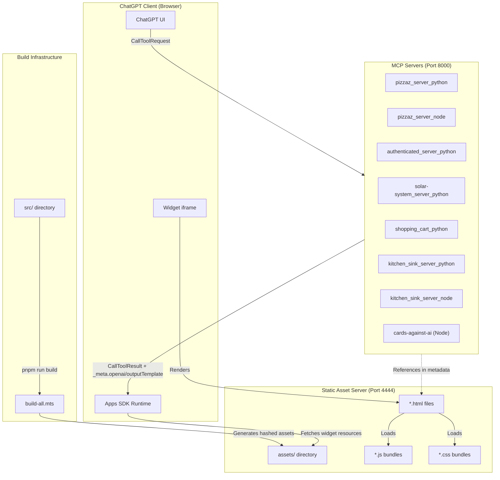
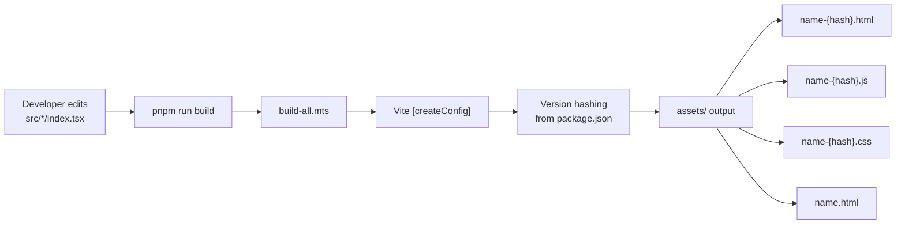
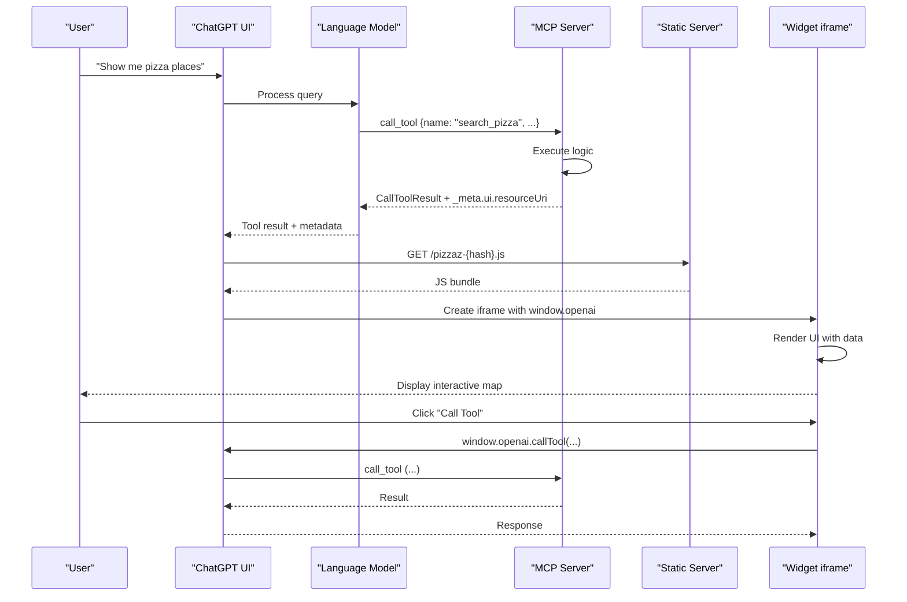

<!-- source: DeepWiki mcp.deepwiki.com · repo openai/openai-apps-sdk-examples · page 1 Overview · fetched 2026-10-26 -->

# Overview

Relevant source files

The following files were used as context for generating this wiki page:

- [README.md](README.md)
- [build-all.mts](build-all.mts)

This document provides an architectural overview of the OpenAI Apps SDK Examples repository. It explains what the repository contains, how its components interact, and where to find detailed information about specific subsystems.

This repository is a **reference implementation gallery** that demonstrates how to build MCP (Model Context Protocol) servers and widget components for ChatGPT integration using the Apps SDK. It provides working examples of both server-side tool implementations and client-side UI components, along with the infrastructure needed to build, serve, and deploy them.

**Sources:** [README.md:1-7](), [README.md:18-31]()

## Purpose and Scope

This repository serves three primary purposes:

1.  **Demonstrate MCP + Apps SDK integration patterns**: Shows how MCP servers expose tools that return structured data alongside widget metadata.
2.  **Provide reusable widget examples**: Offers production-quality widget implementations covering common UI patterns (maps, carousels, shopping carts, authentication flows, and 3D visualizations).
3.  **Illustrate full-stack development workflow**: Includes build systems (`build-all.mts`), static asset serving, and cross-language server implementations (Python/Node.js).

The repository is structured as a **monorepo** containing multiple independent MCP servers and a shared widget component library built with React, TypeScript, and Vite.

**Sources:** [README.md:32-44](), [README.md:110-117]()

## Core Architecture

The system operates across three distinct layers that communicate through standardized protocols.

### Three-Layer Architecture Diagram

**Sources:** [README.md:18-30](), [README.md:110-117](), [build-all.mts:13-44]()

### Integration Flow

The three layers interact through these integration points:

| Layer | Technology | Port | Communication Protocol |
| :--- | :--- | :--- | :--- |
| **ChatGPT Client** | Browser + Apps SDK | N/A | MCP over SSE/HTTP |
| **MCP Servers** | Python (FastMCP) or Node.js | 8000 | MCP JSON-RPC |
| **Static Assets** | Vite-generated bundles | 4444 | HTTP with CORS |

**Key Integration Points:**

1.  **MCP Protocol**: ChatGPT issues `call_tool` requests to MCP servers with tool name and JSON arguments [README.md:24-25]().
2.  **Widget Metadata**: MCP servers return `_meta.ui.resourceUri` or `_meta.openai/outputTemplate` containing HTML references in tool responses [README.md:26-30]().
3.  **Asset Fetching**: Apps SDK fetches widget resources directly from the static server (port 4444) [README.md:103-104]().
4.  **Widget API**: Rendered widgets access the `window.openai` API for bidirectional communication with the host [README.md:53-58]().

**Sources:** [README.md:18-31](), [README.md:53-58](), [README.md:103-104]()

## Repository Structure

The repository is organized into source code, generated assets, and server implementations.

### Directory Structure Diagram

```mermaid
graph TB
    Root["Repository Root"]
    
    Root --> Src["src/"]
    Root --> Assets["assets/"]
    Root --> BuildTools["Build Tools"]
    Root --> PythonServers["Python MCP Servers"]
    Root --> NodeServers["Node.js MCP Servers"]
    
    Src --> PizzazWidgets["pizzaz-*/ widgets"]
    Src --> ShoppingCart["shopping-cart/"]
    Src --> SolarSystem["solar-system/"]
    Src --> CardsAgainstAI["cards-against-ai/"]
    Src --> KitchenSink["kitchen-sink-lite/"]
    Src --> Basics["mcp-app-basics-*/ widgets"]
    
    Assets --> HTML["*.html"]
    Assets --> JSBundles["*-{hash}.js"]
    Assets --> CSSBundles["*-{hash}.css"]
    
    BuildTools --> BuildAllMts["build-all.mts"]
    BuildTools --> PackageJson["package.json"]
    
    PythonServers --> PizzazPy["pizzaz_server_python/"]
    PythonServers --> AuthPy["authenticated_server_python/"]
    PythonServers --> SolarPy["solar-system_server_python/"]
    PythonServers --> CartPy["shopping_cart_python/"]
    
    NodeServers --> PizzazNode["pizzaz_server_node/"]
    NodeServers --> CardsNode["cards_against_ai_server/"]
    NodeServers --> BasicsNode["mcp_app_basics_node/"]
    
    PizzazPy --> MainPy["main.py"]
    PizzazNode --> ServerTs["src/server.ts"]
    BuildAllMts --> Targets["targets array [line 20-44]"]
```

**Sources:** [README.md:32-44](), [build-all.mts:20-44]()

### Directory Reference

| Directory | Purpose | Key Files |
| :--- | :--- | :--- |
| `src/` | Widget source code (React/TypeScript) | `*/index.tsx`, `*/index.jsx` |
| `assets/` | Generated HTML/JS/CSS bundles | `*.html`, `*-{hash}.js`, `*-{hash}.css` |
| `pizzaz_server_python/` | Python MCP server for Pizzaz widgets | `main.py`, `requirements.txt` |
| `pizzaz_server_node/` | Node.js MCP server for Pizzaz widgets | `src/server.ts`, `package.json` |
| `shopping_cart_python/` | Python server demonstrating `widgetSessionId` | `main.py` |
| `authenticated_server_python/` | Python server demonstrating OAuth | `main.py` |
| `solar-system_server_python/` | Python server for 3D solar system widget | `main.py` |
| `build-all.mts` | Vite build orchestrator | Root level |

**Sources:** [README.md:32-44](), [build-all.mts:13-14]()

## MCP Server Implementations

The repository provides several MCP server implementations demonstrating different patterns and capabilities.

### Server Inventory

*   **Pizzaz (Node & Python)**: Pizza-inspired collection of tools and components [README.md:112]().
*   **Solar system (Python)**: 3D solar system viewer using React [README.md:113]().
*   **Authenticated (Python)**: Demonstrates tools requiring different levels of OAuth [README.md:114]().
*   **Kitchen sink lite (Node & Python)**: Minimal widget + server pairing demonstrating full `window.openai` surface [README.md:115]().
*   **Shopping cart (Python)**: Demonstrates `widgetSessionId` to keep state between tool calls [README.md:116]().
*   **Cards Against AI (Node)**: Complex game server with SSE state streaming and model-mediated actions.

**Sources:** [README.md:110-117]()

## Widget Component Gallery

The repository includes 20+ widget entrypoints (targets) defined in the build system [build-all.mts:20-44]().

### Widget Categories

*   **Visual Display**: `pizzaz-map` (Mapbox), `pizzaz-albums`, `solar-system` (3D).
*   **Interactive Form**: `pizzaz-shop`, `shopping-cart`, `todo`.
*   **Data Visualization**: `pizzaz-carousel`, `pizzaz-list`.
*   **Educational (Basics)**: `show-tool-result`, `send-message`, `update-model-context`, `call-server-tool`, `host-theming`, `open-link`, `request-display-mode`, `streaming-tool-input`, `get-host-capabilities`, `get-host-context`, `get-host-version`.
*   **Complex Game**: `cards-against-ai`.

**Sources:** [build-all.mts:20-44](), [README.md:45-60]()

## Build and Deployment Pipeline

The repository uses a custom Vite-based build system to transform widget source code into standalone, versioned bundles.

### Build Pipeline Flow

**Sources:** [README.md:80-88](), [build-all.mts:115-157](), [build-all.mts:172-190]()

### Build System Components

The build process involves these key mechanisms:

| Component | Role | Code Reference |
| :--- | :--- | :--- |
| **Entry Discovery** | Uses `fast-glob` to find all `index.{tsx,jsx}` files in `src/` | [build-all.mts:13]() |
| **Virtual Wrapper** | `wrapEntryPlugin` injects CSS imports and exports the App component | [build-all.mts:54-84]() |
| **Hashing** | Generates a 4-character SHA256 hash from `package.json` version | [build-all.mts:172-176]() |
| **HTML Generation** | Writes hashed `.html` files with `__APP_URL_CONFIG__` script | [build-all.mts:218-239]() |

**Sources:** [build-all.mts:13](), [build-all.mts:54-84](), [build-all.mts:172-176](), [build-all.mts:218-239]()

## How Components Interact

The following diagram shows the complete data flow from user query to rendered widget:

### End-to-End Interaction Flow

**Sources:** [README.md:18-30](), [README.md:53-58]()

## Next Steps

To start working with these examples:

1.  **Prerequisites**: Ensure you have Node.js 18+, pnpm, and Python 3.10+ installed [README.md:62-67]().
2.  **Installation**: Run `pnpm install` and `pre-commit install` [README.md:69-76]().
3.  **Build**: Run `pnpm run build` to generate the `assets/` directory [README.md:80-88]().
4.  **Serve**: Run `pnpm run serve` to start the local static asset server on port 4444 [README.md:96-104]().
5.  **Run Server**: Start an MCP server (e.g., `cd pizzaz_server_node && pnpm start`) [README.md:108-123]().

---

