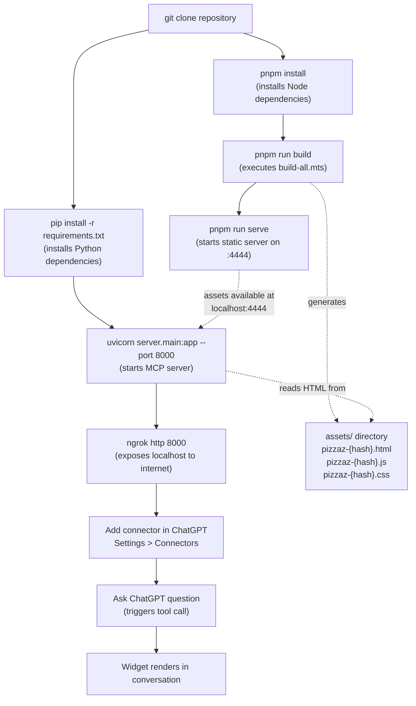
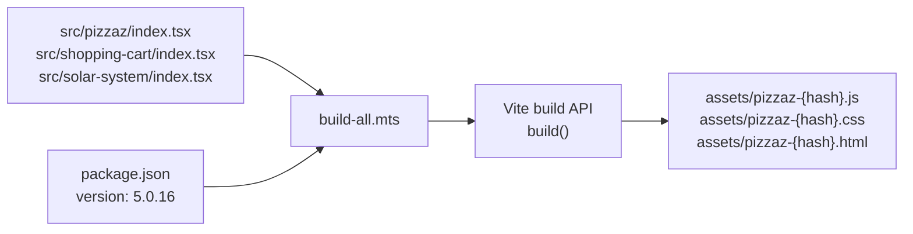

<!-- source: DeepWiki mcp.deepwiki.com · repo openai/openai-apps-sdk-examples · page 2 Getting Started · fetched 2026-10-26 -->

# Getting Started

<details>
<summary>Relevant source files</summary>

The following files were used as context for generating this wiki page:

- [.gitignore](.gitignore)
- [README.md](README.md)
- [package.json](package.json)
- [pnpm-lock.yaml](pnpm-lock.yaml)
- [pnpm-workspace.yaml](pnpm-workspace.yaml)
- [src/kitchen-sink-lite/kitchen-sink-lite.tsx](src/kitchen-sink-lite/kitchen-sink-lite.tsx)

</details>


This page guides you through the initial setup and execution of your first widget example. You will install dependencies, build widget assets, start an MCP server, and connect it to ChatGPT to see a live widget rendering.

For detailed architectural concepts and how the system components interact, see [Architecture and Concepts](#3). For in-depth widget development workflows, see [Widget Development](#4). For MCP server implementation patterns, see [MCP Server Development](#5).

---

## Setup and Execution Flow

The following diagram illustrates the complete workflow from repository clone to widget rendering in ChatGPT:



**Sources:** [README.md:62-210]()

---

## Prerequisites and Installation

### Required Software

The repository requires the following runtime environments:

| Dependency | Minimum Version | Purpose |
|------------|----------------|---------|
| Node.js | 18+ | Widget build system and Node.js MCP servers |
| pnpm | 10.24.0+ | Package manager for monorepo [package.json:18]() |
| Python | 3.10+ | Python MCP servers |
| pre-commit | Latest | Code formatting hooks |

**Sources:** [README.md:62-67](), [package.json:18]()

### Installation Steps

Clone the repository and install workspace dependencies:

```bash
git clone https://github.com/openai/openai-apps-sdk-examples
cd openai-apps-sdk-examples
pnpm install
pre-commit install
```

The `pnpm install` command installs all Node.js dependencies defined in the root `package.json` [package.json:34-64]() and workspace packages listed in `pnpm-workspace.yaml` [pnpm-workspace.yaml:1-5](). The `pre-commit install` command configures Git hooks for automatic code formatting.

For Python dependencies, each MCP server directory contains a separate `requirements.txt`. Install them after creating a virtual environment:

```bash
python -m venv .venv
source .venv/bin/activate  # On Windows: .venv\Scripts\activate
pip install -r pizzaz_server_python/requirements.txt
```

**Sources:** [README.md:69-78](), [pnpm-workspace.yaml:1-5](), [package.json:34-64]()

---

## Building and Serving Assets

### Build Process

The build system transforms React/TypeScript source files in `src/` into production-ready HTML, JavaScript, and CSS bundles in `assets/`:

```bash
pnpm run build
```

This command executes the `build-all.mts` orchestrator [package.json:7](), which performs the following operations for each widget:

1. **Entry Point Discovery**: Scans `src/**/index.{tsx,jsx}` for widget entry points.
2. **CSS Collection**: Gathers per-entry CSS files and global stylesheets.
3. **Vite Bundling**: Compiles each entry into a single JavaScript and CSS bundle.
4. **Version Hashing**: Appends a hash to filenames based on the `package.json` version [package.json:3]().
5. **HTML Generation**: Produces HTML files with script and stylesheet references.

The following diagram maps the build pipeline to code entities:



**Sources:** [README.md:80-94](), [package.json:3-7]()

### Serving Static Assets

After building, start the static asset server:

```bash
pnpm run serve
```

This command launches an HTTP server on port 4444 with CORS enabled [package.json:8](). MCP servers reference these assets via URLs like `http://localhost:4444/pizzaz-{hash}.html`.

**Important Caching Behavior:**

- **Python servers** cache HTML with `@lru_cache`. After rebuilding assets, restart the MCP server to pick up changes [README.md:106]().
- **Kitchen Sink Lite**: The `kitchen-sink-lite.tsx` component demonstrates reading host state and calling tools [src/kitchen-sink-lite/kitchen-sink-lite.tsx:4-9]().

**Sources:** [README.md:96-106](), [package.json:8](), [src/kitchen-sink-lite/kitchen-sink-lite.tsx:4-9]()

---

## Running MCP Servers

The repository includes several demo MCP servers demonstrating different widget patterns.

### Server Inventory

| Server | Language | Primary Widget(s) | Key Features |
|--------|----------|-------------------|--------------|
| `pizzaz_server_python` | Python | pizzaz-map, carousel, etc. | FastMCP framework |
| `pizzaz_server_node` | Node.js | Same as Python | Official TypeScript SDK |
| `shopping_cart_python` | Python | shopping-cart | `widgetSessionId` sync |
| `kitchen_sink_server_node` | Node.js | kitchen-sink-lite | Full API demonstration |
| `mcp_app_basics_node` | Node.js | Basic app tools | Educational tool coverage |

**Sources:** [README.md:108-117](), [pnpm-workspace.yaml:2-5]()

### Starting Servers

**Pizzaz Node Server:**
```bash
cd pizzaz_server_node
pnpm start
```

**Kitchen Sink Node Server:**
```bash
pnpm --filter kitchen-sink-mcp-node start
```

**Python Servers (Example: Pizzaz):**
```bash
uvicorn pizzaz_server_python.main:app --port 8000
```

**Sources:** [README.md:118-165]()

---

## ChatGPT Integration

### Local Development with ngrok

Use ngrok to create a public HTTPS tunnel to your local MCP server:

```bash
ngrok http 8000
```

### DNS Rebinding Protection

When using tunnels, configure allowed hosts via environment variables [README.md:201-207]():

```bash
export MCP_ALLOWED_HOSTS="your-ngrok-url.ngrok-free.app"
export MCP_ALLOWED_ORIGINS="https://your-ngrok-url.ngrok-free.app"
```

**Sources:** [README.md:189-207]()

---

## Verification Checklist

| Component | Verification Method | Expected Result |
|-----------|---------------------|----------------|
| Static assets built | `ls assets/` | Contains `*-{hash}.html` files |
| Asset server running | `curl http://localhost:4444/` | Accessible assets |
| Chrome 142 Flag | `chrome://flags/` | `#local-network-access-check` Disabled [README.md:12-14]() |

**Sources:** [README.md:8-16]()

---

## Next Steps

- **Prerequisites and Installation (#2.1)** — Detailed dependency setup.
- **Building and Serving Assets (#2.2)** — Deep dive into `build-all.mts`.
- **Running MCP Servers (#2.3)** — Advanced server configuration.
- **ChatGPT Integration (#2.4)** — Step-by-step connector configuration.

---

