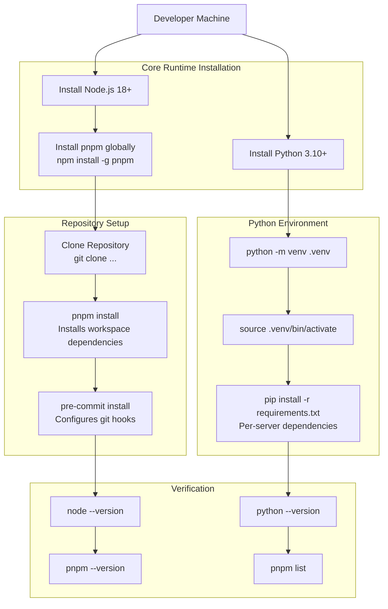
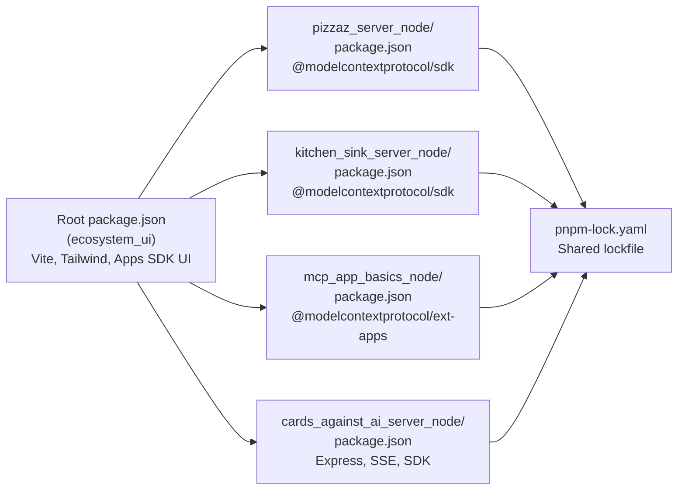

<!-- source: DeepWiki mcp.deepwiki.com · repo openai/openai-apps-sdk-examples · page 2.1 Prerequisites and Installation · fetched 2026-10-26 -->

# Prerequisites and Installation

<details>
<summary>Relevant source files</summary>

The following files were used as context for generating this wiki page:

- [.gitignore](.gitignore)
- [README.md](README.md)
- [package.json](package.json)
- [pizzaz_server_python/requirements.txt](pizzaz_server_python/requirements.txt)
- [pnpm-lock.yaml](pnpm-lock.yaml)
- [pnpm-workspace.yaml](pnpm-workspace.yaml)
- [solar-system_server_python/requirements.txt](solar-system_server_python/requirements.txt)
- [src/kitchen-sink-lite/kitchen-sink-lite.tsx](src/kitchen-sink-lite/kitchen-sink-lite.tsx)
- [src/pizzaz-albums/albums.json](src/pizzaz-albums/albums.json)
- [tsconfig.app.json](tsconfig.app.json)
- [tsconfig.node.json](tsconfig.node.json)

</details>


This page covers the required tools, dependencies, and installation steps necessary to run the Apps SDK Examples Gallery locally. This includes setting up Node.js and Python environments, installing package dependencies, configuring development tools, and addressing browser-specific requirements.

For information on building widget assets after installation, see [Building and Serving Assets](2.2). For configuring ChatGPT integration with ngrok, see [ChatGPT Integration](2.4).

---

## Overview

The repository requires a polyglot development environment supporting both TypeScript/Node.js (for widget builds and Node.js MCP servers) and Python 3.10+ (for Python MCP servers). The build system uses `pnpm` for monorepo workspace management, `vite` for widget compilation, and `uvicorn` for Python server execution.

**Sources:** [README.md:62-68](), [README.md:108-116]()

---

## System Requirements

### Required Software

| Tool | Minimum Version | Purpose |
|------|----------------|---------|
| **Node.js** | 18.0.0+ | JavaScript runtime for build tools and Node.js MCP servers |
| **pnpm** | 10.24.0 | Package manager with workspace support |
| **Python** | 3.10+ | Runtime for Python MCP servers using FastMCP |
| **pre-commit** | Any | Git hook framework for code formatting |

**Optional:**
- **npm** or **yarn** - Alternative to pnpm (requires adjusting commands) [README.md:78-79]()
- **ngrok** - For exposing local MCP servers to ChatGPT

**Sources:** [README.md:62-68](), [package.json:18]()

---

## Dependency Installation Flow



**Sources:** [README.md:62-76](), [README.md:127-132](), [README.md:145-150]()

---

## Node.js and pnpm Installation

### Install Node.js

Download and install Node.js 18 or later from [nodejs.org](https://nodejs.org). Verify installation:

```bash
node --version  # Should output v18.x.x or higher
npm --version   # Comes bundled with Node.js
```

### Install pnpm

The repository specifies `pnpm@10.24.0` as the package manager:

```bash
npm install -g pnpm@10.24.0
```

Verify installation:

```bash
pnpm --version  # Should output 10.24.0
```

The `packageManager` field in [package.json:18]() enforces this version for consistency across development environments.

**Sources:** [package.json:18](), [README.md:64-65]()

---

## Repository Setup

### Clone and Install Dependencies

```bash
# Clone the repository
git clone https://github.com/openai/openai-apps-sdk-examples
cd openai-apps-sdk-examples

# Install all workspace dependencies
pnpm install
```

The `pnpm install` command installs dependencies for the root and all workspace packages defined in `pnpm-workspace.yaml`.

### Workspace Structure

The monorepo contains multiple Node.js packages integrated via `pnpm` workspaces.



**Sources:** [pnpm-workspace.yaml:1-5](), [package.json:1-3](), [pnpm-lock.yaml:1-220]()

---

## Python Environment Setup

### Create Virtual Environment

Each Python MCP server requires its own dependencies. Create a virtual environment at the repository root to manage these:

```bash
python -m venv .venv
source .venv/bin/activate  # On Windows: .venv\Scripts\activate
```

### Install Python Server Dependencies

The repository includes several Python MCP servers, each with a `requirements.txt` file. For example, to set up the Pizzaz Python server:

```bash
pip install -r pizzaz_server_python/requirements.txt
```

Each `requirements.txt` typically includes:
- `mcp[fastapi]` - FastMCP framework with FastAPI integration [pizzaz_server_python/requirements.txt:2]()
- `uvicorn` - ASGI server for running MCP servers [pizzaz_server_python/requirements.txt:3]()
- `fastapi` - Web framework [pizzaz_server_python/requirements.txt:1]()

**Sources:** [README.md:127-132](), [pizzaz_server_python/requirements.txt:1-4](), [solar-system_server_python/requirements.txt:1-5]()

---

## Development Tools Configuration

### Install pre-commit Hooks

The repository uses `pre-commit` for automated code formatting:

```bash
pre-commit install
```

This installs Git hooks that ensure code quality standards are met before commits are finalized.

**Sources:** [README.md:67-68](), [README.md:75]()

---

## Browser Configuration

### Chrome 142+ Local Network Access Fix

**Critical:** If using Chrome version 142 or later, the browser blocks local network access by default, which prevents widget UI from loading from local servers.

#### Disable the Restriction

1. Navigate to `chrome://flags/`
2. Search for `#local-network-access-check`
3. Set to **Disabled**
4. **Restart Chrome** (required for change to take effect)

**Sources:** [README.md:8-16]()

---

## Installed Dependency Versions

### Root Package Dependencies

The root [package.json]() specifies production and development dependencies used across the project:

| Package | Version | Purpose |
|---------|---------|---------|
| `react` | ^19.1.1 | UI framework for widgets [package.json:55]() |
| `@openai/apps-sdk-ui` | ^0.2.1 | UI components for Apps SDK [package.json:36]() |
| `@modelcontextprotocol/ext-apps` | ^1.0.1 | Apps SDK extensions for MCP [package.json:35]() |
| `tailwindcss` | 4.1.11 | CSS framework [package.json:29]() |
| `vite` | ^7.1.1 | Build tool [package.json:32]() |
| `three` | ^0.179.1 | 3D graphics for Solar System [package.json:62]() |
| `zod` | ^4.1.5 | Schema validation [package.json:63]() |

### Node.js Server Specifics

The Node.js servers utilize the official MCP SDK:
- `pizzaz_server_node` uses `@modelcontextprotocol/sdk` [pnpm-lock.yaml:222]()
- `mcp_app_basics_node` uses `@modelcontextprotocol/ext-apps` [pnpm-lock.yaml:191]()

**Sources:** [package.json:19-64](), [pnpm-lock.yaml:139-224]()

---

## Verification Steps

### Verify Node.js Environment

```bash
# Check Node.js version
node --version

# Check pnpm version
pnpm --version

# Verify dependencies installed
pnpm list --depth=0
```

### Verify TypeScript Compilation

The repository includes scripts to verify types across different targets:

```bash
pnpm run tsc       # Build all projects [package.json:10]()
pnpm run tsc:app   # Check widget code [package.json:11]()
pnpm run tsc:node  # Check build scripts/node code [package.json:12]()
```

The `tsc:app` command uses [tsconfig.app.json]() which targets `ES2022` and includes the `src` directory [tsconfig.app.json:4-26](). The `tsc:node` command uses [tsconfig.node.json]() which targets `ES2023` and includes build orchestration files like `build-all.mts` [tsconfig.node.json:4-24]().

**Sources:** [package.json:10-12](), [tsconfig.app.json:1-27](), [tsconfig.node.json:1-25]()

---

## Installation Directory Structure

After installation, the repository structure appears as follows:

```
openai-apps-sdk-examples/
├── node_modules/              # Root Node.js dependencies
├── .venv/                     # Python virtual environment
├── src/                       # Widget source code [README.md:34]()
├── assets/                    # Built bundles (generated after build) [README.md:35]()
├── pizzaz_server_node/        # Node server [README.md:37]()
├── pizzaz_server_python/      # Python server [README.md:38]()
├── package.json               # Root config [package.json:1]()
├── pnpm-workspace.yaml        # Workspace definition [pnpm-workspace.yaml:1]()
└── build-all.mts              # Build orchestrator [README.md:43]()
```

**Sources:** [README.md:32-43](), [pnpm-workspace.yaml:1-5]()

---

## Next Steps

After completing installation:

1. **Build widgets**: Run `pnpm run build` to generate assets in the `assets/` directory [README.md:85]().
2. **Serve assets**: Run `pnpm run serve` to start the local asset server on port 4444 [README.md:101]().
3. **Run a server**: Navigate to a server directory (e.g., `pizzaz_server_node`) and start it [README.md:120-123]().

**Sources:** [README.md:80-104]()

---

